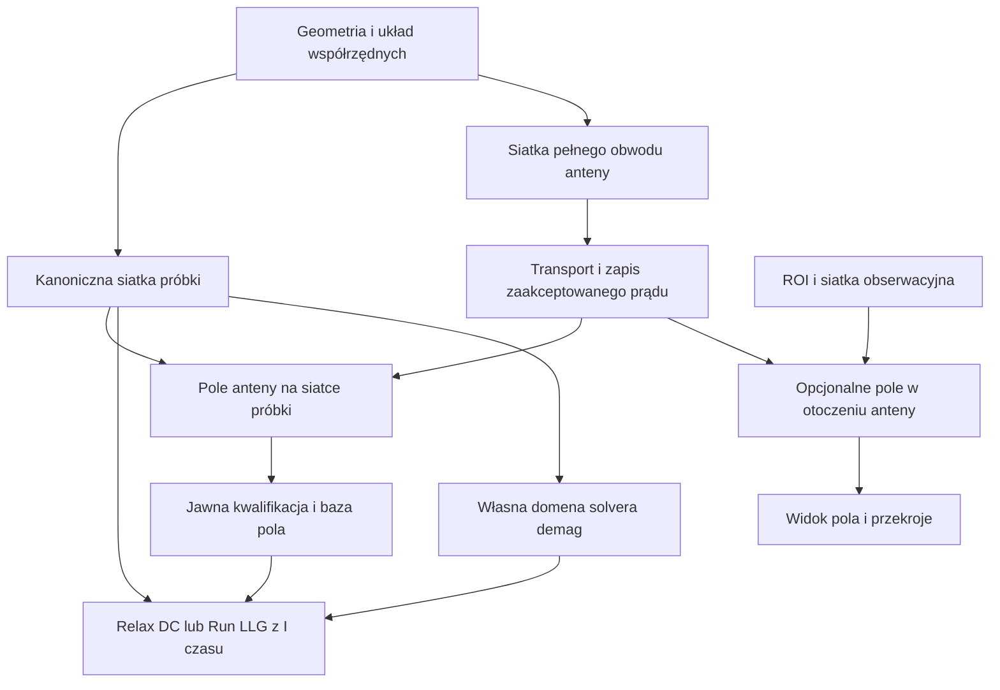

# Domeny anteny i ferromagnetyka: wspólna siatka próbki, niezależne otoczenie

Status: **projekt do przeglądu; nie jest opisem wdrożonego nowego API**. Data: 02.11.2026.
Baza odczytu kodu: `8088f0191b19dd456e2e8ba67723a4c7e80dbabc`, po integracji
mastera `d037fd6b499cd074bf507b775e83f65a1d72c9ed`, wraz z lokalnymi zmianami anten.
Metoda: Superpowers `using-superpowers` i `brainstorming`, uzupełnione
`scientific-documentation-contract`. Dokument pozostaje we wskazanym przez użytkownika
katalogu brainstorm. Kanonicznymi właścicielami fizyki pozostają noty 0100, 0102,
0107, 0950, 0951 i 0980; ten projekt nie zastępuje ich równań ani kwalifikacji.

## 1. Rozstrzygnięcie

**Wspólnym rdzeniem ma być siatka ferromagnetyka, a nie oba Airboxy.** Na tych samych
punktach i w tej samej reprezentacji docelowej przygotowujemy pole anteny oraz
rozwiązujemy LLG. Siatka przewodnika pozostaje odrębnym nośnikiem potencjału i prądu.

Airbox magnetyczny, jeśli wymaga go wybrany solver demag, służy polu własnemu próbki.
Airbox anteny jest domeną obserwacji jej pola. Nie wymagamy zawierania jednego
Airboxa w drugim. Większa objętościowa siatka obserwacyjna anteny może zawierać
niezmienioną podsiatkę próbki, ale nie jest to warunek samego obliczenia wymuszenia LLG.
Przekrój obserwacyjny nie musi być częścią żadnej siatki objętościowej.

Wniosek wynika z rozdzielenia ról fizycznych. Wspólne elementy w próbce są wybranym
wariantem implementacyjnym upraszczającym zgodność danych, a nie ogólnym prawem
wymagającym identycznych siatek dla wszystkich pól elektromagnetycznych.

### Pochodzenie decyzji

| Ustalenie | Pochodzenie / status |
|---|---|
| Oddzielny krok anteny i osobny krok LLG | Wymaganie użytkownika z rozmowy. |
| Spójna siatka w obszarze ferromagnetyka | Wymaganie użytkownika; przyjmujemy tę samą tożsamość siatki docelowej. |
| Zagęszczanie dużego obszaru obserwacji w pobliżu próbki | Propozycja użytkownika, zachowana jako polityka meshu obserwacyjnego. |
| Brak obowiązkowego zawierania Airboxa demag w Airboxie anteny | Wniosek fizyczny i rekomendacja po ostatnim doprecyzowaniu użytkownika. |
| Jedno Universe i katalog domen przypisanych do etapów | Rekomendacja architektoniczna autora; niezatwierdzony jeszcze nowy kontrakt. |
| Brak arbitralnego promienia zerowania pola anteny | Wymóg poprawności obliczeń, szczególnie porównania z publikacją. |

(problem-statement)=
## 2. Cel produktu i problem fizyczny

Użytkownik ma móc zbudować antenę nad falowodem, przygotować prąd i pole raz,
następnie uruchamiać odpowiedź magnetyczną bez powtarzania transportu przy każdym
kroku czasu. W UI musi rozumieć, który mesh służy prądowi, który próbce, który demag,
a który wyłącznie prezentacji pola. Wybór w drzewie nie może aktywować fizyki.

Nie należy wyznaczać „zasięgu oddziaływania” przez rozmiar pudełka na ekranie.
Pole może być małe daleko od anteny, ale nie ma ogólnego ostrego promienia odcięcia.
Wpływ na próbkę zależy również od kierunku pola, równowagi magnetyzacji,
częstotliwości, dyspersji, tłumienia i czasu obserwacji.

W pracy Sushruth i in. (2020) sygnał transmisji rozdzielono na wkład propagujących
fal spinowych i odpowiedź wzbudzaną bezpośrednio przez dalekie pole anteny.
Dlatego automatyczne wyzerowanie wymuszenia poza lokalnym oknem mogłoby usunąć
jedno z porównywanych zjawisk [1]. To uzasadnia pokrycie polem całej aktywnej domeny
magnetycznej, a nie dowodzi, że musimy liczyć mapę w całym otaczającym powietrzu.

### Cele i granice

- Jawne role i zakresy domen w Python, ProblemIR, plannerze, runtime, archiwum i UI.
- Ta sama docelowa siatka próbki w precompute anteny i LLG; kontrola rewizji i DOF.
- Niezależne granice, rozdzielczość i częstotliwość odświeżania obserwacji zewnętrznej.
- Zachowanie pełnego modelu przewodnika, źródła i powrotu.
- Brak drugiego solvera, drugiego klienta API i zdublowanych obiektów fizycznych.
- Poza tym projektem: pełny Maxwell, samouzgodnione ekranowanie przez prądy wirowe,
  zmiana przewodności z magnetyzacją/temperaturą, S-parametry i automatyczna
  kwalifikacja źródła do LLG. Istniejące odmowy pozostają skuteczne.

(governing-equations)=
## 3. Fizyczna domena i pole przekazywane do LLG

<!-- DOC-ANCHOR: domains-design-physical-model -->
(domains-design-physical-model)=

Nie zmieniamy równań transportu, Biota–Savarta ani LLG. Ograniczamy miejsce,
w którym potrzebny jest wynik istniejących operatorów. Dla jednego stałego,
liniowego, zakwalifikowanego źródła obowiązuje istniejąca separacja z noty 0950:

```{math}
:label: eq-domains-antenna-basis
\mathbf h(\mathbf r)=\frac{\mathbf H_{\mathrm{ref}}(\mathbf r)}{I_{\mathrm{ref}}},
\qquad
\mathbf H_{\mathrm{ant}}(\mathbf r,t)=I(t)\mathbf h(\mathbf r),
\qquad \mathbf r\in\Omega_m,\quad I_{\mathrm{ref}}\ne0.
```

Prąd referencyjny i jego znak pochodzą z zaakceptowanego wyniku transportu.
Raw H w A/m nie może zostać podane do konsumenta jako baza na amper bez jawnej
normalizacji. Wiele źródeł wymaga istniejącej jawnej superpozycji i oddzielnych pinów.

Rozdzielenie wkładów pola efektywnego ma znaczenie architektoniczne:

```{math}
:label: eq-domains-effective-field
\mathbf H_{\mathrm{eff}}=
\mathbf H_{\mathrm{bias}}+
\mathbf H_{\mathrm{demag}}[\mathbf m]+
\mathbf H_{\mathrm{ex}}[\mathbf m]+
\mathbf H_{\mathrm{an}}[\mathbf m]+
\mathbf H_{\mathrm{ant}},
\qquad \mathbf r\in\Omega_m.
```

To zapis rozważanego zakresu, nie wyczerpująca lista wszystkich interakcji Fullmaga.
LLG ewoluuje magnetyzację w materiale magnetycznym. Powietrze nie otrzymuje
sztucznej magnetyzacji. Pole demag zależy od całego rozkładu magnetyzacji, pozostaje
nielokalne i nie zostaje zastąpione polem anteny [2]. Ewentualne zamrożenie demag
między odświeżeniami podlega odrębnej polityce błędu solvera.

### Cztery różne role domen

| Rola | Co zawiera | Co obliczamy | Wymagane zawieranie |
|---|---|---|---|
| Przewodnik anteny | Fizyczny signal, return, feed, połączenia i źródło | V i zachowawczy J | Pełny obwód według przyjętego modelu; niezależny od pudełka obserwacji. |
| Próbka magnetyczna | Wszystkie aktywne obszary ferromagnetyka | H anteny jako wymuszenie oraz m(t) | Wszystkie miejsca użycia pola przez LLG muszą mieć wynik. |
| Domena demag | Próbka i otoczenie wymagane przez daną metodę | Pole własne próbki | Dla FEM Poisson obejmuje próbkę i wybraną granicę zewnętrzną. |
| Obserwacja anteny | Wybrana objętość, przekrój lub punkty otoczenia | Opcjonalna mapa H do analizy/UI | Nie musi zawierać Airboxa demag; nie ustanawia odcięcia wymuszenia LLG. |

(symbols-and-si-units)=
## 4. Symbole i jednostki SI

| Symbol LaTeX | Znaczenie | Jednostka SI |
|---|---|---|
| $\mathbf r$ | Położenie w jednym układzie współrzędnych sceny | $\mathrm m$ |
| $t$ | Fizyczny czas dynamiki | $\mathrm s$ |
| $\Omega_m$ | Domena materiału magnetycznego | $\mathrm{m^3}$ |
| $I_{\mathrm{ref}}$ | Podpisany prąd zaakceptowanego rozwiązania referencyjnego | $\mathrm A$ |
| $I(t)$ | Zadany przebieg prądu ze swoją konwencją amplitudy i czasu | $\mathrm A$ |
| $\mathbf H_{\mathrm{ref}}$ | Surowe pole anteny przy prądzie referencyjnym | $\mathrm{A\,m^{-1}}$ |
| $\mathbf h$ | Baza pola na jednostkę prądu | $\mathrm{m^{-1}}$ |
| $\mathbf H_{\mathrm{ant}}$ | Pole wymuszające od anteny | $\mathrm{A\,m^{-1}}$ |
| $\mathbf H_{\mathrm{eff}}$ | Pole efektywne w rozważanym zakresie interakcji | $\mathrm{A\,m^{-1}}$ |
| $\mathbf H_{\mathrm{bias}}$ | Zadane pole zewnętrzne | $\mathrm{A\,m^{-1}}$ |
| $\mathbf H_{\mathrm{demag}}$ | Pole własne całego ferromagnetyka | $\mathrm{A\,m^{-1}}$ |
| $\mathbf H_{\mathrm{ex}}$ | Wkład wymiany | $\mathrm{A\,m^{-1}}$ |
| $\mathbf H_{\mathrm{an}}$ | Wkład anizotropii | $\mathrm{A\,m^{-1}}$ |
| $\mathbf m$ | Znormalizowana magnetyzacja w materiale | $1$ |

(assumptions-and-validity)=
## 5. Kiedy separacja etapów jest poprawna

Źródło jest quasistatyczne i liniowe, a jego geometria, przewodność oraz zasilanie
pozostają zgodne z zaakceptowaną bazą. Pomijamy zwrotne ekranowanie i przebudowę
prądu anteny przez dynamikę próbki. Jeżeli dodamy takie sprzężenie, stała baza pola
może przestać być poprawnym modelem i będzie wymagała osobnego kontraktu.

Wspólny mesh nie zastępuje kontroli dokładności całkowania, aproksymacji pola ani
zbieżności LLG. Cienka warstwa Co/Ni wymaga rozdzielczości stosownej do modelu,
nie tylko małych elementów w powietrzu. Wybór wielkości próbki, warunków brzegowych
i stref pochłaniających wymaga zbieżności obserwowanej fali; nie przenosimy wymiarów
Airboxa na długość falowodu automatycznie.

## 6. Rozważone warianty i rekomendacja

| Wariant | Zaleta | Koszt / ryzyko | Wniosek |
|---|---|---|---|
| A. Jedna duża siatka zagnieżdżająca całą domenę demag | Wspólna topologia także w powietrzu | Zbędne punkty pola anteny, silna zależność obu otoczeń, trudniejsza niezależna zbieżność granic | Opcjonalny wybór użytkownika, nie domyślny warunek fizyczny. |
| B. Wspólny rdzeń magnetyczny, osobne otoczenia | Zgodność H/LLG bez dodatkowego transferu między różnymi siatkami próbki; niezależna obserwacja i demag | Potrzebne jawne mapy podsiatek i własność wspólnych węzłów | **Rekomendowany po ostatnim doprecyzowaniu użytkownika.** |
| C. Całkowicie niezależne siatki, bezpośrednie H na punktach celu | Swobodne adaptacje i backendy | Inny kontrakt od dosłownie wspólnych elementów; ewentualna projekcja wymaga własnej kontroli | Poprawny wariant rozszerzenia; nie wybieramy go po cichu zamiast B. |

Nie budujemy sztucznej domeny materialnej „antenna air” z przewodnością ani Ms.
Region materiałowy, selektor domeny, obszar zagęszczania i ROI wizualizacji to
różne pojęcia. Możemy współdzielić mechanizmy selekcji i kompozycji pól rozmiaru,
ale nie nadawać im tej samej semantyki fizycznej.

(discrete-realization)=
## 7. Siatkowanie i własność wspólnego rdzenia

1. Zbudować/wybrać kanoniczną siatkę próbki i nadać jej stabilny mesh asset oraz
   rewizję, fingerprint geometrii, topologii i reprezentacji DOF.
2. Przypisać tę samą siatkę jako cel pola anteny i jako siatkę magnetyzacji.
   Położenia węzłów, kolejność lokalna, transformacja oraz mapy indeksów muszą być zgodne.
3. Dla objętościowej obserwacji anteny można rozszerzyć niezmieniony rdzeń próbki
   o grubsze elementy otoczenia. Gmsh nie może przy tym ponownie triangulować rdzenia.
   To ponowne użycie zasobu, nie dopasowanie „najbliższych” punktów po fakcie.
4. Domena demag może rozszerzać ten sam rdzeń o inne powietrze i inne granice.
   Jej zbiór elementów powietrza nie musi być podzbiorem obserwacji anteny.
5. Jeśli solver konsumuje pole w punktach całkowania zamiast bezpośrednio w węzłach,
   musi istnieć jawne, testowane odwzorowanie reprezentacji pola do tych punktów.
   „Ten sam mesh” nie pozwala utożsamić RT0 prądu ze stopniami swobody magnetyzacji.
6. Przewodnik może być osobną siatką 3D. Pełny prąd RT0 i jego momenty pozostają
   niezmienionym źródłem całkowania; nie zastępujemy ich wygładzonym nodal J.

### Zagęszczanie

Wykorzystać istniejącą kanoniczną kompozycję polityk rozmiaru i grading Airboxa.
Twarde wymagania próbki i interfejsu mają pierwszeństwo przed zgrubnym celem otoczenia.
Dodatkowe lokalne cele mogą obejmować krawędzie przewodników, szczeliny oraz obszary
z dużym gradientem pola; ich akceptacja wymaga pomiarów, nie samej zadanej wartości.

Istniejące `frozen_magnetic_submesh_source` i podpisy podsiatki są punktem wyjścia.
Obecny kod scala współrzędne otoczenia z zamrożonym rdzeniem przy użyciu kwantyzacji
w `_merge_frozen_magnetic_submesh_with_air_mesh`. Nie uznajemy tego za automatyczny
dowód nowego, dokładnego mapowania DOF: potrzebna jest analiza kolizji, orientacji,
facets i podpisów. Nie kopiujemy progu kwantyzacji do nowego kontraktu bez dowodu.

### Macierz realizacji

| Solver | Urządzenie | Stan tego nowego workflow | Warunki |
|---|---|---|---|
| FEM | CPU | Projekt, brak kwalifikacji pełnego przepływu | Tet4 i istniejące ograniczenia źródła; native/public runtime do zweryfikowania. |
| FEM | GPU | Nowy workflow niewspierany do osobnego potwierdzenia | Brak automatycznego CPU fallback; CPU precompute nie jest GPU solve anteny. |
| FDM | CPU | Osobny kontrakt transferu, brak wspólnych Tet4 | Siatka regularna i istniejący konsument pola; literalne zawieranie Tet4 nie ma zastosowania. |
| FDM | GPU | Nowy workflow niewspierany do osobnego potwierdzenia | Potrzebna kwalifikacja konsumenta, precyzji i runtime; bez cichej zmiany urządzenia. |

## 8. Kolejność etapów i ponowne użycie



Samo tworzenie sceny i siatki nie uruchamia Solve. Budowa meshu, transport,
całkowanie pola, kwalifikacja, projekcja i LLG mają oddzielne statusy.
Przed liczeniem pola trzeba pokazać rzeczywistą liczbę targetów i źródłowych komórek,
budżet pracy oraz plan: obowiązkowa próbka / opcjonalne ROI. Nie rozpoczynać obu
map, jeśli budżet wystarcza tylko na jedną, bez jawnej decyzji użytkownika.

Zmiana wyłącznie przebiegu prądu nie powtarza transportu przy spełnieniu założeń.
Nowy ROI może wymagać nowego H z zachowanego J. Zmiana siatki próbki wymaga nowego
próbkowania/odwzorowania H. Zmiana przewodnika lub przewodności unieważnia odpowiedni
prąd i jego zależności. Nowy Airbox demag nie musi unieważniać prądu anteny, jeśli
nie zmienia źródła ani wspólnego rdzenia magnetycznego.

(python-api)=
## 9. Publiczny Python: stan obecny i granica projektu

Poniższy przykład sprawdza wyłącznie istniejący selector. **Nie jest skryptem
wykonującym jeszcze niezaimplementowany workflow dwóch domen.**

```python
# %% Inspect the existing canonical target selector without starting a solve.
import fullmag as fm

magnetic_target = fm.FieldTarget.object("waveguide")
assert magnetic_target.to_ir() == {"kind": "object", "object_id": "waveguide"}
```

| Python | Typ | Domyślnie | SI | Walidacja | Znaczenie | Wsparcie | ProblemIR |
|---|---|---|---|---|---|---|---|
| `FieldTarget.object.object_id` | str | required | $1$ | Niepusty object_id; ValueError przy pustym ID; istnienie celu i mesh sprawdza planner. | Cel pola wskazany przez stabilną tożsamość obiektu. | Obecny planner FEM: Object/Global na wspieranym Tet4; nowy workflow niekwalifikowany. | `antenna_field_solve_stages[].field_sampling_domain.object_id` |
| `study.universe.mesh.maximum_element_size` | float \| None | None | $\mathrm m$ | Finite > 0; ValueError dla niepoprawnej wartości; nie określa zasięgu pola. | Maksymalny rozmiar elementu | Konfiguracja FEM CPU/GPU; bez mieszania z FDM cell_size; nowy workflow niekwalifikowany. | `runtime_metadata.study_universe.airbox_hmax` |
| `study.universe.mesh.minimum_element_size` | float \| None | None | $\mathrm m$ | Finite > 0 i <= maksimum, jeśli podane; ValueError przy sprzeczności. | Minimalny rozmiar elementu | Konfiguracja FEM CPU/GPU; bez mieszania z FDM cell_size; nowy workflow niekwalifikowany. | `runtime_metadata.study_universe.airbox_hmin` |
| `study.universe.mesh.maximum_element_growth_rate` | float \| None | None | $1$ | Finite 1 < g <= 2.5; ValueError poza zakresem; None pozostawia konfigurację bez nadpisania. | Kontrola przejścia rozmiarów; nie estymator błędu pola. | Konfiguracja FEM CPU/GPU; bez mieszania z FDM cell_size; nowy workflow niekwalifikowany. | `runtime_metadata.study_universe.airbox_growth_rate` |

`StudyUniverseHandle.mesh` przekazuje wartości do `StudyUniverseConfig`, a `to_ir()`
zapisuje wskazane pola w `runtime_metadata.study_universe`. Następnie polityka meshu
normalizuje je do własnej reprezentacji; nie są to trzy nowe parametry ProblemIR.

Wykonany `to_ir()` powyższego selectora dał kanoniczny wynik:

```json
{"kind": "object", "object_id": "waveguide"}
```

Docelowy publiczny DSL ma rozszerzyć istniejący stage-first model i round-trip.
Nie zatwierdzamy w tym brainstormie nazw nowych konstruktorów ani nie dopisujemy
pozornie działającego przykładu. Muszą one powstać razem z kanonicznym ProblemIR,
walidatorem, rendererem skryptu i testem UI→Python→UI po przyjęciu projektu.

(problem-ir)=
## 10. ProblemIR i kontrakt danych do zaprojektowania

Jedno Universe pozostaje układem współrzędnych i sceną fizyczną. Domeny są
jawnie identyfikowane oraz przypisane do etapów. Nazwa „Airbox anteny” w UI nie
może być przełącznikiem operatora ani podstawą do inferencji fizyki.

Poniższe nazwy opisują **proponowane pola kontraktu**, nie istniejące publiczne API.

| Informacja | Typ / domyślnie | SI | Reguła / właściciel |
|---|---|---|---|
| Tożsamość domeny i jej rola | niepusty ID + enum, wymagane | $1$ | Kanoniczny model; role źródła, targetu, demag, obserwacji nie są zamienne. |
| Zbiór obiektów/regionów domeny | lista stabilnych referencji, wymagana | $1$ | Bez kopiowania obiektów i materiałów między domenami. |
| Granice i transformacja | jawny opis geometrii, wymagany dla objętościowego Airboxa | $\mathrm m$ | Jeden układ sceny; własna granica solvera nie ustanawia fizycznego odcięcia H. |
| Mesh asset i reprezentacja | ID, rewizja, fingerprint; wymagane przed wykonaniem | $1$ | Właściciel meshu; odróżnić topologię od carrier/DOF. |
| Powiązanie wspólnego rdzenia | identyfikator mesh assetu próbki, wymagany dla wariantu B | $1$ | Pola anteny i LLG wskazują tę samą wersję. |
| Mapowanie lokalne↔wspólne | jawne mapy indeksów i podpisy | $1$ | Nie zastępować dopasowaniem najbliższych współrzędnych. |
| Przepis rozmiaru i przejścia | istniejąca polityka + lokalny zakres | $\mathrm m$ i $1$ | Jedna kanoniczna kompozycja; zachować requested i realized policy. |
| BC solvera demag | typowany istniejący model, jawny | zależnie od BC | Wyłącznie etap demag; bez przenoszenia BC z okna obserwacji anteny. |
| Referencja zaakceptowanego prądu | pełne piny źródła i wyniku, wymagana dla reuse | $1$ | Canonical accepted runtime; obcy/uszkodzony/niedokończony wynik odrzucony. |
| Harmonogram obserwacji | tryb i interwał, jawne | $\mathrm s$ lub $1$ | Osobny od kroku LLG; ograniczony transfer i retencja. |

Nie dodawać pola „universe_antenna” wyłącznie do UI bez własności w ProblemIR.
Nie serializować alternatywnego, niezgodnego modelu tylko w workspace state.
Starszy pojedynczy Airbox wymaga jawnego rozstrzygnięcia roli w migracji,
bez cichego zduplikowania go jako dwóch niezależnych domen.

(round-trip-and-failure-semantics)=
## 11. Błędy, cache, archiwum i odtwarzanie

Requested intent zachowuje żądane domeny, siatki, backend i polityki. Resolved execution
zapisuje rzeczywiste meshe, metodę, urządzenie i pełne provenance bez nadpisywania intencji.
Validation errors obejmują niezgodność tożsamości, pokrycia, jednostek i budżetu.
Unsupported combinations mają jawną odmowę; np. nowy workflow GPU nie może
potajemnie przejść na CPU, a Region nie może udawać obecnie wspieranego carrieru.


- Missing H na aktywnym celu LLG jest błędem pokrycia, nie zerowym polem.
- Obcy source/run/session/epoch, niezgodny carrier, topologia, kolejność XYZ,
  jednostki, transformacja lub normalizacja blokują użycie wyniku.
- Wynik inspection-only pozostaje niekwalifikowany do LLG i kwalifikowanego FFT.
- Przekroczenie budżetu nie może skutkować automatycznym zgrubieniem próbki,
  ukryciem punktów ani zmianą metody; odmowa ma wskazać konkretny koszt.
- Wyłączenie mapy w powietrzu nie usuwa wymuszenia działającego na próbkę.
- Przebudowa większego otoczenia nie może po cichu zmienić wspólnego rdzenia.
- Cache ma osobne zależności dla J, H na próbce, H w ROI i demag.
- Archiwum przechowuje referencje siatek, mapy, recepty, źródło prądu, normalizację,
  metodę i kwalifikację; cold-load zachowuje te same kontrole co live.

## 12. UI: dwie role Airboxa i jeden widoczny rdzeń próbki

Proponowana struktura logiczna drzewa; etykiety do przeglądu, nie nowe field IDs:

```text
Universe
  Domeny
    Airbox anteny — obserwacja H
      Granice i cel obserwacji
      Mesh obserwacyjny
      Visualization
    Domena magnetyczna
      Próbka — wspólna siatka H anteny / LLG
      Airbox demag — gdy wymaga go wybrana metoda
        Granice i warunki brzegowe
        Mesh otoczenia
        Visualization
Objects
  Antena — geometria, przewodnik, źródło i powrót
  Falowód — geometria, materiał i moduły magnetyczne
Study
  Build mesh
  Antenna field solve
  Relax / Run
Results
  Pole źródła anteny
  Odpowiedź magnetyzacji / widmo m(k,ω)
```

Każdy semantyczny węzeł ma własny detail view. Wspólny szablon Inspectora otrzymuje
jednoznaczny typ domeny i rzeczywistą tożsamość celu. Nie powiela jednego
`visualizationTargetId="airbox"` dla dwóch różnych zasobów.

Inspector pokazuje rolę, ownera etapu, granice, mesh asset/revision, powiązany rdzeń,
liczbę elementów, requested/realized targets i stan ready/stale/missing/incompatible.
Visualization oferuje tylko quantities dostępne na danym carrierze: H anteny,
H demag lub m zgodnie z fizyką i wynikiem. Powietrze nie dostaje frozen_spins ani m.

Telemetry rozdziela Build mesh, transport, całkowanie pola i publikację. Po starcie
LLG zmienia instrumenty na czas, kroki i dynamikę. Procent i ETA opierają się na
rzeczywistym liczniku danego etapu. Nie porównujemy numeru targetu anteny z krokiem LLG.

Wspólny rdzeń można podświetlić w obu kontekstach. Zmiana widoczności nie uruchamia
Solve. Kamera i wybór domeny zachowują focus, scroll oraz lokalne drafty Inspectora.

(implementation-mapping)=
## 13. Stan kodu i punkty rozszerzenia

| Obszar | Ścieżka + symbol | Fakt / luka |
|---|---|---|
| Universe DSL | `packages/fullmag-py/src/fullmag/world.py` + `class StudyUniverseHandle` | Jeden facade Universe z osobnym zakresem mesh; nie katalog dwóch ról Airboxa. |
| Docelowa domena anteny | `packages/fullmag-py/src/fullmag/model/antenna.py` + `class FieldTarget` | Istniejący selector i normalizacja; nie dowód dowolnego carrieru. |
| Planner próbkowania | `crates/fullmag-plan/src/antenna_field_solve.rs` + `resolve_field_sampling` | Global/Object; Region jawnie odrzucany, obecny target Tet4. |
| Zamrożony rdzeń | `packages/fullmag-py/src/fullmag/meshing/asset_pipeline.py` + `_extract_frozen_magnetic_submesh` | Ekstrakcja magnetycznych elementów według markera; nie cała domena demag. |
| Scalanie rdzenia z powietrzem | ten sam plik + `_merge_frozen_magnetic_submesh_with_air_mesh` | Zachowuje rdzeń i składa otoczenie; wymaga weryfikacji nowego użycia i map. |
| Polityka rozmiaru | `crates/fullmag-ir/src/mesh_policy.rs` + `FemMeshPolicyIR` | Kanoniczne reguły obiektów/interfejsów/powietrza do rozszerzenia zakresami domen. |
| Raport i podpisy | `crates/fullmag-ir/src/mesh_assets.rs` + `FemSharedDomainBuildReportIR` | Istnieją `magnetic_submesh_signatures`, statusy i realized size fields. |
| Rozdzielenie demag/obserwacji | `backends/fem/cpu/mfem/interactions/demag.hpp` + `DemagRuntimeState` | Osobne h_xyz i h_visual_xyz; nie dowód oszczędnego ROI odzyskiwania. |
| Drzewo Airbox | `apps/control-room/src/modules/explorer/builders/airboxExplorerNodes.ts` + `buildAirboxPresentationNode` | Pojedyncze ID `model:airbox` i target `airbox`; trzeba domenowych tożsamości. |

Brak wpisu w powyższej tabeli nie dowodzi braku implementacji gdzie indziej.
Przed planem wykonawczym należy prześledzić również exporter skryptu, asset resolver,
field-store/catalog oraz accepted provenance i cold loader. Nie wolno dopisywać
lokalnego wyjątku wyłącznie w rendererze.

(validation)=
## 14. Kryteria odbioru i walidacja

| Bramka | Dowód wymagany przed uznaniem funkcji za działającą |
|---|---|
| Mesh | Ten sam fingerprint rdzenia; poprawne mapy; brak utraty komórek, duplikatów, odwróceń i naruszenia interfejsów; odmowa niezgodnej rodziny elementów. |
| Grading | Zmierzone rozmiary i jakość w pasmach odległości; małe elementy w próbce mimo grubszej siatki powietrza. |
| H na próbce | Zachowane V/J parenta; nowy nośnik H; zgodne piny; niezależny reference i zbieżność całkowania według tolerancji ustalonych przed wynikiem. |
| ROI | Inny zasięg/rozdzielczość wizualizacji nie zmienia H używanego w próbce; brak próbek nie jest zerem. |
| LLG | Zero, zmiana znaku i amplitudy, faza, czasy podkroków, trial/reject/retry, restart; licznik transportu nie rośnie przy samym LLG. |
| Demag | Zbieżność granicy Airboxa niezależnie od okna obserwacji anteny; brak sztucznego odcięcia źródeł magnetycznych. |
| Fale spinowe | Oddzielne widmo źródła i m(k,ω); rozdzielczość przestrzenna/czasowa i długość próbki sprawdzone zbieżnością; rozdzielenie propagacji od bezpośredniej odpowiedzi dalekiego wymuszenia. |
| Publiczny przepływ | Python→IR→mesh→accepted solve→archiwum→cold-load→API→UI oraz UI→Python→ponowne wykonanie. |
| UI | Osobne domenowe quantities i stabilne Inspectory; canvas widoczny, niezerowy drawing buffer, WebGL bez utraty; bounded requests i brak solve przy zmianie widoku. |

Nie ustalamy teraz uniwersalnej liczby elementów, promienia odcięcia ani nowej
tolerancji fizycznej. Obecne kwalifikacje zachowują zakres; poprawny mesh nie
kwalifikuje automatycznie pełnego obwodu ani wzbudzenia fal spinowych.

## 15. Kolejność dalszego planowania

1. Przyjąć kontrakt ról domen i wspólnego rdzenia w jednym modelu.
2. Zaprojektować wersjonowanie, migrację pojedynczego Airboxa, round-trip i invalidację.
3. Rozszerzyć build meshu oraz dowody mapowania; najpierw mały przypadek zgodności.
4. Połączyć accepted J z H-only na rdzeniu i opcjonalnym ROI bez ponownego transportu.
5. Rozszerzyć API/resource hooks/Explorer/Inspectory/Telemetry i zapis projektu.
6. Zakwalifikować bazę i konsumenta LLG, potem porównać odpowiedź z publikacją.

To kolejność zależności do przyszłego planu `writing-plans`, nie deklaracja ukończenia
implementacji ani zgoda na usunięcie istniejących blokad naukowych.

(limitations)=
## 16. Otwarte granice odpowiedzialności

Nazwy publicznego API i schemat migracji wymagają osobnego szczegółowego projektu
wersjonowanego kontraktu. Builder wybiera konkretne nazwy tylko po audycie obecnych
ownerów. Nie ma otwartej decyzji fizycznej, czy zerować H poza oknem UI: nie zerujemy.

Wariant wspólnego rdzenia ma być najpierw zakwalifikowany dla FEM CPU. Przejście do
FDM wymaga zgodnej siatki docelowej FDM i jawnego transferu; nie nazywamy tego
wspólnymi elementami Tet4. GPU i materiały zwrotnie zmieniające prąd pozostają
za własnymi bramkami. Żaden z tych braków nie wymaga zgrubiania docelowej próbki.

(scientific-bibliography)=
## 17. Bibliografia i właściciele naukowi

1. M. Sushruth i in., *Electrical spectroscopy of forward volume spin waves in
   perpendicularly magnetized materials*, Phys. Rev. Research **2**, 043203 (2020),
   [DOI 10.1103/PhysRevResearch.2.043203](https://doi.org/10.1103/PhysRevResearch.2.043203).
   Uzasadnienie oddzielenia propagacji i bezpośredniego dalekiego wymuszenia;
   nie dowód kwalifikacji Fullmaga.
2. X. Tan, J. S. Baras, P. S. Krishnaprasad, *Fast evaluation of demagnetizing field
   in three dimensional micromagnetics using multipole approximation* (2000),
   [tekst autorów](https://user.eng.umd.edu/~baras/publications/papers/2000/TanBK_2000-1.pdf).
   Oddzielenie wkładów pola efektywnego i nielokalność demag; nie przyjmujemy
   z tej pracy nowego algorytmu solvera Fullmaga.
3. Własność kanoniczna: `docs/physics/0100-mesh-and-region-discretization.md`,
   `0102-airbox-mesh-grading-geometric.md`, `0107-airbox-feature-refinement.md`,
   `0950-quasistatic-microwave-antenna-field-basis-and-k-selective-excitation.md`,
   `0951-sushruth-2020-forward-volume-reference.md`,
   `0980-dynamic-current-and-oersted-coupling.md`.

(source-code-index)=
## 18. Indeks źródeł i stan dowodów

Indeksem path+symbol jest tabela w sekcji 13 oraz sąsiedni `design.source-map.json`.
Równania z sekcji 3 opisują zakres fizyczny i kierunek projektu; nie potwierdzają
nowego połączenia runtime. Odwołanie do kotwicy tego dokumentu jest dowodem
specyfikacji, nie istnienia kodu. Strukturalna walidacja, parser przykładu i builder
check mają osobny raport `validation-pl.md`; nie są kwalifikacją naukową ani UI.


| ID mapy | Ścieżka | Symbol / kotwica | Odpowiedzialność | Dowód |
|---|---|---|---|---|
| physical-intent | `.superpowers/brainstorm/2026-11-02-antenna-magnetic-domains/design.md` | `DOC-ANCHOR:domains-design-physical-model` | Projektowany zakres fizyczny; nie dowód nowej implementacji. | planned_contract — specyfikacja |
| target | `packages/fullmag-py/src/fullmag/model/antenna.py` | `class FieldTarget` | Istniejący selector i lowering celu. | Odczyt źródła; nie dowód nowego runtime |
| universe | `packages/fullmag-py/src/fullmag/world.py` | `class StudyUniverseHandle` | Istniejący zakres konfiguracji Universe i mesh. | Odczyt źródła; nie dowód nowego runtime |
| sampling | `crates/fullmag-plan/src/antenna_field_solve.rs` | `resolve_field_sampling` | Obecne ograniczenia carrierów. | Odczyt źródła; nie dowód nowego runtime |
| frozen | `packages/fullmag-py/src/fullmag/meshing/asset_pipeline.py` | `_extract_frozen_magnetic_submesh` | Obecna ekstrakcja rdzenia magnetycznego. | Odczyt źródła; nie dowód nowego runtime |
| merge | `packages/fullmag-py/src/fullmag/meshing/asset_pipeline.py` | `_merge_frozen_magnetic_submesh_with_air_mesh` | Obecne składanie rdzenia i powietrza. | Odczyt źródła; nie dowód nowego runtime |
| ui | `apps/control-room/src/modules/explorer/builders/airboxExplorerNodes.ts` | `buildAirboxPresentationNode` | Obecne pojedyncze ID Airbox. | Odczyt źródła; nie dowód nowego runtime |
