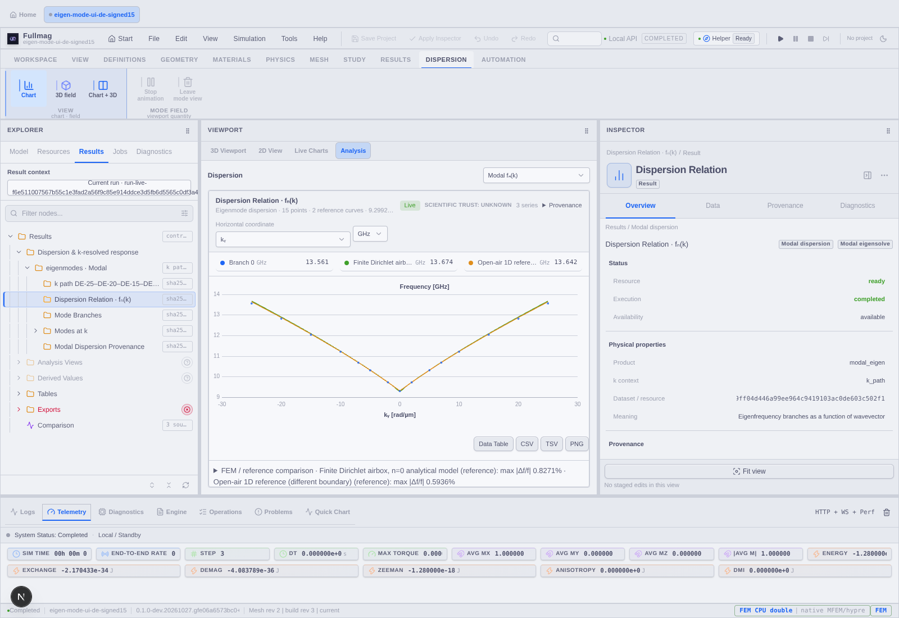
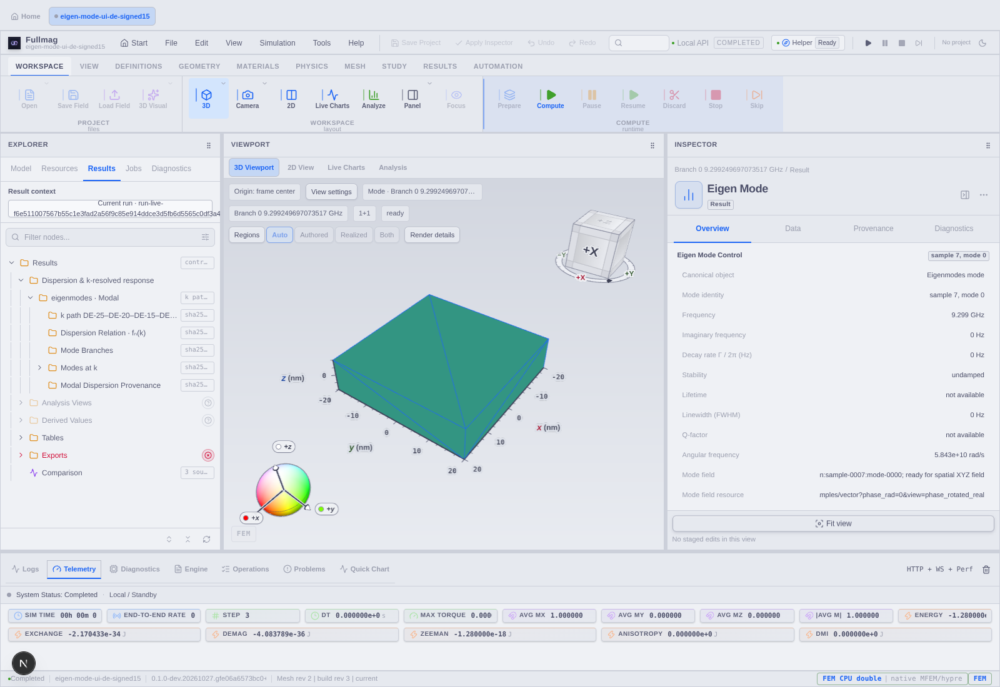

# Przeglądarka dyspersji i modów: naprawy i dowody

## Cel i zakres

Opublikowana dyspersja FEM ma być dostępna w głównym UI z tymi samymi wartościami i referencjami co na wykresie Python. Wybór punktu musi prowadzić do zespolonego pola dokładnej próbki i modu. Zmiany dotyczą prezentacji istniejących wyników; nie uruchamiają solvera ani nie zmieniają fizyki benchmarku.

Worktree: `eigensolve-integration-ui-20261026`. Branch: `codex/eigensolve-integration-ui-20261026`. Główny commit UI: `3cae975b0`; poprawki: `fc20e7d36`, `2273cf5b8`, `2e3f45ed9`, `d8fb82e30`, `c6a5a2034`.

## Potwierdzone usterki i rozwiązania

| Usterka | Rozwiązanie | Stan dowodu |
|---|---|---|
| Spektrum nakłada różne k na tę samą rangę modu | Filtr próbek w Inspectorze i w głównym spektrum, zachowane oryginalne indeksy wierszy | Testy regresji dodane; główna przeglądarka działa na 15 próbkach |
| Results zmienia tylko Inspector | Kolekcja dyspersji/spektrum otwiera główny panel Analysis | Potwierdzone w browserze |
| Metadane wypychają wykres; zagnieżdżone wysokości obcinają płótno | Zwijana provenance i kontekst fizyczny, pojedyncza wysokość płótna, rozmiar zależny od rzeczywistego panelu | Kontrola browserowa i zrzuty |
| Krzywe odniesienia nie pojawiają się po imporcie | Wiązanie z rewizją zewnętrznego, opublikowanego manifestu; wewnętrzna etykieta solvera nie jest rewizją datasetu | Rzeczywisty import obu tabel przez UI zakończony sukcesem |
| Referencja wyłącza podpisaną oś k | Jawne `pathS` i interpolacja wektora tylko w jednoznacznym prostym segmencie opublikowanej ścieżki | Gamma i obie strony k; testy braku ekstrapolacji, luk i konfliktów |
| Referencja może zasłaniać numeryczny punkt | Znaczniki numeryczne nad liniami referencyjnymi; referencja nie udostępnia akcji pola FEM | Rzeczywiste kliknięcia w browserze |
| Liczba próbek referencji wygląda jak liczba wyników solvera | Osobny licznik punktów obliczonych i krzywych odniesienia | Test komponentu dodany |
| Akcja modu ukryta pod całym wykresem | Akcja 3D przy kontrolkach nad wykresem; lista modów wybranego k pod wykresem | Pięć rzeczywistych pól potwierdzonych |
| W starszym Spectrum Inspectorze brak `onSelectMode`, a Inspect jest no-op | Podłączona selekcja i bramka właściciela/równowagi konkretnej próbki | Testy pozytywne i negatywne; osobna kwalifikacja tej starszej ścieżki runtime pozostaje otwarta |

## Wyniki dostępne w UI

Run: `run-live-f6e511007567b55c1e3fad2a56f9c85e914ddce3d5fb6d5565c0df3a40e65a88`, stage `eigenmodes`. Generacja: `sha256:94a4698432bb417fd3e0758c39300ef98661c84a7d3b7e6638e74b10b9ca7f4f`.

- 15 punktów FEM od −25 do +25 rad/µm, włącznie z Gamma.
- 501 próbek analityki n=0 dla skończonego airboxu Dirichleta.
- 15 próbek wcześniejszej referencji 1D z otwartym powietrzem, wyraźnie oznaczonej jako inne warunki brzegowe.
- Tabela błędu `100*(f_FEM/f_ref−1)`. Maksima: około 0,8271% względem modelu n=0 oraz 0,5936% względem referencji 1D. Są to porównania opisowe, nie kwalifikacja zbieżności.

Przetwarzanie referencji korzysta z istniejących definicji postprocessingu i typowanego klienta. Nie ma ukrytych, wpisanych na stałe częstotliwości w komponentach. Skrypt Python eksportuje CSV referencji dopiero po weryfikacji źródła benchmarku, parametrów i opublikowanej prostej ścieżki k. W bazie pozostają współrzędne SI; `Mrad/m` jest pokazywane jako równoważne `rad/µm`.

## Weryfikacja

Verifier: `scripts/verify_eigensolve_modal_workbench_ui.mjs`. To dedykowana ścieżka odbioru benchmarku `examples/fem_eigen_mode_ui_de_signed15.py`, wymagająca jego 15 próbek i zaimportowanej referencji. Weryfikuje właściciela zasobu, wartości częstotliwości, kliknięcia pięciu punktów, rzeczywiste powiązania zespolonych pól, obie osie oraz rozmiary okna. Nie zleca Solve ani Compute Fields.

Przykład:

```sh
FULLMAG_PLAYWRIGHT_MODULE=/absolute/path/to/playwright/index.mjs \
node scripts/verify_eigensolve_modal_workbench_ui.mjs \
  --url http://localhost:3217/workspace \
  --run run-live-f6e511007567b55c1e3fad2a56f9c85e914ddce3d5fb6d5565c0df3a40e65a88 \
  --source-sha 2e3f45ed9 --output /tmp/modal-ui/report.json
```

Wstępna kontrola potwierdziła pola `sample-0000`, `sample-0003`, `sample-0007`, `sample-0011`, `sample-0014`, każde z 5127 wartościami zespolonymi bufora. To 3 składowe dla 1709 węzłów całej siatki; widoczna powierzchnia to sam ferromagnetyk. Ta liczba nie jest liczbą modów ani fizyczną amplitudą pobudzenia.

Kontrola architektury frontendu: PASS. Składnia skryptu Node: PASS. Kompilowane testy uruchamiane wyłącznie w GitHub Actions. Pierwsze CI: typecheck/lint PASS, sześć regresji oczekiwań UI/kontraktu; poprawione bez usuwania kontroli wartości i identyfikatorów. Kolejne CI ujawniło niepoprawnie ogólny string trybu Spectrum; zastąpiony typowanym `free_modes`. Końcowy wynik CI i raport browserowy uzupełniane po ich zakończeniu.

## Granice i dalsza praca

- Aktualny backend nadal pochodzi z pakietu `0.1.0-dev.20261027.gfe06a6573bc0+9796`. Nowy frontend działa przez HMR. Nie należy utożsamiać SHA frontendu z binarką solvera.
- Osobny błąd starego backendu/proxy dla `GET /v2/sessions/current/data/artifacts` (HTTP 500, rozmiar ETag) pozostaje otwartą bramką pełnego UI. Poprawka źródłowa była wcześniej przygotowana, ale nie jest wdrożona do tej binarki. Nie ukrywamy tego błędu.
- Migracja i rzeczywisty roundtrip FMS są osobnym niedokończonym zadaniem; zachowano ich WIP.
- Jeden zwrócony mod na k nie dowodzi kompletności widma, poprawnego śledzenia wszystkich gałęzi ani zbieżności siatki/airboxu. COMSOL A1 i jego próg 0,5% nie są kwalifikacją tego benchmarku DE.
- Browser używa SwiftShader. Dowód renderowania i wyboru pola nie jest dowodem sprzętowego GPU ani nową weryfikacją solvera.

## Dowody końcowego przebiegu browserowego

Raport: [2026-10-27-eigensolve-modal-workbench-ui.evidence.json](2026-10-27-eigensolve-modal-workbench-ui.evidence.json). Interakcje sprawdzono na `2e3f45ed9`, a końcowy opis osi i zrzut na `d8fb82e30`.

- PASS: wszystkie 15 częstotliwości renderowanych punktów zgodne z opublikowanym spectrum.v2 (tolerancja porównania reprezentacji 1e-12).
- PASS: pięć rzeczywistych przejść punkt→zespolone pole; próbki 0/3/7/11/14.
- PASS: referencja bez akcji modu FEM.
- PASS: współrzędne końców/Gamma na obu osiach i pozycje wewnątrz płótna po zmianie osi.
- PASS: brak błędów JavaScript; wykres mieści się przy 1600×1100, 1440×1000 i 1100×900.
- OPEN: jeden HTTP 500 dla katalogu `data/artifacts`; pełna kwalifikacja całego UI pozostaje otwarta.

Zrzuty i CSV referencji znajdują się w `docs/raports/assets/eigensolve-modal-workbench-20261027/`. Tabele referencji mają współrzędną odległości po opublikowanej ścieżce s od 0 do 50 rad/µm; signed ky jest od −25 do +25 rad/µm. Przy imporcie należy użyć nagłówka `path_s_rad_per_um` oraz jednostek rad/µm i GHz.

CI `40581494110` na `d8fb82e30`: typecheck/lint PASS, 8895 testów PASS, jedna regresja pustego widoku. Poprawka `c6a5a2034` przywraca provenance także przy braku serii; test pozostaje bez zmian. Ta poprawka nie zmienia obliczonych punktów, referencji, mapowania osi ani pól modów.

## Bramki źródłowe i fixture browserowy

- `40582878262`, job `control-room-contracts`, commit `c6a5a2034`: PASS — typecheck, lint, 8896 testów (13 wcześniejszych pominiętych), dodatkowe 3 testy oraz produkcyjny build aplikacji.
- `40583860596`, commit `c6a5a2034`: PASS — dedykowane kontrakty eigensolve UI, architektura, typowanie i React Doctor. Doctor: 90/100, 7 ostrzeżeń. Cztery nowe ostrzeżenia o łańcuchach iteracji w liście modów i porównaniu referencji poprawiono przez pojedyncze `flatMap` z warunkami. Pozostałe trzy wskazania dotyczą istniejącego importu zbiorczego w `ModeFieldOverlayIntent.ts` oraz istniejących eksportów helperów w plikach komponentów. Nie wyciszono reguł.
- Szerszy job browserowy zatrzymał się w `qualifyModalArtifactOwnershipRace`: po nowym automatycznym otwarciu Analysis test oczekiwał widocznego płótna 3D bez przełączenia widoku. Fixture dostał jawne kliknięcie **3D Viewport** przed kontrolą shadera obiektu. Kontrole obcego runu, braku pobrania pola i zdrowego WebGL pozostają bez zmian. Ponowna bramka browserowa jest wymagana. Nazwa zbiorczego kroku CI obejmuje również DMI, ale log wskazał ten scenariusz modalny.




