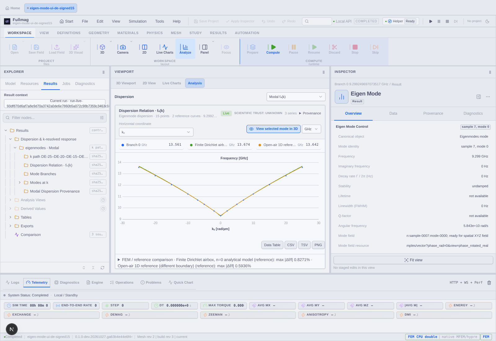
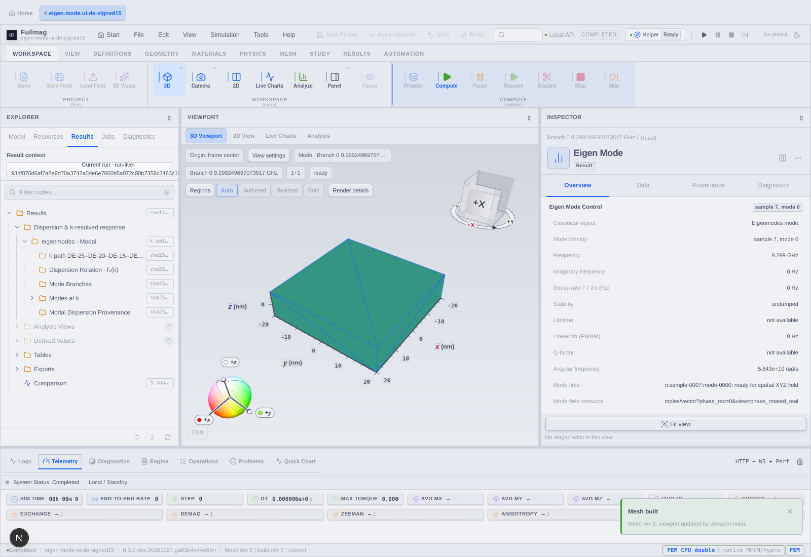

# Signed15, mody i wykres w nowym UI — 28.10.2026

## Potwierdzony wynik

Ponownie wykonano rzeczywisty FEM CPU signed15 z dynamicznym demag. Wszystkie 15 częstotliwości jest identycznych z poprzednim runem; maksymalna względna różnica reprezentowanych wartości wynosi 0. Gamma: **9,299249697073517 GHz**. Zapisano pola modu 0 dla każdej próbki. To jeden zwrócony mod na k, nie certyfikat kompletności widma.

| Dowód | Stan |
|---|---|
| Managed przebudowa własnej grupy | SUCCESS, iteration `2c5aab51243e495585dac88e88a25375`; zachowane wolumeny i poprzednie wyniki |
| Backend | `0.1.0-dev.20261027.ga63b4e44e6f4+9796`, source snapshot `53f20b09770bf17dd2930c2b3221107a44e89eb7d0b8e1128e6d1256c01b7157` |
| Wykonanie | `run-live-93df870d6af7a8e9d70a3742a0de6e7860b5a072c98b7359c3463c18b49113de`, completed; relax i eigenmodes completed |
| Siatka | 7134 komórki, identyczny rozmiar benchmarku |
| Generacja | `sha256:094bf14b5f4e43d1622336ab43a09cbdce64b3e558519dfbb6c616473a5c215b` |
| Residual pełnego problemu | maksimum `2,7172922182445158e-11`, przy wymaganiu `1e-8` |
| Przeglądarka dyspersji | PASS: 15 punktów, dwie referencje, obie osie, pięć punktów→właściwe pola, trzy rozmiary okna |
| Strict Gamma | PASS: rzeczywiste JSON/meta/binary, Real/Imag/Abs/Phase, animacja i zatrzymane klatki, widoczny WebGL z niezerowym buforem i bez utraty kontekstu |
| Katalog artefaktów | HTTP 200 po publikacji; krótki ETag, dawny HTTP 500 nie występuje w obu odbiorach browserowych |
| Eksport solved FMS z referencjami | PASS: 158456496 bajtów, SHA-256 `2338882b585bc40f9911ec3334676e672cb23c2a55448d4945e711533b57b6cf` |
| Ponowne otwarcie rzeczywistego FMS | OTWARTE: limity proxy/JSON oraz rozdzielenie rewizji dokumentu i wykonania; osobny plan L1–L4 |

UI: `http://localhost:3217/workspace`. Pozostawiono widoczne okno z próbką 7, modem 0 i kamerą dopasowaną do ferromagnetyka. Nie pokazujemy airboxu jako powierzchni modu. Browser korzysta ze SwiftShader; nie jest to kwalifikacja sprzętowego GPU ani fizyki FEM GPU.

## Wykres i analityka

Dane i referencje pochodzą z `plot_eigensolve_completed_native_dispersion.py`, który sprawdził SHA skryptu aktywacji, właścicieli zasobów, opublikowaną ścieżkę i fizyczne parametry. Te same CSV referencji zaimportowano przez rzeczywisty formularz UI i przypięto do nowej generacji.

Maksymalna różnica Fullmag–skończony airbox Dirichleta, model n=0: **0,827148%**. Dla referencji 1D z otwartym powietrzem: **0,593629%**, przy innych warunkach brzegowych. Są to opisowe porównania modeli. Nie są wynikiem COMSOL A1 ani dowodem spełnienia jego progu 0,5%. Zbieżność siatki/airboxu, kompletność okna, serial/adaptive i COMSOL pozostają NOT VERIFIED.

## Artefakty i dalsza naprawa

[Dowody maszynowe](2026-10-28-eigensolve-modal-runtime-results.evidence.json) zawierają wszystkie częstotliwości, residuale, błędy referencji, powtarzalność oraz SHA i rozmiary plików. W `docs/raports/assets/eigensolve-modal-runtime-20261028` zachowano także PDF/PNG Python, CSV, referencje i raporty browserowe. Duże FMS pozostają poza Git w katalogu wizualizacji tej sesji `eigensolve-modal-updated-signed15-20261027`; dokładna ścieżka jest w evidence JSON.

Plan dalszy: [duży transport FMS i rewizje](../superpowers/plans/2026-10-28-eigensolve-large-fms-transport.md). Nie wykonano import commit i nie zastąpiono działającego wyniku niezweryfikowanym archiwum. L1 jest potwierdzony CI 40601067977 (`41d2d0cda`), L2 CI 40605186626 (`55bef9853`), L3 CI 40606621173 (`82a4bf371`, 1220 testów). L1–L3 nie były częścią binarki ga63 użytej do powyższych symulacji. Trwa kontrolowana aktualizacja własnej grupy. L4 (rzeczywisty cold import) pozostaje do wykonania.

## Aktualizacja po otwarciu wyników z FMS

Transport i import UI wdrożono i potwierdzono. Dokładnie 15 wartości oraz k zgadza się z CSV Python (0 Hz różnicy); po cold import przeszły wykres, referencje i pięć pól 3D. Zobacz [nowy raport](2026-10-28-eigensolve-modal-ui-file-restore.md). Wykryto i naprawiono automatyczny compute_fields przy przeglądaniu archiwum. Końcowy strict po tej poprawce nie został domknięty; następnie Docker i UI przestały odpowiadać. Powyższy wcześniejszy PASS dotyczy pierwotnego działającego runtime, a nie końcowego strict odtworzonej sesji. Obecnie nie należy uznawać UI za aktywne.
