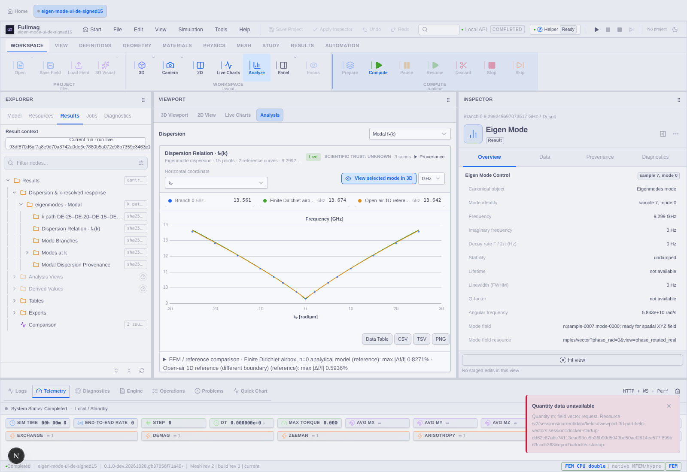
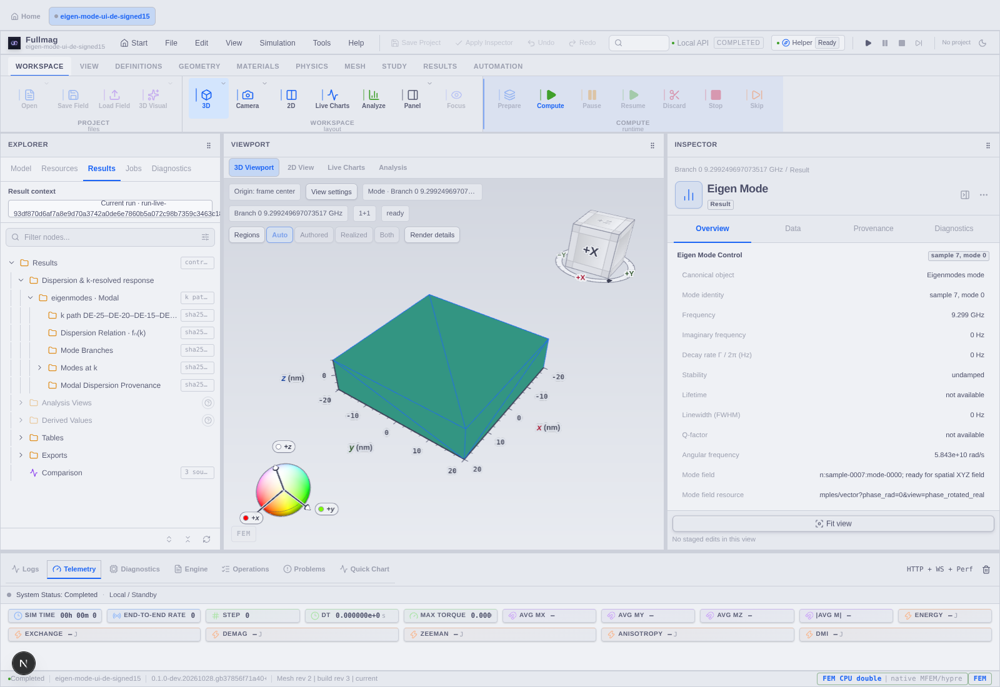

# Przeglądarka dyspersji, modów i ponowne otwieranie FMS — 28.10.2026

## Co działało w rzeczywistym UI

W dedykowanej grupie uruchomiono nowy backend i frontend, a następnie otwarto rzeczywiste FMS 158456496 bajtów przez menu UI i proxy. Po cold import odtworzono dokładnie tę samą generację wyników. Kolejny odbiór jawnego visualization_only dał HTTP 200 dla inspekcji i importu, nowy katalog session-store/imports i brak błędów JS. Nie powtarzano solvera.

Wykres UI zawiera 15 punktów od −25 do +25 rad/µm z Gamma i dwie referencje użyte również przez Python. Wszystkie częstotliwości, wektory k, indeksy próbek i raw-mode są identyczne z CSV: maksymalna różnica 0 Hz. Gamma: 9,299249697073517 GHz. Jeden zapisany mod na k nie jest certyfikatem kompletności widma.

Rzeczywisty workbench po cold import przeszedł: pięć punktów→pięć właściwych zespolonych pól, po 5127 wartości, powierzchnia magnetyka bez airboxu, obie osie i trzy rozmiary okna. Zero błędów JS i HTTP. Browser używa SwiftShader; to dowód UI, nie sprzętowego GPU ani zbieżności fizyki.

## Naprawy

| Problem | Poprawka i dowód |
|---|---|
| Duże FMS przekraczało limit proxy i JSON/base64 | Osobne binarne inspect/commit, 512 MiB, deadline, strumień do anonimowego pliku, te same walidatory i guardy publikacji; CI backend SUCCESS |
| Zmiana postprocessingu zmienia revision dokumentu | Zachowane ścisłe run/session/CAS i fizyczny execution-input hash; różne revision dopuszczone tylko przez oryginalny typed RunIntent |
| Klient kopiował plik do base64 | File/Blob bez konwersji, centralny scoped transport, anulowanie inspekcji i brak automatycznego replay POST |
| RestoreClass używane jako restore_mode | Rozdzielone kontrakty. Domyślnie visualization_only dla rozpoznanej klasy; jawny wybór zachowany. config_only opisuje checkpoint, a nie brak zapisanych modów |
| Pusty Home blokował menu i skrót importu | Dopuszczona komenda otwierania archiwum; solver/prepare/stop/checkpoint restore pozostają poza tą polityką |
| Rejestr uznawał null scope za nieaktualny | Jawny opt-in wyłącznie dla importu; trwały fence także null→sesja→null, z regresją |
| Restart zachowywał stary next.config.ts z limitem 10 MB | Klucz generacji workspace uwzględnia manifest seed konfiguracji. Nowy frontend potwierdził 536870912 bajtów i 360000 ms; stare cache zachowane |
| Przeglądanie archiwum próbowało compute_fields dla brakującego m | Potwierdzono blokującym probe. Automat wymaga teraz lifecycle.commandability=allowed; forbidden/read_only/brak wartości nie zleca obliczeń. Regresje metadata/vector i pozytywne coalescing w CI |

## Granica końcowego odbioru

Pierwszy strict Gamma po imporcie wykazał automatyczną komendę, zablokowaną przez verifier. Po poprawce nie było prób mutacji i przeszły Real/Imag, ale odbiór zatrzymał się na timeout powiązania Abs. Następne zapytanie statusu nie miało połączenia; Docker daemon również przestał odpowiadać, a jego procesów nie było na liście. Nie przypisano timeoutu jednoznacznie rendererowi ani awarii Dockera. Nie osłabiono asercji i nie uznano strict za PASS.

Stan końcowy runtime: **UNAVAILABLE**. Na WSL było 14 GiB, na C: 63 GiB wolnego; nie ma dowodu awarii z braku miejsca. Nie restartowano współdzielonego Dockera. Wyniki, FMS, katalogi importu i screenshoty zachowano. Po przywróceniu Dockera należy odzyskać dokładnie tę grupę i domknąć strict Gamma wraz z animacją, bez ponowienia Solve.

CI UI [40610859641](https://github.com/MateuszZelent/fullmag/actions/runs/40610859641): SUCCESS. Wcześniejsza bramka pustego scope: 1247 testów / 53 pliki. Dziesięć lekkich testów launchera przeszło lokalnie; testy kompilowane wykonywano wyłącznie w GitHub Actions.

Dowód maszynowy: [JSON](2026-10-28-eigensolve-modal-ui-file-restore.evidence.json). Plan: [L1–L4](../superpowers/plans/2026-10-28-eigensolve-large-fms-transport.md). I0/I1/I5/I6/I7 głównego planu pozostają otwarte; PR/master, zbieżność i COMSOL nie są zamknięte tym odbiorem UI.
