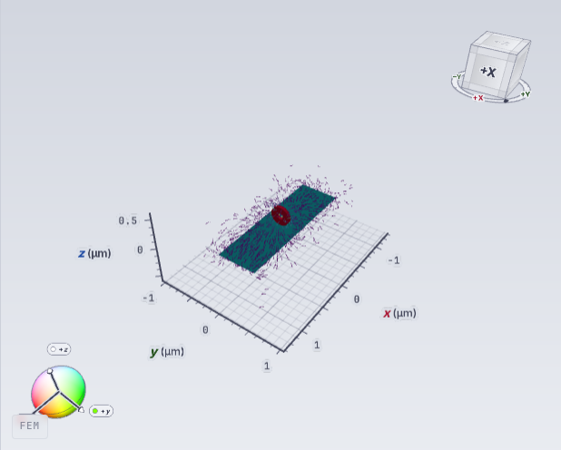

# CoFeB na aktualnym masterze — odbiór bieżącej sesji, 29.10.2026

> Aktualizacja 30.10.2026: poniżej zachowano historyczny odbiór z 29.10.
> Jego otwarte punkty restore i telemetryczne zostały następnie zamknięte.
> Nowy build `aee17a54d4c283f2fdf5aa3d89acc5ecdb638e19` wykonał CoFeB
> FEM/GPU/double/strict: 10 iteracji, identyczny mesh i hashe m/H_demag/H_eff.
> Stopka Step 10 i energia przeszły rzeczywisty reload; osobno odebrano FDM
> GPU single i multilayer. Aktualny stan, receipty i ograniczenia zawiera
> [odbiór sześciu punktów](../superpowers/plans/2026-10-29-master-runtime-completion.md#odbiór-końcowy-3010-sześć-punktów-zamkniętych).

## Wynik

UI działa pod <http://127.0.0.1:3198/workspace>. Backend i frontend grupy
`fullmag-master` pozostawiono uruchomione. Docker i native environment mają
zgodny budżet **128 GiB / 16 CPU**, Cargo używa 16 jobs.

Oryginalny `examples/permalloy_layer_cofeb_rings_relax_300nm.py` zakończył
**10 iteracji, FEM / GPU / double / strict**. Etap jest skonfigurowany w skrypcie
jako `add_minimize(method="bb", max_steps=10)`. Natywny receipt,
trace kroków 1–10 oraz API potwierdzają ukończenie. To iteracje minimizacji;
czas fizyczny 0 s jest zgodny z konfiguracją tego etapu. API nie poświadcza
algorytmu (`algorithm=null`); BB opisuje konfigurację wejściową, a nie osobny
receipt wybranego algorytmu. Nie kwalifikowano zbieżności.

Siatka została zbudowana i zaakceptowana: **1 087 250 elementów mieszanych,
183 764 węzły**, 52 454 ściany brzegowe. Pole m i pola H zostały automatycznie
opublikowane w terminalnym quantity bundle. W tej próbie wysłano **jedno Solve**;
nie było potrzeby osobnego POST Compute Fields.

## Granice geometrii i Universe

Bounds cylindra uwzględniają unormowaną oś. Dla osi X długość 50 nm dotyczy X,
a średnica 300 nm dotyczy Y/Z. API potwierdziło maksymalne Z obiektów
**310,8 nm**. Warstwa ma 2000 × 600 × 1,6 nm.

Universe zachowuje jawne **2,8 × 2,1 × 1,2 µm**. Bounds siatki wynoszą
`[-1.4e-6, -1.05e-6, -6e-7]` do `[1.4e-6, 1.05e-6, 6e-7]` m;
mesh nie jest oznaczony jako dirty. Szczegóły są w
[domain-meta.json](../diagnostics/2026-10-29-cofeb-master-current/domain-meta.json).

## Dane i render

[Metadane, hashe i provenance wykonania](../diagnostics/2026-10-29-cofeb-master-current/runtime-evidence.json).
[Projekcja native completion](../diagnostics/2026-10-29-cofeb-master-current/native-completion-projection.json)
zawiera wynik, liczbę iteracji i tożsamość; wskazuje też zachowany oryginalny
plik oraz jego SHA256. Pominięto dane lease w projekcji.

| Pole | Zakres | Próbki | Stan |
|---|---|---:|---|
| m | full FEM | 183 764 | step10, complete, stale=0, wartości skończone |
| H_demag | Airbox | 157 393 | step10, complete, stale=0, skończone i niezerowe |
| H_eff | Airbox | 157 393 | step10, complete, stale=0, skończone i niezerowe |

Hash wartości m w binarnym API odpowiada natywnemu snapshotowi GPU:
`f87c4d4ea756c9a9f287c12d0465c07981cd9d3dd3296207e0cabfed44392f26`.
Hash H_demag/Airbox:
`da81dc5f5d9efe31f0293c539995cefd6b1e91d146a8b263ef12481ea3dc3118`.
Energia końcowa z kroku 10: `-3.668191276379833e-16 J`.

Ustawiono m na obiektach oraz wektory H_demag w Airboxie. Obejrzany PNG pokazuje
kolorowaną magnetyzację warstwy i pierścienia oraz wektory wokół obiektów.
Zarządzana przeglądarka potwierdziła widoczny WebGL2 canvas, niezagubiony kontekst,
drawing buffer **617 × 495**, stabilność po przejściu Home→workspace i zero
błędów strony/HTTP. [Odbiór przeglądarki](../diagnostics/2026-10-29-cofeb-master-current/browser-proof.json).

Browser używał SwiftShader. Natywne wykonanie GPU ma oddzielny receipt dla
`GPU-fcb9fbf1-8284-37c7-af5b-76bcbf2d2937`. Nie hashowano treści odpowiedzi
binarnej wewnątrz tej próby przeglądarkowej: wartości sprawdzono przez API
i snapshot native, a render przez widoczny canvas i obejrzany PNG.

## Przypięte wykonanie

- Checkout: `/home/kkingstoun/git/fullmag/fullmag`, `master`, HEAD
  `b2b159c58fb921efbf278c120d12d268d958d03b` z zachowanymi lokalnymi zmianami.
- Native snapshot: `fd3cc159005bee251f8f876df7174c3bcef2dc183489146ed370dcb7dc2e42b1`.
- Development: `80088b44d21c497199550c8857ed14c6`, Compose SHA256
  `7e370a5ec8a4ce75de76826247470820fa593ca57f0696c9b6e12db1bbc72369`.
- Aktywacja: `bbf27f4dc34247f4a37bdfb791019d08`, request
  `cofeb-master-gpu-20261029-visualization-04`.
- Run: `run-live-d06087ec50780f18efb6b3bf47d774c839cae891da150dfb7a602c6d6086d7e8`.
- Worker: `attempt-8452ad205e584581916bcc78bbfcdb05`, epoch 1.
- Solve: `fm-4f29b085-8e6d-40a9-8074-75e9963550c2`, completed.
- Browser: `af947a0a399c4f8b828d179839115353`, succeeded.
- Przypięta konserwacja cache: `e9b964df046b46e1bdc3058186b1094e`, succeeded.

Materializacja trwała **398,049 s**, native domain preparation **188,365 s**,
łącznie **9 min 46,414 s**. Komenda Solve od przyjęcia do completed:
**615,244 s**. Trace raportuje łącznie około **5,004 s** czasu zaakceptowanych
kroków oraz osobno około **27,700 s** backend-create. Te zegary nie pokrywają
całej obsługi wejść i publikacji wyników; nie przypisujemy pozostałego czasu
do konkretnej funkcji bez profilowania. To próba z cache, nie porównanie
wydajności kontrolujące wszystkie warunki.

## Zachowane dane i ograniczenia

Praca odbyła się na masterze, bez nowego worktree, testów jednostkowych,
commit/push, reset/stash i globalnego prune. Zachowano równoległe zmiany.
Retirement poprzedniego terminalnego workspace poprzedził nową aktywację;
stary run `run-live-f83f7552cf05f87b1eeb213f88de34fbf9202abcbf918bfa8634bb8f17db68c1`
i jego wyniki pozostały w store. Nie ponawiano jego Solve.

Potwierdzone pozostałe punkty:

1. Terminal-observation po restarcie odtwarza model/status, ale jeszcze nie mesh
   i pola. Bieżący render pochodzi z nowej, jawnie zleconej próby powyżej.
2. Scalar window/stopka nadal może wskazywać prepared step0 i starą energię,
   mimo step10 w statusie, bieżących energiach i polach. Nie maskowano licznika.
3. Obsługa dużych wejść wymaga profilowania. Nie deklarujemy rozwiązania
   całego problemu czasu materializacji ani kwalifikacji wszystkich FDM/FEM
   CPU/GPU, zbieżności naukowej i wydania produkcyjnego.

4. Surowe `health.uptime_seconds` ma wartość odpowiadającą epoce Unix zamiast
   upływowi czasu; pozostawiono ją jako obserwację błędu API. Nie używano jej
   do pomiaru czasów. API nie publikuje też nazwy aktualnego algorytmu.

Izolację błędów API/runtime i brakujące scenariusze weryfikacji opisuje
[osobny raport](2026-10-29-runtime-failure-isolation.md).
