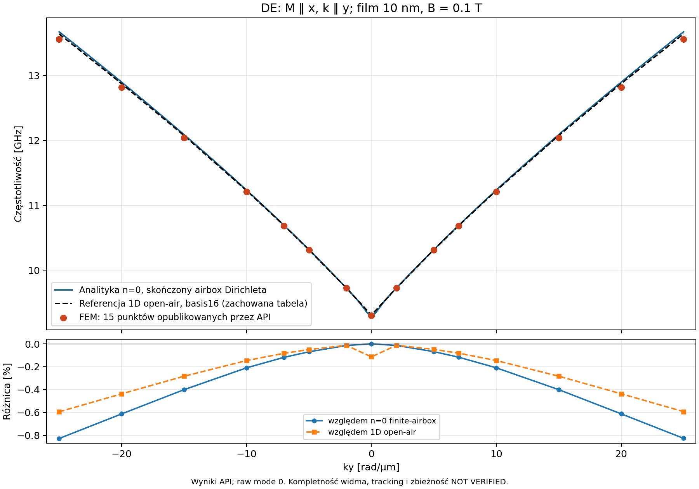

# Świeży sweep DE z FGMRES — 30.10.2026

Własna grupa Docker na porcie 3217 zakończyła oryginalny signed15 i opublikowała 15 widm oraz 15 zespolonych pól. Runtime zbudowano z `5c8fdb527`; jawny FGMRES był przypięty w nowym rekordzie konfiguracji. Nie jest to jeszcze weryfikacja późniejszego natywnego defaultu bez override'u ani pełna kwalifikacja solvera.

## Właściciel i zachowane dane

- Run: `run-live-6a5847c66a6378c7d826fbc4dad2b1ec694685f59b70f8d850da7e26ea1f9df6`; stage `eigenmodes`.
- Generacja: `sha256:dee5d3b7c25732d8da8010ff4c0f54082cf92807520ac35656f959fc138851a4`; API `ready/member_verified_owner_bound`.
- Activation `310a6609f019432e85d456b626b26757`; development `7ac23e143dba47e9bbd3ef12db1eedb2`.
- Oryginalny skrypt SHA-256 `8d48ad08356352d69713b29465a70e2c0ea4135f66069f3d82c2ce853dacfa2f`, potwierdzony receiptem i zamrożonym źródłem backendu.
- FMS: 38165446 B, 351 wpisów, CRC poprawne, SHA-256 `1fc25b1478f7e97cffdbf68849628e17829f79b1d40541f31cbbbb381c92c499`. Pełne archiwum i odczyty API są zachowane poza Git pod ścieżkami w evidence JSON.

## Fizyka i wynik

DE: M i B wzdłuż x, k wzdłuż y; film 40×40×10 nm, Ms=800000 A/m, Aex=13 pJ/m, B=0,1 T, gamma0=2,211e5 rad·m/(A·s). PBC x/y, dynamiczny demag Floqueta w airboxie Dirichleta 40×40×4010 nm. CPU double, żądany serial i jeden wątek na worker, 3 warstwy w filmie, element P1; okno 8,5–16 GHz, count1/best_effort, damping ignore. Oryginalny skrypt nie został uproszczony.

Pełny residual maksymalnie **1.397311e-13** przy niezmienionej bramce **1e-8**. Wszystkie 15 pól jest opublikowanych. Gamma = **9.299249697 GHz**. Maksymalna asymetria ±k wynosi 0.001455%. Nie zastępowano ujemnych punktów odbiciem dodatnich.

| ky [rad/µm] | f FEM [GHz] | eps_full | Δ względem n=0 [%] | Δ względem 1D [%] |
|---:|---:|---:|---:|---:|
| -25.0 | 13.560765017 | 4.029e-14 | -0.827148 | -0.593629 |
| -20.0 | 12.819133185 | 4.560e-14 | -0.612335 | -0.436920 |
| -15.0 | 12.041290552 | 1.736e-14 | -0.400444 | -0.282849 |
| -10.0 | 11.211849792 | 8.604e-14 | -0.209733 | -0.146204 |
| -7.0 | 10.681045692 | 1.397e-13 | -0.117943 | -0.082521 |
| -5.0 | 10.310201976 | 4.104e-14 | -0.069533 | -0.049711 |
| -2.0 | 9.724035208 | 3.195e-14 | -0.014065 | -0.013682 |
| 0.0 | 9.299249697 | 9.578e-15 | -0.000000 | -0.113472 |
| 2.0 | 9.724074783 | 3.079e-14 | -0.013658 | -0.013275 |
| 5.0 | 10.310352014 | 3.799e-14 | -0.068078 | -0.048256 |
| 7.0 | 10.681152764 | 9.115e-14 | -0.116942 | -0.081519 |
| 10.0 | 11.211886650 | 4.884e-14 | -0.209405 | -0.145876 |
| 15.0 | 12.041315830 | 2.712e-14 | -0.400235 | -0.282640 |
| 20.0 | 12.819200391 | 1.223e-13 | -0.611814 | -0.436398 |
| 25.0 | 13.560913969 | 5.233e-14 | -0.826059 | -0.592537 |

[Wykres PDF](assets/de-signed15-fgmres-20261030/de-native-completed-dispersion.pdf) · [CSV](assets/de-signed15-fgmres-20261030/samples.csv) · [provenance](assets/de-signed15-fgmres-20261030/provenance.json).

Maksymalna różnica wynosi 0.827148% wobec przybliżenia n=0 z tym samym skończonym airboxem i 0.593629% wobec zachowanej tabeli 1D open-air basis16. To różne modele odniesienia. Mały residual układu dyskretnego nie dowodzi zbieżności siatki, airboxu lub bazy 1D. Próg COMSOL A1 ≤0,5% nie został tu zweryfikowany.

## UI i R6

Gamma sample7/mode0 rzeczywiście wiąże `part:film_geom` z polem `analysis:eigen:sample-0007:mode-0000`: 5127 wartości zespolonych, 1560 indeksów powierzchni, niepusty WebGL 888×573 bez utraty kontekstu. Fit mode obejmuje sam film. Animacja fazy oraz viridis/inferno zmieniają hashe obrazu; brak page errors i niedozwolonych zapisów numerycznych.

R6: 11/14 pierwotnych operacji ma ten sam aktywny run przed i po; ten run następnie zakończył się i opublikował wszystkie wyniki. Ostatnie trzy gesty wymagają ponownej obserwacji podczas potrzebnej próby nowego defaultu. Pierwszy obserwator przekroczył 10s odczytu API podczas aktywacji; późniejszy punkt chwytu Explorera trafił w interaktywną zakładkę. Nie są to dowody przerwania solvera, ale nie zamykają R6. Nie uruchamiano ponownie obliczeń w odpowiedzi na timeout odczytu.

Odkryto dodatkową lukę R5: legacy Results Navigator kieruje do inspectora bez importera referencji i bez kompletnego ownera selekcji. Trwa ujednolicenie z istniejącym wrapperem physics-first. Wykres z analityką powyżej jest artefaktem Pythona; świeży import i signed-ky w UI pozostają do weryfikacji po przebudowie.

## Kolejne bramki

1. Hosted native dla nowego defaultu sparse Floquet oraz pełny source CI po fixture correction; bez lokalnych unit testów.
2. Managed rebuild, jawny reset typu do defaultu, oryginalny signed15 bez type override'u; R6 podczas tego realnego przebiegu.
3. UI import referencji z dokładnym run/stage/revision, podpisane ky i widok chart+mode; screeny.
4. I1/I7: pozostałe disposition, bias LLG budget, kompletność i zbieżności, serial/adaptive oraz COMSOL A1.
5. Najnowszy master, końcowe review/CI i merge; potem kwalifikowane sprzątanie własnych danych. Chronione 14 plików i cudze zasoby są zachowane.
