# Produkcyjny audyt wydajnościowy solwera FEM CPU/GPU: demagnetyzacja, wykorzystanie GPU, transfery CPU↔GPU oraz potok danych do frontendu

- **Data audytu:** 2026-11-04
- **Bazowy commit (`HEAD`):** `7c38c65085a16c92f96f024f486156003bacfc3e` (*Cache FEM CPU Poisson transfers and qualify managed execution (#394)*)
- **Zakres audytu:**
  1. Natywne jądro C++/MFEM/HYPRE/CUDA (`backends/fem/gpu/cuda/*`, `backends/fem/cpu/mfem/*`, `backends/fem/core/*`, `backends/fem/src/api.cpp`) ze szczególnym uwzględnieniem **demagnetyzacji** (Poisson Airbox Dirichlet/Robin/PBC oraz Fredkin–Koehler FEM/BEM).
  2. Wykorzystanie GPU, integratory czasowe RK (Heun, RK4, RK23, RK45/DP54), solwery relaksacyjne (NCG, PG-BB, Tangent-Plane Implicit), kernele oddziaływań (Exchange, DMI, Anisotropy, Zeeman, Magnetoelastic, STT/SOT, Thermal) oraz synchronizacje Host–Device.
  3. Wielowątkowość i gorące pętle CPU (`OpenMP`, `mfem::Device`, alokacje i hashowanie w pętli krokowej).
  4. Granica FFI (`crates/fullmag-runner/src/native_fem.rs`, `crates/fullmag-runner/src/fem/relax/*`), worker API (`crates/fullmag-api/src/accepted_fem_study_worker.rs`, `accepted_study_worker.rs`, `live_accepted_projection.rs`, `live_field_demand.rs`), endpointy binarne (`router_v2/handlers/data/fields.rs`, `field_store.rs`) oraz odpytywanie i buforowanie w `apps/control-room`.
- **Zasada nadrzędna:** Wszystkie rekomendowane optymalizacje są **w 100% neutralne dla fizyki i dokładności numerycznej** (zachowują te same równania dyskretne, rzędy elementów $P_1 / P_2$, tolerancje certyfikacji i niezmienniki reprezentacji).
- **Status dowodowy:** Wszystkie wskazane wąskie gardła są **POTWIERDZONE W KODZIE (`CONFIRMED IN CODE`)** na rewizji `7c38c65085a16c92f96f024f486156003bacfc3e`. Szacunki przyspieszenia runtime i przepustowości pozostają prognozą inżynierską (**`NOT VERIFIED AT RUNTIME`** do czasu wdrożenia i kwalifikacji w kontenerze grupy Compose oraz na docelowym GPU).

---

## 1. Streszczenie wykonawcze (Executive Summary)

Przeprowadzony audyt wykazał, że mimo wcześniejszych usprawnień (rezydentna pętla RK na GPU, operatory CSR dla demagnetyzacji na GPU oraz wprowadzone w `#394` / `7c38c6508` macierze CSR transferu dla CPU Poisson), szybkość obliczeń solwera FEM (zarówno na GPU, jak i na CPU) jest silnie ograniczana przez **trzy klasy narzutów systemowych i algorytmicznych**, które nie wynikają z samej fizyki mikromagnetycznej:

1. **Narzuty wokół najdroższego operatora — demagnetyzacji (Poisson & Fredkin–Koehler FEM/BEM):**
   - **Na CPU (nawet po commicie `#394` / `7c38c6508`):** na **każdym pojedynczym wywołaniu demag** (czyli 2 razy na jedno obliczenie pola: w `demag.cpp:175` i ponownie w `demag_poisson_solve.cpp:58`, co daje **12–14 pełnych przebiegów na jeden krok RK45!**) funkcja `make_poisson_operator_dependency_key` (`demag_poisson_dependency.cpp:248–268`) oblicza jednowątkowo skrót FNV-1a bajt po bajcie po całej topologii siatki, geometrii, **wszystkich elementach i tablicach DOF obu przestrzeni $P_1$ i $P_2$** oraz macierzach prolongacji/restrykcji. Ponadto `recover_demag_poisson_field_impl` (`demag_poisson_recovery.cpp:494–508, 623–661`) na każdym wewnętrznym etapie RK wykonuje **6 mnożeń SpMV zamiast 3** (licząc pełnodomenowe pole wizualne `h_visual_xyz` razem z airboxem, które w `demag.cpp:40, 59` jest natychmiast nadpisywane i wyrzucane!) oraz nie wbudowuje wag węzłowych `1.0 / node_weight` w macierz CSR podczas inicjalizacji.
   - **Na GPU i CPU (warm-start PCG):** między etapami RK i krokami czasowymi solver Poissona używa jako punktu startowego surowego potencjału z poprzedniego etapu ($\phi^{(0)} = \phi_{\text{prev}}$), bez liniowego predyktora czasowego ($\phi^{(0)}(t_n + c_i \Delta t) = \phi(t_n) + \frac{c_i \Delta t}{\Delta t_{\text{prev}}}(\phi(t_n) - \phi(t_{n-1}))$). Ponieważ równanie Poissona zależy liniowo od $\mathbf{m}(t)$, liniowa ekstrapolacja z dwóch ostatnich kroków obniża początkowe reziduum o rząd wielkości i redukuje liczbę iteracji HYPRE PCG (oraz liczbę wewnętrznych synchronizacji D2H w PCG) o **30–50%** bez żadnej zmiany tolerancji ani fizyki.
   - **W GPU FEM/BEM (`fem_bem.cpp:393–441`):** funkcja `solve_linear_system` nie używa `HypreStreamInterop` (w przeciwieństwie do GPU Poisson), lecz wywołuje blokujące `cudaStreamSynchronize(stream)` przed i po każdym rozwiązaniu $u_1$ i $u_2$, a ponadto **bezwarunkowo** liczy na GPU $A x - b$ oraz dwie normy `Norml2()` (z synchronizacją D2H) po każdym rozwiązaniu — co daje **8 pełnych barier CPU–GPU na każdy etap RK (48 na krok DOPRI5)**.
   - **W kernelach CSR GPU (`demag_kernels.cu:14–110`) i Exchange GPU (`exchange_kernels.cu:179–233`):** zastosowano mapowanie **1 wątek = 1 wiersz CSR** (`thread-per-row`). Dla siatek 3D $P_1/P_2$ powoduje to **całkowity brak koalescencji odczytów** tablic `csr_col_indices` i `csr_values` w obrębie warpu oraz silną dywergencję wątków między węzłami wierzchołkowymi a krawędziowymi $P_2$.

2. **Niewykorzystany potencjał GPU i CPU w integratorach czasowych, relaksacji i oddziaływaniach krótkiego zasięgu:**
   - **Brak reużycia końcowego odświeżenia RHS (`rk_final_refresh.cu:117–156`) dla Heun, RK4 i stałokrokowego RK23:** na końcu każdego kroku wykonywana jest pełna ewaluacja RHS (wraz z rozwiązaniem demag!) na zaakceptowanym stanie $\mathbf{m}_{n+1}$, ale jej wynik nie jest zapisywany do `gpu.rk.k[0]` dla metod niebędących adaptacyjnym RK23/RK45. Przez to **2-etapowy Heun wykonuje 3 pełne rozwiązania demag/RHS na krok (+50% kosztu)**, a **4-etapowy RK4 wykonuje 5 rozwiązań na krok (+25% kosztu)**.
   - **Zserializowane globalne `atomicAdd` FP64 w DMI na GPU (`rk_dmi_fields.cu:87` → `dmi_kernels.cu:260`):** na każdym etapie pośrednim RK przekazywany jest niezerowy wskaźnik `energy_out = gpu.reductions.scalar_workspace`, przez co **każdy czworościan w siatce wykonuje atomowe dodawanie FP64 pod ten sam pojedynczy adres pamięci globalnej `scalar_workspace[0]`**, a wynik jest natychmiast ignorowany!
   - **Brak prekondycjonera $(M + w K_{\text{ex}})^{-1} M$ w relaksacji NCG na GPU (`nonlinear_cg.cpp:9–15`):** podczas gdy CPU NCG używa prekondycjonera masowo-wymiennego tłumiącego sztywność wymiany ($\propto h^{-2}$), GPU NCG operuje na surowym gradiencie, co na gęstych siatkach FEM drastycznie zwiększa liczbę kroków i odrzuceń Armijo. Jednocześnie na CPU (`relaxation_math.cpp:176, 321–397, 786`) prekondycjoner ten **przebudowuje od zera `HypreParMatrix` oraz pełny `HypreBoomerAMG` 3 razy na każde wywołanie** (6 razy na krok NCG!).
   - **Całkowity brak zrównoleglenia OpenMP na CPU poza demagiem i pętlą elementową DMI:** `configured_mfem_device_string` (`mfem_device.cpp:48–56`) zwraca `"cpu"` zamiast `"omp"`, a wszystkie pętle w `llg_rhs.cpp`, `rk_explicit_step.cpp`, `adaptive_dt.cpp` (gdzie liczone jest 8× `std::hypot` + `std::acos` na węzeł!), `effective_field.cpp`, `anisotropy_*.cpp`, `zeeman_*.cpp` i `relaxation_math.cpp` działają **w 100% na jednym wątku CPU**.

3. **Kaskada zbędnych kopii GPU→CPU, alokacji, hashowania SHA-256 i zapisów dyskowych co 1 krok na granicy FFI / Worker / API / Frontend:**
   - **Zerwany kanał zapotrzebowania na pola (`live_demand`):** w `accepted_fem_study_worker.rs:150` sztywno przekazano `DisplaySelectionState::default`, a w `live_field_demand.rs:53–56` warunek `if display.is_empty() { return None; }` wychodzi z funkcji przed sprawdzeniem `RECENT_FIELD_REQUESTS`. Przez to worker widzi `demand == None`, co `retain_in_demand` (`live_demand.rs:47`) interpretuje jako **„materializuj wszystkie ~10–15 aktywnych pól”**!
   - **W efekcie przy `ACCEPTED_LIVE_FIELD_EVERY_N = 1` i `ACCEPTED_LIVE_FIELD_MIN_INTERVAL = 0` (`accepted_study_worker.rs:64–67`) na KAŻDYM pojedynczym kroku solvera:**
     1. wykonywanych jest ~10 osobnych wywołań FFI (`native_fem.rs:4217–4453`), w tym `average_m_for_nodes_f64` (`api.cpp:5388`), które dla scen wieloobiektowych kopiuje całe `m` z GPU na CPU na każdym kroku;
     2. pole `m` jest pobierane z GPU dwukrotnie (`request_magnetization` + `capture_native_fem_observables`);
     3. klonowana jest **cała siatka FEM** przez `FemMeshPayload::from(plan)` (`llg_overdamped.rs:572`, `direct_minimizer.rs:410`);
     4. w C++ `fullmag_fem_backend_snapshot_local_node_map_v1` (`api.cpp:5938`) za każdym razem alokuje i buduje od zera 3 wektory mapowania węzłów $O(N)$, tylko po to, by zwrócić 4 liczby nagłówka i zwolnić pamięć;
     5. z GPU na CPU ściągane są wszystkie ~10–15 pól (`m`, `H_eff`, `H_demag` wraz z airboxem, `H_ex`, `torque`, `eden_*`, przy czym każde `eden_*` w `native_fem.rs:5526–5532` ponownie kopiuje przez FFI `m` i pola składowe `H_*`!);
     6. wszystkie pola są pakowane do wielomegabajtowego bufora, dwukrotnie hashowane przez **SHA-256** i **zapisywane synchronicznie na dysk** (`.live_observation_m.<seq>.f64le.tmp` → `rename` → `remove_file`) wewnątrz wątku solvera!

---

## 2. Architektura przepływu wykonania i punkty dławienia (End-to-End Pipeline)

```mermaid
flowchart TD
    subgraph GPU_CPU_CORE["1. Natywne jądro C++/CUDA (backends/fem)"]
        A1["Etapy RK / Krok relaksacji<br/>(rk_step.cu / nonlinear_cg.cpp)"]
        A2["Oddziaływania krótkiego zasięgu<br/>Exchange (CSR dd_math) + DMI (atomicAdd) + Anisotropy"]
        A3["Demagnetyzacja (6x w RK45, 3x w Heun, 5x w RK4)<br/>RHS CSR -> HYPRE PCG/AMG -> Recovery CSR"]
        A4["Bariery cudaStreamSynchronize<br/>(Control Packet + 18/30 Scalar Readback + Hypre PCG)"]
        A1 --> A2 --> A3 --> A4
    end

    subgraph FFI_RUNNER["2. Granica FFI i Runner (crates/fullmag-runner)"]
        B1["~10 wywołań FFI na każdy krok<br/>(step_interruptible / relax_step)"]
        B2["average_m_for_nodes_f64 -> sync GPU->CPU m_xyz<br/>collect_local_node_map -> alokacja 3x Vec(N)"]
        B3["field_every_n == 1 (na każdym kroku!):<br/>1) FemMeshPayload::from(plan) — pełny klon siatki<br/>2) request_magnetization + capture_native_fem_observables<br/>3) Pobranie ~10-15 pól D2H (oraz wielokrotne kopie dla eden_*)"]
        B1 --> B2 --> B3
    end

    subgraph WORKER_API["3. Worker, Dysk i Projektor API (crates/fullmag-api)"]
        C1["AcceptedLiveObservationWriter::observe<br/>(MIN_INTERVAL = 0 -> każdy krok!)"]
        C2["2x SHA-256 + zapis na dysk .f64le.tmp + rename + unlink<br/>synchronicznie w wątku solvera!"]
        C3["live_accepted_projection (co 500 ms):<br/>Odczyt z dysku + 3. SHA-256 + konwersja wszystkich pól<br/>do milionów obiektów serde_json::Value w RAM!"]
        C4["fields.rs (get_field_vector_unfenced):<br/>Pod read-lockiem: flatten JSON -> Vec<f64> + .clone()<br/>+ BTreeSet walidacji PRZED sprawdzeniem ETag / cache!"]
        C1 --> C2 --> C3 --> C4
    end

    subgraph FRONTEND["4. Frontend (apps/control-room)"]
        D1["Transport binarny FMVP zawsze w f64 (8B)<br/>mimo konwersji do Float32Array (4B) dla WebGL"]
        D2["ResourceRuntimeStore: abortStaleInflight=true<br/>przerywa trwające pobrania >150-250 ms przy szybkim SSE"]
        D1 --> D2
    end

    A4 --> B1
    B3 --> C1
    C4 --> D1
```



---

## 3. Głęboki audyt demagnetyzacji (FEM GPU & CPU) — najdroższe obliczenia

Demagnetyzacja odpowiada za **70–90% czasu pojedynczego etapu RK / kroku relaksacji**. W kodzie zaimplementowane są dwie rodziny sformułowań:
1. **Otwarty problem Poissona z airboxem** (`AIRBOX_DIRICHLET`, `AIRBOX_ROBIN`, `AIRBOX_PERIODIC_REDUCED`) w przestrzeni mieszanej: namagnesowanie $\mathbf{m} \in (P_1)^3$ na węzłach, potencjał skalarny $\phi \in P_2$ (10 DOF/czworościan) na elementach czworościennych/pryzmatycznych lub $P_1$ przy piramidach/redukcji periodycznej ([`demag_poisson_lifecycle.cpp`](file:///c:/git/fullmag/fullmag/backends/fem/cpu/mfem/interactions/demag_poisson_lifecycle.cpp#L130-L131)).
2. **Hybrydowa metoda Fredkina–Koehlera FEM/BEM** (`fem_bem_fredkin_koehler`), rozwiązująca dwa układy rzadkie $P_1$ ($u_1$ i $u_2$) sprzężone brzegowym operatorem potencjału warstwy podwójnej (gęstym `DenseBem` lub skompresowanym hierarchicznie `AcaCompressed`).

---

### 3.1. [P0 — KRYTYCZNE] CPU Demag Poisson: Dwukrotne hashowanie FNV-1a całej siatki i obu przestrzeni FE ($P_1$ i $P_2$) na każdym etapie RK
- **Lokalizacja w kodzie:**
  - [`backends/fem/cpu/mfem/interactions/demag.cpp`](file:///c:/git/fullmag/fullmag/backends/fem/cpu/mfem/interactions/demag.cpp#L175) (`compute_demag_field_for_magnetization`)
  - [`backends/fem/cpu/mfem/interactions/demag_poisson_solve.cpp`](file:///c:/git/fullmag/fullmag/backends/fem/cpu/mfem/interactions/demag_poisson_solve.cpp#L58) (`context_compute_demag_poisson`)
  - [`backends/fem/cpu/mfem/interactions/demag_poisson_dependency.cpp`](file:///c:/git/fullmag/fullmag/backends/fem/cpu/mfem/interactions/demag_poisson_dependency.cpp#L248-L327) (`demag_poisson_operator_dependencies_current`, `make_poisson_operator_dependency_key_impl`)
- **Mechanizm problemu (`CONFIRMED IN CODE`):**
  - Nawet po wprowadzeniu w commicie `7c38c6508` (`#394`) cache'owanych macierzy CSR dla RHS i odzyskiwania pola na CPU, funkcja `demag_poisson_operator_dependencies_current(ctx, error)` jest wywoływana **dwukrotnie podczas każdego pojedynczego obliczenia pola demagnetyzacji**: najpierw w `demag.cpp:175`, a chwilę później w `demag_poisson_solve.cpp:58`.
  - Wewnątrz `demag_poisson_operator_dependencies_current` (linia `309`) wywoływane jest `make_poisson_operator_dependency_key(ctx, *mesh, mfem::Device::IsEnabled())`, które **za każdym razem od zera** oblicza 64-bitowy skrót FNV-1a bajt po bajcie (`hash_bytes`, linie `36–44`: `for (size_t i = 0; i < count; ++i) { state ^= bytes[i]; state *= kFnvPrime; }`) po:
    1. `hash_mesh_topology` (linie `106–137`): wektory `cell_types`, `cell_offsets`, `cell_nodes`, `cell_global_ordinals`, `cell_markers`, wszystkie tablice ścian `facet_*` oraz pętla `for (int e = 0; e < mesh.GetNE(); ++e)` wywołująca `mesh.GetElementVertices(e, vertices)`.
    2. `hash_mesh_geometry` (linie `139–159`): cały wektor `ctx.mesh.nodes_xyz`, pętla po wszystkich wierzchołkach `mesh.GetVertex(v)` oraz pełny wektor `mesh.GetNodes()`.
    3. `hash_finite_element_space` dla przestrzeni $P_1$ `ctx.mfem_context.fes` (linie `80–104`): pętla po **wszystkich elementach** `0..space->GetNE()` wywołująca `space->GetElementDofs(element, dofs)` oraz hashowanie pełnych macierzy rzadkich `GetRestrictionMatrix()` i `GetProlongationMatrix()` wiersz po wierszu!
    4. `hash_finite_element_space` dla przestrzeni $P_2$ `ctx.poisson_demag.potential_fes` (linia `257`): kolejna pętla po wszystkich elementach i 10 DOF-ach $P_2$ każdego elementu wraz z macierzami restrykcji/prolongacji!
    5. `hash_material_membership` (linie `161–175`): maski magnetyczne, `Ms_field`, `Ms_element_field` oraz pętla po wszystkich elementach `ms_a_per_m(element)`.
    6. `hash_boundary_data` (linie `177–197`) oraz `hash_periodic_data` (linie `199–212`, w tym alokacja i `std::sort` kopii `periodic_boundary_marker_set`!).
- **Wpływ na wydajność:**
  - W jednym kroku RK45 (6 etapów + 1 odświeżenie końcowe = 7 ewaluacji demag) ten jednowątkowy, bajtowy przebieg po całej siatce i przestrzeni $P_2$ wykonuje się **14 razy na pojedynczy krok czasowy**! Koszt tego hashowania jest porównywalny lub większy niż samo mnożenie CSR SpMV wprowadzone w `#394`.
- **Rekomendowana optymalizacja (bez zmiany fizyki):**
  1. Usunąć zduplikowane wywołanie z `demag.cpp:175`.
  2. Zastąpić pełne przeliczanie skrótu FNV-1a na każdym etapie RK przez sprawdzenie lekkiego znacznika wersji (`uint64_t mesh_and_material_revision` w `Context`), inkrementowanego wyłącznie w funkcjach mutujących siatkę, warunki brzegowe lub rozkład $M_s$, albo keszować obliczony `PoissonOperatorDependencyKey` i unieważniać go przy mutacji.

---

### 3.2. [P0 — KRYTYCZNE] CPU Demag Poisson: Nadmiarowe odzyskiwanie pola wizualnego (`family = 1`, `h_visual_xyz`) na każdym etapie RK, brak wbudowania wag w CSR oraz odczyty `/proc/self/status`
- **Lokalizacja w kodzie:**
  - [`backends/fem/cpu/mfem/interactions/demag_poisson_recovery.cpp`](file:///c:/git/fullmag/fullmag/backends/fem/cpu/mfem/interactions/demag_poisson_recovery.cpp#L86-L176) (`build_recovery_transfer`) oraz [`L246-L668`](file:///c:/git/fullmag/fullmag/backends/fem/cpu/mfem/interactions/demag_poisson_recovery.cpp#L246-L668) (`recover_demag_poisson_field_impl`)
  - [`backends/fem/cpu/mfem/interactions/demag.cpp`](file:///c:/git/fullmag/fullmag/backends/fem/cpu/mfem/interactions/demag.cpp#L39-L61) (`compute_fresh_demag_field_for_magnetization`)
  - [`backends/fem/cpu/mfem/interactions/demag_poisson_rhs.cpp`](file:///c:/git/fullmag/fullmag/backends/fem/cpu/mfem/interactions/demag_poisson_rhs.cpp#L153-L244) (`build_rhs_transfer`)
  - [`backends/fem/cpu/mfem/interactions/demag_poisson_transfer.hpp`](file:///c:/git/fullmag/fullmag/backends/fem/cpu/mfem/interactions/demag_poisson_transfer.hpp#L52-L85) (`cpu_transfer_memory_sample`, `cpu_transfer_observe_peak`)
- **Mechanizm problemu (`CONFIRMED IN CODE`):**
  1. **Liczenie `h_visual_xyz` (wraz z całym airboxem!) na każdym wewnętrznym etapie RK i wyrzucanie wyniku:**
     - Na GPU (`stage_compute.cpp:387–432` vs `626–747`) podczas kroków RK liczone jest wyłącznie pole fizyczne na elementach magnetycznych (`recovery_x/y/z`), natomiast pole wizualne w całej domenie (`visual_recovery_x/y/z`) jest liczone wyłącznie na żądanie przy eksporcie obserwabli.
     - Na CPU `recover_demag_poisson_field_impl` (`demag_poisson_recovery.cpp:257–258, 497–506`) **zawsze** zeruje `ctx.demag.h_visual_xyz` i wykonuje **wszystkich 6 mnożeń `SparseMatrix::Mult`** (`family = 0` dla pola fizycznego oraz `family = 1` dla pełnej domeny z airboxem).
     - Co więcej, ponieważ większość węzłów siatki FEM należy do airboxa, macierze `family = 1` są znacznie większe niż `family = 0`. A gdy wywoływane jest `compute_fresh_demag_field_for_magnetization` (`demag.cpp:40, 59`) na etapach pośrednich RK i w próbach relaksacji, kod zapisuje kopię `saved_visual_field = ctx.demag.h_visual_xyz` przed rozwiązaniem Poissona i **nadpisuje `ctx.demag.h_visual_xyz = std::move(saved_visual_field)` zaraz po wyjściu** — czyli 3 najdroższe mnożenia SpMV (`family = 1`) są wykonywane tylko po to, by ich wynik został natychmiast skasowany!
  2. **Brak normalizacji wierszy CSR przez `-1.0 / node_weight` podczas budowy macierzy:**
     - Na GPU (`operators.cpp:1041–1071`) wpisy macierzy `recovery_x/y/z` są dzielone przez `recovery_weight[row]` raz podczas inicjalizacji.
     - Na CPU (`demag_poisson_recovery.cpp:495–496, 623–661`) w **każdym etapie RK** kopiowane są dwa wektory wag (`node_weight = transfer_workspace->fixed_node_weight` i `visual_node_weight = transfer_workspace->fixed_visual_node_weight`), wykonywana jest jednowątkowa pętla sprawdzająca `std::isfinite` i dodatniość stałych wag po wszystkich węzłach (`L623–643`), a następnie pętla wykonująca 6 dzieleń zmiennoprzecinkowych na węzeł (`L648–661`).
  3. **Powielona struktura CSR (3× w RHS, 6× w Recovery) i wielokrotna kwadratura przy inicjalizacji:**
     - `build_rhs_transfer` (`demag_poisson_rhs.cpp:178`) przechodzi wszystkie elementy i liczy jakobiany oraz gradienty funkcji kształtu **3 razy** (osobno dla `component = 0, 1, 2`), a `build_recovery_transfer` (`demag_poisson_recovery.cpp:105`) — **6 razy** (`family = 0..1`, `component = 0..2`).
     - Każda składowa X/Y/Z trzyma osobną kopię tablic `I` i `J` w `mfem::SparseMatrix`, co 3-krotnie zwiększa ruch pamięci dla indeksów kolumn podczas SpMV oraz wymaga pakowania/rozpakowywania wektorów tymczasowych `component` i `product` (`demag_poisson_rhs.cpp:336–342`, `demag_poisson_recovery.cpp:501–505`).
  4. **Tysiące operacji `open("/proc/self/status")` podczas budowy CSR i blokada na hostach spoza Linuksa:**
     - `cpu_transfer_check_budget` jest wywoływane co 256 elementów (`demag_poisson_rhs.cpp:187`, `demag_poisson_recovery.cpp:113`), otwierając i parsując `/proc/self/status` tysiące razy podczas budowy macierzy. Na systemach innych niż Linux `cpu_transfer_memory_sample()` (`demag_poisson_transfer.hpp:59`) zwraca `{0, 0}`, co w `cpu_transfer_observe_peak` (linia `81`) rzuca wyjątek `CpuTransferUnavailable` i wymusza powolny fallback kwadraturowy!
- **Rekomendowana optymalizacja (bez zmiany fizyki):**
  1. Dodać parametr `bool include_visual_field` do `recover_demag_poisson_field_impl`: podczas etapów pośrednich RK i prób Armijo wykonywać wyłącznie `family = 0` (3 mnożenia SpMV tylko na węzłach magnetycznych), a `family = 1` (`h_visual_xyz`) liczyć leniwie tylko przy żądaniu pola wizualnego lub na zaakceptowanym kroku, gdy pole wizualne jest obserwowane.
  2. Przemnożyć wiersze macierzy CSR odzyskiwania pola przez `-1.0 / fixed_node_weight[row]` raz na etapie `build_recovery_transfer` i usunąć z gorącej ścieżki kopiowanie wag, walidację `std::isfinite` oraz dzielenie końcowe.
  3. Zastąpić 3 osobne macierze `mfem::SparseMatrix` strukturą `CpuCsrTriple` (wspólne `row_offsets` i `col_indices`, wartości `values_xyz[3 * nnz]`) operującą bezpośrednio na buforze AoS `m_xyz` / `h_demag_xyz` równolegle przez `#pragma omp parallel for`.

---

### 3.3. [P0 — KRYTYCZNE] GPU Demag FEM/BEM (`fem_bem.cpp`): Blokujące `cudaStreamSynchronize`, bezwarunkowe mnożenie $Ax - b$ i brak `certification_solver_tolerance`
- **Lokalizacja w kodzie:**
  - [`backends/fem/gpu/cuda/demag_fem_bem/fem_bem.cpp`](file:///c:/git/fullmag/fullmag/backends/fem/gpu/cuda/demag_fem_bem/fem_bem.cpp#L281-L318) (`configure_linear_system_solver`) oraz [`L393-L441`](file:///c:/git/fullmag/fullmag/backends/fem/gpu/cuda/demag_fem_bem/fem_bem.cpp#L393-L441) (`solve_linear_system`)
  - [`backends/fem/gpu/cuda/demag_fem_bem/fem_bem_kernels.cu`](file:///c:/git/fullmag/fullmag/backends/fem/gpu/cuda/demag_fem_bem/fem_bem_kernels.cu#L25-L155) (`dense_bem_matvec_kernel`, `aca_near_matvec_kernel`, `aca_far_v_transpose_kernel`, `aca_far_u_scatter_kernel`)
- **Mechanizm problemu (`CONFIRMED IN CODE`):**
  1. **8 pełnych barier Host–Device i 2 zbędne mnożenia `A_par->Mult` na każdy etap RK:**
     - W `solve_linear_system` (`fem_bem.cpp:394` i `438`), wywoływanym dwa razy na etap RK (dla `u1_system` w linii `905` i dla `u2_system` w linii `957`), użyto blokującego `cudaStreamSynchronize(stream)` zamiast opartego na `cudaEventRecord` + `cudaStreamWaitEvent` mechanizmu `HypreStreamInterop` (`hypre_stream_interop.cpp:283–329`).
     - Co gorsza, w liniach `410–413` po **każdym** rozwiązaniu `u1` i `u2` kod **bezwarunkowo** wykonuje:
       ```cpp
       system.A_par->Mult(*system.x_par, *system.residual);
       system.residual->Add(-1.0, *system.b_par);
       const double true_residual_norm = system.residual->Norml2();
       const double rhs_norm = system.b_par->Norml2();
       ```
       Każde wywołanie `Norml2()` wykonuje redukcję na GPU i blokujący odczyt skalaru D2H!
  2. **Brak współczynnika `0.1` (`certification_solver_tolerance`) w `SetTol`:**
     - W `fem_bem.cpp:255, 267, 289, 303` (oraz na CPU w [`demag_fem_bem_linear_solve.cpp:87, 242, 255`](file:///c:/git/fullmag/fullmag/backends/fem/cpu/mfem/interactions/demag_fem_bem_linear_solve.cpp#L242-L255)) solver HYPRE dostaje surowe `relative_tolerance` zamiast `0.1 * relative_tolerance` (jak w `hypre_device_solver.cpp:85`), przez co zbieżność w normie prekondycjonowanej nie gwarantuje spełnienia warunku dla $\|Ax - b\|_2$.
     - Dodatkowo na CPU w [`demag_fem_bem_linear_solve.cpp:220–222`](file:///c:/git/fullmag/fullmag/backends/fem/cpu/mfem/interactions/demag_fem_bem_linear_solve.cpp#L220-L222) brakuje wywołania `configure_demag_amg(*cache->amg, ctx)`, przez co CPU FEM/BEM nie używa skonfigurowanej polityki BoomerAMG (PMIS + extended+i + $\ell_1$-Jacobi).
  3. **Brak koalescencji w kernelach BEM (`fem_bem_kernels.cu`):**
     - W `dense_bem_matvec_kernel` (`fem_bem_kernels.cu:25–43`) 1 wątek obsługuje 1 wiersz macierzy gęstej zapisanej wierszami (`matrix[row * cols + col]`), co daje odczyty z pamięci globalnej rozstrzelone o `cols * sizeof(double)` między sąsiednimi wątkami w warpie i brak kafelkowania wektora `x` w `__shared__`.
     - W `aca_far_v_transpose_kernel` (`fem_bem_kernels.cu:69–103`) uruchamiany jest cały blok 256 wątków na pojedynczy czynnik niskiego rzędu (`gridDim.x = total_rank`), a `aca_far_u_scatter_kernel` (`L105–138`) wykonuje `atomicAdd` FP64 do pamięci globalnej dla każdego pojedynczego składnika rzędu $r = 1..k$.
- **Rekomendowana optymalizacja (bez zmiany fizyki):**
  1. W `fem_bem.cpp:393–441` użyć `HypreStreamInterop` (`hypre_wait_for_fullmag` / `fullmag_wait_for_hypre`), zastosować `certification_solver_tolerance` oraz `resolve_hypre_residual_validation_needs` (jak w `hypre_device_solver.cpp:349–381`), aby pominąć `A_par->Mult` i `Norml2()` gdy HYPRE PCG zgłosił zbieżność.
  2. Zastąpić `dense_bem_matvec_kernel` wywołaniem `cublasDgemv` (lub kernelem kafelkowanym w `__shared__` z układem column-major), a w ACA H-matrix użyć 1 warpu na wiersz $V^T$ (`__shfl_down_sync`) i akumulacji blokowej przed `atomicAdd`.

---

### 3.4. [P1 — WYSOKIE] CPU Demag (Poisson, Periodic, FEM/BEM): Bezwarunkowe mnożenie $Ax - b$, obliczanie obu energii na etapach pośrednich oraz brak AMG w Periodic Poisson
- **Lokalizacja w kodzie:**
  - [`backends/fem/cpu/mfem/interactions/demag_poisson_hypre.cpp`](file:///c:/git/fullmag/fullmag/backends/fem/cpu/mfem/interactions/demag_poisson_hypre.cpp#L417-L422) oraz [`L501-L537`](file:///c:/git/fullmag/fullmag/backends/fem/cpu/mfem/interactions/demag_poisson_hypre.cpp#L501-L537) (`solve_demag_poisson_hypre`)
  - [`backends/fem/cpu/mfem/interactions/demag_poisson_recovery.cpp`](file:///c:/git/fullmag/fullmag/backends/fem/cpu/mfem/interactions/demag_poisson_recovery.cpp#L675-L695) (`recover_demag_poisson_field_impl`)
  - [`backends/fem/cpu/mfem/interactions/demag_poisson_periodic.cpp`](file:///c:/git/fullmag/fullmag/backends/fem/cpu/mfem/interactions/demag_poisson_periodic.cpp#L61-L85) (`PeriodicPoissonReducedWorkspace::ensure_solver`) oraz [`L277-L289`](file:///c:/git/fullmag/fullmag/backends/fem/cpu/mfem/interactions/demag_poisson_periodic.cpp#L277-L289)
  - [`backends/fem/cpu/mfem/interactions/demag_fem_bem_linear_solve.cpp`](file:///c:/git/fullmag/fullmag/backends/fem/cpu/mfem/interactions/demag_fem_bem_linear_solve.cpp#L124-L128) oraz [`L310-L314`](file:///c:/git/fullmag/fullmag/backends/fem/cpu/mfem/interactions/demag_fem_bem_linear_solve.cpp#L310-L314)
- **Mechanizm problemu (`CONFIRMED IN CODE`):**
  1. W przeciwieństwie do GPU Poisson (`hypre_device_solver.cpp:349–380`), wszystkie trzy ścieżki CPU (`demag_poisson_hypre.cpp:501–520`, `demag_poisson_periodic.cpp:277–289`, `demag_fem_bem_linear_solve.cpp:124–128, 310–314`) **po każdym rozwiązaniu układu liniowego bezwarunkowo wykonują pełne mnożenie `active_operator->Mult(x_par, residual)` oraz dwie normy `b_par.Norml2()` i `residual.Norml2()`**, nawet gdy `HyprePCG` zbiegł przy tolerancji zaostrzonej o czynnik `0.1` (`kCertificationSolverToleranceFactor = 0.1`, linia `36`)!
  2. Przed każdym rozwiązaniem w `demag_poisson_hypre.cpp:417–422` kopiowany jest cały wektor potencjału $P_2$ (`copy_host_vector(*workspace.x_par, workspace.accepted_solution_backup)`).
  3. W `demag_poisson_recovery.cpp:675–695` na **każdym etapie pośrednim RK** obliczane są **obie** postacie energii demagnetyzacji: `demag_poisson_energy_from_field` (całka po węzłach magnetycznych) oraz `demag_poisson_energy_from_rhs_potential` ($\frac{1}{2} b^T \phi$ na przestrzeni $P_2$), mimo że na etapach pośrednich RK energia nie jest w ogóle używana!
  4. W `demag_poisson_periodic.cpp:61–85` zredukowany układ periodyczny używa prostego wygładzacza Gaussa–Seidla (`mfem::GSSmoother`) zamiast `HypreBoomerAMG`, co dla większych siatek 3D powoduje wzrost liczby iteracji CG jak $\mathcal{O}(N^{1/3})$ zamiast $\mathcal{O}(1)$.
- **Rekomendowana optymalizacja (bez zmiany fizyki):**
  - Zastosować tę samą politykę `resolve_hypre_residual_validation_needs` co na GPU (pomijać `Mult(x, residual)` gdy `converged != 0`), pomijać obliczanie energii demag na etapach pośrednich RK (`FieldOnly`) oraz użyć `HyprePCG + HypreBoomerAMG` dla zredukowanego operatora periodycznego.

---

### 3.5. [P1 — WYSOKIE] GPU & CPU Demag: Predyktor (ekstrapolacja czasowa) dla punktu startowego $\phi^{(0)}$ oraz koalescencja kerneli CSR (Warp-per-Row)
- **Lokalizacja w kodzie:**
  - [`backends/fem/gpu/cuda/demag_poisson/stage_compute.cpp`](file:///c:/git/fullmag/fullmag/backends/fem/gpu/cuda/demag_poisson/stage_compute.cpp#L244-L270) (`compute_device_demag_for_device_stage_impl`)
  - [`backends/fem/gpu/cuda/demag_poisson/demag_kernels.cu`](file:///c:/git/fullmag/fullmag/backends/fem/gpu/cuda/demag_poisson/demag_kernels.cu#L14-L110) (`demag_rhs_csr_kernel`, `demag_recovery_xyz_csr_kernel`)
  - [`backends/fem/gpu/cuda/demag_poisson/operators.cpp`](file:///c:/git/fullmag/fullmag/backends/fem/gpu/cuda/demag_poisson/operators.cpp#L1242-L1259) (`upload_demag_poisson_operators`)
  - [`backends/fem/core/demag_solver_policy.cpp`](file:///c:/git/fullmag/fullmag/backends/fem/core/demag_solver_policy.cpp#L63-L81) (`resolve_demag_amg_policy_from_environment`)
- **Mechanizm problemu (`CONFIRMED IN CODE`):**
  1. **Brak ekstrapolacji punktu startowego $\phi^{(0)}$:**
     - Obecnie warm-start (`iterative_mode = true`) przekazuje do PCG niezmieniony wektor $\phi$ z poprzedniego etapu RK ($\phi^{(0)} = \phi_{\text{prev}}$).
     - Ponieważ w każdej iteracji PCG biblioteka HYPRE wykonuje 2 redukcje skalarne z synchronizacją D2H (`(r, z)` oraz `(p, Ap)`), każda zaoszczędzona iteracja PCG eliminuje nie tylko 1 V-cykl BoomerAMG + 1 SpMV na przestrzeni $P_2$, ale też **2 synchronizacje strumienia `hypre_stream` z CPU**.
     - Zastosowanie liniowego predyktora między krokami:
       $$\phi^{(0)}(t_n + c_i \Delta t) = \phi(t_n) + \frac{c_i \Delta t}{\Delta t_{\text{prev}}}\bigl(\phi(t_n) - \phi(t_{n-1})\bigr)$$
       obniża błąd początkowego przybliżenia z $\mathcal{O}(\Delta t)$ do $\mathcal{O}(\Delta t^2)$ kosztem jednego wywołania kernela `axpby` na wektorze $P_2$, zmniejszając liczbę iteracji PCG o **30–50%** przy **identycznej tolerancji końcowej i identycznej fizyce**.
  2. **Mapowanie `thread-per-row` w `demag_rhs_csr_kernel` i `demag_recovery_xyz_csr_kernel` (`demag_kernels.cu:14–110`):**
     - Przypisanie 1 wątku do 1 wiersza CSR sprawia, że sąsiednie wątki w warpie czytają elementy oddalone o `nnz_per_row` ($\sim 30\text{–}100$ dla $P_2$), co powoduje niekoalescencyjne transakcje pamięci globalnej oraz dywergencję warpów między węzłami wierzchołkowymi a krawędziowymi (oraz węzłami powietrza, które wychodzą wcześniej w linii `88`).
     - Zastąpienie go mapowaniem **sub-warp (8 lub 16 wątków na wiersz CSR)** z redukcją `__shfl_down_sync` zapewnia w 100% skoalescowane odczyty `csr_col_indices` i `csr_values_x/y/z`.
  3. **Duplikacja tablic CSR `d_row_offsets` i `d_col_indices` w `upload_demag_poisson_operators` (`operators.cpp:1242–1259`) oraz zbędne `cudaMemsetAsync` w trybie `FieldOnly` (`stage_compute.cpp:505–525`):**
     - Mimo że `recovery_execution_mode == SharedPatternFusedXyz` używa wyłącznie `d_row_offsets` i `d_col_indices` ze składowej X (`stage_compute.cpp:399–400`), funkcja `upload_demag_poisson_operators` alokuje i kopiuje identyczne tablice offsetów i kolumn dla Y i Z zarówno w `recovery`, jak i w `visual_recovery` (4 nadmiarowe kopie struktury grafu CSR w VRAM).
     - W `stage_compute.cpp:507, 516` na każdym etapie pośrednim RK (`FieldOnly`) wykonywane są 2 zbędne wywołania `cudaMemsetAsync(..., 0, sizeof(double), stream)`.
  4. **Domyślny `strength_threshold = std::nullopt` ($0.25$) dla 3D $P_2$ BoomerAMG (`demag_solver_policy.cpp:74`):**
     - Dla operatora Laplace'a 3D dyskretyzowanego elementami $P_2$ próg $0.25$ w HYPRE tworzy gęste poziomy zgrubne (wysokie *operator complexity*). Ustawienie domyślnego progu $0.5$ dla 3D $P_2$ istotnie odchudza macierze zgrubne i przyspiesza każdy V-cykl AMG bez wpływu na wynik rozwiązania układu liniowego.

---

## 4. Głęboki audyt FEM GPU: integratory RK, relaksacja, kernele oddziaływań i synchronizacje Host–Device

### 4.1. [P0 — KRYTYCZNE] Nadmiarowa pełna ewaluacja RHS + Demag na każdym kroku Heun (+50%) i RK4 (+25%) w `rk_final_refresh.cu`
- **Lokalizacja w kodzie:**
  - [`backends/fem/gpu/cuda/integrators/rk/rk_step_preflight.cu`](file:///c:/git/fullmag/fullmag/backends/fem/gpu/cuda/integrators/rk/rk_step_preflight.cu#L124) (`gpu_rk_prepare_step_preflight`)
  - [`backends/fem/gpu/cuda/integrators/rk/rk_final_refresh.cu`](file:///c:/git/fullmag/fullmag/backends/fem/gpu/cuda/integrators/rk/rk_final_refresh.cu#L70-L156) (`gpu_rk_finalize_accepted_step`)
  - [`backends/fem/gpu/cuda/integrators/rk/rk_attempt_setup.cu`](file:///c:/git/fullmag/fullmag/backends/fem/gpu/cuda/integrators/rk/rk_attempt_setup.cu#L86-L100) (`gpu_rk_prepare_attempt_stage0`)
  - [`backends/fem/gpu/cuda/integrators/rk/rk_stage_schedule.cu`](file:///c:/git/fullmag/fullmag/backends/fem/gpu/cuda/integrators/rk/rk_stage_schedule.cu#L187) (`gpu_rk_run_stage_attempt`)
- **Mechanizm problemu (`CONFIRMED IN CODE`):**
  - Na końcu każdego zaakceptowanego kroku `gpu_rk_finalize_accepted_step` (`rk_final_refresh.cu:117–129`) potrzebuje świeżych pól `h_eff`, `h_demag`, `h_ex`, `h_ani`, `h_dmi` oraz `MaxRhs` na zaakceptowanym i znormalizowanym stanie końcowym $\mathbf{m}_{n+1}$ w chwili $t_{n+1} = t_n + \Delta t$.
  - Dla adaptacyjnych metod `RK23` i `RK45` (gdy `gpu_rk_rhs_allows_fsal_reuse(ctx) == true`), obliczony na końcu kroku wektor RHS jest kopiowany do `gpu.rk.k[0]` z flagą `gpu.rk.fsal_valid = true` (`rk_final_refresh.cu:147–156`), dzięki czemu kolejny krok $n+1$ nie musi ponownie liczyć etapu 0.
  - Jednak w `rk_step_preflight.cu:124` ustawiono:
    ```cpp
    out.fsal_method = (out.is_rk23 || out.is_rk45) && gpu_rk_rhs_allows_fsal_reuse(ctx);
    ```
    W rezultacie dla **Heun** (`is_heun`) oraz **RK4** (`is_rk4`) `fsal_method` wynosi zawsze `false`! Funkcja `rk_final_refresh.cu:117` wykonuje **pełne obliczenie RHS (wraz z pełnym rozwiązaniem równania Poissona/BEM dla demag!)** dokładnie w punkcie $(t_{n+1}, \mathbf{m}_{n+1})$, zapisuje go do `gpu.rk.error`, **nie kopiuje go do `gpu.rk.k[0]`**, a na początku kolejnego kroku `gpu_rk_prepare_attempt_stage0` (`rk_attempt_setup.cu:86`) **oblicza dokładnie ten sam RHS i ten sam demag w punkcie $(t_{n+1}, \mathbf{m}_{n+1})$ po raz drugi!**
  - Dodatkowo dla **stałokrokowego RK23 (`is_rk23 && !adaptive`)** w `rk_stage_schedule.cu:187` obliczenie etapu `k3` jest obwarowane warunkiem `if (is_rk23 && adaptive)`, przez co `endpoint_valid` jest `false`, `rk_final_refresh.cu:117` liczy końcowy RHS i zapisuje go do `k[0]`, ale w `rk_step_preflight.cu:125` `consume_fsal = out.fsal_method && out.adaptive && gpu.rk.fsal_valid` ma warunek `&& out.adaptive`, więc zapisany `k[0]` i tak nie jest używany!
- **Wpływ na wydajność:**
  - **Heun** wykonuje **3 pełne rozwiązania demag/RHS na krok zamiast 2** (narzut **+50%** czasu obliczeń!).
  - **RK4** wykonuje **5 pełnych rozwiązań demag/RHS na krok zamiast 4** (narzut **+25%** czasu obliczeń!).
  - **Stałokrokowy RK23** wykonuje **4 pełne rozwiązania demag/RHS na krok zamiast 3** (narzut **+33%** czasu obliczeń!).
- **Rekomendowana optymalizacja (bez zmiany fizyki):**
  - Zawsze gdy `gpu_rk_rhs_allows_fsal_reuse(ctx) == true`, po wykonaniu `gpu_rk_compute_rhs_for_magnetization` na zaakceptowanym stanie końcowym $(t_{n+1}, \mathbf{m}_{n+1})$ w `rk_final_refresh.cu:117` zapisać wynik do `gpu.rk.k[0]` (`gpu.rk.fsal_valid = true`) i zezwolić `rk_step_preflight.cu:125` na konsumpcję `k[0]` również dla Heun, RK4 i stałokrokowego RK23/RK45. Fizyka, trajektoria $\mathbf{m}(t)$ i wszystkie statystyki końcowe pozostają bitowo identyczne.

---

### 4.2. [P0 — KRYTYCZNE] GPU DMI (`dmi_kernels.cu`, `rk_dmi_fields.cu`, `rk_dmi_energy_reductions.cu`): Zserializowany globalny `atomicAdd` FP64 ze wszystkich czworościanów pod jeden adres na każdym etapie RK
- **Lokalizacja w kodzie:**
  - [`backends/fem/gpu/cuda/integrators/rk/rk_dmi_fields.cu`](file:///c:/git/fullmag/fullmag/backends/fem/gpu/cuda/integrators/rk/rk_dmi_fields.cu#L63-L104) (`gpu_rk_compute_one_dmi_field`)
  - [`backends/fem/gpu/cuda/interactions/dmi/dmi_kernels.cu`](file:///c:/git/fullmag/fullmag/backends/fem/gpu/cuda/interactions/dmi/dmi_kernels.cu#L33-L114) (`dmi_tetra_gradients_device`), [`L196-L261`](file:///c:/git/fullmag/fullmag/backends/fem/gpu/cuda/interactions/dmi/dmi_kernels.cu#L196-L261) (`dmi_element_residual_kernel`), [`L264-L412`](file:///c:/git/fullmag/fullmag/backends/fem/gpu/cuda/interactions/dmi/dmi_kernels.cu#L264-L412) (`dmi_energy_difference_kernel`)
  - [`backends/fem/gpu/cuda/integrators/rk/rk_dmi_energy_reductions.cu`](file:///c:/git/fullmag/fullmag/backends/fem/gpu/cuda/integrators/rk/rk_dmi_energy_reductions.cu#L63-L118) (`gpu_rk_reduce_final_dmi_energy_terms`)
- **Mechanizm problemu (`CONFIRMED IN CODE`):**
  1. **Globalna serializacja wszystkich wątków GPU na `energy_out` w każdym etapie RK:**
     - W `rk_dmi_fields.cu:87` podczas każdego etapu pośredniego RK wywoływane jest `fullmag_cuda_dmi_field_energy` z `energy_out = gpu.reductions.scalar_workspace`.
     - W `dmi_element_residual_kernel` (`dmi_kernels.cu:259–261`):
       ```cpp
       if (energy_out != nullptr) {
           dmi_atomic_add_double(energy_out, energy);
       }
       ```
       Ponieważ `energy_out` wskazuje na pojedynczy skalar `scalar_workspace[0]`, **wszystkie wątki wszystkich czworościanów w całej siatce wykonują globalny `atomicAdd` FP64 pod ten sam adres pamięci**, serializując wykonanie kernela w kontrolerze pamięci L2/ROP! Co więcej, na etapach pośrednich RK obliczona w `scalar_workspace[0]` wartość jest **całkowicie ignorowana**.
     - Następnie na końcu kroku w `rk_dmi_energy_reductions.cu:96–118` cały kernel `fullmag_cuda_dmi_field_energy` (wraz z 4× `cudaMemsetAsync`, 12× `atomicAdd` pola na element, globalnym `atomicAdd` energii i projekcją masową) jest **uruchamiany od nowa po raz drugi**, tylko po to, by policzyć energię DMI!
     - Ten sam wzorzec globalnego `dmi_atomic_add_double` pod pojedyncze adresy `delta_out` i `absolute_out` występuje w `dmi_energy_difference_kernel` (`dmi_kernels.cu:410–411`) podczas przeszukiwania linii Armijo.
  2. **Przeliczanie w locie objętości i gradientów funkcji kształtu `dmi_tetra_gradients_device` (`dmi_kernels.cu:33–114`) oraz 12 globalnych `atomicAdd` na czworościan (`L238–240`):**
     - Ponieważ operator DMI jest liniowy względem $\mathbf{m}$, a siatka jest statyczna, złożenie stałej macierzy CSR operatora DMI (analogicznie do `exchange` i `demag_recovery`) eliminuje zarówno przeliczanie jakobianów na każdym etapie RK, jak i 12 globalnych operacji `atomicAdd` na każdy czworościan.
- **Rekomendowana optymalizacja (bez zmiany fizyki):**
  1. Natychmiast przekazać `energy_out = nullptr` w `rk_dmi_fields.cu:87` na etapach polowych RK.
  2. W `dmi_element_residual_kernel` i `dmi_energy_difference_kernel` zastąpić globalny `dmi_atomic_add_double` redukcją blokową `cub::BlockReduce<double, 256>::Sum` zapisującą sumy blokowe do `scalar_workspace[blockIdx.x]`.
  3. Docelowo stabulować operator DMI jako stałą macierz CSR (wraz z wagami masowymi `-1.0 / (mu0 * Ms * mass_lumped[row])`).

---

### 4.3. [P1 — WYSOKIE] Synchronizacje Host–Device w RK, NCG i PG-BB oraz brak prekondycjonera $(M + w K_{\text{ex}})^{-1} M$ na GPU
- **Lokalizacja w kodzie:**
  - [`backends/fem/gpu/cuda/integrators/rk/rk_stage_schedule.cu`](file:///c:/git/fullmag/fullmag/backends/fem/gpu/cuda/integrators/rk/rk_stage_schedule.cu#L201-L207) (`gpu_rk_run_stage_attempt`)
  - [`backends/fem/gpu/cuda/integrators/rk/rk_adaptive_decision_readback.cu`](file:///c:/git/fullmag/fullmag/backends/fem/gpu/cuda/integrators/rk/rk_adaptive_decision_readback.cu#L27-L72) (`gpu_rk_read_attempt_control_packet`)
  - [`backends/fem/gpu/cuda/integrators/rk/rk_step_stats.cu`](file:///c:/git/fullmag/fullmag/backends/fem/gpu/cuda/integrators/rk/rk_step_stats.cu#L433-L523) (`finalize_step_stats_impl`)
  - [`backends/fem/gpu/cuda/relaxation/pgbb.cpp`](file:///c:/git/fullmag/fullmag/backends/fem/gpu/cuda/relaxation/pgbb.cpp#L253-L360) (`gpu_relax_compute_current_metrics`), [`L446-L533`](file:///c:/git/fullmag/fullmag/backends/fem/gpu/cuda/relaxation/pgbb.cpp#L446-L533) (`gpu_relax_compute_accepted_bb_curvature`), [`L577-L955`](file:///c:/git/fullmag/fullmag/backends/fem/gpu/cuda/relaxation/pgbb.cpp#L577-L955) (`gpu_relax_projected_gradient_bb_step`)
  - [`backends/fem/gpu/cuda/relaxation/nonlinear_cg.cpp`](file:///c:/git/fullmag/fullmag/backends/fem/gpu/cuda/relaxation/nonlinear_cg.cpp#L9-L15) oraz [`L560-L706`](file:///c:/git/fullmag/fullmag/backends/fem/gpu/cuda/relaxation/nonlinear_cg.cpp#L560-L706), [`L1491-L1805`](file:///c:/git/fullmag/fullmag/backends/fem/gpu/cuda/relaxation/nonlinear_cg.cpp#L1491-L1805)
- **Mechanizm problemu (`CONFIRMED IN CODE`):**
  1. **Stałokrokowe RK (`!adaptive`): 2 bariery `cudaStreamSynchronize` na krok zamiast 1:**
     - W `rk_stage_schedule.cu:201–206` dla `!adaptive` wywoływane jest `gpu_rk_read_attempt_control_packet`, co wymusza `cudaStreamSynchronize(stream)` (`rk_adaptive_decision_readback.cu:49`) przed uruchomieniem `gpu_rk_finalize_accepted_step`, wyłącznie po to, by sprawdzić bit `GpuRkAttemptFlagInvalidNormalization`. Odczyt tej flagi można dołączyć do pojedynczego końcowego odczytu 18 skalarów w `gpu_rk_finalize_step_stats` (`rk_scalar_readback.cu:103`).
     - Dodatkowo w [`backend_step.cpp:219–220`](file:///c:/git/fullmag/fullmag/backends/fem/cpu/mfem/runtime/backend_step.cpp#L219-L220) strażnik `gpu_attempt_hot_loop.reset()` jest zamykany przed `gpu_rk_finalize_step_stats`, przez co odczyt 18 skalarów końcowych (144 B) jest błędnie księgowany w `transfer_audit.cpp:90–103` jako `bulk_d2h_bytes` zamiast `control_d2h_bytes`.
  2. **Relaksacja PG-BB (`pgbb.cpp`): brak reużycia `accepted_evaluation`, podwójne liczenie `H_eff`/Demag na każdym kroku i 4 bariery `cudaStreamSynchronize`:**
     - W przeciwieństwie do NCG (`nonlinear_cg.cpp:585–631`), PG-BB w `pgbb.cpp:577` nie reużywa stanu z zaakceptowanej próby Armijo poprzedniego kroku, lecz na początku każdego kroku **od nowa oblicza `H_eff` (w tym pełny demag!) i wszystkie energie**.
     - Ponadto po akceptacji kroku `gpu_relax_compute_accepted_bb_curvature` (`pgbb.cpp:523–529`) wykonuje osobny `cudaStreamSynchronize`, a zaraz potem `gpu_rk_finalize_step_stats_control_readback` (`pgbb.cpp:950` → `rk_step_stats.cu:464`) **po raz drugi redukuje wszystkie energie na tym samym stanie** i wykonuje kolejny `cudaStreamSynchronize`! (To samo powtórne wywołanie `gpu_rk_reduce_final_energy_terms` występuje też na końcu NCG w `nonlinear_cg.cpp:1802`!).
  3. **Brak prekondycjonera $(M + w K_{\text{ex}})^{-1} M$ w GPU NCG (`nonlinear_cg.cpp:9–15`):**
     - Podczas gdy CPU NCG (`backends/fem/cpu/mfem/relaxation/nonlinear_cg.cpp:512, 794`) filtruje gradient przez $(M + w K_{\text{ex}})^{-1} M$, GPU NCG używa nieprekondycjonowanego gradientu stycznego, co na zagęszczonych siatkach FEM powoduje wielokrotnie wolniejszą zbieżność i liczne backtracki Armijo.

---

### 4.4. [P1 — WYSOKIE] Kernel Exchange GPU (`exchange_kernels.cu`) oraz fragmentacja kerneli w `rk_effective_field.cu`
- **Lokalizacja w kodzie:**
  - [`backends/fem/gpu/cuda/exchange/exchange_kernels.cu`](file:///c:/git/fullmag/fullmag/backends/fem/gpu/cuda/exchange/exchange_kernels.cu#L179-L233) (`legacy_sparse_exchange_xyz_kernel`) oraz [`L328-L377`](file:///c:/git/fullmag/fullmag/backends/fem/gpu/cuda/exchange/exchange_kernels.cu#L328-L377), [`L518-L559`](file:///c:/git/fullmag/fullmag/backends/fem/gpu/cuda/exchange/exchange_kernels.cu#L518-L559)
  - [`backends/fem/gpu/cuda/integrators/rk/rk_effective_field.cu`](file:///c:/git/fullmag/fullmag/backends/fem/gpu/cuda/integrators/rk/rk_effective_field.cu#L43-L118) (`gpu_rk_accumulate_effective_field`)
  - [`backends/fem/gpu/cuda/interactions/anisotropy/anisotropy_kernels.cu`](file:///c:/git/fullmag/fullmag/backends/fem/gpu/cuda/interactions/anisotropy/anisotropy_kernels.cu#L15-L174)
  - [`backends/fem/gpu/cuda/integrators/rk/rk_step_transaction_device.cu`](file:///c:/git/fullmag/fullmag/backends/fem/gpu/cuda/integrators/rk/rk_step_transaction_device.cu#L227-L228) oraz [`rk_attempt_setup.cu:68`](file:///c:/git/fullmag/fullmag/backends/fem/gpu/cuda/integrators/rk/rk_attempt_setup.cu#L68)
- **Mechanizm problemu (`CONFIRMED IN CODE`):**
  1. **`legacy_sparse_exchange_xyz_kernel` (`exchange_kernels.cu:179–233`):**
     - Używa mapowania `1 wątek = 1 wiersz CSR` (brak koalescencji odczytów `csr_col_indices` i `csr_values`) oraz w wewnętrznej pętli po każdym sąsiedzie `cursor = begin..end` wykonuje pełną arytmetykę `double-double` (`gpu_relax_dd::two_diff`, `scale`, `add` — **~90 instrukcji FP64 na każdy niezerowy wpis CSR!**).
     - Przejście na mapowanie sub-warp/warp-per-row z kompensacją Kahan/Knuth na poziomie redukcji sub-warpu zapewnia koalescencję pamięci przy zachowaniu pełnej precyzji dla małych różnic $\mathbf{m}_j - \mathbf{m}_i$.
  2. **Fragmentacja uruchomień kerneli i nadmiarowe redukcje etapowe:**
     - `gpu_rk_accumulate_effective_field` (`rk_effective_field.cu:43–118`) uruchamia do **27 osobnych jednowymiarowych kerneli** (osobno dla `.x`, `.y`, `.z` każdego składnika pola), wielokrotnie zapisując i odczytując `h_eff.{x,y,z}` z DRAM/L2, zamiast 1 sfuzowanego kernela 3D.
     - Kernele anizotropii (`anisotropy_kernels.cu:68–80, 159–173`) oraz magnetosprężystości (`rk_magnetoelastic_field.cu:75–97`) na każdym etapie pośrednim RK wykonują w pamięci współdzielonej `cub::BlockReduce<double, 256>::Sum` energii, której wynik jest ignorowany, a na końcu kroku (`rk_anisotropy_energy_reductions.cu:62–139`) uruchamiają ten sam kernel polowo-energetyczny po raz drugi!
     - Na początku każdego kroku wektor $\mathbf{m}$ jest kopiowany D2D dwukrotnie (po 3 wywołania `cudaMemcpyAsync`): raz do `checkpoint.m` w `rk_step_transaction_device.cu:227` i drugi raz do `m_backup` w `rk_attempt_setup.cu:68`.

---

## 5. Głęboki audyt FEM CPU: jednowątkowe gorące pętle, `mfem::Device("cpu")`, hashowanie w Exchange i błędy w relaksacji

### 5.1. [P0 — KRYTYCZNE] Relaksacja CPU (`nonlinear_cg.cpp`, `projected_gradient_bb.cpp`, `tangent_plane_implicit.cpp`, `relaxation_math.cpp`): Nieużywany cache `cached_current_stats` oraz 3-krotna przebudowa `HypreBoomerAMG` w każdym wywołaniu prekondycjonera
- **Lokalizacja w kodzie:**
  - [`backends/fem/cpu/mfem/relaxation/relaxation_math.cpp`](file:///c:/git/fullmag/fullmag/backends/fem/cpu/mfem/relaxation/relaxation_math.cpp#L142-L397) (`cached_exchange_mass_preconditioner`, `solve_scalar_hypre_system`), [`L719-L820`](file:///c:/git/fullmag/fullmag/backends/fem/cpu/mfem/relaxation/relaxation_math.cpp#L719-L820) (`exchange_mass_preconditioned_gradient_with_stats`), [`L1128-L1176`](file:///c:/git/fullmag/fullmag/backends/fem/cpu/mfem/relaxation/relaxation_math.cpp#L1128-L1176) (`fresh_line_search_snapshot`, `take_cached_current_stats`), [`L1423-L1458`](file:///c:/git/fullmag/fullmag/backends/fem/cpu/mfem/relaxation/relaxation_math.cpp#L1423-L1458) (`finish_accepted_relaxation_step`)
  - [`backends/fem/cpu/mfem/relaxation/nonlinear_cg.cpp`](file:///c:/git/fullmag/fullmag/backends/fem/cpu/mfem/relaxation/nonlinear_cg.cpp#L433) (`run_nonlinear_cg_step`)
  - [`backends/fem/cpu/mfem/relaxation/projected_gradient_bb.cpp`](file:///c:/git/fullmag/fullmag/backends/fem/cpu/mfem/relaxation/projected_gradient_bb.cpp#L143) (`run_projected_gradient_bb_step`)
  - [`backends/fem/cpu/mfem/relaxation/tangent_plane_implicit.cpp`](file:///c:/git/fullmag/fullmag/backends/fem/cpu/mfem/relaxation/tangent_plane_implicit.cpp#L537-L723) oraz [`L1141-L1318`](file:///c:/git/fullmag/fullmag/backends/fem/cpu/mfem/relaxation/tangent_plane_implicit.cpp#L1141-L1318)
- **Mechanizm problemu (`CONFIRMED IN CODE`):**
  1. **Martwy kod `take_cached_current_stats` — podwójne liczenie wszystkich pól i zerowanie warm-startu demag na początku każdego kroku relaksacji CPU:**
     - Na końcu zaakceptowanego kroku `finish_accepted_relaxation_step` (`relaxation_math.cpp:1423–1458`) zapisuje komplet obliczonych pól i energii do `ctx.relaxation.cached_current_stats`.
     - W `relaxation_math.cpp:1159–1176` napisano funkcję `take_cached_current_stats(ctx, out_stats)` mającą odczytywać ten cache, jednak **żaden z trzech solwerów relaksacji (`nonlinear_cg.cpp:433`, `projected_gradient_bb.cpp:143`, `tangent_plane_implicit.cpp:1227`) nigdy jej nie wywołuje!** Zamiast tego każdy z nich wywołuje `fresh_line_search_snapshot` (`relaxation_math.cpp:1128`), które w linii `1136` **zeruje warm-start potencjału demagnetyzacji (`reset_demag_warm_start(ctx)`)** i od zera przelicza pełny demag, wymianę i wszystkie energie na stanie, który przed chwilą został policzony na końcu poprzedniego kroku!
  2. **3-krotna budowa `HypreParMatrix` + `HypreBoomerAMG` w pętli po składowych `component = 0..2` (`relaxation_math.cpp:321–397, 786`):**
     - W `exchange_mass_preconditioned_gradient_with_stats` (`relaxation_math.cpp:786`) pętla `for (int component = 0; component < 3; ++component)` wywołuje `solve_scalar_hypre_system` (`L321–397`) lub `solve_scalar_mfem_cg_system` (`L201–241`).
     - Ponieważ macierz $P = M_{M_s} + w K_{\text{ex}}$ jest identyczna dla wszystkich trzech składowych $(x, y, z)$, umieszczenie budowy `HypreParMatrix`, `HypreBoomerAMG` (pełna faza setup AMG!) oraz `HyprePCG` **wewnątrz** `solve_scalar_hypre_system` sprawia, że **setup BoomerAMG i konwersja macierzy są wykonywane od zera 3 razy na każde wywołanie prekondycjonera (czyli 6 razy na każdy krok NCG, bo NCG wywołuje go w liniach `512` i `794`)!**
     - Dodatkowo `cached_exchange_mass_preconditioner` (`relaxation_math.cpp:176`) porównuje wagę przez ścisłą równość `cache.exchange_mass_preconditioner_weight == exchange_weight`, która pudłuje na każdym kroku, ponieważ `trial_step` zmienia się w sposób ciągły.
  3. **Przebudowa macierzy $2N \times 2N$ i baza styczna przy każdym backtracku w `tangent_plane_implicit.cpp:1312–1318`:**
     - Wewnątrz pętli `while (true)` przeszukiwania linii Armijo wywoływane jest `solve_tangent_plane_linear_system` (`L1135`), które na każdym odrzuconym podkroku na nowo buduje bazę styczną $(e_1, e_2)$ (`L1141`), wektor RHS (`L1148`) oraz składa od zera rzadką macierz $2N \times 2N$ i jej prekondycjoner AMG (`L537–599`).

---

### 5.2. [P1 — WYSOKIE] CPU Exchange: Hashowanie FNV-1a całej siatki na każdym etapie RK (`exchange_operator.cpp:37–165`), podwójne rozpakowywanie AoS→SoA (`aos_field.cpp:256`) oraz 9 alokacji na etap przy PBC
- **Lokalizacja w kodzie:**
  - [`backends/fem/cpu/mfem/interactions/exchange_field.cpp`](file:///c:/git/fullmag/fullmag/backends/fem/cpu/mfem/interactions/exchange_field.cpp#L53-L88) (`compute_exchange_for_magnetization`)
  - [`backends/fem/cpu/mfem/interactions/exchange_operator.cpp`](file:///c:/git/fullmag/fullmag/backends/fem/cpu/mfem/interactions/exchange_operator.cpp#L37-L165) (`make_exchange_operator_dependency_key`)
  - [`backends/fem/cpu/mfem/interactions/dmi_workspace.cpp`](file:///c:/git/fullmag/fullmag/backends/fem/cpu/mfem/interactions/dmi_workspace.cpp#L39-L69) oraz [`L136`](file:///c:/git/fullmag/fullmag/backends/fem/cpu/mfem/interactions/dmi_workspace.cpp#L136)
  - [`backends/fem/cpu/mfem/interactions/exchange_mass_projection.cpp`](file:///c:/git/fullmag/fullmag/backends/fem/cpu/mfem/interactions/exchange_mass_projection.cpp#L179-L192)
  - [`backends/fem/cpu/mfem/runtime/mfem_context.cpp`](file:///c:/git/fullmag/fullmag/backends/fem/cpu/mfem/runtime/mfem_context.cpp#L82-L114) (`AdapterBackedElementwiseCoefficient::Eval`)
- **Mechanizm problemu (`CONFIRMED IN CODE`):**
  1. Analogicznie do CPU Demag, `compute_exchange_for_magnetization` (`exchange_field.cpp:54`) na **każdym etapie RK** wywołuje `make_exchange_operator_dependency_key` (`exchange_operator.cpp:37–165`), które liczy FNV-1a bajt po bajcie po całej siatce, wierzchołkach elementów, współrzędnych, polach materiałowych oraz kopiuje i sortuje `periodic_boundary_marker_set` (`L142–145`).
  2. `copy_local_node_aos_to_mfem_state` (`aos_field.cpp:256–303`) rozpakowuje `m_xyz` jednocześnie do `std::vector<double> m_x, m_y, m_z` oraz do `mfem::GridFunction *mx, *my, *mz`. Jest wywoływane w `exchange_field.cpp:88`, a następnie w tym samym etapie RK **wywoływane ponownie** w `dmi_workspace.cpp:136` dla DMI powierzchniowego i trzeci raz dla DMI objętościowego!
  3. W `dmi_workspace.cpp:48–50, 62–69` zerowanie i redukcja tablic wątkowych o rozmiarze `T * 3N` wartości `double` odbywają się **jednowątkowo** na wątku głównym przed i po pętli OpenMP.
  4. W `AdapterBackedElementwiseCoefficient::Eval` (`mfem_context.cpp:102–105`) podczas składania macierzy MFEM wykonywane jest liniowe przeszukiwanie `std::find(active.begin(), active.end(), ordinal)` ($\mathcal{O}(N_{\text{elem}})$) w każdym punkcie kwadratury, co daje kwadratową złożoność $\mathcal{O}(N_{\text{elem}}^2)$ inicjalizacji dla dużych siatek.

---

### 5.3. [P1 — WYSOKIE] CPU: Całkowity brak OpenMP w gorących pętlach RK / LLG / metryk adaptacyjnych (`adaptive_dt.cpp`) oraz `mfem::Device("cpu")`
- **Lokalizacja w kodzie:**
  - [`backends/fem/cpu/mfem/runtime/mfem_device.cpp`](file:///c:/git/fullmag/fullmag/backends/fem/cpu/mfem/runtime/mfem_device.cpp#L48-L56) (`configured_mfem_device_string`)
  - [`backends/fem/cpu/mfem/runtime/cpu_threads.cpp`](file:///c:/git/fullmag/fullmag/backends/fem/cpu/mfem/runtime/cpu_threads.cpp#L91-L112) (`auto_cpu_thread_cap_for_context`)
  - [`backends/fem/cpu/mfem/integrators/adaptive_dt.cpp`](file:///c:/git/fullmag/fullmag/backends/fem/cpu/mfem/integrators/adaptive_dt.cpp#L123-L370) (`compute_adaptive_error_norm_mass_weighted`, `compute_adaptive_attempt_guard_metric`)
  - [`backends/fem/cpu/mfem/integrators/rk_explicit_step.cpp`](file:///c:/git/fullmag/fullmag/backends/fem/cpu/mfem/integrators/rk_explicit_step.cpp#L277-L465)
  - [`backends/fem/cpu/mfem/runtime/llg_rhs.cpp`](file:///c:/git/fullmag/fullmag/backends/fem/cpu/mfem/runtime/llg_rhs.cpp#L17-L107), [`effective_field.cpp`](file:///c:/git/fullmag/fullmag/backends/fem/cpu/mfem/runtime/effective_field.cpp#L85-L199), [`aos_field.cpp`](file:///c:/git/fullmag/fullmag/backends/fem/cpu/mfem/runtime/aos_field.cpp#L368-L467)
- **Mechanizm problemu (`CONFIRMED IN CODE`):**
  1. Wszystkie pętle wektorowe po węzłach w `llg_rhs.cpp`, `rk_explicit_step.cpp`, `adaptive_dt.cpp`, `effective_field.cpp`, `aos_field.cpp`, `anisotropy_uniaxial.cpp`, `anisotropy_cubic.cpp`, `zeeman_field.cpp`, `zeeman_energy.cpp`, `step_metrics.cpp` i `relaxation_math.cpp` są **w 100% jednowątkowe** (brak `#pragma omp parallel for`).
  2. W `adaptive_dt.cpp:215–219` (`compute_adaptive_error_norm_mass_weighted`) w pętli po węzłach wywoływane jest **`std::hypot` 6 razy na węzeł**, a w `compute_adaptive_attempt_guard_metric` (`adaptive_dt.cpp:270–370`, wywoływanym w `rk_explicit_step.cpp:456` nawet dla kroków nieadaptacyjnych!) — **kolejne 2 wywołania `std::hypot` oraz `std::acos` na każdy węzeł**! Zastąpienie `std::hypot(x, y, z)` przez `std::sqrt(x*x + y*y + z*z)` oraz pominięcie `std::acos` poza maksimum $\min(\text{dot})$ eliminuje kosztowne wywołania funkcji transcendentalnych.

---

## 6. Głęboki audyt transferów CPU↔GPU, granicy FFI, Workera, Projektora API i Frontendu (`apps/control-room`)

### 6.1. [P0 — KRYTYCZNE] Zerwany kanał zapotrzebowania na pola (`live_demand`) i wymuszona materializacja wszystkich ~10–15 pól na każdym kroku (`ACCEPTED_LIVE_FIELD_EVERY_N = 1`)
- **Lokalizacja w kodzie:**
  - [`crates/fullmag-api/src/accepted_fem_study_worker.rs`](file:///c:/git/fullmag/fullmag/crates/fullmag-api/src/accepted_fem_study_worker.rs#L150-L168) (`execute_accepted_fem_study_worker_process`)
  - [`crates/fullmag-api/src/live_field_demand.rs`](file:///c:/git/fullmag/fullmag/crates/fullmag-api/src/live_field_demand.rs#L53-L75) (`current_live_demand`)
  - [`crates/fullmag-runner/src/live_demand.rs`](file:///c:/git/fullmag/fullmag/crates/fullmag-runner/src/live_demand.rs#L43-L51) (`retain_in_demand`)
  - [`crates/fullmag-api/src/accepted_study_worker.rs`](file:///c:/git/fullmag/fullmag/crates/fullmag-api/src/accepted_study_worker.rs#L64-L69) (`ACCEPTED_LIVE_FIELD_EVERY_N`, `ACCEPTED_LIVE_FIELD_MIN_INTERVAL`), [`L234-L330`](file:///c:/git/fullmag/fullmag/crates/fullmag-api/src/accepted_study_worker.rs#L234-L330) (`field_sampling_interval`, `observe`), [`L362-L482`](file:///c:/git/fullmag/fullmag/crates/fullmag-api/src/accepted_study_worker.rs#L362-L482) (`write_magnetization`)
  - [`crates/fullmag-runner/src/fem/relax/llg_overdamped.rs`](file:///c:/git/fullmag/fullmag/crates/fullmag-runner/src/fem/relax/llg_overdamped.rs#L451-L595) oraz [`direct_minimizer.rs`](file:///c:/git/fullmag/fullmag/crates/fullmag-runner/src/fem/relax/direct_minimizer.rs#L297-L432)
  - [`crates/fullmag-runner/src/fem/relax/preview.rs`](file:///c:/git/fullmag/fullmag/crates/fullmag-runner/src/fem/relax/preview.rs#L1771-L1817) (`capture_native_fem_observables`)
  - [`crates/fullmag-runner/src/native_fem.rs`](file:///c:/git/fullmag/fullmag/crates/fullmag-runner/src/native_fem.rs#L5450-L5567) (`copy_live_preview_field`, `copy_energy_density_values`)
- **Mechanizm problemu (`CONFIRMED IN CODE`):**
  1. **Dlaczego worker zawsze myśli, że frontend żąda wszystkich pól jednocześnie:**
     - W `accepted_fem_study_worker.rs:150` callback wyboru wyświetlania jest zahardkodowany jako `let display_selection = fullmag_runner::DisplaySelectionState::default;`.
     - Równolegle w `live_field_demand.rs:53–56` funkcja `current_live_demand(display: &[String])` zaczyna się od:
       ```rust
       if display.is_empty() {
           return None;
       }
       ```
       Ponieważ `CurrentDisplaySelection::default()` ma pusty wektor `observation_quantities: Vec::new()`, a `synchronize_observation_quantities` (`display.rs:2412`) wywoływane jest wyłącznie przy żądaniach `PUT`/`PATCH` (nigdy przy `GET`), `current_live_demand` zwraca `None` zanim w linii `66` sprawdzi mapę `RECENT_FIELD_REQUESTS` zasilaną przez zapytania frontendu v2!
     - W efekcie plik `live_demand.v1.json` nie jest zapisywany, a `retain_in_demand` w `crates/fullmag-runner/src/live_demand.rs:47` wykonuje:
       ```rust
       let Some(demand) = demand else {
           return quantities;
       };
       ```
       czyli przy braku pliku demand **zwraca pełny katalog ~10–15 aktywnych pól** (`m`, `H_eff`, `H_demag`, `H_ex`, `H_ext`, `H_ani`, `H_dmi`, `torque`, `demag_phi`, `eden_ex`, `eden_demag`, `eden_ext`, `eden_ani`, `eden_dmi`, `eden_total`)!
  2. **Lawina operacji na KAŻDYM pojedynczym kroku (`ACCEPTED_LIVE_FIELD_EVERY_N = 1`, `ACCEPTED_LIVE_FIELD_MIN_INTERVAL = Duration::ZERO`):**
     - W `llg_overdamped.rs:465, 568–592` oraz `direct_minimizer.rs:301, 406–429` warunek `live.field_every_n == 1` jest spełniony na każdym kroku:
       - **Podwójny odczyt `m` z GPU:** najpierw `preview_handoff.request_magnetization(...)` zleca pobranie `m`, a chwilę później `capture_native_fem_observables` pobiera `m` po raz drugi i nadpisuje `update.magnetization` oraz `update.cached_preview_fields`.
       - **Pełne klonowanie siatki FEM na każdym kroku:** `Some(FemMeshPayload::from(plan))` (`llg_overdamped.rs:572`, `direct_minimizer.rs:410`) klonuje wszystkie węzły, czworościany, ściany, markery i segmenty siatki przy każdym kroku!
       - **Wielokrotne kopiowanie `m` i `H_*` przez FFI dla gęstości energii `eden_*`:** w `copy_energy_density_values` (`native_fem.rs:5526–5532`) dla każdego pola `eden_*` z osobna wywoływane jest `self.copy_field(FULLMAG_FEM_OBSERVABLE_M, node_count)` oraz `self.copy_field(field_name, node_count)` (a dla `eden_total` — wszystkie składowe pola `H_*` jeszcze raz!) + projekcja całkowa P1-DG0 na CPU po wszystkich czworościanach (`project_nodal_energy_density_from_element_dot_p1`, `native_fem.rs:3449–3522`).
       - **Odzyskiwanie pełnodomenowego pola `H_demag` (wraz z airboxem) na każdym kroku:** `copy_live_preview_field` (`native_fem.rs:5487–5504`) wywołuje `begin_field_snapshot("H_demag", ...)`, co na GPU uruchamia `recover_device_demag_visual_field` (`stage_compute.cpp:723–747`) z pełną synchronizacją `cudaStreamSynchronize` i transferem D2H wszystkich węzłów (łącznie z airboxem).
       - **2× SHA-256 i synchroniczny zapis pliku `.f64le` na dysk na każdym kroku:** `AcceptedLiveObservationWriter::observe` (`accepted_study_worker.rs:297, 362–482`) na każdym kroku (bo `ACCEPTED_LIVE_FIELD_MIN_INTERVAL == Duration::ZERO`, podczas gdy projektor API czyta te pliki najwyżej co `500 ms`!) pakuje wszystkie ~10–15 pól do `Vec<u8>`, liczy 2 skróty SHA-256 i zapisuje wielomegabajtowy plik `.live_observation_m.<seq>.f64le.tmp` na dysk wewnątrz wątku solvera!

---

### 6.2. [P0 — KRYTYCZNE] Granica FFI (`native_fem.rs` ↔ `api.cpp`): Synchroniczny transfer GPU→CPU całego `m` w `average_m_for_nodes_f64` oraz alokacja 3 wektorów $O(N)$ w `collect_local_node_map` na każdym kroku
- **Lokalizacja w kodzie:**
  - [`backends/fem/src/api.cpp`](file:///c:/git/fullmag/fullmag/backends/fem/src/api.cpp#L5362-L5488) (`fullmag_fem_backend_average_m_for_nodes_f64`), [`L5855-L5914`](file:///c:/git/fullmag/fullmag/backends/fem/src/api.cpp#L5855-L5914) (`fullmag_fem_backend_snapshot_representation_receipt_v1`), [`L5916-L5969`](file:///c:/git/fullmag/fullmag/backends/fem/src/api.cpp#L5916-L5969) (`fullmag_fem_backend_snapshot_local_node_map_v1` → `collect_local_node_map` w [`L122-L252`](file:///c:/git/fullmag/fullmag/backends/fem/src/api.cpp#L122-L252))
  - [`crates/fullmag-runner/src/native_fem.rs`](file:///c:/git/fullmag/fullmag/crates/fullmag-runner/src/native_fem.rs#L4082-L4114) (`local_node_index_map_identity`), [`L4198-L4215`](file:///c:/git/fullmag/fullmag/crates/fullmag-runner/src/native_fem.rs#L4198-L4215) (`attach_native_object_average_m`), [`L4217-L4453`](file:///c:/git/fullmag/fullmag/crates/fullmag-runner/src/native_fem.rs#L4217-L4453) (`step_interruptible`)
  - [`crates/fullmag-runner/src/fem/relax/scalars.rs`](file:///c:/git/fullmag/fullmag/crates/fullmag-runner/src/fem/relax/scalars.rs#L58-L89) (`fem_segment_weight`)
- **Mechanizm problemu (`CONFIRMED IN CODE`):**
  1. **`fullmag_fem_backend_average_m_for_nodes_f64` (`api.cpp:5388`):**
     - Wywoływane na końcu każdego kroku z `attach_native_object_average_m` (`native_fem.rs:4198–4215`), gdy scena ma więcej niż 1 obiekt magnetyczny lub gdy pojedynczy obiekt ma `object_id != "free"`.
     - W linii `5388` wykonuje `context_sync_gpu_magnetization_to_host(handle->context, error)`! Oznacza to, że **nawet gdy w danym kroku nie pobieramy snapshotu pola, sam odczyt średniego namagnesowania obiektów wymusza synchroniczny transfer całego wektora `m_xyz` z GPU na CPU na każdym pojedynczym kroku!**
  2. **`fullmag_fem_backend_snapshot_local_node_map_v1` (`api.cpp:5938` → `collect_local_node_map` w `L122–252`):**
     - Wywoływane przez `local_node_index_map_header()` (`native_fem.rs:4087`) przy każdym sprawdzeniu tożsamości mapy węzłów.
     - Mimo że wywołujący potrzebuje jedynie 4 liczb nagłówka (`node_count`, `mfem_dof_count`, `periodic_class_count`, `core_periodic_map_revision`), funkcja w C++ **za każdym razem alokuje trzy wektory `std::vector<uint32_t>` o długości $N$**, wypełnia je w pętli po wszystkich węzłach i natychmiast zwalnia przy wyjściu!
  3. **`fullmag_fem_backend_snapshot_representation_receipt_v1` (`api.cpp:5874`):**
     - Na każdym kroku wywołuje `bind_periodic_node_map(handle->context, error)`.
  4. **`fem_segment_weight` (`scalars.rs:76–81`):**
     - Na każdym kroku buduje od zera `BTreeSet<u32>` ze wszystkich `part.node_indices`, aby policzyć liczbę unikalnych węzłów obiektu (która jest stała dla całej symulacji!).

---

### 6.3. [P1 — WYSOKIE] Projektor API (`live_accepted_projection.rs`), praca pod read-lockiem w `fields.rs`, transport `f64` w FMVP i ryzyko zagłodzenia (`abortStaleInflight`) na frontendzie
- **Lokalizacja w kodzie:**
  - [`crates/fullmag-api/src/live_accepted_projection.rs`](file:///c:/git/fullmag/fullmag/crates/fullmag-api/src/live_accepted_projection.rs#L2971-L3599) (`apply_projection`, szczególnie [`L3314-L3360`](file:///c:/git/fullmag/fullmag/crates/fullmag-api/src/live_accepted_projection.rs#L3314-L3360))
  - [`crates/fullmag-api/src/router_v2/handlers/data/fields.rs`](file:///c:/git/fullmag/fullmag/crates/fullmag-api/src/router_v2/handlers/data/fields.rs#L5028-L5582) (`get_field_vector_unfenced`) oraz [`resolved_spatial_field.rs`](file:///c:/git/fullmag/fullmag/crates/fullmag-api/src/router_v2/handlers/data/resolved_spatial_field.rs#L2235-L2285)
  - [`crates/fullmag-api/src/field_store.rs`](file:///c:/git/fullmag/fullmag/crates/fullmag-api/src/field_store.rs#L8-L12) oraz [`L371-L405`](file:///c:/git/fullmag/fullmag/crates/fullmag-api/src/field_store.rs#L371-L405) (`serialize_field_vector_binary_v6`)
  - [`apps/control-room/src/kernel/resources/ResourceRuntimeStore.ts`](file:///c:/git/fullmag/fullmag/apps/control-room/src/kernel/resources/ResourceRuntimeStore.ts#L328-L401) (`invalidate`)
  - [`apps/control-room/src/modules/viewport-3d/viewport3dResources.ts`](file:///c:/git/fullmag/fullmag/apps/control-room/src/modules/viewport-3d/viewport3dResources.ts#L1324-L1984)
- **Mechanizm problemu (`CONFIRMED IN CODE`):**
  1. **Konwersja wszystkich pól live na miliony obiektów `serde_json::Value` w `live_accepted_projection.rs:3314–3360`:**
     - Co 500 ms projektor odczytuje plik `.f64le`, liczy trzeci skrót SHA-256 (`accepted_study_worker.rs:585`), a następnie w `apply_projection` zamienia wektory `f64` na drzewa `serde_json::Value` (`json!({ "values": values })`) wewnątrz `SessionStateResponse.latest_fields`.
     - Następnie w `get_field_vector_unfenced` (`fields.rs:5042–5350`), **trzymając blokadę odczytu `state.current_live_state.read().await` i PRZED sprawdzeniem `projection_cache` oraz ETag (`L5475–5481`)**, serwer przechodzi całe drzewo `serde_json::Value::Array` element po elemencie (`flatten_json_field_values`), tworzy `Vec<f64>`, klonuje go po raz drugi (`field.values.clone()` w `fields.rs:5152`), buduje `BTreeSet` do walidacji indeksów (`resolved_spatial_field.rs:429`) i liczy SHA-256 po indeksach węzłów (`field_node_indices_cache_token` w `fields.rs:5452`)!
  2. **Podwójny rozmiar payloadów binarnych FMVP (`f64` zamiast `f32`):**
     - `field_store.rs` serializuje wszystkie pakiety binarne FMVP wyłącznie jako `FIELD_VECTOR_BINARY_KIND_F64 = 1` (8 bajtów na składową), mimo że dekoder frontendowy [`fieldVectorCodec.ts:139–150`](file:///c:/git/fullmag/fullmag/apps/control-room/src/kernel/api/codecs/fieldVectorCodec.ts#L139-L150) obsługuje już `KIND_F32 = 2`, a cały renderer WebGL/Three.js w [`viewport3dFieldMapping.ts:75–116`](file:///c:/git/fullmag/fullmag/apps/control-room/src/modules/viewport-3d/viewport3dFieldMapping.ts#L75-L116) rzutuje te tablice na `Float32Array`.
  3. **Ryzyko zagłodzenia (`abortStaleInflight: true`) w `ResourceRuntimeStore.ts:372–391`:**
     - Gdy czas odpowiedzi serwera dla dużego pola przekracza `minRefetchIntervalMs` (150–250 ms), nadejście nowej rewizji wywołuje `current.inflightController.abort()`, przerywając trwający transfer przed ukończeniem i restartując go od zera.

---

## 7. Matryca priorytetów i mapa drogowa optymalizacji (P0 / P1 / P2 / P3)

Wszystkie poniższe pozycje zachowują w **100% fizykę i dokładność numeryczną** (brak przybliżeń fizycznych, brak obniżenia rzędu elementów $P_1/P_2$, brak rozluźnienia tolerancji).

| ID | Priorytet | Podsystem | Dokładna lokalizacja (`plik:linia`) | Opis optymalizacji | Wpływ na fizykę | Szacowany zysk (`NOT VERIFIED AT RUNTIME`) |
|---|---|---|---|---|---|---|
| **OPT-01** | **P0** | **CPU Demag Poisson** | `demag.cpp:175`, `demag_poisson_solve.cpp:58`, `demag_poisson_dependency.cpp:248–327` | Usunąć duplikat wywołania `demag_poisson_operator_dependencies_current` i zastąpić przebieg FNV-1a po całej siatce i przestrzeniach $P_1/P_2$ na każdym etapie RK przez sprawdzenie licznika rewizji `mesh_and_material_revision`. | **Brak (0%)** — ten sam klucz przy zmianie siatki/$M_s$. | Eliminacja 12–14 pełnych przebiegów po siatce i $P_2$ na każdy krok RK45. |
| **OPT-02** | **P0** | **CPU Demag Recovery** | `demag_poisson_recovery.cpp:86–176, 257–258, 494–508, 623–661`, `demag.cpp:39–61`, `demag_poisson_transfer.hpp:52–85` | Pomijać odzyskiwanie pola wizualnego `family = 1` (`h_visual_xyz` z airboxem) podczas etapów pośrednich RK i prób relaksacji; wbudować `-1.0 / fixed_node_weight[row]` w macierz CSR przy budowie; usunąć odczyty `/proc/self/status` z pętli po elementach. | **Brak (0%)** — identyczny algebraicznie iloczyn CSR. | **>2× szybsze odzyskiwanie pola demag na CPU**; usunięcie tysięcy syscalli przy starcie. |
| **OPT-03** | **P0** | **GPU Demag FEM/BEM** | `fem_bem.cpp:289, 303, 393–441` | Zastąpić `cudaStreamSynchronize` przez `HypreStreamInterop`; dodać `certification_solver_tolerance` ($0.1 \times \text{rtol}$) i warunkową walidację reziduum (`resolve_hypre_residual_validation_needs`), pomijając `A_par->Mult` i `Norml2()` po zbieżności PCG. | **Brak (0%)** — spójna certyfikacja z GPU Poisson. | Eliminacja **48 barier CPU–GPU i 12 mnożeń `A_par->Mult` na krok DOPRI5**. |
| **OPT-04** | **P0** | **GPU RK (Heun, RK4, fixed RK23)** | `rk_step_preflight.cu:124–125`, `rk_final_refresh.cu:70–156`, `rk_stage_schedule.cu:187` | Zapisywać końcowe odświeżenie RHS z `rk_final_refresh.cu:117` do `gpu.rk.k[0]` (`fsal_valid = true`) i reużywać je jako etap 0 następnego kroku zawsze, gdy `gpu_rk_rhs_allows_fsal_reuse(ctx) == true`. | **Brak (0%)** — dokładnie ten sam wektor RHS w $(t_{n+1}, \mathbf{m}_{n+1})$. | **-33% czasu kroku Heun (3→2 demag/RHS)**, **-20% czasu kroku RK4 (5→4 demag/RHS)**. |
| **OPT-05** | **P0** | **GPU DMI** | `rk_dmi_fields.cu:87`, `dmi_kernels.cu:259–261, 410–411`, `rk_dmi_energy_reductions.cu:96–118` | Przekazywać `energy_out = nullptr` na etapach polowych RK; zastąpić globalne `dmi_atomic_add_double` pod jeden adres redukcją blokową `cub::BlockReduce`; stabulować gradienty/operator CSR DMI. | **Brak (0%)** — ta sama dyskretyzacja DMI. | **Kilku-/kilkunastokrotne przyspieszenie DMI na GPU** (usunięcie globalnej serializacji atomowej). |
| **OPT-06** | **P0** | **Worker / Live Demand / Dysk** | `accepted_fem_study_worker.rs:150`, `live_field_demand.rs:53–56`, `accepted_study_worker.rs:64–67, 285–330`, `llg_overdamped.rs:568–592`, `direct_minimizer.rs:406–429` | 1) Naprawić `current_live_demand` (nie zwracać `None` przed sprawdzeniem `RECENT_FIELD_REQUESTS`, domyślnie tylko `["m"]`); 2) Ustawić `ACCEPTED_LIVE_FIELD_MIN_INTERVAL = Duration::from_millis(250..500)` zamiast `Duration::ZERO`; 3) Nie klonować `FemMeshPayload::from(plan)` na każdym kroku (`!initial_mesh_emitted`); 4) Nie wywoływać jednocześnie `request_magnetization` i `capture_native_fem_observables`. | **Brak (0%)** — dotyczy wyłącznie I/O i telemetrii live. | **Kilku-/kilkunastokrotna redukcja narzutu D2H, SHA-256 i I/O dyskowego** w trakcie symulacji. |
| **OPT-07** | **P0** | **FFI Per-Step (`api.cpp` / `native_fem.rs`)** | `api.cpp:5388, 5874, 5938`, `native_fem.rs:4087, 4198–4215, 5526–5532`, `scalars.rs:76–81` | 1) Liczyć `average_m_for_nodes` na GPU (lub tylko w krokach publikujących skalary) zamiast robić `context_sync_gpu_magnetization_to_host` na każdym kroku; 2) W `snapshot_local_node_map_v1` zwracać sam nagłówek bez alokacji 3 wektorów $O(N)$ gdy wskaźniki buforów są `nullptr`; 3) Przekazywać raz pobrane `m` i `H_*` do `copy_energy_density_values`; 4) Keszować wagi segmentów w `scalars.rs`. | **Brak (0%)** — te same obserwable i niezmienniki. | Usunięcie wymuszonego transferu D2H całego `m` i alokacji $O(N)$ na każdym kroku. |
| **OPT-08** | **P0** | **CPU Relaksacja (NCG, PG-BB, Implicit)** | `relaxation_math.cpp:176, 321–397, 786, 1128–1176`, `nonlinear_cg.cpp:433`, `projected_gradient_bb.cpp:143`, `tangent_plane_implicit.cpp:1227, 1314` | 1) Używać `take_cached_current_stats` na początku kroku zamiast `fresh_line_search_snapshot` (zachowując warm-start demag!); 2) Keszować `HypreParMatrix` + `HypreBoomerAMG` + `HyprePCG` dla $(M + w K_{\text{ex}})$ i używać ich dla wszystkich 3 składowych bez 3-krotnego setupu AMG na wywołanie! | **Brak (0%)** — ten sam operator liniowy prekondycjonera. | **2–4× szybszy krok relaksacji CPU** (eliminacja 6 setupów AMG i 1 rozwiązania demag na krok NCG). |
| **OPT-09** | **P1** | **GPU & CPU Demag Warm-Start** | `stage_compute.cpp:244–270`, `demag_poisson_hypre.cpp:404–426`, `fem_bem.cpp:884–905` | Dodać liniową ekstrapolację czasową potencjału $\phi^{(0)}(t_n + c_i \Delta t) = \phi(t_n) + \frac{c_i \Delta t}{\Delta t_{\text{prev}}}(\phi(t_n) - \phi(t_{n-1}))$ przed wywołaniem HYPRE PCG. | **Brak (0%)** — zmienia wyłącznie punkt startowy iteracyjnego solvera przy tej samej tolerancji. | **Redukcja liczby iteracji PCG (i synchronizacji D2H w HYPRE) o 30–50%**. |
| **OPT-10** | **P1** | **GPU Demag & Exchange CSR Kernels** | `demag_kernels.cu:14–110`, `exchange_kernels.cu:179–233`, `operators.cpp:1242–1259` | Zastąpić mapowanie `thread-per-row` przez **sub-warp (8/16 wątków) na wiersz CSR** z redukcją `__shfl_down_sync`; usunąć duplikaty `d_row_offsets`/`d_col_indices` dla Y/Z w `recovery`; ograniczyć narzut `double-double` w Exchange do sumy częściowej. | **Brak (0%)** — ten sam iloczyn macierz-wektor w FP64. | **2–3× szybsze kernele RHS, Recovery i Exchange na GPU** dzięki pełnej koalescencji pamięci. |
| **OPT-11** | **P1** | **GPU Relaksacja (PG-BB & NCG)** | `pgbb.cpp:523–529, 577, 950`, `nonlinear_cg.cpp:9–15, 1802`, `rk_step_stats.cu:464` | 1) Dodać reużycie `accepted_evaluation` i ogon skalarów w PG-BB (redukcja z 4 do 2 synców i -1 demag/krok); 2) Pominąć powtórne `gpu_rk_reduce_final_energy_terms` w `finalize_step_stats`; 3) Dodać prekondycjoner $(M + w K_{\text{ex}})^{-1} M$ na GPU. | **Brak (0%)** — zbieżność do tego samego minimum energii. | **~30–40% szybszy pojedynczy krok PG-BB** + znacznie mniej kroków NCG na gęstych siatkach. |
| **OPT-12** | **P1** | **CPU OpenMP & Exchange Hash** | `exchange_field.cpp:54`, `exchange_operator.cpp:37–165`, `llg_rhs.cpp`, `rk_explicit_step.cpp`, `adaptive_dt.cpp:215–370`, `dmi_workspace.cpp:48–69`, `mfem_context.cpp:102` | 1) Usunąć FNV-1a z gorącej ścieżki `compute_exchange_for_magnetization`; 2) Dodać `#pragma omp parallel for` do pętli w `llg_rhs`, `rk_explicit_step`, `adaptive_dt`, `effective_field`, `dmi_workspace`; 3) Zastąpić 8× `std::hypot` przez `std::sqrt(x*x+y*y+z*z)`; 4) Zastąpić `std::find` w `AdapterBackedElementwiseCoefficient::Eval` tablicą bezpośredniego indeksowania $O(1)$. | **Brak (0%)** — deterministyczne pętle wektorowe po węzłach. | Wielokrotne przyspieszenie części pozademagowej na wielordzeniowych CPU. |
| **OPT-13** | **P2** | **API `fields.rs` / `live_accepted_projection.rs` / FMVP `f32`** | `live_accepted_projection.rs:3314–3360`, `fields.rs:5042–5485`, `field_store.rs:371`, `ResourceRuntimeStore.ts:372–391` | 1) Przechowywać pola live jako binarne `Arc<[f64]>` / `BinaryFieldRef` zamiast drzew `serde_json::Value`; 2) Sprawdzać ETag i `projection_cache` **przed** rozpakowaniem i klonowaniem wektorów w `fields.rs`; 3) Dodać opcję `KIND_F32 = 2` w FMVP dla viewportu 3D; 4) Nie przerywać pierwszego trwającego pobrania przez `abortStaleInflight`, dopóki przynajmniej jedna klatka nie zostanie dostarczona. | **Brak (0%)** — dane obliczeniowe w solverze i artefaktach pozostają w `f64`. | **50% mniejszy transfer sieciowy FMVP**, brak przycięć UI pod obciążeniem i brak zagłodzenia viewportu. |
| **OPT-14** | **P3** | **GPU Kernel Fusion & Memory** | `rk_effective_field.cu:43–118`, `anisotropy_kernels.cu:68–80`, `rk_step_transaction_device.cu:227` | Sfuzować 27 kerneli X/Y/Z w `rk_effective_field.cu` w jeden kernel 3D; przekazywać `block_sums = nullptr` do kerneli anizotropii/magnetosprężystości na etapach pośrednich RK; wyeliminować podwójny backup `m` (`checkpoint.m` + `m_backup`). | **Brak (0%)** — ta sama suma pól efektywnych. | Mniejszy narzut wywołań CUDA i mniejszy ruch w pamięci L2/DRAM. |

---

## 8. Kryteria weryfikacji i bramki kwalifikacyjne przed wdrożeniem

Każdy etap wdrożenia powyższych optymalizacji musi przejść następujące bramki (zgodnie z kontraktem `AGENTS.md` oraz `docs/architecture/backend-golden-masterplan.md`):

1. **Parytet naukowy i niezmienniki fizyczne (Zero Physics Degradation):**
   - Testy dokładności pola demagnetyzacji kuli/elipsoidy/sześcianu względem rozwiązań analitycznych (Poisson Dirichlet/Robin/PBC oraz Fredkin–Koehler FEM/BEM) muszą zachować tę samą normę błędu $L_2 / L_\infty$ i tę samą energię demagnetyzacji $E_{\text{demag}}$ w granicach tolerancji solvera.
   - Trajektorie dynamiczne LLG (np. Standard Problem #4) oraz stany równowagi relaksacji (NCG, PG-BB, Tangent-Plane Implicit) przy włączonym FSAL-k0 dla Heun/RK4 i liniowym predyktorze $\phi^{(0)}$ muszą być zgodne z bazą referencyjną.
2. **Kwalifikacja liczników transferów i synchronizacji (`fullmag_fem_transfer_audit`):**
   - W pętli gorącej kroku GPU (`gpu_attempt_hot_loop`) licznik `bulk_d2h_bytes` oraz `bulk_h2d_bytes` musi wynosić **0 B** (w tym po naprawie księgowania końcowego odczytu 18 skalarów w `backend_step.cpp:219–220`).
   - Dla `average_m_for_nodes_f64` oraz przy kroku bez emisji snapshotu pola nie może występować żaden transfer `context_sync_gpu_magnetization_to_host`.
3. **Bramka zapotrzebowania `live_demand` i kadencji I/O:**
   - Podczas uruchomienia accepted FEM z otwartym viewportem 3D oglądającym wyłącznie pole `m`, licznik materializowanych pól w `capture_native_fem_observables` musi wynosić **1 (`["m"]`)** zamiast pełnego katalogu 10–15 pól, a zapis plików `.live_observation_m.<seq>.f64le` musi respektować minimalny interwał czasowy (`>= 250 ms`).
4. **Środowisko wykonawcze:**
   - Wszelkie testy kompilacji i benchmarki runtime wykonywać wyłącznie w przypisanej grupie Docker Compose wybranego checkoutu (`just docker-dev-toolchain` / `just docker-dev` lub zarządzane recepty kwalifikacyjne).
