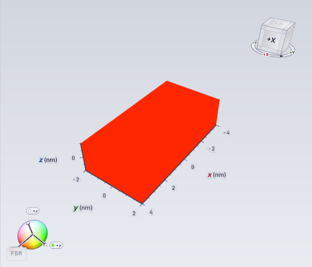

# Odbiór rdzenia interaktywnego Study — 2026-11-08

**Wynik: PASS, 9/9 bramek podstawowego cyklu FDM CPU.** Rzeczywisty backend i przeglądarka wykonały: trzy kolejne Relax, ponowienie wybranego B, ponowienie Study, zmianę materiału i ponowienie A, zmianę siatki i Study, reset tekstury B oraz ponowienie B i całego Study. Kontrole obejmowały natywne artefakty, publiczne próbki pola, historię, pełny reload i widoczny WebGL2. Każda z sześciu prób mutujących UI zakończyła się jednym oczekiwanym Compute i zerem błędów Reacta, konsoli, HTTP oraz naruszeń harnessu.

## Tożsamość wykonania

- Zarządzany DEV WSL: `be231c339cf24f1fa32a4b4981e54409`, konfiguracja `1778f03786acd3bd91821aa2d58efbd4570760edbe306154dc302e5c522e7a3b`.
- Natywna binarka: czysta rewizja `dc7eeb6ce8f4c1d35885be15568c75f2aec20d8d`; snapshot `d4d5cb529075f680331ac35c42dbaeb405102140d1f315b74f2b68c79115e207`. Pełny build i pakietowanie przeszły, API przywróciło zapisany workspace. Managed codegen przeszedł bez różnic.
- Harness: `e1bf0b8e7f1c1933b8a24a215ac106ebbab8878c`. Ta rewizja zmienia wyłącznie test i oczekiwanie harnessu na wyrenderowany stan; źródła produktu pozostają zgodne z binarką DC7.
- [Lokalne UI](http://127.0.0.1:3242/session/p22-three-relax-stages). Jest to runtime grupy P22; inne checkouty i grupy pozostały poza operacją.
- [Utrwalony indeks dowodów](2026-11-08-interactive-study-core-acceptance.json) zawiera pełne identyfikatory, hashe źródeł, ścieżki receiptów w wolumenie kontrolnym, wyniki porównań CAS i kontrolę publicznego pola.

## Rzeczywiste próby UI

| Scenariusz | Próba browser QA | Natywny run | Wynik |
|---|---|---|---|
| PPM B: tylko wybrany etap | `6c4d9546200242729a226d0ad4798747` | `run-live-ddd79f6d199081195acdd5daeb67f1331818163a1d3b837972a49e69c9d0ebdb` | PASS |
| PPM Study: A/B/C | `cdde432f7394472aa6e8a9e8cd987c28` | `run-live-8b57f5bb9039ff9f84fd9a0e4797d1ad6456390d8696b8c4a38cd20cc48c991e` | PASS |
| Materiał → zapis → tylko A | `692a51f43a0b4715a64f5896b03f5b51` | `run-live-04d7793686ea005f0a3f0f85c0fce2944ded6dc7a26f7060a6285dee6514c666` | PASS |
| Komórka 2→1 nm w X → Apply Grid → Study | `bb4fd54c4b72420fb58513ab7c66916d` | `run-live-ce376d10fd12311ba739454fef3e4a4b501c0393e91623c287a1f1c9ab276de5` | PASS |
| Reset B → authored input → tylko B | `fec200afb035457c9030a65062fd79d9` | `run-live-67b65b1635e1676cc1a80641cfc3ea9e26b77c5a36a2a0dd5430dd8c8b6c55a8` | PASS |
| Study: A → reset B → C | `fc5e3a808e5542ed8c089f0905ae3e04` | `run-live-e851e2eabec7835c216c1b8ec7423872b77c8c3b977de9982bb9b77b1cdae6d5` | PASS |

Przebudowa 8→16 komórek i następujący Compute Study odbyły się w jednej zamontowanej stronie. Wcześniejsza próba harnessu otwierała menu przed odświeżeniem jego zasobów: Compute nie dotarł do API. Dziennik API, trzy taski Accepted bez attemptu i brak startów workerów potwierdziły ten stan. Poprawka czeka na widoczny nowy Run w Inspectorze i gotową siatkę 16 komórek w Explorerze. Guard odrzucający zmienione preconditions pozostał bez zmian. Osobne, przypięte wznowienie dokończyło tamten przygotowany run; powyższy świeży przebieg dodatkowo zamknął kontrolę tej samej strony.

## Magnetyzacja, materiał i historia

- Kontynuacja S29: wszystkie próbki B.initial są równe A.final, a C.initial są równe B.final. Zmiana algorytmu LLG overdamped → projected gradient BB → nonlinear CG nie resetuje stanu.
- Jawne ponowne uniform X, S30: wszystkie osiem próbek B.initial jest dokładnie `(1,0,0)`, choć A.final różni się od tej wartości o `0.007439671386780809`. C ponownie pobiera B.final.
- Reset regionu, S31: maskę wyznaczono z rzeczywistego FMRM i jego legendy. B.initial ma +Z w lewym regionie i A.final poza nim; C.initial jest równe B.final.
- UI authored reset B: plan zawiera wymagany, typowany `authored_initial_state`; wszystkie 16 B.initial są uniform X. W pełnym Study A.final ewoluuje, B zachowuje jawny reset, C pobiera wynik B.
- Materiał: worker użył Ms=`600000`, Aex=`1e-11`, alpha=`0.5` we wszystkich komórkach. Sama zmiana współczynników zachowała siatkę ośmiu komórek. Zmiana komórki przebudowała ją do `[8,2,1]`, 16 komórek.
- Publiczne pole każdego odebranego runu zgadza się z końcowym stanem CAS: maksymalna różnica `0`.
- Stary wynik A nadal udostępnia własną geometrię `[4,2,1]`, osiem próbek i dwa zgodne wiersze skalarów po remeshu i kolejnych zmianach tekstury. Wszystkie 2115 plików z inwentaryzacji sprzed recovery zachowało rozmiary i hashe po całym cyklu.

## Telemetria i obraz

Próba `8216fffc919a45af8a5dde0daa72beee` przeszła po końcowym runie `run-live-e851e2eabec7835c216c1b8ec7423872b77c8c3b977de9982bb9b77b1cdae6d5`. Przed i po pełnym reloadzie zachowała tożsamość API, sesji i runu. Step=`1`, energia skalarów, current run, summary oraz widocznego footera wynosiła `-6.063642418651386e-22 J`. Nie wystąpiły błędy strony, konsoli, sieci ani HTTP. Widoczny canvas WebGL2 miał niezerowy bufor i właściwe 16 komórek; zapis PNG 618×528 sprawdzono również wizualnie.

## Integracja z nowszym masterem

Podczas finalizacji master otrzymał PR #418 (`b8e39d7f0182c87566f9de59e15ff1ae668d0b2f`). Rozwiązanie konfliktów zachowuje resety i wiązanie stanu P22 oraz kontrolę topologii, adaptacyjnych snapshotów Run i zegarów z mastera. Integrację tych źródeł sprawdzają kontrole PR #411. Powyższy odbiór działającego runtime pozostaje przypisany dokładnie do binarki DC7 i harnessu E1BF; nie przenosimy go automatycznie na późniejszą binarkę.

## Testy i granice kwalifikacji

[Pełne CI DC7](https://github.com/MateuszZelent/fullmag/actions/runs/42480881756) i siedem pozostałych workflow zakończyły się sukcesem. Odczytany log Rust potwierdza indywidualne wykonanie sześciu regresji P10/P11 oraz dwunastu regresji restore, historycznej siatki, energii i cienkiego statusu. Poprawka harnessu przeszła 22 testy kontraktowe, parser Node, diff check i lint w dokładnym zarządzanym frontendzie; hash pliku kontenera odpowiadał źródłom.

P10 wiąże kwalifikowanego poprzednika przed walidacją i kompiluje wyłącznie B. P11 przygotowuje wymagany authored input bez sztucznego CAS; brak resetu i obce referencje nadal mają regresje odmowy. Obie dodatnie ścieżki przeszły powyższy rzeczywisty odbiór FDM CPU.

To krótkie próby FDM CPU w double, 8/16 komórek, z limitami kroków 10/1/1 i wyłączonym demagiem. Potwierdzają przepływ danych i interakcje. Kwalifikacja zbieżności fizycznej, FEM CPU/GPU, FDM GPU, multilayer i pełna macierz S01–S46 wymagają osobnych dowodów. Rozliczenie wszystkich 22 ustaleń znajduje się w [§11 planu](../superpowers/plans/2026-11-05-interactive-simulation-control-and-texture-reexecution-plan.md).

Integrację kodu śledzi [PR #411](https://github.com/MateuszZelent/fullmag/pull/411). Odbiór działającego runtime i status scalenia mają osobne tożsamości.
