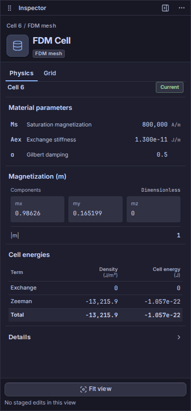
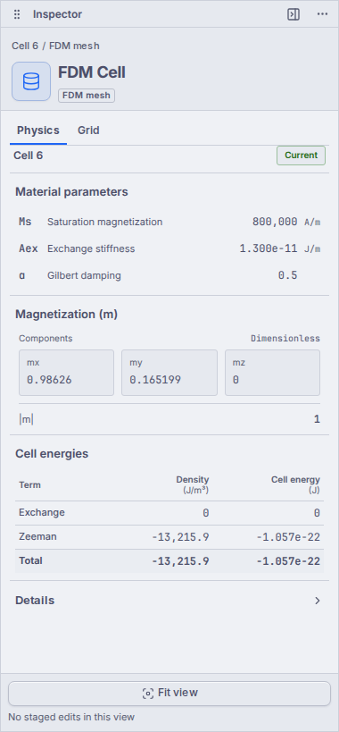
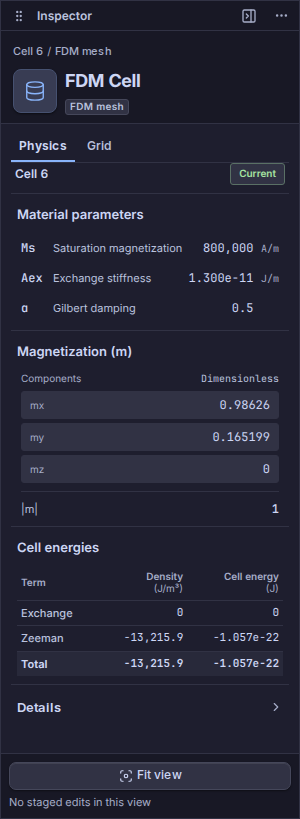

# P22 — rzeczywisty odbiór Inspectora FDM Cell, 2026-11-13

**PASS w opisanym zakresie.** Kliknięcie komórki 6 w rzeczywistym canvasie otworzyło Physics w Inspectorze FDM Cell. Materiał, magnetyzacja i energie zgadzają się z publicznymi point probes. Zakładki działają z klawiatury; przy szerokościach 380 i 300 px nie obcięto żadnej wartości. Sprawdzono jasny/ciemny motyw oraz przejście Home i pełny reload. Nie wystąpiły błędy strony, konsoli ani HTTP.

| Wielkość | Wartość komórki 6 |
|---|---:|
| Ms | 800000 A/m |
| Aex | 1.3e-11 J/m |
| alpha | 0.5 |
| m | (0.986260256021403, 0.1651989933159304, 0) |
| norma m | 1 |
| gęstość energii całkowitej | -13215.919465274435 J/m³ |
| energia komórki | -1.0572735572219551e-22 J |

Energia komórki odpowiada gęstości pomnożonej przez objętość `(2 nm)^3 = 8e-27 m³`. Część wymienna wynosi 0; w tej próbie wyłączono demag. Nie dodano fikcyjnej energii dla niedostępnych składników. Czternaście odpowiedzi point probe oraz surowe wartości widoczne w Inspectorze są w dołączonym indeksie JSON.

## Tożsamość dowodu

- Browser QA: `b38edfb5c4b44ba2905fece51629f34e`, succeeded; prawdziwy pointer pick, Chromium/WebGL2 przez SwiftShader.
- Binarka: `9f146c29bb682a465bb8bf6e0c672efa4d84b7c6`, clean; source snapshot `bab950ffbf87a49209b69e556a11364b99208ddca3a5c9cc69cda2f18f51d4d5`.
- Run: `run-live-6c17b503b4780c537529256c9e0220fbd96e0ae2f8ec2bf3339d8aaa6e52cc3b`; nowe jawne uruchomienie bazowe, trzy natywne Succeeded. Wcześniejsze Study i jego wyniki pozostają zachowane.
- Pierwszy preflight `31b63e1497fa489f95ad8455f05b9dae` zakończył się timeoutem zimnej kompilacji `/workspace` przed startem browsera. Po potwierdzonym GET 200 wykonano powyższą nową próbę; nie ponawiano Solve.

## Obraz rzeczywistego runtime

Obrazy obejrzano po eksporcie i sprawdzeniu hashy. [Indeks pomiarów, źródeł i screenshotów](2026-11-13-p22-fdm-cell-ui.json) zachowuje dokładne tożsamości.

## Granice

To krótki test przepływu FDM CPU double na ośmiu komórkach, bez demag. Nie dowodzi zbieżności fizycznej, FEM/GPU/multilayer ani pełnej macierzy S01–S46. Odbiór ponowień etapów, zmiany mesha i eksportu/importu jest osobny. Dowód dotyczy wskazanej binarki; nie przenosi się automatycznie na późniejszy build lub merge.
