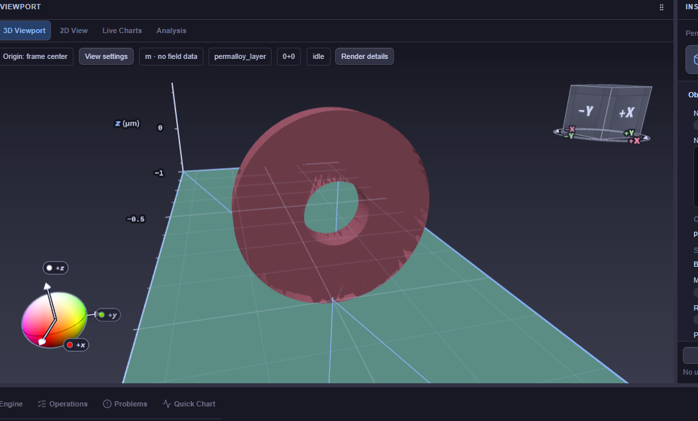
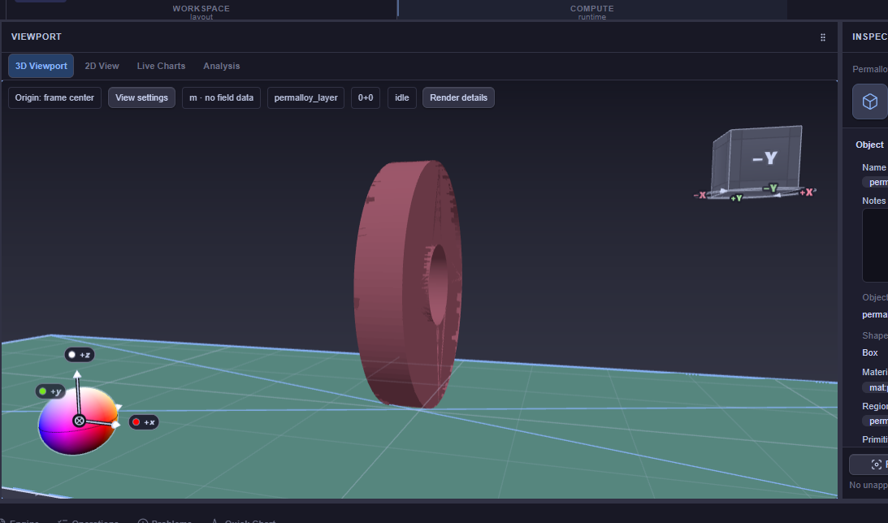

# Audyt artefaktów powierzchni pierścienia w widoku 3D

Data: 22.10.2026, Europe/Warsaw. Zakres: diagnoza i raport, bez naprawy aplikacji.

## Wynik

**Najbardziej prawdopodobną przyczyną plam jest utrata precyzji głębokości, prowadząca do z-fightingu.** W kodzie kamery znaleziono i odtworzono konkretną regresję: po zbliżeniu do małego obiektu wewnątrz bryły ograniczającej całą scenę funkcja ustawia `near = 1e-12 m`. Dla obserwowanej kamery jest to około **51 800 razy mniej** niż przed zmianą. Przy modelowym buforze 24-bitowym krok głębokości przy ringu wynosi wtedy około **24 nm**. To skala istotna wobec grubości pierścienia 50 nm.

**Potwierdzono wadliwy wynik funkcji i utratę rozdzielczości w obliczeniu. Powiązanie dokładnych pikseli obu zrzutów z tym mechanizmem ma wysokie prawdopodobieństwo, lecz nie jest jeszcze potwierdzone kontrolowanym testem WebGL A/B.** Nie zmieniono ustawień użytkownika ani kodu aplikacji.

Zwykły aliasing daje schodkowanie konturu. Tutaj ciemne, nieregularne fragmenty zajmują także wnętrze powierzchni przy otworze i zewnętrznym obwodzie. Taki obraz pasuje do błędnego rozstrzygania, która ściana leży przed drugą. Samo zwiększenie antyaliasingu nie przywróci utraconej precyzji głębokości. Mechanizm i znaczenie `near` opisują [Three.js — Cameras](https://threejs.org/manual/pages/cameras.html) oraz [OpenGL — Depth Buffer FAQ](https://www.opengl.org/archives/resources/faq/technical/depthbuffer.htm).

## 1. Źródła i granice dowodów

| Element | Ustalenie |
|---|---|
| Adres zrzutów | Użytkownik potwierdził `localhost:3198`, grupa `fullmag-master` |
| Checkout | `/home/kkingstoun/git/fullmag/fullmag`, branch `master` |
| HEAD | `e19ee0664173b5d0dafe281b402c0b088a11b3d5` |
| Stan źródeł | Dirty; osiem plików viewportu miało wcześniejsze niezacommitowane zmiany |
| Sesja | `permalloy_layer_cofeb_rings_relax_300nm` |
| Początkowy odczyt API | HTTP 200; `fem:unmaterialized`, `cell_count=0`, `topology_revision=0`, `waiting_for_compute` |
| Późniejsze odczyty | 21:49:18–21:49:20 oraz 21:50:20 CEST; siatka była już zmaterializowana, `cell_count=1087250`; kamera odsunięta |
| Oryginalne ustawienia WebGL ze zrzutów | Nie odczytano; brak pomiaru `DEPTH_BITS`, aktywnego `near/far`, MSAA i drawing buffer z tej przeglądarki |

Sesja pozostawała aktywna. Pierwszy odczyt ustawień miał już ring w trybie wireframe, podczas gdy załączniki pokazują wypełnioną powierzchnię. Nie utożsamiam kolejnych odczytów z dokładnym stanem zrzutów. Początkowy status bez siatki jest zgodny z widocznym na zrzutach `0+0` oraz `m · no field data`.

Artefakty audytu:

- [Zrzut przedni](viewport-ring-depth-audit-2026-10-22/user-front.png) i [zrzut boczny](viewport-ring-depth-audit-2026-10-22/user-side.png) — niezmienione kopie załączników; [sumy SHA-256](viewport-ring-depth-audit-2026-10-22/screenshots.json).
- [Początkowy stan](viewport-ring-depth-audit-2026-10-22/observed-initial-state.json) — jawnie oznaczona transkrypcja istotnych pól wcześniejszych odpowiedzi narzędzia.
- [Odtworzenie bliskiej kamery](viewport-ring-depth-audit-2026-10-22/evidence-near-replay.json) — funkcje źródłowe, wejścia API, wyniki, hashe i kontrola stabilności.
- [Późniejsza odsunięta kamera](viewport-ring-depth-audit-2026-10-22/evidence-far-live.json) — oddzielny odczyt kontrolny.
- [Manifest źródeł](viewport-ring-depth-audit-2026-10-22/source-manifest.json), [probe.cjs](viewport-ring-depth-audit-2026-10-22/probe.cjs), [run-probe.py](viewport-ring-depth-audit-2026-10-22/run-probe.py).





## 2. P1 — regresja wyznaczania przedniej płaszczyzny kamery

Miejsce: [Viewport3DScene.tsx](../../apps/control-room/src/modules/viewport-3d/layers/Viewport3DScene.tsx), linie 409–442, szczególnie 426–434.

Funkcja `resolveViewport3DProjectionCameraClip` wykonuje:

```text
nearestDepth = depth(bounds.center) - bounds.radius
poseNearLimit = nearestDepth > 1e-12 ? nearestDepth * 0.5 : 1e-12
near = max(1e-12, min(fit.near, poseNearLimit))
```

`bounds` obejmuje domenę/universe oraz prymitywy. Nie jest to odległość do najbliższej rzeczywistej ściany widocznego ringu. W [useViewport3DSceneModel.ts](../../apps/control-room/src/modules/viewport-3d/hooks/useViewport3DSceneModel.ts), linie 3756–3798, dane domeny/universe łączone są z bounds obiektów. W początkowym stanie bez topologii otrzymujemy rozmiar `2,8 × 2,1 × 1,2 µm` i promień sfery `1,85 µm`.

Dla zapisanej bliskiej kamery:

- głębokość środka tej sfery: około `0,647 µm`;
- `nearestDepth`: około `−1,203 µm`;
- głębokość środka ringu: około `0,634 µm`;
- wynik funkcji: `near = 1e-12 m`, `far = 1e-3 m`.

Kamera znajduje się wewnątrz dużej sfery ograniczającej scenę, choć ring pozostaje przed kamerą. Algorytm sprowadza tę sytuację do minimalnego `near`. Zmienia to rozdział precyzji całego bufora głębokości.

**Pochodzenie regresji:** commit `d87d42ed78a4267d9d9ad064d2c04f6c2c14543c`, „Apply viewport camera FOV and qualify appearance regressions”, 20.10.2026. Rodzic `3cae01857b630eb2825e4b22782307bf467034b7` zwracał `near: fit.near`. Historia wskazuje dokładne wprowadzenie ryzykownego warunku; nie wykonano pełnego historycznego buildu ani bisekcji wizualnej.

Dirty diff obecnej sesji nie zmienia tego fragmentu kamery. Dodaje głównie przekazanie widoczności z primitive do gotowej siatki. Nie ma podstaw, żeby przypisać mu wykazaną regresję clippingu.

## 3. Obliczenie rozdzielczości i porównanie z poprzednim kodem

W istniejącym kontenerze `fullmag-master-frontend-1` wykonano wyodrębnione, niezmienione deklaracje funkcji z bieżących źródeł oraz z rodzica wskazanego commita. Parser wybrał deklaracje, Node usunął wyłącznie adnotacje typów w pamięci. Użyto dostępnego Three.js r186. Nie budowano aplikacji ani testów jednostkowych.

Bliska kamera to wartość faktycznie odczytana z API przy revision 11, zachowana przed zmianą stanu sesji. Replay nie zmienia kamery na serwerze. Bounds odtwarzają ścieżkę **bez zmaterializowanej topologii** z domeny/universe i authored objects. Późniejsze bufory topologii nie zostały pobrane, więc wynik nie jest pomiarem aktualnych bounds renderowanej siatki.

| Wielkość | Bieżąca funkcja, bliska kamera | Funkcja przed regresją, te same wejścia |
|---|---:|---:|
| `near` | `1e-12 m` | `5,18e-8 m` |
| `far` | `1e-3 m` | `1e-3 m` |
| `far/near` | `1e9` | około `19305` |
| Przybliżony krok głębokości przy ringu, 24 bity | `23,96 nm` | `0,000463 nm` |
| Modelowe głębokości oddalone o 15 nm | ten sam kod `16777189` | różne kody `15407380` i `15439058` |

To obliczenie dla standardowego bufora głębokości o zadanej liczbie bitów, **nie pomiar formatu bufora użytkownika**. Dla dodatniej odległości wzdłuż osi kamery `z`, `n=near`, `f=far`:

```text
d(z) = f/(f-n) - f*n/((f-n)*z)
Δz ≈ z²*(f-n)/(f*n*(2^b-1))
```

Kod pokazuje również identyczny wynik `near` przy proporcjach viewportu 1, 1,6 i 2,2. Wyklucza to zależność tego konkretnego załamania od dokładnej szerokości zrzutu.

Przy ograniczeniu wejściowych bounds do samego ringu funkcja zwraca około `5,98e-9 m`; przy wszystkich prymitywach nadal `1e-12 m`. To wskazuje na związek ze skalą obejmującej scenę bryły. **Usunięcie universe albo ignorowanie innych obiektów nie jest pełną naprawą** — także sama szeroka warstwa permaloju wywołuje problem.

Późniejsza odsunięta kamera dawała `near ≈ 4,85e-8 m`, bez załamania do minimum. Wyjaśnia to potencjalną zależność defektu od zoomu i orientacji. Nie dowodzi wizualnego zniknięcia plam w tej klatce.

## 4. Czynniki wzmacniające i hipotezy alternatywne

| Hipoteza | Ocena i dowód |
|---|---|
| Utrata precyzji głębokości | **Najsilniejsza.** Powtarzalny wynik bieżącej funkcji, porównanie historyczne i obserwowana skala geometrii. Pixel A/B: `NOT VERIFIED`. |
| Przednie i tylne ściany tej samej bryły konkurują o głębokość | Mechanizm wiarygodny: `solidSurface` używa `DoubleSide`, `depthTest=true`, `depthWrite=true`, `polygonOffsetFactor=1`, `polygonOffsetUnits=1`. Nie trzeba dwóch osobnych obiektów w tym samym miejscu. Udział każdego parametru wymaga A/B. |
| Oświetlenie uwidacznia różnice ścian | Materiał studio używa Lambert; fragmenty różnych ścian mogą mieć różną jasność. Commit `722c18e63ac139b4e7e95ae649e2969316d5fdcf` dodał ten tryb. To możliwy wzmacniacz widoczności, bez dowodu pierwotnej przyczyny. |
| Błąd konstrukcji pierścienia / normalnych | W przeglądzie brak oczywistego błędu. `Difference(Cylinder,Cylinder)` tworzy jedną annularną `ExtrudeGeometry`, otwór ma przeciwny winding, remap osi X zachowuje orientację i przenosi normalne. |
| Zbyt mało segmentów / aliasing | `curveSegments: 64`; pewna kanciastość konturu jest możliwa, lecz nie wyjaśnia dobrze ciemnych pól wewnątrz powierzchni. Więcej segmentów ani MSAA nie usunie wykazanego problemu `near`. |
| Nakładanie primitive i siatki FEM | Nie jest potrzebne do wyjaśnienia problemu w początkowym stanie bez topologii. Po materializacji wymaga osobnego sprawdzenia; nie przenoszę wniosków między tymi stanami. |
| Wireframe / region overlays | Mogą pokazywać triangulację, lecz brakuje dowodu ich aktywności w obu klatkach. Sama specyfika linii nie potwierdza źródła plam na powierzchni. |

Źródła czynników:

- [viewport3DRenderPolicy.ts](../../apps/control-room/src/modules/viewport-3d/layers/viewport3DRenderPolicy.ts), linie 42–50 — depth, side, polygon offset.
- [PrimitiveObjectLayer.tsx](../../apps/control-room/src/modules/viewport-3d/layers/PrimitiveObjectLayer.tsx), linie 207–212 i 274–287 — normalne i Lambert/Basic.
- [PrimitiveObjectLayerModel.ts](../../apps/control-room/src/modules/viewport-3d/layers/PrimitiveObjectLayerModel.ts), linie 222–280 — geometria ringu i remap.
- [viewport3dVisualProfile.ts](../../apps/control-room/src/modules/viewport-3d/viewport3dVisualProfile.ts), linie 187–202 — żądanie antyaliasingu zależne od profilu; faktyczne MSAA w przeglądarce nie zostało zmierzone.

Nie stwierdzono na tej podstawie ubytku geometrii fizycznej ani błędu solvera. Audyt renderowania nie kwalifikuje poprawności siatki i obliczeń FEM.

## 5. Zalecany zakres naprawy

1. **P1: poprawić wybór `near/far` dla zbliżeń wewnątrz bounds sceny.** Nie utożsamiać przecięcia kamery ze sferą całej domeny z koniecznością ustawienia `near=1e-12`. Uwzględnić dodatnie głębokości istotnej geometrii i wymagany budżet precyzji; zachować możliwość oglądania bliskich powierzchni. Perspektywa i ortho wymagają osobnej oceny.
2. **P2: przejrzeć stałe `far >= 1e-3 m` i `DoubleSide`/polygon offset.** Przy perspektywie główna wykazana strata wynika z `near`; samo skrócenie `far` nie odwróci jej w tym przykładzie. Ewentualne wyłączenie tylnej strony musi zachować poprawność otwartych powierzchni, clippingu i trybów diagnostycznych.
3. **P2: dodać scenariusz regresyjny małego ringu nad szeroką cienką warstwą**, z kamerą wewnątrz globalnej sfery. Obecne testy clippingu obejmują zasięg i FOV, lecz nie sprawdzają rozdzielczości głębokości dla takiego zbliżenia.
4. Dopiero po usunięciu plam oceniać zwykłe schodkowanie konturu: efektywne MSAA, DPR i profil jakości. Nie zwiększać siatki solvera w celu naprawy tej wady podglądu.

Nie zalecam ślepego cofnięcia całego commita FOV: zawiera także ochronę przed obcinaniem widocznej geometrii. Stała duża wartość `near` mogłaby przywrócić ten problem. `logarithmicDepthBuffer`/odwrócona głębokość wymagają zgodności shaderów, postprocessingu i urządzeń; nie są automatycznym zamiennikiem poprawnej polityki kamery.

## 6. Weryfikacja naprawy i brakujący dowód

Minimalny test rozstrzygający: zapisać kamerę, ustawienia i tożsamość sceny; w izolowanej sesji odtworzyć primitive ring; wykonać klatki z obecnym clippingiem oraz poprawioną polityką przy identycznym MSAA, DPR, materiale i kamerze. Sprawdzić obwód, otwór i widok boczny. Po powrocie do starej polityki artefakt powinien wrócić. Oddzielnie wyłączyć wireframe/region overlays i porównać Lambert/Basic.

Wymagane kryteria:

- widoczny canvas, `gl.isContextLost() === false`, niezerowe `drawingBufferWidth/Height`;
- zapis rzeczywistych `camera.near/far`, `DEPTH_BITS`, próbek MSAA, renderer/GPU i efektywnego DPR;
- brak plam podczas obrotu, zbliżenia i przejścia przez próg dawnego załamania `near`;
- brak odcinania bliskich obiektów, brak regresji FOV, perspektywy i ortho;
- osobne klatki primitive-only oraz mesh-ready, także po przejściu między nimi;
- zachowana jakość warstw, poprawna widoczność cienkiej warstwy, brak ciągłego renderowania w idle.

**Browser/WebGL A/B: `NOT VERIFIED`.** Narzędzie Windows Computer Use odrzuciło uruchomienie z bieżącym WSL `sandboxCwd` (`sandboxCwd is not a local file URI`). W frontendzie jest Playwright 1.62.1, ale nie ma jego Chromium ani systemowego Chromium; przypięty obraz browser QA także nie był lokalnie dostępny. Istniejąca zarządzana recepta `docker-dev-browser-qa` pozostaje drogą do odrębnej kwalifikacji; nie zastępowano jej instalacją/buildem na hoście. Nie wykonywano testów jednostkowych ani uruchomienia Solve, restartu lub zmian sceny.

| Rodzaj dowodu | Stan |
|---|---|
| Oględziny obu załączników | Wykonane |
| Przegląd kodu, diff i historii | Wykonany; zakres viewport/kamera/primitive/material |
| HTTP istniejącej sesji | 200; oddzielone stany przed i po materializacji |
| Wykonanie funkcji kamery + porównanie historyczne | Exit code 0; źródła stabilne podczas obu probe |
| Obliczenie kwantyzacji 24-bit | Wykonane; format rzeczywistego WebGL niezmierzony |
| Kontrolowany obraz A/B w przeglądarce | `NOT VERIFIED` |
| Build, solver GPU, walidacja fizyki, kwalifikacja wydania | Nie wykonywano; poza zakresem |

Reprodukcja probe, z głównego checkoutu i przy działającej tej samej grupie:

```sh
python3 -B docs/diagnostics/viewport-ring-depth-audit-2026-10-22/run-probe.py \
  --replay-captured-camera --output /tmp/ring-depth-replay.json
```

Probe czyta API aktualnej sesji; po zmianie sceny wynik wymaga ponownej interpretacji. Zapisane JSON-y pozostają dowodem konkretnych wejść z tego audytu. Raport i załączniki są lokalne, bez commit/push/PR. Cudze zmiany pozostały zachowane.
