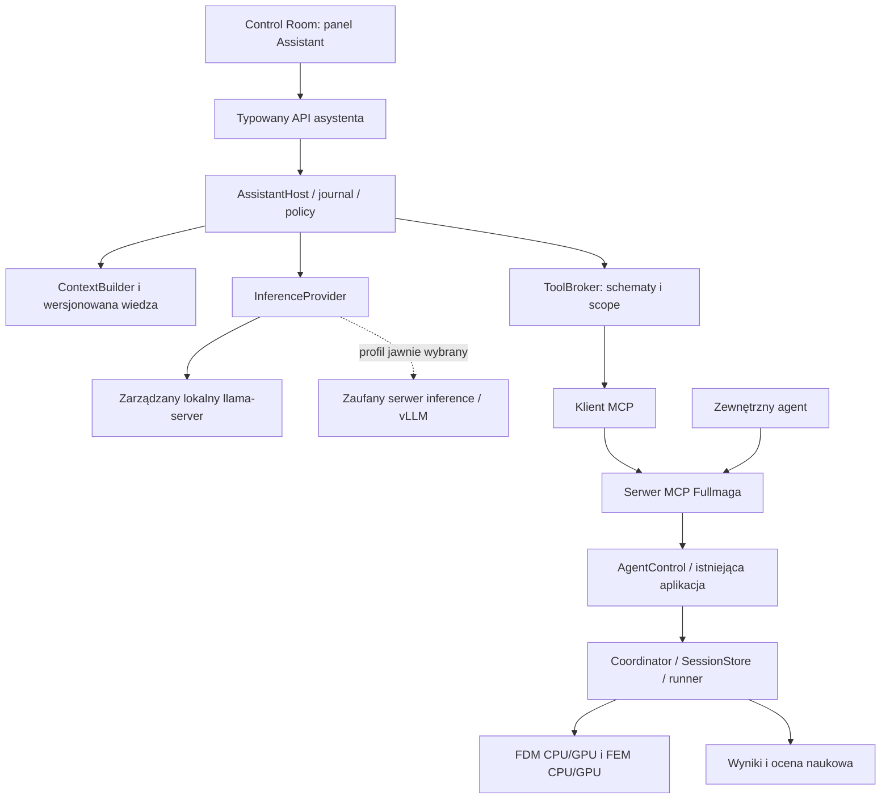
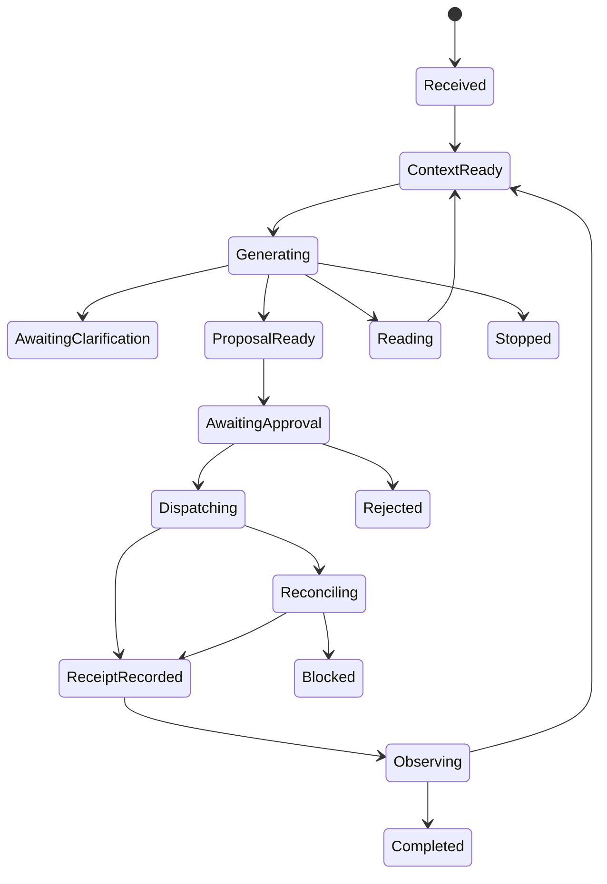
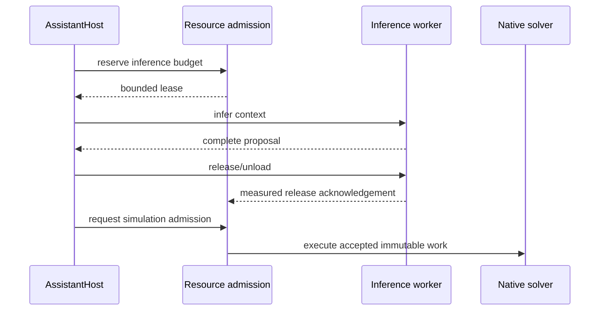

# Fullmag Assistant — architektura lokalnego asystenta naukowego

**Data:** 6.11.2026. **Status:** DESIGN; żadna nowa funkcja opisana w tym dokumencie nie jest deklarowana jako wdrożona.  
**Specyfikacja bazowa:** [architektura MCP](mcp_2026-10-31/02_PLAN_ARCHITEKTURY_MCP.md).  
**Audyt wejściowy:** [08](08_AUDYT_ROZSZERZENIA_LLM.md). **Realizacja:** [12](12_PLAN_WDROZENIA_LLM.md).

## 1. Cel i definicja produktu

Użytkownik ma móc napisać „utwórz falowód, dodaj wzbudzenie, przeprowadź relaksację i pokaż widmo”, zobaczyć brakujące dane i proponowane zmiany, a następnie wykonać rzeczywisty, odtwarzalny workflow. Asystent ma korzystać z tych samych projektów, geometrii, materiałów, solverów, wyników i kontrolek co UI, Python i zewnętrzny klient MCP.

Nazwy robocze `Fullmag Assistant`, `Fullmag-Assistant-Lite` i `Fullmag-Assistant-Workstation` nie oznaczają istniejących wydań modeli. Integracja ma działać także z modelem bazowym bez adaptera; specjalizacja jest wersjonowanym ulepszeniem, nie warunkiem uruchomienia infrastruktury.

### 1.1 Wymagania LLM-R01–LLM-R18

| ID | Wymaganie normatywne |
|---|---|
| LLM-R01 | Działanie lokalne/offline po instalacji pakietu; brak obowiązkowego zewnętrznego API |
| LLM-R02 | Wymienne modele i silniki, bez zależności fizyki od rodziny LLM |
| LLM-R03 | Wszystkie efekty w Fullmagu przez autoryzowaną granicę narzędzi MCP |
| LLM-R04 | Jeden DSL, scene authority i ProblemIR; brak równoległego solvera lub DSL asystenta |
| LLM-R05 | Jawne rozpoznawanie brakujących danych, jednostek i założeń fizycznych |
| LLM-R06 | Dokumentacja przypięta do buildu, schematów i statusu funkcji; runtime state pobierany narzędziami |
| LLM-R07 | Diff/preview, akceptacja lub delegacja przed efektem; brak samonadawania praw |
| LLM-R08 | Tożsamość instancji, projektu, rewizji, runu i próby sprawdzana przed mutacją |
| LLM-R09 | Durable journal pętli; timeout nie powoduje podwójnego submit |
| LLM-R10 | Rozróżnienie statusu infrastruktury, solvera i oceny naukowej |
| LLM-R11 | Wspólny admission zasobów z solverem; inference jest przerywalne i zwalnia VRAM |
| LLM-R12 | Źródłowy, edytowalny skrypt i provenance dostępne po authoringu |
| LLM-R13 | Kontrola wszystkich rodzin operacji z bazowego katalogu, zależna od wdrożenia i kwalifikacji |
| LLM-R14 | Integracja z istniejącym Control Room, bez drugiego workspace i własnych stanów geometrii |
| LLM-R15 | Prywatne dane nie trafiają do treningu lub zdalnego modelu bez osobnej zgody |
| LLM-R16 | Trening i dystrybucja z pinami modeli, danych, parserów i kwantyzacji |
| LLM-R17 | Kwalifikacja PL/EN, funkcjonalna, bezpieczeństwa, naukowa i sprzętowa |
| LLM-R18 | Wyłączenie lub rollback asystenta nie uszkadza projektów ani zaakceptowanych obliczeń |

## 2. Warianty architektury i wybór

| Wariant | Zalety | Koszt / wada | Decyzja |
|---|---|---|---|
| Host Rust wewnątrz backendu + odseparowany proces inference | Wspólne identity/DTO, kontrola cyklu życia, bez nowego schedulera; model wymienny | Wymaga własnej, ograniczonej pętli agenta i adapterów | **Rekomendowany dla produktu** |
| Python/Qwen-Agent jako zewnętrzny host MCP | Szybki prototyp i porównanie zachowania narzędzi | Dodatkowy runtime aplikacyjny, ryzyko rozbieżnej pamięci/zgód; framework nie usuwa potrzeby policy | Dopuszczony harness eksperymentalny [S18] |
| LLM wewnątrz handlerów serwera MCP | Pozornie proste „wszystko w MCP” | Ukryte akcje, trudne retry, rekurencja, gorsza wymienność i audyt | Odrzucony |

To rekomendacje autora planu, nie wcześniejsze decyzje użytkownika. Logiczne rozdzielenie nie wymaga osobnych stałych kontenerów. MCP przydziela koordynację modelu hostowi; serwer pozostaje dostawcą operacji. [S01]

## 3. Komponenty i graf zależności



`fullmag-assistant` zależy od neutralnych typów `fullmag-application` i SDK klienta MCP, a nie od prywatnego `AppState`. `fullmag-api` tworzy hosta i implementuje porty przechowywania, uprawnień oraz zasobów. `fullmag-mcp` nie zależy od `fullmag-assistant`; wyłączenie asystenta nie wyłącza MCP.

`InferenceProvider` jest transportem generacji. Nie zna `SessionStore`, nie posiada credentials MCP i nie może bezpośrednio uruchamiać solverów. `ToolBroker` waliduje odpowiedź modelu, lecz serwer MCP nadal ponownie stosuje policy. Nie wolno omijać tej drugiej kontroli z argumentem „to nasz własny lokalny model”.

Początkowo klient hosta korzysta z prywatnego endpointu MCP tej samej instalacji. Ewentualny transport in-process musi przechodzić te same DTO, walidatory i policy, oraz mieć test zgodności z transportem sieciowym; nie jest skrótem do wywołań solvera.

### 3.1 Projektowany układ plików

Wszystkie pozycje z poniższego drzewa są **NOWE**, chyba że wskazano istniejący katalog nadrzędny.

```text
crates/fullmag-assistant/
  Cargo.toml
  src/lib.rs
  src/contracts.rs            # ThreadRef, TurnRef, Proposal, evidence
  src/orchestrator.rs         # deterministic state machine
  src/context.rs              # bounded, scoped model input
  src/intent.rs               # requirements, unknowns, assumptions
  src/tool_broker.rs          # allowlist, schemas, proposal dispatch
  src/mcp_client.rs           # qualified MCP client adapter
  src/approvals.rs            # binds trusted grants, never manufactures them
  src/journal.rs              # port + recovery contracts
  src/inference/{mod,provider,local,remote,normalization}.rs
  src/models/{manifest,integrity,manager}.rs
  src/knowledge/{manifest,retrieval,ranking}.rs
  src/resources.rs            # lease port, not a second scheduler
  src/evidence.rs             # claim-to-receipt binding

crates/fullmag-api/src/assistant/
  mod.rs
  handlers.rs
  store.rs
  resource_adapter.rs
  supervisor.rs
  auth_context.rs

apps/control-room/src/modules/assistant/
  manifest.ts
  AssistantPanel.tsx
  ProposalReview.tsx
  EvidenceSummary.tsx
  ModelSettings.tsx
  resources.ts

assistant/
  models/registry.json
  knowledge/manifest.schema.json
  policies/defaults.json
  prompts/system.md
  recipes/                 # versioned workflow metadata, no new physics DSL
  training/                # recipes/manifests, no large weights or private data
  eval/                    # scenario manifests and independent expected states
```

Miejsca wpięcia UI oraz generatorów należy dopasować do aktualnych manifestów modułów i centralnego klienta. Nie przenosić modeli ani zbiorów treningowych do `packages/fullmag-py` jako obowiązkowej zależności importu. Normatywne zasady UI wymagają jednego klienta, resource hooks i manifestów modułów. [G06]

## 4. Przepływ jednej intencji

1. Host przypina użytkownika, instancję, projekt i kontrakty; odczytuje dostępne narzędzia oraz capabilities. Nie prosi modelu o wymyślenie identyfikatorów.
2. W kontekście umieszcza aktualne parametry potrzebne do pytania, krótkie wyniki dokumentacji i schematy wybranych narzędzi.
3. Model proponuje odpowiedź, pytanie uściślające albo wywołanie narzędzia. Niedokończony strumień nie jest akcją.
4. Host sprawdza składnię, narzędzie, scope, parametry, limit kroków i klasę efektu. Następnie wykonuje bezpieczny odczyt albo buduje propozycję zmiany.
5. Użytkownik widzi diff, jawne założenia, koszt i ograniczenia. Istniejąca delegacja może zastąpić ponowny klik, ale tylko w ustalonym zakresie.
6. MCP stosuje atomową mutację albo przyjmuje pracę; receipt trafia do trwałego dziennika przed podsumowaniem w UI.
7. Odczyt wyników i quality odbywa się po trwałych referencjach. Odpowiedź końcowa wskazuje, co rzeczywiście wykonano, a czego nie oceniono.

W trybie authoring etap 5 zatwierdza zmianę projektu, a osobny etap zatwierdza kosztowny solve. „Utwórz model” nie jest zgodą na uruchomienie symulacji. „Uruchom” nie oznacza zgody na dowolną późniejszą kampanię.

## 5. Maszyna stanów rozmowy i operacji



To **stan asystenta**, nie nowy lifecycle solvera. `Observing` nie zajmuje permanentnie GPU LLM. Odpytywanie runów wykonuje zwykły klient zasobów, a model dostaje istotne zdarzenia lub żądanie użytkownika. Wysokoczęstotliwościowa kontrola LLG nie przechodzi przez generację tokenów.

Po restarcie host odczytuje journal i porównuje status zaakceptowanych operacji. Nie odtwarza ślepo tekstu tool call z historii. Niepewny dispatch przechodzi w reconciliation. Utrata odpowiedzi inference przed zaakceptowaniem propozycji nie uruchamia niczego; utrata odpowiedzi submit po przyjęciu nie upoważnia do nowego runu.

`Stop generation` blokuje kolejne decyzje i inferencję. `Cancel simulation` to odrębne, autoryzowane narzędzie kierowane do konkretnej pracy. Zatrzymanie rozmowy nie zabija zaakceptowanych obliczeń. Awaria asystenta nie przekazuje prawa do przejmowania osieroconych workerów poza istniejącym recovery.

## 6. Kontrakty hosta

### 6.1 Semantyka rekordów

| Rekord | Właściciel i obowiązkowe dane |
|---|---|
| AssistantThread | Użytkownik, installation_id, project binding, policy profile, retention |
| AssistantTurn | turn_id, wejście użytkownika, context digest, model pack, limity i stan |
| ContextSnapshot | ProjectRef, runtime build, schema/catalog digest, knowledge pack, wybrane evidence refs |
| IntentPlan | Cel, wartości podane przez użytkownika, braki, jawne założenia, workflow refs; **nie zastępuje ProblemIR** |
| ActionProposal | Znormalizowana nazwa tool i arguments, expected revision, digest, klasa efektu, wymagana decyzja |
| ApprovalBinding | Wydany poza LLM grant_id, principal, scope, proposal digest, expiry, budżet i preconditions |
| DispatchRecord | operation key, request hash, stan wysłania, receipt albo reconciliation marker |
| AnswerEvidence | Claim, źródłowy receipt/artifact, jednostka, jakość, świeżość i ograniczenia |

`ProjectRef`, `RunRef`, `AttemptRef` i `ArtifactRef` są współdzielone z [katalogiem MCP](mcp_2026-10-31/04_KATALOG_NARZEDZI_I_KONTRAKTOW.md). Rewizje u64 są serializowane jako dziesiętne stringi zgodnie z bazowym projektem; JS nie może tracić bitów powyżej 2^53. Model nie otrzymuje sekretu grantu, a jedynie informację o dozwolonych klasach działań.

### 6.2 Przykład metadanych propozycji — DESIGN

Poniższy JSON opisuje obwiednię hosta, nie istniejące argumenty `fm_model_apply`. Argumenty są osobnym obiektem walidowanym opublikowanym schematem MCP. Demonstracyjne identyfikatory i hashe nie pochodzą z realnej sesji.

```json
{
  "schema_version": "assistant.proposal.v1",
  "proposal_id": "proposal-demo-01",
  "thread_id": "thread-demo-01",
  "turn_id": "turn-demo-03",
  "tool_name": "fm_model_apply",
  "tool_arguments_ref": "cas:demo-arguments",
  "effect_class": "draft",
  "expected_project_revision": "42",
  "approval_state": "required",
  "assumptions": [],
  "requires_live_revalidation": true
}
```

Pole `approval_state` w tym zasobie jest projekcją stanu serwera. Nie jest polem, które wolno modelowi przesłać jako uprawnienie. Nieznane pola wejściowe i nieznane enumy są odrzucane; nie „naprawiamy” ich przez zgadywanie intencji.

### 6.3 Wersjonowanie

Pakiet asystenta wiąże `assistant_contract`, `fullmag_mcp_contract`, `runtime_build`, `model_revision`, `tokenizer_digest`, `chat_template_digest`, `tool_parser_revision`, `knowledge_digest` i `policy_revision`. Kompatybilność oznacza wynik testu tego zestawu, nie zgodność prefiksu nazwy modelu. Zmiana tool schema invaliduje wygenerowane konteksty i oczekujące propozycje; nie odtwarza starych argumentów na nowym schemacie.

## 7. Wiedza o Fullmagu: trzy różne źródła

**Parametry modelu** uczą języka, typowych sekwencji i nawyków. **Wersjonowana baza wiedzy** dostarcza opis API, fizyki i przykładów. **Odczyty MCP** podają fakty o bieżącym projekcie i wykonaniu. Są to odrębne kanały; żaden nie zastępuje pozostałych.

Index knowledge budujemy z zatwierdzonych docs, publicznego DSL, schematów i przykładów z kwalifikacją. Każdy chunk ma `source_path`, `commit`, `symbol`, `line_range`, `content_hash`, `document_kind`, `feature_state`, `backend_scope` oraz `language`. Dokumenty planów i archiwalne audyty można udostępniać jako historię, ale nie rankować ich jako obowiązującej instrukcji wykonania.

Publiczne instrukcje produktu i dokumenty repozytoryjne są danymi, nie system promptem. `AGENTS.md` opisuje pracę programisty, nie nadaje użytkownikowi asystenta praw do commitów, merge, instalacji czy sprzątania cache. Nie kopiujemy z niego automatycznej autoryzacji działań do rozmowy użytkownika.

MVP korzysta z wyszukiwania leksykalnego i metadanych. Wariant docelowy dodaje embedding oraz opcjonalny reranker; przykładowym małym kandydatem jest Qwen3-Embedding-0.6B. Zysk należy wykazać na retrieval benchmarku PL/EN; nie uruchamiać dodatkowego modelu, gdy wyszukiwanie po symbolu jest wystarczające. [S17]

Aktualizacja indeksu nie aktualizuje potajemnie modelu. Projekt przypięty do starego runtime otrzymuje dokumentację zgodną z tym runtime. Brak zgodnego knowledge pack daje ograniczony tryb schematów i odczytów, a nie odpowiedzi o nowych możliwościach.

## 8. Dobór narzędzi i rozmiar kontekstu

Serwer zachowuje stabilne profile katalogu opisane w bazowym planie. Host może z pełnej, dozwolonej listy wybierać do pojedynczej inferencji mniejszy zestaw schematów. To **selekcja kontekstu modelu**, a nie niejawna zmiana `tools/list` serwera lub uprawnień. Zestaw i jego digest są zapisywane przy każdym turnie.

Domyślnie host pokazuje do 8 schematów tematycznych oraz niezbędne operacje discovery. Przy szerokim zadaniu dzieli workflow na etapy: authoring, mesh/study, execution, results. Wybór rodziny może być błędny, dlatego host obsługuje jawne żądanie rozszerzenia zestawu i powrót do discovery. Brak narzędzia w kontekście nie jest dowodem braku jego implementacji.

Kontekst zawiera zwarte podsumowanie projektu, nie cały binary field ani wszystkie logi. Duże tablice redukuje narzędzie analityczne z jawnym algorytmem. Streszczenia nie nadpisują źródłowych referencji; host potrafi ponownie odczytać pełny potrzebny fragment. Każdy dokument, nazwa obiektu i tekst logu jest oznaczony jako nieufna zawartość.

### 8.1 Początkowe limity projektowe

| Parametr | Wartość startowa, do kwalifikacji |
|---|---|
| Context Lite / Workstation | 16 384 / 32 768 tokenów łącznie z rezerwą wyjścia |
| Maksymalna generacja jednej inferencji | 4 096 tokenów łącznie z reasoning, gdy występuje |
| Maksymalna liczba wywołań narzędzi na turn | 16; dłuższy workflow wymaga nowej zatwierdzonej porcji |
| Naprawy formatu / walidacji | Najwyżej 2 po pierwszym błędnym wyniku |
| Równoległe odczyty / mutacje | 4 / 1 w obrębie rozmowy i projektu |
| Wynik narzędzia do kontekstu | Domyślnie do 32 KiB tekstu; więcej przez jawny odczyt paginowany |
| Wywołania inference jednocześnie | 1 na lokalny model pack w profilu pierwszego wydania |
| Automatyczne ponawianie mutacji | Wyłącznie ten sam request i key po reconciliation |

To limity produktu proponowane w tym planie, nie limity MCP ani właściwości sprzętu. Zwiększenie limitu nie może być odpowiedzią modelu na własny błąd. Limity kampanii i grantów są nadrzędne względem powyższych.

## 9. Authoring i semantyka fizyczna

Preferowany ciąg: język naturalny → wymagania i braki → typed operations → kanoniczna scena/DSL → istniejący lowering → ProblemIR → walidacja i plan. `IntentPlan` przechowuje intencję i decyzje, nie ma własnych równań solvera. Jednostki są normalizowane przez wspólną bibliotekę aplikacji, nie swobodną arytmetykę modelu. [G02]

Każdy parametr otrzymuje pochodzenie: podany przez użytkownika, odczytany z projektu, pochodzący z wersjonowanego szablonu lub proponowany z uzasadnieniem. Materiał „YIG” nie ustala sam przez się pełnego zestawu parametrów próbki. Brak Ms, Aex, geometrii lub definicji celu może wymagać pytania. Wybranie istniejącego, nazwanego szablonu pozwala odziedziczyć jego wartości, lecz trzeba pokazać je w preview.

Asystent ma odróżniać B [T] od H [A/m], Hz od rad/s, k [rad/m] od liczby cykli na metr, µm od nm, namagnesowanie jednostkowe od M [A/m], oraz czas fizyczny od czasu pracy. Konwersja przez μ0 jest jawna i odbywa się tylko dla właściwej wielkości. To wymagania kontraktu i testów, nie nowe wyprowadzenie fizyki.

Nie zastępować skończonego falowodu z odbiciami obliczeniem Blocha dla okresowej komórki. Nie dodawać anteny do zadania o termicznych fluktuacjach bez źródła wymuszonego. Nie zamieniać zadanego pola Zeemana w samouzgodniony prąd/Oersteda. Receptury muszą wskazywać warunki stosowalności i odsyłać do właściwych not naukowych, a runtime capability rozstrzyga wykonalność.

Ścieżka złożonego Python DSL pozostaje dostępna po osobnej kwalifikacji izolatora. Host przechowuje source, diff i authority/fidelity; nie regeneruje kodu z uproszczonej sceny po utracie semantyki. Compile/export skryptu może wykonywać kod, więc wymaga tej samej granicy zaufania co opisano w audycie. [G05]

## 10. Poziomy autonomii

| Poziom | Co wolno | Granica |
|---|---|---|
| A0 — obserwator | Wyjaśniać, czytać projekty i wyniki, przygotować niewykonany plan | Zero mutacji i kosztownych prac |
| A1 — projektant | Zatwierdzane zmiany draftu, preview siatki, eksport skryptu | Solve wymaga odrębnej zgody; preview kosztowne również pod budget |
| A2 — operator | Uruchamiać i kontrolować zatwierdzony workflow w limicie | Jeden wskazany projekt/run, brak rozszerzania fizyki i budżetu |
| A3 — badacz delegowany | Kampanie, adaptacja parametrów i analizy w ustalonej przestrzeni | Jawna funkcja celu, zakresy, max runy, zasoby, stop conditions i prawo przerwania |

A3 nie oznacza nieograniczonego dostępu. Użytkownik może delegować np. sweep pola w określonym przedziale i budżecie, lecz zmiana materiału, warunków brzegowych albo rodzaju problemu jest nową decyzją naukową. Przesunięcie punktu w dozwolonej kampanii nie wymaga klikania przy każdym przypadku, o ile grant nadal jest ważny.

Zgoda wiąże digest propozycji, rewizję, docelowe zasoby, maksymalny koszt, expiry i listę akceptowanych ostrzeżeń. Zmiana któregokolwiek istotnego elementu unieważnia zgodę. Tekst znaleziony w pliku lub wygenerowany przez LLM nigdy nie staje się approval.

## 11. Zasoby i współistnienie z solverem

Nie rezerwować GPU LLM „na zawsze”. Domyślny tryb: model ładuje się na żądanie, tworzy plan, zwalnia zbędny cache i może zostać całkowicie odładowany przed solve. W trakcie obliczeń status jest czytelny bez LLM. Współbieżność jest dopuszczona wyłącznie po rezerwacji zasobów i pomiarze szczytów.



Przed admission solvera potrzebny jest rzeczywisty release ACK i ponowny pomiar; samo zakończenie streamu nie usuwa modelu z VRAM. Adapter może użyć udokumentowanego sleep mode albo zakończenia własnego procesu inference. Nie wolno zabijać grupy procesów zawierającej solver. [S13]

W trybie kilku GPU administrator wskazuje preferencję device UUID dla inference. Nie zakłada się liniowego sumowania pamięci kart ani automatycznego tensor parallel. Na CPU ogranicza się liczbę wątków i RAM, aby LLM nie zagłodził FEM/meshera. Fallback inference GPU→CPU jest osobną, widoczną decyzją; nie zmienia requested execution naukowego runu. [G08]

## 12. UI i użyteczny rezultat

Panel Assistant jest modułem lub dokowanym panelem tego samego workspace. Powinien prezentować rozmowę, kartę celu, braki, diff obiektów i parametrów, tabelę założeń, przewidywany koszt z niepewnością, przyciski zatwierdzenia oraz odnośniki do runów i artefaktów. Stany „plan”, „projekt zapisany”, „przyjęto run”, „obliczanie” i „wynik oceniony” mają osobne oznaczenia.

Ruchoma kamera i snapshot służą prezentacji. Model nie steruje przez klikanie pikseli, o ile istnieje API. Ustawienie widoku nie może mutować materiałów, siatki lub aktywnego źródła projektu. Wszystkie mutacje są widoczne w zwykłym Inspectorze i historii projektu. [G06]

Osobne przyciski: „zatrzymaj odpowiedź”, „anuluj obliczenie” i „cofnij zmianę draftu”. Cofnięcie tworzy nową rewizję; nie usuwa historii runu. UI wskazuje lokalny/zdalny provider, model pack, stan pamięci i brak dowodu kwalifikacji. Wyniki liczbowe pokazuje z jednostkami i linkami do artefaktów.

## 13. Bezpieczeństwo, prywatność i identyczność naukowa

Proces inference ma read-only wagi, własny ograniczony katalog roboczy, bez Docker socket, kluczy GitHub, tokenów MCP, `.env` i dowolnego network egress. Konfiguracja provider endpointu jest administracyjna, nie argumentem generowanym przez model. Zewnętrzny backend wymaga jawnej polityki danych i scoped credentials; zakaz automatycznego „awaryjnego” przesłania projektu do chmury.

**Proces potomny sam w sobie nie jest sandboxem.** Supervisor musi uruchomić inference z wyczyszczonym środowiskiem i z rzeczywiście wymuszonymi uprawnieniami do plików, procesów oraz sieci. W profilu Linux/DEV potrzebny jest osobny nieuprzywilejowany użytkownik lub równoważna kwalifikowana izolacja, ograniczony widok plików, blokada dostępu do sekretów i `/proc` hosta aplikacji oraz kontrola egress. Nie przyznawać workerowi Docker socketu ani uprawnień do tworzenia uprzywilejowanych kontenerów. Silnik GPU może wymagać dostępu do urządzeń; dokładną politykę trzeba zakwalifikować, nie kopiować ogólnego profilu seccomp w ciemno. Dla natywnego profilu Windows/macOS wymagany jest własny dowód izolacji. Jeśli profil nie zapewnia tych granic, nie reklamować go jako sandboxowanego i nie włączać nieufnych rozszerzeń/remote code. Ograniczenia te są zadaniem L06/L21, a nie dowiedzioną cechą obecnego backendu.

Tool outputs i RAG traktować jako nieufne: zakaz wykonywania zawartych w nich poleceń, filtrowanie dozwolonych treści i limit rozmiaru. Ochrona promptem jest warstwą pomocniczą. Decydują ograniczenia operacji, scope, walidacja i sandbox. Parser nie korzysta z `eval`, `exec`, `globals` ani dispatchu dowolnej nazwy funkcji.

Provenance naukowe przechowuje source/IR/snapshot, solver build, requested/resolved execution, seeds, study i artefakty. Dodatkowy audit asystenta zapisuje model pack, context digest, wybrane dokumenty, opublikowane propozycje i receipty. Surowe wewnętrzne rozumowanie modelu nie jest potrzebne do reprodukcji; zapisujemy krótkie uzasadnienia decyzji i obserwowalne działania. Prywatne rozmowy nie są automatycznym datasetem.

## 14. Pakowanie i deployment

W Git trafiają implementacja hosta, receptury, małe golden fixtures, indeks-manifest, schematy, prompts i model registry. Wagi bazowe, adaptery, indeksy i duże dane są osobnymi wersjonowanymi artefaktami. Offline installer może zawierać wybrany pakiet wag, ale repozytorium nie musi przenosić gigabajtów historii modeli.

Zarządzany `llama-server` jest procesem potomnym uruchamianym na żądanie wewnątrz istniejącego backendu lub w jawnie zdefiniowanym release profile. W Docker DEV nie dodajemy trzeciej stałej usługi. Artefakty modelu wymagają jawnej klasy storage w resolverze; nie wolno po prostu utworzyć nowego prywatnego volume i obejść ADR 0076. Bazowe pliki wag są immutable, aktywacje/cache procesowe są oddzielone od danych użytkownika. [G02] [G04]

vLLM na serwerze laboratoryjnym/HPC jest opcjonalnym providerem. Jego utrzymanie i policy należą do zarejestrowanego profilu wdrożenia, nie do generowanego przez LLM polecenia `ssh`. Podczas treningu stosuje się osobną zatwierdzoną receptę, a nie obciąża aktualnie mierzącej symulacji.

## 15. Zakres pierwszego wydania i rozszerzeń

Pierwsze wydanie: PL/EN text-only, odczyty, typed authoring, preview/diff, mały workflow relaksacja→dynamika, explicit solve, wyniki i eksport z provenance. Model bazowy + RAG służy jako punkt odniesienia. Następnie wchodzi adapter SFT, kolejne rodziny badań i kwalifikowana autonomia A2/A3.

Multimodalność, mowa, automatyczna interpretacja zrzutów UI, wieloagentowość i reinforcement learning nie są konieczne do pierwszego produktu. Każdy z tych elementów ma osobną bramkę. Analiza obrazu nie zastępuje zapytań do numerycznych danych, a mały model nie ma prawa wywnioskować stanu solvera z koloru wykresu.

## 16. Kontrakt ukończenia

Użytkownik może przejść cały zadeklarowany workflow od języka naturalnego do odtwarzalnego runu bez ręcznego pisania kodu. Jednocześnie może zawsze obejrzeć i edytować wygenerowany skrypt. Każde wykonane działanie ma receipt, zmiana projektu ma diff, każde ograniczenie ma powód, a każdy wynik naukowy ma źródło i właściwą ocenę jakości. W trybie offline nie występuje ukryty egress. Wyłączenie Assistant pozostawia działające UI, MCP i zaakceptowane symulacje.

## Odsyłacze źródłowe

[G02]: 14_ZRODLA_I_DECYZJE_LLM.md#g02
[G04]: 14_ZRODLA_I_DECYZJE_LLM.md#g04
[G05]: 14_ZRODLA_I_DECYZJE_LLM.md#g05
[G06]: 14_ZRODLA_I_DECYZJE_LLM.md#g06
[G08]: 14_ZRODLA_I_DECYZJE_LLM.md#g08
[S01]: 14_ZRODLA_I_DECYZJE_LLM.md#s01
[S13]: 14_ZRODLA_I_DECYZJE_LLM.md#s13
[S17]: 14_ZRODLA_I_DECYZJE_LLM.md#s17
[S18]: 14_ZRODLA_I_DECYZJE_LLM.md#s18
