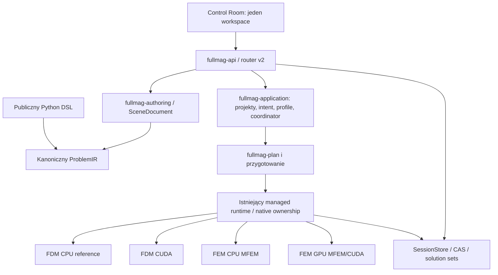

# Audyt gotowości Fullmaga do integracji MCP

**Data:** 2026-10-31  
**Baseline:** `master` → `f95aa31e1d216008513770afe6b0ea9fad1b5260`  
**Tryb:** tylko odczyt; audyt statyczny wybranych punktów integracji.  
**Weryfikacja wykonania:** **NOT VERIFIED-RUNTIME**. Nie uruchamiano solverów, GPU, API ani UI.

## 1. Werdykt

**Fullmag ma rozbudowany fundament aplikacyjny do zbudowania MCP bez tworzenia drugiego solver runnera. Nie ma jednak podstaw, aby bez dodatkowych zabezpieczeń wystawić istniejące REST jako zestaw narzędzi z pełnymi uprawnieniami agenta.** Najcenniejsze istniejące elementy to kanoniczny model, trwałe intent/spec uruchomienia, identyfikatory prób, wersjonowane profile, CAS wyników oraz revision-driven API. [R04] [R08] [R13] [R14] [R15] [R17]

Rekomendowane rozwiązanie to cienki adapter MCP w Rust, korzystający z istniejącego procesu API i wspólnej fasady aplikacyjnej. Najpierw należy domknąć granice zaufania, jawne scope i trwałą tożsamość operacji; następnie udostępnić authoring i pełny cykl wykonania. Wydanie „pełnej kontroli” oznacza kompletny, autoryzowany workflow dla **zakwalifikowanych** funkcji Fullmaga, nie obietnicę obsługi każdej kombinacji fizyki na każdym backendzie.

Nie stwierdzono kompletnego serwera MCP do sterowania symulacjami w przebadanej powierzchni. Jest to **wniosek ograniczony zakresem**: manifest workspace oraz pierwsze wyniki wyszukiwania MCP nie pokazały takiego adaptera. Nie wykonano pełnego przeszukania lokalnego checkoutu. [R03]

### 1.1 Ocena gotowości

| Obszar | Ocena źródłowa | Decyzja dla MCP |
|---|---|---|
| Model i DSL/IR | Mocny kontrakt, istniejące struktury aplikacji | Reuse, nie nowy DSL |
| Trwałe projekty/runy | Widoczne endpointy i mechanizmy identity/CAS | Główna ścieżka headless |
| Edycja live | Rozbudowana, silnie związana z current | Jawny bridge z fence; bez automatycznego przełączania UI |
| Bezpieczeństwo kodu Python | Wykonanie skryptu jest faktem; sandbox niepotwierdzony | Blokada ekspozycji do czasu kwalifikacji izolacji |
| Kontrola zasobów | Istnieją budżety/profiles/backlog | Uzupełnić o delegację, limity całkowite i retry |
| Parytet backendów | Kontrakt rozróżnia cztery lane | Brak zbiorczego certyfikatu; kwalifikacja per workload |
| Zdalne auth i ACL | Nieustalone w pełnym łańcuchu ingress | Bramka przed remote write/execute |
| Transport MCP | Projektowany | Modern + jawna zgodność legacy |
| Testy i niezawodność E2E | Nie wykonano | Osobny program kwalifikacji, nie „gotowe produkcyjnie” |

## 2. Zakres i metoda

Badano kontrakty repozytorium, manifest workspace, router v2 i wybrane implementacje: komendy, scope, pin API, capabilities, CORS, immutable run specification, aplikacyjne eksporty lifecycle, trwałe projekty, profile wykonania i import Python. [R02]–[R19]

Analiza obejmuje **gotowość integracyjną i projekt bezpieczeństwa**, a nie ponowny audyt poprawności każdego jądra mikromagnetycznego. W szczególności nie sprawdzano wyników referencyjnych LLG, demag, wymiany, DMI, PBC/Floquet, eigensolve ani termicznego RNG. Istnienie API do danego wyniku jest dowodem powierzchni transportowej, nie poprawności fizyki.

Ograniczenia zapisano w [rejestrze źródeł](06_REJESTR_ZRODEL_I_DECYZJI.md). Nie istnieje lokalny checkout tego audytu, więc nie raportujemy `git status --short` jako clean. Nie pobierano i nie przeglądano sekretów `.env`. Nie sprawdzono lokalnych niezatwierdzonych zmian użytkownika. Do wdrożenia nie wolno traktować niniejszego SHA jako zawsze aktualnego mastera.

### 2.1 Klasyfikacja ustaleń

**P0** blokuje właściwą klasę ekspozycji: skrypt, zdalne mutacje lub przyjęcie kosztownej pracy. **P1** blokuje deklarację niezawodnej pełnej kontroli. **P2** obejmuje jakość eksploatacji i spójność dokumentacji. Priorytet nie jest oceną exploitability CVSS ani stwierdzeniem exploitu w istniejącym lokalnym produkcie.

Zasada dowodowa: brak odczytu nie jest dowodem braku implementacji. Szczególnie idempotency, autoryzacja i checkpointy są poniżej opisane jako istniejące elementy plus niezamknięta kwalifikacja end-to-end, a nie automatycznie jako „brak”.

## 3. Rzeczywista architektura integracyjna

Schemat jest syntezą odczytanych granic i kontraktów, nie kompletnym call graphem wszystkich modułów. Ścieżki aplikacji i runtime są bardziej rozbudowane; ich szczegółową sekwencję przyjęcia i startu musi zamknąć I01. [R03] [R05] [R08] [R13]

### 3.1 Dwie różne tożsamości, których nie należy sklejać

Interaktywna sesja `current` opisuje aktywny kontekst pracy UI/API. Trwały run jest powiązany z niezmiennym projektem, planem, profilem, taskiem, próbą i artefaktami. Trwałe zasoby projektowe mogą być adresowane project_id/run_id, ale znaczna część granularnego authoringu i odczytu live nadal jest current-scoped. [R08] [R10] [R14] [R15]

MCP nie może uznać połączenia transportowego za właściciela tych stanów. Oddzielenie ma umożliwić odczyt wyników po zamknięciu agenta i restart klienta bez powtórzenia obliczeń. Jest to zalecenie projektowe wynikające z istniejących granic, nie nowy format danych fizycznych.

### 3.2 Które fundamenty zachować

| Fundament | Dowód | Co dokładnie odzyskujemy |
|---|---|---|
| Kanoniczny Python/IR | R04 | Jedną semantykę problemu i eksport odtwarzalny |
| `ProjectSnapshot` | R14 | Tożsamość rewizji i hash dokładnych przyjętych bajtów |
| `RequestedExecution` i profiles | R14, R17 | Requested intent niezależny od realizacji |
| Run/Task/Attempt/Epoch | R13, R15 | Fencing prób i rozliczenie artefaktów |
| Session/instance fences | R09, R10, R12 | Ochronę przed użyciem starego procesu lub kontekstu |
| Rozdział command lifecycle i runtime | R11, R12 | Miejsce dla jawnego ACK, odrzucenia i finalizacji |
| Bounded CAS identity | R15 | Sprawdzalny związek wyników z konkretną próbą |
| Read-model / binary data | R07, R08 | Ograniczenie rozmiaru odpowiedzi dla modeli językowych |
| Batch expansion | R13, R08 | Bazę kampanii bez osobnego schedulera MCP |

## 4. Mapa funkcjonalna: potrzeba agenta a obecny kod

| Potrzeba | Istniejący punkt integracji | Brakujący kontrakt agentowy |
|---|---|---|
| Utworzyć projekt bez uruchomienia solvera | `/v2/persistence/projects`, `/open`, `/authoring` | ACL, niezmienne referencje i lifecycle draft bez zmiany current |
| Zaimportować skrypt | `/v2/persistence/projects/from-script` | Sandbox, grant wykonania, authority/fidelity i audyt |
| Zmienić geometrię/materiały/regiony | `model/scene`, `objects`, `materials`, `transactions` | Atomowa typed mutacja z expected_revision i diff |
| Ustawić wzbudzenie i oddziaływania | `field-drives`, `couplings`, `interactions`, transporty | Jawne SI i capability konkretnej realizacji |
| Zbudować mesh/grid | `meshing/...`, `MeshBuild`, `FdmGridRefresh` | Durable operation, bounded quality, zależność od rewizji |
| Przygotować symulację | `projects/:id/run-intent`, compute preview | Przypięcie planu, admission i approval hash |
| Przyjąć run | `projects/:id/runs` | Trwały receipt i idempotency scope użytkownika |
| Sterować pracą | commands i task cancellation/retry | Ograniczony kontroler run/task/attempt, native ACK |
| Monitorować | run resources, status, events | Snapshot/cursor/reconciliation, brak ukrytego wait godzinami |
| Pobrać wynik | solution sets/members/artifacts | Manifest-first, ACL, bounded queries i binary access |
| Analizować | analysis spectrum/dispersion/FMR/hysteresis itp. | Wersja algorytmu, jednostki, scope i jakość naukowa |
| Kampanie | project batches i app expansion | Budżet całkowity, zależności, deterministyczne case IDs |
| Odtworzyć badanie | project/source/provenance/checkpoints | Reproducibility bundle i poziom checkpointu |
| Współpracować z UI | visualization state/client ACK/workspace | Jawne attach, żadnego niezamówionego przełączania projektu |

Podstawa mapy: zarejestrowane trasy R08, komendy R11–R12 i warstwa aplikacji R13–R17. Poza wymienionymi zakresami nie zakładamy istnienia lub nieistnienia dodatkowych endpointów.

## 5. Ustalenia szczegółowe

### A01 — Powierzchnia wykonująca Python nie jest bezpiecznym narzędziem agenta tylko dlatego, że przyjmuje consent

**Priorytet:** P0. **Status dowodowy:** VERIFIED-SOURCE; izolacja procesu NOT ESTABLISHED.  
**Źródła:** [R16]

**Obserwacja.** `from_script` wprost wykonuje dostarczony Python i sprawdza `consent.executed_by_user`. Jest to jawna semantyka operacji, nie parser deklaratywny. W odczytanym fragmencie są limity tekstu i prywatny katalog, ale nie ma dowodu kompletnej izolacji systemowej.

**Znaczenie dla agenta.** Agent może sam ustawić boolean. Automatyczne odwzorowanie endpointu na narzędzie wykonywałoby kod z poziomem zaufania szerszym niż intencja „utwórz model”. Samo wydzielenie procesu lub katalogu nie ogranicza dostępu do sekretów, sieci i hosta.

**Zalecenie.** Zbudować autoryzowaną ścieżkę compile/import w izolowanym workerze, odrębny grant `script:execute`, ograniczone wejścia i potwierdzenie po stronie zaufanej aplikacji. Do tego czasu udostępniać tylko structured authoring i sprawdzone szablony. Nie mapować argumentu modelu na zgodę użytkownika.

**Zamknięcie:** zadania I04, I12, I31; przypadki kwalifikacyjne T041–T048. Testy te są wymaganiami przyszłego wdrożenia, nie wykonanymi testami audytu.

### A02 — Brak nagłówka pinującego instancję i scope jest dopuszczony dla legacy

**Priorytet:** P0. **Status dowodowy:** VERIFIED-SOURCE.  
**Źródła:** [R09] [R10]

**Obserwacja.** Middleware instancji i scope odrzucają nieprawidłowe wartości, lecz dopuszczają brak nagłówka. To użyteczne zabezpieczenia istniejącej aplikacji, a nie obowiązkowa polityka klienta agentowego.

**Znaczenie dla agenta.** Po restarcie API lub zmianie aktywnej sesji opóźniona mutacja może trafić do innego kontekstu, jeżeli adapter zachowa semantykę klienta legacy. Samo odczytanie `/current` przed mutacją pozostawia okno wyścigu.

**Zalecenie.** W fasadzie agentowej wymusić jawny instance pin i kontekst sesji dla wszystkich operacji live. Weryfikować cel oraz rewizję pod tą samą blokadą/fence co mutację. Dla trwałych runów preferować project_id/run_id zamiast current.

**Zamknięcie:** zadania I05, I10, I23; przypadki kwalifikacyjne T011–T018. Testy te są wymaganiami przyszłego wdrożenia, nie wykonanymi testami audytu.

### A03 — Bezpieczna ekspozycja zdalna nie wynika z konfiguracji lokalnego API

**Priorytet:** P0. **Status dowodowy:** VERIFIED-SOURCE; pełne auth NOT ESTABLISHED.  
**Źródła:** [R19] [R08]

**Obserwacja.** Domyślny CORS dopuszcza dowolny origin, chyba że operator ustawi FULLMAG_API_CORS_ALLOWED_ORIGIN. Końcowe warstwy badanego routera obejmują request-id, wersję i scope. Nie przeprowadzono kompletnego audytu ingress ani middleware całego procesu.

**Znaczenie dla agenta.** Nie można uznać publicznego MCP za bezpieczne przez samo zamontowanie endpointu lub ustawienie CORS. Dodatkowo bezpośrednie REST może obchodzić politykę MCP, jeśli wystawiono je tym samym niezabezpieczonym ingress.

**Zalecenie.** Oddzielić lokalny profil zaufania od zdalnego. AuthN, ACL per projekt/run/artefakt, Origin/Host i limity muszą chronić wszystkie dostępne ścieżki mutacji. OAuth nie zastępuje autoryzacji obiektowej. Nie wystawiać surowego backend:8081 do Internetu.

**Zamknięcie:** zadania I04, I09, I31; przypadki kwalifikacyjne T001–T010, T079. Testy te są wymaganiami przyszłego wdrożenia, nie wykonanymi testami audytu.

### A04 — Accepted-run należy wykorzystać, ale nie wolno utożsamiać submit z running

**Priorytet:** P0. **Status dowodowy:** VERIFIED-SOURCE; zachowanie całej kolejki NOT VERIFIED-RUNTIME.  
**Źródła:** [R13] [R14] [R15]

**Obserwacja.** Istnieją RunSpecification/RunIntent, ProjectSnapshot, typed resources, koordynatory i trwały adapter. Nagłówek handlera projektów opisuje przyjęcie intentu bez bezpośredniego schedulowania workera.

**Znaczenie dla agenta.** Adapter może zwrócić „symulacja uruchomiona”, chociaż zapisano tylko intent. Odwrotny błąd to ponowne uruchamianie solvera z MCP, gdy istniejący supervisor już obsłuży zaakceptowany run.

**Zalecenie.** Prześledzić dokładnie accepted→materialization→admission→worker. Zdefiniować osobne stany i jawne start_policy. Publikować sukces submit dopiero po trwałym receipcie, running dopiero po dowodzie natywnego startu. Żadnego dodatkowego schedulera.

**Zamknięcie:** zadania I01, I16, I17; przypadki kwalifikacyjne T021–T030, T051. Testy te są wymaganiami przyszłego wdrożenia, nie wykonanymi testami audytu.

### A05 — Idempotency istnieje częściowo; trwałość end-to-end wymaga sprawdzenia

**Priorytet:** P0. **Status dowodowy:** VERIFIED-SOURCE; pełny kontrakt NOT ESTABLISHED.  
**Źródła:** [R12] [R14] [R15]

**Obserwacja.** Kod poleceń ma cached_command_response; RunIntent ma tożsamość żądania, a warstwa aplikacyjna wyraźnie rozdziela in-memory ledger i odpowiedzialność trwałego adaptera. Nie odczytano pełnej implementacji cache poleceń ani wszystkich transakcji store.

**Znaczenie dla agenta.** Powtórzony tools/call po timeout może utworzyć drugą pracę, jeśli klucz jest ulotny, nie obejmuje payload hash lub adapter generuje nowy run_id. Awaria pomiędzy zapisem intentu a potwierdzeniem jest szczególnie istotna.

**Zalecenie.** Ujednolicić trwały klucz w zakresie principal+project+operation, wiązać z kanonicznym hashem żądania, zachować ten sam run_id przy ponowieniu i zapewnić reconciliation. Nie obiecywać exactly-once wykonania fizycznego; gwarantować unikalne logiczne przyjęcie i fencing prób.

**Zamknięcie:** zadania I06, I17, I30; przypadki kwalifikacyjne T021–T028, T063. Testy te są wymaganiami przyszłego wdrożenia, nie wykonanymi testami audytu.

### A06 — Uruchomienie przez agenta wymaga ograniczonej delegacji zasobów

**Priorytet:** P0. **Status dowodowy:** VERIFIED-SOURCE; polityka delegacji DESIGN.  
**Źródła:** [R14] [R15] [R17]

**Obserwacja.** RunSpec zawiera minimum_resources oraz waliduje zgodność z compute_resources; istnieją wersjonowane profile wykonania i ograniczenie backlogu. cpu_millis oznacza przydział CPU, nie zużyty czas procesora.

**Znaczenie dla agenta.** Rezerwacja minimalna nie jest automatycznie górnym limitem kosztu, walltime, liczby prób, liczby przypadków batch ani sumarycznego miejsca wyników. Agent w pętli może wyczerpać zasoby legalnymi małymi żądaniami.

**Zalecenie.** Nałożyć nadrzędny grant z maksymalnym CPU/GPU/RAM/VRAM/scratch/output/walltime/concurrency oraz limitem kampanii i retry. Rezerwować przed startem; po zmianie planu lub profilu przeliczyć zgodę. Nie przeliczać cpu_millis na sekundy.

**Zamknięcie:** zadania I07, I16, I24; przypadki kwalifikacyjne T031–T038, T067. Testy te są wymaganiami przyszłego wdrożenia, nie wykonanymi testami audytu.

### A07 — Fidelity skrypt↔scena jest realnym ograniczeniem, nie detalem eksportu

**Priorytet:** P0. **Status dowodowy:** VERIFIED-SOURCE + CONTRACT.  
**Źródła:** [R16] [R04]

**Obserwacja.** Kod importu opisuje scenę jako przybliżenie niektórych skryptów i zwraca werdykt fidelity po porównaniu loweringów. Kontrakt aplikacji jednocześnie wymaga jednego kanonicznego modelu i round-trip.

**Znaczenie dla agenta.** Agent może wczytać zaawansowany skrypt, otrzymać uproszczoną scenę, zmienić jeden parametr i uruchomić inną fizykę. Sam zapis oryginalnego tekstu nie dowodzi równoważności z edytowaną sceną.

**Zalecenie.** Wprowadzić jawne authority_mode: scene_authoritative albo source_authoritative. Przy utracie fidelity zachować oryginalny skrypt i zablokować cichy round-trip; edycja source uruchamia izolowaną ponowną kompilację i diff IR. Konwersja wymaga jawnej akceptacji różnic.

**Zamknięcie:** zadania I11, I12, I13; przypadki kwalifikacyjne T039–T040, T049–T050. Testy te są wymaganiami przyszłego wdrożenia, nie wykonanymi testami audytu.

### A08 — MCP nie wymaga nowego modelu fizyki ani bezpośrednich wywołań C ABI

**Priorytet:** P1. **Status dowodowy:** VERIFIED-SOURCE + CONTRACT.  
**Źródła:** [R03] [R04] [R13]

**Obserwacja.** Warstwa aplikacyjna eksportuje lifecycle projektu, RunSpec, batch expansion, preparation, coordinator i artefakty. Python DSL i ProblemIR są oficjalnym wspólnym kontraktem.

**Znaczenie dla agenta.** Implementacja od shell wrappera lub niezależnego Python solver runnera rozjedzie walidację, provenance, resource admission i stan widoczny w UI.

**Zalecenie.** Dodać cienki adapter oraz transport-neutral AgentControl, wspólny dla MCP i API. Rozszerzać brakujące operacje w istniejącej warstwie aplikacji; nie implementować wymiany, demag, LLG ani obliczeń modalnych w adapterze.

**Zamknięcie:** zadania I03, I10, I16; przypadki kwalifikacyjne T019–T020, T052. Testy te są wymaganiami przyszłego wdrożenia, nie wykonanymi testami audytu.

### A09 — Current-scoped authoring nie jest automatycznie wieloprojektowym headless authoring

**Priorytet:** P1. **Status dowodowy:** VERIFIED-SOURCE.  
**Źródła:** [R08] [R10] [R12]

**Obserwacja.** Większość granularnych zmian sceny, meshingu i live-data jest wystawiona pod sessions/current. Trwałe projekty i runy mają oddzielne ścieżki z identyfikatorami.

**Znaczenie dla agenta.** Zmiana aktywnego projektu przeglądarki w celu obsługi żądania agenta może przerwać pracę użytkownika i powodować interferencję agentów. Dodanie argumentu session_id do tools/call nie zmienia semantyki istniejącego handlera.

**Zalecenie.** Udostępnić authoring na trwałym dokumencie/revizji bez przełączania current. Most live pozostawić jawny, z lease do edycji i tokenem scope. Przejście UI na projekt pozostaje decyzją użytkownika, nie efektem ubocznym submit.

**Zamknięcie:** zadania I05, I10, I23; przypadki kwalifikacyjne T013–T020, T070. Testy te są wymaganiami przyszłego wdrożenia, nie wykonanymi testami audytu.

### A10 — Opcjonalne preconditions należy podnieść do wymaganego kontraktu mutacji MCP

**Priorytet:** P1. **Status dowodowy:** VERIFIED-SOURCE.  
**Źródła:** [R11] [R12]

**Obserwacja.** RuntimeCommandIntent ma opcjonalny target, precondition i client_intent_id. Preconditions obejmują wiele rewizji: scena, mesh, region topology/membership/coefficients/initial state i execution.

**Znaczenie dla agenta.** Last-write-wins lub niejawne domyślne targety są niebezpieczne przy wspólnej pracy z UI. Zmiana materiału może unieważnić plan nawet przy niezmienionej geometrii.

**Zalecenie.** Mutacje wymagają jawnego celu i expected_revision; invalidation set obejmuje odpowiednie składowe modelu. Konflikt zwraca aktualną rewizję i diff metadata, ale nie nadpisuje automatycznie nowych zmian.

**Zamknięcie:** zadania I05, I10, I14; przypadki kwalifikacyjne T011–T020. Testy te są wymaganiami przyszłego wdrożenia, nie wykonanymi testami audytu.

### A11 — Capabilities wykryte w pakiecie nie są kwalifikacją naukową

**Priorytet:** P1. **Status dowodowy:** VERIFIED-SOURCE + CONTRACT.  
**Źródła:** [R18] [R05]

**Obserwacja.** Endpoint platform/capabilities używa RuntimeRegistry::discover. Kontrakt backendów osobno opisuje legalne realizacje CPU/GPU, precyzję i kwalifikację.

**Znaczenie dla agenta.** Agent może uznać „GPU available” za gwarancję wykonania danego DMI, PBC, eigensolve lub modelu demag. Podobnie enum hybrid nie dowodzi obsługi hybrydowego workflow.

**Zalecenie.** Zwracać wektor declared/compiled/runtime_available/plannable/qualified dla konkretnego workloadu, precyzji i urządzenia. Wynik planu ma posiadać reason_codes, required_evidence i jawny unsupported bez automatycznego fallbacku.

**Zamknięcie:** zadania I08, I16, I27, I29; przypadki kwalifikacyjne T053–T060. Testy te są wymaganiami przyszłego wdrożenia, nie wykonanymi testami audytu.

### A12 — Zdarzenia i powiadomienia nie mogą stać się źródłem prawdy o runie

**Priorytet:** P1. **Status dowodowy:** CONTRACT + VERIFIED-SOURCE.  
**Źródła:** [R07] [R08] [R12]

**Obserwacja.** Istnieją HTTP snapshoty i WebSocket invalidacji. Polecenie może zakończyć publikację po odłączeniu klienta, więc utrata odpowiedzi nie jest dowodem niewykonania.

**Znaczenie dla agenta.** Agent po reconnect może zgubić completion, wykonać niepotrzebny retry albo utrzymywać stary stan w pamięci. SSE/WebSocket nie zastępuje trwałego dziennika i odczytu stanu.

**Zalecenie.** Dodać bounded event cursor powiązany z runem i epoch; po luce lub restarcie wymusić resync snapshotu. Core tools get/list pozostają wystarczające bez subskrypcji. Trwały stan przechowuje Fullmag, nie połączenie MCP.

**Zamknięcie:** zadania I19, I30; przypadki kwalifikacyjne T025–T030, T061–T064. Testy te są wymaganiami przyszłego wdrożenia, nie wykonanymi testami audytu.

### A13 — Anulowanie wywołania MCP i zatrzymanie solvera to różne operacje

**Priorytet:** P1. **Status dowodowy:** VERIFIED-SOURCE; mapowanie DESIGN.  
**Źródła:** [R12] [R11] [R15]

**Obserwacja.** Kod poleceń świadomie utrzymuje publikację po odłączeniu HTTP. Istnieją Stop/Pause/Resume oraz task cancellation intents, ale nie zweryfikowano ich wszystkich realizacji natywnych.

**Znaczenie dla agenta.** Zamknięcie czatu/stdio nie powinno przypadkowo zatrzymywać kilkugodzinnego runu. Z kolei zaakceptowany cancel nie znaczy, że GPU już nie pracuje i lease można uwolnić.

**Zalecenie.** Rozdzielić request_cancelled, cancel_requested i stopped_acknowledged. Zatrzymanie musi wskazywać run/task/attempt i kończyć się dowodem safe point lub kontrolowanym failure. Lease zwalnia właściciel runtime, nie adapter po HTTP 200.

**Zamknięcie:** zadania I18, I19, I30; przypadki kwalifikacyjne T029–T030, T061–T066. Testy te są wymaganiami przyszłego wdrożenia, nie wykonanymi testami audytu.

### A14 — Checkpoint stanu m nie musi umożliwiać wiernej kontynuacji solvera

**Priorytet:** P1. **Status dowodowy:** VERIFIED-SOURCE dla powierzchni; zgodność checkpointów NOT ESTABLISHED.  
**Źródła:** [R08] [R11] [R13]

**Obserwacja.** API posiada persistence checkpoints oraz import/export field-state. W schemacie są integratory fixed/adaptive, w tym ABM3. Odczyt nie obejmował pełnej zawartości każdego checkpointu.

**Znaczenie dla agenta.** Przywrócenie samego magnetization może pomijać historię integratora, czas, RNG, kolejny etap i kontroler kroku. Taki restart można błędnie sprzedać jako dokładne resume.

**Zalecenie.** Osobne typy checkpoint_scope: physical_state, solver_restart, exact_resume. Restore domyślnie tworzy nowy pochodny run, sprawdza mesh/layout/ABI/precision i deklaruje poziom odtwarzalności. Brak wsparcia pozostaje jawny.

**Zamknięcie:** zadania I21, I29; przypadki kwalifikacyjne T065–T066, T073. Testy te są wymaganiami przyszłego wdrożenia, nie wykonanymi testami audytu.

### A15 — Wyniki mają silne identity/CAS, ale agent potrzebuje ograniczonego read-modelu

**Priorytet:** P1. **Status dowodowy:** VERIFIED-SOURCE + CONTRACT.  
**Źródła:** [R08] [R15] [R07]

**Obserwacja.** Solution sets mają wersje, members i artefakty. Handler sprawdza task/attempt/ownership_epoch, content digest i CAS reference. Duże dane są oddzielone od statusów.

**Znaczenie dla agenta.** Zwracanie pełnych pól w structuredContent lub całych archiwów base64 zwiększy RAM/tokeny i może pomylić aktualną próbę z poprzednią. Sam znajomy artifact_id nie jest uprawnieniem do odczytu.

**Zalecenie.** Catalog-first; field_query z ROI i limitem, redukcje po stronie backendu, krótkie podglądy, autoryzowane pobranie binarne. Każdy rezultat wiązać z pełną niezmienną referencją solution-set revision i digest.

**Zamknięcie:** zadania I20, I22, I31; przypadki kwalifikacyjne T071–T078. Testy te są wymaganiami przyszłego wdrożenia, nie wykonanymi testami audytu.

### A16 — Fizyczne znaczenie obserwacji musi przetrwać redukcję i resampling

**Priorytet:** P1. **Status dowodowy:** CONTRACT; szczegółowe kontrakty DESIGN.  
**Źródła:** [R04] [R05] [R07]

**Obserwacja.** Wymagane są wspólne SI, semantyka quantities, requested/resolved i ciężki data plane. Audyt nie walidował poszczególnych jąder interpolacji i analizy.

**Znaczenie dla agenta.** Pomylenie B z H, m z M, f z omega albo średniej węzłowej ze średnią objętościową może dać przekonujący, lecz niepoprawny raport naukowy. Rasteryzacja FEM może ukryć przybliżenie.

**Zalecenie.** Każdy FieldQueryResult zawiera units, carrier, association, weighting, coordinate_frame, component, precision i approximation. Adapter nie wymyśla analityki; zleca ją kwalifikowanemu operatorowi i podaje jego wersję.

**Zamknięcie:** zadania I20, I22, I27, I29; przypadki kwalifikacyjne T071–T078, T082. Testy te są wymaganiami przyszłego wdrożenia, nie wykonanymi testami audytu.

### A17 — Batch expansion istnieje; kampania autonomiczna wymaga limitów i semantyki zależności

**Priorytet:** P1. **Status dowodowy:** VERIFIED-SOURCE; pełne workflow NOT VERIFIED-RUNTIME.  
**Źródła:** [R13] [R08]

**Obserwacja.** Aplikacja eksportuje niezależny batch expansion oraz polityki błędów; router obsługuje batch list/submit/cases/commands.

**Znaczenie dla agenta.** Zrównoleglenie sekwencyjnej histerezy lub sweepu wykorzystującego stan poprzednika zmienia problem. Zagnieżdżone osie i retry mogą pomnożyć liczbę prac i koszty.

**Zalecenie.** Planner klasyfikuje independent_cartesian, zipped i sequential_dependency. Plan kampanii ma preview liczby przypadków, hash każdej konfiguracji, budżet całkowity, stop criteria i maksymalną liczbę proponowanych adaptacji.

**Zamknięcie:** zadania I24, I25; przypadki kwalifikacyjne T067–T070, T083. Testy te są wymaganiami przyszłego wdrożenia, nie wykonanymi testami audytu.

### A18 — Łatwy sidecar MCP koliduje z aktualnym kontraktem DEV

**Priorytet:** P1. **Status dowodowy:** CONTRACT + VERIFIED-SOURCE.  
**Źródła:** [R02] [R03]

**Obserwacja.** Root AGENTS wymaga dokładnie backend i frontend jako stałych usług aplikacji. Backend jest prywatny, a build i runtime odbywają się w tej samej grupie Compose.

**Znaczenie dla agenta.** Dopisanie trzeciej stałej usługi Python albo uruchamianie buildów na hoście omija obecne mechanizmy izolacji, receiptów i storage. Osobny runtime MCP mógłby też stać się drugim właścicielem solverów.

**Zalecenie.** W DEV montować MCP w istniejącym API. Stdio jest procesem klienta bez solvera i bez osobnego storage runów. Ewentualny gateway release ma odrębny, zatwierdzony profil, bez zmiany kontraktu DEV jako efektu ubocznego.

**Zamknięcie:** zadania I02, I09, I32; przypadki kwalifikacyjne T084–T088. Testy te są wymaganiami przyszłego wdrożenia, nie wykonanymi testami audytu.

### A19 — Istnieją testy w źródłach, ale audyt nie potwierdził wyników

**Priorytet:** P1. **Status dowodowy:** VERIFIED-SOURCE; NOT VERIFIED-RUNTIME.  
**Źródła:** [R02] [R09] [R10] [R17]

**Obserwacja.** W kodzie widoczne są testy parsera scope, pinu instancji i profili. Jednocześnie obowiązuje zakaz budowania testów jednostkowych.

**Znaczenie dla agenta.** Łatwo pomylić obecność testu albo wcześniejszy zielony CI z dowodem dla nowej ścieżki MCP. Obejście zakazu przez kompilację tego samego testu pod inną nazwą narusza instrukcje.

**Zalecenie.** Planować testy jako wymagania, oddzielić dozwolone kontrole statyczne/runtime od obecnie zablokowanej kompilacji. Brak obowiązkowego dowodu ma blokować odpowiednią kwalifikację, a nie znikać z raportu.

**Zamknięcie:** zadania I00, I28, I29, I33; przypadki kwalifikacyjne T089–T092. Testy te są wymaganiami przyszłego wdrożenia, nie wykonanymi testami audytu.

### A20 — Health i logi wymagają projekcji przyjaznej agentom

**Priorytet:** P2. **Status dowodowy:** VERIFIED-SOURCE.  
**Źródła:** [R18]

**Obserwacja.** Health raportuje ok/degraded i obecność sesji. Odczytany log endpoint buduje odpowiedź z clone listy wpisów, z ETag zależnym od końca logu.

**Znaczenie dla agenta.** Health ok nie dowodzi zdolności wykonania obliczeń. Długie logi w narzędziu mogą zwiększać koszty i ujawniać ścieżki, identyfikatory albo nieufne treści sterujące agentem.

**Zalecenie.** Zwracać bounded diagnostics z cursor/severity/run scope, redakcją i znakiem untrusted-content. Readiness prezentować osobno dla API, storage, runtime package, admission i konkretnie planowanej pracy.

**Zamknięcie:** zadania I08, I19, I31; przypadki kwalifikacyjne T009, T064, T080. Testy te są wymaganiami przyszłego wdrożenia, nie wykonanymi testami audytu.

### A21 — Dokumenty governance zawierają warstwę historyczną

**Priorytet:** P2. **Status dowodowy:** CONTRACT; konflikt udokumentowany.  
**Źródła:** [R02] [R06] [R07]

**Obserwacja.** Starsze instrukcje frontendowe dopuszczają ścieżki cache pod storage hosta, podczas gdy root AGENTS i nowszy kontrakt Docker DEV kierują dane techniczne do nazwanych wolumenów/BuildKit.

**Znaczenie dla agenta.** Plan implementacji skopiowany bez hierarchii może zalecić niezgodne przechowywanie pakietów, logów buildu i cache. Podobnie przykładowe cargo test z resource-first skilla nie znosi rootowego zakazu.

**Zalecenie.** W tym planie przyjąć nowszy root jako wiążący dla DEV. W zadaniu I00 zapisać rozstrzygnięcie i zakres; ewentualne porządkowanie instrukcji jako osobny uzgodniony diff, bez hurtowego przepisywania dokumentów.

**Zamknięcie:** zadania I00, I32; przypadki kwalifikacyjne T084, T091. Testy te są wymaganiami przyszłego wdrożenia, nie wykonanymi testami audytu.

### A22 — Nowy protokół MCP wymaga jawnej strategii zgodności, a nie starego szablonu initialize

**Priorytet:** P1. **Status dowodowy:** DESIGN na podstawie M01–M10.  
**Źródła:** [R03]

**Obserwacja.** Fullmag nie posiada potwierdzonego w tym audycie transportu MCP. Aktualny protokół i SDK zweryfikowano osobno w źródłach oficjalnych; nie należy projektować na pamięć ze starszego standardu.

**Znaczenie dla agenta.** Wymaganie initialize dla każdego klienta, zakładanie Mcp-Session-Id lub umieszczenie trwałości symulacji w sesji SDK powoduje błędy zgodności i utratę kontroli przy reconnect.

**Zalecenie.** Zastosować profil modern 2026-07-28 i jawny legacy 2025-11-25. Protokołowy lifecycle delegować przypiętemu SDK. Stan runów pozostawić w Fullmagu; Tasks extension opcjonalne. Szczegóły w planie architektury.

**Zamknięcie:** zadania I02, I09, I26, I28; przypadki kwalifikacyjne T093–T100. Testy te są wymaganiami przyszłego wdrożenia, nie wykonanymi testami audytu.

## 6. Macierz czterech realizacji

| Realizacja | Ustalony kontrakt wykonania | Co potwierdzono w audycie | Czego nie potwierdzono |
|---|---|---|---|
| FDM CPU | Aktualna legalna ścieżka `CpuReference` | Kontrakt oraz wspólne punkty model/command/run | Uruchomienie, parytet i pełne pokrycie funkcji |
| FDM GPU | Natywny CUDA FDM; brak wymuszonego fallbacku CPU | Kontrakt i pola requested execution | Faktyczny dispatch na GPU, residency, wyniki i checkpoint |
| FEM CPU | Produkcyjna ścieżka MFEM/hypre/libCEED | Kontrakt i API meshing/preparation | Przypadki brzegowe geometrii, demag, eigen i runtime |
| FEM GPU | MFEM/hypre/libCEED/CUDA | Odrębna realizacja wymagana kontraktem | Device execution, host/device transfer, parytet i sterowanie |

Ta macierz nie mówi, że implementacje nie działają. Mówi, że **ten audyt nie wykonał ich kwalifikacji**. Serwer MCP powinien korzystać z istniejących i nowych manifestów dowodowych przypiętych do builda, zamiast odziedziczyć nieuzasadnione „supported=true”. [R05] [R18]

Dla każdej realizacji należy dodatkowo kwalifikować study type, integrator, precyzję, warunki brzegowe, modele oddziaływań, topologię siatki i format restartu. PBC/Floquet, skończony układ z odbiciami, źródło antenowe i dynamika termiczna nie są zamiennymi interpretacjami jednej opcji „dispersion”. Plan MCP ma zachować zadeklarowaną semantykę, a nie automatycznie zastępować jedną inną.

## 7. Kolejność zamykania ryzyk

Pierwsza bramka obejmuje A01–A07: kod wykonywalny, tożsamość kontekstu, zdalne uprawnienia, trwałe przyjęcie, idempotency, budżet i fidelity. Nie trzeba wstrzymywać read-only catalogue do czasu zakończenia wszystkich tych prac, ale **nie wolno w tym czasie udostępniać chronionych mutacji jako działających**.

Druga bramka obejmuje atomowy authoring, planowanie, kontrolę run/task/attempt i ograniczony odczyt wyników. Trzecia domyka cztery lane, checkpointy, batch, współpracę z UI, chaos i eksploatację. Szczegóły etapów i zależności podano w [planie wdrożenia](03_PLAN_WDROZENIA_MCP.md).

### 7.1 Czego nie robić w pierwszym PR

Nie dodawać uniwersalnego `execute_python`, `run_shell`, `http_request` ani narzędzia przyjmującego dowolną ścieżkę hosta. Nie generować mechanicznie setek tools z OpenAPI. Nie tworzyć osobnego cache runów „na razie w pamięci”. Nie kopiować whole SceneDocument do każdego poll. Nie przenosić solver ownership do sesji MCP. Nie wystawiać endpointów zmiany polityki node, storage roots, globalnego cleanupu lub resetowania ownerów zwykłemu agentowi badawczemu.

## 8. Kryterium zakończenia audytu integracyjnego

Niniejsza część kończy analizę źródłową na wskazanym baseline i przekazuje konkretne ryzyka, punkty reuse oraz wymagania weryfikacji. **Nie kończy kwalifikacji produktu.** Przed wdrożeniem wymagany jest delta-audyt nowego SHA, pełny ślad przyjęcia i startu pracy oraz testy opisane w osobnym dokumencie. Rejestr pytań Q01–Q09 zawiera warunek zamknięcia i bezpieczne zachowanie do tego czasu.

## Odsyłacze źródłowe

[R01]: 06_REJESTR_ZRODEL_I_DECYZJI.md#r01
[R02]: 06_REJESTR_ZRODEL_I_DECYZJI.md#r02
[R03]: 06_REJESTR_ZRODEL_I_DECYZJI.md#r03
[R04]: 06_REJESTR_ZRODEL_I_DECYZJI.md#r04
[R05]: 06_REJESTR_ZRODEL_I_DECYZJI.md#r05
[R06]: 06_REJESTR_ZRODEL_I_DECYZJI.md#r06
[R07]: 06_REJESTR_ZRODEL_I_DECYZJI.md#r07
[R08]: 06_REJESTR_ZRODEL_I_DECYZJI.md#r08
[R09]: 06_REJESTR_ZRODEL_I_DECYZJI.md#r09
[R10]: 06_REJESTR_ZRODEL_I_DECYZJI.md#r10
[R11]: 06_REJESTR_ZRODEL_I_DECYZJI.md#r11
[R12]: 06_REJESTR_ZRODEL_I_DECYZJI.md#r12
[R13]: 06_REJESTR_ZRODEL_I_DECYZJI.md#r13
[R14]: 06_REJESTR_ZRODEL_I_DECYZJI.md#r14
[R15]: 06_REJESTR_ZRODEL_I_DECYZJI.md#r15
[R16]: 06_REJESTR_ZRODEL_I_DECYZJI.md#r16
[R17]: 06_REJESTR_ZRODEL_I_DECYZJI.md#r17
[R18]: 06_REJESTR_ZRODEL_I_DECYZJI.md#r18
[R19]: 06_REJESTR_ZRODEL_I_DECYZJI.md#r19
[M01]: 06_REJESTR_ZRODEL_I_DECYZJI.md#m01
[M02]: 06_REJESTR_ZRODEL_I_DECYZJI.md#m02
[M03]: 06_REJESTR_ZRODEL_I_DECYZJI.md#m03
[M04]: 06_REJESTR_ZRODEL_I_DECYZJI.md#m04
[M05]: 06_REJESTR_ZRODEL_I_DECYZJI.md#m05
[M06]: 06_REJESTR_ZRODEL_I_DECYZJI.md#m06
[M07]: 06_REJESTR_ZRODEL_I_DECYZJI.md#m07
[M08]: 06_REJESTR_ZRODEL_I_DECYZJI.md#m08
[M09]: 06_REJESTR_ZRODEL_I_DECYZJI.md#m09
[M10]: 06_REJESTR_ZRODEL_I_DECYZJI.md#m10
