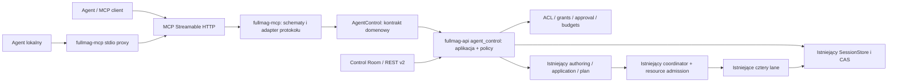

# Fullmag MCP — plan architektury i kontrakt produktu

**Wersja projektu:** 1.0, 2026-10-31.  
**Baseline:** `f95aa31e1d216008513770afe6b0ea9fad1b5260`.  
**Status:** **DESIGN** — projekt do implementacji, nie opis gotowego serwera.  
**Dokumenty zależne:** [audyt](01_AUDYT_GOTOWOSCI_MCP.md), [katalog](04_KATALOG_NARZEDZI_I_KONTRAKTOW.md), [wdrożenie](03_PLAN_WDROZENIA_MCP.md), [kwalifikacja](05_MACIERZ_TESTOW_I_KWALIFIKACJI.md).

## 1. Cel i znaczenie „pełnej kontroli”

Agent ma samodzielnie przejść od intencji naukowej do odtwarzalnego wyniku: odczytać możliwości instalacji, utworzyć projekt, skonfigurować geometrię i materiały, wybrać fizykę i warunki brzegowe, przygotować siatkę, zdefiniować etapy, sprawdzić plan i koszty, przyjąć pracę, sterować nią, analizować wyniki oraz wyeksportować pełne provenance. Ma działać lokalnie lub przez autoryzowane połączenie z serwerem, również po ponownym połączeniu.

**Kontrola dotyczy domeny symulacji, nie nieograniczonego wykonywania poleceń systemu operacyjnego.** Agent nie dostaje Docker socket, dowolnego SSH, globalnego zarządzania storage, mechanizmu zmiany polityki bezpieczeństwa ani prawa do wyłączania cudzych prac. Nie dostaje też prawa do „naprawiania” problemu fizycznego przez ukryte uproszczenia.

Pełność jest mierzona macierzą przepływów i kwalifikacją capability. Funkcja niedostępna w konkretnym solverze ma wrócić z jednoznacznym powodem. MCP nie może rozszerzyć możliwości numerycznych samym istnieniem narzędzia. Złożone nowe solver features pozostają osobnymi pracami naukowymi i implementacyjnymi.

### 1.1 Wymagania funkcjonalne

| ID | Wymaganie | Warunek odbioru |
|---|---|---|
| F01 | Discovery instalacji i capabilities | Agent otrzymuje wersje, policy, lane i powody niedostępności bez czytania hosta |
| F02 | Headless authoring | Tworzenie i edycja projektu nie przełącza aktywnej sesji użytkownika |
| F03 | Atomowe zmiany modelu | Geometria, materiały, regiony i fizyka zmieniają się jako spójna transakcja |
| F04 | Publiczny Python DSL | Import/kompilacja izolowane; eksport i fidelity jawne |
| F05 | Meshing/grid i diagnostyka | Agent otrzymuje immutable mesh reference oraz quality gates |
| F06 | Wieloetapowy study | Zależności, stan wejściowy, output policy i kryteria zakończenia zapisane w planie |
| F07 | Preflight i budżet | Wyliczenie rozmiarów, kosztów i ograniczeń poprzedza przyjęcie wykonania |
| F08 | Trwały submit i reconciliation | Ten sam klucz po restarcie nie przyjmuje drugiego logicznego runu |
| F09 | Kontrola natywnego wykonania | Pause/resume/cancel/retry mają jawny scope, ACK i unsupported |
| F10 | Obserwacja bez utraty stanu | Odłączenie klienta nie usuwa pracy; reconnect odtwarza stan z trwałych zasobów |
| F11 | Wyniki i analiza | Odczyty mają units, identity, approximation, bounded payload i provenance |
| F12 | Checkpoint/restart | Restore określa poziom kontynuacji i zgodność z konkretnym runtime |
| F13 | Kampanie | Batch/adaptacja respektują zależności i sumaryczny grant |
| F14 | Współpraca z Control Room | UI i agent widzą ten sam model, lecz nie nadpisują się bez kontroli |
| F15 | Audyt i odtwarzalność | Każdą decyzję i wynik można przypisać do źródeł, wersji i próby |

### 1.2 Niezmienne wymagania jakościowe

Wymagana jest jedna semantyka DSL→IR→plan, niezmienność przyjętych wejść, explicit requested/resolved/executed, oddzielne capability dla czterech lane i brak cichego downgrade. Duże dane pozostają poza cienkim control plane. Autoryzacja i walidacja obowiązują niezależnie od wejścia MCP/REST/stdio. Są to projektowe rozszerzenia istniejącego kontraktu Fullmaga, nie jego zamiennik. [R04] [R05] [R07]

## 2. Wybór implementacji

| Wariant | Zalety | Koszty i ryzyka | Decyzja |
|---|---|---|---|
| Rust/RMCP w istniejącym API | Reuse typed domain, identity i store; ten sam lifecycle | Należy uporządkować granicę usług i sprawdzić SDK/Tower | **Rekomendowany** |
| Osobny Python adapter nad REST | Szybki prototyp, dobre środowisko analityczne | Nowy proces, pułapka current, podwójne DTO/policy, dodatkowa eksploatacja | Tylko kontrolowany prototyp read-only, nie architektura docelowa |
| TypeScript gateway przy frontendzie | Blisko klienta web i narzędzi UI | Frontend nie powinien być właścicielem symulacji; problemy headless | Niewskazany jako kontroler runtime |
| Bezpośredni dostęp MCP do engine/C ABI | Mało warstw w przykładzie demonstracyjnym | Omija planning, admission, persistence i provenance | Odrzucony |
| Shell/CLI wrapper | Najmniej początkowego kodu | Nieustrukturyzowane wyjście, bezpieczeństwo, utrata idempotency | Odrzucony jako API naukowe |

Oficjalny Rust SDK deklaruje obsługę MCP 2026-07-28 oraz zgodność ze starszą erą; rekomendacja dotyczy rodziny RMCP 3.x. Konkretny release, MSRV i features muszą zostać przypięte w I02. Fullmag ma axum 0.7; axum 0.8 w odczytanym manifeście SDK jest zależnością deweloperską. Z tego faktu **nie wynika obowiązek migracji całej aplikacji**. Najpierw sprawdzić granicę Tower/HTTP body. [M05] [M06] [R03]

## 3. Struktura i odpowiedzialności



Przejście istniejących operacji UI do współdzielonej usługi wykonywać tylko dla zakresu potrzebnego MCP. Nie planujemy jednorazowego przepisania całego routera ani generalnego refaktoru frontendu.

### 3.1 Graf zależności bez cyklu

`fullmag-application` definiuje transport-neutral tożsamości i port `AgentControl`; nie zależy od RMCP ani HTTP. `fullmag-mcp` zależy od `fullmag-application` i SDK; zna nazwy tools, resources i mapowanie odpowiedzi. `fullmag-api` implementuje port przy użyciu AppState, SessionStore i istniejących usług, a następnie wstrzykuje implementację do adaptera. API może zależeć od MCP, ale MCP nie może zależeć od API.

Proces `fullmag-mcp` dla stdio jest cienkim klientem zaufanej instalacji: przekazuje żądania do jej autoryzowanego endpointu, bez dostępu do store, solvera i hostowej powłoki. Jego cykl życia kończy się z klientem, lecz prace pozostają własnością Fullmaga. Konfiguracja endpointu jest administracyjna, nie argumentem narzędzia.

### 3.2 Proponowane moduły — wszystkie oznaczone jako nowe

```text
crates/fullmag-application/src/agent_control/
  mod.rs                 # porty i typy wspólne, bez zależności MCP
  identity.rs            # project/run/attempt/scope/revision
  authorization.rs       # domenowe reguły ACL i grantów
  operations.rs          # request/receipt/reconciliation
  budgets.rs             # delegacja i koszty kampanii
  capabilities.rs        # złożone capability + dowód kwalifikacji

crates/fullmag-api/src/agent_control/
  mod.rs                 # implementacja portów na istniejących usługach
  auth.rs                # weryfikacja credentials, TrustedAgentContext
  projects.rs            # trwały authoring i eksport
  compilation.rs         # managed sandbox, nie exec w API
  meshing.rs             # operation -> istniejący mesh/preparation
  execution.rs           # prepare/submit/control
  observations.rs        # bounded reads, reductions, artefakty
  campaigns.rs           # batch i kontrola budżetu
  live.rs                # jawne połączenie z kontekstem current

crates/fullmag-mcp/
  Cargo.toml
  src/lib.rs
  src/server.rs
  src/catalog.rs
  src/errors.rs
  src/resources.rs
  src/transports/http.rs
  src/transports/stdio_proxy.rs
  src/bin/fullmag-mcp.rs
  src/tools/{platform,projects,model,mesh,execution,results,campaigns,live}.rs
```

Podkatalogi są propozycją, nie informacją o obecnym drzewie repozytorium. Drobna zmiana podziału plików jest dopuszczalna, jeśli nie zmienia właściciela stanu i granic zależności.

## 4. Wersja MCP, transport i stan

### 4.1 Profil wire

Dla `2026-07-28` metadane protokołu są per request; nie budujemy nowego serwera wokół obowiązkowego `initialize`. Serwer implementuje `server/discover`, lecz nowoczesny klient nie musi go wywołać przed innym RPC. Profil `2025-11-25` ma osobną obsługę legacy w SDK. [M01]

Nowoczesny Streamable HTTP używa endpointu POST oraz odpowiedzi JSON lub request-scoped SSE. Wymagane sprawdzanie metadanych i Origin delegujemy kwalifikowanej warstwie transportu. Powiadomienia o zasobach nie są dawnym GET stream; projekt nie wprowadza własnego „SSE compatibility protocol”. [M02]

Stdio zachowuje framing MCP na stdout; logi idą na stderr. Koniec stdin zamyka proxy, nie stan domenowy. [M09]

Szczegóły wire mają być generowane/obsługiwane przez przypięty SDK. Poniższe dokumenty opisują przede wszystkim **własne kontrakty Fullmaga**. Nie utrzymywać ręcznej kopii implementacji MCP obok biblioteki.

### 4.2 Tools, resources, prompts

Tools obsługują konkretne intencje i zwracają walidowane `structuredContent`. `inputSchema` i `outputSchema` są częścią wydania; adnotacje narzędzia nie zastępują policy. Modern wynik końcowy używa odpowiedniego `resultType` z SDK, a legacy jest serializowany zgodnie z wybraną erą. [M03]

Resources służą do odczytu ograniczonych manifestów, schematów, dokumentacji i provenance po URI. Ich widoczność zależy od uprawnień. Powiadomienia zasobów mogą invalidować cache, ale odczyt trwałego zasobu nadal rozstrzyga stan. [M10]

Prompts są opcjonalnymi szablonami procesu badawczego: „przygotuj relaksację”, „sprawdź konwergencję siatki”, „porównaj lane”. Nie zawierają sekretów, nie przyznają uprawnień i nie wymuszają konkretnego klienta AI. Podstawowy produkt działa bez prompts, sampling i elicitation.

### 4.3 Zasada trwałości

`MCP request id`, `operation_id`, `run_id`, `task_id`, `attempt_id` i ewentualny MCP Tasks handle to **różne identyfikatory**. Nie mapować ich jeden-do-jednego bez jawnej tabeli relacji. Transport nie jest właścicielem zadania; właścicielem jest istniejący coordinator/runtime. Cache SDK nie jest ledgerem operacji.

Długotrwałe kompilacje, mesh i analizy zwracają po trwałym przyjęciu krótki receipt oraz `operation_id`. Agent sprawdza `fm_operation_get` lub odpowiedni run resource. Zakończenie wywołania submit oznacza przyjęcie żądania, nie zakończenie fizyki.

### 4.4 Rozszerzenie Tasks

Tasks jest opcjonalne i nie stanowi warunku działania długich obliczeń. Odczytane źródło rozszerzenia jest oznaczone Draft; przed włączeniem wymagany jest pin i conformance. Handle rozszerzenia może reprezentować oczekiwanie na wynik operacji, a nie zastępować Fullmag run. Nie zwracać takiego handle klientowi bez deklarowanej obsługi. [M07]

Pierwsze wydanie używa submit/get/control jako stabilnego mechanizmu. Adapter Tasks wolno dodać później bez zmiany schematów fizycznego projektu. Wygaśnięcie uchwytu protokołowego nie usuwa artefaktów ani pracy. Anulowanie uchwytu nie daje uprawnień do zatrzymania obcej symulacji.

## 5. Identyfikacja i współbieżność

### 5.1 Referencje domenowe

| Typ projektowany | Pola obowiązkowe | Zastosowanie |
|---|---|---|
| `InstallationRef` | installation_id, api_instance_id, build_digest | Wybrany zaufany endpoint i konkretny proces |
| `ProjectRef` | project_id, definition_revision, definition_sha256 | Kanoniczny draft/snapshot |
| `LiveRef` | session_id, scientific_epoch, request_scope_epoch, api_instance_id | Most do current, nie substytut ProjectRef |
| `RunRef` | project_id, run_id, run_spec_sha256 | Niezmienny przyjęty problem |
| `AttemptRef` | RunRef, task_id, attempt_id, ownership_epoch | Sterowanie konkretną próbą |
| `ArtifactRef` | RunRef, solution_set_id, revision, member_id, artifact_id, content_sha256 | Dokładny wynik, nie „najnowszy plik” |
| `PreparedRunRef` | prepared_run_id, ProjectRef, plan_sha256, profile_ref, expiry | Zwalidowany kandydat przed trwałym submit |

Nazwy pól istniejących typów mają pierwszeństwo na granicy DTO. Jeśli facade używa skrótu, mapowanie musi być jawne i testowane. Nie zmieniać istniejącego formatu run_spec.v2 tylko dla kosmetyki MCP. [R14]

W nowym publicznym kontrakcie MCP u64 identity/revision i liczniki mogące przekroczyć bezpieczny zakres JavaScript są dziesiętnymi stringami. Wewnątrz pozostają u64 z kontrolą zakresu. Małe rozmiary stron i enum indeksy mogą być liczbami, o ile schemat ogranicza je do bezpiecznego przedziału.

### 5.2 Konflikty i atomowość

Mutacja modelu wymaga `expected_revision` i powiązanego hasha. Walidacja→zmiana→nadanie nowej rewizji→zapis muszą być jedną transakcją domenową. Jeżeli implementacja używa plików/CAS i osobnego katalogu, należy zdefiniować punkt publikacji i recovery zamiast nazywać serię zapisów „atomową”.

Nie stosować automatycznego last-write-wins. Przy konflikcie zwrócić kod, aktualną referencję oraz ograniczony diff. Agent musi ponownie zaplanować zmianę. Niezależne zmiany można scalać tylko wtedy, gdy silnik authoringu posiada jednoznaczną semantykę merge; nie zakładać tego w MCP v1.

Do operacji live wymagany jest context przenoszony jawnie do usługi. Nie wywoływać istniejącego handlera z pominięciem HTTP i liczyć, że task-local scope utworzy się sam. Obecny parser i pin stanowią podstawę integracji, lecz policy agenta musi wymagać ich obecności. [R09] [R10] [R12]

### 5.3 Edycja podczas wykonania

Przyjęty run nie zmienia wejścia, gdy agent edytuje draft projektu. Zmiana materiału, geometrii, tłumienia, anteny lub output policy tworzy nową rewizję i nowy run, chyba że istniejący solver ma odrębny, zakwalifikowany kontrakt interwencji w safe point. Interwencja musi mieć zapis czasu fizycznego, próbę, przyczynę i nowy hash protokołu badania. Wydanie v1 nie wprowadza ogólnego mutowania fizyki w działającym solverze.

## 6. Authoring bez rozbieżnego DSL

### 6.1 Dwa tryby autorytetu

`scene_authoritative`: typowane operacje tworzą SceneDocument i kanoniczny eksport publicznego Python DSL. `source_authoritative`: źródłem prawdy jest zachowany, przypięty skrypt oraz jego zwalidowane lowering/IR; wizualna scena może być niepełną projekcją. Wybrany tryb jest częścią manifestu projektu i odpowiedzi agenta.

Wykryta utrata fidelity blokuje ciche przestawienie trybu. Agent otrzymuje różnice znaczących pól i decyzję `conversion_required`. Samo zapisanie oryginalnego pliku w archiwum nie oznacza, że eksport sceny zachowuje badanie. Ten wymóg odpowiada rzeczywistej uwadze w obecnym importerze. [R16]

### 6.2 Transakcje modelu

`fm_model_apply` przyjmuje listę **typowanych operacji domenowych**, nie dowolny JSON Patch na prywatnych polach runtime. Każda operacja ma schemat i walidator istniejącej domeny. Zestaw obejmuje obiekty, transformacje/pivot, geometrię/import asset, materiały i przypisania regionów, oddziaływania, pola/wzbudzenia, warunki brzegowe, meshing policy, stan początkowy oraz study/output definitions.

Cała lista przechodzi walidację referencji i jednostek przed publikacją. Usunięcie obiektu referencjonowanego przez coupling lub monitor wymaga jawnej kaskady w tym samym request albo zostaje odrzucone. Nazwy użytkownika i prezentacyjny typ nie aktywują fizyki. [R02]

### 6.3 Python compile/import

Agent najpierw rejestruje źródło jako immutable asset. `fm_script_compile` uruchamia dedykowaną operację managed compilation; nie wykonuje Pythona w wątku API ani w proxy. Kompilacja nie może wywołać solvera nawet dla skryptu, który w normalnym publicznym DSL automatycznie uruchamia Solve. Musi istnieć jawny tryb capture/compile publicznej ścieżki, kwalifikowany z rzeczywistymi przykładami, a nie podmiana znaczenia DSL przez ad hoc monkey patch.

Izolator otrzymuje wyłącznie źródło, jawne assets i przypięty runtime. Nie ma sekretów, sieci, Docker socket ani zapisywalnych źródeł aplikacji. Ogranicza CPU/RAM/walltime/ilość procesów/rozmiar plików i logów. Produkty techniczne trafiają do zarządzanego obszaru grupy; zatwierdzone wyniki kompilacji i źródło do project CAS. Brak kwalifikowanego izolatora oznacza brak tej capability, nie użycie mniej bezpiecznej trasy.

Parametry pętli/skryptu, źródła losowości i zależności importów muszą wejść do provenance. Powtarzalność kompilacji sprawdza się hashem IR i manifestem źródeł. Jeżeli skrypt zależy od niejawnego czasu lub nieprzypiętych danych, plan wskazuje niedeterministyczność i blokuje deklarację reprodukowalności.

### 6.4 Referencyjna realizacja izolatora

Dla profilu Linux/release proponowana realizacja to **jednorazowy OCI task z przypiętym image digestem**, uruchamiany przez zaufany executor istniejącego managed runtime, a nie przez Docker socket dostępny dla API lub agenta. Typ zadania `python_compile` ma stały zestaw dozwolonych mountów, obrazu i polityki; klient nie dostarcza komendy startowej, image URL, capabilities ani konfiguracji kontenera. Rejestrację tej nowej klasy zadania obejmuje I12.

Profil początkowy: użytkownik bez uprawnień root, read-only root filesystem, brak sieci i GPU, drop Linux capabilities, aktywne seccomp/LSM według zatwierdzonego profilu, maksymalnie 64 procesy, 1 CPU capacity, 2 GiB RAM, 30 s walltime, 256 MiB zapisywalnego obszaru tymczasowego i osobny limit opublikowanego output. Wejścia są tylko do odczytu; środowisko ma allowlist zamiast dziedziczenia sekretów API. Parametry są projektowymi limitami startowymi, wymagającymi pomiaru na publicznych skryptach, nie istniejącą konfiguracją Fullmaga.

Usługa API wysyła jedynie typed compile intent do executora. Odbiera manifest zawierający exit status, profile digest, input digests i ograniczone wyniki; publikacja do project CAS następuje po walidacji. Błąd tworzenia sandboxu kończy operację, bez uruchomienia tego samego źródła „bez izolacji”.

To nie jest propozycja trzeciej stałej usługi aplikacji DEV. Jeżeli aktualny profil DEV nie dopuszcza takiego jednorazowego executora lub nie zapewnia wymaganej izolacji, `fm_script_compile` pozostaje wyłączone w DEV. Zmiana zasad wykonania wymaga osobnej jawnej decyzji, zamiast użycia privileged/nested Docker jako obejścia.

## 7. Planowanie fizyki i kwalifikacja lane

`fm_study_plan` tworzy jawny graf etapów i zależności; `fm_run_prepare` rozwiązuje go względem konkretnego snapshotu, runtime profile, mesh i budżetu. Adapter nie podejmuje za użytkownika decyzji typu „FEM za drogie, użyjemy FDM” albo „GPU niedostępne, policzymy CPU”.

Capability jest projekcją:

```text
(feature, study_type, backend_lane, precision, geometry_class,
 boundary_model, interaction_set, runtime_build, hardware_class)
 -> declared / compiled / runtime_available / plannable / qualified
 -> reasons + evidence_refs + restrictions
```

Dla `auto` zachowuje się requested value i policy resolution. Dla wymuszonego GPU odmowa jest błędem jawnym, bez ponownego planowania CPU. Nie wpisywać „native FDM CPU” jako obecnej legalnej ścieżki wyłącznie na podstawie katalogu źródeł. [R05] [R14]

Preflight obejmuje spójność SI, legalność fizyki i BC, jakość discretization, stan początkowy, obowiązkowe przygotowanie/relaksację, kompatybilność profile i przybliżenia analizy. Nie wszystkie kryteria są twardymi uniwersalnymi progami: naukowe tolerancje muszą pochodzić z przypiętej definicji badania/fixture. Warning nie znika z provenance nawet po akceptacji.

Dla modal/response wyniki mają rozróżniać k=0, Bloch/Floquet oraz analizę skończonego układu i transformacji przestrzenno-czasowej. Dla termicznych kampanii wymagane są seed policy, RNG identity i metadane statystyczne. Te reguły określają kontrakt transportu; nie stanowią nowego wyprowadzenia metody numerycznej.

## 8. Przygotowanie, submit i uruchomienie

```mermaid
sequenceDiagram
    participant A as Agent
    participant M as MCP
    participant S as AgentControl
    participant D as Durable store
    participant R as Native coordinator
    A->>M: run_prepare(project_ref, study_ref, resources)
    M->>S: walidacja, capability, plan, budżet
    S-->>A: prepared_run_ref + digest + ostrzeżenia
    A->>M: run_submit(prepared_ref, key, start_policy)
    M->>S: autoryzowany submit
    S->>D: idempotency + niezmienny intent + receipt
    D-->>S: durable accepted
    S-->>A: accepted/held + run_ref; nie running
    S->>R: istniejący mechanizm admission/release
    R->>D: claim/attempt/epoch + execution evidence
    A->>M: run_get(run_ref)
    M-->>A: stan, native evidence, progress, next actions
```

`start_policy` jest obowiązkowym wyborem `hold` albo `after_admission`. Pierwszy zachowuje przyjęty run bez prawa startu; drugi zezwala istniejącemu coordinatorowi na wykonanie po spełnieniu admission. **To kontrakt projektowany:** przed udostępnieniem `hold` trzeba wykazać, że wszystkie natywne ścieżki naprawdę respektują blokadę. Jeśli obecny supervisor automatycznie materializuje accepted runs, należy dodać kontrolę w jego kanonicznej ścieżce, a nie symulować hold tylko w MCP.

`release` dotyczy tylko held runu. Materializacja/preparation może być osobnym etapem stanu; nie nazywa się jej running. Źródło R15 opisuje submit bez bezpośredniego schedulowania, ale nie rozstrzyga wszystkich późniejszych działań supervisorów. I01 i I16 domykają ten ślad przed implementacją gwarancji.

### 8.1 Proponowana projekcja statusu

Stan API zawiera `lifecycle`, `native_state`, `execution_evidence`, `quality_state` i `stop_reason`. `lifecycle` może być accepted, held, preparing, queued, running, pause_requested, paused, cancel_requested, completed, failed, cancelled lub blocked. Nieznany stan natywny daje `unknown` z diagnostyką, nie automatycznie failed/completed.

`quality_state` jest oddzielnym polem: not_assessed, pass, warn, fail, inconclusive. Run może ukończyć proces, ale nie spełnić kryterium relaksacji lub dokładności. Task retry tworzy nowy attempt z nowym ownership_epoch, zachowując poprzedni ślad. Zmiana fizycznych wejść tworzy nowy run, nie retry.

## 9. Idempotency i awarie

Klucz deduplikacji to `(principal_scope, project_id, operation_kind, idempotency_key)`. Powiązany digest obejmuje semantyczne argumenty, expected references, start policy i budżet; nie obejmuje JSON-RPC id, access tokenu ani zmiennych nagłówków transportu. Kanonikalizacja ma jawny schemat i nie zaokrągla liczb SI. Błędy NaN/Infinity/overflow są odrzucane przed hashowaniem.

Ten sam klucz i digest zwracają ten sam logical operation/run receipt. Ten sam klucz i inny digest zwracają `IDEMPOTENCY_CONFLICT`. Awaria po przyjęciu, przed odpowiedzią nie pozwala generować nowego run_id. Reconciliation szuka zapisu po kluczu i zakresie principal, a nie przez zgadywanie ostatniego runu.

Jeśli store nie pozwala atomowo opublikować intentu oraz wpisu operacji, wdrożyć trwały wzorzec outbox/reservation: najpierw rezerwacja z docelowym run_id, następnie bezpieczna ponawialna publikacja istniejącego RunIntent, a na końcu receipt. Recovery nigdy nie przyjmuje nowego ID dla tej samej rezerwacji. Dokładna realizacja musi respektować aktualną metodę zapisu SessionStore i jego blokady; nie zakładamy, że wszystko jest w jednej bazie SQL.

Nie obiecujemy dokładnie jednego uruchomienia fizycznego mimo awarii procesu. Gwarancja obejmuje pojedynczy logiczny intent, jednoznaczne próby i fencing późnych wyników. Duplikat worker execution ma być wykryty, odcięty od publikacji i rozliczony jako błąd eksploatacyjny, nie ukryty przez merge artefaktów.

## 10. Bezpieczeństwo i delegacja

HTTP zdalne korzysta z mechanizmu autoryzacji MCP i zaufanego authorization server; dla tego produktu jest to wymaganie release, choć standard nie wymaga auth w każdym zastosowaniu. Protected resource metadata, audience/resource i issuer muszą być walidowane. Stdio korzysta z lokalnego credential provisioning, nie z udawania anonimowego połączenia z prawami operatora. [M04]

W naszym modelu zagrożeń token passthrough, SSRF, przejęcie handle i confused deputy są klasami obowiązkowych testów. Zasady szczegółowe poniżej są policy Fullmaga; nie wynikają automatycznie z użycia SDK. [M08]

### 10.1 Role i zakresy

| Rola | Uprawnienia domyślne | Wykluczenia |
|---|---|---|
| Viewer | platform/read, project/read, results/read | Zmiany, kompilacja, nowe obliczenia |
| Author | Viewer + project/write, asset/import, model/validate | Run submit i wykonywanie dowolnego źródła bez odrębnego grantu |
| Runner | Wskazane projekty, run/prepare/submit/control w budżecie | Zmiana polityki node, cudze runy, bezlimitowe kampanie |
| Analyst | Results/read + analysis/submit z budżetem | Zmiana źródłowej symulacji, niejawna eksfiltracja |
| Operator | Nadawanie grantów i polityka instalacji poza zwykłym MCP badawczym | Nie dziedziczy automatycznie prawa do publikowania danych użytkownika |

Scope nie jest jedynym kryterium: serwis sprawdza ownership/ACL dla każdego ID, visibility danych, grant expiry, auth epoch, limit i stan obiektu. `_meta.clientInfo`, tool argument `user_id` czy nazwa agenta nie są dowodem tożsamości. TrustedAgentContext powstaje z walidowanych credentials, nie z deserializacji payloadu.

### 10.2 Zgody użytkownika

Zgoda na wykonanie kodu, kosztowną kampanię lub eksport danych powstaje w zaufanym UI/operator flow. Approval wiąże principal, dokładny digest planu, resource ceilings, zakres projektów i termin ważności. Agent może przekazać otrzymany `approval_ref`; nie może stworzyć zgody przez `approved:true`.

Nie trzeba pytać użytkownika przy każdym małym kroku. Właściciel może wcześniej nadać ograniczony grant np. dla konkretnego projektu i maksymalnej liczby GPU-hours. Serwis sprawdza, czy operacja mieści się w delegacji. Zmiana planu zwiększająca koszt lub zakres danych wymaga ponownej decyzji policy. Komunikat MCP o potrzebie interakcji nie jest sam w sobie dowodem autoryzacji.

### 10.3 Dane i działania zabronione

Żadnych narzędzi arbitrary filesystem/http/shell. Import przyjmuje `upload_id` i digest pliku dostarczonego zaufaną ścieżką, nie URL do pobrania z sieci wewnętrznej. Eksport wybiera zarejestrowany storage target. Archive unpack sprawdza traversal, symlink, liczbę plików, sumę rozmiarów i bomby kompresji. Logi, skrypty i nazwy obiektów są danymi nieufnymi, nie instrukcjami rozszerzającymi uprawnienia agenta.

## 11. Budżet i admission

Istniejące minimum_resources pozostają rezerwacją wykonania. Nad nimi działa grant maksymalny: concurrency, CPU capacity, RAM, liczba i klasa GPU, VRAM, walltime, scratch/output bytes, liczba runs, attempts i cases oraz całkowity koszt kampanii. Oba poziomy nie mogą być utożsamione. [R14]

Plan zawiera estymatę z modelem/wersją i zakresem niepewności, a nie zmyśloną dokładną liczbę sekund. Rezerwacja zasobów jest atomowa dla danego schedulera i nie jest zwalniana dopóki runtime nie potwierdzi zatrzymania. Backpressure zwraca busy/quota_exceeded i retry hint. Żadne automatyczne retry nie może rozmnażać kosztu poza grant.

Budżet pola binarnego i analizy również podlega admission. Read-only query może kosztować duże GPU/CPU; jeżeli wymaga materializacji nowego wyniku, jest `analysis:submit`, nie ukrytym odczytem z prawami Viewer.

## 12. Control plane, dane i analiza

Każda odpowiedź naukowa zawiera źródło wyniku, jednostkę, obszar przestrzenny, czas/frequency/k i sposób agregacji. `fm_field_query` rozróżnia odczyt istniejącej obserwacji od obliczenia nowego quantity. Dla FEM jawnie określa node/element/quadrature association i sposób oceny pola; dla FDM maskę materiału i objętości komórek. Średnia po węzłach nie może być opisana jako objętościowa bez odpowiedniego operatora.

Konwencje B[T]/H[A/m], m[1]/M[A/m], f[Hz]/omega[rad/s], k[rad/m] i fazy sygnałów zespolonych są częścią registry quantities/analysis. Adapter nie używa nieopisanych `field`, `freq` i `value`. Zera dla niedostępnego pola są zabronione; odpowiedź podaje unavailable z przyczyną.

Wyniki idą ścieżką manifest→wybór→ograniczona projekcja→opcjonalne binarne pobranie. ArtifactRef wiąże digest, próbę i immutable solution revision. Przy istniejących rootach storage nie ma bezpośredniego `file://` do plików hosta w zasobach MCP. [R07] [R08] [R15]

### 12.1 Domyślne limity projektowe

| Obiekt | Limit początkowy | Zasada |
|---|---|---|
| Żądanie MCP JSON | 1 MiB | Dalsze assets przesyłane oddzielnie |
| Zwykła odpowiedź tools/read | 64 KiB łącznie | Liczy się structuredContent i jego tekstowa reprezentacja |
| Strona listy | domyślnie 100, maksymalnie 500 rekordów | Limit bajtów ma pierwszeństwo nad liczbą rekordów |
| Transakcja modelu | maks. 100 typed operations | Brak częściowego commit |
| Inline próbki skalarne | maks. 1024 wartości | Zwrócić artifact/next cursor po przekroczeniu budżetu |
| Logi | maks. 200 wpisów i 64 KiB | Ograniczenie obu wymiarów, redakcja |
| Podgląd obrazu | maks. 512 KiB | Osobny jawny image result, bez ukrytego pola 3D |
| Kompilacja skryptu — profil startowy | 30 s walltime, 2 GiB RAM, brak sieci | Propozycja do benchmarku; operator może nadać inny ograniczony profil |
| Aktywna subskrypcja | maks. 8 na principal i instalację | Backpressure/coalescing, brak nieskończonej kolejki |

Są to decyzje produktu do pierwszej kwalifikacji, nie wartości wymagane przez MCP ani pomiary istniejącego Fullmaga. Limity zwracane są w discovery i receiptach. Zmiana limitów ma wersję policy oraz audyt. Nie wolno ich podwyższać automatycznie po błędzie.

### 12.2 Analiza jako wersjonowana praca

`fm_analysis_submit` przyjmuje allowlisted operator, źródła ArtifactRef, parametry i budżet. Katalog może obejmować redukcje pól, FFT/FMR, dispersion, eigenmode projection, comparison, topology i convergence, ale każda pozycja jest reklamowana dopiero po kwalifikacji. Brak operatora nie uruchamia automatycznie dowolnego notebooka. Wynik ma algorithm/version, wejścia, units, preprocessing/windowing/normalization i approximation.

## 13. Checkpoint i odtwarzalność

`physical_state` zapisuje zadeklarowany stan fizyczny, `solver_restart` umożliwia wspieraną kontynuację z określoną dokładnością, `exact_resume` obejmuje kompletną historię wymaganą przez solver. Nie każdy lane zapewnia każdy poziom. RNG state, sekwencja etapów i kontrola adaptive timestep są obowiązkowe, gdy są częścią obiecanego poziomu.

Restore tworzy przygotowany child run ze wskazaniem rodzica i checkpoint digest; nie zastępuje danych działającego runu. Weryfikuje mesh/layout, format, build/ABI, precision i profile. Zmiana sprzętu może pozwalać na restart, ale nie na bitwise equivalence. Poziom reproducibility ma być jawny: semantic, numerically_bounded lub bitwise, wraz z dowodem i ograniczeniami.

Bundle odtwarzalności zawiera kanoniczny skrypt lub source-authoritative wejście, IR i plan hashes, asset digests, dokładne profile, wersje solverów, requested/resolved/executed, seed/RNG, dane konwergencji, manifest wyników i receptę odtworzenia. Nie zawiera tokenów, absolutnych ścieżek prywatnego hosta ani całego `.env`.

## 14. Kampanie i kontrola adaptacyjna

`fm_batch_plan` rozwija osie z ograniczoną liczbą przypadków. Identyfikator case wynika z kanonicznych parametrów i planu, nie kolejności zakończenia workerów. Independent cases mogą wykonywać się równolegle; sequential sweep/hysteresis przechowuje zależność stanu i nie może być losowo przetasowany.

Adaptive campaign to powtarzalne wywołania tych samych operacji z zapisem decyzji: observation_refs, objective/version, constraints, proposal, acceptance i budget remainder. Agent nie jest nowym schedulerem. Kampania kończy się po spełnieniu celu, wyczerpaniu budżetu, stagnacji określonej w policy albo decyzji użytkownika. Wynik „najlepszy” musi zawierać zbiór ocenionych przypadków i ograniczenia, nie tylko wybraną liczbę.

W v1 nie ma ogólnego optymalizatora wykonującego dowolny kod celu. Funkcja celu jest allowlisted albo wersjonowaną, osobno autoryzowaną analizą; zmiana funkcji rozpoczyna nową rewizję kampanii.

## 15. UI i wizualizacja

`fm_live_attach` jest jawną operacją, która potwierdza istniejącą sesję i jej scope. Nie otwiera za użytkownika innego projektu. Lease edycji może ograniczać konflikty, ale nie zastępuje optimistic concurrency. Wygaśnięcie lease nie usuwa projektu ani runu.

Zmiany modelu i stanów są publikowane przez istniejący resource system. UI pokazuje principal, ostatnie operacje, oczekujące zgody, budżet i źródło aktywnego runu. Wspólne wykresy/viewport pozostają jednym modułem dla FDM/FEM. [R06] [R07]

`fm_view_configure` zmienia jedynie prezentację: kamerę, quantity, slice, selection i render settings, z przypiętą rewizją. `fm_view_snapshot` zwraca receipt z render revision, artifact references i rodzajem renderera. ACK przeglądarki dowodzi zastosowania konfiguracji, nie poprawności fizyki. Headless rendering jest osobną capability; brak przeglądarki nie blokuje numerycznego workflow.

## 16. Monitoring, cache i audyt działań

Traces łączą request_id, operation_id, project/run/task/attempt i native receipt. Metryki mają niską kardynalność: tool family, outcome, lane i phase; identyfikatorów runów nie używać jako nieograniczonych etykiet metryk. Audyt zapisuje principal, grant, digest żądania, decyzję policy, zmienione referencje i wynik; sekrety są redagowane przed zapisem.

Cache read-modelu uwzględnia auth scope/epoch, immutable revision i wszystkie parametry projekcji. Cache między użytkownikami wolno współdzielić tylko dla rzeczywiście publicznych danych. Catalog tools nie zależy od poprzedniej rozmowy; jest stabilny dla wersji serwera i zakresu credentials. Wybór funkcji dla modelu odbywa się przez capability, nie chaotyczne zmienianie listy tools po każdej mutacji.

Wstępne cele eksploatacyjne: p95 małego odczytu <500 ms i durable acceptance <2 s na opisanym środowisku referencyjnym bez przeciążenia, bez wliczania pracy naukowej. Są to cele benchmarku, nie aktualne pomiary. Każdy raport musi podać liczbę klientów, rozmiar katalogu, hardware i storage; przekroczenie celu nie usprawiedliwia wcześniejszego ACK przed durability.

## 17. Deployment i granice hosta

DEV zachowuje dokładnie dwie stałe usługi aplikacji: backend i frontend. Endpoint MCP jest częścią backendu i jest routowany przez kontrolowany ingress; sama obecność feature flag nie publikuje dodatkowego portu. Stdio proxy działa po stronie klienta i nie uruchamia buildów. Wszystkie nowe składniki buduje istniejąca grupa Compose i aktualny launcher. [R02]

Techniczne build/cache pozostają w named volumes/BuildKit, dane projektów i wyników w rozwiązanym storage użytkownika. Operacje MCP nie zarządzają źródłami Git, worktree ani build cache. Przełączenie builda API nie może przejąć cudzej lease ani restartować symulacji jako efektu ubocznego.

Zdalny release może mieć osobny gateway bezpieczeństwa lub identity provider, lecz tylko w osobnej, jawnej recepcie wdrożenia. Taka zmiana nie jest pretekstem do obejścia DEV governance. Egress, TLS, audience i proxy forwarding headers stanowią część kwalifikacji ingress.

### 17.1 Zdalne węzły i HPC

Ten sam zestaw tools ma działać z istniejącym zakwalifikowanym profilem zdalnego wykonania. Agent wybiera `execution_profile_ref`, nie adres SSH, konto systemowe ani własny skrypt schedulera. Profil administracyjny określa allowlist węzłów, kolejkę/account, klasy GPU i ograniczenia przechowywania. Nie deklarujemy w tym audycie, że konkretny adapter Slurm już istnieje lub jest kwalifikowany.

Jeśli backend profilu korzysta z zewnętrznego schedulera, jego job ID jest relacją do Fullmag task/attempt, nie zamiennikiem run_id. Przyjęcie zewnętrznego joba nie oznacza przydziału zasobów ani natywnego startu. Cancellation oczekuje potwierdzenia właściwej warstwy; przerwane połączenie z węzłem daje stan unknown/reconciling zamiast domyślnego completed. Wyniki są publikowane przez ten sam fencing i CAS manifest, z kontrolą transferu i digestu.

I01 identyfikuje aktualne zdalne backendy; I32 kwalifikuje tylko istniejący lub osobno wdrożony adapter. Dodanie nowego schedulera to odrębny podprojekt wykonawczy. Nie blokuje lokalnego MCP, ale bez niego serwer nie reklamuje `remote_execution` dla danej infrastruktury.

## 18. Stopniowe uruchamianie i rollback

Pierwszy profil jest read-only. Następny umożliwia authoring bez kodu wykonywalnego. Kolejny udostępnia controlled execution jednego zakwalifikowanego lane. Następnie dokładane są pozostałe lane, analiza, checkpointy i kampanie. Zdalne mutacje są oddzielną bramką bezpieczeństwa, a nie automatycznym skutkiem zakończenia lokalnego MVP.

Kill switch odrzuca nowe mutacje/submit, lecz zachowuje status, reconciliation i kontrolowane zatrzymanie istniejących prac przez uprawnionych operatorów. Rollback nie usuwa CAS, nie cofa automatycznie schema storage i nie uruchamia ponownie accepted intentów. Przy niekompatybilnym native ABI istniejące workery wymagają drain lub osobno zweryfikowanej izolacji wersji; hot upgrade bez takiego kontraktu jest zabroniony.

## 19. Definition of Done całej integracji

Dokumenty, kontrakty i katalog tools muszą zgadzać się z opublikowanym serwerem. Wymagane jest pokrycie F01–F15, przetestowane konflikty i failure windows, rzeczywiste wywołania przez klientów obu wspieranych er, niezależne dowody czterech lane dla reklamowanego zakresu i sprawdzony rollback. Wymagane testy zablokowane zakazem kompilacji pozostają BLOCKED — nie można ich uznać za zaliczone przez sam przegląd źródeł.

Wydanie nie musi reklamować fizyki, której Fullmag jeszcze nie kwalifikuje. Musi za to **prawdziwie przedstawiać granice, bezpiecznie odmawiać oraz kompletnie obsługiwać cały cykl tych badań, które reklamuje**.


## Odsyłacze źródłowe

[R01]: 06_REJESTR_ZRODEL_I_DECYZJI.md#r01
[R02]: 06_REJESTR_ZRODEL_I_DECYZJI.md#r02
[R03]: 06_REJESTR_ZRODEL_I_DECYZJI.md#r03
[R04]: 06_REJESTR_ZRODEL_I_DECYZJI.md#r04
[R05]: 06_REJESTR_ZRODEL_I_DECYZJI.md#r05
[R06]: 06_REJESTR_ZRODEL_I_DECYZJI.md#r06
[R07]: 06_REJESTR_ZRODEL_I_DECYZJI.md#r07
[R08]: 06_REJESTR_ZRODEL_I_DECYZJI.md#r08
[R09]: 06_REJESTR_ZRODEL_I_DECYZJI.md#r09
[R10]: 06_REJESTR_ZRODEL_I_DECYZJI.md#r10
[R11]: 06_REJESTR_ZRODEL_I_DECYZJI.md#r11
[R12]: 06_REJESTR_ZRODEL_I_DECYZJI.md#r12
[R13]: 06_REJESTR_ZRODEL_I_DECYZJI.md#r13
[R14]: 06_REJESTR_ZRODEL_I_DECYZJI.md#r14
[R15]: 06_REJESTR_ZRODEL_I_DECYZJI.md#r15
[R16]: 06_REJESTR_ZRODEL_I_DECYZJI.md#r16
[R17]: 06_REJESTR_ZRODEL_I_DECYZJI.md#r17
[R18]: 06_REJESTR_ZRODEL_I_DECYZJI.md#r18
[R19]: 06_REJESTR_ZRODEL_I_DECYZJI.md#r19
[M01]: 06_REJESTR_ZRODEL_I_DECYZJI.md#m01
[M02]: 06_REJESTR_ZRODEL_I_DECYZJI.md#m02
[M03]: 06_REJESTR_ZRODEL_I_DECYZJI.md#m03
[M04]: 06_REJESTR_ZRODEL_I_DECYZJI.md#m04
[M05]: 06_REJESTR_ZRODEL_I_DECYZJI.md#m05
[M06]: 06_REJESTR_ZRODEL_I_DECYZJI.md#m06
[M07]: 06_REJESTR_ZRODEL_I_DECYZJI.md#m07
[M08]: 06_REJESTR_ZRODEL_I_DECYZJI.md#m08
[M09]: 06_REJESTR_ZRODEL_I_DECYZJI.md#m09
[M10]: 06_REJESTR_ZRODEL_I_DECYZJI.md#m10
