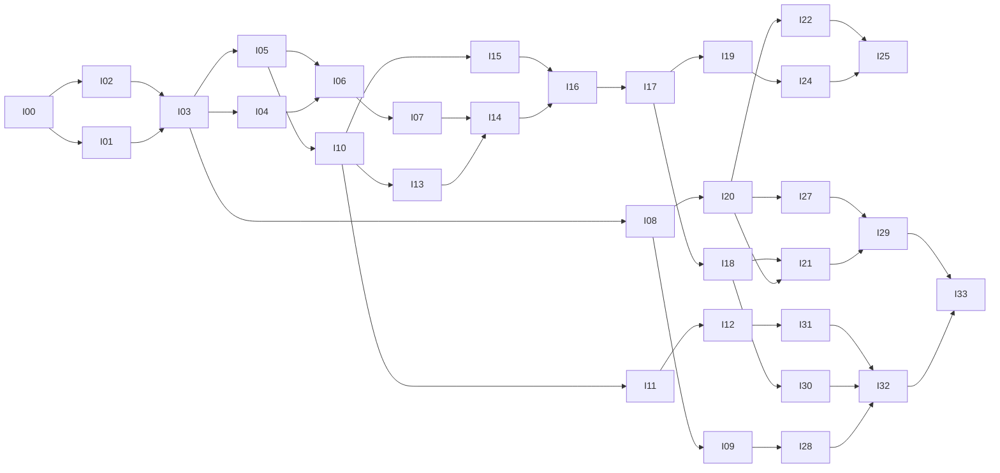

# Fullmag MCP — szczegółowy plan implementacji, wdrożenia i odbioru

> Dla agentów wykonawczych: realizować zadania sekwencyjnie według zależności, z niezależnym przeglądem domkniętych pakietów. Przy pracy agentowej używać dostępnego workflow `executing-plans` albo `subagent-driven-development`; obowiązujące `AGENTS.md` i uprawnienia użytkownika mają pierwszeństwo. Ten dokument **nie upoważnia do rozpoczęcia zmian** w ramach obecnego audytu.

**Cel:** umożliwić agentom kompletny, bezpieczny i odtwarzalny cykl badań w Fullmagu przez MCP.  
**Architektura:** cienki Rust/RMCP adapter w istniejącym API, wspólny AgentControl, trwałe RunIntent/SessionStore/CAS i niezmienny model. Żadnego nowego schedulera ani solvera w MCP.  
**Stack:** Rust, Tokio, istniejący axum/Tower, oficjalny RMCP po przypięciu, canonical Python DSL w izolowanym workerze, istniejące managed runtime i Control Room.  
**Specyfikacja:** [02_PLAN_ARCHITEKTURY_MCP.md](02_PLAN_ARCHITEKTURY_MCP.md) i [04_KATALOG_NARZEDZI_I_KONTRAKTOW.md](04_KATALOG_NARZEDZI_I_KONTRAKTOW.md).  
**Baseline audytu:** `f95aa31e1d216008513770afe6b0ea9fad1b5260`.  
**Status:** plan przyszłej realizacji; nie wykonano poniższych zadań ani testów produktu.

## 1. Ograniczenia globalne

1. Zachować istniejące zmiany repozytorium, najpierw ustalić lokalny stan i aktualny SHA. Audyt nie dowiódł czystego worktree użytkownika.
2. Nie budować poza zarejestrowaną grupą Compose. DEV zachowuje dwie stałe usługi `backend` i `frontend`; MCP nie tworzy trzeciego stałego sidecara.
3. **Nie kompilować testów jednostkowych ani zadań, których celem jest taka kompilacja, dopóki użytkownik nie odwoła obowiązującego zakazu.** Sam fakt, że plan opisuje test, nie jest zgodą na jego wykonanie.
4. Nie uruchamiać build/test na hoście i nie tworzyć niezarejestrowanych output/cache. Stosować aktualny launcher i storage governance, nie kopiować dawnych recept.
5. Nie zmieniać semantyki DSL/IR, requested/resolved/executed ani legalnych lane. Nie dodawać silent fallback.
6. Nie wystawiać narzędzi kosztownych/zdalnych/kodowych przed właściwą bramką. Nie traktować obecności tool w katalogu jako dowodu qualification.
7. Wszystkie nowe publiczne DTO mają wersję, schemat i fixture. Zmiana browser API aktualizuje OpenAPI oraz generowane pliki klienta zgodnie z R07.
8. Integracja i cleanup Git/worktree odbywają się później według bieżącego AGENTS; żaden krok tego planu nie daje prawa do usuwania danych użytkownika lub cudzych środowisk.

Źródła ograniczeń: [R02] [R04] [R05] [R06] [R07].

## 2. Review focus — pięć błędów, które trzeba zatrzymać wcześnie

| Ryzyko | Oczekiwane zachowanie | Właściciel testu |
|---|---|---|
| Utrata odpowiedzi po trwałym submit | Replay zwraca ten sam logical run, bez dodatkowego GPU zadania | I06/I17, T025–T026 |
| Przełączenie current lub restart API między read i write | Odmowa starej mutacji, bez zmiany nowego kontekstu | I05/I23, T014–T017 |
| Agent „potwierdza zgodę” na kod albo koszt | Zgoda pochodzi z zaufanej delegacji związanej z digestem, nie z boolean | I04/I12, T006/T038/T048 |
| Completed proces z nienaukowym wynikiem | Lifecycle i quality state pozostają oddzielne | I22/I27/I29, T060/T081 |
| Przywrócenie m bez integratora/RNG jako exact resume | Odmowa zawyżonego poziomu; jawny physical-state restart | I21, T065–T066 |

## 3. Strumienie pracy i odpowiedzialność

| Strumień | Odpowiedzialność | Zadania |
|---|---|---|
| W1 — architektura/kontrakty | Granice domeny, schema, aktualizacja ADR | I00–I03, I08, I27 |
| W2 — zaufanie/niezawodność | Auth, grants, fencing, ledger, budżet | I04–I07, I30–I31 |
| W3 — workflow naukowy | Authoring, compile, mesh, study, prepare, execute | I10–I18, I21–I22 |
| W4 — protokół i dane | Transporty, catalog, read models, artefakty | I09, I19–I20, I26, I28 |
| W5 — współpraca i skala | UI, batch, adaptive policy | I23–I25 |
| W6 — kwalifikacja i release | Science matrix, packaging, rollback, odbiór | I29, I32–I33 |

Równoległość jest dozwolona po zamrożeniu interfejsów. Bezpieczne pary to I04 z I05, I11 z I13 oraz I20 z I18 po dostępności ich wejść. Nie równoleglić implementacji dwóch różnych właścicieli tego samego store schema lub native command path. Integracja częsta, ale każdy commit ma zachować uzgodnioną semantykę.

## 4. Fazy i bramki

| Faza | Dostarczany profil | Bramka przed publikacją |
|---|---|---|
| F0 | Kontrakty, source map, SDK | I00–I03, znane release/MSRV/body boundary i native lifecycle |
| F1 | Read-only local | Auth/ACL, identity, bounded manifests, HTTP/stdio conformance i read-only fragment I28; żadnego submit ani Python |
| F2 | Headless authoring | Atomic revisions, import inspection, canonical export/fidelity i konflikty z UI bez przełączenia current |
| F3 | Controlled execution jednego lane | Durable idempotency, real hold/admission, grants i native ACK; kwalifikacja dokładnego minimalnego workloadu |
| F4 | Pozostałe lane/data/live | Odrębne dowody FDM/FEM CPU/GPU, scientific metadata, checkpoints, analiza; sandbox włącza się własną bramką |
| F5 | Kampanie i opcjonalne Tasks | Sumaryczny budżet, zależności, case IDs, stop criteria; rozszerzenie Tasks może pozostać wyłączone |
| F6 | Remote production | Pełny ingress/security review, chaos/load, backup/restore, rollback i niezależny odbiór |

Bramka oznacza przejście wymaganych testów **dla dokładnie reklamowanego profilu**, nie procent „wykonania planu”. Na przykład F1 nie wymaga jeszcze kwalifikacji eigensolve, ale musi mieć sprawdzone ACL i bounded results. F3 nie nazywa się pełną obsługą czterech lane. Zdalny read-only profil także wymaga prawidłowej autoryzacji ingress.

### 4.1 Ścieżka krytyczna



Graf pokazuje główne zależności; kompletne wymagane wejścia podano w kartach zadań. Rozszerzenie Tasks I26 nie blokuje podstawowego release.

## 5. Sposób wykonywania i dowodzenia prac

Każde zadanie zaczyna się od testu/fixture lub sprawdzalnego negatywnego warunku. Najpierw należy potwierdzić brak zachowania na istniejącym kodzie **dozwoloną metodą**. Przy zakazanym typie testu zapisać `BLOCKED`, dodać fixture/spec i nie udawać cyklu wykonania red/green. Następnie implementuje się minimalną zmianę, uruchamia dostępne kontrole i zbiera receipt. Niezależny reviewer sprawdza skutki uboczne, granice auth i zgodność z native ownership.

### 5.1 Recepta weryfikacyjna — nowy element planu, nie istniejące polecenie

I28 wprowadza interfejs recepty:

```text
just mcp-verify <compose-group> <static|contract|runtime|science|faults|security> <case-or-task-id>
```

Ta recepta ma delegować do **aktualnego** launchera/managed runnera z I00, wybierać poprawny immutable build i zapisywać manifest. Nie wolno implementować jej jako hostowe cargo/pnpm/docker build. Nie istnieje jeszcze w baseline audytu.

`static` sprawdza schematy, fixtures, policy, generated drift i zależności bez unit-build. `contract` wykonuje black-box na uprawnionym API/stdio. `runtime/science/faults/security` wymagają zarejestrowanego środowiska i fixture scope. Żaden tryb nie może potajemnie kompilować testów jednostkowych. Po odwołaniu zakazu osobny zatwierdzony profil może dodać unit tests; nie dopisujemy go teraz jako obowiązującego polecenia.

Receipt zawiera source SHA, build digest, compose group, policy digest, selected cases, hardware/runtime identity, expected/observed, PASS/FAIL/BLOCKED/NOT_RUN, artefakty i powód ograniczeń. Konwencja kodu wyjścia nowej recepty: 0 — wszystkie wymagane przypadki PASS; 1 — FAIL; 3 — przynajmniej jeden wymagany BLOCKED/NOT_RUN bez FAIL. **Brak wykonania nie zwraca 0.**

### 5.2 Nazwy ścieżek

`E:` oznacza istniejący punkt źródłowy potwierdzony albo wskazany przez baseline, który trzeba odczytać w całości przed modyfikacją. `N:` oznacza nowy plik/moduł proponowany przez ten plan. Jeśli karta podaje ścieżkę względną np. `fullmag-api/src`, chodzi o `crates/fullmag-api/src`. Numery linii audytu nie są instrukcją mechanicznego patchowania przyszłego SHA.

Placeholder `NNNN` w nazwie ADR jest wyłącznie zasadą rezerwacji wolnego numeru na aktualnym branchu, nie brakującą decyzją architektoniczną. Wszystkie inne nazwy modułów i interfejsów poniżej są konkretne propozycje implementacyjne.

## 6. Karty zadań

<a id="i00"></a>
### I00 — Zamrożenie baseline i zasad wykonania

**Zależności:** brak.  
**Pliki/punkty integracji:** N: docs/plans/active/mcp/baseline.md; N: docs/plans/active/mcp/verification-policy.md. Odczyt E: AGENTS.md i .agents/instructions/.

**Wejście:** Ten pakiet, aktualny master i lokalny stan repozytorium wykonawcy.  
**Interfejs/dostarczany rezultat:** BaselineRecord {sha, dirty_paths, compose_group, policy_digest, allowed_checks}.

**Realizacja:** Odczytać aktualny SHA, porównać z baseline audytu i zapisać delta. Zachować cudze zmiany. Rozstrzygnąć hierarchię storage/test restrictions według root AGENTS. Nie tworzyć buildów lub dodatkowych usług na tym etapie.

- [ ] Utrwalić przypadki T084, T089, T091 i ich oczekiwane wyniki; potwierdzić dozwoloną metodą aktualny stan, bez łamania zakazu unit-build.
- [ ] Zaimplementować opisany interfejs i minimalny zakres zmian; aktualizować schematy i dokumentację razem z kodem.
- [ ] Wykonać właściwe kontrole przez zarejestrowaną receptę; do czasu I28 użyć istniejącej, zweryfikowanej w I00 recepty, a niedostępne kontrole oznaczyć BLOCKED.
- [ ] Przekazać diff i receipts reviewerowi; zamknąć odchylenia i opublikować spójny commit zgodnie z bieżącym AGENTS.

**Kryterium odbioru:** Znany właściciel worktree i Compose; jawny zakaz unit-build odnotowany; nie ma twierdzenia clean/PASS bez dowodu.

<a id="i01"></a>
### I01 — Pełny ślad lifecycle i mapowanie istniejących usług

**Zależności:** I00.  
**Pliki/punkty integracji:** N: docs/plans/active/mcp/native-lifecycle-map.md. Odczyt E: router_v2/handlers/persistence/projects.rs, live_accepted_execution i fullmag-application/fullmag-session/fullmag-runtime-control.

**Wejście:** BaselineRecord oraz R08/R12–R17.  
**Interfejs/dostarczany rezultat:** NativeBindingMap {operation, owner_function, accepted_point, release_point, durable_receipt, recovery_path}.

**Realizacja:** Przeczytać pełne funkcje submit/materialization/release/cancel/retry używane przez wybraną ścieżkę, a nie same nagłówki. Ustalić, czy supervisor sam przechodzi accepted→running i gdzie dodać rzeczywisty hold. Zidentyfikować istniejące testy i brakujące dowody.

- [ ] Utrwalić przypadki T051–T052, T063 i ich oczekiwane wyniki; potwierdzić dozwoloną metodą aktualny stan, bez łamania zakazu unit-build.
- [ ] Zaimplementować opisany interfejs i minimalny zakres zmian; aktualizować schematy i dokumentację razem z kodem.
- [ ] Wykonać właściwe kontrole przez zarejestrowaną receptę; do czasu I28 użyć istniejącej, zweryfikowanej w I00 recepty, a niedostępne kontrole oznaczyć BLOCKED.
- [ ] Przekazać diff i receipts reviewerowi; zamknąć odchylenia i opublikować spójny commit zgodnie z bieżącym AGENTS.

**Kryterium odbioru:** Dla każdej mutacji jest jeden właściciel. Żaden projektowany tool nie wymaga bezpośredniego wywołania C ABI ani drugiego schedulera.

<a id="i02"></a>
### I02 — Przypięcie SDK i spike integracji transportu

**Zależności:** I00.  
**Pliki/punkty integracji:** N: crates/fullmag-mcp/Cargo.toml i src/lib.rs; E: Cargo.toml/Cargo.lock; N: docs/adr/NNNN-mcp-adapter.md po przydzieleniu wolnego numeru.

**Wejście:** BaselineRecord, wymagane ery MCP i aktualny graf zależności Rust.  
**Interfejs/dostarczany rezultat:** SdkQualification {release, checksum, msrv, features, body_adapter, protocol_profiles}.

**Realizacja:** Wybrać konkretny opublikowany RMCP 3.x i minimalne features server/client/HTTP/stdio. Sprawdzić Tower/http-body bez hurtowej migracji axum. Eksperyment wykonać przez aktualny managed build, nie na hoście; testów jednostkowych nie kompilować.

- [ ] Utrwalić przypadki T093–T097 i ich oczekiwane wyniki; potwierdzić dozwoloną metodą aktualny stan, bez łamania zakazu unit-build.
- [ ] Zaimplementować opisany interfejs i minimalny zakres zmian; aktualizować schematy i dokumentację razem z kodem.
- [ ] Wykonać właściwe kontrole przez zarejestrowaną receptę; do czasu I28 użyć istniejącej, zweryfikowanej w I00 recepty, a niedostępne kontrole oznaczyć BLOCKED.
- [ ] Przekazać diff i receipts reviewerowi; zamknąć odchylenia i opublikować spójny commit zgodnie z bieżącym AGENTS.

**Kryterium odbioru:** Udokumentowany lockfile i zgodność API integracyjnego. Jeżeli konflikt wymaga zmiany axum, osobny scoped ADR i ocena wpływu przed kontynuacją.

<a id="i03"></a>
### I03 — Port AgentControl i wspólne DTO

**Zależności:** I01, I02.  
**Pliki/punkty integracji:** N: crates/fullmag-application/src/agent_control/{mod,identity,operations}.rs; E: fullmag-application/src/lib.rs; N: crates/fullmag-mcp/src/{catalog,errors}.rs.

**Wejście:** NativeBindingMap i katalog 46 narzędzi.  
**Interfejs/dostarczany rezultat:** Port AgentControl + ProjectRef/RunRef/AttemptRef/ArtifactRef/AgentError/ToolOutcome; schemat fullmag.mcp.v1.

**Realizacja:** Zdefiniować typowane grupy interfejsów odczytu, authoringu, wykonania i wyników. Oddzielić principal od payloadu. Zabezpieczyć nieznane pola, finite numbers i u64-string. Wygenerować schema bundle ze wspólnych DTO, bez zależności application→MCP.

- [ ] Utrwalić przypadki T019–T020, T097 i ich oczekiwane wyniki; potwierdzić dozwoloną metodą aktualny stan, bez łamania zakazu unit-build.
- [ ] Zaimplementować opisany interfejs i minimalny zakres zmian; aktualizować schematy i dokumentację razem z kodem.
- [ ] Wykonać właściwe kontrole przez zarejestrowaną receptę; do czasu I28 użyć istniejącej, zweryfikowanej w I00 recepty, a niedostępne kontrole oznaczyć BLOCKED.
- [ ] Przekazać diff i receipts reviewerowi; zamknąć odchylenia i opublikować spójny commit zgodnie z bieżącym AGENTS.

**Kryterium odbioru:** Graf crate jest acykliczny, każdy tool ma input/output type i semantykę błędu; bez jednego execute(name, arbitrary_json) omijającego typowanie.

<a id="i04"></a>
### I04 — AuthN, ACL, delegacje i zgody

**Zależności:** I03.  
**Pliki/punkty integracji:** N: fullmag-application/src/agent_control/authorization.rs; N: fullmag-api/src/agent_control/auth.rs; N: tests/fixtures/mcp/auth/.

**Wejście:** AgentControl DTO, installation config i zaufany identity provider/profile lokalny.  
**Interfejs/dostarczany rezultat:** authorize(ctx: TrustedAgentContext, action: AgentAction, target: ResourceScope) -> AuthorizationDecision; ApprovalRef.

**Realizacja:** Weryfikować credentials, issuer/audience/expiry oraz obiektowe ACL. Nie deserializować TrustedAgentContext z argumentów. Approval wiązać z digestem, grantem i auth epoch. Zastosować politykę do usług wspólnych także przy wejściu REST; negatywny test ma obejmować obejście MCP.

- [ ] Utrwalić przypadki T001–T010, T038 i ich oczekiwane wyniki; potwierdzić dozwoloną metodą aktualny stan, bez łamania zakazu unit-build.
- [ ] Zaimplementować opisany interfejs i minimalny zakres zmian; aktualizować schematy i dokumentację razem z kodem.
- [ ] Wykonać właściwe kontrole przez zarejestrowaną receptę; do czasu I28 użyć istniejącej, zweryfikowanej w I00 recepty, a niedostępne kontrole oznaczyć BLOCKED.
- [ ] Przekazać diff i receipts reviewerowi; zamknąć odchylenia i opublikować spójny commit zgodnie z bieżącym AGENTS.

**Kryterium odbioru:** Brak credentials lub obcy project/run/artifact nie ujawnia danych ani nie wywołuje skutku. Sam approved:true/consent.executed_by_user nie daje uprawnień.

<a id="i05"></a>
### I05 — Spójne identity, revisions i fencing live

**Zależności:** I03.  
**Pliki/punkty integracji:** N: fullmag-api/src/agent_control/context.rs; E: router_v2/middleware/{version,session_scope}.rs tylko w koniecznym zakresie; N: tests/fixtures/mcp/concurrency/.

**Wejście:** ProjectRef/LiveRef/AttemptRef oraz istniejące context capture/validate.  
**Interfejs/dostarczany rezultat:** bind_context(ctx, target, expected) -> BoundAgentContext; commit fence/revision guards.

**Realizacja:** Zapewnić jawne przekazanie kontekstu do usług, aby wywołanie in-process nie omijało task-local HTTP. Walidować scope w momencie skutku. Stare instance i session epochs odrzucać, a run reads utrzymać niezależne od current.

- [ ] Utrwalić przypadki T011–T018 i ich oczekiwane wyniki; potwierdzić dozwoloną metodą aktualny stan, bez łamania zakazu unit-build.
- [ ] Zaimplementować opisany interfejs i minimalny zakres zmian; aktualizować schematy i dokumentację razem z kodem.
- [ ] Wykonać właściwe kontrole przez zarejestrowaną receptę; do czasu I28 użyć istniejącej, zweryfikowanej w I00 recepty, a niedostępne kontrole oznaczyć BLOCKED.
- [ ] Przekazać diff i receipts reviewerowi; zamknąć odchylenia i opublikować spójny commit zgodnie z bieżącym AGENTS.

**Kryterium odbioru:** Kontrolowane przełączenie sesji między walidacją a commit nie mutuje nowej sesji. Czytanie pól nie skleja starej geometrii z nowym polem.

<a id="i06"></a>
### I06 — Trwały ledger operacji i idempotency

**Zależności:** I03, I04, I05.  
**Pliki/punkty integracji:** N: fullmag-application/src/agent_control/operations.rs (rozszerzenie); N: fullmag-session/src/agent_operations.rs; E: eksporty fullmag-session według aktualnego modułu; N: tests/fixtures/mcp/recovery/.

**Wejście:** BoundAgentContext, CommandDigest, istniejący SessionStore i native RunIntent.  
**Interfejs/dostarczany rezultat:** reserve_operation(scope, key, digest, intended_ids) -> Reservation; publish_receipt(...); reconcile_operation(...).

**Realizacja:** Współdzielić trwałość z istniejącym store. Dodać unikalność scope/key, conflict payload i rekoncyliację po kluczu. W razie osobnych magazynów zastosować trwałą rezerwację/outbox z przypiętym run_id. Receipt nie jest drugą kopią lifecycle solvera.

- [ ] Utrwalić przypadki T021–T028, T063 i ich oczekiwane wyniki; potwierdzić dozwoloną metodą aktualny stan, bez łamania zakazu unit-build.
- [ ] Zaimplementować opisany interfejs i minimalny zakres zmian; aktualizować schematy i dokumentację razem z kodem.
- [ ] Wykonać właściwe kontrole przez zarejestrowaną receptę; do czasu I28 użyć istniejącej, zweryfikowanej w I00 recepty, a niedostępne kontrole oznaczyć BLOCKED.
- [ ] Przekazać diff i receipts reviewerowi; zamknąć odchylenia i opublikować spójny commit zgodnie z bieżącym AGENTS.

**Kryterium odbioru:** 20 równoczesnych identycznych submitów i restart w krytycznym oknie daje jeden logiczny run. Klucz z innym digestem zawsze odrzucony.

<a id="i07"></a>
### I07 — Budżety, rezerwacje i preauthorization

**Zależności:** I03, I04, I06.  
**Pliki/punkty integracji:** N: fullmag-application/src/agent_control/budgets.rs; N: fullmag-api/src/agent_control/budgets.rs; N: tests/fixtures/mcp/budgets/.

**Wejście:** Grant, ExecutionRequest, istniejące minimum_resources/profile i registry lease.  
**Interfejs/dostarczany rezultat:** assess_budget(plan, grant) -> BudgetDecision; reserve/reconcile/release przez istniejącego właściciela zasobów.

**Realizacja:** Rozdzielić minimum i maximum. Zliczać per-principal/project/campaign concurrency, walltime, storage, retries i case count. Użyć checked arithmetic, kontrolować output size i writer backlog. Release resource reservation dopiero po native ownership evidence.

- [ ] Utrwalić przypadki T031–T038, T067 i ich oczekiwane wyniki; potwierdzić dozwoloną metodą aktualny stan, bez łamania zakazu unit-build.
- [ ] Zaimplementować opisany interfejs i minimalny zakres zmian; aktualizować schematy i dokumentację razem z kodem.
- [ ] Wykonać właściwe kontrole przez zarejestrowaną receptę; do czasu I28 użyć istniejącej, zweryfikowanej w I00 recepty, a niedostępne kontrole oznaczyć BLOCKED.
- [ ] Przekazać diff i receipts reviewerowi; zamknąć odchylenia i opublikować spójny commit zgodnie z bieżącym AGENTS.

**Kryterium odbioru:** Nie ma oversubscription wskutek wyścigu ani interpretacji cpu_millis jako czasu CPU. Wszystkie automatyczne retry mieszczą się w grancie.

<a id="i08"></a>
### I08 — Read-only platform, schema, dokumentacja i capabilities

**Zależności:** I03, I04, I05.  
**Pliki/punkty integracji:** N: fullmag-mcp/src/tools/platform.rs; N: fullmag-api/src/agent_control/discovery.rs; N: fullmag-application/src/agent_control/capabilities.rs; N: schemas/mcp/v1/manifest.json generowany.

**Wejście:** AgentControl, registry runtime, schema bundle i allowlisted docs.  
**Interfejs/dostarczany rezultat:** InstallationInfo, CapabilityMatrix, SchemaDocument, DocumentationPage; fm_platform_get/capabilities_get/schema_get/docs_search.

**Realizacja:** Wprowadzić wielowymiarowe capabilities z dowodami. Czytać wersje i limity policy; nie wypisywać ścieżek hosta. Indeks docs pochodzi z przypiętego pakietu. Katalog narzędzi jest deterministyczny dla profilu/auth, a nie stanu rozmowy.

- [ ] Utrwalić przypadki T053–T060, T064, T098 i ich oczekiwane wyniki; potwierdzić dozwoloną metodą aktualny stan, bez łamania zakazu unit-build.
- [ ] Zaimplementować opisany interfejs i minimalny zakres zmian; aktualizować schematy i dokumentację razem z kodem.
- [ ] Wykonać właściwe kontrole przez zarejestrowaną receptę; do czasu I28 użyć istniejącej, zweryfikowanej w I00 recepty, a niedostępne kontrole oznaczyć BLOCKED.
- [ ] Przekazać diff i receipts reviewerowi; zamknąć odchylenia i opublikować spójny commit zgodnie z bieżącym AGENTS.

**Kryterium odbioru:** Agent odróżnia deklarację od dostępności i kwalifikacji; nieznane runtime daje unknown/blocked, nie losowe supported.

<a id="i09"></a>
### I09 — Endpoint HTTP i cienkie stdio

**Zależności:** I02, I04, I08.  
**Pliki/punkty integracji:** N: fullmag-mcp/src/server.rs, src/transports/{http,stdio_proxy}.rs, src/bin/fullmag-mcp.rs; E: fullmag-api/src/main.rs w miejscu montażu routera; N: runtime config schema MCP.

**Wejście:** SdkQualification, implementacja AgentControl i zweryfikowany credentials provider.  
**Interfejs/dostarczany rezultat:** mount_mcp(service, transport_policy); stdio proxy z przypiętym endpointem i profilem modern/legacy.

**Realizacja:** Zamontować /mcp w obecnym backendzie. SDK obsługuje wire, limity i era routing; policy otacza wszystkie wywołania. Koniec proxy nie zatrzymuje runu. Stdout nie zawiera logów; endpoint nie jest argumentem narzędzia.

- [ ] Utrwalić przypadki T007, T086, T093–T100 i ich oczekiwane wyniki; potwierdzić dozwoloną metodą aktualny stan, bez łamania zakazu unit-build.
- [ ] Zaimplementować opisany interfejs i minimalny zakres zmian; aktualizować schematy i dokumentację razem z kodem.
- [ ] Wykonać właściwe kontrole przez zarejestrowaną receptę; do czasu I28 użyć istniejącej, zweryfikowanej w I00 recepty, a niedostępne kontrole oznaczyć BLOCKED.
- [ ] Przekazać diff i receipts reviewerowi; zamknąć odchylenia i opublikować spójny commit zgodnie z bieżącym AGENTS.

**Kryterium odbioru:** Rzeczywiste kontraktowe wywołanie działa dla obu reklamowanych er. Nie otwarto niezamówionego portu ani trzeciej stałej usługi DEV.

<a id="i10"></a>
### I10 — Headless project authoring i atomic model_apply

**Zależności:** I05, I06, I08.  
**Pliki/punkty integracji:** N: fullmag-api/src/agent_control/projects.rs; N: fullmag-mcp/src/tools/{projects,model}.rs; E: właściwe usługi fullmag-authoring/fullmag-application z mapy I01.

**Wejście:** ProjectRef, Typed ModelOperation, canonical SceneDocument i authorize/ledger.  
**Interfejs/dostarczany rezultat:** project_create/get/fork/save; apply_model(ctx, ApplyModelRequest) -> ModelCommitReceipt.

**Realizacja:** Wydzielić potrzebne domain operations z current handlerów do wspólnej usługi. Nie przełączać current. Zwalidować całą transakcję i dangling refs, zatwierdzić jedną rewizję i invalidation set. Source-authoritative mutations stosują odpowiednią politykę fidelity.

- [ ] Utrwalić przypadki T011–T020, T039–T040 i ich oczekiwane wyniki; potwierdzić dozwoloną metodą aktualny stan, bez łamania zakazu unit-build.
- [ ] Zaimplementować opisany interfejs i minimalny zakres zmian; aktualizować schematy i dokumentację razem z kodem.
- [ ] Wykonać właściwe kontrole przez zarejestrowaną receptę; do czasu I28 użyć istniejącej, zweryfikowanej w I00 recepty, a niedostępne kontrole oznaczyć BLOCKED.
- [ ] Przekazać diff i receipts reviewerowi; zamknąć odchylenia i opublikować spójny commit zgodnie z bieżącym AGENTS.

**Kryterium odbioru:** UI i agent widzą ten sam canonical model. Konflikt rewizji i błąd dowolnej operacji pozostawiają projekt bez częściowych zmian.

<a id="i11"></a>
### I11 — Diff, eksport i authority/fidelity

**Zależności:** I10.  
**Pliki/punkty integracji:** N: fullmag-api/src/agent_control/fidelity.rs; E: canonical script export usługa wskazana przez I01; N: tests/fixtures/mcp/roundtrip/.

**Wejście:** Dwa ProjectRef lub źródło/scene/IR po publicznym lowering.  
**Interfejs/dostarczany rezultat:** AuthorityMode, FidelityReport, SemanticDiff; fm_model_diff i fm_script_export.

**Realizacja:** Zachować source_authoritative, gdy scena jest niepełną projekcją. Porównywać znaczące fields IR i payload hashes, nie tylko tekst Pythona. Export ma jawny verdict i zachowuje ostrzeżenia. Konwersja źródła do sceny wymaga odrębnej świadomej decyzji.

- [ ] Utrwalić przypadki T039–T040, T049–T050 i ich oczekiwane wyniki; potwierdzić dozwoloną metodą aktualny stan, bez łamania zakazu unit-build.
- [ ] Zaimplementować opisany interfejs i minimalny zakres zmian; aktualizować schematy i dokumentację razem z kodem.
- [ ] Wykonać właściwe kontrole przez zarejestrowaną receptę; do czasu I28 użyć istniejącej, zweryfikowanej w I00 recepty, a niedostępne kontrole oznaczyć BLOCKED.
- [ ] Przekazać diff i receipts reviewerowi; zamknąć odchylenia i opublikować spójny commit zgodnie z bieżącym AGENTS.

**Kryterium odbioru:** Zaawansowany skrypt z ograniczeniem round-trip nie zostaje uproszczony przez zwykłe otwarcie, diff lub save.

<a id="i12"></a>
### I12 — Izolowany compile-only publicznego Python DSL

**Zależności:** I04, I06, I07, I11.  
**Pliki/punkty integracji:** N: fullmag-api/src/agent_control/compilation.rs; N: scripts/managed_mcp_compile.py (worker, nie launcher omijający governance); E: packages/fullmag-py tylko dla jawnego capture contract; N: tests/fixtures/mcp/sandbox/.

**Wejście:** SourceAssetRef, declared dependencies, compile profile i zweryfikowany approval/grant.  
**Interfejs/dostarczany rezultat:** compile_source(ctx, CompileRequest) -> OperationReceipt; CompileResult {IR, hashes, fidelity, diagnostics}.

**Realizacja:** Włączyć sandbox przez istniejący managed runtime z zablokowaną siecią, ograniczonym filesystem i cgroup/procesami. Dodać tryb compile/capture bez Solve zgodny z publicznym DSL. Zbierać bounded logs i wszystkie wejścia; brak izolatora blokuje capability.

- [ ] Utrwalić przypadki T041–T050 i ich oczekiwane wyniki; potwierdzić dozwoloną metodą aktualny stan, bez łamania zakazu unit-build.
- [ ] Zaimplementować opisany interfejs i minimalny zakres zmian; aktualizować schematy i dokumentację razem z kodem.
- [ ] Wykonać właściwe kontrole przez zarejestrowaną receptę; do czasu I28 użyć istniejącej, zweryfikowanej w I00 recepty, a niedostępne kontrole oznaczyć BLOCKED.
- [ ] Przekazać diff i receipts reviewerowi; zamknąć odchylenia i opublikować spójny commit zgodnie z bieżącym AGENTS.

**Kryterium odbioru:** Fixture próbujący odczytać sekret, zapisać host, wykonać fork bomb lub solver podczas capture nie przekracza granicy zaufania. Żaden boolean agenta nie autoryzuje wykonania.

<a id="i13"></a>
### I13 — Import assets, upload broker i safe storage targets

**Zależności:** I04, I06, I10.  
**Pliki/punkty integracji:** N: fullmag-api/src/agent_control/assets.rs; N: router_v2/handlers/agent_uploads.rs i schemas/agent_uploads.rs; E: router_v2/mod.rs/openapi_v2.rs; N: tests/fixtures/mcp/assets/.

**Wejście:** RegisteredUploadRef/inline text, allowlisted file kind i ProjectRef.  
**Interfejs/dostarczany rezultat:** AssetInspection, AssetRef, RegisteredTargetRef; fm_asset_import/assets_list.

**Realizacja:** Dodać jawnie nowy upload API i kontrolowany lifecycle stagingu. Walidować digest/rozmiar/format, archive traversal i symlinks. Opublikować atomowo do CAS i sprzątać tylko własne nieopublikowane pliki. Nowe API aktualizuje OpenAPI i generowany klient.

- [ ] Utrwalić przypadki T049, T078–T079, T085 i ich oczekiwane wyniki; potwierdzić dozwoloną metodą aktualny stan, bez łamania zakazu unit-build.
- [ ] Zaimplementować opisany interfejs i minimalny zakres zmian; aktualizować schematy i dokumentację razem z kodem.
- [ ] Wykonać właściwe kontrole przez zarejestrowaną receptę; do czasu I28 użyć istniejącej, zweryfikowanej w I00 recepty, a niedostępne kontrole oznaczyć BLOCKED.
- [ ] Przekazać diff i receipts reviewerowi; zamknąć odchylenia i opublikować spójny commit zgodnie z bieżącym AGENTS.

**Kryterium odbioru:** Złośliwe nazwy, BOM/NUL, pliki o złym typie i archive bomb nie zapisują się poza zarządzanym obszarem. Asset nie staje się kodem przez import.

<a id="i14"></a>
### I14 — Siatka i FDM grid jako trwałe operacje

**Zależności:** I07, I10, I13.  
**Pliki/punkty integracji:** N: fullmag-api/src/agent_control/meshing.rs; N: fullmag-mcp/src/tools/mesh.rs; E: istniejąca preparation/meshing service z I01.

**Wejście:** ProjectRef, MeshPolicyRef, lane i budget.  
**Interfejs/dostarczany rezultat:** build_mesh(ctx, MeshBuildRequest) -> OperationReceipt; MeshRef i QualityReport.

**Realizacja:** Powiązać build z niezmiennym input/policy digest. Oddzielić FDM refresh od FEM meshing i uwzględnić airbox/interfejsy. Ukończony wynik starej rewizji zachować jako historyczny, lecz nie attach do nowego draft. Zabezpieczyć remesh przed konfliktem aktywnego runu.

- [ ] Utrwalić przypadki T016–T017, T034–T035, T052, T075 i ich oczekiwane wyniki; potwierdzić dozwoloną metodą aktualny stan, bez łamania zakazu unit-build.
- [ ] Zaimplementować opisany interfejs i minimalny zakres zmian; aktualizować schematy i dokumentację razem z kodem.
- [ ] Wykonać właściwe kontrole przez zarejestrowaną receptę; do czasu I28 użyć istniejącej, zweryfikowanej w I00 recepty, a niedostępne kontrole oznaczyć BLOCKED.
- [ ] Przekazać diff i receipts reviewerowi; zamknąć odchylenia i opublikować spójny commit zgodnie z bieżącym AGENTS.

**Kryterium odbioru:** Krok mesh nie uruchamia drugiego accepted Solve, a stale mesh nie może zostać użyty w innym przygotowanym runie.

<a id="i15"></a>
### I15 — Study graph, output policy i preview

**Zależności:** I10, I11.  
**Pliki/punkty integracji:** N: fullmag-api/src/agent_control/studies.rs; N: fullmag-mcp/src/tools/studies.rs; E: fullmag-plan/StudyProblemCatalog i authoring study użyte w I01.

**Wejście:** ProjectRef, StudyPlan, requested execution i output definitions.  
**Interfejs/dostarczany rezultat:** plan_study(ctx, StudyPlanRequest) -> StudyPlanPreview; fm_study_get/study_plan.

**Realizacja:** Walidować kolejność relax/time/eigen/response i źródła stanu wejściowego. Nie łączyć finite dispersion z Bloch. Wyliczyć required preparation i output storage estimate bez wykonania solvera. Dla niewykonanego source-authoritative projektu żądać jawnej kompilacji.

- [ ] Utrwalić przypadki T052, T059–T060, T068–T069, T082 i ich oczekiwane wyniki; potwierdzić dozwoloną metodą aktualny stan, bez łamania zakazu unit-build.
- [ ] Zaimplementować opisany interfejs i minimalny zakres zmian; aktualizować schematy i dokumentację razem z kodem.
- [ ] Wykonać właściwe kontrole przez zarejestrowaną receptę; do czasu I28 użyć istniejącej, zweryfikowanej w I00 recepty, a niedostępne kontrole oznaczyć BLOCKED.
- [ ] Przekazać diff i receipts reviewerowi; zamknąć odchylenia i opublikować spójny commit zgodnie z bieżącym AGENTS.

**Kryterium odbioru:** Preview zachowuje intencję, wykrywa zależności/cykle i nie ma skutku startu ani materializacji ukrytej w odczycie.

<a id="i16"></a>
### I16 — Prepare: immutable binding i native hold gate

**Zależności:** I07, I14, I15.  
**Pliki/punkty integracji:** N: fullmag-api/src/agent_control/execution.rs (prepare); E: run_intent_preparation i właściciel admission/release z I01; N: tests/fixtures/mcp/prepare/.

**Wejście:** ProjectRef, StudyRef, MeshRef, ExecutionRequest i grant.  
**Interfejs/dostarczany rezultat:** prepare_run(ctx, PrepareRunRequest) -> PreparedRunRef; hold/after_admission policy bound to digest.

**Realizacja:** Związać source/IR/study/profile/mesh/outputs z jednym planem i policzyć ceiling. Wprowadzić prawdziwy hold w kanonicznym lifecycle, jeżeli brak go obecnie. Utrwalić prepared record i expiry. Sam prepare nie daje prawa startu i nie dopina mutable defaults później.

- [ ] Utrwalić przypadki T031–T038, T051–T060 i ich oczekiwane wyniki; potwierdzić dozwoloną metodą aktualny stan, bez łamania zakazu unit-build.
- [ ] Zaimplementować opisany interfejs i minimalny zakres zmian; aktualizować schematy i dokumentację razem z kodem.
- [ ] Wykonać właściwe kontrole przez zarejestrowaną receptę; do czasu I28 użyć istniejącej, zweryfikowanej w I00 recepty, a niedostępne kontrole oznaczyć BLOCKED.
- [ ] Przekazać diff i receipts reviewerowi; zamknąć odchylenia i opublikować spójny commit zgodnie z bieżącym AGENTS.

**Kryterium odbioru:** Zmiana input/profile/policy po prepare blokuje submit albo wymaga nowego przygotowania. Held run nie wykonuje się przez żaden supervisor.

<a id="i17"></a>
### I17 — Durable submit i zachowanie po utracie odpowiedzi

**Zależności:** I06, I16.  
**Pliki/punkty integracji:** N: fullmag-api/src/agent_control/execution.rs (submit); N: fullmag-mcp/src/tools/execution.rs; E: canonical accepted-run publication path.

**Wejście:** PreparedRunRef, explicit start_policy, key i approval/grant.  
**Interfejs/dostarczany rezultat:** submit_run(ctx, SubmitRunRequest) -> SubmitReceipt z native RunRef.

**Realizacja:** Atomowo skojarzyć ledger operation z istniejącym RunIntent. Utrzymywać ten sam run_id podczas retry. ACK dopiero po durability, po nim work należy do coordinatora. Zwracać accepted/held, a nie running bez natywnego receipt.

- [ ] Utrwalić przypadki T021–T028, T051–T054, T062 i ich oczekiwane wyniki; potwierdzić dozwoloną metodą aktualny stan, bez łamania zakazu unit-build.
- [ ] Zaimplementować opisany interfejs i minimalny zakres zmian; aktualizować schematy i dokumentację razem z kodem.
- [ ] Wykonać właściwe kontrole przez zarejestrowaną receptę; do czasu I28 użyć istniejącej, zweryfikowanej w I00 recepty, a niedostępne kontrole oznaczyć BLOCKED.
- [ ] Przekazać diff i receipts reviewerowi; zamknąć odchylenia i opublikować spójny commit zgodnie z bieżącym AGENTS.

**Kryterium odbioru:** Timeout po zapisie i replay z nowym JSON-RPC id zwracają ten sam logiczny run. Równoległy klient nie wymusza drugiego submit.

<a id="i18"></a>
### I18 — Sterowanie runem, natywne ACK i retry prób

**Zależności:** I17.  
**Pliki/punkty integracji:** N: fullmag-api/src/agent_control/control.rs; E: native command/cancellation/retry service z I01; N: tests/fixtures/mcp/control/.

**Wejście:** RunRef/AttemptRef, action, expected revision, reason i key.  
**Interfejs/dostarczany rezultat:** control_run(ctx, ControlRunRequest) -> ControlReceipt; retry_task(...) -> RetryReceipt.

**Realizacja:** Rozdzielić request, acceptance, native ACK i terminal state. Obsłużyć release tylko held, pause/resume tylko kwalifikowane safe points, cancel bez kill PID. Retry zachowuje RunSpec i tworzy nową attempt/epoch. Po completed cancel jest jawnie no-op/conflict, nie zmienia historii.

- [ ] Utrwalić przypadki T018, T029–T030, T037, T061–T066 i ich oczekiwane wyniki; potwierdzić dozwoloną metodą aktualny stan, bez łamania zakazu unit-build.
- [ ] Zaimplementować opisany interfejs i minimalny zakres zmian; aktualizować schematy i dokumentację razem z kodem.
- [ ] Wykonać właściwe kontrole przez zarejestrowaną receptę; do czasu I28 użyć istniejącej, zweryfikowanej w I00 recepty, a niedostępne kontrole oznaczyć BLOCKED.
- [ ] Przekazać diff i receipts reviewerowi; zamknąć odchylenia i opublikować spójny commit zgodnie z bieżącym AGENTS.

**Kryterium odbioru:** Nie zwalnia się zasobów po samym HTTP 200. Wynik spóźnionej starej próby nie publikuje się do nowego attempt.

<a id="i19"></a>
### I19 — Run/operation read models i odtwarzanie zdarzeń

**Zależności:** I06, I17.  
**Pliki/punkty integracji:** N: fullmag-api/src/agent_control/observations.rs (status/events); N: fullmag-mcp/src/resources.rs; E: lifecycle event projection z R07/R08.

**Wejście:** RunLocator/OperationId, principal scope, cursor i limits.  
**Interfejs/dostarczany rezultat:** RunView, OperationView, EventPage; fm_run_get/runs_list/operation_get/events_read.

**Realizacja:** Projekcja ma native_state, quality_state, stop_reason i poll hint. Stronicować task graphs/logs. Cursor powiązać z zakresem i retencją; gap wymusza snapshot resync. Subskrypcja invaliduje cache, lecz nie jest ledgerem.

- [ ] Utrwalić przypadki T025–T030, T061–T064, T074 i ich oczekiwane wyniki; potwierdzić dozwoloną metodą aktualny stan, bez łamania zakazu unit-build.
- [ ] Zaimplementować opisany interfejs i minimalny zakres zmian; aktualizować schematy i dokumentację razem z kodem.
- [ ] Wykonać właściwe kontrole przez zarejestrowaną receptę; do czasu I28 użyć istniejącej, zweryfikowanej w I00 recepty, a niedostępne kontrole oznaczyć BLOCKED.
- [ ] Przekazać diff i receipts reviewerowi; zamknąć odchylenia i opublikować spójny commit zgodnie z bieżącym AGENTS.

**Kryterium odbioru:** Reconnect po utracie eventów daje właściwy stan z trwałego źródła. Nie ma stale completion z innego runu ani nieograniczonego wzrostu bufora.

<a id="i20"></a>
### I20 — Katalog wyników i kontrolowany data plane

**Zależności:** I06, I08.  
**Pliki/punkty integracji:** N: fullmag-api/src/agent_control/observations.rs (artifacts); N: fullmag-mcp/src/tools/results.rs; E: solution-set/CAS services R08/R15.

**Wejście:** ArtifactRef/DatasetRef, ReadLimit i ACL.  
**Interfejs/dostarczany rezultat:** ResultManifest, FieldQueryResult, AccessReceipt; fm_results_list/result_get/field_query/artifact_access/provenance_get.

**Realizacja:** Czytać immutable revisions i potwierdzać membership/digest/attempt. Bounded metadata i ROI, wskazywać datatype/units/support. Dostęp binarny przez autoryzowany route/ticket; nie transportować pól base64 w statusie. Odczyt nie materializuje nowej symulacji.

- [ ] Utrwalić przypadki T071–T080 i ich oczekiwane wyniki; potwierdzić dozwoloną metodą aktualny stan, bez łamania zakazu unit-build.
- [ ] Zaimplementować opisany interfejs i minimalny zakres zmian; aktualizować schematy i dokumentację razem z kodem.
- [ ] Wykonać właściwe kontrole przez zarejestrowaną receptę; do czasu I28 użyć istniejącej, zweryfikowanej w I00 recepty, a niedostępne kontrole oznaczyć BLOCKED.
- [ ] Przekazać diff i receipts reviewerowi; zamknąć odchylenia i opublikować spójny commit zgodnie z bieżącym AGENTS.

**Kryterium odbioru:** 64 KiB ma pierwszeństwo nad page_size; obcy/niezgodny artefakt odrzucony przed danymi. Brak pola nie wygląda jak zerowe wartości.

<a id="i21"></a>
### I21 — Poziomy checkpoint i immutable child restore

**Zależności:** I18, I20.  
**Pliki/punkty integracji:** N: fullmag-api/src/agent_control/checkpoints.rs; E: istniejące native checkpoint/frozen state services; N: tests/fixtures/mcp/checkpoints/.

**Wejście:** AttemptRef + requested_level albo CheckpointRef + target profile.  
**Interfejs/dostarczany rezultat:** CheckpointManifest z achieved_level; restore_checkpoint(...) -> PreparedRunRef child runu.

**Realizacja:** Zidentyfikować stan integratora/RNG/stage niezbędny dla deklarowanego poziomu. Zapisać receipt safe point i kompatybilność ABI/mesh/precision. Restore nie mutuje źródłowego runu. Zmiana lane ma jawny dopuszczalny poziom odtwarzalności.

- [ ] Utrwalić przypadki T065–T066, T073, T090 i ich oczekiwane wyniki; potwierdzić dozwoloną metodą aktualny stan, bez łamania zakazu unit-build.
- [ ] Zaimplementować opisany interfejs i minimalny zakres zmian; aktualizować schematy i dokumentację razem z kodem.
- [ ] Wykonać właściwe kontrole przez zarejestrowaną receptę; do czasu I28 użyć istniejącej, zweryfikowanej w I00 recepty, a niedostępne kontrole oznaczyć BLOCKED.
- [ ] Przekazać diff i receipts reviewerowi; zamknąć odchylenia i opublikować spójny commit zgodnie z bieżącym AGENTS.

**Kryterium odbioru:** Physical-state-only nie przechodzi jako exact_resume. Niekompatybilny checkpoint zostaje odrzucony przed uruchomieniem.

<a id="i22"></a>
### I22 — Wersjonowane analizy i kontrola jakości wyników

**Zależności:** I07, I20.  
**Pliki/punkty integracji:** N: fullmag-api/src/agent_control/analysis.rs; N: fullmag-application/src/agent_control/analysis.rs; E: istniejący analysis operator registry / services z I01; N: tests/fixtures/mcp/analysis/.

**Wejście:** OperatorRef, immutable input artifacts, typed params i budget.  
**Interfejs/dostarczany rezultat:** analysis_submit(...) -> OperationReceipt; AnalysisManifest z algorithm/version/units/quality.

**Realizacja:** Zdefiniować allowlist operatorów i ich schematy. Reuse istniejących obliczeń; brak operatora = unavailable. Wymagać weighting, axes, window/normalization i approximation. Kosztowna materializacja wymaga grant i receipt.

- [ ] Utrwalić przypadki T060, T071–T082 i ich oczekiwane wyniki; potwierdzić dozwoloną metodą aktualny stan, bez łamania zakazu unit-build.
- [ ] Zaimplementować opisany interfejs i minimalny zakres zmian; aktualizować schematy i dokumentację razem z kodem.
- [ ] Wykonać właściwe kontrole przez zarejestrowaną receptę; do czasu I28 użyć istniejącej, zweryfikowanej w I00 recepty, a niedostępne kontrole oznaczyć BLOCKED.
- [ ] Przekazać diff i receipts reviewerowi; zamknąć odchylenia i opublikować spójny commit zgodnie z bieżącym AGENTS.

**Kryterium odbioru:** Agent nie otrzymuje naukowego PASS jedynie ze statusu completed; wyniki mają pełne źródła i powtarzalne parametry analizy.

<a id="i23"></a>
### I23 — Koegzystencja z Control Room i jawny live attach

**Zależności:** I05, I10, I19.  
**Pliki/punkty integracji:** N: fullmag-api/src/agent_control/live.rs; N: fullmag-mcp/src/tools/live.rs; E: apps/control-room/src/kernel/api i moduł Automation wybrany wg jego manifestu; E: openapi/generated artefacts jeśli zmieniają się DTO.

**Wejście:** LiveRef, ProjectRef, expected view revision i principal.  
**Interfejs/dostarczany rezultat:** LiveAttachmentRef/lease, ViewStateReceipt i ImageArtifactRef; UI audit/approval surfaces.

**Realizacja:** Dodać attach/detach bez przełączania current. Pokazać autora zmiany i scope grantu w istniejącej powłoce. Render snapshot wymaga danych i ACK/gotowego headless renderer. Użyć centralnych facade/hooks, nie fetch w komponentach.

- [ ] Utrwalić przypadki T013–T020, T070, T080 i ich oczekiwane wyniki; potwierdzić dozwoloną metodą aktualny stan, bez łamania zakazu unit-build.
- [ ] Zaimplementować opisany interfejs i minimalny zakres zmian; aktualizować schematy i dokumentację razem z kodem.
- [ ] Wykonać właściwe kontrole przez zarejestrowaną receptę; do czasu I28 użyć istniejącej, zweryfikowanej w I00 recepty, a niedostępne kontrole oznaczyć BLOCKED.
- [ ] Przekazać diff i receipts reviewerowi; zamknąć odchylenia i opublikować spójny commit zgodnie z bieżącym AGENTS.

**Kryterium odbioru:** Sesja użytkownika pozostaje pod jego kontrolą. Edycje konfliktują jawnie; zmiana kamery nie zmienia fizyki; brak renderera nie blokuje numerycznych runów.

<a id="i24"></a>
### I24 — Deterministyczny batch i sumaryczny admission

**Zależności:** I07, I15, I17, I19.  
**Pliki/punkty integracji:** N: fullmag-api/src/agent_control/campaigns.rs; N: fullmag-mcp/src/tools/campaigns.rs; E: fullmag-application batch_expansion i istniejące batch API.

**Wejście:** Batch axes/join/strategy, ProjectRef, profile i campaign grant.  
**Interfejs/dostarczany rezultat:** BatchPlanRef, BatchReceipt i BatchControlReceipt z mapą cases→runs.

**Realizacja:** Limitować rozwinięcie i przepełnienia przed tworzeniem cases. Rozdzielić independent, zipped i sequential. Przy częściowym przyjęciu opublikować dokładny manifest. Pause admission nie udaje wstrzymania istniejącego GPU task.

- [ ] Utrwalić przypadki T034, T037, T067–T070 i ich oczekiwane wyniki; potwierdzić dozwoloną metodą aktualny stan, bez łamania zakazu unit-build.
- [ ] Zaimplementować opisany interfejs i minimalny zakres zmian; aktualizować schematy i dokumentację razem z kodem.
- [ ] Wykonać właściwe kontrole przez zarejestrowaną receptę; do czasu I28 użyć istniejącej, zweryfikowanej w I00 recepty, a niedostępne kontrole oznaczyć BLOCKED.
- [ ] Przekazać diff i receipts reviewerowi; zamknąć odchylenia i opublikować spójny commit zgodnie z bieżącym AGENTS.

**Kryterium odbioru:** Case IDs/digests są deterministyczne, zależności fizyczne zachowane, a suma prac/prób mieści się w zadeklarowanym grancie.

<a id="i25"></a>
### I25 — Adaptacyjna kampania z audytem decyzji agenta

**Zależności:** I22, I24.  
**Pliki/punkty integracji:** N: fullmag-application/src/agent_control/campaign_policy.rs; N: docs/specs/mcp/adaptive-campaigns.md; N: tests/fixtures/mcp/campaigns/.

**Wejście:** ObjectiveRef, observation refs, constraints, max iterations/cost i BatchPlanRefs.  
**Interfejs/dostarczany rezultat:** CampaignDecisionRecord {inputs, objective_version, proposal, acceptance, stop_reason, budget_remaining}.

**Realizacja:** Wykorzystywać te same prepare/submit/analysis operations. Sprawdzać limit iteracji, stagnację i niewykonalne constraints. Zmiana funkcji celu tworzy nową rewizję kampanii. Nie implementować drugiego optymalizatora/schedulera w sesji MCP.

- [ ] Utrwalić przypadki T067–T070, T083 i ich oczekiwane wyniki; potwierdzić dozwoloną metodą aktualny stan, bez łamania zakazu unit-build.
- [ ] Zaimplementować opisany interfejs i minimalny zakres zmian; aktualizować schematy i dokumentację razem z kodem.
- [ ] Wykonać właściwe kontrole przez zarejestrowaną receptę; do czasu I28 użyć istniejącej, zweryfikowanej w I00 recepty, a niedostępne kontrole oznaczyć BLOCKED.
- [ ] Przekazać diff i receipts reviewerowi; zamknąć odchylenia i opublikować spójny commit zgodnie z bieżącym AGENTS.

**Kryterium odbioru:** Każdy „najlepszy” przypadek ma dowody porównania i koszt; agent nie może kontynuować kampanii poza grantem po restarcie rozmowy.

<a id="i26"></a>
### I26 — Opcjonalny adapter MCP Tasks

**Zależności:** I09, I19.  
**Pliki/punkty integracji:** N: fullmag-mcp/src/tasks_extension.rs; N: docs/specs/mcp/tasks-profile.md; E: SDK feature profile tylko po pinie extension.

**Wejście:** Przypięty Tasks extension schema, OperationId i protokołowe client capabilities.  
**Interfejs/dostarczany rezultat:** MCP task handle↔operation mapping z TTL, ACL i zgodnością stanów.

**Realizacja:** Włączyć wyłącznie po osobnej kwalifikacji draft/release. Bez obsługi rozszerzenia zwykły submit/get działa identycznie. TTL uchwytu nie usuwa runu; cancel mapuje się zgodnie z jawnie zadeklarowaną semantyką i uprawnieniami. Nie mapować bezmyślnie failed solvera na protocol failed.

- [ ] Utrwalić przypadki T099–T100 i ich oczekiwane wyniki; potwierdzić dozwoloną metodą aktualny stan, bez łamania zakazu unit-build.
- [ ] Zaimplementować opisany interfejs i minimalny zakres zmian; aktualizować schematy i dokumentację razem z kodem.
- [ ] Wykonać właściwe kontrole przez zarejestrowaną receptę; do czasu I28 użyć istniejącej, zweryfikowanej w I00 recepty, a niedostępne kontrole oznaczyć BLOCKED.
- [ ] Przekazać diff i receipts reviewerowi; zamknąć odchylenia i opublikować spójny commit zgodnie z bieżącym AGENTS.

**Kryterium odbioru:** Core nie zależy od rozszerzenia. Klient bez capability nigdy nie dostaje task result; tryb off nie usuwa możliwości monitorowania.

<a id="i27"></a>
### I27 — Semantyka naukowa i registry kwalifikacji

**Zależności:** I08, I15, I20.  
**Pliki/punkty integracji:** N: docs/specs/mcp/scientific-contract.md; N: fullmag-application/src/agent_control/scientific_semantics.rs; E: fullmag-quantities i registry capabilities tylko jeśli brakuje jawnych metadanych.

**Wejście:** Quantity registry, study types, lane contracts i wersjonowane qualification receipts.  
**Interfejs/dostarczany rezultat:** ScientificSemantics {units, support, weighting, axes, convention, approximation}; WorkloadQualificationRef.

**Realizacja:** Zamrozić konwencje B/H, m/M, f/omega/k, complex components, volume weighting i scientific stop reasons. Kwalifikacja wiąże feature/lane/precision/build/fixture. Aktualizacja builda unieważnia niezgodne dowody zamiast przenosić supported=true.

- [ ] Utrwalić przypadki T053–T060, T071–T077, T081–T082 i ich oczekiwane wyniki; potwierdzić dozwoloną metodą aktualny stan, bez łamania zakazu unit-build.
- [ ] Zaimplementować opisany interfejs i minimalny zakres zmian; aktualizować schematy i dokumentację razem z kodem.
- [ ] Wykonać właściwe kontrole przez zarejestrowaną receptę; do czasu I28 użyć istniejącej, zweryfikowanej w I00 recepty, a niedostępne kontrole oznaczyć BLOCKED.
- [ ] Przekazać diff i receipts reviewerowi; zamknąć odchylenia i opublikować spójny commit zgodnie z bieżącym AGENTS.

**Kryterium odbioru:** Każdy reklamowany wynik ma interpretowalne jednostki i capability evidence. Unknown nie znika przez formatowanie odpowiedzi.

<a id="i28"></a>
### I28 — Testy kontraktu i rzeczywistych klientów

**Zależności:** I09, I10, I17, I20.  
**Pliki/punkty integracji:** N: scripts/verify_mcp.py; N: tests/mcp/contracts/*.json; N: tests/mcp/clients/; N: recipes/managed-mcp-verify.md; E: justfile nowa zatwierdzona recepta mcp-verify.

**Wejście:** Opublikowane schematy, oba profile protokołu, test users i bounded fixtures.  
**Interfejs/dostarczany rezultat:** Machine-readable verification manifest, client version matrix i schema drift report.

**Realizacja:** Dodać testy black-box HTTP/stdio oraz schema fixtures. Uruchamiać wyłącznie przez managed recipe. Przypadki wymagające Rust unit-build mają status BLOCKED do odwołania zakazu; nie ukrywać ich przez przepisanie launchera. Sprawdzać nowoczesny i legacy klient na realnych requestach.

- [ ] Utrwalić przypadki T001–T020, T074, T093–T100 i ich oczekiwane wyniki; potwierdzić dozwoloną metodą aktualny stan, bez łamania zakazu unit-build.
- [ ] Zaimplementować opisany interfejs i minimalny zakres zmian; aktualizować schematy i dokumentację razem z kodem.
- [ ] Wykonać właściwe kontrole przez zarejestrowaną receptę; do czasu I28 użyć istniejącej, zweryfikowanej w I00 recepty, a niedostępne kontrole oznaczyć BLOCKED.
- [ ] Przekazać diff i receipts reviewerowi; zamknąć odchylenia i opublikować spójny commit zgodnie z bieżącym AGENTS.

**Kryterium odbioru:** Żaden profil release nie reklamuje wersji/feature bez dowodu wire. Generator OpenAPI/MCP nie produkuje driftu w clean diff.

<a id="i29"></a>
### I29 — Kwalifikacja czterech lane i danych naukowych

**Zależności:** I14, I18, I21, I22, I27.  
**Pliki/punkty integracji:** N: tests/fixtures/mcp/physics/ i manifests; N: scripts/verify_mcp_physics.py; E: istniejące benchmark/runtime recipes po zidentyfikowaniu w I01.

**Wejście:** Canonical fixture inputs, niezależne reference/tolerance manifests, build i hardware identity.  
**Interfejs/dostarczany rezultat:** LaneQualificationReceipt dla FDM CPU/GPU, FEM CPU/GPU i zakresu features.

**Realizacja:** Porównać MCP z direct canonical path dla tego samego wejścia i dodatkowo z niezależnym oracle naukowym. Dla FDM/FEM uwzględnić różną discretization i convergence, nie wymagać identyczności surowych tablic. Sprawdzić GPU execution evidence, precision i fallback rejection.

- [ ] Utrwalić przypadki T053–T060, T065–T066, T071–T077, T081–T082, T090–T092 i ich oczekiwane wyniki; potwierdzić dozwoloną metodą aktualny stan, bez łamania zakazu unit-build.
- [ ] Zaimplementować opisany interfejs i minimalny zakres zmian; aktualizować schematy i dokumentację razem z kodem.
- [ ] Wykonać właściwe kontrole przez zarejestrowaną receptę; do czasu I28 użyć istniejącej, zweryfikowanej w I00 recepty, a niedostępne kontrole oznaczyć BLOCKED.
- [ ] Przekazać diff i receipts reviewerowi; zamknąć odchylenia i opublikować spójny commit zgodnie z bieżącym AGENTS.

**Kryterium odbioru:** Każda lane reklamuje tylko zwalidowany workload. Brak hardware albo zakaz koniecznego testu daje NOT_RUN/BLOCKED, a nie PASS.

<a id="i30"></a>
### I30 — Chaos, crash consistency i obciążenie

**Zależności:** I18, I19, I24.  
**Pliki/punkty integracji:** N: tests/mcp/faults/; N: scripts/verify_mcp_faults.py; N: docs/operations/mcp-recovery.md.

**Wejście:** Fault injection points, durable operation ledger, worker ownership i bounded load profile.  
**Interfejs/dostarczany rezultat:** Recovery receipts, duplicate-publication counter, p95/RSS/backpressure report.

**Realizacja:** Wstrzykiwać awarie przed/po trwałym przyjęciu, podczas materializacji, native ACK i publikacji artefaktu. Testować lease expiry, spóźnione wyniki, zapełniony disk i zerwane SSE. Obciążenie obejmuje jednoczesny UI i 20 klientów agentowych.

- [ ] Utrwalić przypadki T021–T030, T035–T037, T061–T064, T087–T088 i ich oczekiwane wyniki; potwierdzić dozwoloną metodą aktualny stan, bez łamania zakazu unit-build.
- [ ] Zaimplementować opisany interfejs i minimalny zakres zmian; aktualizować schematy i dokumentację razem z kodem.
- [ ] Wykonać właściwe kontrole przez zarejestrowaną receptę; do czasu I28 użyć istniejącej, zweryfikowanej w I00 recepty, a niedostępne kontrole oznaczyć BLOCKED.
- [ ] Przekazać diff i receipts reviewerowi; zamknąć odchylenia i opublikować spójny commit zgodnie z bieżącym AGENTS.

**Kryterium odbioru:** Brak podwójnych logicznych runów, mieszania prób i nieograniczonej kolejki. Recovery nie uruchamia ukrytego Solve.

<a id="i31"></a>
### I31 — Przegląd bezpieczeństwa i kwalifikacja zdalnego ingress

**Zależności:** I04, I12, I13, I20, I23.  
**Pliki/punkty integracji:** N: docs/security/mcp-threat-model.md; N: tests/mcp/security/; E: release ingress/auth configuration w istniejącym deployment profile.

**Wejście:** Trust boundaries, scopes, sandbox, artifact access i pełna inwentaryzacja opublikowanych REST/MCP routes.  
**Interfejs/dostarczany rezultat:** SecurityReviewReceipt i policy profile remote-write-qualified.

**Realizacja:** Przetestować obejście MCP przez REST, token audience, cache leakage, SSRF, artifact guessing, archive/symlink i forged approval. Oceniać również podłączone proxy/stdin boundary. Ustalić rotację/revocation i redakcję audit logs.

- [ ] Utrwalić przypadki T001–T010, T041–T048, T078–T080 i ich oczekiwane wyniki; potwierdzić dozwoloną metodą aktualny stan, bez łamania zakazu unit-build.
- [ ] Zaimplementować opisany interfejs i minimalny zakres zmian; aktualizować schematy i dokumentację razem z kodem.
- [ ] Wykonać właściwe kontrole przez zarejestrowaną receptę; do czasu I28 użyć istniejącej, zweryfikowanej w I00 recepty, a niedostępne kontrole oznaczyć BLOCKED.
- [ ] Przekazać diff i receipts reviewerowi; zamknąć odchylenia i opublikować spójny commit zgodnie z bieżącym AGENTS.

**Kryterium odbioru:** Nie ma otwartego P0 dla reklamowanej powierzchni. Test potwierdza, że prywatny backend nie jest dostępny publicznie inną trasą.

<a id="i32"></a>
### I32 — Pakowanie, runbook, migracje i rollback

**Zależności:** I09, I28, I30, I31.  
**Pliki/punkty integracji:** N: docs/operations/mcp-deployment.md; N: docs/operations/mcp-rollback.md; E: aktualne Docker/launcher manifests wskazane w I00; N: klientowy mcp configuration example bez sekretów.

**Wejście:** Qualified builds, policy flags, storage schema compatibility i existing worker inventory.  
**Interfejs/dostarczany rezultat:** ReleaseProfile, signed/checksummed artifacts, rollout/rollback receipts i backup manifest.

**Realizacja:** Zachować dwie usługi DEV i named-volume storage. Release włączać per scope/profile. Wykonać backup/restore drill oraz kill switch new-writes. Nie cofać automatycznie store schema; przy ABI mismatch drain bez przejęcia cudzych lease.

- [ ] Utrwalić przypadki T084–T088, T091 i ich oczekiwane wyniki; potwierdzić dozwoloną metodą aktualny stan, bez łamania zakazu unit-build.
- [ ] Zaimplementować opisany interfejs i minimalny zakres zmian; aktualizować schematy i dokumentację razem z kodem.
- [ ] Wykonać właściwe kontrole przez zarejestrowaną receptę; do czasu I28 użyć istniejącej, zweryfikowanej w I00 recepty, a niedostępne kontrole oznaczyć BLOCKED.
- [ ] Przekazać diff i receipts reviewerowi; zamknąć odchylenia i opublikować spójny commit zgodnie z bieżącym AGENTS.

**Kryterium odbioru:** Operator potrafi wyłączyć nowe mutacje bez utraty statusu/history. Rollback nie usuwa wyników i nie zdubluje istniejących runów.

<a id="i33"></a>
### I33 — Odbiór produktu i przekazanie do eksploatacji

**Zależności:** I25, I27, I28, I29, I30, I31, I32.  
**Pliki/punkty integracji:** N: docs/reports/mcp-release-qualification.md; N: docs/user/mcp-workflows.md; E: docs index i release notes.

**Wejście:** Komplet wymaganych receipts dla wybranego profilu; status opcjonalnego I26.  
**Interfejs/dostarczany rezultat:** Release verdict PASS/CONDITIONAL/FAIL, zakres capability, lista ograniczeń i właściciele operacyjni.

**Realizacja:** Uruchomić trzy kompletne scenariusze: headless relax/time result, konflikt UI+agent i recovery submit. Dodać multi-lane/batch/reproduce demo z immutable refs. Niezależny reviewer porównuje deklaracje katalogu ze schematami, policy i rzeczywistymi receiptami.

- [ ] Utrwalić przypadki T081–T100 oraz wszystkie testy wymagane przez reklamowany profil i ich oczekiwane wyniki; potwierdzić dozwoloną metodą aktualny stan, bez łamania zakazu unit-build.
- [ ] Zaimplementować opisany interfejs i minimalny zakres zmian; aktualizować schematy i dokumentację razem z kodem.
- [ ] Wykonać właściwe kontrole przez zarejestrowaną receptę; do czasu I28 użyć istniejącej, zweryfikowanej w I00 recepty, a niedostępne kontrole oznaczyć BLOCKED.
- [ ] Przekazać diff i receipts reviewerowi; zamknąć odchylenia i opublikować spójny commit zgodnie z bieżącym AGENTS.

**Kryterium odbioru:** Brak deklaracji pełnej kwalifikacji przy BLOCKED/NOT_RUN testach wymaganych. Użytkownik otrzymuje instrukcję instalacji, granice uprawnień, przykład i runbook awarii.


## 7. Pokrycie wymagań produktu

| Wymaganie | Zadania | Dowód |
|---|---|---|
| F01 discovery | I08/I09/I27 | Schema i capability receipts |
| F02 headless authoring | I10/I13 | Brak skutków current, ACL i lifecycle |
| F03 atomowe zmiany | I05/I10 | Conflict/rollback fixtures |
| F04 DSL | I11/I12 | Fidelity i sandbox qualification |
| F05 mesh/grid | I14 | Immutable mesh/quality i stale publication tests |
| F06 study | I15 | Stage graph i required-input validation |
| F07 preflight/budżet | I07/I16 | Grant/estimate/admission receipts |
| F08 trwały submit | I06/I17/I30 | Crash-window/replay proof |
| F09 native control | I18 | ACK, lease fencing i unsupported control |
| F10 obserwacja | I19/I30 | Event gap/reconnect/snapshot recovery |
| F11 wyniki/analiza | I20/I22/I27 | Artifact integrity, units, bounded projections |
| F12 restart | I21/I29 | Poziom checkpoint i zgodność runtime |
| F13 kampanie | I24/I25 | Case graph i cumulative budget |
| F14 Control Room | I23 | UI concurrency i render ACK |
| F15 audyt/reproduce | I06/I20/I27/I32/I33 | Immutable provenance bundle i odtworzenie |

## 8. Wdrożenie operacyjne krok po kroku

### 8.1 Przed pierwszym włączeniem

Operator wybiera istniejącą grupę i niezajęty loopback ingress, sprawdza resolved storage, build/runtime identity i aktywne runy. Generuje credentials dla konkretnego użytkownika i profile read-only. Konfiguracja klienta zawiera endpoint/command oraz odwołanie do lokalnego magazynu sekretu, nie token zapisany w repozytorium. W DEV nie odsłania backend:8081 jako dodatkowego publicznego portu.

Przed F3 operator publikuje profile zasobów i grants z górnymi limitami. Serwer sprawdza capability manifest dokładnego builda. Przed F4 operator osobno kwalifikuje izolator kodu; brak takiej kwalifikacji utrzymuje `fm_script_compile` poza katalogiem aktywnego profilu. Przed F6 przeprowadza się review wszystkich dróg do backendu, nie tylko `/mcp`.

### 8.2 Canary

Canary obejmuje wydzielony test project i mały ograniczony workload. Ten sam przypadek przechodzi przez canonical direct path oraz MCP; porównuje się IR/spec/profile hashes, rzeczywiste lane i końcowe artefakty. Następnie testuje się zgubioną odpowiedź submit, przerwanie połączenia agenta i odczyt statusu po restarcie klienta. Canary nie może używać produkcyjnego projektu jako ofiary testów fault injection.

Po pozytywnym canary rozszerza się **grant i kwalifikowany zakres**, nie tylko liczbę użytkowników. Włączenie kolejnego lane wymaga jego dowodu, a nowy rodzaj study wymaga własnej fixture. Operator zachowuje kontrolę nad maksymalną liczbą aktywnych runów i rozmiarem output.

### 8.3 Rollout z klientami

Macierz klientów wskazuje konkretną aplikację/build, transport i erę protokołu. Sam producent klienta nie wystarcza. Test obejmuje discovery, read, draft change, submit, reconnect, cancellation i artifact access w granicach profilu. Klient legacy nie dostaje nowoczesnych pól wymagających niewspieranej semantyki. Dla klienta bez resources zapewnione są równoważne narzędzia odczytu.

Nie publikować gotowej konfiguracji specyficznego klienta na podstawie zgadywania nazw jego pól. Przykłady instalacyjne aktualizować na etapie I28/I32 według rzeczywistego sprawdzonego hosta; ich treść i wynik testu wiązać z wersją klienta.

### 8.4 Wyłączenie i rollback

Najpierw aktywować kill switch nowych mutacji. Pozostawić run_get/results/reconciliation i kontrolowane cancel dla uprawnionych osób. Sprawdzić aktywne lease i kompatybilność workerów. Jeśli cofnięcie API jest zgodne ze storage i native lifecycle, wykonać rollback kontrolowany. W przeciwnym przypadku drain albo utrzymać starszy run-time owner według istniejącej zatwierdzonej architektury; nie wymyślać hot handoff na potrzeby MCP.

Nie usuwać accepted intents, historii operacji, CAS ani grant audit. Cofnięcie schematu storage wymaga przetestowanej migracji, a nie nadpisania katalogu backupem przy pracujących writerach. Każdy rollback kończy się reconciliation i odczytem prób/runów; nie wolno uruchamiać „brakujących” prac bez sprawdzenia ich tożsamości.

## 9. Ryzyka projektu i decyzje zarządcze

| Ryzyko | Sygnał wczesny | Decyzja |
|---|---|---|
| Zbyt duży refaktor API zamiast dostarczenia MCP | PR zmienia wiele niezwiązanych handlerów | Wyodrębnić tylko wspólne operacje potrzebne bieżącej fazie |
| Presja na szybkie execute_python | Pomijany sandbox lub zgoda jako bool | Nie publikować tej capability; structured authoring jest poprawnym produktem pośrednim |
| SDK wymusza nieplanowany upgrade | Globalne zmiany dependencies bez spike | Zatrzymać I02; osobny scoped compatibility ADR |
| Niejasne ownerstwo runów | Stan w cache MCP rozchodzi się ze store | Usunąć shadow state; native coordinator pozostaje właścicielem |
| Brak dostępnego GPU/HPC na testy | Qualification kopiowana ze starszego builda | Ograniczyć profil do dowiedzionych lane, reszta NOT_RUN |
| Zakaz unit-build blokuje dowód | Raport twierdzi PASS mimo niewykonania | Utrzymać BLOCKED i warunkowy release; potrzebna jawna decyzja użytkownika |
| Zbyt szeroka początkowa lista tools | Agent wybiera operacje administracyjne | Nie wystawiać admin shell; etapowy profil i przejrzyste opisy |
| Zmiany mastera podczas realizacji | Przestają pasować funkcje/kontrakty | Delta-audyt i aktualizacja binding map, bez utraty historycznego baseline |

## 10. Końcowa lista odbioru

- [ ] Odczytano aktualne AGENTS i zapisano baseline/delta; nie naruszono ograniczeń repozytorium.
- [ ] Zgodność protokołu i klientów ma aktualne receipts dla reklamowanych er.
- [ ] Brak P0 w zakresie włączonego profilu; auth/ACL obejmuje także dostępne REST.
- [ ] Submit/retry/reconnect/late worker nie duplikują logicznych runów i nie mieszają artefaktów.
- [ ] Każdy reklamowany lane/workload ma science qualification, nie tylko endpoint.
- [ ] Stan naukowy, jednostki, requested/resolved/executed i zakres checkpointu są jawne.
- [ ] Budżety, export, Python i kampanie nie wykraczają poza delegację.
- [ ] Backup/restore/rollback i kill switch sprawdzono bez utraty istniejących prac.
- [ ] Narzędzia/schematy/docs są zgodne, a BLOCKED/NOT_RUN pozostają widoczne w werdykcie.

**Rezultat wdrożenia:** nie „agent z terminalem”, lecz kontrolowany interfejs badawczy do tego samego Fullmaga, z bezpieczną automatyzacją, kompletnymi wynikami i udokumentowanymi granicami.


## Odsyłacze źródłowe

[R01]: 06_REJESTR_ZRODEL_I_DECYZJI.md#r01
[R02]: 06_REJESTR_ZRODEL_I_DECYZJI.md#r02
[R03]: 06_REJESTR_ZRODEL_I_DECYZJI.md#r03
[R04]: 06_REJESTR_ZRODEL_I_DECYZJI.md#r04
[R05]: 06_REJESTR_ZRODEL_I_DECYZJI.md#r05
[R06]: 06_REJESTR_ZRODEL_I_DECYZJI.md#r06
[R07]: 06_REJESTR_ZRODEL_I_DECYZJI.md#r07
[R08]: 06_REJESTR_ZRODEL_I_DECYZJI.md#r08
[R09]: 06_REJESTR_ZRODEL_I_DECYZJI.md#r09
[R10]: 06_REJESTR_ZRODEL_I_DECYZJI.md#r10
[R11]: 06_REJESTR_ZRODEL_I_DECYZJI.md#r11
[R12]: 06_REJESTR_ZRODEL_I_DECYZJI.md#r12
[R13]: 06_REJESTR_ZRODEL_I_DECYZJI.md#r13
[R14]: 06_REJESTR_ZRODEL_I_DECYZJI.md#r14
[R15]: 06_REJESTR_ZRODEL_I_DECYZJI.md#r15
[R16]: 06_REJESTR_ZRODEL_I_DECYZJI.md#r16
[R17]: 06_REJESTR_ZRODEL_I_DECYZJI.md#r17
[R18]: 06_REJESTR_ZRODEL_I_DECYZJI.md#r18
[R19]: 06_REJESTR_ZRODEL_I_DECYZJI.md#r19
[M01]: 06_REJESTR_ZRODEL_I_DECYZJI.md#m01
[M02]: 06_REJESTR_ZRODEL_I_DECYZJI.md#m02
[M03]: 06_REJESTR_ZRODEL_I_DECYZJI.md#m03
[M04]: 06_REJESTR_ZRODEL_I_DECYZJI.md#m04
[M05]: 06_REJESTR_ZRODEL_I_DECYZJI.md#m05
[M06]: 06_REJESTR_ZRODEL_I_DECYZJI.md#m06
[M07]: 06_REJESTR_ZRODEL_I_DECYZJI.md#m07
[M08]: 06_REJESTR_ZRODEL_I_DECYZJI.md#m08
[M09]: 06_REJESTR_ZRODEL_I_DECYZJI.md#m09
[M10]: 06_REJESTR_ZRODEL_I_DECYZJI.md#m10
