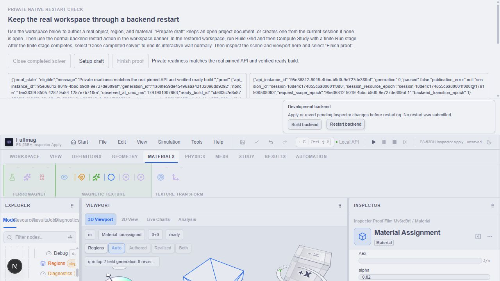
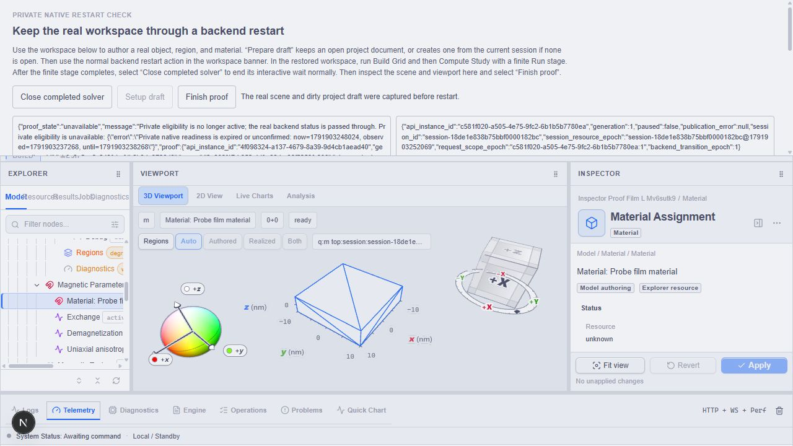
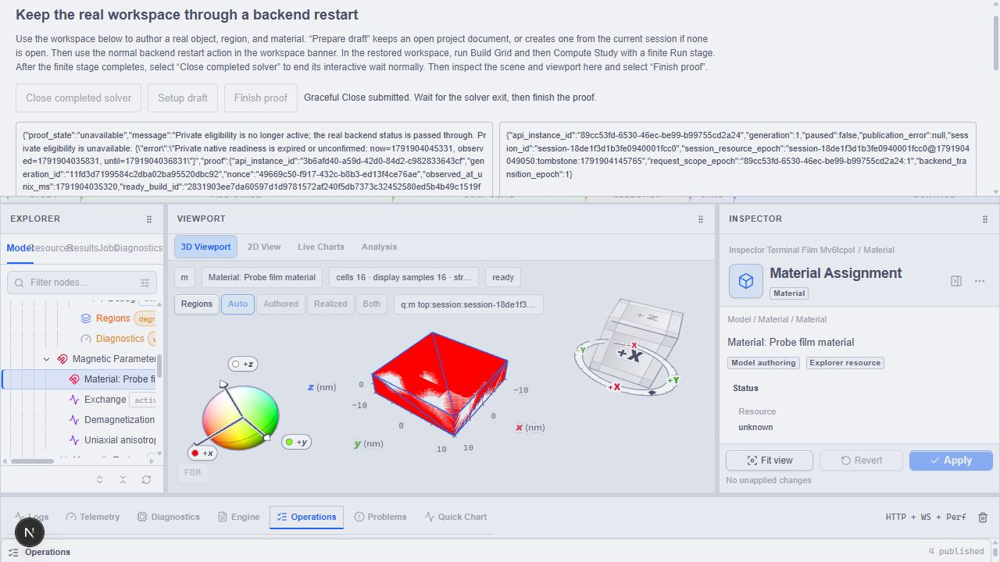
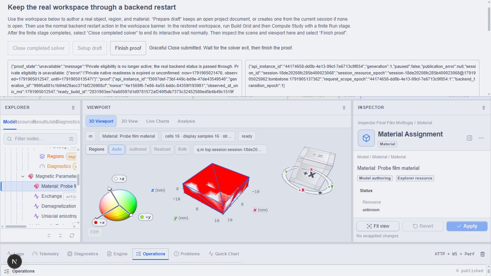

# P8-53BH — pierwsza edycja Inspectora po odświeżeniu materiału

Data: 13.10.2026. Status: **CLOSED w opisanym zakresie materiału** —
pierwsza edycja, odmowa restartu przy szkicu, Apply i odtworzenie potwierdzone
terminalną próbą przeglądarkową. Cały P8-53 pozostaje otwarty.

## Zakres i kontrakt

Apply zatwierdza lokalny szkic do sceny. Save Project zapisuje dokument projektu;
w przeglądarce pobiera archiwum, a trwały zapis desktop ma oddzielny kontrakt.
Restart nie wykonuje domyślnie Apply ani Save: sprawdza wszystkie zarejestrowane
szkice i przenosi niezapisany dokument. Cancel/failure nie może czyścić szkicu.
Wymagania: `docs/specs/frontend-v2/04-state-management.md`, P8-53.

## Bieżące dowody

Zweryfikowany etap lifecycle CLI/API został zapisany i opublikowany na master:
`7a70eee3345cba31b6902e00919d5b444f819913`. Osobny odczyt remote potwierdził
dokładnie ten SHA. Review nie wskazało blockerów; dowody etapu BE pozostają
w [53BG](53bg-acquisition-refusal-diagnostics.md) i [53BE](53be-compute-after-workspace-restore.md).

Próba `ad572535ae884002939492c902232c0e` użyła zweryfikowanego pakietu K
`cb683c2e8e879785f01f4547fa25e2fbcf2d5369f42ab297512c8e72dff22959`,
owner bundle F `12984ba740244e5e86d8878814069155`, izolowanego portu 3258.
API `95e36812-9019-4bbc-b9d0-9e727de389af`, sesja
`session-18de1c174855c6a80001f0d0`. Workspace użytkownika na 3197 bez zmian.

1. Przez UI utworzono pusty FDM i Thin Film 20 × 20 × 5 nm.
2. Apply Draft utworzył obiekt `inspector-proof-film-mv6rd9rt`, rewizja 1.
3. Zmiana nazwy w Inspectorze na `Inspector applied film` bez Apply odmówiła
   restartu: `Apply or revert pending Inspector changes before restarting.
   No restart was submitted.` API/session/generation pozostały bez zmian.
4. Jawny Apply Inspector zatwierdził nazwę, rewizja 2; panel clean.
5. Normalna transakcja `replace_scene` odtworzyła wcześniejszy model testowy
   z regionem, materiałem i finite Run; zachowano ID i nazwę zastosowaną w UI,
   tożsamość sceny oraz storage tej prywatnej próby. Rewizja 3. Nie jest to
   dowód utworzenia regionu i materiału przez UI ani substytut kwalifikacji fizyki.
6. Po odświeżeniu panel pokazywał Name, Ms=800000 A/m, Aex=1.3e-11 J/m,
   alpha=0.01. Edycja samego alpha na 0.02 wyczyściła pozostałe pola szkicu.
   Apply Parameters stało się disabled. Restart prawidłowo odmówił i zachował
   alpha=0.02 oraz dokładny scope; błędem jest utrata nietkniętych pól.

Receipt terminalny:
`C:/git/fullmag/storage/builds/fullmag-0950f4dca4ffe38f/development-backend-api-checks/checks/ad572535ae884002939492c902232c0e/receipt.json`.
Normalne anulowanie przez nonce-bound bridge: `state=failed`, exit 1,
0 zaliczonych końcowych kontroli. Wszystkie 19 procesów `waited=true`;
to zakończona diagnoza błędu, **nie PASS całej próby restartu**.
Próba nie wykonała replacement ani Compute.

## Przyczyna i warunki odbioru poprawki

`ObjectMaterialPanel.updateDraft` wybierał surowy przechowany szkic, jeśli
identity pozostało to samo. Render używał rozwiązanego szkicu z nowszego
zasobu, lecz pierwsza edycja wracała do starego clean state z pustym materiałem.
Pierwszy patch musi rozwiązać bieżący stan updatera względem aktualnej bazy.
Nie wolno zastąpić już dirty szkicu ani zgubić kolejnych zmian w tej samej kolejce.
Osobno zachować rebasing po ACK przypisania materiału.

Poprawka dodaje `updateResolvedInspectorDraftState` i używa go w funkcjonalnym
updaterze `ObjectMaterialPanel`. Projekcja rebasingu ACK przyjmuje ten sam
bieżący stan updatera; nie korzysta ze starej wartości zamkniętej w renderze.
Pozostałych paneli nie zmieniono. Jest to lokalny draft state, nie kopia
kanonicznej sceny w globalnym store.

Managed `material-assignment-draft-check` PASS, exit 0, 20 przypadków:
`C:/git/fullmag/storage/builds/fullmag-0950f4dca4ffe38f/windows-control-room-source-check/material-assignment-draft-check/9021380d356044ac9b42579cf5447a8d/receipt.json`.
Checker interpretuje produkcyjne źródła przez usunięcie typów, bez kompilacji
testów jednostkowych. Obejmuje stare zachowanie z utratą Name/Ms, pierwszą
edycję po załadowaniu, kolejne edycje, dirty pola oraz istniejące przypadki ACK.

Pierwszy TypeScript check `beca1175b7c0444ea6d9b2b3267ff8f1` zakończył
sam proces exit 0, ale receipt `failed`: końcowa edycja skryptu regresji
zmieniła fingerprint w trakcie. Nie przedstawiać go jako PASS managed gate;
po zamrożeniu zakresu kontrolę ponowiono.

Ponowiony managed production-source PASS, exit 0:
`C:/git/fullmag/storage/builds/fullmag-0950f4dca4ffe38f/windows-control-room-source-check/production-source/e024fcbf0fd148b5b917128913f5c3a5/receipt.json`.
Ten dowód obejmuje typowanie produkcyjnego frontendu; nie dowodzi jeszcze
zastosowania poprawki w pakiecie frozen/native ani zachowania po restarcie.

React Doctor changed scope: managed receipt `42f9341cde924a369ef350078950c154`,
exit 0, 9 plików. Brak ustaleń w zmienionym panelu/helperze; jedna uwaga
`prefer-useReducer` w równolegle zmienianym `ProjectBatchesSection.tsx:29`
pozostaje poza zakresem tej poprawki. Nie jest to deklaracja braku uwag
w całym repozytorium.

Wymagane: interpretowana regresja empty→loaded→edit, zachowanie nietkniętych
pól, kolejnych edycji i dirty state; typecheck oraz adekwatne kontrole źródeł;
następnie realny browser Apply→restart→restore. Pozostają też Save/Cancel,
pozostałe typy paneli, powtórny restart, fault gates i warm-service ownership.

## Pakiet natywny L — przygotowany do próby browser

Zarządzany `just windows-workspace-build dev dev 3258 true` zakończył się
kodem 0. Manifest SHA-256:
`2831903ee7da60597d1d9781572af240f5db7373c32452580ed5b4b49c1519f6`.
Commit pakietu `141f21a193bc920f7d5232b7e50d24550e31ba51`, stan dirty,
tożsamość źródeł `abb2a46a6ad7f4d82cd6ffcb7ba1dffa6e726e33ea6e8108bf061d13a17900de`.
Snapshot katalogu źródeł:
`4c6d50d21b13e36484565caf15c0391186e917b504c9ba95c3ca9d73264092fa`.
CLI SHA-256 `bac1493a494ce04a1f0ce0601c965085febc4fd7e4a359f3fd2959587486c852`,
API `38b4f8832b1ac4f45ff3b6c4c89fd6e8579886d6408fa598a20b27ea5f87d1e6`.

Uruchomiono osobną zarządzaną próbę browser z owner bundle F, receipt
`development-backend-api-checks/checks/d2521f8a968d48b9baae60e92b3aa82b/receipt.json`.
Próba jest w toku; przygotowanie obejmuje kontrolę typów produkcyjnego
frontendu fixture. Nie kompiluje testów jednostkowych. Do chwili otrzymania
terminalnego receipt nie zalicza bramki Apply→restart→restore.

## Realny browser L — edycja i odtworzenie potwierdzone, pełny gate OPEN

Próba `d2521f8a968d48b9baae60e92b3aa82b` wykazała:
- normalne UI New FDM i Thin Film 20 × 20 × 5 nm;
- otwarcie nieprzypisanego panelu przed transakcją odświeżającą materiał;
- pierwsza edycja alpha 0.01→0.02 zachowała Name, Ms=800000 i Aex=1.3e-11;
- niezastosowany szkic odmówił restartu bez zmiany API/session/generation;
- Apply Parameters zakończył się ACK, rewizja 3, panel clean;
- restart odtworzył scenę i dokładny niezapisany dokument, API zmieniło się
  z `4f098324-a137-4679-8a39-9d4cb1aead40`
  na `c581f020-a505-4e75-9fc2-6b1b5b7780ea`, generation=1;
- ponownie otwarty panel zachował powyższe pola i alpha=0.02;
- widoczny viewport: context_lost=false, drawing buffer 700×297;
- Build Grid zakończył dziecko exit 0; Compute wykonał finite Run na FDM CPU.

Końcowa obserwacja execution odmówiła zamknięcia solvera: scena różniła się
od obserwacji odtworzenia. Porównanie zapisanych scen wyizolowało wyłącznie
usunięcie `objects[0].tags=["mesh:dirty"]`. Produkcyjny `session.rs` usuwa
znacznik po pomyślnym przygotowaniu mesh; pozostałe dane są identyczne.
To błąd reguły verifiera, nie utrata parametrów. Nie zaliczono pełnego gate.
Normalne anulowanie fixture dało terminal failed/exit 1; wszystkie 26
procesów mają waited=true. Nie przedstawiać tego jako normalnego terminalnego
zamknięcia Compute ani PASS całej próby.

Verifier zachowuje ścisłe porównanie sceny natychmiast po restore. Dopiero
w gate wykonania i finish porównuje oczekiwaną scenę po usunięciu samego
`mesh:dirty`, zachowując inne tagi i wszystkie dane authoringu. Nadal wymaga
udanej terminalnej obserwacji Grid i osobnego Compute oraz dokładnego scope.
Interpretowane regression checks: 27 PASS, bez kompilowania testów.
Ponowna realna próba jest wymagana przed zamknięciem całego punktu.

## Ponowna próba L — terminalny Compute, pozostała bramka dokumentu

Receipt `8c03ed8d9797405291a2bb65dc5e59bf` powtórzył pierwszą edycję oraz
Apply→restart→restore z zachowaniem Name, Ms=800000, Aex=1.3e-11, alpha=0.02.
Nowe API: `89cc53fd-6530-46ec-be99-b99755cd2a24`, session
`session-18de1f3d1b3fe0940001fcc0`. Przygotowany grid 4×4×1 / 16 cells.
Compute `fm-04373438-03c4-4fd9-a3fc-adc501a7c489` wykonał 10 kroków,
stage-000 completed; requested/resolved FDM CPU double strict.
Po normalnym Close dziecko PID 131492: waited=true, exit_code=0,
kill_requested=false. Bramka przed Close potwierdziła Grid oraz ukończony Run.

Finish pozostał disabled: fixture `currentProofMatches` nadal porównuje cały
`projectDocumentProof` dokładnie. Po Grid hashe scene_resource/scene_document
zmieniają się z `c17f2cc7858df2e6c7fe366e3e81767a8e807777d31f262c29a38173b821ba58`
na `60aa190cb38b38f572a9c1e6e61b2a3ce48013ee59c256a1091ef6a1bb370731`.
Archiwum zachowuje hash
`0b2eeb3c252548cfaeff03174c9988ff8d83c88063c439f7963e7a4480ab833c`,
project_id, revision=2 i dirty=true. Przyczyną jest ta sama legalna zmiana
mesh:dirty w zasobie sceny, a nie zmiana archiwum. Python finish również
wymaga jeszcze dokładnego `project_document_after`.

Następny krok: dopasować oba porównania dokumentu do jawnej, weryfikowanej
transformacji po Grid, zachowując exact archive/metadata oraz exact immediate
restore; nie ignorować dowolnych hashy ani zmian authoringu. Dodać regresję
fałszywych zmian i ponowić pełny browser gate. Do tego czasu P8-53BH OPEN.
Próbę normalnie anulowano po terminalnym Compute; terminal fixture failed,
nie PASS całej bramki. Nie zmieniono publicznej dostępności restartu.

## Poprawka checkpointu dokumentu po Grid

Prywatny checkpoint przygotowuje teraz `project_document_after_grid` przed
restartem z tego samego dokumentu i jawnej kopii sceny bez `mesh:dirty`.
Archiwum, project_id, revision, dirty, nazwa, filename i liczności pozostają
identyczne. Dwa przewidywane hashe zasobu/projekcji sceny są przypięte w
niezmiennym before-capture. Parent odrzuca inne zmiany metadata, dodatkowe
pola oraz niepoprawne hashe. Finish wymaga dokładnej zgodności z oczekiwaną
projekcją po Grid, niezależnej ścisłej zgodności sceny i terminalnego custody.
Natychmiastowa obserwacja odtworzenia nadal porównuje pełną scenę bez wyjątków.
Nie zmieniono publicznego API ani zachowania produktu.

Kontrole interpretowane: Python 28 PASS; frontend scene-evidence 5 PASS.
Regresja sprawdza zachowanie parametrów i regionów, brak mutacji baseline,
zachowanie innych tagów, usunięcie pustego tags, wiring obu hashy oraz odmowę
zmiany archiwum, rewizji, dirty, project_id i dodatkowych pól.
Ponowna zarządzana próba: receipt `0349fe166bc24239b39ecf5260ad3fc5`,
pakiet L; wynik browser pozostaje otwarty do terminalnego receipt.

## Terminalny odbiór pełnej próby materiału

Receipt `0349fe166bc24239b39ecf5260ad3fc5` zakończył się 13.10.2026
17:27:01 +02:00: state=completed, exit_code=0, dziewięć kontroli PASS.
Wszystkie 26 procesów odebrano; Compute zakończył się normalnie, bez kill.
Izolowany workspace na 3258; sesja użytkownika na 3197 bez zmian.

Po odświeżeniu zasobu edycja samego alpha=0.02 zachowała Name,
Ms=800000 i Aex=1.3e-11. Restart odmówił do jawnego Apply Parameters.
Po Apply odtworzono dokładną scenę oraz niezapisany dokument, z nowym API
`44174658-dd8b-4e13-99cf-7e6713c9f854`, generation=1 i session
`session-18de20208fc285b400023068`. Archiwum zachowało hash
`48bf9e9723057ffcc84e8cfeacd3bfa5e0988dad4f8b5297b4621787f9c1faaa`.

Grid `fm-722bd17b-ee4f-436b-86c8-dc5012be12dd` przygotował 4×4×1 / 16 cells.
Compute `fm-76572cb2-62d1-415a-9fb6-9a687fd9fe2a` wykonał 10 kroków / 1 ps,
FDM CPU double strict, stage-000 completed. Close
`fm-59323d45-c5e6-4016-a130-1a668deccdfe` oraz Finish zakończyły custody.
Dwa hashe sceny po Grid odpowiadają przewidzianemu usunięciu mesh:dirty;
archiwum, metadata i parametry pozostały identyczne. Typecheck i lint exit=0.
Interpretowane kontrole: Python 28 PASS, frontend scene-evidence 5 PASS.
Review kodu: PASS, bez wskazanych P0/P1.

Źródła backendu przypięto w pakiecie L, build ID
`2831903ee7da60597d1d9781572af240f5db7373c32452580ed5b4b49c1519f6`.
Dowód nie kwalifikuje wszystkich równoległych zmian mastera ani innych lane’ów.
Region i materiał wprowadzono przez typowaną transakcję sceny; ta próba
nie dowodzi ich utworzenia przez UI. Save Project, Cancel, wszystkie typy
Inspectora, powtórny restart i publiczna dostępność restartu nadal mają
osobne bramki. Następny etap: Save Project i przenoszenie stanu dokumentu.
