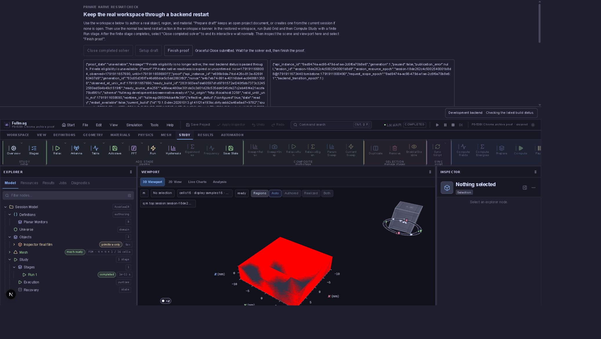

# P8-53BI — Save Project przed restartem

Data: 13.10.2026. Status: **CLOSED dla Save w przeglądarce z czystym
Inspectorem → restart → restore**. Trwały zapis Windows desktop i Save
przy niezastosowanym szkicu pozostają OPEN. Pierwsza próba poniżej nie
była zaliczona; ponowna próba Chrome potwierdza opisany zakres.

## Kontrakt i wymagane dowody

`workspace.save-project` wywołuje `ProjectDocumentController.save()`.
Kontroler synchronizuje zatwierdzoną scenę przez authoring binding;
nie wykonuje niejawnego Apply lokalnych szkiców Inspectora.
W przeglądarce uruchamia pobranie archiwum i zachowuje dirty document.
Host Tauri zapisuje archiwum i dopiero po potwierdzeniu aktualizuje
persisted_revision oraz dirty=false. Te ścieżki wymagają osobnych dowodów.

Odbiór wymaga rzeczywistego pliku z normalnego Save, kontroli ZIP/CRC,
manifestu, dokumentu sceny i skryptu, zgodności z zatwierdzoną sceną,
a następnie kontrolowanego restartu i dokładnego odtworzenia dokumentu.
Szkic Inspectora nie może zostać zastosowany ani skasowany przez Save.
Pobranie przez przeglądarkę nie dowodzi trwałego zapisu Windows desktop.

## Próba 231cfac682144a9b8c95fa177d08c024

Managed recipe `verify-windows-development-workspace-browser`, owner bundle
`12984ba740244e5e86d8878814069155`, checkout
`1ce6fee668f8bbe56da0c193361bf25a258e2b16`, prywatny port 3258.
Workspace użytkownika na 3197 nie był restartowany.

API `1f1cb566-ea0c-41cf-b5a0-b2f6983f5d4c`, session
`session-18de210b64cbbf2400023578`. Przez UI utworzono projekt
`project-25346248be434ae482f8a3d4081ee786`, nazwa
`P8-53BI Save archive proof`. Scenę z obiektem, regionem, materiałem
i finite Run wprowadzono normalną transakcją `replace_scene`.
Nie jest to dowód pełnego authoringu przez UI.

Setup draft uzyskał pozytywny before-capture. Zapisany checkpoint ma
revision=2, dirty=true i hash archiwum
`fc9555b17f662e60967324e3d7b44da0de71605e9a93f4bc6fe2d370a81761fc`.
Canvas był widoczny, context_lost=false, drawing buffer 679×281.
Kontrole źródeł fixture: typecheck i lint exit=0.

Obsługa zdarzenia download w narzędziu przeglądarkowym nie zwróciła
pliku ani obserwacji po kliknięciu. Narzędzie pozostało w oczekiwaniu
dłużej niż zadany limit. Następnie prywatny serwer zakończył próbę bez
otrzymania restartu/Finish; karta pokazała odmowę połączenia. Nie obchodzono
polityki nawigacji przeglądarki. Nie można z tych danych rozstrzygnąć,
czy Save został wykonany, ani przypisać awarii produktowi.

Terminalny receipt: state=failed, exit_code=1, checks=0,
finished_at=2026-10-13T18:07:35.352221+02:00. Wszystkie 19 procesów
mają waited=true. Brak nowego API i brak dowodu restartu. Próba nie jest PASS.

## Następny krok

Ponowić tę samą zarządzaną trasę dopiero po potwierdzeniu terminalnego
stanu poprzedniej próby (potwierdzono). Rozdzielić kliknięcie Save od
odczytu zdarzenia pobrania, obsłużyć odrzucenie obietnicy i sprawdzić
wynik UI przed dalszym oczekiwaniem. Jeśli używana przeglądarka nadal
nie udostępnia pliku, użyć wspieranej przeglądarki z obsługą pobrań;
nie zastępować rzeczywistego Save eksportem wykonanym przez API.
Nie zmieniać zachowania produktu na podstawie samego timeoutu narzędzia.

## Ponowna próba Chrome — odbiór

Receipt `8ea73f1c32b1424a90a4d69906d5c665`: state=completed,
exit_code=0, dziewięć kontroli PASS. Checkout przy starcie
`132fdf36066526ab4e2981177b308d3518b968f3`, ten sam przypięty pakiet L.
Nie kompilowano testów jednostkowych ani nowego backendu.

Normalny przycisk Save Project pobrał
`p8-53bi-chrome-archive-proof.fms`, 4726 bajtów. Kontrola pliku:
ZIP/CRC PASS, unikalne wpisy manifest/project.json, project/definition.json,
project/scene_document.json i project/source.py. Obiekty, materiały oraz
Study odpowiadają ACK zatwierdzonej sceny. Skrypt ma 1917 bajtów i poprawną
składnię Python; sama składnia nie dowodzi pełnego DSL round-trip.

Hash pliku: `d86ae343a7564005b83fd5f70a20aa2b41cf5101b777227adafdcc0e1069f5b1`.
Hash jego kodowania base64, zgodny z dokumentem UI oraz before/after:
`e54581b9dd0757a15572819fa0a7e226a13be2a4491b49fcf9b9c144fb7c7035`.
Projekt `project-0d27618b987143d3b9e0c46108f68127`, revision=2, dirty=true.
Archiwum i wynik kontroli zachowano w katalogu receipt jako
browser-save-archive.fms i browser-save-archive-evidence.json.

Restart zmienił API z `e696b9da-7fcd-426c-813e-8269163407d9` na
`8ad9474a-ac98-479d-a1ae-2c6f6a70b8e6`, generation=1, session
`session-18de262c4c5002540001b8d8`. Natychmiastowe odtworzenie sceny
jest dokładne; archiwum, project_id, revision i dirty zachowane.
Grid `fm-9da1dd16-481d-4a0b-8854-34e354bb485f` oraz Compute
`fm-40761da6-f657-4345-a785-c63623a01265` zakończone normalnie,
10 kroków / 1 ps, requested/resolved FDM CPU double strict.

Pierwsze Close odmówiono przed pojawieniem się terminalnego ledger receipt;
nie zamknięto wówczas solvera. Po potwierdzeniu Run completed ponowne Close
i Finish przyjęto. Parent potwierdził execution_verified=true i wszystkie
procesy odebrano. Typecheck i lint fixture: exit=0.

Ograniczenia: prywatna eligibility overlay, jeden restart, czysty Inspector.
Scenę wprowadzono typowaną transakcją, nie pełnym authoringiem UI.
Nie dowodzi to publicznego restartu, Save/Cancel szkiców, trwałego zapisu
desktop, wszystkich lane’ów ani kwalifikacji fizyki. Cały P8-53 pozostaje
otwarty. Następna bramka: Save przy niezastosowanym szkicu Inspectora
oraz Cancel z zachowaniem danych, następnie powtórny restart.
