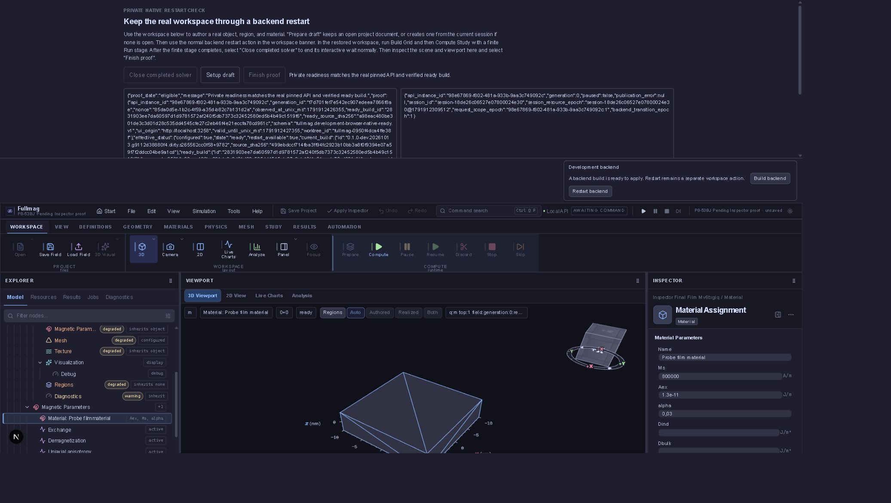

# P8-53BJ — Save/Cancel przy niezastosowanym szkicu Inspectora

Data: 13.10.2026. Status: **CLOSED w opisanym zakresie panelu materiału**.
Zakres: rzeczywisty panel materiału, Save Project w Chrome oraz Cancel
dialogu New Problem. Nie obejmuje wszystkich edytorów ani trwałego zapisu desktop.

## Przebieg i dowody

Managed receipt `89e280c2a794426cb3a4e55127178bd1`, owner bundle
`12984ba740244e5e86d8878814069155`, checkout
`5d04b587d7a1a4fc31fcfdc9209263ece38a2dd3`, izolowany port 3258.
Nie zmieniono workspace użytkownika na 3197. Pakiet backendu L przypięty;
nie kompilowano testów jednostkowych ani nowego backendu.

Przez UI utworzono projekt P8-53BJ Pending Inspector proof. Zatwierdzony
model z obiektem, regionem, materiałem i finite Run wprowadzono typowaną
transakcją replace_scene, nie pełnym authoringiem UI. Zatwierdzone alpha=0.01.
Wybrano rzeczywisty panel Material Assignment i wpisano alpha=0.03 bez Apply.
Name, Ms=800000 oraz Aex=1.3e-11 pozostały niezmienione.

Normalny Save Project pobrał archiwum 4725 bajtów, ZIP/CRC PASS.
Hash pliku: `46bf38acd4f6e4f6d5b188abe7b3e45029088d88a8d12406a61c83fdd09dc638`.
Archiwum zachowało zatwierdzone materiały i obiekty, alpha=0.01;
panel nadal pokazywał alpha=0.03 oraz aktywne Apply Parameters.
Odczyt API potwierdził brak zmian objects/materials/study i revision=1.
Dowody: pending-save-archive.fms, pending-save-evidence.json oraz
scene-before-pending-save.json w katalogu receipt.

File → New Problem otworzył produkcyjny dialog New simulation.
Cancel zamknął dialog i zachował alpha=0.03, Name, Ms, Aex i Apply Parameters.
Odczyt API potwierdził identyczną scenę authoringu oraz jej tożsamość i rewizję.
Migawka UI zachowana jako pending-save-cancel-ui.txt w katalogu receipt.

Restart przy niezastosowanym szkicu odmówił:
`Apply or revert pending Inspector changes before restarting. No restart was submitted.`
Następnie jawny Revert usunął lokalną zmianę zgodnie z wyborem użytkownika
testowego. Setup draft przypiął dokument do końcowej próby restartu.
Kontrolowane odtworzenie i terminalny Grid/Compute potwierdzone w receipt.

## Terminalny odbiór

Receipt zakończył się state=completed, exit_code=0, dziewięć kontroli PASS.
Grid `fm-6e3c2d1c-829e-4896-80e9-9e51f2148208` zakończony normalnie.
Compute wykonał 10 kroków / 1 ps, requested/resolved FDM CPU double strict,
child_exit_code=0, kill_requested=false. Wszystkie 26 procesów odebrano.
execution_verified=true; scena odtworzona dokładnie, dokument i jego archiwum
zachowane. Po Grid dopuszczono wyłącznie przewidziane usunięcie mesh:dirty.
Typecheck i lint fixture: exit=0. Te dowody nie kwalifikują równoległych
niezacommitowanych zmian mastera ani innych backendów.

## Granice

Cancel oznacza tu Cancel dialogu New Problem, a nie Revert Inspectora.
Save nie jest Apply; zachowanie szkicu udowodniono przed jawnym Revert.
Nie dowodzi to przenoszenia niezastosowanych szkiców przez restart — restart
odmawia do ich jawnego rozstrzygnięcia. Publiczny restart, powtórny restart,
pozostałe typy paneli i kwalifikacja lane’ów pozostają osobnymi bramkami.
