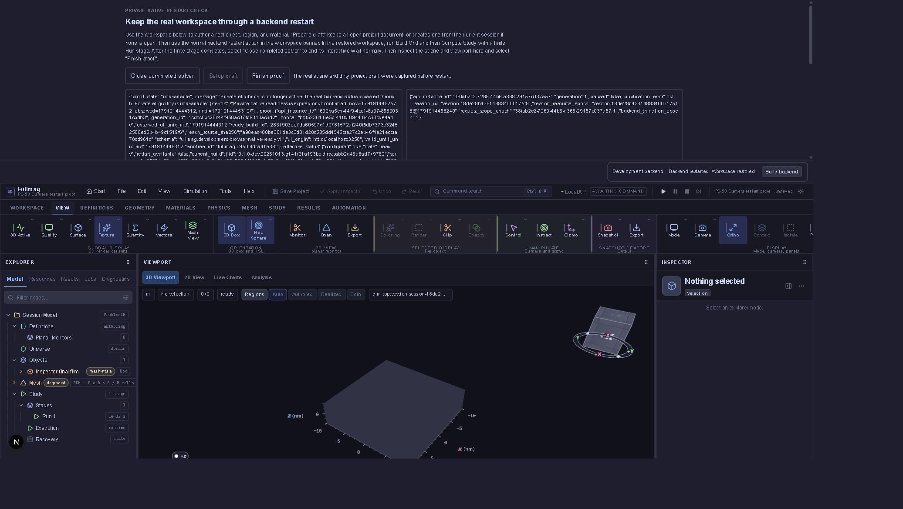

# P8-53BM — kamera po development restart

## Status

Potwierdzony błąd P1: restart zachowuje scenę, lecz traci projekcję kamery.
Poprawka ownera jest w realizacji; runtime po poprawce pozostaje **NOT VERIFIED**.
Nie zamyka to P8-53 ani całego planu.

## Dowód przed poprawką

Prywatna próba przeglądarkowa na 3258, z rzeczywistymi procesami Windows:
receipt `4db8d035170f4d5799d7d89443e7eed1` w profilu
`development-backend-api-checks`, worktree-id `fullmag-0950f4dca4ffe38f`.
Katalog receipt zawiera `camera-before-restart.json`,
`camera-after-restart.json` i `camera-after-mounted-kernel.json`.

Normalny przycisk View → Ortho ustawił projekcję `orthographic`.
Po normalnym Restart backend oraz zamontowaniu nowego kernela API zwróciło
`perspective`. Pozostałe pola zachowały wartości: position
`[2e-6, 1.4e-6, 2e-6]`, target `[0,0,0]`, up `[0,0,1]`,
fov_degrees `45`, orthographic_scale `null`.

Stary API instance: `602ba5cb-44f9-4cc1-8a37-8580031cbdb3`;
nowy: `38fab2c2-7269-44b6-a368-29157c037a57`. Nowy kernel osiągnął
generation 1, paused=false, publication_error=null. Model próby był
odtworzonym przez API wejściem testowym; nie jest to dowód ręcznego
autoringu całej sceny w UI. Projekcję zmieniono rzeczywistym przyciskiem UI.

Próbę świadomie zakończono po wykryciu błędu, przed pełnym Grid/Compute/Finish.
Receipt jest terminalny `failed`, exit 1; wszystkie 24 zapisane procesy
mają waited=true. Nie kwalifikować tej próby jako PASS restartu.
Sesji użytkownika na 3197 nie zatrzymano.

## Wzmocnienie weryfikatora

`scripts/windows/verify_workspace_browser.py` zapisuje kamerę przed restartem
i porównuje po nim wszystkie sześć pól: projection, position, target, up,
fov_degrees oraz orthographic_scale. Brak pola, obce pole, niepoprawna
projekcja, niefinitywna liczba lub niepoprawny parametr blokują pozytywny
wynik; weryfikator nie zastępuje danych wartościami domyślnymi.

Nowy interpretowany regression check sprawdza każdy utracony parametr,
niepoprawne dane, izolację kopii i zachowanie null scale.
`just verify-windows-development-handoff`: **165 testów, 0 skipów, exit 0**.
Receipt `57d5fc8a660e4eaf8c2c1b71ecd30201`; tożsamość źródeł przed/po:
`cc5c085cdc0d1ebbb370170d7b2067a6034891c661705133700a3d41b5314e31`.
Nie kompilowano testów jednostkowych. Te testy dowodzą kontroli dowodu,
a nie naprawienia produkcyjnego odtworzenia kamery.

Ponowna seria po dopasowaniu FOV do backendowego zakresu `[1,179]`:
165 testów, 0 skipów, exit 0, receipt `ba44d7f6f0b74f0daf205dfefa272c3e`.
Źródła przed/po: `03458c10c461ad9f80e2b4e785a0f4c28620b140cac0d595644b2a29b21e70f2`.
Regresja odrzuca także 0,5 oraz 179,5 stopnia.

## Odbiór poprawki

Owner musi przenosić ścisły snapshot kamery, wykrywać jego zmianę podczas
handoffu i odtworzyć go przez istniejący typowany visualization API nowego
procesu. ACK oraz odczyt z nowego pinned API muszą zgadzać się przed
publikacją kernela. Wymagane są także jawny odczyt starszego payloadu,
obsługa pustego workspace i odmowa publikacji przy błędzie.

Pozostają: konkretne regresje ownera, kontrole produkcyjnego frontendu,
nowy zamrożony pakiet oraz rzeczywista próba restartu z porównaniem kamery.

## Checkpoint implementacji ownera

Owner zapisuje teraz workspace v2 z kamerą; starszy v1 ma jawny reader.
Przygotowanie replacement odrzuca brak session_id i niepoprawny session_epoch.
Kamera sesji jest odtwarzana przez typowane PATCH/GET visualization; brak
zgodnego ACK lub odczytu blokuje publikację. Sessionless workspace ma
camera=null i nie wywołuje niedostępnego endpointu sesji.

Scoped lint przeszedł: receipt `3062fa8c0afe40fb8d889dd7da5f440e`.
Pierwsza kontrola produkcyjnych typów (`2e488dd351ef44f894f6ef1da915d1b4`)
wykryła niewężony opcjonalny session_id ownera, poprawiony następnie jawną
walidacją. Wykryła także niezależny błąd nullable snapshot w równolegle
zmienianym computeNodeInventory.ts; nie należy do tej poprawki.

Pierwsza próba konkretnych ownerów w Chrome na 3251 zakończyła się failed:
receipt `6547c409dfec427eb67bedb64aa8a01d`. Istniejący mock NewProblem
nie udostępniał resources.getRevision wymaganego przez useResource;
wykonanie przerwano przed nowymi regresjami kamery. Naprawa adaptera próby
jest w toku. To nie jest PASS ani dowód poprawności produkcyjnego restartu.

## Wyniki review

- P1 owner: świeży rejestr kamery ma lastRemoteRevision=null i kamerę
  domyślną. Dla aktywnej sesji capture musi odmówić przed przyjęciem takiego
  stanu. Wymagane są potwierdzona remoteCamera oraz lastRemoteRevision,
  oprócz braku dirty/sync/error. Dla sessionless workspace pozostaje jawne
  camera=null. Regresja tej odmowy jest w realizacji.
- Wycofany P1 backend (ponowny audyt 13.10.2026): camera-only PATCH
  zwiększa `selection.revision`. `patch_visualization_state` zawsze
  wywołuje `apply_display_patch_to_state`, także dla pustego display patch;
  ta funkcja bezwarunkowo zwiększa rewizję. Następnie handler publikuje ją
  w realtime i odpowiedzi. Pełny przepływ w `display.rs:261`, `:352`,
  `:409`, `:1819`, `:2020` potwierdziło niezależne review źródeł.
  Wcześniejszy finding pomijał to wywołanie; nie wymaga poprawki backendu.
  Rzeczywista synchronizacja kilku klientów nadal NOT VERIFIED.
- P2 backend: orthographic_scale=null w PATCH jest interpretowane jak brak
  pola przez Option<f64>. Świeży backend ma domyślnie null, ale ACK/readback
  musi odmówić publikacji, jeśli docelowy stan nie zgadza się z capture.
  Pełne czyszczenie skali pozostaje osobnym otwartym kontraktem.

Review nie znalazło automatycznego PATCH nowego rejestru przy montażu:
hydracja wykonuje zapis/odczyt przed publikacją, a świeży namespace zasobów
po montażu pobiera backend. To dowód źródłowy; runtime po poprawce pozostaje
NOT VERIFIED. Nie zamykać punktu na podstawie samego review.

Weryfikator odrzuca także position==target i zerowy up, zgodnie z backendem.
Seria `5a42876f577b4d3fbfded703698d7637` wykryła brak importu sys w tej
nowej kontroli. Po dodaniu importu receipt `d812db40be7c49efaf800c74c26e8da3`
potwierdził ponownie 165 testów, 0 skipów i exit 0. Nie jest to dowód
runtime ownera kamery.

## Końcowe dowody konkretnych ownerów

Managed Chrome na 3251: receipt `98aedd887c6d41a3a2370c19dde2fdc2`,
**34/34 PASS**, exit 0, brak page_errors i console_errors, własny serwer
terminalny. Fingerprint przed/po:
`53809fd60c1431074c2dcdb44475cc6d86f84921e2635da4726dafad1c83b7dd`.
Rzeczywiste kontrolery projektu, registry i typowana fasada API wykonały
przenoszenie sześciu pól, odmowę przy niezgodnym ACK/readback, mutation guard,
odmowę niezaobserwowanej kamery ze zwolnieniem guardów, odmowę współdzielenia
starego rejestru, v1 compatibility i sessionless null. Odpowiedzi API są
fixtures: nie jest to restart procesu Windows ani kwalifikacja solvera.

Finalny scoped lint ownera: receipt `42269c36ee83410fabfa7125319f353f`, PASS.
Kontrola produkcyjnych typów `1d0f5dcc0766432b9bfe1f19a0c86fb2` nie zgłaszała
już błędów ownera ani fixture; pozostał obcy błąd computeNodeInventory.ts:260
(`snapshot` possibly null). Cała kontrola ma zatem FAILED, nie PASS.

Próby pośrednie zachowano: `17fb3745c0e8451585f52d4f4e9f9b9c` miała
32/33 PASS, bo asercja canSave wymagała otwartego projektu zamiast pustego
dokumentu; `b7c55c20283949fe8844cba3ef9840cb` miała 33/33 kontrole ownerów,
ale stary selektor dialogu New Problem zatrzymał dodatkową kontrolę UI.
Aktualizacja smoke do etykiet New simulation/Create simulation i nazwanej
zgody zastąpienia zachowuje asercje Cancel/pending/failure. Receipt
`609f4f48ce6d4b809e145c8e76e39455` potwierdził 34/34 przed dodaniem ostatniej
regresji odmowy współdzielenia rejestru. Końcowy receipt jest podany powyżej.

Natywny restart po poprawce oraz dwa restarty A→B→C w jednej sesji
przeglądarki pozostają NOT VERIFIED. Status P8-53 pozostaje otwarty.

API hygiene: receipt `cea917eb274649e1b65aa5c876c9c68a`, PASS.
Końcowa kontrola produkcyjnych typów po guardzie świeżości rejestru:
`e5ec865c017d4184a73eabeb2ee3a7f1`, FAILED wyłącznie na
computeNodeInventory.ts:260. Własne pliki poprawki nie zgłosiły diagnoz.
Nie promować tego checkpointu do pełnej kwalifikacji frontendu ani wydania.

## Natywny pakiet po poprawce — 13.10.2026

Zarządzany `just windows-workspace-build dev dev 3258 true` zakończył się
kodem 0; wrapper zapisał `state=completed` o
`2026-10-13T19:03:41.476902+00:00`. API/CLI i launcher desktopowy skompilowano
w profilu `backend-dev`; integralność utrwalonej kopii źródeł przeszła kontrolę.
Build nie kompilował testów jednostkowych i nie restartował workspace na 3197.

- Commit: `1c0c35dcf8a4d7dcb0cbde10f3c723c83b729a22`; snapshot obejmuje
  także zastane zmiany równoległej pracy, zatem `source_dirty=true`.
- Snapshot źródeł:
  `8d236794af8bfcd0b9a78f4fe64767990fb0cffde33410ee63b3cf1b94bdc038`.
- Kapsuła:
  `ff37087d52de092122c8621425b9e5c3f57469841e4017252e4fee344fc50310`.
- SHA-256 manifestu pakietu:
  `e14f2a96f55b69177b979543095dc7d1006ca28a6493f0b1b48d8f72daee14b7`.
- SHA-256 API:
  `053b19f3e144befeff29f8afeb7cad435757a3c43c0c08daf3883b4b32049c65`.
- Manifest zamrożonych źródeł frontendu:
  `cef3504337a530d4f0b117762bb6718df1fbf1d6565d83e5f68af46c490038d1`.

Dowody znajdują się pod rozwiązaną ścieżką
`storage/builds/fullmag-0950f4dca4ffe38f/windows-native-fdm-cpu-dev/`:
`build-status.json`, `windows-runtime/build-manifest.json` oraz
`logs/native-build-1c9664e56d224fd3a67e8158d6a65db7.log`.
Sukces kompilacji nie zamyka bramki kamery, solvera ani wydania.

Wykonano odrębną natywną próbę przeglądarkową na 3258:
receipt `fa2d27b2689b434785b39a3c28374623`, source binding
`verified_frozen_native_package`. Próba zakończyła się FAILED, exit 1,
przed udostępnieniem strony: zamrożony frontend zawierał błąd
`computeNodeInventory.ts:260`, TS18047 (`snapshot` possibly null).
Wszystkie 18 procesów ma terminalne `waited=true`; nie wykonano restartu
ani porównania kamery. Workspace 3197 pozostał nietknięty.

W bieżącym checkoutcie dodano jedną linię `!snapshot ||` do istniejącej
walidacji parsera compute inventory. Pozostała równoległa implementacja
tego nieśledzonego pliku została zachowana i nie jest przejmowana do
commita kamery. Zarządzana kontrola całych produkcyjnych typów po tej
poprawce przeszła: `4d5cb65a806c4521b49ef378bd4803d8`, exit 0, PASS.
Nie poprawiano zamrożonej kapsuły ani nie pomijano jej kontroli.
Próba restartu wymaga nowego pakietu zawierającego poprawiony frontend;
wynik natywnego restartu z zachowaniem kamery nadal NOT VERIFIED.

### Kolejny pakiet i próba przeglądarkowa

Równoległy build workspace zakończył się `completed`, exit 0,
`2026-10-13T19:18:23.012310+00:00`. Jego kapsuła
`b7717905b6f3ccd0f9a77a36a2f1f7c0a0b3bbd016d938e3e3a455e00d4eb6ac`
zawiera poprawiony guard compute inventory i poprawkę ownera kamery.
SHA-256 manifestu:
`f72044f8f8ecb465504db38eec79850e1fb32564e23b73716cc088cc478d286b`;
snapshot źródeł:
`30ad419872263b72330c5d54f6c6d72007453ef5b64d88c5ff1df37637a23aef`.
API SHA-256:
`d40f262ac4e29e5e75d9511ac4c710cbed227da21df1b94605984c84872e24e5`.

Próba `7b9184b3b1a4452dbe359867c0d98245` przeszła typecheck i lint
zamrożonego frontendu (oba exit 0) i udostępniła prywatny browser-ready.
Przez Chrome utworzono projekt i pudełko; canvas był widoczny,
`context_lost=false`, drawing buffer 1183×518 oraz 1183×565.
Nie wykonano restartu ani capture kamery. Odczyty gotowości następnie
utraciły potwierdzenie (`readiness_observation_unconfirmed`), a sterowanie
Chrome kończyło się timeoutem. Nie ustalono wspólnej przyczyny tych zdarzeń.

Próba jest terminalnie FAILED, exit 1; wszystkie 19 procesów ma
`waited=true`. Nie należy ponawiać jej jako żywego procesu ani uznawać za
PASS. Diagnoza obserwacji gotowości i rzeczywisty restart kamery pozostają
otwarte; żadna sesja użytkownika na 3197 nie została zatrzymana.

### Diagnoza utraty obserwacji gotowości — 13.10.2026

Prześledzono `readiness_frame` w
`crates/fullmag-cli/src/control_room/development_workspace_probe.rs`.
Wyjątek może pochodzić z odczytu consumer status przez prywatny kanał
ownera API, odczytu pending restart slot albo zegara. Niezgodność
`require_ready_identity` sama zwraca `Ok(None)` i nie tłumaczy terminalnego
`readiness_observation_unconfirmed`. Consumer status nie używa HTTP:
`OwnedDevelopmentApi::consumer_control` wysyła uwierzytelnione żądanie TCP
na loopback, z limitem odpowiedzi 2 sekundy. Nie ustalono jeszcze, która
z tych granic zawiodła w próbie `7b9184b3b1a4452dbe359867c0d98245`.

Dodano do lokalnego kodu konteksty tych trzech granic i zapis łańcucha
błędu na stderr. Zachowano terminalny wynik `unknown`, protokół stdout,
warunki dopuszczenia restartu oraz istniejące timeouty. Statyczne review
nie wykazało P0/P1 ani logowania owner tokenu/payloadu żądania.
To diagnostyka, nie potwierdzona naprawa ani dowód zachowania kamery.

Zarządzany build diagnostyki zakończył się przed kompilacją: exit 1,
`2026-10-13T19:44:11.321932+00:00`, log
`native-build-923110612a3a42899917c3770a8bafe6.log` w istniejącym profilu
`windows-native-fdm-cpu-dev`. Przyczyna:
`Source inventory differs from request fingerprints` podczas capture.
Istniejący `capture_for_build` ponawia wyłącznie wyścigi źródeł do trzech
prób; nie zwiększano limitu ani nie omijano kontroli. Sam komunikat nie
rozstrzyga jeszcze przyczyny rozbieżności. Diagnostyka Rust pozostaje
niezweryfikowana przez kompilację i rzeczywisty odczyt błędu.

Następne żądanie buildu zakończyło oczekiwanie na slot ciężkiej pracy
po 120 sekundach, exit 2, przed rozpoczęciem kompilacji
(`Bounded wait expired before starting`). Oba nasze żądania są terminalne;
nie uruchomiono równoległego wykonawcy i nie zatrzymywano obcych procesów.
Następny krok: odróżnić zmiany plików od deterministycznej rozbieżności
inventory/fingerprint, a po uzyskaniu slotu zbudować diagnostykę i ponowić
prywatną próbę kamery. P8-53 i cały plan pozostają otwarte.

Odczytowa kontrola inventory w kolejnym kroku zakończyła się exit 0:
backend i dependencies miały odpowiednio zgodne pary hashów
`d98cca6bbc0717e3b8412092871102cd3168d77801041deeaf289807f1f45049`
oraz `e329a2b68344dbbec936f25fea9fc436fc9aee42183ace12644bb309a53386b6`,
bez zmienionych/brakujących plików między tymi odczytami. To chwilowa
obserwacja checkoutu, bez zapisu snapshotu, a nie dowód wcześniejszej
przyczyny ani udanego buildu. Nie znaleziono deterministycznej rozbieżności
filtrów przy tych wejściach. Slot ciężkiej pracy zajmował w tym czasie
aktywny managed FEM GPU build-only z worktree `fem-script-launch-20261013`;
jego procesów ani blokad nie zmieniano.

### Jawne wyczyszczenie skali kamery — implementacja w toku

Istniejący wygenerowany kontrakt `VisualizationCameraPatch` dopuszcza
opcjonalne `orthographic_scale` jako `number | null` (format `double`,
brak w `required`). Lokalna poprawka parsera używa istniejącego w module
`deserialize_double_option` i rozróżnia brak pola (`None`), jawne null
(`Some(None)`) oraz liczbę (`Some(Some(value))`). Aplikacja PATCH przypisuje
wewnętrzny Option; walidacja nadal odrzuca wartości niedodatnie i niefinitywne.
Jawny `schema(value_type = Option<f64>)` ma zachować istniejący kontrakt.

Dodano dwie regresje Rust: serde round-trip, set/preserve/clear bez zmiany
pozostałych pól kamery oraz odmowę 0, -1, infinity i NaN. Nie kompilowano
ich ani nie uruchamiano — zgodnie z obowiązującym zakazem kompilacji testów.
W istniejącym zarządzanym weryfikatorze API dodano odrębną regresję HTTP
na jego prywatnej odtworzonej sesji: set → absent → null, nowe rewizje
i identyczny GET readback; po odmowie 0/-1 kamera i rewizja mają pozostać
bez zmian. Parser AST tego weryfikatora przeszedł, lecz to nie wykonanie HTTP.

Po zakończeniu obcego procesu uruchomiono następny managed build-only:
log `native-build-687f97a99f144ac6b1899e7ec86f77d5.log` w istniejącym
profilu. W momencie tego wpisu trwa capture. Wymagane są terminalny
build receipt, regresja HTTP, porównanie eksportu OpenAPI oraz rzeczywisty
restart kamery. Punktu P2 i P8-53 nie oznaczono jako zamkniętych.

Capture następnie zakończył się poprawnie: kapsuła
`4eae0210c3641894aac49629c7dff458e8fdb97f13e36f84f213e74cbe901525`,
snapshot źródeł
`e45a260b2dde7cd57ec3cfa162ccd05e970ed492a4b2f328ace4180998119e0d`,
backend fingerprint
`c17ea5cd5bc142136d8021c3bfcec32d630aba2018b280a78dbabf52b03345ca`,
HEAD `29ca31c72dd1d4d7901f88843c0e87e639372956`, dirty.
Hashy trzech zmienionych plików Rust w kapsule i checkoutcie są identyczne.
Build przeszedł przygotowanie wersji Python; brak jeszcze terminalnego
wyniku produkcyjnej kompilacji i żadna regresja HTTP nie ma jeszcze PASS.

Review poprawki Rust i regresji HTTP nie wykazało P0/P1. Wykryto P2
w fixture `project-document-handoff-page.tsx`: operator `??` nadal
ignorował null. Poprawiono fixture i rozszerzono istniejący scenariusz
rzeczywistych ownerów o hydrację kamery perspective/null do replacement API
z początkową skalą `2.75e-6`. Wymagane są typowany PATCH ACK oraz GET
readback przed publikacją; poprzednia semantyka fixture nie przechodziłaby
tego scenariusza. Managed próba fixture zakończyła się odmową storage lock
przed testami, ponieważ ten sam checkout jest zablokowany przez nasz
aktywny build. Nie ma nowego fixture PASS. Bieżący build zakończył instalację
zależności Python i pnpm; dalszy wynik należy odczytać z tego samego
uchwytu procesu, bez uruchamiania kolejnej kompilacji.

### Terminalny build poprawki — 13.10.2026

Ten sam build zakończył się `completed`, exit 0,
`2026-10-13T20:15:06.792704+00:00`. Receipt profilu
`windows-native-fdm-cpu-dev/build-status.json` potwierdza tożsamość checkoutu,
profilu i logu powyżej. API/CLI skompilowały się w 3m24s, launcher desktopowy
w 1m32s; są to czasy faz Cargo, nie całego przygotowania pakietu.
Digest opublikowanego `windows-runtime/build-manifest.json`:
`1626bd35933b27d1edc6cbdb812c81429a6f5a8a21819e092b6c86e40fed872b`.
Powstały produkcyjne `fullmag.exe`, `fullmag-api.exe` i `fullmag-ui.exe`
w profilu `backend-dev`. Nie kompilowano testów jednostkowych.

Uruchomiono na tym przypiętym manifeście
`just verify-windows-frozen-development-backend-api
1626bd35933b27d1edc6cbdb812c81429a6f5a8a21819e092b6c86e40fed872b`.
Próba `1995c74607ba4a4a852388b1a854447a` jest w toku; nie ma jeszcze
terminalnego PASS regresji HTTP ani eksportu OpenAPI. Użytkowy workspace
na 3197 pozostaje poza zakresem tej próby. Sam sukces kompilacji nie
zamyka P8-53, weryfikacji restartu kamery ani kwalifikacji wydania.

### Regresja natywnego API — PASS

Próba `1995c74607ba4a4a852388b1a854447a` zakończyła się `completed`,
exit 0, `2026-10-13T20:26:41.494384+00:00`: 301 kontroli, 98 procesów,
wszystkie z `waited=true`. Receipt znajduje się w profilu
`development-backend-api-checks/checks/1995c74607ba4a4a852388b1a854447a/receipt.json`.
API SHA256: `a8cfabccf09595b6da4582a584531b1319c892f87f74903be390d621f0f6e4d8`;
weryfikator: `931ebdb1afedab11dd41b63b437f5038ccc44301f86a6ab60c4cacc2c94934ef`.

Potwierdzone na prywatnym odtworzonym API:

- `camera-scale-patch-set-revision-and-readback`;
- `camera-scale-patch-absent-revision-and-readback`;
- `camera-scale-patch-clear-revision-and-readback`;
- `camera-scale-invalid-patch-preserves-state-and-revision`;
- `camera-scale-openapi-optional-nullable-double`.

Kanoniczny eksport OpenAPI ma digest
`885325f890e91ea5ded348dbf05dbdc4169400753915c7a556b610d767b919c6`.
Brak pola nadal zachowuje skalę; jawne null ją usuwa; 0/-1 są odrzucane
bez mutacji stanu i rewizji. Pozostałe pola kamery są porównywane dokładnie
w odpowiedzi PATCH i GET. Publiczny kształt opcjonalnego `number | null`
pozostał zgodny z istniejącym klientem. Pełna próba obejmowała także
kontrole właściciela runtime-service — frozen manifest nie pomija tej fazy.

Po zwolnieniu blokady uruchomiono `just verify-project-document-handoff-browser`
na prywatnym porcie 3251. Jej wynik i rzeczywisty restart przeglądarkowy
pozostają na tym etapie otwarte; testy Rust nadal `NOT RUN`.

### Regresja ownerów w przeglądarce — PASS 35/35

Próba `2d8e25fdfbfb48aabf04169b00d72ebc` zakończyła się `passed`, exit 0,
`2026-10-13T20:27:52.218911+00:00`, serwer fixture zakończony i port zamknięty.
Receipt oraz raport i screenshot są w profilu
`windows-control-room-browser-fixture/project-document-handoff-browser/2d8e25fdfbfb48aabf04169b00d72ebc/`.
Digest źródeł przed i po:
`54fe203a0d74c0b55f224f5f81f2a8b3842001b094784d9a305defada3eeae9f`.
Raport potwierdza 35/35 scenariuszy, zero `page_errors` i `console_errors`,
w tym `concrete owner clears the replacement camera scale through typed patch and readback`.
Poprawka parsera null i odpowiadająca jej semantyka fixture mają już dowód
natywnego HTTP i przeglądarkowy dowód ownerów. Ten ostatni używa fixture API:
nie jest dowodem rzeczywistego restartu procesu ani zachowania WebGL.
P8-53 nadal wymaga osobnej prywatnej próby restartu z natywnym backendem.

### Checkpoint integracji i następna bramka

Zweryfikowany fragment zapisano i wysłano na `origin/master`:
`6b4fceba3379d5944c3f16f5329291ca9b6cafef`
(`fix: clear nullable camera scale during development handoff`). Zakres:
parser/aplikacja PATCH, regresje HTTP i fixture ownerów, bezpieczna
diagnostyka granicy readiness oraz powyższe dowody. Po push HEAD i
origin/master są zgodne; staging jest pusty. Obce zmiany pozostawiono.

Uruchomiono `just verify-windows-development-workspace-browser
12984ba740244e5e86d8878814069155`; prywatna próba
`4f50176b319c458f87e9f8b6459c85be` korzysta z zachowanego pakietu A
i nowego natywnego pakietu B, port 3258. Przy ostatniej obserwacji
proces weryfikatora PID 87376 i uchwyt 24903 są aktywne. Nie ma jeszcze
terminalnego wyniku tej próby. Kontynuować obserwację tego samego uchwytu;
nie rozpoczynać drugiej próby wskutek samego upływu czasu. Sesji użytkownika
na 3197 nie zatrzymywano. P8-53 i cały plan pozostają otwarte.

### Prywatna próba 4f501 — capture odmówiony, bez restartu

Frontend przeszedł przygotowanie i ogłosił gotowość API
`141988c5-0839-46be-9aed-5be4307c5517`. Sterowanie rozszerzeniem Chrome
przekroczyło limit czasu na `Page.navigate` i `Emulation.setFocusEmulationEnabled`.
Odrębna karta przeglądarki aplikacji działała prawidłowo; nie restartowano
procesu próby z powodu tych timeoutów.

Przez produkcyjne UI utworzono projekt `project-8e053dfdd5734d4386be5d91f14ae938`,
sesję `session-18de3127063b9ea80002219c`, obiekt
`camera-proof-film-mv755onz` (Box 100 × 100 × 10 nm), materiał
`mat:camera-proof-film` (`Ms=800000 A/m`, `Aex=1.3e-11 J/m`, `alpha=0.01`)
oraz region `camera-proof-film-mv755onz:r1` o nazwie `film region`.
Są to faktyczne definicje sceny, potwierdzone w `workspace_browser_before`,
nie tylko tekstowe etykiety draftu. Scene revision 4, po jednym obiekcie,
regionie i materiale. Przed przygotowaniem obiektu odświeżenie Explorera
było potrzebne do pokazania jego podwęzłów; przyczyny nie kwalifikowano.

Przełączono kamerę na orthographic. Receipt przed restartem zapisuje
pozycję `[2e-6,1.4e-6,2e-6]`, target `[0,0,0]`, up `[0,0,1]`, FOV 45,
skalę null. Canvas był widoczny, kontekst niezagubiony, drawing buffer
679 × 281 (następnie 679 × 297). Projekt pozostawał dirty.

Normalny przycisk **Restart backend** zakończył się komunikatem
`Workspace capture failed; no restart was submitted.` Model pozostał
dostępny. Nowa diagnostyka natywnej granicy readiness nie zarejestrowała
błędu w stderr; nie utożsamiamy tego przypadku z wcześniejszym
`readiness_observation_unconfirmed`. Dokładny etap błędu frontendowego
capture pozostaje nieustalony, ponieważ obecny wrapper odrzuca szczegóły.
Nie wykonano restartu ani porównania kamery po restarcie.

Próbę zakończono jej istniejącym, nonce-bound protokołem `cancel`:
terminalny receipt `failed`, exit 1, 19 procesów, wszystkie `waited=true`.
Powód receiptu to `Private browser proof cancelled; collecting terminal custody`;
nie jest to PASS ani diagnoza przyczyny capture. Użytkowego workspace 3197
nie zmieniano. [Screenshot odmowy](53bm-native-capture-refusal.png).

Lokalny następny przyrost rozróżnia stałe, bezpieczne przyczyny capture:
ochrona projektu, pauza workspace, obserwacja kamery, tożsamość i layout.
Nie propaguje arbitralnej treści wyjątków, nie osłabia guardów, nie dodaje
ponawiania. Niepotwierdzony cleanup nadal ma pierwszeństwo przed tymi
komunikatami. Nowa regresja używa konkretnych ownerów i kontrolera dla
pauzy, nieobserwowanej kamery, obcego API i awarii resume; sprawdza brak
POST restartu, zachowanie dokumentu, cleanup i brak wycieku treści błędu.
Jej managed wynik oraz kolejna natywna próba są jeszcze otwarte.

Managed regresja diagnostyki zakończyła się PASS 36/36, exit 0:
`477ccbcbe0e540f5bc9614c3ee0f7ca6`, profil
`windows-control-room-browser-fixture/project-document-handoff-browser`.
Digest źródeł przed i po
`4a66bd74e9d4326735789a87b17b1cd1e5e82108a8c7f7f1e7f3f1ee83275212`,
serwer zakończony, brak błędów strony i konsoli. Jest to dowód konkretnych
ownerów/kontrolera przeciw fixture API, bez natywnego restartu. Aktualna
przyczyna odmowy w 4f501 wymaga ponownej rzeczywistej próby z tymi nowymi
komunikatami, bez wyłączania kontroli spójności ani powtórzenia żądania
o nieznanym wyniku. Testów jednostkowych nie kompilowano.

Scoped lint ownerów/kontrolera: PASS, exit 0,
`4b7dfee40d1a4f76b8098a75a632901b`, profil
`windows-control-room-source-check/development-restart-action-lint`.
Niezależny read-only review trzech plików nie znalazł P0/P1/P2.
Screenshot odmowy ma SHA256
`9ece6a4f798a2fa9e5dec5671f3e85b9ea300310040cd8df369721a50a2b746b`.

Przyrost zapisano i wysłano na `origin/master`:
`48d3893cca7d7f7fdd0b7408051d3955039318ac`
(`fix: identify safe workspace capture refusal boundaries`), pięć własnych
plików. HEAD i origin/master zgodne, staging pusty. Hook React Doctor
wskazał `position.every(...target[index])` bez lokalnego sprawdzenia długości.
Po odczycie kontekstu: false positive, high confidence — oba wektory
przechodzą `validateCameraVector`, która odrzuca długość różną od 3 i zwraca
nową trójelementową krotkę przed porównaniem. Nie dodano suppression ani
nie zmieniono walidacji kamery.

Następny `just windows-workspace-build dev dev 3258 true` jest uruchomiony
jako build-only; uchwyt 40022 oczekuje na istniejącą blokadę ciężkiej pracy
(limit 120s). Przy ostatniej obserwacji jest aktywny; nie ma jeszcze wyniku
ani nowego manifestu. Nie zatrzymywano obcych prac i nie uruchamiano
równoległego wykonawcy. Po terminalnym sukcesie przypiąć nowy manifest,
ponowić prywatną próbę restartu i odczytać nowy komunikat odmowy lub dowód
odtworzenia. Ta diagnostyka nie zamyka bramki P8-53.

Uchwyt 40022 następnie zakończył się terminalnie: recipe exit 2,
`Bounded wait expired before starting`, po 120 sekundach. Nie rozpoczął
kompilacji, nie utworzył nowego snapshotu ani manifestu. Odczyt procesów
potwierdził aktywnego managed FEM GPU build-only z worktree
`fem-script-launch-20261013`, wrapper PID 159104. Nie zatrzymywano tej pracy.
Kolejne żądanie ma sens po potwierdzeniu zwolnienia zasobu, nie po samym
upływie kolejnego timeoutu. W międzyczasie uzupełniono read-only ocenę Z:
o odrębne bramki lokalnego writera sesji, publikacji FMS i volatile TEMP
w [ocenie storage](55-network-storage-assessment-20261013.md).

### Potwierdzenie kandydata po capture — odrębna diagnostyka

Odczyt `DevelopmentRestartActionService.confirmAndStart` wykazał drugi
wrapper odrzucający szczegóły: po udanym capture ownerów ponownie sprawdza
sesję, gotowy pakiet, chroniony host i własność operacji. Dopiero po
potwierdzonym release zwraca teraz stały powód `candidate_confirmation`.
Awaria cleanupu nadal zwraca `cleanupConfirmed=false` i zachowuje
pierwszeństwo komunikatu o niepewnej ochronie. Nie zmieniono kryteriów
tożsamości, czasu ważności proof ani reguł dopuszczania restartu.

Rozszerzono istniejący fixture bannera o zmianę pakietu przy trzecim
odczycie statusu w operacji capture, bez równoczesnej awarii cleanupu.
Scenariusz używa produkcyjnego KernelProvider, ownerów, action service,
kontrolera i typowanego klienta; odpowiedzi HTTP są kontrolowane.
Potwierdza osobny komunikat, null requestId, confirmed cleanup, wznowiony
host, brak nowego POST i brak ponowienia po remount bannera. Następna
jawna próba nadal przechodzi istniejący test niepotwierdzonego cleanupu.

`just verify-development-restart-action-browser`: PASS 13 kontroli, exit 0,
receipt `c00a743dd0d9464f836fe8300837fe52`, profil
`windows-control-room-browser-fixture/development-restart-action-browser`.
Digest przed i po `55cf83e4451475dbdac7de45202567671ccae6b340b6a5f14e1712f734f5fb20`;
serwer terminalny, brak błędów strony/konsoli. Jest to fixture-only,
bez natywnego consumera i bez niepustego dokumentu.
Scoped lint PASS, exit 0, `0c39a4a0de25403ebe26a99dae50f580`.
Przyczyna odmowy rzeczywistej próby 4f501 nadal nie jest potwierdzona:
ten przyrost usuwa lukę diagnostyczną, nie kwalifikuje restartu.

### Pakiet diagnostyki i odmowa produkcyjnego typechecku

Przyrost diagnostyki kandydata zapisano na remote master:
`279b634ea57f0d6383d58793c9e065e58ad45eea`
(`fix: distinguish candidate confirmation capture refusals`). Niezależny
review nie znalazł P0/P1/P2. Managed build-only
`native-build-a491c62a9cb84fa8aaf9d7c0cdbd92aa.log` zakończył się
`completed`, exit 0, `2026-10-13T23:21:49.195357+02:00`.
API/CLI: 1m05s, desktop: 1m10s (fazy Cargo, nie całe przygotowanie).
Manifest SHA256 `3ab4d4ca2feb2a3fee1ab859e70992c8d0838d86c8f6ca65eccd0c252532b0d4`;
API SHA256 `7ebef7b8d249453af53c18aa3a9c3ebad3682716ed05dfd6c4ce73f13e231865`.
Kapsuła `c51d4a7f9fd00d76be469846f3a42040262bb403a14315c260270454cbc8c04a`,
source snapshot `81f4edbc50b611424f0aa6ff2dc17c6c0bae3c51e4da79b7565a242f5c767b0f`,
inventory `4d9a8e59b7d197250d3dd9d2f1b86a59e6a18b1dea4189622099feca4ae3f105`.
Hashy ownerów, kontrolera i action service w kapsule i checkoutcie są zgodne.

Następna prywatna próba `2217069eff234263823106a5d37a1928` zakończyła się
przed otwarciem UI: `Staged frontend typecheck failed`, exit 1 (recipe 2),
17/17 procesów terminalnych. Nie wykonano restartu ani nowej próby capture.
Pełne diagnozy produkcyjnego TypeScript:

- `ComputeEnvironmentSettings.tsx(124,27) TS2322`: przekazanie
  `ComputeEnvironment | null` do panelu wymagającego niepustego odczytu;
- `ExecutionProfilesSettings.tsx(210,92) TS2339`: odwołanie do `kind`
  po wyczerpaniu zamkniętego union distributed/single_process.

W checkoutcie dodano tylko jawny warunek `compute !== null` do gałęzi
szczegółów oraz usunięto niemożliwe odwołanie do `parallelism?.kind`
w końcowej gałęzi; brak konfiguracji nadal jest prezentowany jako Inherit.
Obie linie znajdują się w cudzych nowych, niezacommitowanych sekcjach,
nieobecnych w HEAD. Nie stage'owano całych plików ani nie przypisano sobie
tych implementacji. Nowy snapshot musi zawierać te poprawki; istniejącej
kapsuły nie modyfikowano.

`just check-control-room-production-source`: PASS, exit 0,
`f49b7b793a844873a05e7a0bc9e91a21`, digest przed i po
`83605d27af259a3c64e9144e11f5dfce29c84398a126fdb394c9aaa113d397b9`.
Nie kompilowano testów jednostkowych. Ten dowód usuwa blokadę typów bieżącego
checkoutu, lecz nie zmienia wyniku próby 221706 ani nie potwierdza restartu.

### Kontrola pakietu diagnostyki podczas oczekiwania na slot

Niezależny review dwóch lokalnych poprawek TypeScript zakończył się bez
P0/P1/P2. Wcześniejsze zgłoszenie dotyczące końcowego `parallelism?.kind`
wycofano jako false positive: poprawiona gałąź kończy się `undefined`,
zachowując etykietę Single process dla właściwego wariantu.

`just verify-windows-frozen-development-backend-api` z manifestem
`3ab4d4ca2feb2a3fee1ab859e70992c8d0838d86c8f6ca65eccd0c252532b0d4`
zakończył się niepowodzeniem, exit 1 (recipe 2), receipt
`caab51c039de43a38d93fc3d93c830d2`, po 7 kontrolach. Timeout 10 sekund
wystąpił w końcowym `child.wait` dla własnego API `owner-empty`, po żądaniu
zatrzymania przez weryfikator. Receipt ma 4/5 procesów z `waited=true`;
PID 158332 nie występował już w późniejszym odczycie procesów, ale brak
terminalnego wait w receipt pozostaje luką dowodową. Nie przedstawiać
tej próby jako pełnej regresji API ani jako potwierdzonego błędu restartu.
Nie uruchomiono UI, nie restartowano sesji użytkownika.
Hash weryfikatora `931ebdb1afedab11dd41b63b437f5038ccc44301f86a6ab60c4cacc2c94934ef`.

Główny checkout został w międzyczasie zaktualizowany przez inną pracę do
`7224c257b36ca1ed6dc6c54290ddedbf14caf73d`. Lokalne poprawki TypeScript
pozostają obecne, cudze pliki pozostają poza stagingiem tego zadania.
Po potwierdzeniu zakończenia obcego buildu FEM zlecono nowy
`just windows-workspace-build dev dev 3258 true`. Wynik tego buildu i
rzeczywisty restart z kamerą wymagają odrębnego terminalnego dowodu.
