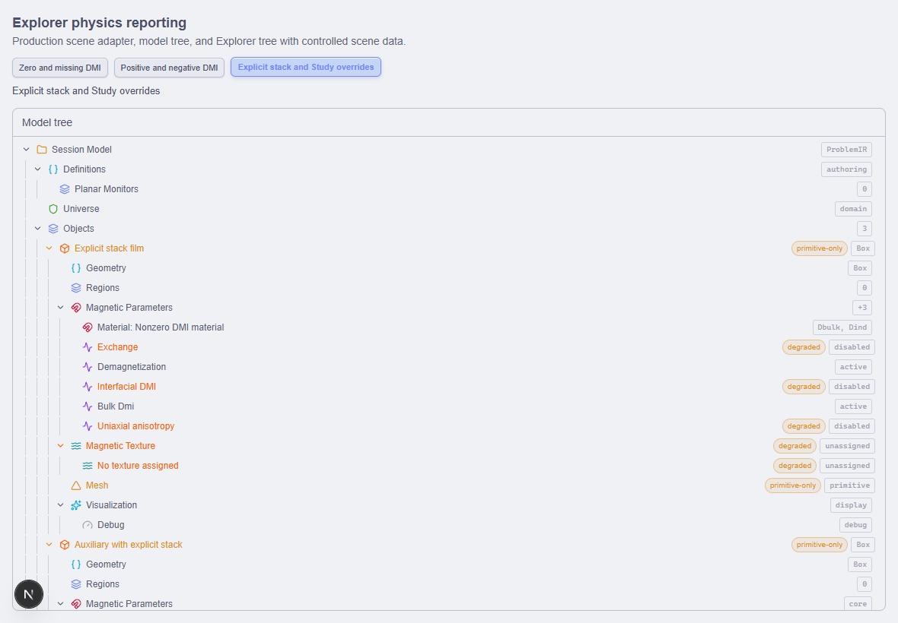

# P8-53BR — dowód UI normalizacji fizyki Explorera

Status: **BROWSER FIXTURE PASS**, 14.10.2026. Baza lokalnego mastera
`da90cc3df9951400b0f8d2f1876ec3bc8d845818`.
Cel: uzupełnić źródłowy dowód P8-53BQ o rzeczywiste renderowanie
produkcjnego drzewa Explorera. Nie zmieniać solvera ani sesji użytkownika.

## Zakres i trasa

Nowa stała recepta `just verify-explorer-physics-reporting-browser`
korzysta z istniejącego managed browser wrappera, profilu
windows-control-room-browser-fixture oraz osobnego portu 3259.
Źródła frontendowe są kopiowane do immutable widoku kontrolnego w storage;
Next outputs, logi, raport i screenshoty należą do tego samego receiptu.
Nie instaluje się zależności, nie uruchamia backendu, Cargo ani kompilacji
testów jednostkowych. Preflight wymaga dokładnej recepty i wolnego portu;
cleanup kończy wyłącznie proces własnego kontrolnego serwera.

Fixture musi importować rzeczywiste modelTreeSnapshotFromScene,
buildModelTree i ExplorerTreeView, z istniejącymi stylami Fullmaga
oraz właściwym kontekstem kernelu. Nie zastępować drzewa ręcznym HTML.
Dane sceny są kontrolowanymi wejściami: zero/missing DMI, niezerowe DMI,
jawne wyłączenie mimo wartości materiału, ostatni znany wpis, nieznany
rodzaj i globalne exchange/demag=false. Zmiana wejść przez widoczne
kontrolki ma prowadzić do właściwych produkcyjnych węzłów, badge i statusów.
Smoke nie może wysyłać mutacji API ani kontaktować sesji 3197.

## Wymagany odbiór i ograniczenia

Wymagany jest terminalny receipt PASS, odczytany report, potwierdzony
snapshot źródeł, brak niespodziewanych wyjątków strony, brak mutacji backendu,
screenshot rzeczywistego drzewa i zamknięcie kontrolnego serwera.
Trasa kwalifikuje tylko produkcyjne renderowanie Explorera na danych
kontrolnych. Nie kwalifikuje hooków z realnym API, authoring persistence,
GPU/FEM ani nauki. P8-53BQ ma już wykonywalny driver 31/31 PASS;
pełny P8 i remote integracja pozostają niezakończone.

## Wynik wykonania

Receipt `96d56620e5914b2eb596927758850904`: **PASS, exit 0**.
Raport `browser/explorer-physics-reporting-report.json` potwierdza wszystkie
trzy scenariusze. Brak page errors, mutacji, mutacyjnych preflightów oraz
nieoczekiwanych GET; oba obserwowane odczyty zachowały URL-pinned API instance.
`owned_server_terminal=true`, `source_changed_during_run=false`.
Source digest przed i po:
`1e49b113501225faa50640e3dc0ffc4786e4e042bb1957633179376c59beb40c`.
Artefakty znajdują się w resolverowym profilu
`windows-control-room-browser-fixture/explorer-physics-reporting-browser/96d56620e5914b2eb596927758850904`.
Końcowy production-source typecheck po korekcie hydracji:
`716211e687cf4311a9be2f29ea3ee597`, **PASS / exit 0**; bez unit targets.
Screenshot w repo SHA-256:
`c777347ba9bec6112ba75acaa76aee270ae91a89aefb12ec8df827c5226db714`.

Pierwsza próba `ba9caca024e14ba883d44cb4a2886a6d` zakończyła się FAIL:
zero/missing PASS, kliknięcie następnego scenariusza przed hydracją nie
zmieniło widoku. Fixture wyłącza teraz przyciski do czasu efektu Reacta;
Playwright czeka na ich rzeczywistą interaktywność. Nie dodano opóźnienia ani
sterowania stanem przez evaluate. Cleanup i stabilność źródeł były potwierdzone
również dla nieudanej próby. Review wskazało brak asercji nieoczekiwanych GET;
asercję dodano. Re-review korekt: brak P0/P1/P2.

Browser kwalifikuje węzły per obiekt, statusy i badge. Agregaty adaptera nie
mają osobnej renderowanej gałęzi i pozostają objęte driverem 31/31 z P8-53BQ.
Nie kwalifikuje to rzeczywistego API, runtime, fizyki ani wydania.

