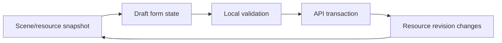

# Frontend v2 - State Management

**Status:** Proposed architecture
**Date:** 2026-05-11

## 1. Rule

Zustand stores are for client-owned UI state. Resource hooks and caches are for server-owned state. React context is for immutable services only.

This split prevents the legacy failure mode where context, stores, normalizers, and mutable singletons all claimed partial ownership of the same session.

## 2. State Ownership

| State kind | Owner | Examples |
|---|---|---|
| Server resource snapshot | resource hook/cache | session status, scene document, mesh topology, field vectors, scalar histories |
| Runtime invalidation pointer | kernel session store | revision map, connection status, command completion revision |
| Layout state | kernel layout store | panel sizes, active slot modules, split ratio |
| Selection state | kernel selection store | selected node, selected resource, selection source |
| Module UI state | module-local Zustand store | expanded tree nodes, active inspector tab, transient camera interaction state, chart zoom |
| Imperative external resource | resource tracker / renderer class | WebGL buffers, textures, workers, observers |
| Theme | CSS/token provider | dark/light/high-contrast variant |

Server data must not be copied into module stores except as a small stable identifier or view preference. If a resource changes, modules re-render from resource hooks.

## 3. Allowed React Contexts

Only these mutable-looking contexts are allowed:

- `KernelContext` containing immutable `KernelApi`;
- `ThemeContext` containing visual theme mode and setter;
- third-party provider contexts required by libraries, if wrapped at shell level.

No React context may own session data, mesh data, field data, viewport state, selected entity, command lifecycle, or inspector drafts.

## 4. Kernel Stores

| Store | Writes | Reads |
|---|---|---|
| `sessionStore` | realtime client and status resource synchronizer | all modules through selectors |
| `layoutStore` | layout controller and user resize/tab actions | shell, slot hosts, command palette |
| `selectionStore` | explorer, viewport picking, command actions | explorer, inspector, viewport, status |
| `diagnosticsStore` | diagnostics controller | diagnostics module and dev overlays |

Kernel stores expose selectors and plain controller functions. They do not import module code.

## 5. Module Stores

Each module may define `store.ts` for local UI state. That file is private to the module.

Allowed examples:

- `explorer/store.ts`: expanded node ids, tree filter, active explorer tab;
- `viewport-3d/store.ts`: transient camera interaction fallback, active local layer panel, local dirty reason counters;
- `inspector/store.ts`: open sections, draft edit session id, validation panel visibility;
- `charts/store.ts`: visible series ids, brush range, display density.

Forbidden examples:

- storing full `SessionStatus` in a module store;
- storing full mesh topology in a Zustand store;
- storing decoded field arrays in React state;
- importing `viewport-3d/store.ts` from `inspector`;
- store actions that call `fetch`;
- module stores that become cross-module API surfaces.

Geometry object authoring uses this split:

- new-object and edit forms are inspector draft state;
- committed objects are server resource snapshots from `model/scene`;
- primitive display preference is visualization state;
- solver topology and mesh reports are meshing resources;
- selected object id is kernel selection state;
- Three.js primitive and wireframe objects are viewport resources, not React/Zustand state.

## 6. Draft Editing

Inspector edits use explicit draft transactions:

Draft state is local to the inspector panel. The canonical committed state remains the resource snapshot. If a commit fails, the draft remains visible with the error; the canonical resource is not silently overwritten.

Workspace transitions use the kernel `PendingFormRegistry` to check every
registered owner, including inactive forms. The registry stores callbacks and
small validation/dirty flags; it does not own draft values. An explicit Apply
choice may prepare a transition only after the panels publish clean state.
Dirty, applying, invalid or locked changes refuse the transition. A generation
guard must remain owned through the asynchronous operation and finalization;
changed forms invalidate it. Cancel never clears forms or authoring history.
An acknowledged session creation is distinguished from a finalization failure
and is never submitted again implicitly. The development restart consumer must
use this boundary together with the separate authoritative backend idle fence.

## 7. Derived Data

Derived data must be computed in one of these places:

- pure selector over a store;
- pure resource adapter;
- `useMemo` in a leaf component when the input is small and stable;
- worker when computation is large enough to block the main thread;
- renderer class when the data is purely render-side.

Avoid `useEffect + setState` for derived values. That pattern causes stale closures, cascading renders, and difficult invalidation.

## 8. Persistence

Only user preferences and layout state persist locally:

- panel visibility/sizes;
- active module per slot;
- local viewport presets that are not canonical session state;
- chart display preferences;
- theme;
- debug overlay preferences.

Canonical simulation state, session state, field state, mesh state, command state, and provenance do not persist through browser local storage.

### Non-authoritative Compute observation hints

`CommandFeedbackController` owns unresolved Compute observation in memory. The
existing API-scoped browser-tab store may retain up to 16 small hints keyed by
logical session identity (session ID and session epoch). A hint is never a
canonical command, acceptance record, simulation snapshot, or result. Only the
backend command ledger and durable accepted-run store can establish acceptance
and completion.

A hint may include the first immutable request JSON for an explicit user retry
with the same client intent and idempotency key. It never causes an automatic
POST after reload or reconnect and never reconstructs inputs from the current
model. The body must match the hint's kind and client intent. Per-body storage
is limited to 16,384 characters and the entire record to 32,768 characters;
overflow retains identity hints without bodies. Unavailable browser storage
leaves in-memory observation usable. A legacy, invalid, or absent body disables
retry; it does not prove rejection or authorize a new Compute. Hints must remain
isolated by API authority and logical session even when transport scope changes.

### Viewport 3D appearance preferences

`viewport3dStore` owns the viewport's client-side appearance preferences. The
version 1 local-storage record contains the requested appearance values, the
selected dimension-frame and scale widgets, ViewCube/HSL visibility, AO/Bloom/
antialias toggles, and the selected non-capture visual profile. It does not
contain the camera, projection, orthographic scale, active capture profile,
session/model resources, or transient dialog and inspection state.

The appearance snapshot is exposed through `useViewport3DAppearance()`. It
starts with fixed defaults on both the server and the first browser render;
the store reads local storage only when a browser subscriber attaches, then
publishes the restored preferences. Unknown fields are ignored, unsupported
schema versions and malformed JSON use defaults, and unavailable or blocked
storage leaves the in-memory store usable. Numeric values are finite and
bounded: background strength 0–1, lighting intensity 0–2, azimuth −180–180°,
elevation −90–90°, grid opacity 0.25–2, AO intensity 0–3, and AO radius 0–1 of
the domain size.

Geometry-lighting preferences affect uniform solid geometry only. Quantitative
field colors remain unlit and un-tonemapped; a legacy `fieldShading` key is
ignored as an unknown appearance field.

`appearanceDiagnostics` separates requested and effective AO, Bloom, and
antialias flags. A requested effect suppressed by protected quantitative field
colors, browser post-processing disablement, or a technical profile limit
reports the reason; an intentionally disabled effect has no suppression
reason. Capture failures remain transient and clear on the next capture
request. Reset commands target background, frame, lighting, effects, or all
appearance preferences. They update only module-local preferences and never
reset the canonical camera or touch session/model state.

## 9. Verification

State changes must be checked with:

- store unit tests for updates and selectors;
- resource-hook tests for revision invalidation;
- integration test for event-to-store flow where relevant;
- `rg "createContext" apps/control-room/src`;
- `rg "let .*=" apps/control-room/src/kernel apps/control-room/src/modules`;
- `rg "fetch\\(" apps/control-room/src`.
