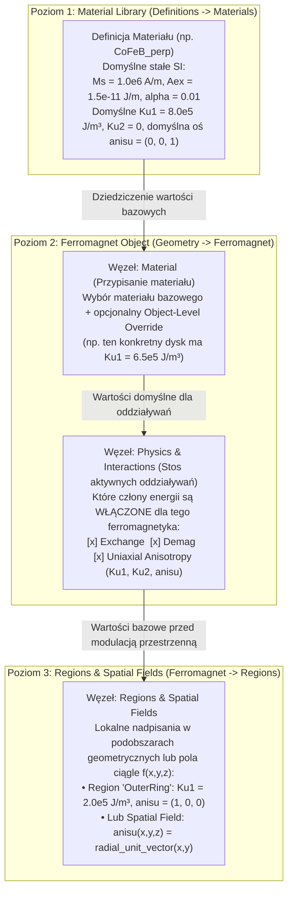

# Audyt i Architektura Drzewa Explorera oraz Wszystkich Inspektorów Control Room (FDM / FEM / Obiekty / Fizyka) — Plan od A do Z

> **Dla wykonawców (agentów):** Użyj skilla `superpowers:subagent-driven-development` lub `superpowers:executing-plans`, aby wdrożyć ten plan zadanie po zadaniu (Task-by-Task). Kroki używają składni checkboxów (`- [ ]`) do śledzenia postępu.

**Cel:** Całkowite uporządkowanie drzewa Explorera (`apps/control-room/src/modules/explorer`) oraz wszystkich widoków Inspektora (`apps/control-room/src/modules/inspector`) w aplikacji Control Room tak, aby:
1. Każdy węzeł drzewa Explorera posiadał **własny, ściśle dopasowany zakres odpowiedzialności** (zero duplikowania tych samych formularzy w rodzicu i w dzieciach, likwidacja pozornych wrapperów `DedicatedInspectorRouteFrame`).
2. Nastąpił **rygorystyczny rozdział ról obiektów sceny**: ferromagnetyki (`magnet` / `ferromagnet`), anteny (`antenna`), przewodniki/elektrody (`conductor` / `electrode`), obiekty geometryczne/przekładki (`auxiliary` / `geometry`) oraz domena zewnętrzna (`universe` / `airbox`) nigdy nie mieszają swoich atrybutów ani poddrzew.
3. Wszystkie **różnice między FDM a FEM** (zarówno duże architektoniczne, jak i drobne niuanse parametrów, siatek, masek, warunków brzegowych, demagnetyzacji i sprzężeń) były obsłużone w 100% jawnie i bez przecieków pojęciowych.
4. Przypisywanie **materiałów, parametrów materiałowych, tekstury magnetycznej oraz oddziaływań fizycznych** (w tym jednoosiowej anizotropii magnetokrystalicznej `Ku1` + osi łatwej `anisu` / `axis`, DMI powierzchniowego i objętościowego, wymiany, demagnetyzacji, STT/SOT, pola Zeemana i Oersteda) odbywało się w jednym, logicznym, naukowo spójnym modelu: **Definicja Materiału (`Definitions -> Materials`) → Przypisanie i Moduły Fizyki Obiektu (`Object -> Material & Physics`) → Lokalne Nadpisania i Pola Przestrzenne Regionu (`Object -> Regions -> <Region>`)**.

**Architektura docelowa:** Jednokierunkowa hierarchia odpowiedzialności w drzewie `ExplorerNode` (gdzie węzeł-rodzic pełni funkcję przeglądu/kolekcji/karty statusu i szybkiej nawigacji, a węzeł-liść pełni funkcję dedykowanego edytora pojedynczego zasobu `ProblemIR`), wsparta jawnym dyskryminatorem roli obiektu (`SceneObjectRole`) oraz dyskryminatorem dyskretyzacji (`DiscretizationLane = "fdm" | "fem" | "unresolved"`).

**Stos technologiczny i kontrakty:** TypeScript / React 19 (`apps/control-room`), OpenAPI v2 (`packages/contracts` / `generated/openapi-v2-types.ts`), Rust `ProblemIR` (`crates/fullmag-ir`), Python DSL (`packages/fullmag-py`).

---

## Część I: Kompleksowy Audyt Obecnego Stanu (Diagnoza Błędów)

Szczegółowa analiza kodu źródłowego w `apps/control-room/src/modules/explorer` oraz `apps/control-room/src/modules/inspector` ujawniła **7 fundamentalnych błędów architektonicznych**, które bezpośrednio powodują zachowania wskazane przez użytkownika.

---

### Błąd Krytyczny #1: Pozorna separacja widoków (`DedicatedExplorerInspectorPanels.tsx` + `DedicatedInspectorRouteFrame.tsx`) — „Nieważne w co kliknę, wszędzie wyświetla się to samo”

W pliku [`.agents/instructions/frontend.md`](file:///c:/git/fullmag/fullmag/.agents/instructions/frontend.md#L175) zapisano regułę:
> *„Every semantic Explorer tree node in `apps/control-room` must map to its own Inspector detail view; do not reuse one generic inspector view for distinct child nodes such as asset, load, and transform.”*

Zamiast faktycznego podziału monolitycznych paneli na dedykowane komponenty dla rodzica i dzieci, w pliku [`DedicatedExplorerInspectorPanels.tsx`](file:///c:/git/fullmag/fullmag/apps/control-room/src/modules/inspector/panels/DedicatedExplorerInspectorPanels.tsx#L1-L301) zastosowano obejście (antywzorzec): funkcja `dedicatedInspectorPanel()` tworzy dziesiątki „różnych” komponentów o unikalnych `displayName` (aby przejść test jednostkowy sprawdzający referencje funkcji w [`inspectorRouteCatalog.tsx`](file:///c:/git/fullmag/fullmag/apps/control-room/src/modules/inspector/inspectorRouteCatalog.tsx#L912-L1520)), ale **pod spodem wszystkie te komponenty renderują dokładnie ten sam monolityczny panel wewnętrzny**, opakowany jedynie w [`DedicatedInspectorRouteFrame.tsx`](file:///c:/git/fullmag/fullmag/apps/control-room/src/modules/inspector/panels/DedicatedInspectorRouteFrame.tsx#L1-L174):

| Grupa węzłów w Explorerze | Węzły (`selection.kind`) | Co faktycznie renderuje Inspektor | Skutek dla użytkownika |
| :--- | :--- | :--- | :--- |
| **Siatka FDM (`mesh.grid.*`)** | `mesh.grid`, `mesh.grid.descriptor`, `mesh.grid.common`, `mesh.grid.layers`, `mesh.grid.layer`, `mesh.grid.layer.native-grid`, `mesh.grid.layer.mask`, `mesh.grid.layer.transfer`, `mesh.grid.layer.provenance`, `mesh.grid.magnetic-support`, `mesh.grid.active-unassigned`, `mesh.grid.mask`, `mesh.grid.provenance`, `mesh.grid.region`, `mesh.grid.universe-outside-support`, `fdm.cell` (**16 węzłów!**) | Ten sam [`FdmGridInspectorPanel`](file:///c:/git/fullmag/fullmag/apps/control-room/src/modules/inspector/panels/fdm-grid/FdmGridInspectorPanel.tsx#L313-L368) | Klikanie po drzewie `Structured Grid -> Descriptor`, `Magnetic Support`, `Active Mask`, `Provenance` pokazuje w kółko te same sekcje `Structured Grid` i `Cell Membership`. |
| **Study (`study.*`)** | `study.root`, `study.stages`, `study.execution`, `study.recovery` (**4 węzły**) | Ten sam 3160-liniowy [`StudyInspectorPanel`](file:///c:/git/fullmag/fullmag/apps/control-room/src/modules/inspector/panels/StudyInspectorPanel.tsx#L1477-L1797) bez żadnego filtrowania sekcji po `selection.kind`! | Niezależnie czy użytkownik kliknie `Study`, `Stages`, `Execution` czy `Recovery`, zawsze widzi gigantyczną ścianę 8 sekcji: `Runtime`, `Project Runs`, `Project Batches`, `Selected Stage`, `Global Study Settings`, `Study Execution Profile`, `Pipeline / Stages`, `Recovery`, `Run History`. |
| **Siatka FEM (`mesh.*`)** | `mesh.root`, `mesh.shared-domain`, `mesh.builds`, `mesh.quality`, `mesh.size-fields`, `mesh.regions` (**6 węzłów**) | Ten sam [`MeshDetailsPanel`](file:///c:/git/fullmag/fullmag/apps/control-room/src/modules/inspector/panels/MeshDetailsPanel.tsx#L72-L180) (z częściowo nakładającymi się listami sekcji, gdzie `overview`, `shared-policy`, `identity`, `mixed-topology`, `editor-capabilities` powtarzają się między `mesh.root` a `mesh.shared-domain`) | Rodzic `Mesh` i dziecko `Shared-Domain Mesh` pokazują niemal identyczny formularz polityki siatki i surowe zrzuty JSON. |
| **Tekstura magnetyczna (`object.magnetic-texture.*`)** | `object.magnetic-texture`, `object.magnetic-texture.asset`, `object.magnetic-texture.load`, `object.magnetic-texture.transform` (**4 węzły**) | Ten sam [`ObjectMagneticTexturePanel`](file:///c:/git/fullmag/fullmag/apps/control-room/src/modules/inspector/panels/ObjectMagneticTexturePanel.tsx#L787-L1194), w którym zawsze na górze wisi `MagneticTextureSummarySection` (10 wierszy), na dole `MagneticTextureRawAssetSection` i `MagneticTextureActionsSection` | Kliknięcie w rodzica `Magnetic Texture` pokazuje surowe pola tekstowe JSON (`Raw Asset`) i przycisk `Save Texture` (który zapisuje ukryty draft!). |
| **Podwęzły regionu (`object.region.*`)** | `object.region.geometry` vs `object.region.shape`; `object.region.magnetic-parameters` vs `object.region.material`; `object.region.texture` vs `object.region-magnetic-texture` | Wszystkie przechodzą przez monolityczny [`ObjectRegionsPanel`](file:///c:/git/fullmag/fullmag/apps/control-room/src/modules/inspector/panels/ObjectRegionsPanel.tsx#L150-L899), a każdy sub-panel dokleja na górze ten sam 10-wierszowy `ObjectRegionMetadataSection` i na dole ten sam `ObjectRegionActionsSection` (z przyciskami `Apply Region`, `Build Mesh`, `Duplicate Region`, `Delete Region`) | W każdym dziecku regionu powtarza się cała ramka metadanych i akcji całego regionu. |
| **Przekroje 2D (`mesh.cross-section.*`)** | `mesh.cross-section`, `mesh.cross-section.draft`, `mesh.cross-section.plot`, `visualizations2d.draft`, `visualizations2d.parameter`, `visualizations2d.plot` | Ten sam [`CrossSectionInspectorPanel`](file:///c:/git/fullmag/fullmag/apps/control-room/src/modules/inspector/panels/CrossSectionInspectorPanel.tsx) | Brak rozróżnienia między węzłem draftu, parametru a zapisanego wykresu. |

Co więcej, [`DedicatedInspectorRouteFrame.tsx`](file:///c:/git/fullmag/fullmag/apps/control-room/src/modules/inspector/panels/DedicatedInspectorRouteFrame.tsx#L134-L163) renderuje u góry każdego takiego panelu komponent `ScientificInspectorTemplate` z twardo zakodowanymi statusami:
```ts
status={{
  availability: "unknown",
  execution: "unknown",
  resource: "unknown",
}}
```
przez co użytkownik widzi w Inspektorze **podwójny nagłówek** (pierwszy z `InspectorShell`, drugi z `DedicatedInspectorRouteFrame` pełen bezużytecznych badge'y `unknown`).

---

### Błąd Krytyczny #2: Chaos i duplikacja między węzłami Obiektu (`object.root` vs `object.geometry` vs `object.magnetic-parameters` vs `object.material`)

Gdy użytkownik rozwija obiekt ferromagnetyczny w drzewie `Objects -> <Ferromagnet>`, widzi następujące węzły, których zawartość w Inspektorze jest kompletnie wymieszana:

1. **Kliknięcie w główny węzeł obiektu (`model:object:<id>`, `kind: "object.root"`)** otwiera [`ObjectGeneralPanel.tsx`](file:///c:/git/fullmag/fullmag/apps/control-room/src/modules/inspector/panels/ObjectGeneralPanel.tsx#L878-L1080):
   - W sekcji `Identity` (linie 919–948) oprócz `Object ID`, `Role` i `Name` znajdują się **surowe pola tekstowe (`type="text"`) dla `Material` oraz `Region`**! Użytkownik widzi możliwość wpisywania z palca nazwy regionu i identyfikatora materiału bezpośrednio na korzeniu obiektu.
   - Zaraz pod spodem renderuje się `Viewport display` (kolory), a pod nim sekcja `Energies` (`Average m`, `Exchange`, `Demag`, `Zeeman`, `Anisotropy`, `DMI`, `Total`) — czyli **wyniki symulacji (observables)** pomieszane z formularzem autorskim tożsamości obiektu!
   - Jeszcze niżej w `ObjectGeneralPanel` doklejony jest `ObjectExtensionsSection` (linie 367–492), który pozwala włączać i wyłączać rozszerzenie post-processingu `Topological charge (Q, q(x))` bezpośrednio na głównym węźle obiektu!
   - W logice `applyRegisteredDrafts` (`ObjectGeneralPanel.tsx:591-677`) główny panel obiektu przechwytuje również niewysłane drafty geometrii (`geometryDraft`) i wysyła `patchObjectGeometry` oraz `patchObjectTransform`!

2. **Kliknięcie w dziecko `Geometry` (`model:object:<id>:geometry`, `kind: "object.geometry"`)** otwiera [`GeometryObjectPanel.tsx`](file:///c:/git/fullmag/fullmag/apps/control-room/src/modules/inspector/panels/GeometryObjectPanel.tsx#L1007-L1168):
   - W sekcji `DraftIdentitySection` (`GeometryObjectPanel.tsx:1012-1043`), gdy obiekt jest już zatwierdzony (`draft.mode === "committed"`), formularz **ponownie renderuje edytowalne pola tekstowe `Name`, `Region` oraz `Material`**!
   - Oznacza to, że klikając w `Geometry` (dziecko mające odpowiadać wyłącznie za kształt geometryczny `Box`/`Cylinder`/`Sphere`/`Waveguide`/`CSG` oraz transformację `Translation`/`Rotation`), użytkownik znów widzi pola `Name`, `Region` i `Material` swojego rodzica!

3. **Kliknięcie w dziecko `Magnetic Parameters` (`kind: "object.magnetic-parameters"`) vs wnuka `Material: <name>` (`kind: "object.material"`)** otwiera ten sam plik [`ObjectMaterialPanel.tsx`](file:///c:/git/fullmag/fullmag/apps/control-room/src/modules/inspector/panels/ObjectMaterialPanel.tsx#L1259-L1831):
   - Oba węzły wywołują ten sam gigantyczny hook `useObjectMaterialPanelState` (ponad 1200 linii kodu).
   - Oba węzły wstrzykują w środek komponent [`ObjectAbsorbingBoundaryPanel`](file:///c:/git/fullmag/fullmag/apps/control-room/src/modules/inspector/panels/ObjectMaterialPanel.tsx#L1745-L1754) (`Absorbing Boundary Layer` — warstwa tłumiąca fale spinowe przy brzegach obiektu)! Dlaczego warstwa brzegowa ABL jest ukryta wewnątrz panelu materiału (`object.material`), skoro to nie jest parametr materiałowy, lecz brzegowy moduł fizyczny obiektu?
   - W sekcji `Create and Assign Material` (`ObjectMaterialPanel.tsx:1612-1629`) znajdują się pola `New Ku1` i `New anisotropy axis`, opatrzone komentarzem: *"Optional interaction draft. It is not part of the material ACK and must be applied separately below."* — ponieważ w backendzie endpoint `POST /model/materials` przyjmuje tylko `Ms`, `Aex`, `alpha`, `Dind`, `Dbulk`, a `Ku1` jest cicho odkładane do zmiennej `deferredAnisotropy` i **nie zapisuje się** przy kliknięciu `Create and assign`!

---

### Błąd Krytyczny #3: Schizofrenia w drzewie Fizyki i Oddziaływań (Jak dodać anizotropię jednoosiową `Ku1` + `anisu`?)

Obecnie w drzewie Explorera i w Inspektorach istnieją **cztery niespójne, wzajemnie sprzeczne miejsca**, w których pojawiają się oddziaływania fizyczne i anizotropia jednoosiowa:

1. **Poddrzewo #1 wewnątrz obiektu: `Objects -> <Magnet> -> Magnetic Parameters -> <Interaction>` (`kind: "object.physics"`)**:
   - Budowane w [`objectExplorerNodes.ts:785-827`](file:///c:/git/fullmag/fullmag/apps/control-room/src/modules/explorer/builders/objectExplorerNodes.ts#L785-L827) na podstawie `sceneObjectPhysicsInteractions` z [`sceneModelTreeAdapter.ts:742-800`](file:///c:/git/fullmag/fullmag/apps/control-room/src/modules/explorer/builders/sceneModelTreeAdapter.ts#L742-L800).
   - Wyświetla dzieci takie jak `Exchange`, `Demagnetization`, `Interfacial DMI`, `Uniaxial anisotropy`.
   - Gdy użytkownik kliknie np. w `Exchange` lub `Uniaxial anisotropy`, otwiera się [`PhysicsInteractionPanel.tsx`](file:///c:/git/fullmag/fullmag/apps/control-room/src/modules/inspector/panels/PhysicsInteractionPanel.tsx#L696-L807), który na samej górze wyświetla sekcję `Physics Interactions` z **checklistą wszystkich 12 oddziaływań w systemie** (w tym globalnych: `Zeeman field`, `Electric current`, `Oersted field`, `Rotated interfacial DMI`, `Demagnetization`) oraz **dropdown `Interaction` pozwalający przełączyć formularz na zupełnie inne oddziaływanie niż to, które jest zaznaczone w drzewie Explorera!**

2. **Poddrzewo #2 wewnątrz tego samego obiektu: `Objects -> <Magnet> -> Physics · <Magnet>` (`kind: "object.physics.scope"` -> dzieci `kind: "physics.module"`)**:
   - Budowane w [`physicsGraphTree.ts:392-442`](file:///c:/git/fullmag/fullmag/apps/control-room/src/modules/explorer/builders/physicsGraphTree.ts#L392-L442) i doklejane do tego samego obiektu w [`objectExplorerNodes.ts:257`](file:///c:/git/fullmag/fullmag/apps/control-room/src/modules/explorer/builders/objectExplorerNodes.ts#L257)!
   - Oznacza to, że pod jednym obiektem ferromagnetycznym użytkownik widzi **zarówno** `Magnetic Parameters` (z listą oddziaływań wewnątrz!), **jak i** `Physics · <Magnet>` (z drugą listą modułów fizycznych `physics.module`!).
   - Co gorsza, kliknięcie w węzeł `physics.module` pod `Physics · <Magnet>` otwiera [`PhysicsGraphModuleInspectorPanel.tsx`](file:///c:/git/fullmag/fullmag/apps/control-room/src/modules/inspector/panels/PhysicsGraphModuleInspectorPanel.tsx#L1-L105), który jest **całkowicie tylko do odczytu (read-only)** i nie pozwala zmienić żadnego parametru!

3. **Poddrzewo #3 na poziomie modelu: `Session Model -> Global Physics`, `Cross-object Interfaces`, `Unresolved Physics`, `Couplings`**:
   - Węzły `Global Physics`, `Cross-object Interfaces`, `Unresolved Physics` używają tych samych read-only paneli `PhysicsGraphModuleInspectorPanel`.
   - Tymczasem faktyczna edycja globalnego pola `B_ext` (Zeeman), przełączników `Exchange enabled` i `Demag enabled` oraz strategii demagnetyzacji znajduje się zupełnie gdzie indziej: w `Study -> Global Study Settings` ([`StudyInspectorPanel.tsx:2488-2662`](file:///c:/git/fullmag/fullmag/apps/control-room/src/modules/inspector/panels/StudyInspectorPanel.tsx#L2488-L2662)) ORAZ częściowo w `PhysicsInteractionPanel`!

4. **Przypadek użycia wskazany przez użytkownika — „Chcę dodać anizotropię jednoosiową, muszę aktywować `anisu` i `Ku1` — gdzie w inspektorze i jak to zrobić?”**:
   - W aktualnym kodzie jest to skrajnie nieintuicyjne i rozbite:
     - W Python DSL (`fullmag-py`) użytkownik może napisać obiektowo `UniaxialAnisotropy(Ku1=..., axis=(ux, uy, uz))` lub w stylu płaskim `Ku1 = ...; anisu = (ux, uy, uz)` albo zdefiniować je na materiale/obiekcie/regionie.
     - W `ProblemIR` (`crates/fullmag-ir/src/model.rs:482-485`) `MaterialIR` posiada pola `uniaxial_anisotropy: Option<f64>`, `uniaxial_anisotropy_k2: Option<f64>`, `anisotropy_axis: Option<[f64; 3]>`, natomiast w `SceneResource` (OpenAPI v2) obiekt ma `physics_stack` z wpisem `kind: "uniaxial_anisotropy"`, `params: { ku1, ku2, axis }`, a regiony i pola materiałowe (`material_parameter_fields`) mają parametry `ku1`, `ku2`, `anisotropy_axis`.
     - W obecnym UI:
       - Jeśli użytkownik kliknie `Material` (`object.material`), nie widzi tam anizotropii (chyba że tworzy nowy materiał w `Create and Assign Material`, gdzie pole `New Ku1` jest pułapką, bo nie zapisuje się z materiałem!).
       - Jeśli kliknie `Magnetic Parameters` (`object.magnetic-parameters`), na samym dole pod `Material Assignment` znajduje małą grupkę `Uniaxial Anisotropy` z checkboxem `Present`, `Ku1` i `Axis` (bez `Ku2`!).
       - Jeśli rozwinie `Magnetic Parameters` (o ile wcześniej anizotropia była już w `physics_stack`!), zobaczy dziecko `Uniaxial anisotropy`, gdzie w `PhysicsInteractionPanel` są pola `Present`, `Enabled`, `K_u1`, `K_u2`, `Axis`. Ale jeśli anizotropii jeszcze nie było w `physics_stack`, to **węzeł `Uniaxial anisotropy` w ogóle nie istnieje w drzewie pod `Magnetic Parameters`** (`sceneObjectPhysicsInteractions` w `sceneModelTreeAdapter.ts:742-783` tworzy węzły tylko dla wpisów obecnych w `physics_stack` oraz dla `exchange` i `demag`!).
       - A jeśli użytkownik chce nadpisać oś `anisu` (`anisotropy_axis`) w konkretnym regionie (`ObjectRegionMagneticParametersPanel.tsx:38-43`), to dropdown `REGION_MATERIAL_PARAMETERS` ma tylko `["ms", "aex", "alpha", "ku1"]`, a `MATERIAL_FIELD_PARAMETERS` (`ObjectRegionMaterialFieldsModel.ts:51-59`) ma `["ms", "aex", "alpha", "ku1", "ku2", "dind", "dbulk"]` — **w obu listach pominięto `anisotropy_axis` (`anisu`)**, mimo że `unitForMaterialParameter` w linii 79 oraz `MaterialParameterNameIR::AnisotropyAxis` w Rust IR istnieją!

---

### Błąd Krytyczny #4: Mieszanie atrybutów Anten (`antenna`) z Ferromagnetykami (`magnet`) oraz elementami pomocniczymi (`auxiliary`)

1. **Węzeł główny anteny (`model:object:<id>`, `kind: "object.root"`) używa `ObjectGeneralPanel` (panelu ferromagnetyka!)**:
   - W [`inspectorRouteCatalog.tsx:900`](file:///c:/git/fullmag/fullmag/apps/control-room/src/modules/inspector/inspectorRouteCatalog.tsx#L900) każdy węzeł `object.root` (niezależnie od tego, czy `role === "magnet"`, `"antenna"` czy `"auxiliary"`) trafia do `ObjectGeneralPanel`.
   - W `ObjectGeneralPanel` (`linie 928-948`) dla anteny renderują się edytowalne pola tekstowe:
     - `Region` (przypisanie regionu magnetycznego!)
     - `Material` (referencja do materiału magnetycznego z `Ms`, `Aex`, `alpha`!)
   - W `ObjectGeneralPanel` (`linie 986-995`) dla anteny renderuje się `ObjectExtensionsSection` z przyciskiem **„Enable Topological Charge” (`Q, q(x)`)** — czyli ładunek topologiczny skyrmionów dla miedzianej anteny RF!
   - W `ObjectGeneralPanel` (`linia 895`) warunek ukrycia energii magnetycznych (`Average m`, `Exchange`, `Demag`, `Zeeman`, `Anisotropy`, `DMI`) to `antennaWithoutMagnetization = sceneObject?.role === "antenna" && hasEmptyObjectMagneticModel(sceneObject)`. Jeśli obiekt anteny w JSON sceny ma jakiekolwiek pozostałości po domyślnych polach, wyświetla pełną tabelę energii mikromagnetycznych!
   - Tymczasem dedykowany panel [`AntennaObjectPanel.tsx`](file:///c:/git/fullmag/fullmag/apps/control-room/src/modules/inspector/panels/AntennaObjectPanel.tsx#L89) jest podpięty tylko pod `object.antenna` (który pojawia się tylko dla starych/uproszczonych anten bez kompozycji portów!), więc dla normalnej anteny z `Conductor`, `Ports`, `Field Solutions` korzeń anteny otwiera ferromagnetyczny `ObjectGeneralPanel`!

2. **Dziecko `Mesh` pod anteną (`model:object:<id>:mesh`, `kind: "object.mesh"`) używa ferromagnetycznego `ObjectMeshPolicyPanel`**:
   - W [`objectExplorerNodes.ts:98-115`](file:///c:/git/fullmag/fullmag/apps/control-room/src/modules/explorer/builders/objectExplorerNodes.ts#L98-L115) antena otrzymuje zwykły węzeł `kind: "object.mesh"`, który otwiera `ObjectMeshPolicyPanel`.
   - W trybie FDM `FdmObjectMeshPolicySection` (`ObjectMeshPolicyPanel.tsx:320`) wypisuje dla anteny: `Mesh scope: selected object / magnetic support` (!), traktując antenę jak nośnik magnetyczny!
   - W trybie FEM pokazuje dla anteny sekcję `Thin-Film Sweep Strategy` z ostrzeżeniem o zbieżności warstw pryzmatycznych ferromagnetyka i dokumentacją `python-api/meshing/fem/ferromagnet/thin-film-tetrahedral.html`, podczas gdy polityka siatki przewodnika anteny (`conductor_mesh_policy`) w rzeczywistości należy do etapu rozwiązania pola anteny (`AntennaFieldSolveStage`) lub geometrii przewodnika!

3. **Obiekty pomocnicze / przekładki niemagnetyczne (`role: "auxiliary"` / `PhysicsObjectTypeIR::Geometry` / `Conductor` / `Electrode`)**:
   - W `objectExplorerNodes.ts:154` każdy obiekt, który nie ma `role === "antenna"`, przechodzi przez `buildStandardObjectChildren()`, otrzymując pełny zestaw węzłów ferromagnetyka: `Magnetic Parameters`, `Magnetic Texture`, `Regions` (z nadpisaniami `Ms`, `Aex`, `alpha`, `Ku1`)!

---

### Błąd Krytyczny #5: Niepełna i niespójna obsługa różnic między FDM a FEM w Drzewie i Inspektorach

Choć część plików sprawdza `meshLane` (`"fdm" | "fem" | "unknown"`), w całym drzewie i inspektorach występują poważne luki i sprzeczności:

1. **Dwa duplikujące się miejsca dla `Airbox` / `Universe` w FDM**:
   - W drzewie Explorera pod `Universe` (`model:universe`) jest dziecko `Airbox` (`model:airbox`, budowane w [`airboxExplorerNodes.ts`](file:///c:/git/fullmag/fullmag/apps/control-room/src/modules/explorer/builders/airboxExplorerNodes.ts#L228-L353)).
   - Jednocześnie w trybie FDM pod `Mesh -> Structured Grid` (`model:mesh:grid`) budowane jest drugie dziecko o etykiecie `Airbox` (`id: "model:mesh:grid:universe-outside-support"`, `kind: "mesh.grid.universe-outside-support"`, w [`meshExplorerNodes.ts:242-265`](file:///c:/git/fullmag/fullmag/apps/control-room/src/modules/explorer/builders/meshExplorerNodes.ts#L242-L265))!
   - Użytkownik widzi w drzewie dwa różne węzły `Airbox` otwierające dwa zupełnie różne inspektory (`AirboxOverviewLanePanel` vs `FdmGridInspectorPanel`).
   - Co więcej, w FDM fizyczny sens „Airboxa” zależy od kontekstu:
     - Podczas **authoringu domeny** w FDM określa się rozmiary pudła obliczeniowego `Universe` / siatki `nx, ny, nz` oraz `dx, dy, dz` (komórki poza geometrią ferromagnetyka mają $M_s = 0$, a demagnetyzacja używa konwolucji FFT w próżni z otwartymi lub periodycznymi warunkami brzegowymi PBC, bez siatki czworościennej w powietrzu!).
     - Natomiast w **FEM** `Airbox` jest faktycznym obszarem geometrycznym otaczającym ferromagnetyki, który **musi zostać zdyskretyzowany czworościanami** (z parametrami `padding_factor`, `h_air_max`, `transition_distance`, `Boundary Faces` pod warunek Dirichleta lub Robina/asymptotyczny dla potencjału skalarnego $\phi_m$, chyba że użyto metody bez-airboxowej `fredkin_koehler` / `bem`).

2. **Rozproszenie konfiguracji siatki FDM**:
   - Parametry siatki FDM (`defaultCell`, `perMagnet`, `commonCells`, `commonCellsXy`, `demagMode`, `boundaryCorrection`, `boundaryPhiFloor`, `boundaryDeltaMin`) nie znajdują się w węźle `Mesh` ani `Structured Grid`, lecz są schowane w środku gigantycznego `StudyInspectorPanel` (w sekcji `Global Study Settings`, linie 2541–2655)!
   - Kiedy użytkownik kliknie w drzewie `Mesh` lub `Mesh -> Structured Grid`, widzi tylko read-only `FdmGridInspectorPanel` i **nie może tam zmienić rozmiaru komórki `dx, dy, dz` ani liczby komórek `nx, ny, nz`**!

3. **Różnice w regionach (`Regions`) i polach materiałowych między FDM a FEM**:
   - W FEM region obiektu posiada `realizationPolicy` (`inherit` | `conformal` | `project`) oraz `meshPolicy` (`maximumElementSize`, `minimumElementSize`, `transitionDistance`, `order`) i przycisk `Build Mesh`.
   - W FDM przynależność komórek do regionu (`cell membership`) wynika z rzutowania geometrycznego (vokseli) o zadanym priorytecie (`priority`) i polityce konfliktu (`conflict_policy`), a `realizationPolicy` i `meshPolicy` nie mają zastosowania. Obecnie `ObjectRegionOverviewPanel` i `ObjectRegionActionsSection` wciąż pokazują w FDM mylące wiersze diagnostyczne o braku „unstructured topology”.

4. **Różnice w fizyce i oddziaływaniach między FDM a FEM**:
   - **Demagnetyzacja**:
     - FDM: `auto`, `single_grid` (tylko dla 1 ciała magnetycznego), `multilayer_convolution` (`2d_stack` lub `3d`), opcje PBC (`FdmPbc`: powtórzenia obrazu `nx, ny, nz`).
     - FEM: `auto`, `poisson_robin` (`airbox_robin`), `poisson_dirichlet`, `fredkin_koehler` (hybrydowa FEM/BEM bez airboxa), `bem`, `fmm`, plus `fem_demag_solver_policy` (tolerancje CG/AMG/hypre).
   - **DMI i warunki brzegowe**:
     - `RotatedInterfacialDMI` wymaga włączonego `Exchange` przy otwartych granicach magnetycznych (sprzężony naturalny warunek brzegowy Neumanna $\partial \mathbf{m}/\partial n$).
     - `Magnetoelastic` (sprzężenie magnetosprężyste z ciałem sprężystym `ElasticBody`) jest obsługiwane wyłącznie w FEM, a w FDM niedostępne.
   - **Równoległe wykonanie (`ParallelExecutionPolicy`)**:
     - Tryb `adaptive` dla niezależnych punktów $\mathbf{k}$ w zadaniach własnych (`Eigenmodes`) dotyczy wyłącznie `FEM CPU`. W `StudyBoundarySection` (`linie 2423-2487`) pola `Maximum CPU target (%)`, `Maximum memory target (%)`, `Memory reserve (MiB)`, `Maximum workers`, `Threads per worker` są zawsze widoczne i aktywne, nawet gdy wybrano `Serial` albo `FDM GPU`!

---

### Błąd Krytyczny #6: Martwe lub tylko-do-odczytu węzły nawigacyjne (`ContextInspector`)

W pliku [`ModelTreeOverviewInspectorPanels.tsx`](file:///c:/git/fullmag/fullmag/apps/control-room/src/modules/inspector/panels/ModelTreeOverviewInspectorPanels.tsx#L19-L265) aż **11 głównych węzłów drzewa** (`Session Model`, `Objects`, `Definitions`, `Planar Monitors`, `Couplings`, `Global Physics`, `Object Physics Scope`, `Cross-object Interfaces`, `Unresolved Physics`, `Unassigned Mesh Parts`, `Visualizations 2D`) wyświetla pusty szablon `ContextInspector` z komunikatem:
> *"This is a semantic navigator node. Select a child to inspect its owned resource or definition."*

Zamiast użytecznego widoku zbiorczego (np. tabeli obiektów z przyciskami `+ Add Ferromagnet` / `+ Add Antenna`, katalogu materiałów w `Definitions`, tabeli sprzężeń międzyobiektowych w `Couplings` z przyciskiem `+ Add Coupling`), użytkownik po kliknięciu w te węzły widzi pustą makietę z napisem `Payload owner: Typed child resources`.

---

### Błąd Krytyczny #7: Bałagan w `Definitions` i brak widoczności katalogu `Materials`

W [`modelRootNodes.ts:154-243`](file:///c:/git/fullmag/fullmag/apps/control-room/src/modules/explorer/builders/modelRootNodes.ts#L154-L243) gałąź `Definitions` zawiera:
- `Study Execution Profile` (który dotyczy wykonywania `Study`, a nie definicji modelowych!),
- `Planar Monitors` (które są sondami pomiarowymi / observables, a nie definicjami materiałowymi!),
- wyekstrahowane definicje anten (`antenna_port_modes`, `antenna_field_solve_stages`, `antenna_target_projections`, `solved_antenna_drives`, `antenna_spectrum_requests`), które już raz występują pod obiektem anteny (`Objects -> <Antenna> -> Ports / Field Solutions / ...`), więc duplikują się w dwóch miejscach drzewa!
- Natomiast **globalne zasoby `Materials` (`scene.materials`) oraz ` Selections` (`scene.selections`) nie mają swojej czystej kolekcji w `Definitions`**, przez co użytkownik nie widzi jakie materiały są zdefiniowane w projekcie i które obiekty z nich korzystają!

---

## Część II: Kanoniczny Schemat Drzewa Explorera (Od A do Z)

Poniżej definiujemy nową, całkowicie uporządkowaną architekturę drzewa Explorera. Każdy węzeł ma:
- jednoznaczną rolę,
- ścisłą relację **Rodzic (Przegląd / Kolekcja / Szybkie akcje)** vs **Dziecko (Dedykowany Edytor pojedynczego aspektu)**,
- jawne filtrowanie według **Roli Obiektu (`ferromagnet` | `antenna` | `conductor` | `spacer`)** oraz **Dyskretyzacji (`FDM` | `FEM`)**.

### 2.1. Diagram Architektury Głównego Drzewa (`ExplorerTree`)

```mermaid
flowchart TD
    Root["Explorer View"] --> ModelSec["1. MODEL (ProblemIR Authoring)"]
    Root --> StudySec["2. STUDY & EXECUTION (Workflow & Runtime)"]
    Root --> ResultsSec["3. RESULTS & MONITORS (Observables & Post-processing)"]
    Root --> DiagSec["4. DIAGNOSTICS & JOBS (Readiness & Telemetry)"]

    ModelSec --> Univ["Universe & Domain (FDM Grid / FEM Airbox)"]
    ModelSec --> Defs["Definitions (Materials, Selections, Profiles)"]
    ModelSec --> Objs["Objects (Strict Role Separation)"]
    ModelSec --> GlobalPhys["Global Physics & Couplings"]
    ModelSec --> MeshNode["Mesh & Discretization (FDM Grid vs FEM Tet Mesh)"]

    Objs --> FerroObj["Ferromagnet Object (magnet)"]
    Objs --> AntObj["Antenna Object (antenna)"]
    Objs --> CondObj["Conductor / Electrode Object"]
    Objs --> AuxObj["Spacer / Geometry Object (auxiliary)"]

    FerroObj --> FGeom["Geometry & Transform"]
    FerroObj --> FMat["Material & Anisotropy / Local Parameters"]
    FerroObj --> FPhys["Object Physics & Boundary (Exchange, DMI, ABL, STT)"]
    FerroObj --> FTex["Initial Magnetization (Texture)"]
    FerroObj --> FReg["Regions (Subregions & Spatial Fields)"]
    FerroObj --> FMesh["Discretization / Mesh Policy"]
    FerroObj --> FVis["Visualization"]

    AntObj --> AGeom["Conductor Geometry & Placement"]
    AntObj --> ACond["Conductor Transport & Material (sigma)"]
    AntObj --> ATerm["Terminals & Ports"]
    AntObj --> AField["Field Solve & Target Projections"]
    AntObj --> ADrive["Excitations / Drives & Spectrum"]
    AntObj --> AVis["Visualization"]
```



---

### 2.2. Pełne Drzewo ASCII dla Trybu **FDM** vs Trybu **FEM**

#### A. Gałąź `1. MODEL` — Wspólna struktura nadrzędna i różnice `FDM` vs `FEM`

```text
SESSION MODEL (kind: "model.session")
│
├── 1. Universe & Domain (kind: "universe.root")
│   ├── [W TRYBIE FDM]:
│   │   ├── Domain Box & PBC (kind: "universe.fdm.domain")
│   │   │   └── Rozmiar pudła [Lx, Ly, Lz], Origin, Periodic Boundary Conditions (PBC: Repeat X, Y, Z)
│   │   └── Vacuum / Outside Magnetic Support (kind: "universe.fdm.outside-support")
│   │       ├── Podgląd komórek próżni (Ms = 0) poza ferromagnetykami
│   │       └── Visualization (kind: "universe.fdm.outside-support.visualization")
│   │
│   └── [W TRYBIE FEM]:
│       └── Airbox (kind: "airbox.root")
│           ├── Domain & Padding Policy (kind: "airbox.parameters")
│           │   └── Tryb Auto/Manual, Padding factor, h_air_max, Transition distance, Magnetostatic BC (Robin/Dirichlet/BEM)
│           ├── Boundary Faces (kind: "airbox.boundary-faces")
│           │   └── X-, X+, Y-, Y+, Z-, Z+ (inspekcja ścian zewnętrznych dla warunku brzegowego phi_m)
│           ├── Mesh & Quality (kind: "airbox.mesh")
│           │   ├── Build & Provenance (kind: "airbox.mesh.build")
│           │   ├── Quality Gates (kind: "airbox.mesh.quality")
│           │   ├── Size Statistics (kind: "airbox.mesh.statistics")
│           │   └── Topology (kind: "airbox.mesh.topology")
│           └── Visualization (kind: "airbox.visualization")
│
├── 2. Definitions (kind: "model.definitions")
│   ├── Materials Library (kind: "definitions.materials")
│   │   └── <Material: Permalloy / CoFeB / YIG> (kind: "definitions.material")
│   │       └── Bazowe parametry materiałowe: Ms, Aex, alpha, opcjonalne bazowe Ku1, Ku2, anisu, Kc1..3, Dind, Dbulk
│   ├── Named Selections (kind: "definitions.selections")
│   │   └── <Selection> (kind: "definitions.selection")
│   └── Execution Profiles (kind: "definitions.execution-profiles")
│       └── <Execution Profile> (kind: "study.execution-profile")
│
├── 3. Objects (kind: "objects.root")
│   │
│   ├── [ROLA: FERROMAGNET (role === "magnet")] -> <Ferromagnet Name> (kind: "object.ferromagnet.root")
│   │   ├── Geometry & Transform (kind: "object.geometry")
│   │   │   └── Kształt (Box, Cylinder, Sphere, Ellipsoid, SinWaveguide, ArchWaveguide, CSG, Imported) + Transformacja 3D
│   │   ├── Material & Parameters (kind: "object.material")
│   │   │   ├── Przypisanie materiału z biblioteki (Select + Create New Material)
│   │   │   ├── Efektywne parametry skalarne na obiekcie (Ms, Aex, alpha, Dind, Dbulk, Ku1, Ku2, anisu)
│   │   │   └── Spatial Parameter Fields na poziomie obiektu (kind: "object.material.fields") — gradienty liniowe/radialne
│   │   ├── Physics & Interactions (kind: "object.physics.root")
│   │   │   ├── Exchange (kind: "object.physics.interaction", interactionId: "exchange")
│   │   │   ├── Uniaxial Anisotropy [Ku1, Ku2, anisu] (kind: "object.physics.interaction", interactionId: "uniaxial_anisotropy")
│   │   │   ├── Cubic Anisotropy [Kc1, Kc2, Kc3, c1, c2] (kind: "object.physics.interaction", interactionId: "cubic_anisotropy")
│   │   │   ├── Interfacial DMI [Dind] (kind: "object.physics.interaction", interactionId: "interfacial_dmi")
│   │   │   ├── Bulk DMI [Dbulk] (kind: "object.physics.interaction", interactionId: "bulk_dmi")
│   │   │   ├── Spin Torque [STT / SOT] (kind: "object.physics.interaction", interactionId: "spin_torque")
│   │   │   ├── Absorbing Boundary Layer [ABL] (kind: "object.physics.absorbing-boundary")
│   │   │   └── [Tylko FEM]: Magnetoelastic Coupling (kind: "object.physics.interaction", interactionId: "magnetoelastic")
│   │   ├── Initial Magnetization (kind: "object.magnetic-texture")
│   │   │   ├── Preset & Direction [Uniform / Vortex / Skyrmion / Domain Wall / Helical / ...] (kind: "object.magnetic-texture.asset")
│   │   │   ├── Transform & Mapping [Translation, Rotation, Scale, Projection] (kind: "object.magnetic-texture.transform")
│   │   │   └── Load From File [H5 / Zarr / OVF] (kind: "object.magnetic-texture.load")
│   │   ├── Regions (kind: "object.regions")
│   │   │   └── <Subregion Name> (kind: "object.region")
│   │   │       ├── Shape & Frame (kind: "object.region.geometry")
│   │   │       ├── Material & Anisotropy Overrides (kind: "object.region.material")
│   │   │       ├── Texture Override (kind: "object.region.texture")
│   │   │       ├── [FDM: Cell Membership | FEM: Region Mesh Policy] (kind: "object.region.mesh")
│   │   │       ├── Visualization (kind: "object.region.visualization")
│   │   │       └── Diagnostics (kind: "object.region.diagnostics")
│   │   ├── [W TRYBIE FDM]: Grid Participation (kind: "object.mesh.fdm")
│   │   │   └── Per-magnet cell [dx, dy, dz], covered extent, active cells count, Re-voxelize
│   │   ├── [W TRYBIE FEM]: Mesh Policy (kind: "object.mesh.fem")
│   │   │   ├── Sizing & Strategy [Free Tet vs Layered Swept Prism, h_min, h_max, order] (kind: "object.mesh.fem.sizing")
│   │   │   ├── Refinement [Edge, Corner, Interface, Core Relaxation, Manual Box] (kind: "object.mesh.fem.refinement")
│   │   │   └── Realized Topology & Quality [Histogram, Gates, Build History] (kind: "object.mesh.fem.quality")
│   │   └── Visualization (kind: "object.visualization")
│   │
│   ├── [ROLA: ANTENNA (role === "antenna")] -> <Antenna Name> (kind: "object.antenna.root")
│   │   │   (ZERO węzłów Magnetic Parameters, ZERO Magnetic Texture, ZERO Topological Charge, ZERO Ms/Aex/Ku1!)
│   │   ├── Conductor Geometry & Placement (kind: "object.antenna.geometry")
│   │   │   └── Layout (Microstrip / CPW / Waveguide), Width stations, Return strip, Closed loop, Rigid Transform 3D
│   │   ├── Conductor Transport (kind: "object.antenna.conductor")
│   │   │   └── Przewodność elektryczna sigma [S/m], powiązany moduł CurrentTransport
│   │   ├── Terminals & Ports (kind: "object.antenna.ports")
│   │   │   ├── Terminals (kind: "object.antenna.terminals")
│   │   │   │   └── <Terminal Face> (kind: "object.antenna.terminal")
│   │   │   └── <Port Mode> (kind: "object.antenna.port")
│   │   │       └── Branches (inlet -> outlet, signed weight), Normalization current [A]
│   │   ├── Field Solutions & Projections (kind: "object.antenna.solutions")
│   │   │   ├── <Antenna Field Solve> (kind: "object.antenna.solution")
│   │   │   └── <Target Projection> (kind: "object.antenna.projection")
│   │   ├── Drives & Spectrum (kind: "object.antenna.drives")
│   │   │   ├── <Solved Antenna Drive / Regional Field Drive> (kind: "object.antenna.drive")
│   │   │   └── <Source Spectrum Request> (kind: "object.antenna.spectrum")
│   │   └── Visualization (kind: "object.visualization")
│   │
│   ├── [ROLA: CONDUCTOR / ELECTRODE (role === "conductor" | "electrode")] -> <Conductor Name> (kind: "object.conductor.root")
│   │   ├── Geometry & Transform (kind: "object.geometry")
│   │   ├── Charge & Spin Transport Material (kind: "object.conductor.transport")
│   │   ├── Mesh Policy (kind: "object.mesh")
│   │   └── Visualization (kind: "object.visualization")
│   │
│   └── [ROLA: SPACER / AUXILIARY GEOMETRY (role === "auxiliary")] -> <Geometry Name> (kind: "object.auxiliary.root")
│       ├── Geometry & Transform (kind: "object.geometry")
│       ├── Mesh Policy (kind: "object.mesh")
│       └── Visualization (kind: "object.visualization")
│
├── 4. Global Physics & Couplings (kind: "physics.global.root")
│   ├── Global Interactions (kind: "physics.global.interactions")
│   │   ├── Demagnetization [Method: FDM FFT vs FEM Poisson/BEM/FMM] (kind: "physics.global.demag")
│   │   ├── External Zeeman Field [B_ext] (kind: "physics.global.zeeman")
│   │   ├── Global Exchange Switch (kind: "physics.global.exchange")
│   │   ├── Rotated Interfacial DMI [D] (kind: "physics.global.rotated-dmi")
│   │   ├── Thermal Noise [Temperature T] (kind: "physics.global.thermal")
│   │   └── Current & Oersted Sources (kind: "physics.global.current-oersted")
│   ├── Regional Field Drives (kind: "physics.field-drives")
│   │   └── <Field Drive> (kind: "physics.field-drive")
│   └── Inter-Object Couplings & Interfaces (kind: "physics.couplings")
│       ├── <Coupling: Exchange / RKKY / Interlayer> (kind: "physics.coupling")
│       └── <Physics Interface> (kind: "physics.interface")
│
├── 5. Mesh & Discretization (kind: "mesh.root")
│   ├── [W TRYBIE FDM]: Structured Grid (kind: "mesh.fdm.root")
│   │   ├── Grid Policy & Cell Sizing [dx, dy, dz / Nx, Ny, Nz / Boundary Correction] (kind: "mesh.grid.policy")
│   │   ├── Common Convolution Grid & Multilayer Stack (kind: "mesh.grid.common")
│   │   │   └── Native Layers (kind: "mesh.grid.layers") -> <Layer> (kind: "mesh.grid.layer")
│   │   ├── Magnetic Support & Active Mask (kind: "mesh.grid.magnetic-support")
│   │   └── Region Cell Membership (kind: "mesh.grid.regions")
│   │       └── <Region Membership> (kind: "mesh.grid.region")
│   │
│   └── [W TRYBIE FEM]: Shared-Domain Tetrahedral Mesh (kind: "mesh.fem.root")
│       ├── Global Shared-Domain Policy [h_min, h_max, growth, Gmsh algorithms] (kind: "mesh.shared-domain")
│       ├── Realized Size Fields (kind: "mesh.size-fields")
│       ├── Mesh Quality & Gates [Histogram, Worst Elements, Refine] (kind: "mesh.quality")
│       ├── Region & Object Carriers (kind: "mesh.regions")
│       ├── Periodic Boundary Pairs [Floquet / PBC Certificate] (kind: "mesh.periodic-pairs")
│       └── Build Pipeline & History (kind: "mesh.builds")
│
├── 6. Study & Workflow (kind: "study.root")
│   ├── Solver & Execution Policy [Backend, Device, Precision, Mode, Integrator, Timestep, Parallel] (kind: "study.solver")
│   ├── Stages Pipeline (kind: "study.stages")
│   │   ├── <Stage 1: Relax> (kind: "study.stage.relax")
│   │   ├── <Stage 2: Run / Time Evolution> (kind: "study.stage.run")
│   │   ├── <Stage 3: Hysteresis> (kind: "study.stage.hysteresis")
│   │   │   ├── Field Schedule & Orientation (kind: "study.stage.hysteresis.schedule")
│   │   │   ├── Settle Pipeline (kind: "study.stage.hysteresis.settle")
│   │   │   └── Storage & Outputs (kind: "study.stage.hysteresis.outputs")
│   │   ├── <Stage 4: Eigenmodes> (kind: "study.stage.eigenmodes")
│   │   │   ├── Calculation Mode & Equilibrium (kind: "study.stage.eigenmodes.setup")
│   │   │   ├── Operator & Boundary / Periodic Pairs (kind: "study.stage.eigenmodes.operator")
│   │   │   ├── Wavevector Sampling (k-Path / k-Grid) (kind: "study.stage.eigenmodes.k_path")
│   │   │   ├── Solver & Tolerance (kind: "study.stage.eigenmodes.solver")
│   │   │   └── Outputs & Diagnostics (kind: "study.stage.eigenmodes.outputs")
│   │   └── <Stage 5: Frequency Response / Antenna Solve / Save / ...>
│   ├── Runtime Execution & Telemetry [Compute, Pause, Stop, Progress, Torque] (kind: "study.execution")
│   └── Checkpoints & State Recovery [Save/Restore Checkpoint, Import/Export .fms] (kind: "study.recovery")
│
└── 7. Monitors & Post-Processing (kind: "monitors.root")
    ├── Planar Monitors (kind: "monitors.planar")
    │   └── <Planar Monitor> (kind: "monitors.planar.item")
    ├── 2D Cross-Sections (kind: "visualizations2d.root")
    │   ├── Cross-Section Drafts (kind: "mesh.cross-section.draft")
    │   └── Saved Cross-Section Plots (kind: "mesh.cross-section.plot")
    └── Topological Charge & Extensions (kind: "monitors.extensions")
```
### 2.3. Kompletna Tabela Kontraktu Wszystkich Węzłów Drzewa Explorera

Poniższa tabela definiuje jednoznaczny kontrakt 1:1 między każdym węzłem drzewa Explorera (`ExplorerNodeKind`), warunkiem jego widoczności (`FDM` vs `FEM`, rola obiektu), dedykowanym panelem Inspektora oraz ścisłym rozdziałem odpowiedzialności **Rodzic vs Dziecko** (żaden węzeł podrzędny nie wyświetla tego samego formularza co jego rodzic).

| `ExplorerNodeKind` (kanoniczny) | Wzorzec `nodeId` | Rodzic w drzewie | Widoczność (`FDM` / `FEM` / Rola) | Dedykowany Panel Inspektora | Zakres odpowiedzialności widoku (Rodzic vs Dziecko) |
| :--- | :--- | :--- | :--- | :--- | :--- |
| `model.root` | `model:root` | — | Zawsze | `ModelRootSummaryPanel` | **Rodzic całego modelu**: Nazwa projektu, aktywna metoda dyskretyzacji (`FDM` / `FEM`), podsumowanie obiektów, status sesji i provenance. Brak formularzy edycji pojedynczych obiektów. |
| `definitions.root` | `model:definitions` | `model:root` | Zawsze | `DefinitionsOverviewPanel` | **Kolekcja definicji**: Karta podsumowania liczby materiałów i profili, przyciski szybkiego dodawania (`+ New Material`, `+ New Excitation Profile`). |
| `definitions.materials.collection` | `model:definitions:materials` | `model:definitions` | Zawsze | `MaterialLibraryCollectionPanel` | **Kolekcja biblioteki materiałów**: Tabela wszystkich materiałów w projekcie (`Ms`, `Aex`, `alpha`, `Ku1`, `anisu`), akcje tworzenia/duplikacji/usuwania i sprawdzenia, które obiekty używają danego materiału. |
| `definitions.material.item` | `model:definitions:material:<id>` | `model:definitions:materials` | Zawsze | `MaterialDefinitionInspectorPanel` | **Pojedynczy materiał biblioteczny**: Edycja bazowych stałych materiałowych SI (`Ms`, `Aex`, `alpha`, `gamma`, `Ku1`, `Ku2`, domyślna oś `anisu`, `Kc1`, `D_dmi`, `B1`, `B2`, `c11`, `c12`, `c44`) oraz lista przypisanych ferromagnetyków. |
| `definitions.profiles.collection` | `model:definitions:profiles` | `model:definitions` | Zawsze | `ProfileLibraryCollectionPanel` | **Kolekcja profili czasowych/przestrzennych**: Lista reużywalnych przebiegów (`sin`, `sinc`, `gaussian`, `table`) dostępnych dla pól zewnętrznych i anten. |
| `universe.root` | `model:universe` | `model:root` | Zawsze | `UniverseDomainPanel` | **Domena obliczeniowa**: W `FDM` wyświetla bounding box siatki globalnej (`Lx, Ly, Lz`), warunki brzegowe (`Open` vs `PBC` z liczbą powtórzeń `nx, ny, nz`) oraz przełącznik trybu `Airbox / Vacuum Padding`. W `FEM` wyświetla globalny układ odniesienia i podsumowanie domeny otaczającej. |
| `airbox.root` | `model:airbox` | `model:universe` | `FEM`: zawsze<br>`FDM`: tylko gdy `padding > 0` | `AirboxInspectorLanePanel` | **Domena otaczająca / próżnia**: W `FEM` konfiguracja kształtu (`box`/`sphere`), bufora `padding`, rozmiaru elementu `airbox_h` i strategii zewnętrznej (`truncation` / `shell_transformation` / `bem_coupling`). W `FDM` wyłącznie podgląd/edycja liczby komórek próżni poza ferromagnetykiem (bez duplikatu pod `Structured Grid`). |
| `geometry.collection` | `model:geometry` | `model:root` | Zawsze | `GeometryCollectionOverviewPanel` | **Kolekcja obiektów sceny**: Tabela wszystkich encji sceny z podziałem na role (`ferromagnet`, `antenna`, `conductor`, `auxiliary`), akcje `+ Add Ferromagnet`, `+ Add Antenna`, `+ Add Auxiliary`, operacje CSG i widoczność w viewporcie. |
| `object.ferromagnet.root` | `object:<id>` | `model:geometry` | Tylko `role === "magnet"` | `FerromagnetIdentityPanel` | **Tylko tożsamość i status ferromagnetyka**: Nazwa (`name`), niezmienne `object_id`, rola, widoczność/blokada w viewporcie, przypisany materiał (read-only badge z linkiem do węzła `Material`), lista aktywnych oddziaływań (read-only pille) i szybkie statystyki objętości. **Zero edycji geometrii, zero edycji materiału, zero tabel energii wyjściowych.** |
| `object.geometry` | `object:<id>:geometry` | `object:<id>` | Wszystkie role obiektów | `ObjectGeometryShapePanel` | **Tylko kształt, wymiary i transformacja**: Typ prymitywu (`box`, `cylinder`, `disk`, `ellipsoid`, `sphere`, `polygon`, `extruded_polygon`, `cad_solid`), wymiary (`Lx, Ly, Lz`, `diameter`, `thickness`), pozycja (`cx, cy, cz`) i rotacja Eulera. **Zero pól `Name`, `Material`, `Region`.** |
| `object.material` | `object:<id>:material` | `object:<id>` | Tylko `magnet` oraz `conductor` | `ObjectMaterialAssignmentPanel` | **Przypisanie materiału i jednorodne stałe obiektu**: Dla `magnet`: wybór materiału z biblioteki lub utworzenie nowego, podgląd i nadpisanie per-obiekt stałych bazowych (`Ms`, `Aex`, `alpha`, `gamma`) oraz wskaźniki, które parametry mają nadpisania w regionach. **Zero `ObjectAbsorbingBoundaryPanel` i zero odroczonego `deferredAnisotropy`.** |
| `object.magnetic-texture` | `object:<id>:magnetic-texture` | `object:<id>` | Tylko `role === "magnet"` | `ObjectMagneticTexturePanel` | **Stan początkowy magnetyzacji $\mathbf{m}_0$**: Wybór presetu (`uniform`, `vortex`, `skyrmion`, `néel`, `bloch`, `helical`, `random`, `custom_expression`), kierunek wektora $(\theta, \phi)$ lub $(m_x, m_y, m_z)$, polaryzacja i chiralność. **Brak sztucznych dzieci powielających ten sam panel.** |
| `object.physics.collection` | `object:<id>:physics` | `object:<id>` | Tylko `role === "magnet"` | `ObjectPhysicsStackMatrixPanel` | **Kolekcja oddziaływań obiektu (Rodzic fizyki)**: Macierz wszystkich dostępnych oddziaływań dla danego ferromagnetyka z przełącznikami `Enabled/Disabled`, statusem legalności dla bieżącego solvera (`FDM`/`FEM`), podglądem głównych stałych (np. `Aex = 13 pJ/m`, `Ku1 = 0.5 MJ/m³`, `axis = (0,0,1)`) oraz przyciskiem przejścia do konfiguracji konkretnego oddziaływania. |
| `object.physics.exchange` | `object:<id>:physics:exchange` | `object:<id>:physics` | Tylko `role === "magnet"` | `ExchangeInteractionInspectorPanel` | **Dziecko — tylko wymiana (`Exchange`)**: Włączenie/wyłączenie wymiany na obiekcie, efektywna stała `Aex` (dziedziczona z materiału lub nadpisana na obiekcie), długość wymiany $l_{\text{ex}}$, link do nadpisań regionalnych/międzyregionalnych (`inter-region Aex scale`) i diagnostyka rozdzielczości siatki względem $l_{\text{ex}}$. |
| `object.physics.uniaxial-anisotropy` | `object:<id>:physics:uniaxial_anisotropy` | `object:<id>:physics` | Tylko `role === "magnet"` | `UniaxialAnisotropyInspectorPanel` | **Dziecko — tylko anizotropia jednoosiowa (`Uniaxial Anisotropy`)**: Przełącznik aktywacji, stałe `Ku1` i `Ku2` [$\text{J/m}^3$], tryb definiowania osi łatwej `anisu` (`Uniform Vector (ux, uy, uz)` z automatyczną normalizacją, `Spherical Angles (θ, φ)`, `Spatial Field / Expression`, `Per-Region Override`), podgląd pola anizotropii $B_{\text{anis}} = 2 K_{u1} / M_s$ oraz szybka tabela nadpisań `Ku1` i `anisu` w regionach obiektu. |
| `object.physics.cubic-anisotropy` | `object:<id>:physics:cubic_anisotropy` | `object:<id>:physics` | Tylko `role === "magnet"` | `CubicAnisotropyInspectorPanel` | **Dziecko — tylko anizotropia kubiczna (`Cubic Anisotropy`)**: Przełącznik aktywacji, stałe `Kc1`, `Kc2`, `Kc3` [$\text{J/m}^3$], ortonormalna triada osi kubicznych $\mathbf{u}_1, \mathbf{u}_2, \mathbf{u}_3$ (z kontrolą ortogonalności $\mathbf{u}_1 \perp \mathbf{u}_2$) oraz nadpisania regionalne. |
| `object.physics.dmi` | `object:<id>:physics:dmi` | `object:<id>:physics` | Tylko `role === "magnet"` | `DmiInteractionInspectorPanel` | **Dziecko — tylko DMI**: Wybór symetrii (`interfacial` $C_{nv}$, `bulk` $T/O$, `d2d`), stała `D` [$\text{mJ/m}^2$], oś symetrii $\hat{\mathbf{n}}_{\text{interface}}$, warunki brzegowe Roharta-Thiaville'a na krawędziach oraz informacja o wsparciu w aktywnym backendzie (`FDM` vs `FEM`). |
| `object.physics.demag` | `object:<id>:physics:demag` | `object:<id>:physics` | Tylko `role === "magnet"` | `DemagInteractionInspectorPanel` | **Dziecko — tylko demagnetyzacja (`Demagnetization`)**: Udział obiektu jako źródła i odbiorcy pola dipolowego, w `FDM` podgląd tensora Newell FFT / PBC, w `FEM` odwołanie do globalnej strategii solvera potencjału skalarnego ($\phi$) i sprzężenia z `Airbox`. |
| `object.physics.zeeman` | `object:<id>:physics:zeeman` | `object:<id>:physics` | Tylko `role === "magnet"` | `ZeemanInteractionInspectorPanel` | **Dziecko — tylko pole zewnętrzne (`External / Zeeman Field`)**: Konfiguracja statycznego pola $\mathbf{B}_{\text{ext}} = (B_x, B_y, B_z)$ [$\text{T}$ lub $\text{mT}$] oraz wzbudzeń czasowo-przestrzennych $\mathbf{B}_{\text{rf}}(t) = \mathbf{B}_0 \cdot f(t) \cdot g(\mathbf{r})$ z wyborem profilu czasowego (`sin`, `sinc`, `gaussian`, `chirp`). |
| `object.physics.stt` | `object:<id>:physics:stt` | `object:<id>:physics` | Tylko `role === "magnet"` | `SttInteractionInspectorPanel` | **Dziecko — tylko Spin-Transfer Torque (`STT`)**: Wybór formalizmu (`Zhang-Li` dla prądu w płaszczyźnie vs `Slonczewski` dla złącza MTJ), gęstość prądu $\mathbf{J}_c(t)$, polaryzacja spinu $P$, parametr nieadiabatyczności $\xi$, kierunek warstwy referencyjnej $\mathbf{m}_{\text{fixed}}$. |
| `object.physics.sot` | `object:<id>:physics:sot` | `object:<id>:physics` | Tylko `role === "magnet"` | `SotInteractionInspectorPanel` | **Dziecko — tylko Spin-Orbit Torque (`SOT`)**: Kąt Halla spinowego $\theta_{\text{SH}}$, współczynnik field-like / damping-like $\beta_{\text{SOT}}$, kierunek przepływu prądu $\hat{\mathbf{j}}_e$, normalna interfejsu metalu ciężkiego $\hat{\mathbf{n}}_{\text{HM}}$ i grubość warstwy ferromagnetyka. |
| `object.physics.thermal` | `object:<id>:physics:thermal` | `object:<id>:physics` | Tylko `role === "magnet"` | `ThermalFieldInspectorPanel` | **Dziecko — tylko pole termiczne (`Thermal Fluctuations`)**: Temperatura $T$ [$\text{K}$], ziarno generatora losowego (`seed`), skalowanie kroku czasowego Browna i ostrzeżenie o wymaganiu integratora stochastycznego (`Heun` / `RK-SDE`) w `Study`. |
| `object.physics.magnetoelastic` | `object:<id>:physics:magnetoelastic` | `object:<id>:physics` | Tylko `role === "magnet"` | `MagnetoelasticInteractionInspectorPanel` | **Dziecko — tylko sprzężenie magnetosprężyste**: Tryb (`static_strain`, `one_way_elastic`, `full_elastodynamics`), stałe magnetostrykcji $B_1, B_2$ [$\text{J/m}^3$], sztywności $c_{11}, c_{12}, c_{44}$ [$\text{GPa}$], gęstość $\rho$ [$\text{kg/m}^3$], tłumienie mechaniczne $\eta$ i tensor odkształcenia $\varepsilon_{ij}$. |
| `object.physics.rkky` | `object:<id>:physics:rkky` | `object:<id>:physics` | Tylko `role === "magnet"` | `RkkyInteractionInspectorPanel` | **Dziecko — tylko wymiana międzywarstwowa (`RKKY`)**: Wybór drugiego ferromagnetyka (`partner_object_id`) lub przekładki (`spacer_object_id`), stała sprzężenia powierzchniowego $J_{\text{rkky}}$ [$\text{mJ/m}^2$] (dodatnia FM / ujemna AFM), powierzchnie sprzężenia i walidacja przylegania. |
| `object.physics.absorbing-boundary` | `object:<id>:physics:abc` | `object:<id>:physics` | Tylko `role === "magnet"` | `ObjectAbsorbingBoundaryPanel` | **Dziecko — tylko warstwa pochłaniająca (`Absorbing Boundary / Gilbert Sponge`)**: Przeniesione z `ObjectMaterialPanel` na właściwe miejsce w drzewie fizyki! Profil tłumienia $\alpha(\mathbf{r})$ przy krawędziach (`polynomial`, `exponential`), szerokość strefy $d_{\text{abc}}$, maksymalne $\alpha_{\max}$ i wybór ścian obiektu (`+x, -x, +y, -y`). |
| `object.regions.collection` | `object:<id>:regions` | `object:<id>` | Tylko `role === "magnet"` | `ObjectRegionsCollectionPanel` | **Kolekcja regionów i pól przestrzennych (Rodzic regionów)**: Podsumowanie podziału obiektu na regiony (`Region 0 (Default)`, dodane podregiony), przycisk `+ Add Sub-Region`, macierz porównawcza wszystkich regionów obiektu (`Ms`, `Aex`, `alpha`, `Ku1`, `anisu`) oraz tabela wiązań międzyregionalnych (`Inter-Region Exchange / RKKY Scale`). |
| `object.region.item` | `object:<id>:region:<regId>` | `object:<id>:regions` | Tylko `role === "magnet"` | `ObjectRegionItemInspectorPanel` | **Pojedynczy region ferromagnetyka (Dziecko regionu)**: Edycja nazwy i predykatu geometrycznego danego regionu (`box_clip`, `cylinder_clip`, `layer_z`, `voronoi_grain`) + tabela nadpisań parametrów magnetycznych w tym regionie (`Ms`, `Aex`, `alpha`, `Ku1`, `Ku2`, **wraz z osią `anisu`**, `D_dmi`) + lokalna tekstura $\mathbf{m}_0$ regionu. |
| `object.mesh-policy` | `object:<id>:mesh` | `object:<id>` | Wszystkie role, ale **różny widok wg roli i FDM/FEM** | `ObjectDiscretizationPolicyPanel` | **Polityka dyskretyzacji obiektu**:<br>• Dla `magnet` w `FDM`: udział w `magnetic support`, liczba komórek przypadających na grubość/średnicę i sprawdzenie $dx, dy, dz \le l_{\text{ex}}$.<br>• Dla `magnet` w `FEM`: docelowy rozmiar elementu $h_{\text{target}}$, `Thin-Film Sweep Strategy` (`layers`), rząd elementów.<br>• Dla `antenna` w `FDM`: mapowanie ścieżki prądowej na woksele i próbkowanie pola Oersteda.<br>• Dla `antenna` w `FEM`: czy geometria anteny jest jawnie siatkowana w domenie (`explicit_coil_mesh`) czy liczona analitycznie z prawa Biota-Savarta (`analytic_filament`). |
| `object.antenna.root` | `object:<id>` | `model:geometry` | Tylko `role === "antenna"` | `AntennaOverviewInspectorPanel` | **Tożsamość i podsumowanie anteny**: Nazwa, `object_id`, architektura falowodu/cewki (`CPW`, `microstrip`, `meander`, `loop`, `helmholtz`), aktywny tryb wymuszenia (`Current I(t)` vs `Field Profile B(r,t)`), amplituda szczytowa i częstotliwość. **Zero pól `Material (Ferromagnet)`, `Region`, `Energies`, `Topological Charge`!** |
| `object.antenna.drive` | `object:<id>:antenna-drive` | `object:<id>` | Tylko `role === "antenna"` | `AntennaDriveInspectorPanel` | **Wymuszenie elektryczne i profil czasowy anteny**: Typ sygnału (`RF Tone sin(2πft)`, `Sinc Pulse`, `Gaussian Pulse`, `Chirp`, `DC Bias`), natężenie prądu $I_0$ [$\text{mA}$], częstotliwość $f_0$ [$\text{GHz}$], faza $\phi_0$, impedancja portu $50\,\Omega$ i podgląd widma FFT impulsu. |
| `object.antenna.conductor` | `object:<id>:antenna-conductor` | `object:<id>` | Tylko `role === "antenna"` | `AntennaConductorLossPanel` | **Przewodnik i straty omowe anteny**: Wybór metalu (`Cu`, `Au`, `Pt`, `Al`, `PEC`), konduktywność $\sigma$ [$\text{S/m}$], grubość metalizacji $t_{\text{metal}}$, szerokość szczeliny CPW / ground plane oraz głębokość naskórkowa $\delta_{\text{skin}}(f_0)$. |
| `object.antenna.field-coupling` | `object:<id>:antenna-coupling` | `object:<id>` | Tylko `role === "antenna"` | `AntennaFieldCouplingPanel` | **Sprzężenie pola Oersteda z ferromagnetykami**: Metoda wyznaczania pola $\mathbf{B}_{\text{Oe}}(\mathbf{r})$ (`Biot-Savart Filament / Sheet Integration` vs `Quasi-Static Ampere / Curl-Curl FEM Solve`), lista docelowych ferromagnetyków odbierających pole anteny oraz podgląd rozkładu składowych $(B_x, B_y, B_z)$ pod anteną. |
| `object.auxiliary.root` | `object:<id>` | `model:geometry` | Tylko `role === "auxiliary"` | `AuxiliaryObjectInspectorPanel` | **Obiekt pomocniczy / przekładka niemagnetyczna (`spacer`, `substrate`, `heat_sink`)**: Nazwa, rola konstrukcyjna, opcjonalne powiązanie z oddziaływaniem `RKKY` (jako warstwa pośrednicząca `spacer`) lub SOT (jako warstwa metalu ciężkiego `HM`). Brak sekcji magnetycznych. |
| `mesh.root` | `model:mesh` | `model:root` | Zawsze | `DiscretizationRootSummaryPanel` | **Główny węzeł dyskretyzacji (FDM vs FEM)**: Wyświetla aktywną rodzinę dyskretyzacji (`Structured Finite-Difference Grid` w `FDM` lub `Unstructured Finite-Element Mesh` w `FEM`), podsumowanie liczby komórek/elementów, zużycia pamięci VRAM/RAM i przyciski akcji (`Validate Grid` w FDM / `Generate & Preview Mesh` w FEM). |
| `mesh.fdm.grid` | `model:mesh:fdm-grid` | `model:mesh` | Tylko `FDM` | `FdmGridSizingInspectorPanel` | **Konfiguracja siatki prostokątnej FDM**: Edycja rozmiaru komórki $(dx, dy, dz)$ [$\text{nm}$] lub liczby podziałów $(N_x, N_y, N_z)$, przeniesione z `StudyInspectorPanel` reguły `defaultCell`, `perMagnet` i `commonCells`, kontrola warunku $dx, dy, dz \le l_{\text{ex}}$ oraz tabela rozdzielczości dla każdego ferromagnetyka. |
| `mesh.fdm.support` | `model:mesh:fdm-support` | `model:mesh` | Tylko `FDM` | `FdmSupportAndPaddingPanel` | **Maska nośnika magnetycznego i PBC w FDM**: Lista obiektów włączonych do `magnetic support`, współczynnik wypełnienia siatki (fill factor %), bufor próżni (`vacuum padding cells`) oraz podgląd rozmiaru bufora FFT dla jądra demagnetyzacji. |
| `mesh.fem.generator` | `model:mesh:fem-generator` | `model:mesh` | Tylko `FEM` | `FemMeshGeneratorPanel` | **Generator siatki czworościennej FEM**: Globalny rozmiar elementu (`max_h`, `min_h`), krzywizna (`curvature_safety`), gradacja (`grading`), rząd geometryczny elementów ($p = 1, 2$), strategia dla cienkich warstw (`Swept Prism/Tet` vs `Isotropic Tet`) oraz przycisk przebudowy siatki. |
| `mesh.fem.domains` | `model:mesh:fem-domains` | `model:mesh` | Tylko `FEM` | `FemMeshDomainsAndInterfacesPanel` | **Domeny objętościowe i interfejsy brzegowe FEM**: Mapowanie `attribute_id` elementów objętościowych na obiekty i regiony (`magnet`, `airbox`, `coil`) oraz `bdr_attribute_id` na powierzchnie brzegowe ($\partial\Omega_{\infty}$, interfejsy RKKY, porty antenowe). |
| `mesh.fem.quality` | `model:mesh:fem-quality` | `model:mesh` | Tylko `FEM` | `FemMeshQualityDiagnosticsPanel` | **Diagnostyka jakości siatki FEM**: Histogram jakości elementów ($\gamma_{\min}, \gamma_{\text{avg}}$), liczba wierzchołków, krawędzi, ścian i czworościanów, ostrzeżenia o zdegenerowanych elementach oraz porównanie rozmiaru krawędzi $h_e$ z długością wymiany $l_{\text{ex}}$. |
| `study.root` | `model:study` | `model:root` | Zawsze | `StudyOverviewAndExecutionPanel` | **Konfiguracja wykonawcza Study (Rodzic)**: Wybór `Solver Family` (`FDM` / `FEM`) i `Execution Backend` (`Auto`, `CPU`, `GPU`), w `FEM` jawny wybór `Execution Mode` (`Serial` vs `MPI Parallel` z liczbą rang), globalne mnożniki skali, podsumowanie łańcucha kroków (`Pipeline Steps`) i przycisk `Run Study`. **Nie wyświetla formularzy szczegółowych poszczególnych kroków ani siatki!** |
| `study.stage.item` | `model:study:stage:<stageId>` | `model:study` | Zawsze (1 węzeł na każdy etap w potoku) | `StudyStageInspectorPanel` | **Pojedynczy etap symulacji (Dziecko)**: Zależnie od `stage.kind` wyświetla wyłącznie formularz danego kroku:<br>• `Relax`: kryterium stopu $\max|\mathbf{m}\times\mathbf{H}_{\text{eff}}|$, metoda (`L-BFGS` / `Minimizer` / `Overdamped LLG`), maks. liczba iteracji.<br>• `TimeIntegration (LLG)`: czas końcowy $t_{\text{end}}$, integrator (`RK45`, `Dormand-Prince`, `BDF`, `Implicit Midpoint` w FEM), tolerancje `rtol`/`atol`, $dt_{\min}/dt_{\max}$.<br>• `Hysteresis`: kierunek pola, zakres $B_{\text{start}} \to B_{\text{stop}}$, krok $\Delta B$, warunek równowagi na krok.<br>• `Eigenmodes`: liczba modów $N_{\text{modes}}$, zakres częstotliwości, punkt równowagi. |
| `study.numerics` | `model:study:numerics` | `model:study` | Zawsze (zawartość zależna od `FDM`/`FEM`) | `StudySolverNumericsPanel` | **Tylko zaawansowana numeryka solvera**:<br>• W `FDM`: precyzja (`FP32` / `FP64`), plan FFT demagnetyzacji, rozmiar bloku GPU.<br>• W `FEM`: solwery liniowe i preconditioned (`CG` / `GMRES` + `Hypre BoomerAMG` / `AMS`), tolerancja solvera potencjału $\phi$, metoda brzegowa pola otwartego (`Shell Transformation` / `Truncation` / `BEM`), a przy `MPI Parallel` parametry `Adaptive parallel execution` (`rebalanceThreshold`, `parmetis`). |
| `study.outputs` | `model:study:outputs` | `model:study` | Zawsze | `StudyOutputsAndProbesPanel` | **Konfiguracja zapisu wyników i sond**: Kadencja zapisu tabeli skalarnej ($\Delta t_{\text{table}}$) i pełnych pól 3D ($\Delta t_{\text{field}}$), wybór zapisywanych pól ($\mathbf{m}$, $\mathbf{B}_{\text{demag}}$, $\mathbf{B}_{\text{eff}}$, gęstość energii $w$, ładunek topologiczny $Q$) oraz definicja sond punktowych/liniowych. |
| `results.root` | `model:results` | `model:root` | Zawsze | `ResultsSummaryInspectorPanel` | **Podsumowanie wyników uruchomień**: Status ostatniego i aktywnego runu, porównanie energii całkowitej i składowych (`E_total`, `E_ex`, `E_anis`, `E_demag`, `E_zeeman`), ładunek topologiczny $Q$ (przeniesione z `ObjectGeneralPanel`!), wykresy przebiegów czasowych i eksport danych. |

---

## Część III: Rygorystyczny Rozdział Ról Obiektów Sceny (`ferromagnet` vs `antenna` vs `conductor` vs `auxiliary` vs `airbox`)

Jednym z najpoważniejszych błędów obecnej implementacji jest traktowanie wszystkich obiektów w `model:geometry` jako ferromagnetyków z opcjonalną doklejoną zakładką anteny. Poniższa specyfikacja wprowadza twardą izolację typów na poziomie:
1. **Budowania drzewa Explorera** ([`objectExplorerNodes.ts`](file:///c:/git/fullmag/fullmag/apps/control-room/src/modules/explorer/builders/objectExplorerNodes.ts)),
2. **Routingu Inspektora** ([`inspectorRouteCatalog.tsx`](file:///c:/git/fullmag/fullmag/apps/control-room/src/modules/inspector/inspectorRouteCatalog.tsx)),
3. **Modelu danych i adaptera sceny** ([`sceneModelTreeAdapter.ts`](file:///c:/git/fullmag/fullmag/apps/control-room/src/modules/explorer/sceneModelTreeAdapter.ts)).

### 3.1. Macierz dozwolonych i zabronionych węzłów oraz sekcji Inspektora według roli obiektu

| Cecha / Węzeł / Sekcja UI | `ferromagnet` (`role: "magnet"`) | `antenna` (`role: "antenna"`) | `conductor` (`role: "conductor"`, np. warstwa SOT / elektroda) | `auxiliary` (`role: "auxiliary"`, np. przekładka RKKY / podłoże) | `airbox` (`model:airbox`) |
| :--- | :---: | :---: | :---: | :---: | :---: |
| **Węzeł główny (`object.<role>.root`)** | `FerromagnetIdentityPanel` | `AntennaOverviewInspectorPanel` | `ConductorIdentityPanel` | `AuxiliaryObjectInspectorPanel` | `AirboxInspectorLanePanel` |
| **Dziecko `Geometry`** | ✅ (`ObjectGeometryShapePanel`) | ✅ (`AntennaGeometryPanel` — wymiary cewki/CPW + pozycja) | ✅ (`ObjectGeometryShapePanel`) | ✅ (`ObjectGeometryShapePanel`) | ❌ (Wymiary w `AirboxInspectorLanePanel`) |
| **Dziecko `Material` (Ferromagnetyczny: `Ms`, `Aex`, `alpha`)** | ✅ (`ObjectMaterialAssignmentPanel`) | ❌ **ZABRONIONE** | ❌ **ZABRONIONE** (używa `ConductorMaterial`: $\sigma$, $\theta_{\text{SH}}$) | ❌ **ZABRONIONE** | ❌ **ZABRONIONE** |
| **Dziecko `Magnetic Texture (m0)`** | ✅ (`ObjectMagneticTexturePanel`) | ❌ **ZABRONIONE** | ❌ **ZABRONIONE** | ❌ **ZABRONIONE** | ❌ **ZABRONIONE** |
| **Dziecko `Physics & Interactions` (`Exchange`, `Ku1`, `DMI`, `Demag`, ...)** | ✅ (`ObjectPhysicsStackMatrixPanel` + węzły dzieci aktywnych oddziaływań) | ❌ **ZABRONIONE** | ❌ **ZABRONIONE** | ❌ **ZABRONIONE** | ❌ **ZABRONIONE** |
| **Dziecko `Regions & Spatial Fields`** | ✅ (`ObjectRegionsCollectionPanel` + węzły dzieci regionów) | ❌ **ZABRONIONE** | ❌ **ZABRONIONE** | ❌ **ZABRONIONE** | ❌ **ZABRONIONE** |
| **Dziecko `Excitation & Drive` ($I(t)$, port RF, profil czasowy)** | ❌ **ZABRONIONE** (pole Zeemana jest w `Physics -> External Field`) | ✅ (`AntennaDriveInspectorPanel`) | ✅ (opcjonalne dla prądu DC/RF w warstwie SOT/STT) | ❌ **ZABRONIONE** | ❌ **ZABRONIONE** |
| **Dziecko `Conductor & Ohmic Loss` ($\sigma$, metal, skin depth)** | ❌ (opcjonalnie tylko przy prądowym STT) | ✅ (`AntennaConductorLossPanel`) | ✅ (`ConductorMaterialPanel`) | ❌ **ZABRONIONE** | ❌ **ZABRONIONE** |
| **Dziecko `Oersted Field Coupling` (Biot-Savart vs FEM Curl-Curl)** | ❌ **ZABRONIONE** | ✅ (`AntennaFieldCouplingPanel`) | ✅ (opcjonalnie pole Oersteda od paska prądowego) | ❌ **ZABRONIONE** | ❌ **ZABRONIONE** |
| **Dziecko `Mesh / Grid Policy`** | ✅ Polityka magnetyczna (`magnetic support` w FDM, `h_target` i `thin-film sweep` w FEM) | ✅ Polityka antenowa (dyskretyzacja filamentów Biota-Savarta lub siatka cewki w FEM — **nigdy** `magnetic support` ani `thin-film sweep`!) | ✅ Polityka warstwy przewodzącej | ✅ Tylko informacja o powiązaniu z interfejsem RKKY/FEM | ❌ (Rozmiar elementu próżni w `AirboxInspectorLanePanel`) |
| **Sekcja wyników `Energies` i `Topological charge` w panelu obiektu** | ❌ Przeniesiona do gałęzi `Results` (w panelu obiektu tylko szybki link do wyników) | ❌ **CAŁKOWICIE ZABRONIONE** | ❌ **CAŁKOWICIE ZABRONIONE** | ❌ **CAŁKOWICIE ZABRONIONE** | ❌ **CAŁKOWICIE ZABRONIONE** |

### 3.2. Zasady przebudowy `buildObjectSubtree` w `objectExplorerNodes.ts`

W pliku [`objectExplorerNodes.ts`](file:///c:/git/fullmag/fullmag/apps/control-room/src/modules/explorer/builders/objectExplorerNodes.ts) funkcja `buildObjectSubtree` musi zostać rozdzielona na jawne buildery per rola:

```typescript
export function buildSceneObjectSubtree(
  object: ExplorerSceneObjectInput,
  context: BuildObjectSubtreeContext,
): ExplorerNode {
  switch (object.role) {
    case "magnet":
      return buildFerromagnetObjectSubtree(object, context);
    case "antenna":
      return buildAntennaObjectSubtree(object, context);
    case "conductor":
      return buildConductorObjectSubtree(object, context);
    case "auxiliary":
      return buildAuxiliaryObjectSubtree(object, context);
  }
}
```

Dzięki temu:
- Kliknięcie w węzeł główny anteny (`kind: "object.antenna.root"`) otwiera `AntennaOverviewInspectorPanel`, a **nie** `ObjectGeneralPanel`.
- Węzeł `Mesh / Grid Policy` anteny otrzymuje `kind: "object.antenna.mesh-policy"`, który otwiera `AntennaDiscretizationPolicyPanel`, a **nie** ferromagnetyczny `ObjectMeshPolicyPanel`.
- Podwójne gałęzie fizyki pod ferromagnetykiem (`Magnetic Parameters` oraz `Physics · <Object>`) zostają połączone w **jeden spójny węzeł** `Physics & Interactions` (`kind: "object.physics.collection"`).

---

## Część IV: Architektura Fizyki, Materiałów i Oddziaływań (Model 3-Poziomowy i Kompletny Przepływ dla Anizotropii Jednoosiowej `Ku1` + `anisu`)

Użytkownik wskazał kluczowy problem praktyczny:
> *„Jak w UI przydzielać parametry oddziaływania do danego ferromagnetyka i przypisywać wartości? Np. chcę dodać anizotropię jednoosiową, muszę aktywować `anisu` i `Ku` — gdzie w inspektorze i jak to zrobić? Przemyśl wszystko inteligentnie.”*

Obecnie w aplikacji panuje chaos, ponieważ parametry fizyczne są rozrzucone w pięciu miejscach naraz (`ObjectMaterialPanel`, `PhysicsInteractionPanel`, `PhysicsGraphModuleInspectorPanel`, `ObjectRegionsPanel`, `StudyInspectorPanel`), a w najważniejszych miejscach brakuje albo osi `anisu` (w regionach i polach przestrzennych), albo węzła `Uniaxial Anisotropy` w drzewie (gdy nie jest jeszcze dodany), albo wpisanie `New Ku1` podczas tworzenia materiału nie zapisuje się w materiale, tylko trafia do „odroczonego” stanu `deferredAnisotropy`.

### 4.1. Kanoniczny 3-Poziomowy Model Dziedziczenia i Priorytetów Parametrów Magnetycznych

Aby zachować 100% zgodności z `ProblemIR` ([`crates/fullmag-ir/src/model.rs`](file:///c:/git/fullmag/fullmag/crates/fullmag-ir/src/model.rs)) oraz Python DSL (`packages/fullmag-py`), a jednocześnie zapewnić całkowicie intuicyjny interfejs w Control Room, wprowadzamy **3-poziomową kaskadę wartości (Cascade & Override Architecture)** ze ścisłą zasadą: **każde oddziaływanie wymaga dwóch rzeczy: (1) aktywacji w stosie fizyki obiektu (`Physics & Interactions`) oraz (2) zdefiniowanych parametrów liczbowych/kierunkowych (dziedziczonych z materiału, nadpisanych na obiekcie lub zróżnicowanych przestrzennie w regionach)**.



#### Zasada priorytetu (Effective Value Resolution) w każdym punkcie $\mathbf{r} \in \Omega_{\text{magnet}}$:
1. **Sprawdzenie aktywacji oddziaływania (`Physics & Interactions`)**: Jeżeli dane oddziaływanie (np. `Uniaxial Anisotropy`) jest **wyłączone** (`enabled = false`) na ferromagnetyku, to człon energii $E_{\text{anis}}$ nie wchodzi do hamiltonianu tego obiektu (nawet jeśli materiał biblioteczny ma niezerowe `Ku1`). UI wyświetla wtedy w węźle `Material` czytelny badge: `Ku1 = 800 kJ/m³ (Inactive — Enable Uniaxial Anisotropy in Physics)`.
2. **Gdy oddziaływanie jest włączone (`enabled = true`)**, wartość efektywna parametru (np. $K_{u1}(\mathbf{r})$ oraz $\hat{\mathbf{u}}_{\text{anis}}(\mathbf{r})$) wyznaczana jest według priorytetu (od najwyższego do najniższego):
   - **Priorytet 1 (Najwyższy) — Spatial Field / Region Override (`Poziom 3`)**: Jeśli punkt $\mathbf{r}$ należy do podregionu posiadającego jawne nadpisanie `Ku1` lub `anisu` (albo na obiekcie zdefiniowano profil przestrzenny `SpatialField`), używana jest wartość z regionu/pola.
   - **Priorytet 2 — Object-Level Override (`Poziom 2`)**: Jeśli użytkownik w węźle `Physics & Interactions -> Uniaxial Anisotropy` (lub `Material`) nadpisał wartość `Ku1` lub oś `anisu` bezpośrednio dla tego ferromagnetyka (bez zmieniania materiału w bibliotece), używana jest wartość obiektu.
   - **Priorytet 3 (Bazowy) — Material Library Default (`Poziom 1`)**: W pozostałych przypadkach używana jest wartość z przypisanego materiału bibliotecznego (`Definitions -> Materials -> <Material>`).

---

### 4.2. Scenariusz Krok po Kroku: Jak Dodać i Skonfigurować Anizotropię Jednoosiową (`Ku1`, `Ku2` oraz oś `anisu`)

Poniżej znajduje się dokładny projekt UX/UI pokazujący, gdzie i jak użytkownik dodaje anizotropię jednoosiową dla wybranego ferromagnetyka w nowym, uporządkowanym drzewie i inspektorach.

#### Ścieżka A (Główna, najbardziej intuicyjna): Z poziomu węzła `Physics & Interactions` danego ferromagnetyka

1. **Krok 1 — Wybór węzła w Explorerze**:
   Użytkownik rozwija w drzewie Explorera:
   `Geometry` → `FreeLayer (ferromagnet)` → klika **`Physics & Interactions`** (`object:<id>:physics`).
2. **Krok 2 — Włączenie oddziaływania w Macierzy Fizyki Obiektu (`ObjectPhysicsStackMatrixPanel`)**:
   W Inspektorze wyświetla się uporządkowana lista wszystkich dostępnych oddziaływań pogrupowana w 4 kategorie:
   - *Core Micromagnetics*: `Exchange`, `Demagnetization`, **`Uniaxial Anisotropy`**, `Cubic Anisotropy`, `DMI`
   - *External & Spin-Transfer Drives*: `External (Zeeman) Field`, `Spin-Transfer Torque (STT)`, `Spin-Orbit Torque (SOT)`
   - *Multi-Physics & Thermal*: `Thermal Fluctuations`, `Magnetoelastic Coupling`, `RKKY Interlayer Exchange`
   - *Boundary Damping*: `Absorbing Boundary (ABC / Sponge)`

   Przy wierszu **`Uniaxial Anisotropy`** użytkownik klika przełącznik **`[ Enable ]`** (lub przycisk `+ Add & Configure`).
   - Natychmiast po kliknięciu:
     - W drzewie Explorera pod `Physics & Interactions` pojawia się (lub podświetla jako aktywny) węzeł dziecka: **`Uniaxial Anisotropy`** (`object:<id>:physics:uniaxial_anisotropy`).
     - Inspektor automatycznie rozwija lub przełącza się do dedykowanego panelu **`UniaxialAnisotropyInspectorPanel`**.
3. **Krok 3 — Konfiguracja `Ku1`, `Ku2` i osi łatwej `anisu` w `UniaxialAnisotropyInspectorPanel`**:
   Dedykowany panel zawiera **wyłącznie** parametry anizotropii jednoosiowej dla wybranego ferromagnetyka `FreeLayer` (bez żadnej checklisty 12 innych oddziaływań i bez dropdowna zmieniającego oddziaływanie!):

   ```text
   ┌──────────────────────────────────────────────────────────────────────────┐
   │ UNIAXIAL ANISOTROPY · FreeLayer                        [● Enabled]       │
   │ Energy density: w_anis = -Ku1 (m · u)² - Ku2 (m · u)⁴                    │
   ├──────────────────────────────────────────────────────────────────────────┤
   │ 1. ANISOTROPY CONSTANTS (SI: J/m³)                                       │
   │                                                                          │
   │   Source Mode:  (•) Object Value   ( ) Inherit from Material (CoFeB)     │
   │                                                                          │
   │   First-order constant Ku1:    [ 8.0e5        ] J/m³   (800 kJ/m³)       │
   │   Quick sign hint:             Ku1 > 0: Easy Axis  |  Ku1 < 0: Easy Plane│
   │   Second-order constant Ku2:   [ 0.0          ] J/m³   (Optional)        │
   │                                                                          │
   │   Derived Anisotropy Field:    B_k = 2·Ku1/Ms = 1.600 T (Q = Ku1/Kd = 1.27)│
   ├──────────────────────────────────────────────────────────────────────────┤
   │ 2. EASY AXIS DIRECTION (anisu = u)                                       │
   │                                                                          │
   │   Axis Definition Mode:                                                  │
   │   [ Cartesian Vector (ux, uy, uz) ▼ ]                                    │
   │     • Cartesian Vector (ux, uy, uz)                                      │
   │     • Spherical Angles (theta, phi)                                      │
   │     • Spatial Profile (Radial / Azimuthal / Analytic Expression)         │
   │                                                                          │
   │   Preset Directions:  [ +X (1,0,0) ]  [ +Y (0,1,0) ]  [ +Z / PMA (0,0,1) ]│
   │                                                                          │
   │   ux: [ 0.0000 ]    uy: [ 0.0000 ]    uz: [ 1.0000 ]   [ Normalize |u|=1 ]│
   │   Normalized unit vector û: (0.0000, 0.0000, 1.0000)                     │
   ├──────────────────────────────────────────────────────────────────────────┤
   │ 3. REGIONAL OVERRIDES WITHIN FreeLayer (2 Regions)   [+ Override Region] │
   │                                                                          │
   │   Region          Ku1 (J/m³)          Easy Axis û (ux, uy, uz)           │
   │   ─────────────────────────────────────────────────────────────────────  │
   │   Default (Base)  8.0e5 (Object)      (0, 0, 1) (Object)                 │
   │   OuterEdge       2.0e5 [Overridden]  (1, 0, 0) [Overridden]   [Edit]    │
   └──────────────────────────────────────────────────────────────────────────┘
   ```

#### Ścieżka B: Z poziomu przypisywania lub tworzenia Materiału (`Material`)

Jeżeli użytkownik zaczyna od węzła `FreeLayer -> Material` (lub `Definitions -> Materials`) i wpisuje `Ku1 = 8e5 J/m³` oraz `anisu = (0, 0, 1)` podczas tworzenia nowego materiału:
1. Wartości `Ku1` oraz `anisu` są **natychmiast zapisywane w definicji materiału** (koniec z błędem `deferredAnisotropy`, który gubił wpisane `Ku1` przy tworzeniu materiału!).
2. Jeżeli na obiekcie `FreeLayer` oddziaływanie `Uniaxial Anisotropy` nie było jeszcze włączone w `physics_stack`, a użytkownik ustawił w materiale $K_{u1} \neq 0$, UI:
   - automatycznie zaznacza domyślny checkbox `[x] Auto-enable Uniaxial Anisotropy on FreeLayer because Ku1 ≠ 0` (z możliwością odznaczenia),
   - i jednym atomowym commitem zapisuje zarówno materiał, jak i wpis `uniaxial_anisotropy` w `physics_stack` obiektu.

#### Ścieżka C: Różna anizotropia (`Ku1` i `anisu`) w różnych regionach tego samego ferromagnetyka

Jeżeli użytkownik chce, aby np. w ferromagnetyku `Nanowire` lewa połowa miała oś łatwą wzdłuż $+Z$ (`anisu = (0,0,1)`, `Ku1 = 5e5`), a prawa połowa wzdłuż $+X$ (`anisu = (1,0,0)`, `Ku1 = 2e5`):
1. W `Nanowire -> Physics & Interactions -> Uniaxial Anisotropy` ustawia bazowe wartości dla całego drutu (`Ku1 = 5e5`, `anisu = (0,0,1)`).
2. Następnie albo bezpośrednio w sekcji **3. Regional Overrides** na dole `UniaxialAnisotropyInspectorPanel`, albo po kliknięciu w drzewo `Nanowire -> Regions & Spatial Fields -> RightHalf`, edytuje wiersz tego regionu:
   - nadpisuje skalar `Ku1 = 2e5 J/m³`,
   - oraz **nadpisuje wektor kierunkowy `anisu = (1, 0, 0)`** (co w obecnym kodzie było niemożliwe, bo `anisotropy_axis` zostało pominięte w `REGION_MATERIAL_PARAMETERS` w [`ObjectRegionMagneticParametersPanel.tsx`](file:///c:/git/fullmag/fullmag/apps/control-room/src/modules/inspector/panels/region/ObjectRegionMagneticParametersPanel.tsx#L39-L51)).

---

### 4.3. Mapowanie Wszystkich 12 Oddziaływań Fizycznych: Gdzie w Drzewie, Jakie Parametry i Jak Mapują się na `ProblemIR` / Python DSL

Poniższa tabela porządkuje **wszystkie** oddziaływania w Fullmag tak, aby każde miało swoje jednoznaczne miejsce w drzewie i swój własny, wyspecjalizowany panel Inspektora:

| Oddziaływanie | Węzeł w drzewie Explorera | Parametry z materiału bazowego (`Poziom 1`) | Parametry na obiekcie w `Physics -> <Interaction>` (`Poziom 2`) | Nadpisania w `Regions & Spatial Fields` (`Poziom 3`) | Reprezentacja w `ProblemIR` / Python DSL |
| :--- | :--- | :--- | :--- | :--- | :--- |
| **1. Exchange** | `object:<id>:physics:exchange` | `Aex` [$\text{J/m}$] | `enabled`, nadpisanie `Aex`, warunki brzegowe Neumanna $\partial_n \mathbf{m} = 0$ | `Aex(r)` w podregionach + `inter_region_exchange_scale` między parami regionów | `ExchangeInteraction { aex }` |
| **2. Uniaxial Anisotropy** | `object:<id>:physics:uniaxial_anisotropy` | `Ku1`, `Ku2` [$\text{J/m}^3$], domyślna oś `anisu` | `enabled`, nadpisanie `Ku1`, `Ku2`, tryb i wektor osi `anisu` ($\hat{\mathbf{u}}$) | `Ku1(r)`, `Ku2(r)` oraz **lokalna oś `anisu(r)`** (wektor per-region lub pole np. radialne) | `UniaxialAnisotropy { ku1, ku2, axis }` |
| **3. Cubic Anisotropy** | `object:<id>:physics:cubic_anisotropy` | `Kc1`, `Kc2`, `Kc3` [$\text{J/m}^3$], osie $\mathbf{u}_1, \mathbf{u}_2$ | `enabled`, nadpisanie `Kc1`, `Kc2`, `Kc3`, ortonormalne osie $(\mathbf{u}_1, \mathbf{u}_2, \mathbf{u}_3)$ | `Kc1(r)` oraz lokalna orientacja krystalograficzna ziaren (np. wielokryształ Voronoi) | `CubicAnisotropy { kc1, kc2, axis1, axis2 }` |
| **4. DMI** | `object:<id>:physics:dmi` | `D_bulk` lub `D_interfacial` [$\text{J/m}^2$] | `enabled`, wariant symetrii (`interfacial`, `bulk`, `d2d`), stała `D`, normalna interfejsu $\hat{\mathbf{n}}$ | Lokalna wartość `D(r)` w regionach (np. paski z modulowanym DMI) oraz skala międzyregionalna | `DmiInteraction { variant, d, normal }` |
| **5. Demagnetization** | `object:<id>:physics:demag` | `Ms` [$\text{A/m}$] (źródło ładunku magnetycznego) | `enabled`, udział jako źródło/odbiornik pola dipolowego; odsyłacz do PBC/Airbox | Lokalna wartość `Ms(r)` w regionach ($M_s = 0$ w pustkach/defektach wewnątrz regionu) | `DemagInteraction` + globalna konfiguracja `DemagSolver` |
| **6. External (Zeeman) Field** | `object:<id>:physics:zeeman` | — (pole zewnętrzne nie należy do materiału) | `enabled`, pole statyczne $\mathbf{B}_{\text{dc}}$, lista przebiegów $\mathbf{B}_{\text{rf}}(t, \mathbf{r})$ (`sin`, `sinc`, `gaussian`, `table`) | Maska przestrzenna przyłożenia pola (np. lokalne wzbudzenie tylko w regionie `GateRegion`) | `ZeemanInteraction { static_field, time_profiles }` |
| **7. Spin-Transfer Torque (STT)** | `object:<id>:physics:stt` | `P` (polaryzacja), $\xi$ (nieadiabatyczność) | `enabled`, formalizm (`Zhang-Li` vs `Slonczewski`), $\mathbf{J}_c(t)$, polaryzator $\mathbf{m}_{\text{fixed}}$, $\Lambda$ | Lokalny rozkład gęstości prądu $\mathbf{J}_c(\mathbf{r})$ lub maska kontaktu elektrycznego na regionie | `SttInteraction { mode, current_density, polarization, xi, fixed_layer }` |
| **8. Spin-Orbit Torque (SOT)** | `object:<id>:physics:sot` | $\theta_{\text{SH}}$ (kąt Halla spinowego), $\beta_{\text{SOT}}$ | `enabled`, gęstość prądu w metalu ciężkim $J_{\text{HM}}(t)$, kierunek prądu $\hat{\mathbf{j}}_e$, normalna $\hat{\mathbf{n}}_{\text{HM}}$ | Maska ścieżki prądowej SOT ograniczona do wybranego regionu (np. lokalna bramka SOT) | `SotInteraction { theta_sh, beta_sot, current_dir, normal }` |
| **9. Thermal Field** | `object:<id>:physics:thermal` | $\alpha$ (tłumienie Gilberta), $M_s$ | `enabled`, temperatura $T$ [$\text{K}$], `seed`, opcjonalny profil czasowy $T(t)$ | Lokalny profil temperatury $T(\mathbf{r})$ w regionach (np. gradient temperatury / laser spot) | `ThermalInteraction { temperature, seed }` |
| **10. Magnetoelastic Coupling** | `object:<id>:physics:magnetoelastic` | $B_1, B_2$ [$\text{J/m}^3$], $c_{11}, c_{12}, c_{44}$ [$\text{Pa}$], $\rho$ [$\text{kg/m}^3$] | `enabled`, tryb (`static_strain`, `one_way`, `full_elastodynamics`), zadany tensor odkształcenia $\varepsilon_{ij}$, warunki brzegowe przemieszczeń $\mathbf{u}=0$ | Lokalny tensor naprężeń/odkształceń w regionach | `MagnetoelasticInteraction { mode, b1, b2, c11, c12, c44, rho, strain }` |
| **11. RKKY Interlayer Exchange** | `object:<id>:physics:rkky` | — (parametr interfejsu między dwoma ferromagnetykami) | `enabled`, wybór drugiego ferromagnetyka (`partner_id`), przekładki (`spacer_id`), stała $J_{\text{rkky}}$ [$\text{J/m}^2$], powierzchnia sprzężenia | Możliwość zawężenia sprzężenia RKKY do wybranych regionów kontaktowych | `RkkyInteraction { target_object_id, j_rkky, interface }` |
| **12. Absorbing Boundary (ABC)** | `object:<id>:physics:abc` | $\alpha_{\text{base}}$ | `enabled`, wybór krawędzi obiektu (`-x, +x, -y, +y`), szerokość strefy $d_{\text{abc}}$, profil (`quadratic`, `cubic`), $\alpha_{\max}$ | Automatycznie generuje profil przestrzenny $\alpha(\mathbf{r})$ przy wybranych granicach obiektu | `AbsorbingBoundary { edges, width, alpha_max, profile }` |

---
## Część V: Pełna Macierz Różnic `FDM` vs `FEM` w Drzewie Explorera i Wszystkich Inspektorach

Zgodnie z kontraktem Fullmag (`AGENTS.md`), aplikacja wspiera cztery odrębne realizacje wykonawcze (`FDM CPU`, `FDM GPU`, `FEM CPU`, `FEM GPU`), a warstwa UI musi precyzyjnie rozróżniać semantykę różnic skończonych na siatce regularnej (`FDM`) od elementów skończonych na siatce czworościennej (`FEM`). Poniższa macierz definiuje **wszystkie różnice widoczności węzłów, nazw, pól formularzy i walidacji** między `FDM` a `FEM`.

### 5.1. Zestawienie różnic `FDM` vs `FEM` obszar po obszarze

| Obszar / Węzeł | Zachowanie dla `FDM` (Finite-Difference Method) | Zachowanie dla `FEM` (Finite-Element Method / MFEM) | Co naprawiamy względem obecnego kodu |
| :--- | :--- | :--- | :--- |
| **1. `Universe` (`model:universe`)** | Wyświetla prostokątne pudełko domeny $(L_x, L_y, L_z)$ wynikające z połączonego supportu obiektów + bufora próżni, oraz przełącznik **Periodic Boundary Conditions (`PBC`)**: osie okresowości $(X, Y, Z)$ i liczbę obrazów $(n_x, n_y, n_z)$ dla tensora demagnetyzacji. | Wyświetla globalny układ współrzędnych oraz konfigurację domeny zewnętrznej powiązanej z `Airbox`. `PBC` jest ukryte lub oznaczone jako niedostępne dla otwartego solvera potencjału skalarnego FEM. | Obecnie `Universe` ma pusty panel `ContextInspector`. |
| **2. `Airbox` (`model:airbox`)** | Domyślnie **niepotrzebny** (pole demagnetyzacji w FDM liczone jest w przestrzeni otwartej przez konwolucję FFT z jądrem Newella). Węzeł pojawia się tylko wtedy, gdy użytkownik włączy jawny `Vacuum Padding` wokół ferromagnetyków. Brak duplikatu pod `Structured Grid`! | **Obowiązkowy przy aktywnej demagnetyzacji (`Demag`)**: domena czworościenna otaczająca ferromagnetyki, w której rozwiązywane jest równanie $\nabla \cdot (\nabla \phi - \mathbf{M}) = 0$. Zawiera kształt (`box`/`sphere`), bufor `padding`, docelowy rozmiar elementu w powietrzu `airbox_h` oraz warunek brzegowy na $\partial\Omega_{\infty}$ (`Dirichlet truncation`, `Shell transformation`, `BEM / Hybrid Fredkin-Koehler`). | Likwidacja dwóch konkurujących węzłów `Airbox` w FDM (`model:airbox` i `model:mesh:grid:universe-outside-support`). |
| **3. Główna gałąź `Discretization` (`model:mesh`)** | Nosi tytuł **`Structured Grid (FDM)`** i posiada wyłącznie 2 dzieci:<br>1. `Grid Cell Size & Dimensions` (`dx, dy, dz`, `Nx, Ny, Nz`, `defaultCell`, `perMagnet`, `commonCells`)<br>2. `Magnetic Support & Padding` (wypełnienie wokseli, bufor FFT). | Nosi tytuł **`Unstructured Mesh (FEM)`** i posiada wyłącznie 3 dzieci:<br>1. `Tetrahedral Generator & Sizing` (`max_h`, `min_h`, `grading`, `curvature`, rząd $p$)<br>2. `Volume Domains & Boundary Interfaces` (`attribute_id`, `bdr_attribute_id`)<br>3. `Mesh Quality & Diagnostics` (liczba czworościanów, $\gamma_{\min}$, podgląd siatki). | Przeniesienie edycji `defaultCell` / `perMagnet` / `commonCells` z dołu `StudyInspectorPanel` do właściwego węzła `Structured Grid (FDM)`. |
| **4. Węzeł `Mesh / Grid Policy` pod ferromagnetykiem (`object:<id>:mesh`)** | Nosi etykietę **`Grid Participation (FDM)`**:<br>• Przełącznik udziału w `magnetic support`<br>• Podgląd liczby komórek $(N_x, N_y, N_z)$ przypadających na ten obiekt<br>• Walidacja $\max(dx, dy, dz) \le l_{\text{ex}} = \sqrt{2 A_{\text{ex}} / (\mu_0 M_s^2)}$<br>• Tryb wygładzania brzegu na schodkach wokseli (`staircase` vs `volume-averaged edge fraction`). | Nosi etykietę **`Mesh Refinement Policy (FEM)`**:<br>• Lokalny docelowy rozmiar krawędzi czworościanu $h_{\text{local}}$ [$\text{nm}$]<br>• Strategia dla cienkich warstw: **`Thin-Film Sweep Strategy`** (`isotropic_tet` vs `swept_layers` z liczbą warstw po grubości $N_z$)<br>• Priorytet zachowania ostrych krawędzi i konforemnego interfejsu z sąsiednimi obiektami. | W obecnym kodzie kliknięcie `Mesh` na antenie otwiera ten sam ferromagnetyczny panel `ObjectMeshPolicyPanel`. |
| **5. Węzeł `Mesh / Grid Policy` pod anteną (`object:<id>:mesh`)** | Nosi etykietę **`Field Sampling Policy (FDM)`**: określa sposób dyskretyzacji przewodnika anteny na segmenty Biota-Savarta i ewaluacji pola $\mathbf{B}_{\text{Oe}}$ w środkach wokseli ferromagnetyka. | Nosi etykietę **`Coil Mesh Policy (FEM)`**: wybór między:<br>• `Analytic Filament / Sheet Source` (antena nie musi być siatkowana objętościowo, pole liczone z całki Biota-Savarta na węzłach FEM)<br>• `Explicit Volumetric Coil Mesh` (geometria anteny wchodzi do siatki czworościennej dla solvera pola). | Całkowite oddzielenie polityki siatki anteny od polityki siatki ferromagnetyka. |
| **6. `Regions & Spatial Fields` (`object:<id>:regions`)** | Regiony są ewaluowane jako **maski wokselowe** (`voxel region ID` w każdym aktywnym wokselu $(i,j,k)$). Sprzężenie międzyregionalne (`inter-region exchange scale`) skaluje różnice skończone na ściankach między wokselami o różnym `region_id`. | Regiony są odwzorowywane jako **atrybuty poddomen czworościennych (`Mesh Element Attribute ID`)** lub ciągłe funkcje współrzędnych $f(x,y,z)$ na punktach kwadratury Gaussa. Nigdy nie wyświetla fałszywego błędu o braku siatki w trybie `FDM`! | Usunięcie mylących komunikatów `No unstructured mesh topology` podczas pracy w `FDM` w [`ObjectRegionMeshPanel.tsx`](file:///c:/git/fullmag/fullmag/apps/control-room/src/modules/inspector/panels/region/ObjectRegionMeshPanel.tsx). |
| **7. Oddziaływania fizyczne (`Physics & Interactions`)** | • `Demag`: FFT Convolution (Newell tensor)<br>• `DMI`: operatory różnicowe (`bulk`, `interfacial`, `d2d`) z warunkami brzegowymi Roharta-Thiaville'a<br>• `Magnetoelastic`: elastodynamika na siatce regularnej (`staggered velocity-stress grid`)<br>• `RKKY`: sprzężenie między sąsiednimi warstwami wokseli lub przez przekładkę. | • `Demag`: potencjał skalarny $\phi \in H^1(\Omega)$ sprzężony z `Airbox`<br>• `DMI`: formy całkowe słabe (`BulkDmiIntegrator`, `InterfacialDmiIntegrator`) w przestrzeni $H^1$<br>• `Magnetoelastic`: sprzężone równanie przemieszczeń $\mathbf{u} \in [H^1(\Omega_{\text{mag}})]^3$ (MFEM elasticity solver)<br>• `RKKY`: całka powierzchniowa na wspólnym interfejsie brzegowym $\Gamma_{\text{rkky}}$. | Jawne wyświetlanie aktywnej dyskretyzacji operatora i jego legalności (`Capability Matrix`) dla `FDM CPU/GPU` oraz `FEM CPU/GPU`. |
| **8. `Study -> Solver & Execution` (`model:study` i `model:study:numerics`)** | • Wybór: `FDM CPU` / `FDM GPU` (`Auto`)<br>• Integratory jawne RK (`RK23`, `RK45`, `Dormand-Prince`, `Heun` dla $T>0$)<br>• **Brak** sekcji `MPI Parallel / ParMETIS` oraz **brak** sekcji `FEM Boundary Strategy`. | • Wybór: `FEM CPU` / `FEM GPU` (`Auto`)<br>• Wybór `Execution Mode`: `Serial` vs `MPI Parallel` (dopiero po wyborze `MPI Parallel` odblokowują się pola `Adaptive parallel execution` / `rebalanceThreshold`!)<br>• Solwery liniowe (`CG`/`GMRES`) i preconditionery (`BoomerAMG`), niejawne/półniejawne integratory (`Implicit Midpoint`, `BDF`, `Theta-scheme`). | W obecnym kodzie `StudyBoundarySection` wyświetla zawsze odblokowane pola `Adaptive parallel execution` nawet dla `Serial` i `FDM`. |

---

## Część VI: Kontrakt 1:1 Węzeł Explorera → Dedykowany Widok Inspektora (Eliminacja `DedicatedInspectorRouteFrame` i Duplikacji Rodzic-Dziecko)

Aby definitywnie rozwiązać problem:
> *„Nie ważne w co kliknę i tak wszystkie parametry są dla rodzica i dzieci itp. — to kompletnie bezmyślnie skonfigurowane jest”*

wprowadzamy twardą regułę architektoniczną w `apps/control-room/src/modules/inspector`:

> [!IMPORTANT]
> **Zasada Pojedynczej Odpowiedzialności Węzła Inspektora (1 Node Kind = 1 Focused Panel)**
> 1. **Całkowite usunięcie pliku [`DedicatedExplorerInspectorPanels.tsx`](file:///c:/git/fullmag/fullmag/apps/control-room/src/modules/inspector/panels/DedicatedExplorerInspectorPanels.tsx) oraz komponentu [`DedicatedInspectorRouteFrame.tsx`](file:///c:/git/fullmag/fullmag/apps/control-room/src/modules/inspector/panels/DedicatedInspectorRouteFrame.tsx)**. Zakazane jest owijanie tego samego monolitycznego panelu w inną ramkę nagłówkową dla różnych węzłów drzewa.
> 2. **Rodzic (`Collection / Overview Node`) NIGDY nie renderuje formularzy szczegółowych swoich dzieci**:
>    - Rodzic wyświetla wyłącznie: kartę tożsamości/podsumowania, tabelę zbiorczą dzieci ze statusem, przełączniki `Enable/Disable` oraz przyciski nawigacji lub dodawania nowego elementu (`+ Add ...`).
>    - Dziecko (`Leaf / Specific Node`) wyświetla wyłącznie formularz edycji swoich własnych parametrów (np. tylko `Geometry`, tylko `Uniaxial Anisotropy`, tylko etap `Relax`).
> 3. **Jeden nagłówek Inspektora**: Nagłówek z tytułem węzła, ścieżką breadcrumb i statusem jest renderowany wyłącznie raz przez `InspectorModule.tsx` — wewnątrz paneli nie wolno renderować drugiego pudełka nagłówkowego z `unknown` statusami.

### 6.1. Plan Dekompozycji Obecnych Monolitycznych Paneli na Wyspecjalizowane Komponenty

Poniżej znajduje się dokładna specyfikacja, jak rozbijamy obecne przeładowane panele na czyste, jednozadaniowe widoki:

#### 1. Rozbicie `ObjectGeneralPanel.tsx` + `GeometryObjectPanel.tsx`
- **Problem obecny**: `ObjectGeneralPanel` (na `object.root`) edytuje surowe stringi `Material` i `Region`, wyświetla tabelę wyników `Energies`, przełącznik `Topological charge` i wysyła patche geometrii. Z kolei `GeometryObjectPanel` (na `object.geometry`) ponownie renderuje pola `Name`, `Material` i `Region` w `DraftIdentitySection`.
- **Nowy podział**:
  1. **`FerromagnetIdentityPanel.tsx`** (dla `object.ferromagnet.root`):
     - Edycja wyłącznie: `Name`, `Visibility` (oko w 3D), `Lock` (blokada zaznaczenia w 3D), opcjonalny kolor/etykieta w scenie.
     - Karta **Quick Summary (Read-Only z przyciskami przejścia)**:
       - `Shape`: np. `Cylinder (d = 100 nm, Lz = 2 nm)` → przycisk `[ Edit Geometry → ]` (przełącza selekcję w drzewie na `object:<id>:geometry`).
       - `Material`: np. `Permalloy (Ms = 800 kA/m, Aex = 13 pJ/m)` → przycisk `[ Change Material → ]` (przełącza na `object:<id>:material`).
       - `Active Physics`: pille `Exchange`, `Demag`, `Uniaxial Anisotropy` → przycisk `[ Manage Physics → ]` (przełącza na `object:<id>:physics`).
       - `Regions`: np. `3 regions defined` → przycisk `[ Edit Regions → ]` (przełącza na `object:<id>:regions`).
     - **Usunięte z tego panelu**: surowe inputy tekstowe `Material` i `Region`, tabela `Energies`, przełącznik `Topological charge`.
  2. **`ObjectGeometryShapePanel.tsx`** (dla `object.geometry`):
     - Dla istniejącego obiektu (`committed`): renderuje **wyłącznie**:
       - `Primitive / Shape Type` (`box`, `cylinder`, `disk`, `ellipsoid`, `sphere`, `ring`, `polygon`, `cad_solid`),
       - `Dimensions` (`Lx, Ly, Lz`, `diameter`, `thickness`, `inner_diameter`),
       - `Position / Center` (`cx, cy, cz`),
       - `Rotation / Orientation` (`rx, ry, rz` w stopniach),
       - Podgląd bounding boxa i objętości $V$ [$\text{nm}^3$].
     - Sekcja `Identity (Name & Role)` jest widoczna **wyłącznie w trybie `creation-draft`** (podczas tworzenia nowego obiektu z paska narzędzi przed pierwszym zatwierdzeniem `Create Object`).

#### 2. Rozbicie `ObjectMaterialPanel.tsx` + `PhysicsInteractionPanel.tsx` + `PhysicsGraphModuleInspectorPanel.tsx`
- **Problem obecny**: Wspólny 1200-liniowy model `ObjectMaterialPanelModel.ts`, zdublowane poddrzewa `Magnetic Parameters` i `Physics · <Object>`, wstrzyknięty `ObjectAbsorbingBoundaryPanel` do panelu materiału, odroczone `deferredAnisotropy` przy tworzeniu materiału oraz globalna checklista 12 oddziaływań i dropdown zmiany oddziaływania na każdym węźle dziecka `object.physics`.
- **Nowy podział**:
  1. **`ObjectMaterialAssignmentPanel.tsx`** (dla `object.material`):
     - Sekcja 1: **Material Selection** — wybór materiału z biblioteki (`Definitions -> Materials`) lub przycisk `+ Create New Material in Library` (który od razu zapisuje wszystkie wpisane stałe, w tym `Ku1` i `anisu`, bezpośrednio w rekordzie materiału bez żadnego `deferredAnisotropy`!).
     - Sekcja 2: **Base Material Constants (`Ms`, `Aex`, `alpha`, `gamma`)** — wyświetla wartości odziedziczone z materiału z możliwością jawnego kliknięcia `[ Override on this Object ]`.
     - Sekcja 3: **Interaction Constants Summary** — czytelna tabela pokazująca stałe materiałowe powiązane z oddziaływaniami (`Ku1`, `anisu`, `Kc1`, `D`, `B1`, `B2`) wraz z informacją, czy dane oddziaływanie jest włączone w `Physics & Interactions`.
     - **Usunięte z tego panelu**: `ObjectAbsorbingBoundaryPanel` (przeniesiony do `object:<id>:physics:abc`).
  2. **`ObjectPhysicsStackMatrixPanel.tsx`** (dla rodzica `object.physics.collection`):
     - Wyświetla macierz wszystkich 12 oddziaływań dostępnych dla ferromagnetyka.
     - Pozwala jednym kliknięciem włączyć/wyłączyć dowolne oddziaływanie (`Exchange`, `Uniaxial Anisotropy`, `Cubic Anisotropy`, `DMI`, `Demag`, `Zeeman`, `STT`, `SOT`, `Thermal`, `Magnetoelastic`, `RKKY`, `Absorbing Boundary`), co natychmiast aktualizuje dzieci węzła `Physics & Interactions` w drzewie Explorera.
     - Wyświetla zwięzły podgląd kluczowych wartości każdego włączonego oddziaływania i status wsparcia w `FDM`/`FEM`.
  3. **Dedykowane panele pojedynczych oddziaływań** (dla dzieci `object.physics.<interaction>`):
     - `ExchangeInteractionInspectorPanel.tsx`
     - `UniaxialAnisotropyInspectorPanel.tsx` (pełna obsługa `Ku1`, `Ku2`, trybów osi `anisu`: wektor kartezjański z normalizacją, kąty sferyczne $(\theta, \phi)$, profil przestrzenny, tabela nadpisań regionalnych)
     - `CubicAnisotropyInspectorPanel.tsx`
     - `DmiInteractionInspectorPanel.tsx`
     - `DemagInteractionInspectorPanel.tsx`
     - `ZeemanInteractionInspectorPanel.tsx`
     - `SttInteractionInspectorPanel.tsx`
     - `SotInteractionInspectorPanel.tsx`
     - `ThermalFieldInspectorPanel.tsx`
     - `MagnetoelasticInteractionInspectorPanel.tsx`
     - `RkkyInteractionInspectorPanel.tsx`
     - `ObjectAbsorbingBoundaryPanel.tsx`
     - **W żadnym z tych 12 paneli dzieci NIE MA checklisty pozostałych 11 oddziaływań ani dropdowna przełączającego edytowane oddziaływanie.**

#### 3. Uporządkowanie `ObjectRegionsPanel.tsx` i podpaneli w `panels/region/`
- **Problem obecny**: Brak osi `anisu` (`anisotropy_axis`) w `REGION_MATERIAL_PARAMETERS` i `MATERIAL_FIELD_PARAMETERS`, mylące błędy o braku siatki czworościennej podczas pracy w `FDM`, mieszanie listy regionów z edycją pojedynczego regionu.
- **Nowy podział**:
  1. **`ObjectRegionsCollectionPanel.tsx`** (dla rodzica `object.regions.collection`):
     - Tabela wszystkich regionów ferromagnetyka (`Default Region` + zdefiniowane podregiony) z porównaniem efektywnych wartości (`Ms`, `Aex`, `alpha`, `Ku1`, **`anisu`**, `D_dmi`).
     - Przycisk `+ Add Sub-Region` (tworzy nowy region i przełącza selekcję na jego węzeł dziecka).
     - Sekcja **Inter-Region Couplings** (skalowanie wymiany `Aex` i DMI na granicach między parą regionów $A \leftrightarrow B$).
  2. **`ObjectRegionItemInspectorPanel.tsx`** (dla dziecka `object.region.item`):
     - Sekcja 1: **Region Geometry Predicate** (`box_clip`, `cylinder_clip`, `z_layer`, `half_space`, `voronoi_grain`).
     - Sekcja 2: **Regional Magnetic Parameter Overrides** — tabela parametrów z przełącznikiem `Inherited vs Overridden` dla każdego parametru:
       - `Ms` [$\text{A/m}$], `Aex` [$\text{J/m}$], `alpha` [—],
       - `Ku1` [$\text{J/m}^3$], `Ku2` [$\text{J/m}^3$],
       - **`anisu` (Easy Axis $\hat{\mathbf{u}} = (u_x, u_y, u_z)$)** — dodane jako pierwszoklasowe pole wektorowe 3D z przyciskami kierunków `+X, +Y, +Z` i normalizacją!
       - `Kc1` [$\text{J/m}^3$], `D_dmi` [$\text{J/m}^2$].
     - Sekcja 3: **Regional Initial Magnetization $\mathbf{m}_0$ Override** (opcjonalny lokalny kierunek początkowy w tym regionie).

#### 4. Rozbicie `FdmGridInspectorPanel.tsx` + `MeshDetailsPanel.tsx`
- **Problem obecny**: 16 węzłów `mesh.grid.*` renderuje ten sam `FdmGridInspectorPanel`, 6 węzłów `mesh.*` renderuje ten sam `MeshDetailsPanel`, a właściwa edycja rozmiaru komórki FDM (`defaultCell`, `perMagnet`, `commonCells`) znajduje się na dole `StudyInspectorPanel`.
- **Nowy podział**:
  1. **`DiscretizationRootSummaryPanel.tsx`** (dla `mesh.root`): podsumowanie wybranej metody dyskretyzacji (`FDM` vs `FEM`), łączna liczba stopni swobody (DOF), szacowana pamięć VRAM i szybkie akcje.
  2. **`FdmGridSizingInspectorPanel.tsx`** (dla `mesh.fdm.grid`, widoczny tylko w `FDM`):
     - Przeniesiony z `StudyInspectorPanel` edytor rozmiaru komórki $(dx, dy, dz)$ oraz wymiarów siatki $(N_x, N_y, N_z)$,
     - Reguły `defaultCell`, `perMagnet` i `commonCells`,
     - Diagnostyka stosunku $\max(dx,dy,dz) / l_{\text{ex}}$ dla każdego ferromagnetyka.
  3. **`FdmSupportAndPaddingPanel.tsx`** (dla `mesh.fdm.support`, widoczny tylko w `FDM`):
     - Lista obiektów tworzących `magnetic support`, współczynnik wypełnienia siatki, bufor próżni (`vacuum padding`) i rozmiar okna FFT.
  4. **`FemMeshGeneratorPanel.tsx`** (dla `mesh.fem.generator`, widoczny tylko w `FEM`):
     - Parametry generatora czworościennego (`max_h`, `min_h`, `grading`, `curvature`, rząd elementów $p$), przycisk `Generate / Rebuild Mesh`.
  5. **`FemMeshDomainsAndInterfacesPanel.tsx`** (dla `mesh.fem.domains`, widoczny tylko w `FEM`):
     - Tabela domen objętościowych (`attribute_id`) i powierzchni brzegowych (`bdr_attribute_id`).
  6. **`FemMeshQualityDiagnosticsPanel.tsx`** (dla `mesh.fem.quality`, widoczny tylko w `FEM`):
     - Statystyki wygenerowanej siatki czworościennej, jakość elementów i ostrzeżenia topologiczne.

#### 5. Rozbicie monolitycznego `StudyInspectorPanel.tsx` (3160 linii!) na 4 dedykowane panele
- **Problem obecny**: Zarówno węzeł główny `Study`, jak i wszystkie jego dzieci (`study.pipeline`, `study.stage`, `study.solver`, `study.outputs`) renderują ten sam gigantyczny komponent `StudyInspectorPanel.tsx`.
- **Nowy podział**:
  1. **`StudyOverviewAndExecutionPanel.tsx`** (dla rodzica `study.root`):
     - Wybór `Discretization Family` (`FDM` vs `FEM`) oraz `Execution Target` (`Auto`, `CPU`, `GPU`),
     - W `FEM`: wybór `Execution Mode` (`Serial` vs `MPI Parallel`),
     - Lista kroków potoku (`Pipeline Stages Summary`) z przyciskami `+ Add Stage (Relax / LLG / Hysteresis / Eigenmodes)`, zmianą kolejności i usuwaniem kroków,
     - Przycisk uruchomienia `Run Study` i status walidacji gotowości modelu (`Preflight Readiness`).
  2. **`StudyStageInspectorPanel.tsx`** (dla dziecka `study.stage.item`):
     - Odczytuje `stageId` z zaznaczonego węzła drzewa (`model:study:stage:<stageId>`) i wyświetla **wyłącznie** formularz tego jednego etapu (`Relax`, `TimeIntegration`, `Hysteresis`, `FrequencySweep` lub `Eigenmodes`).
  3. **`StudySolverNumericsPanel.tsx`** (dla dziecka `study.numerics`):
     - Wyświetla zaawansowane opcje numeryczne dopasowane do aktywnego solvera (`FDM` vs `FEM`),
     - Sekcja `Adaptive parallel execution` (`rebalanceThreshold`) jest widoczna i edytowalna **wyłącznie wtedy, gdy `solverFamily === "FEM"` oraz `executionMode === "mpi_parallel"`**.
  4. **`StudyOutputsAndProbesPanel.tsx`** (dla dziecka `study.outputs`):
     - Konfiguracja kadencji zapisu tabeli i pól 3D, wybór eksportowanych wielkości fizycznych oraz definicja sond (`Point Probes` / `Line Scans`).

---

## Część VII: Plan Implementacji od A do Z (Task-by-Task wg `superpowers:writing-plans`)

Poniższy plan wykonawczy dzieli całą przebudowę na **12 atomowych, weryfikowalnych zadań (Tasks 1–12)** ułożonych w kolejności zależności (od kontraktów typów i domeny fizyki, przez buildery drzewa Explorera, aż po rozbicie paneli Inspektora, usunięcie martwych wrapperów i testy regresyjne).

---

### Task 1: Uporządkowanie kontraktów węzłów Explorera (`explorerTypes.ts` i `inspectorDescriptor.ts`)

**Cel**: Zastąpienie zduplikowanych i pozornych rodzajów węzłów (`16x mesh.grid.*`, zdublowane `object.magnetic-parameters` vs `object.physics.scope`, wspólny `object.root` dla wszystkich ról) kanonicznym zestawem `ExplorerNodeKind` z sekcji 2.3.

**Pliki do modyfikacji**:
- Modify: [`apps/control-room/src/modules/explorer/explorerTypes.ts`](file:///c:/git/fullmag/fullmag/apps/control-room/src/modules/explorer/explorerTypes.ts)
- Modify: [`apps/control-room/src/modules/inspector/inspectorDescriptor.ts`](file:///c:/git/fullmag/fullmag/apps/control-room/src/modules/inspector/inspectorDescriptor.ts)

**Kroki implementacji**:
1. W `explorerTypes.ts` zdefiniuj rozłączne typy węzłów dla korzeni obiektów według roli:
   - `object.ferromagnet.root`, `object.antenna.root`, `object.conductor.root`, `object.auxiliary.root` (z zachowaniem aliasu migracyjnego dla `object.root` rozstrzyganego po `object.role`).
2. Rozdziel politykę dyskretyzacji obiektu według roli:
   - `object.ferromagnet.mesh-policy`, `object.antenna.mesh-policy`, `object.conductor.mesh-policy`, `object.auxiliary.mesh-policy`.
3. Zastąp 16 sztucznych węzłów `mesh.grid.*` i 6 węzłów `mesh.*` pięcioma kanonicznymi węzłami dyskretyzacji:
   - `mesh.root`, `mesh.fdm.grid`, `mesh.fdm.support`, `mesh.fem.generator`, `mesh.fem.domains`, `mesh.fem.quality`.
4. Połącz `object.magnetic-parameters` i `object.physics.scope` w jeden węzeł rodzica `object.physics.collection` oraz typowane węzły dzieci `object.physics.interaction` (z `interactionId: PhysicsInteractionId` w metadanych węzła).
5. Dodaj w `ExplorerNode` pole `interactionId?: PhysicsInteractionId`, `regionId?: string` oraz `stageId?: string`, aby Inspektor odczytywał cel edycji bezpośrednio z deskryptora węzła bez parsowania stringów.

**Kryterium weryfikacji**:
- `pnpm --filter @fullmag/control-room typecheck` przechodzi bez błędów typów w `explorerTypes.ts` i `inspectorDescriptor.ts`.

---

### Task 2: Rozszerzenie modelu domeny fizyki i regionów o pełną obsługę osi anizotropii `anisu` (`anisotropy_axis`) i walidację 3-poziomowej kaskady

**Cel**: Umożliwienie definiowania, dziedziczenia i nadpisywania osi łatwej `anisu` (`(ux, uy, uz)`, kąty $(\theta, \phi)$, pole przestrzenne oraz nadpisanie per-region) na wszystkich 3 poziomach (`Material Library` → `Ferromagnet Object` → `Region / Spatial Field`) oraz likwidacja błędu `deferredAnisotropy`.

**Pliki do modyfikacji**:
- Modify: [`apps/control-room/src/shared/domain/physics/interactions.ts`](file:///c:/git/fullmag/fullmag/apps/control-room/src/shared/domain/physics/interactions.ts)
- Modify: [`apps/control-room/src/modules/inspector/panels/region/ObjectRegionMaterialFieldsModel.ts`](file:///c:/git/fullmag/fullmag/apps/control-room/src/modules/inspector/panels/region/ObjectRegionMaterialFieldsModel.ts)
- Modify: [`apps/control-room/src/modules/inspector/panels/region/ObjectRegionMagneticParametersPanel.tsx`](file:///c:/git/fullmag/fullmag/apps/control-room/src/modules/inspector/panels/region/ObjectRegionMagneticParametersPanel.tsx)

**Kroki implementacji**:
1. W `ObjectRegionMagneticParametersPanel.tsx` oraz `ObjectRegionMaterialFieldsModel.ts` dodaj obsługę wektorowego parametru kierunkowego `anisotropy_axis` (`anisu = [ux, uy, uz]`) oraz `cubic_axes` obok parametrów skalarnych (`Ms`, `Aex`, `alpha`, `Ku1`, `Ku2`, `D_dmi`).
2. Dodaj funkcję pomocniczą `resolveEffectiveAnisotropyForObjectAndRegion(material, objectPhysics, regionOverride)` zwracającą efektywne `(Ku1, Ku2, axis, sourceLevel: "material" | "object" | "region")` wraz z wyliczonym polem anizotropii $B_k = 2 K_{u1} / M_s$ oraz współczynnikiem jakości $Q = K_{u1} / (\frac{1}{2}\mu_0 M_s^2)$.
3. Dodaj helper normalizacji wektora osi `normalizeEasyAxisVector([ux, uy, uz])` oraz konwersję między reprezentacją kartezjańską $(u_x, u_y, u_z)$ a kątami sferycznymi $(\theta, \phi)$.

**Kryterium weryfikacji**:
- Test jednostkowy w Vitest sprawdzający:
  1. Dziedziczenie `Ku1` i `anisu` z materiału bazowego,
  2. Nadpisanie `Ku1` i `anisu` na poziomie obiektu ferromagnetyka,
  3. Nadpisanie `Ku1` i `anisu` w wybranym podregionie obiektu.

---

### Task 3: Przebudowa builderów drzewa Explorera dla obiektów sceny z rygorystycznym rozdziałem ról (`magnet`, `antenna`, `conductor`, `auxiliary`) i unifikacją gałęzi `Physics & Interactions`

**Cel**: Eliminacja mieszania atrybutów anten z ferromagnetykami oraz usunięcie podwójnego poddrzewa fizyki (`Magnetic Parameters` vs `Physics · <Object>`) i sztucznych poddzieci `Magnetic Texture`.

**Pliki do modyfikacji**:
- Modify: [`apps/control-room/src/modules/explorer/builders/objectExplorerNodes.ts`](file:///c:/git/fullmag/fullmag/apps/control-room/src/modules/explorer/builders/objectExplorerNodes.ts)
- Modify: [`apps/control-room/src/modules/explorer/physicsGraphTree.ts`](file:///c:/git/fullmag/fullmag/apps/control-room/src/modules/explorer/physicsGraphTree.ts)
- Modify: [`apps/control-room/src/modules/explorer/sceneModelTreeAdapter.ts`](file:///c:/git/fullmag/fullmag/apps/control-room/src/modules/explorer/sceneModelTreeAdapter.ts)

**Kroki implementacji**:
1. W `objectExplorerNodes.ts` rozdziel `buildObjectSubtree` na 4 wyspecjalizowane funkcje:
   - `buildFerromagnetObjectSubtree`: tworzy dzieci `Geometry`, `Material`, `Magnetic Texture (m0)` (jako pojedynczy węzeł bez sztucznych poddzieci!), `Physics & Interactions` (z dziećmi dla aktywnych oddziaływań), `Regions & Spatial Fields` (z dziećmi dla zdefiniowanych regionów) oraz `Grid Participation (FDM)` / `Mesh Refinement Policy (FEM)`.
   - `buildAntennaObjectSubtree`: tworzy korzeń `object.antenna.root` oraz dzieci: `Geometry`, `Excitation & Drive`, `Conductor & Ohmic Loss`, `Oersted Field Coupling`, `Field Sampling Policy (FDM)` / `Coil Mesh Policy (FEM)`. **Zero węzłów `Material (Ferromagnet)`, `Magnetic Texture`, `Regions`, `Magnetic Parameters`.**
   - `buildConductorObjectSubtree`: tworzy korzeń `object.conductor.root` oraz dzieci: `Geometry`, `Conductor Material`, `Current Drive`, `Discretization Policy`.
   - `buildAuxiliaryObjectSubtree`: tworzy korzeń `object.auxiliary.root` oraz dzieci: `Geometry`, `Interface Role (RKKY / Substrate)`.
2. Usuń wywołanie `buildObjectPhysicsScopeNode` z `physicsGraphTree.ts`, które doklejało drugie, konkurencyjne poddrzewo `Physics · <Object>` pod tym samym ferromagnetykiem.

**Kryterium weryfikacji**:
- Testy drzewa Explorera (`buildModelTree.test.ts`) potwierdzające, że:
  - Obiekt z `role: "antenna"` nie posiada w drzewie węzłów `Material`, `Magnetic Texture`, `Physics & Interactions` ani `Regions`.
  - Obiekt z `role: "magnet"` posiada dokładnie jedną gałąź `Physics & Interactions` i pojedynczy węzeł `Magnetic Texture (m0)`.

---

### Task 4: Przebudowa builderów drzewa dla `Definitions`, `Universe / Airbox`, `Discretization (FDM vs FEM)` oraz `Study`

**Cel**: Dopasowanie głównego szkieletu drzewa Explorera do wybranej metody dyskretyzacji (`FDM` vs `FEM`), likwidacja duplikatu `Airbox` w `FDM` oraz uproszczenie gałęzi `Mesh` i `Study`.

**Pliki do modyfikacji**:
- Modify: [`apps/control-room/src/modules/explorer/builders/modelRootNodes.ts`](file:///c:/git/fullmag/fullmag/apps/control-room/src/modules/explorer/builders/modelRootNodes.ts)
- Modify: [`apps/control-room/src/modules/explorer/builders/airboxExplorerNodes.ts`](file:///c:/git/fullmag/fullmag/apps/control-room/src/modules/explorer/builders/airboxExplorerNodes.ts)
- Modify: [`apps/control-room/src/modules/explorer/builders/meshExplorerNodes.ts`](file:///c:/git/fullmag/fullmag/apps/control-room/src/modules/explorer/builders/meshExplorerNodes.ts)
- Modify: [`apps/control-room/src/modules/explorer/builders/study/studyExplorerNodes.ts`](file:///c:/git/fullmag/fullmag/apps/control-room/src/modules/explorer/builders/study/studyExplorerNodes.ts)

**Kroki implementacji**:
1. W `modelRootNodes.ts` pod `Definitions` utwórz dwie uporządkowane kolekcje: `Materials Library` (`definitions.materials.collection`) oraz `Excitation Profiles` (`definitions.profiles.collection`). Usuń stamtąd duplikaty wewnętrznych części anteny.
2. W `airboxExplorerNodes.ts` uzależnij węzeł `Airbox` od trybu: w `FEM` zawsze widoczny pod `Universe`; w `FDM` widoczny wyłącznie gdy włączony jest jawny `Vacuum Padding`. Usuń duplikat `model:mesh:grid:universe-outside-support` z `meshExplorerNodes.ts`.
3. W `meshExplorerNodes.ts`:
   - Gdy `solverFamily === "fdm"`, buduj wyłącznie 2 dzieci: `Grid Cell Size & Dimensions` (`mesh.fdm.grid`) oraz `Magnetic Support & Padding` (`mesh.fdm.support`).
   - Gdy `solverFamily === "fem"`, buduj wyłącznie 3 dzieci: `Tetrahedral Generator & Sizing` (`mesh.fem.generator`), `Volume Domains & Boundary Interfaces` (`mesh.fem.domains`) oraz `Mesh Quality & Diagnostics` (`mesh.fem.quality`).
4. W `studyExplorerNodes.ts` pod `Study` buduj bezpośrednio węzły poszczególnych kroków potoku (`Stage 1: ...`, `Stage 2: ...` o typie `study.stage.item` z `stageId`), węzeł `Solver & Numerics` (`study.numerics`) oraz `Outputs & Probes` (`study.outputs`).

**Kryterium weryfikacji**:
- Test jednostkowy sprawdzający przełączanie drzewa między `FDM` a `FEM` (brak węzłów czworościennych w `FDM`, brak węzłów wokseli w `FEM`, brak podwójnego `Airbox`).

---

### Task 5: Rozdzielenie `ObjectGeneralPanel` i `GeometryObjectPanel` oraz utworzenie dedykowanych paneli dla `Antenna`, `Conductor` i `Auxiliary`

**Cel**: Zapewnienie, że kliknięcie w korzeń ferromagnetyka pokazuje tylko jego tożsamość i kartę podsumowania, kliknięcie w `Geometry` pokazuje tylko kształt/wymiary/pozycję, a kliknięcie w antenę lub jej `Mesh` nigdy nie wyświetla pól ferromagnetyka.

**Pliki do utworzenia / modyfikacji**:
- Modify: [`apps/control-room/src/modules/inspector/panels/ObjectGeneralPanel.tsx`](file:///c:/git/fullmag/fullmag/apps/control-room/src/modules/inspector/panels/ObjectGeneralPanel.tsx) (przekształcenie w czysty `FerromagnetIdentityPanel`)
- Modify: [`apps/control-room/src/modules/inspector/panels/GeometryObjectPanel.tsx`](file:///c:/git/fullmag/fullmag/apps/control-room/src/modules/inspector/panels/GeometryObjectPanel.tsx)
- Modify: [`apps/control-room/src/modules/inspector/panels/AntennaObjectPanel.tsx`](file:///c:/git/fullmag/fullmag/apps/control-room/src/modules/inspector/panels/AntennaObjectPanel.tsx)
- Modify: [`apps/control-room/src/modules/inspector/panels/antenna/AntennaCompositionPanels.tsx`](file:///c:/git/fullmag/fullmag/apps/control-room/src/modules/inspector/panels/antenna/AntennaCompositionPanels.tsx)
- Create: `apps/control-room/src/modules/inspector/panels/antenna/AntennaDiscretizationPolicyPanel.tsx`
- Create: `apps/control-room/src/modules/inspector/panels/AuxiliaryObjectInspectorPanel.tsx`

**Kroki implementacji**:
1. W `ObjectGeneralPanel.tsx`:
   - Usuń surowe pola tekstowe `Material` i `Region` (zastąp je read-only badge'ami z przyciskami nawigacji do węzłów `object:<id>:material` i `object:<id>:regions`).
   - Usuń tabelę `Energies` i przełącznik `Topological charge` (przenieś je do `ResultsSummaryInspectorPanel`).
   - Usuń wysyłanie zmian wymiarów geometrycznych z tego panelu.
2. W `GeometryObjectPanel.tsx`:
   - Ukryj `DraftIdentitySection` (`Name`, `Region`, `Material`) dla zatwierdzonych obiektów (`committed`); pozostaw wyłącznie sekcje `Shape / Primitive`, `Dimensions`, `Center Position` i `Rotation`.
3. W `AntennaDiscretizationPolicyPanel.tsx` zaimplementuj dedykowany widok polityki dyskretyzacji dla anteny (w `FDM`: parametry próbkowania Biota-Savarta na siatce; w `FEM`: przełącznik `Analytic Biot-Savart Source` vs `Explicit Volumetric Coil Mesh`).

**Kryterium weryfikacji**:
- Test komponentowy potwierdzający, że kliknięcie w korzeń anteny lub jej węzeł `Mesh` nie renderuje żadnych kontrolek `Material`, `Region`, `Topological charge`, `magnetic support` ani `Thin-Film Sweep Strategy`.

---

### Task 6: Przebudowa `ObjectMaterialPanel` i naprawa zapisu materiału bez `deferredAnisotropy`

**Cel**: Oczyszczenie węzła `Material` (`object:<id>:material`) z obcych sekcji (`ObjectAbsorbingBoundaryPanel`) i zapewnienie atomowego zapisu wszystkich stałych materiału (w tym `Ku1` i `anisu`) w momencie tworzenia lub edycji materiału.

**Pliki do modyfikacji**:
- Modify: [`apps/control-room/src/modules/inspector/panels/ObjectMaterialPanel.tsx`](file:///c:/git/fullmag/fullmag/apps/control-room/src/modules/inspector/panels/ObjectMaterialPanel.tsx)
- Modify: [`apps/control-room/src/modules/inspector/panels/ObjectMaterialPanelModel.ts`](file:///c:/git/fullmag/fullmag/apps/control-room/src/modules/inspector/panels/ObjectMaterialPanelModel.ts)

**Kroki implementacji**:
1. Usuń z `ObjectMaterialPanel.tsx` renderowanie `<ObjectAbsorbingBoundaryPanel />` (który ma teraz własny węzeł `object:<id>:physics:abc`).
2. W `ObjectMaterialPanelModel.ts` usuń mechanizm `deferredAnisotropy`: podczas akcji `Create and Assign Material` zapisuj `Ku1`, `Ku2` i domyślną oś `anisu` bezpośrednio w payloadzie tworzonego materiału oraz — jeśli $K_{u1} \neq 0$ i zaznaczono auto-aktywację — w tym samym commicie aktywuj `uniaxial_anisotropy` w `physics_stack` obiektu.
3. Wyświetl w `ObjectMaterialPanel.tsx` czytelną tabelę bazowych stałych materiału (`Ms`, `Aex`, `alpha`, `gamma`) z wyraźnym oznaczeniem źródła wartości (`Library Default` vs `Object Override` vs `Has Region Overrides`).

**Kryterium weryfikacji**:
- Test jednostkowy modelu `ObjectMaterialPanelModel` potwierdzający, że utworzenie nowego materiału z `Ku1 = 5e5` i `anisu = [0, 0, 1]` natychmiast zapisuje oba pola w definicji materiału i aktywuje anizotropię na obiekcie za jednym kliknięciem.

---

### Task 7: Implementacja `ObjectPhysicsStackMatrixPanel` (Rodzic fizyki) oraz 12 dedykowanych paneli pojedynczych oddziaływań (Dzieci fizyki — w tym `UniaxialAnisotropyInspectorPanel`)

**Cel**: Całkowite rozdzielenie widoku rodzica (`Physics & Interactions` — macierz włączania/wyłączania oddziaływań) od widoków dzieci (dedykowany formularz jednego wybranego oddziaływania, bez globalnej checklisty 12 oddziaływań i bez dropdowna zmieniającego oddziaływanie).

**Pliki do utworzenia / modyfikacji**:
- Create: `apps/control-room/src/modules/inspector/panels/physics/ObjectPhysicsStackMatrixPanel.tsx`
- Create: `apps/control-room/src/modules/inspector/panels/physics/UniaxialAnisotropyInspectorPanel.tsx`
- Create: `apps/control-room/src/modules/inspector/panels/physics/CubicAnisotropyInspectorPanel.tsx`
- Create: `apps/control-room/src/modules/inspector/panels/physics/ExchangeInteractionInspectorPanel.tsx`
- Create: `apps/control-room/src/modules/inspector/panels/physics/DmiInteractionInspectorPanel.tsx`
- Create: `apps/control-room/src/modules/inspector/panels/physics/DemagInteractionInspectorPanel.tsx`
- Create: `apps/control-room/src/modules/inspector/panels/physics/ZeemanInteractionInspectorPanel.tsx`
- Create: `apps/control-room/src/modules/inspector/panels/physics/SttSotInteractionInspectorPanels.tsx`
- Create: `apps/control-room/src/modules/inspector/panels/physics/ThermalAndMagnetoelasticPanels.tsx`
- Create: `apps/control-room/src/modules/inspector/panels/physics/RkkyInteractionInspectorPanel.tsx`
- Modify: [`apps/control-room/src/modules/inspector/panels/PhysicsInteractionPanel.tsx`](file:///c:/git/fullmag/fullmag/apps/control-room/src/modules/inspector/panels/PhysicsInteractionPanel.tsx) (przekształcenie w czysty router przekierowujący po `interactionId` z węzła drzewa do jednego z powyższych paneli).

**Kroki implementacji**:
1. W `ObjectPhysicsStackMatrixPanel.tsx` zaimplementuj macierz 12 oddziaływań dla węzła `object:<id>:physics` z przełącznikami `Enable/Disable`, podglądem efektywnych wartości, wskaźnikiem kompatybilności `FDM`/`FEM` oraz przyciskiem `Configure →` wybierającym odpowiedni węzeł dziecka w drzewie.
2. W `UniaxialAnisotropyInspectorPanel.tsx` zaimplementuj kompletny interfejs z sekcji 4.2:
   - Sekcja 1: `Ku1`, `Ku2` [$\text{J/m}^3$], przełącznik `Inherit from Material` vs `Object Override`, wyliczone na żywo pole anizotropii $B_k = 2 K_{u1} / M_s$ oraz czynnik jakości $Q$.
   - Sekcja 2: Oś łatwa `anisu` ($\hat{\mathbf{u}}$) z trzema trybami wprowadzania (`Cartesian Vector (ux, uy, uz)` z przyciskami `+X`, `+Y`, `+Z` i `Normalize`, `Spherical Angles (θ, φ)` oraz `Spatial Field Profile`).
   - Sekcja 3: Podsumowanie nadpisań `Ku1` i `anisu` w regionach tego obiektu z przyciskiem szybkiego dodania nadpisania regionalnego.
3. W pozostałych panelach dzieci (`Exchange`, `Cubic`, `DMI`, `Demag`, `Zeeman`, `STT`, `SOT`, `Thermal`, `Magnetoelastic`, `RKKY`, `ABC`) wyrenderuj wyłącznie formularz danego oddziaływania, odczytywany ściśle z `node.interactionId`.

**Kryterium weryfikacji**:
- Testy komponentowe sprawdzające, że:
  1. Kliknięcie w rodzica `object:<id>:physics` pokazuje macierz wszystkich oddziaływań,
  2. Kliknięcie w dziecko `object:<id>:physics:uniaxial_anisotropy` pokazuje wyłącznie panel anizotropii jednoosiowej (`Ku1`, `Ku2`, `anisu`) bez checklisty pozostałych oddziaływań.

---

### Task 8: Przebudowa paneli `Regions & Spatial Fields` (Rodzic kolekcji regionów vs Dziecko pojedynczego regionu z pełną edycją `anisu`)

**Cel**: Rozdzielenie widoku kolekcji regionów (`object.regions.collection`) od widoku pojedynczego regionu (`object.region.item`), dodanie edycji wektora osi łatwej `anisu` w regionie oraz usunięcie fałszywych komunikatów o braku siatki czworościennej podczas pracy w `FDM`.

**Pliki do modyfikacji**:
- Modify: [`apps/control-room/src/modules/inspector/panels/ObjectRegionsPanel.tsx`](file:///c:/git/fullmag/fullmag/apps/control-room/src/modules/inspector/panels/ObjectRegionsPanel.tsx)
- Modify: [`apps/control-room/src/modules/inspector/panels/region/ObjectRegionOverviewPanel.tsx`](file:///c:/git/fullmag/fullmag/apps/control-room/src/modules/inspector/panels/region/ObjectRegionOverviewPanel.tsx)
- Modify: [`apps/control-room/src/modules/inspector/panels/region/ObjectRegionMagneticParametersPanel.tsx`](file:///c:/git/fullmag/fullmag/apps/control-room/src/modules/inspector/panels/region/ObjectRegionMagneticParametersPanel.tsx)
- Modify: [`apps/control-room/src/modules/inspector/panels/region/ObjectRegionMeshPanel.tsx`](file:///c:/git/fullmag/fullmag/apps/control-room/src/modules/inspector/panels/region/ObjectRegionMeshPanel.tsx)

**Kroki implementacji**:
1. Dla węzła rodzica `object.regions.collection` renderuj wyłącznie `ObjectRegionsCollectionPanel`: tabelę porównawczą wszystkich regionów obiektu (`Ms`, `Aex`, `alpha`, `Ku1`, `anisu`, `D_dmi`), przycisk `+ Add Sub-Region` oraz macierz sprzężeń międzyregionalnych (`Inter-Region Exchange Scale`).
2. Dla węzła dziecka `object.region.item` (identyfikowanego przez `node.regionId`) renderuj wyłącznie formularz tego jednego regionu: predykat geometryczny + nadpisania parametrów magnetycznych (w tym wektor 3D `anisu`) + lokalną teksturę $\mathbf{m}_0$.
3. W `ObjectRegionMeshPanel.tsx` rozdziel diagnostykę dyskretyzacji regionu na `FDM` (liczba wokseli należących do maski regionu) oraz `FEM` (powiązany `element_attribute_id` w siatce czworościennej).

**Kryterium weryfikacji**:
- Test potwierdzający możliwość nadpisania zarówno `Ku1`, jak i wektora osi `anisu = (1, 0, 0)` dla konkretnego regionu oraz brak komunikatu o błędzie „unstructured topology” w trybie `FDM`.

---

### Task 9: Przebudowa paneli dyskretyzacji (`FDM Grid` vs `FEM Mesh`) i przeniesienie edycji rozmiaru komórki FDM z `StudyInspectorPanel`

**Cel**: Zastąpienie 16 zduplikowanych widoków `FdmGridInspectorPanel` i 6 widoków `MeshDetailsPanel` pięcioma dedykowanymi panelami dyskretyzacji oraz przeniesienie edycji `defaultCell` / `perMagnet` / `commonCells` z dołu `StudyInspectorPanel` do węzła `Grid Cell Size & Dimensions` (`mesh.fdm.grid`).

**Pliki do utworzenia / modyfikacji**:
- Create: `apps/control-room/src/modules/inspector/panels/mesh/DiscretizationRootSummaryPanel.tsx`
- Create: `apps/control-room/src/modules/inspector/panels/mesh/FdmGridSizingInspectorPanel.tsx`
- Create: `apps/control-room/src/modules/inspector/panels/mesh/FdmSupportAndPaddingPanel.tsx`
- Create: `apps/control-room/src/modules/inspector/panels/mesh/FemMeshGeneratorPanel.tsx`
- Create: `apps/control-room/src/modules/inspector/panels/mesh/FemMeshDomainsAndInterfacesPanel.tsx`
- Create: `apps/control-room/src/modules/inspector/panels/mesh/FemMeshQualityDiagnosticsPanel.tsx`
- Modify: [`apps/control-room/src/modules/inspector/panels/ObjectMeshPolicyPanel.tsx`](file:///c:/git/fullmag/fullmag/apps/control-room/src/modules/inspector/panels/ObjectMeshPolicyPanel.tsx)

**Kroki implementacji**:
1. W `FdmGridSizingInspectorPanel.tsx` umieść pełną edycję rozmiaru komórki $(dx, dy, dz)$ i liczby komórek $(N_x, N_y, N_z)$, reguły `defaultCell`, `perMagnet`, `commonCells` oraz tabelę kontroli stosunku rozmiaru komórki do długości wymiany $l_{\text{ex}}$.
2. W `FdmSupportAndPaddingPanel.tsx` umieść konfigurację maski `magnetic support`, bufora próżni i rozmiaru siatki FFT.
3. W trzech panelach `FemMesh*` rozdziel wyraźnie: parametry generatora (`FemMeshGeneratorPanel`), mapowanie atrybutów objętościowych/brzegowych (`FemMeshDomainsAndInterfacesPanel`) oraz histogram jakości wygenerowanej siatki (`FemMeshQualityDiagnosticsPanel`).

**Kryterium weryfikacji**:
- Test sprawdzający, że każdy z węzłów pod `Discretization` renderuje swój własny, unikalny zestaw sekcji dopasowany do `FDM` lub `FEM`.

---

### Task 10: Dekompozycja monolitycznego `StudyInspectorPanel.tsx` na 4 dedykowane panele (`StudyOverview`, `StudyStage`, `StudyNumerics`, `StudyOutputs`)

**Cel**: Zapewnienie, że kliknięcie w korzeń `Study` pokazuje tylko konfigurację wykonawczą i listę kroków, kliknięcie w konkretny etap (`Stage 1: Relax`, `Stage 2: LLG`) pokazuje tylko formularz tego etapu, a kliknięcie w `Solver & Numerics` pokazuje tylko opcje numeryczne właściwe dla `FDM` lub `FEM`.

**Pliki do utworzenia / modyfikacji**:
- Create: `apps/control-room/src/modules/inspector/panels/study/StudyOverviewAndExecutionPanel.tsx`
- Create: `apps/control-room/src/modules/inspector/panels/study/StudyStageInspectorPanel.tsx`
- Create: `apps/control-room/src/modules/inspector/panels/study/StudySolverNumericsPanel.tsx`
- Create: `apps/control-room/src/modules/inspector/panels/study/StudyOutputsAndProbesPanel.tsx`
- Modify: [`apps/control-room/src/modules/inspector/panels/StudyInspectorPanel.tsx`](file:///c:/git/fullmag/fullmag/apps/control-room/src/modules/inspector/panels/StudyInspectorPanel.tsx)

**Kroki implementacji**:
1. Wyodrębnij z `StudyInspectorPanel.tsx` cztery powyższe komponenty.
2. W `StudyStageInspectorPanel.tsx` odczytuj `node.stageId` i wyświetlaj wyłącznie edytor wybranego etapu (`Relax`, `TimeIntegration`, `Hysteresis`, `Eigenmodes`).
3. W `StudySolverNumericsPanel.tsx`:
   - Ukryj opcje FEM (`Boundary Strategy`, `Linear Solver CG/GMRES`, `BoomerAMG`) gdy aktywny jest `FDM`.
   - Ukryj lub zablokuj pola `Adaptive parallel execution` (`rebalanceThreshold`), dopóki użytkownik jawnie nie wybierze `FEM` + `MPI Parallel`.
   - Usuń z `Study` edycję rozmiaru komórki siatki `FDM` (przeniesioną w Task 9 do `FdmGridSizingInspectorPanel`).

**Kryterium weryfikacji**:
- Testy komponentowe potwierdzające, że `study.root`, `study.stage.item`, `study.numerics` i `study.outputs` renderują 4 całkowicie rozłączne widoki.

---

### Task 11: Usunięcie `DedicatedExplorerInspectorPanels.tsx`, `DedicatedInspectorRouteFrame.tsx` oraz uzupełnienie paneli kolekcji (`Definitions`, `Universe`, `Geometry`, `Results`)

**Cel**: Likwidacja pozornych wrapperów i pustych `ContextInspector` oraz spięcie nowego routingu 1:1 w `inspectorRouteCatalog.tsx`.

**Pliki do modyfikacji / usunięcia**:
- Delete: [`apps/control-room/src/modules/inspector/panels/DedicatedExplorerInspectorPanels.tsx`](file:///c:/git/fullmag/fullmag/apps/control-room/src/modules/inspector/panels/DedicatedExplorerInspectorPanels.tsx)
- Delete: [`apps/control-room/src/modules/inspector/panels/DedicatedInspectorRouteFrame.tsx`](file:///c:/git/fullmag/fullmag/apps/control-room/src/modules/inspector/panels/DedicatedInspectorRouteFrame.tsx)
- Modify: [`apps/control-room/src/modules/inspector/inspectorRouteCatalog.tsx`](file:///c:/git/fullmag/fullmag/apps/control-room/src/modules/inspector/inspectorRouteCatalog.tsx)
- Modify: [`apps/control-room/src/modules/inspector/panels/ModelTreeOverviewInspectorPanels.tsx`](file:///c:/git/fullmag/fullmag/apps/control-room/src/modules/inspector/panels/ModelTreeOverviewInspectorPanels.tsx)

**Kroki implementacji**:
1. Usuń `DedicatedExplorerInspectorPanels.tsx` oraz `DedicatedInspectorRouteFrame.tsx` (eliminuje to również podwójny nagłówek z `unknown` statusami).
2. W `ModelTreeOverviewInspectorPanels.tsx` zastąp 11 pustych ramek `ContextInspector` funkcjonalnymi panelami podsumowania i akcji dla:
   - `ModelRootSummaryPanel` (`model:root`),
   - `DefinitionsOverviewPanel` (`model:definitions`),
   - `MaterialLibraryCollectionPanel` (`model:definitions:materials`) i `MaterialDefinitionInspectorPanel` (`model:definitions:material:<id>`),
   - `UniverseDomainPanel` (`model:universe` — z pełną edycją `PBC` w `FDM`),
   - `GeometryCollectionOverviewPanel` (`model:geometry` — z tabelą obiektów i przyciskami `+ Add Ferromagnet`, `+ Add Antenna`, `+ Add Auxiliary`),
   - `ResultsSummaryInspectorPanel` (`model:results` — z tabelą energii `E_total, E_ex, E_anis, E_demag, E_zeeman` i ładunkiem topologicznym $Q$ przeniesionymi z `ObjectGeneralPanel`).
3. W `inspectorRouteCatalog.tsx` przepnij każdy `ExplorerNodeKind` bezpośrednio na jego dedykowany komponent z tabeli w sekcji 2.3.

**Kryterium weryfikacji**:
- Test kontraktowy `inspectorRouteCatalog.test.ts` weryfikujący, że żadne dwa węzły w relacji `Rodzic -> Dziecko` nie zwracają tego samego komponentu panelu.

---

### Task 12: Kompleksowa weryfikacja end-to-end (Testy jednostkowe, eksport Python DSL / `ProblemIR` oraz weryfikacja w przeglądarce dla `FDM` i `FEM`)

**Cel**: Potwierdzenie, że całe drzewo Explorera, wszystkie Inspektory, przypisywanie oddziaływań (w tym `Uniaxial Anisotropy` z `Ku1` i `anisu` na poziomie materiału, obiektu i regionu) oraz przełączanie `FDM` $\leftrightarrow$ `FEM` działają bezbłędnie i generują kanoniczny kod Python DSL oraz `ProblemIR`.

**Kroki weryfikacji**:
1. Uruchomienie testów jednostkowych i kontraktowych frontendu w kontenerze grupy Compose wybranego checkoutu:
   - Testy `buildModelTree` dla scen mieszanych (`ferromagnet` + `antenna` + `auxiliary`) w trybach `FDM` oraz `FEM`.
   - Testy `inspectorRouteCatalog` potwierdzające unikalność widoków Rodzic vs Dziecko.
   - Testy pełnego przepływu dodawania `Uniaxial Anisotropy` (`Ku1`, `Ku2`, `anisu`) na poziomie materiału, obiektu oraz regionu wraz z weryfikacją wyeksportowanego skryptu Python DSL.
2. Weryfikacja w przeglądarce (zgodnie z regułami `AGENTS.md` dla zmian Inspectora i workspace):
   - Sprawdzenie stabilności panelu Inspektora przy przechodzeniu po każdym węźle drzewa w trybie `FDM` i `FEM`,
   - Potwierdzenie braku wycieku atrybutów ferromagnetyka na węzłach anteny,
   - Potwierdzenie widocznego canvasu 3D i niezerowego drawing buffera WebGL podczas edycji parametrów w Inspektorze.
