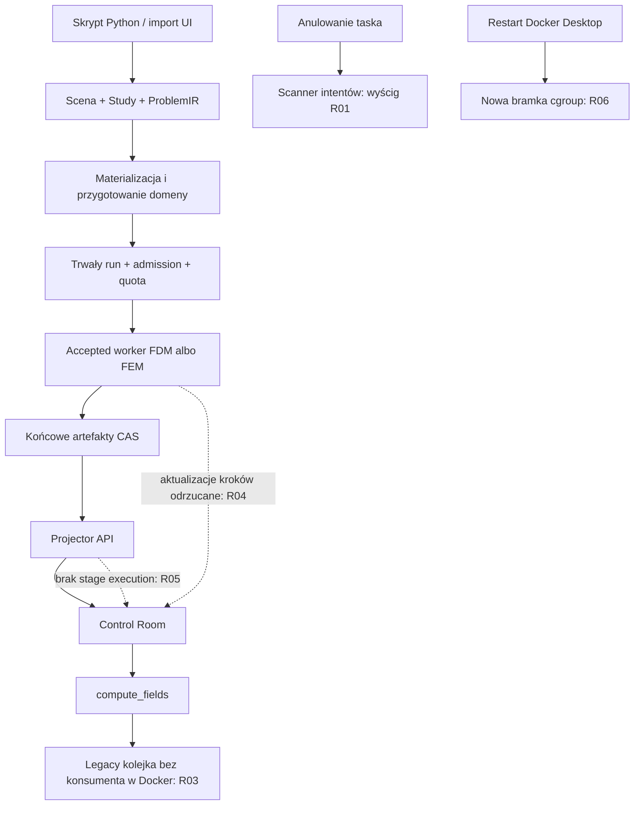
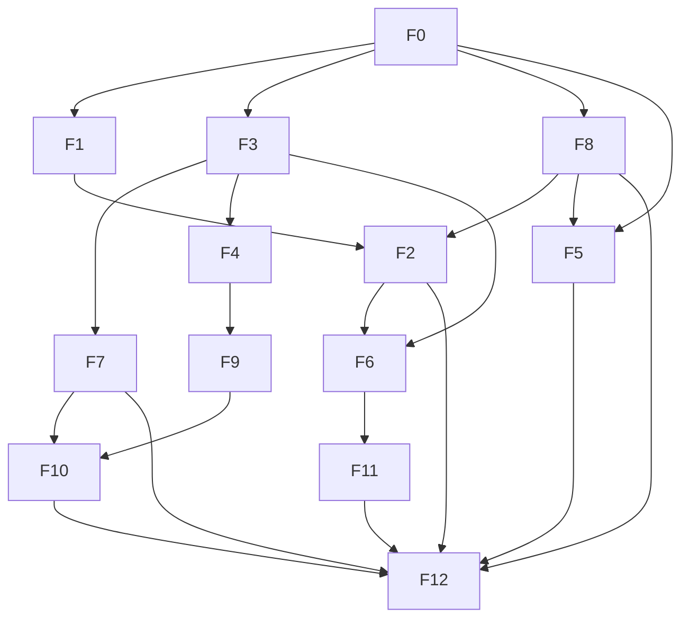

# MX3 — audyt frontendu i runtime symulacji Fullmag

<!-- mx3-current-status:start -->
## Aktualny stan — 29.10.2026

**Bieżący odbiór:** [CoFeB na aktualnym masterze](docs/audits/2026-10-29-cofeb-master-current-build.md),
[przypięte dane i hashe](docs/diagnostics/2026-10-29-cofeb-master-current/runtime-evidence.json).

`fullmag-master` działa na <http://127.0.0.1:3198/workspace>, **128 GiB / 16 CPU**.
Native build: HEAD `b2b159c58fb921efbf278c120d12d268d958d03b` z lokalnymi poprawkami,
snapshot `fd3cc159005bee251f8f876df7174c3bcef2dc183489146ed370dcb7dc2e42b1`.
Development `80088b44d21c497199550c8857ed14c6` i nowa aktywacja CoFeB zakończyły
się poprawnie. Siatka: **1 087 250 elementów, 183 764 węzły**. Run wykonał
**10 iteracji na FEM GPU/double/strict** (w skrypcie etap BB). Native quantity bundle automatycznie
opublikował m, H_demag i H_eff; w nowej próbie wysłano jedno Solve.

Sprawdzono skończone dane binarne z kroku 10, stany complete/stale=0 i zgodność
m z natywnym snapshotem GPU. Obejrzano kolorowaną magnetyzację oraz wektory
Airbox w rzeczywistej przeglądarce: WebGL2, contextLost=false, 617×495,
bez błędów strony/HTTP. Bounds cylindra uwzględniają oś X; Universe zachowuje
2,8×2,1×1,2 µm, zmax obiektów wynosi 310,8 nm.

[Izolacja błędów runtime](docs/audits/2026-10-29-runtime-failure-isolation.md)
opisuje wdrożony pending odczytu wyniku workera, komunikaty UI oraz naprawę
Pythonowego odbioru Completed. Naturalne błędy startup/admission pozostawiły
API diagnostyczne dostępne. Rzadkie ścieżki błędu/pending nie były celowo
wywoływane; ich pełny odbiór pozostaje **NOT VERIFIED**.

Pozostają: terminal-observation odtwarza status/model bez mesh/pól, scalar
window/stopka może pokazywać prepared step0, a obsługa dużych wejść wymaga
profilowania. Nie kwalifikowano wszystkich FDM/FEM CPU/GPU ani zbieżności
naukowej. Bez testów jednostkowych, nowego worktree i commit/push; równoległe
zmiany oraz stary ukończony run zachowane.

[Poprzedni odbiór](docs/audits/2026-10-29-cofeb-master-runtime-result.md) oraz
[audyt początkowy](docs/audits/2026-10-28-mx3-master-reassessment.md)
pozostają historią, a nie dowodem dla dowolnego późniejszego buildu.
<!-- mx3-current-status:end -->

### Historyczny status — 21.10.2026, po źródłowym review H2

Ostatni rzeczywisty build pozostaje na `73e275ce1`: Make exit 0 / 121700 ms,
pakiet 24 plików / 6161 ms, verify 1564 ms. Backend `f7c035fd` ma
128 GiB / 16 CPU, lecz zakończył się exit 1 przed API z powodu konfliktu
wspólnej polityki hosta. Frontend pozostaje healthy na porcie 3198.

**H3: wykonano checkpoint `740722f4cef14f6fa6ca140205047160`, exit 0,
`stopped-confirmed`.** Odczyt kontrolny receiptu potwierdza SHA
`a15f43cbe50ab8ce9e25aef97ae81c777f4c1d712f74d7751c63adb1a60a6c5a`.
Obserwowano istniejący stop; nie wysłano sygnału, nie uruchomiono API ani Solve.
Zachowano pierwotny failed owner, config, released proofs i held04.

**H0 i H1 są zapisane w źródłach; nie zastosowano ich do runtime.**
H1 oddziela pojemność Docker VM od quota konkretnego backendu, zachowując
limity procesu przy ofertach CPU/RAM. Rozszerza istniejący krótki helper;
pozostają dokładnie dwie stałe usługi aplikacji. Nie zmienia wspólnej polityki.
Parsery Python/Rust i review źródeł nie zastępują builda ani dowodu runtime.

**H2: protokół i integracja przeszły review kodu oraz kontrolę składni; nie zostały zbudowane ani zastosowane.** Pozostaje migracja starej, niezmiennej polityki,
z zachowaniem historii oraz koordynacją wszystkich korzystających grup.
Odczyt opisany w §66 wykazał równoległą aktualizację snapshotu inventory: ledger miał
wówczas SHA `04630db439fccb9ecad244f73557f076337e581867783ff7941776370e5c3bda`;
polityka nadal ma revision 1, CPU 4000, RAM 7 GiB, 14 rezerwacji Released.
Sam rekord inventory ownera ani Released nie dowodzą braku aktywnego writera.
Nie nadpisano tej równoległej zmiany. Grupa docker-volume-only ma już inny
kontener niż przy poprzedniej obserwacji; viewport nadal działa jako unhealthy.

3806 i held04 zachowane. Brak retry04/Compute/Solve/testów oraz nowego
buildu H0/H1/H2. Zastosowanie H2 wymaga rozszerzenia zgody na bezpieczny
drain/recovery dwóch innych grup; pytanie pozostaje bez odpowiedzi.
API, materializacja, mesh i widoczny render **NOT VERIFIED**.
Browser tool nadal wymaga poprawnej karty HTTP; nie obchodzono odmowy.

**Data:** 19.10.2026. **Metoda:** analiza kodu, bez uruchamiania testów, buildów, symulacji, poleceń Docker ani przeglądarki. **Checkout:** `C:\git\fullmag\fullmag`, branch `master`. Pierwsza runda: HEAD `6d3fcc08285e075cab0019cb235f21c7a2a9841f`. Druga, trzecia, czwarta i piąta runda (§0–0.3): HEAD `377f3ced6d314ecfc46bc63211563dca4483765f`. We wszystkich rundach istniały lokalne zmiany. Raport dotyczy tych źródeł, nie samego czystego commita ani aktualnie działającego obrazu kontenera.

## 0. Rewizja audytu (19.10.2026, druga runda)

Pierwsza wersja raportu **nie była kompletna względem pytania o frontend**. Obejmowała runtime/integrację (R01–R07), import (S01–S02), poprawność draftów Inspectora (I01–I04) oraz poprawność danych viewportu (indeksy, carriery, WebGL, maska FDM). Pominęła natomiast:

- **wierność eksportu kanonicznego skryptu i widoczność materializacji w UI** — kontrakt „UI musi eksportować kanoniczny, edytowalny skrypt” nie był sprawdzany (nowe M01–M10, §5.E);
- **jakość prezentacji wizualizacji**: stany loading/stale/materializing/unsupported, legenda, jednostki, palety, glify, dostępność (nowe V01–V19, §5.F);
- **ogólną jakość UI/UX**: feedback komend, powody wyłączenia, spójność pól liczbowych i jednostek, terminologia, prymitywy, puste stany (nowe U01–U14, §5.G).

Poprawki istniejącej treści w tej rundzie:

- **Stan źródeł:** HEAD przesunął się z `6d3fcc08…` na `377f3ced6d314ecfc46bc63211563dca4483765f` (merge PR #199; stary HEAD jest przodkiem). Ponowne hashowanie manifestu: 87/93 pliki bez zmian. Zmienione: `docker_startup.rs`, `live_accepted_execution.rs`, `live_scene_preparation.rs`, `accepted_scheduler_main.rs`, `runtime_service.py`, `docker_volume_dev.py`. Był to manifest pierwszej rundy; w trzeciej rundzie §9 odświeżono do odczytanych plików. Poprzednia wersja pozostaje w kopii raportu.
- **Konflikty merge w working tree:** `crates/fullmag-api/src/docker_startup.rs` (markery 1421/1634/1663, obszar publikacji startup failure / `waiting_for_compute`), `scripts/docker_volume_dev.py`, `scripts/docker_volume_stop_failed.py` (status `UU`). `docker_startup.rs` w tym stanie się nie kompiluje; findings R02/R05/R07 cytujące ten plik dotyczą niestabilnego stanu roboczego. Nowe numery linii są podane przy findings.
- Naprawiono 35 zagnieżdżonych, błędnych linków w §5.B oraz dwie błędne etykiety ścieżek w §5.D (`quantityIds.ts` jest w `kernel/api/`, `viewport3dDomainAdapter.ts` nie leży w `model/`).
- **I04 był opisany zbyt łagodnie**, a **R05 miał niepełną listę konsumentów** — uzupełniono w §5.A/§5.C.
- `crates/fullmag-cli/src/orchestrator.rs` (cytowany w R03) brakowało w manifeście pierwszej rundy; dodano go w trzeciej rundzie.
- `mx3.md` i `docs/reports/` są ignorowane przez Git (`.gitignore: *.md`), więc raport nie ma historii wersji; kopia pierwszej wersji nie jest wersjonowana.

Metoda drugiej rundy: wyłącznie odczyt źródeł i `grep`, bez buildów, testów, Docker i przeglądarki. Kluczowe twierdzenia nowych findings (M01, M07, V01, V02, V06, U01, U02) zweryfikowano bezpośrednim odczytem cytowanych linii.

### 0.1. Ponowne review audytu i planu — trzecia runda

Stan: `master`, HEAD `377f3ced6d314ecfc46bc63211563dca4483765f`, istniejący index staged/unmerged i trzy pliki `UU` nadal nienaruszone. Kopia raportu przed tym przeglądem: [mx3-before-review3.md](C:/git/fullmag/fullmag/docs/reports/2026-10-19/mx3-before-review3.md). Zmieniano wyłącznie dokumenty; bez testów, buildów, uruchamiania Python, Docker i przeglądarki.

Korekty zasadnicze:

- Liczba 56 jest liczbą pozycji rejestru, nie dowodem 56 usterek. Review M/V/U oddziela potwierdzony błąd od częściowo trafnego opisu, propozycji UX i hipotezy. Zachowano IDs dla śledzenia zmian.
- Istnieje prezentacja wyników komend w diagnostyce stopki (`CommandAuditTable`); twierdzenie U01 „nigdzie się nie pokazują” było za szerokie. Braku natychmiastowego feedbacku nie naprawia sam subscriber `command:completed`, bo missing/disabled kończą się przed emisją tego eventu. Plan F3 obejmuje te granice i odróżnia ACK od backend completion.
- Brak wykonywanego round-trip eksportu nie jest samodzielnym dowodem P1 utraty danych (M03). Konkretną utratę pól i granice poszczególnych ścieżek trzeba wykazać osobno. Nie nakazano niekontrolowanego wykonywania Python przy każdym eksporcie.
- Liczba memo, surowych tagów HTML czy rozmiar pliku nie dowodzi defektu wydajności lub dostępności. Pomiary zliczeń drugiej rundy nie mają zapisanego pełnego zakresu/polecenia; nie są bramką akceptacji.
- Plan zawiera teraz R02, wczesne F8 oraz osobny odbiór frontendowy. Nie narzuca nowego worktree. F4 może być implementowane przed F2, lecz odbiór rzeczywistych klatek nadal wymaga runtime.
- **§10.7 jest wiążącą macierzą różnic FDM/FEM:** grid/multilayer i cell ordinals versus mesh/mixed topology/native maps; różne drogi Airbox/demag, materializacji, regionów i eksportu. Osobny odbiór FDM CPU, FDM GPU, FEM CPU i FEM GPU. Wspólne UI nie oznacza wspólnej implementacji solvera.

Bramki runtime, browser, dostępności i naukowe w §10 są planem przyszłego odbioru. Ich zapis nie jest wynikiem wykonania i nie cofa zakazu testów. Konfliktów merge w źródłach nie rozwiązano w ramach tego przeglądu.

### 0.2. Weryfikacja zewnętrznego review — czwarta runda

Stan bez zmian: `master`, HEAD `377f3ced6`, trzy pliki `UU`. Kopia przed tą rundą: [mx3-before-review4.md](C:/git/fullmag/fullmag/docs/reports/2026-10-19/mx3-before-review4.md). Zewnętrzne review (DeepInvestigator) zgłosiło uwagi A–F. Każdą uwagę sprawdzono odczytem cytowanego kodu. Wprowadzano wyłącznie potwierdzone treści. Kod tylko czytano — bez buildów, testów, Python i Docker.

| Uwaga review | Werdykt | Gdzie wprowadzono |
|---|---|---|
| A — Compute przy `run.status == "waiting_for_solve"` zwalnia gate bez `accepted_frontier_preparation_is_ready` | **potwierdzone** (skutek dla solvera NOT VERIFIED) | nowe **R08** §5.A; F1/F6 |
| A4 — publikacja przygotowania etapu ustawia `awaiting_command` w trakcie runu | **potwierdzony zapis stanu** — przy sukcesie `apply_projection` przywraca go w tej samej iteracji; widoczność przejścia w UI NOT VERIFIED (§5.A/R08) | R08 |
| A5 / H-M1 — bez `wait_for_solve` startup sam zwalnia gate | **potwierdzone statycznie** | §5.H |
| B1 — `docker_startup.rs`: upstream nie publikuje realtime po błędzie startu | **potwierdzone**; w HEAD `mark_startup_failure` również nie publikuje, publikację wnosi strona stash | F0 |
| B2 — `docker_volume_stop_failed.py`: `native_failure` i `pre_marker_failure` to niezależne przypadki | **potwierdzone** | F0 |
| B3 — `docker_volume_dev.py`: `_PROCESS_RECEIPT_PROBE` = duplikat strony stash | **potwierdzone** (identyczny skrypt) | F0 |
| C1 — Python `_render_runtime` czyta z `runtime_selection` tylko mode/cpu_threads/parallel_execution | **potwierdzone**; Rust emituje backend/device/precision/`fem_demag_solver_policy` (`adapters.rs:465–480`), więc luka jest **tylko po stronie Pythona**. Twierdzenie review o Rust było błędne | nowe **M11** |
| C2–C4 — stage eigen/autosave, `mesh.order`, `compute_resources`, antenna/thermal/outputs bez overrides | **potwierdzone**; Dbulk tylko częściowo (przechodzi przez physics_stack) | nowe **M12** |
| D1 / H-M2 | **potwierdzone warunkowo** (eksport najpierw robi sync, więc kopia zwykle istnieje) | §5.H |
| D2 / H-M3 | **częściowe** — jawne `double` znika z tekstu skryptu, IR bez zmian (domyślne `Double` po obu stronach) | §5.H |
| D3 / H-M4 | **przesłanka błędna**: `SceneObjectRegion` nie ma `magnetization_ref`, a `region_overrides` nie trafiają do eksportu przez `scene_document_to_script_builder` / `geometry_override_value`; `adapters.rs:1290` dotyczy odwrotnej konwersji (korekta dowodu w §5.E.1) | M12, §5.H |
| H-T1 (a) `config?` vs wymagane w Rust | **potwierdzone** (wygenerowane typy też wymagają) | §5.H |
| H-T1 (b) 5 ręcznie pisanych interfejsów capabilities w `apiTypes.ts` | **odrzucone** — żadna z tych nazw nie istnieje w repozytorium | — |
| E — każdy commit authoringu podbija `scene_document.revision` | **potwierdzone** (`main.rs:5339–5345`, bezwarunkowo) | F8 |
| F1 — `accepted_fdm_runtime.rs`, `include_fields`, `write_stage_outputs` | **odrzucone** — plik nie istnieje i nie ma go w historii Git; symbole nie występują w `crates/fullmag-api/src` | — |
| F2 — `accepted_fem_state.rs` jako stan FEM CPU | **potwierdzone** | §10.7 |
| Linki w backtickach §5.E | **potwierdzone** — naprawiono 11 wystąpień | §5.E |
| Manifest | częściowo: `compute_queue.rs` leży w `router_v2/handlers/platform/` i `schemas/`; `modules/about/` nie istnieje — pliki About są w `modules/start/`. Tę błędną ścieżkę poprawiono także w U11 | §9 |

### 0.3. Doprecyzowanie na podstawie bezpośredniego odczytu kodu — piąta runda

**Zakres:** rozstrzygnięcie M12(e), R08 i decyzji F8 oraz korekta licznika, bez implementacji, testów, buildów, uruchamiania Python/Docker i przeglądarki. HEAD nadal `377f3ced6d314ecfc46bc63211563dca4483765f`; kopia wejściowa: [mx3-before-review5.md](C:/git/fullmag/fullmag/docs/reports/2026-10-19/mx3-before-review5.md), SHA-256 `1cf75c79a4bcdf9fd8bfd0de93fe8b50b42884a3eada91723873ec74fb57190c`.

**Zmiana zastanego checkoutu:** trzy dawne pliki `UU` są teraz oznaczone przez Git jako staged `M`, bez markerów konfliktów. Nie zostały zmienione ani stage'owane przez tę rundę audytu. Bezpośredni odczyt pokazuje wspólną publikację błędów startu (`docker_startup.rs:1147–1218`), oba warunki `native_failure` / `pre_marker_failure` i ich osobne ścieżki walidacji (`docker_volume_stop_failed.py:321–415`) oraz użycie modułowego `_PROCESS_RECEIPT_PROBE` (`docker_volume_dev.py:20,1008`). Jest to potwierdzenie obecności połączenia w źródłach, nie zakończenia F0 ani dowód kompilacji. Opisy konfliktów w §0–0.2 i specyfikacja F0 dokumentują poprzedni stan; ten akapit ma pierwszeństwo dla statusu bieżącego.

W trakcie odczytu pojawiły się także równoległe zmiany `script_builder.py` i frontendu. Ta runda nie ocenia ich kompletności ani nie zamyka na ich podstawie M11/F3/F6. Wcześniejsze kwalifikacje tych przepływów odnoszą się do manifestu swojej rundy; przed wdrożeniem/odbiorem wymagają ponownego review aktualnego diffu.

- **M12(e):** poprawiono kierunek dowodu. Eksport gubi stare `SceneObject.region_overrides`, ale serializuje współczesne `SceneObjectRegion.texture_override`. Python→IR odrzuca stare pole; F5 wymaga migracji albo jawnej odmowy, nie reaktywacji drugiego modelu regionów.
- **R08:** potwierdzono pośredni zapis/publikację statusu; przy sukcesie przywrócenie następuje w tej samej iteracji `poll_once`. Migotanie przeglądarki pozostaje NOT VERIFIED.
- **F8:** przyjęto w planie osobną tożsamość wejścia wykonania i zachowanie rewizji dokumentu dla CAS. Dotychczasowy classifier regionów jest częściowy, a surowy hash eksportowanego buildera może dziedziczyć M11/M12. Szczegóły decyzji i odbioru: §10.8; stan implementacji PLANNED.
- **Licznik:** 59 pozycji rejestru, bez doliczania tych doprecyzowań jako nowych usterek. Niejednorodnych części M12 nie należy traktować jako jednakowo udowodnionych skutków runtime.

## 1. Najważniejszy wynik

**Aktualny rejestr obejmuje 59 pozycji audytowych: 13 z pierwszej rundy, 43 z rozszerzenia i 3 dodane w czwartej rundzie. Nie należy przedstawiać tego jako 59 potwierdzonych defektów.** Ponowne review odróżnia potwierdzony przepływ błędu, częściowo trafny zarzut, propozycję UX/dług techniczny i twierdzenie niepotwierdzone lub odrzucone. Aktualne kwalifikacje rozszerzenia są w §5.E–G; nie sumujemy propozycji i hipotez jako błędów produkcyjnych. Priorytety z drugiej rundy nie są automatycznie zatwierdzone.

Wśród **43 ponownie ocenionych pozycji rozszerzenia**: 4 mają status confirmed (V03, V05, V09, U02), 27 partial, 11 design-gap i 1 incorrect (V15). To klasyfikacja całych zgłoszeń: partial może zawierać konkretny potwierdzony defekt, np. utratę `field_drives`/`output_storage` w M02, ale nie potwierdza wszystkich pierwotnie przypisanych skutków. Nie jest to nowa liczba wszystkich błędów produktu.

**Czwarta runda (§0.2)** dodaje 3 pozycje, wszystkie potwierdzone statycznie:

- **R08** — Compute w stanie `waiting_for_solve` omija bramkę gotowości przygotowania.
- **M11** — kanoniczny rewrite `user_file` ignoruje zmienione w UI backend/device/precision i politykę demag FEM.
- **M12** — dalsze pola sceny nieprzenoszone do skryptu.

Piąta runda doprecyzowuje istniejące pozycje; liczba pozostaje równa 59.

Wcześniejsze R/S/I zachowano jako 13 ustaleń źródłowych z opisanymi warunkami, w tym R06 dotyczące lokalnego WIP. Konflikty merge były osobną blokadą źródeł w rundach 2–4. W piątej rundzie nie ma już `UU` ani markerów w tych trzech plikach (§0.3); kompilacja i działanie kontenera nadal nie są zweryfikowane. L01, D01 i hipotezy pozostają oddzielne. Pełna kwalifikacja runtime/renderu pozostaje NOT VERIFIED.

**Wspólne przyczyny nowych findings:**

- brak jawnego **modelu stanu prezentacji pola** (`current / stale / materializing / unsupported / error`) — przyczyna V01–V05 i V10;
- brak spójnego, bezpośredniego **feedbacku komend i powodów wyłączenia**, mimo istniejącej diagnostyki — przyczyna U01 i U03, wzmacniająca skutki R03/R07 („nic się nie dzieje”);
- **eksport skryptu nie jest transakcją związaną z rewizją sceny** i nie ma jawnego verdictu wierności — M01–M03 wymagają rozróżnienia defektów i luk kontraktu;
- **wiele implementacji tego samego widgetu** (pola liczbowe, parsery list, drzewa, zakładki) — przyczyna U02, U04, U08, U09 i I01.

Problem nie ogranicza się do rysowania siatki. W ścieżce Docker accepted są przerwane połączenia pomiędzy wykonaniem solvera a Control Room:

1. UI potrafi wysłać żądanie obliczenia pól, dla którego w tej ścieżce nie ma wykonawcy.
2. Workery FDM i FEM nie przekazują swoich aktualizacji kroków do live view; finalne artefakty publikują po wykonaniu etapu.
3. Status całego runu nie jest równoważny publikacji stanu jego etapów. Świeży startup Docker pozostawia stage execution bez producenta.
4. Legalny równoległy zapis anulowania może zakończyć scheduler wskutek błędu skanowania pliku tymczasowego.
5. Rozpoczęta naprawa delegacji cgroup nie obejmuje jeszcze zwykłego restartu backendu przez Docker Desktop.

Dlatego sam rebuild, poprawka Three.js albo dodanie quantity do listy rozwijanej nie przywróci całego workflow. Potrzebne jest domknięcie producentów danych i obsługi cyklu życia, a następnie naprawa potwierdzonych problemów importu/Inspectora.

**Granica wniosku:** potwierdzenie z kodu oznacza, że da się wskazać sprzeczny przepływ i warunki jego uruchomienia. Nie oznacza reprodukcji w działającym programie. Browser/WebGL, rzeczywisty przebieg przykładu oraz poprawność numeryczna czterech backendów pozostają w tym audycie **NOT VERIFIED**.

## 2. Zakres i zasady liczenia

- Audyt obejmuje pełny główny cykl: plik `.py` → import/authoring → scena/Study/IR → materializacja → trwały run/admission/preparation → worker → output/quantity → API/cache → viewport i Inspector.
- Oddzielono FDM CPU, FDM GPU, FEM CPU i FEM GPU. Wspólny błąd adaptera accepted liczony jest raz, a nie jako cztery błędy solverów.
- Nie przeprowadzono linia po linii całego repozytorium, audytu wszystkich kernelów CUDA/MFEM, metod eigensolve ani pełnej kwalifikacji naukowej. Zakres szczegółowo przeczytanych plików jest podany w załączonych częściach audytu.
- Nie liczono jako nowych błędów zmian już obecnych w dirty checkout, braku wykonanych testów, braku screenshotu ani samej obecności dużego pliku.
- Hipotezy i luki dowodowe są oddzielone od potwierdzonych defektów. Lista jest dolną granicą wykazanych problemów w przejrzanym zakresie, nie obietnicą, że po jej zamknięciu nie istnieje żaden inny błąd.
- Zmiany aplikacji z poprzedniego etapu pozostawiono. W tym etapie powstają wyłącznie raporty; bez commitów, resetów, instalacji, zmian uprawnień i nowych worktree.

## 3. Mapa przepływu i miejsc awarii

| Granica | Istniejący właściciel / dowód | Wniosek z audytu |
|---|---|---|
| Aktywacja `.py` w Docker | `docker_startup::activate_current_live_startup` | Placeholder, accepted commit i publikacja preparation są rozdzielone; replay placeholdera jest niespójny — R02 |
| Import `.py` do projektu | `script_project::build_project_from_script`, helpery Python | Osobna ścieżka od startupu; szczegóły w audycie skryptów poniżej |
| Domena/mesh/materials | `live_scene_preparation`, immutable preparation receipts | Nie wolno utożsamiać gotowej siatki z gotowym solverem ani z obliczonym polem |
| CPU admission i GPU solve | `HostResourceLedger`, worker cgroup, accepted scheduler | Przygotowanie FEM również potrzebuje zasobów CPU; wykryte GPU nie omija quota |
| Anulowanie | `request_task_cancellation_intent` → reconciliation | Atomic rename chroni finalny plik, ale nie niesynchronizowany scanner katalogu — R01 |
| Live obserwacje | callback runnera → accepted worker | Callback nie przekazuje aktualizacji — R04 |
| Pola na żądanie | `ControlRoomApi.materializeFieldsForQuantity` → commands | ACK trafia do niewykonywanej kolejki — R03 |
| Postęp etapów | accepted catalogs → `live_accepted_projection` → stages endpoint | Brak projekcji stage execution — R05 |
| FDM/FEM buffer → renderer | codec, scope, carrier, topology, mapping | Wcześniejsze poprawki już obecne; szczegóły i nierozstrzygnięte kwestie w audycie viewportu |
| Inspector → scena | draft, revision, API mutation, invalidation | Odrębny audyt poniżej; stan wizualizacji trzeba odróżniać od zmian fizycznego modelu |

## 4. Specyfika wskazanego przykładu

Audytowany plik to [permalloy_layer_cofeb_rings_relax_300nm.py](C:/git/fullmag/fullmag/examples/permalloy_layer_cofeb_rings_relax_300nm.py).

W **aktualnym kodzie**, niezależnie od tytułu/docstringa:

- żądana realizacja to **FEM, GPU, double**, z `poisson_robin`;
- istnieją **dwa obiekty magnetyczne**: warstwa i górny pierścień; konstrukcja dolnego pierścienia jest zakomentowana;
- warstwa ma rozmiar `2000 nm × 600 nm × 1.6 nm`; promienie pierścienia wynoszą `150 nm` i `50 nm`, jego grubość `50 nm`, oś `(1,0,0)`;
- warstwa żąda swept prism, jednej warstwy przez grubość i dokładnej liczby warstw; pierścień ma odrębną lokalną politykę meshingu;
- Airbox ma być widoczny w trybie vectors dla `h_eff`;
- aktywny etap to `add_minimize(method="bb", max_steps=10, tolA=1e-4)`; przykład `add_relax` jest zakomentowany;
- `tableautosave` używa `every_steps=1`; zdefiniowane zmienne środowiskowe limitów nie są przekazane do aktywnego `max_steps=10`;
- docstring opisuje inną geometrię niż wykonywany kod. Nie należy diagnozować braku dolnego pierścienia lub innych wymiarów jako usterki renderera bez uwzględnienia tego faktu.

To opis wejścia, nie ocena fizycznej poprawności parametrów ani dowód jego wykonania. Nie zmieniano skryptu w ramach audytu.

## 5. Rejestr findings i szczegółowe dowody

**Trzecia runda:** poniższa zbiorcza lista zachowuje identyfikatory zgłoszeń. Dla M/V/U zakres i status z ponownego review w §5.E–G mają pierwszeństwo przed pierwotnym skrótem i priorytetem w tabeli. Nie jest to tabela 56 zatwierdzonych błędów.

P1 oznacza blokadę istotnej części uruchomienia/sterowania lub obserwacji; P2 oznacza błąd warunkowy, niespójność danych albo obsługi edycji. Priorytet opisuje skutek w podanym scenariuszu, nie dowód wystąpienia na aktualnie uruchomionym kontenerze.

| ID | Priorytet zgłoszenia | Treść zgłoszenia — kwalifikacja rozszerzenia w §5.E–G | Warunek / widoczny skutek |
|---|---|---|---|
| R01 | P1 | Scanner anulowania odrzuca tymczasowy plik własnego writera | Anulowanie równoległe do skanowania może zakończyć scheduler |
| R02 | P2 | Replay placeholdera aktywacji wymaga nieopublikowanych metadanych | To samo żądanie dostaje mylący błąd zmiany hasha |
| R03 | P1 | `compute_fields` nie ma wykonawcy w Docker accepted | Quantity przyjęte do obliczenia, ale pole nie powstaje |
| R04 | P1 | Workery FDM/FEM odrzucają aktualizacje runnera | Brak bieżących klatek i parametrów podczas solve |
| R05 | P1 | Brak projekcji accepted stages do stage execution | UI nie dostaje etapów, ich postępu i przyczyn zakończenia |
| R06 | P1 / WIP | Nowy nonce cgroup po restarcie nie ma obsługi poza launcherem | Zwykły restart Docker Desktop nie przechodzi nowej bramki |
| R07 | P1 | Readiness Pause/Stop nie odpowiada accepted lifecycle | Pause dostępne mimo unsupported; Stop zablokowane przed solve |
| R08 | P2 | Compute przy `waiting_for_solve` zwalnia start gate bez bramki przygotowania; publikacja preparation etapu ustawia pośrednie `awaiting_command` | Brak typowanego `accepted_preparation_pending`; pośredni status potwierdzony w kodzie, widoczne migotanie UI NOT VERIFIED |
| S01 | P2 | Import ponownie wykonuje Python mimo komunikatu „once” | Powtórne efekty uboczne, inne losowe wejście lub zmienione bajty |
| S02 | P2 | Comparator round-trip pomija stan początkowy magnetyzacji | `verified` mimo różnych initial states między ewaluacjami |
| I01 | P2 | Edytor liczbowy regionu gubi niepoprawny raw draft | Nieudany wpis wraca do poprzedniej liczby zamiast pozostać do korekty |
| I02 | P2 | PATCH regionu bezwarunkowo oznacza mesh jako dirty | Zmiana bez wpływu na topologię unieważnia aktualną siatkę |
| I03 | P2 | Zapis Airbox nie sprawdza rewizji odczytanej konfiguracji | Stary panel/tab może nadpisać nowszą konfigurację |
| I04 | P2 | Nazwa/notatka zwiększa rewizję wymaganą przez immutable run binding; z UI dodatkowo oznacza mesh dirty | Legalna edycja metadanych zatrzymuje dalszą projekcję wyników i unieważnia siatkę |

Pozycje M01–M10, V01–V19 i U01–U14 mają pełny rejestr kwalifikacji oraz korekt w §5.E–G. Pierwotne, zbyt szerokie skróty usunięto z tej tabeli, aby nie powtarzały odrzuconych zarzutów. Poprzedni tekst jest zachowany w kopii sprzed review.

Poza licznikiem: **L01** — import jednego pliku bez zależności; **D01** — opis przykładu niezgodny z jego kodem; **H01** — zachowanie retained Airbox payload przy zmianie `surface/full`, nadal hipoteza. W pierwszym przeglądzie nie znaleziono nowego, niezależnego defektu indeksowania ani lifecycle WebGL; rozszerzenie wskazuje osobne problemy prezentacji (§5.F). Nie jest to dowód, że render działa: R03/R04/I04 mogą pozbawiać go poprawnych lub aktualnych danych.

### 5.A. Runtime i połączenie z UI

Data: 19.10.2026. Checkout: `C:\git\fullmag\fullmag`, branch `master`, HEAD `6d3fcc08285e075cab0019cb235f21c7a2a9841f`, z istniejącymi zmianami lokalnymi. Audyt statyczny: bez testów, buildów, uruchamiania skryptu, Docker, HTTP i przeglądarki. Stan źródeł nie jest dowodem stanu zainstalowanego runtime.

#### R01 — P1: poprawny zapis anulowania może zakończyć scheduler

**Status: potwierdzony błąd źródeł, nadal obecny.**

Dowody:

- [crates/fullmag-session/src/task_cancellation.rs:222–296](C:/git/fullmag/fullmag/crates/fullmag-session/src/task_cancellation.rs:222): `list_task_cancellation_intents` skanuje katalog bez transakcji writera; linie 261–275 odczytują każdy wpis i wymagają rozszerzenia `.json`.
- Ten sam plik, `328` i `438–439`: zapis intentu odbywa się pod `write_transaction`, przez `atomic_write`.
- [crates/fullmag-session/src/durability.rs:225–237](C:/git/fullmag/fullmag/crates/fullmag-session/src/durability.rs:225): atomowy zapis tworzy w **tym samym katalogu** plik `.UUID.part`, zapisuje i synchronizuje go, następnie zmienia nazwę.
- [crates/fullmag-runtime-control/src/host_runtime.rs:1125–1141](C:/git/fullmag/fullmag/crates/fullmag-runtime-control/src/host_runtime.rs:1125): reconciliation enumeruje intenty i propaguje błąd odczytu.
- [crates/fullmag-api/src/accepted_fem_preparation_scheduler_main.rs:278–296](C:/git/fullmag/fullmag/crates/fullmag-api/src/accepted_fem_preparation_scheduler_main.rs:278): retry dotyczy `StoreWriterBusy`; pozostały błąd opuszcza główną pętlę. Drugi konsument: [accepted_scheduler_main.rs:455–460](C:/git/fullmag/fullmag/crates/fullmag-api/src/accepted_scheduler_main.rs:455).

Scenariusz: użytkownik anuluje przyjęte zadanie; scanner schedulera odczytuje katalog między utworzeniem `.part` a rename. Dostaje „invalid task cancellation intent filename”; alternatywnie plik znika przed `symlink_metadata`, co również propaguje błąd. Wystarczy normalna współbieżność, bez uszkodzonych danych użytkownika.

Skutek: awaria schedulera może zamknąć admission całego zarządzanego runtime. Z punktu widzenia UI niewinna operacja anulowania prowadzi do utraty działającego backendu.

Kierunek naprawy: zsynchronizować enumerację z publikacją przy zachowaniu kontroli nieznanych plików; przed użyciem transakcji sprawdzić reentrancy i kolejność blokad. Nie usuwać intentów ani nie ignorować dowolnych plików jako obejścia.

#### R02 — P2: replay aktywacji zgłasza zmianę niezmienionego skryptu

**Status: potwierdzona sprzeczność producenta i konsumenta metadanych.**

Dowody:

- [crates/fullmag-api/src/docker_startup.rs:137–140](C:/git/fullmag/fullmag/crates/fullmag-api/src/docker_startup.rs:137): istniejący current workspace kieruje każde powtórzone żądanie do `replay_or_reject`.
- [docker_startup.rs:881–889](C:/git/fullmag/fullmag/crates/fullmag-api/src/docker_startup.rs:881): placeholder `activating` zapisuje request, runtime metadata i rozmiar źródła, ale nie zapisuje `source_sha256` na poziomie rekordu startupu.
- [docker_startup.rs:927–936](C:/git/fullmag/fullmag/crates/fullmag-api/src/docker_startup.rs:927): replay wymaga właśnie tego pola; brak zamienia na pusty string i zwraca „Docker startup source hash changed on replay”.
- Nawet samo dodanie hasha nie wystarczy: `945–989` wymaga accepted run/step IDs i obsługuje tylko dwa późniejsze statusy, podczas gdy placeholder nie ma jeszcze przyjętego runu.

Scenariusz: identyczne żądanie zostaje ponownie odczytane w czasie przygotowania modelu, po publikacji placeholdera i zwolnieniu transition. Plik nie zmienił się; serwer mimo to diagnozuje zmianę hasha. Hostowy helper dodatkowo świadomie blokuje automatyczne ponowienie receiptu `started` ([scripts/docker_startup_script.py:863–871](C:/git/fullmag/fullmag/scripts/docker_startup_script.py:863)), więc nie naprawia tej niespójności.

**Aktualizacja (druga runda):** w HEAD `377f3ced6` linie się przesunęły: `120–124 → 137–140`, `810–819 → 881–889`, `857–864 → 927–936`, `875–902 → ~941–990`. Wniosek nadal obowiązuje. Placeholder zapisuje teraz `source_sha256` wyłącznie w `plan_summary.startup` (875), a rekord `STARTUP_METADATA_KEY` (881–888) nadal go nie ma. Plik zawiera nierozwiązany konflikt merge.

Skutek: brak wiarygodnej odpowiedzi „ten sam request nadal się przygotowuje”; trudniejsza rekonsyliacja po timeout. Nie jest to dowód, że każdy retry wykona solver dwukrotnie — właśnie tego obecne bariery unikają.

Kierunek naprawy: kompletny rekord tożsamości od placeholdera oraz jawny, odczytywalny stan operacji przed admission i po admission, bez ponawiania Solve o nieznanym wyniku.

#### R03 — P1: materializacja pól trafia do kolejki bez wykonawcy w Docker accepted

**Status: potwierdzony błąd integracji frontend → API → runtime.**

Dowody:

- [apps/control-room/src/kernel/api/ControlRoomApi.ts:4409–4439](C:/git/fullmag/fullmag/apps/control-room/src/kernel/api/ControlRoomApi.ts:4409): `materializeFieldsForQuantity` wysyła `compute_fields` z powodem `field_on_demand`.
- [crates/fullmag-api/src/router_v2/handlers/simulation/commands.rs:150–281](C:/git/fullmag/fullmag/crates/fullmag-api/src/router_v2/handlers/simulation/commands.rs:150): specjalny routing Docker API-only obsługuje remesh/grid refresh, Stop, odrzucenie Pause oraz run/relax/solve/resume. Nie obsługuje `compute_fields` ani `compute_energies`.
- `commands.rs:283` kieruje je do zwykłego enqueue; `1887–1931` zapisuje journal jako `Queued`, zwraca `accepted: true` i dodaje polecenie do `current_control_queue`.
- `commands.rs:2289–2292` wprost dokumentuje brak legacy queue consumer w Docker API-only; dlatego remesh ma osobny adapter kończący komendę.
- `crates/fullmag-api/src/main.rs:4515–4523, 4535–4581`: udostępnia dequeue/long-poll, ale sam nie wykonuje fizyki polecenia.
- Wykonanie `compute_fields` znajduje się w `crates/fullmag-cli/src/orchestrator.rs:10836, 12827` i [interactive_runtime_host.rs](C:/git/fullmag/fullmag/crates/fullmag-cli/src/interactive_runtime_host.rs). [docker/all-in-one/entrypoint.py:239–255](C:/git/fullmag/fullmag/docker/all-in-one/entrypoint.py:239) uruchamia API i managed runtime; accepted workers wykonują trwałe Start i nie obsługują tej legacy kolejki.

Scenariusz: po przygotowaniu/wykonaniu modelu użytkownik wybiera nieobecne w cache `H_demag`, `H_eff` lub energię przestrzenną; frontend żąda materializacji. Samo przyjęcie komendy nie ma wykonawcy w tej trasie.

**Doprecyzowanie (druga runda):**

- Wywołujący (`ControlRoomApi.ts:4364–4377`) pomija enqueue dla stanów meta `complete/pending/stale_complete/error`.
- Pętla ponowień kończy się po `FIELD_MATERIALIZATION_TIMEOUT_MS = 5_000` (`:888`) i zwraca ostatni wynik `not-applicable`.
- UI nie czeka więc w nieskończoność, ale też nie mówi, dlaczego pole nie powstało. Zobacz V02/V03 i U01.

Skutek: oczekiwanie na pole bez powstania danych; dodatkowe próby mogą pozostawiać kolejne niedokończone komendy. Poprawienie indeksowania/topologii w viewportcie nie naprawi tego braku.

Kierunek naprawy: jeden wykonawca materializacji przypięty do accepted state, run/task/plan/carrier i backendu; typed unsupported dla rzeczywiście nieobsługiwanej kombinacji. ACK dopiero opisuje przyjęcie; completion i publikacja resource revisions muszą pochodzić z rzeczywistego wykonania. Nie uruchamiać drugiej symulacji dla zmiany quantity.

Zakres: dotyczy żądań przechodzących tą komendą; istnieją osobne endpointy immutable observation/inspection i nie wolno wyciągać z tego wniosku, że każde pole w całym API jest niedostępne.

#### R04 — P1: accepted workers nie przekazują bieżących klatek solvera do UI

**Status: potwierdzona luka wykonania ścieżki live FDM/FEM.**

Dowody:

- [crates/fullmag-api/src/accepted_fem_study_worker.rs:143–155](C:/git/fullmag/fullmag/crates/fullmag-api/src/accepted_fem_study_worker.rs:143): runner dostaje `field_every_n=u64::MAX`, `initial_snapshot=false`, callback `|_| StepAction::Continue`.
- [crates/fullmag-api/src/accepted_study_worker.rs:1490–1503](C:/git/fullmag/fullmag/crates/fullmag-api/src/accepted_study_worker.rs:1490): identyczna konfiguracja dla FDM.
- Nazwy parametrów potwierdza [crates/fullmag-runner/src/lib.rs:4252–4277](C:/git/fullmag/fullmag/crates/fullmag-runner/src/lib.rs:4252). Callback nie publikuje nawet aktualizacji, które mimo stride powstaną.
- `accepted_study_worker.rs:2321–2329, 2398–2408`: `publish_study_outputs` następuje po powrocie z wykonania i walidacji durable receipt.
- `crates/fullmag-api/src/live_accepted_projection.rs:190–225, 263–301`: projector śledzi katalog runu/artefaktów. `1036–1067` publikuje ostatni zweryfikowany state, nie stream kroków bieżącego workera.

Scenariusz: poprawnie uruchomiona długa relaksacja lub time-domain study w zarządzanym Docker. Solver liczy, ale bieżące m/time/scalars nie przechodzą callbackiem do workspace.

Skutek: obraz nie odzwierciedla trwającej symulacji; finalny stan może pojawić się dopiero po zakończeniu etapu. Sam status Running nie dowodzi działającego live view. Autosave w katalogu workera nie zastępuje takiej publikacji.

Kierunek naprawy: kontrolowany kanał obserwacji accepted worker → durable/live observation owner → resource revisions, z ograniczoną częstotliwością, identity i kosztami transferu. Nie osłabiać trwałego commit końcowych wyników.

#### R05 — P1: etapy accepted study nie są projektowane do stage execution UI

**Status: potwierdzona luka read-model dla świeżego startupu Docker.**

Dowody:

- [crates/fullmag-api/src/docker_startup.rs:815](C:/git/fullmag/fullmag/crates/fullmag-api/src/docker_startup.rs:815): początkowy snapshot ma `stage_execution: None`.
- [crates/fullmag-api/src/router_v2/handlers/simulation/commands.rs:2205–2239](C:/git/fullmag/fullmag/crates/fullmag-api/src/router_v2/handlers/simulation/commands.rs:2205): accepted study zapisuje run i liczbę kroków, ale przekazuje `stage_execution: None`.
- [crates/fullmag-api/src/live_scene_preparation.rs:1123](C:/git/fullmag/fullmag/crates/fullmag-api/src/live_scene_preparation.rs:1123): także publikacja accepted preparation nie dostarcza stage execution.
- [crates/fullmag-api/src/live_accepted_projection.rs:969–1093](C:/git/fullmag/fullmag/crates/fullmag-api/src/live_accepted_projection.rs:969): aktualizuje status run/session, czas/energię i pole m; nie buduje listy etapów, ich stop reason, active index ani completed indexes z katalogów/coordinatora.
- [crates/fullmag-api/src/router_v2/handlers/simulation/runtime.rs:529–545](C:/git/fullmag/fullmag/crates/fullmag-api/src/router_v2/handlers/simulation/runtime.rs:529): brak tego pola daje HTTP 204 dla `/simulation/stages/execution`.
- Konsumenci: [FooterTelemetry.tsx:99](C:/git/fullmag/fullmag/apps/control-room/src/modules/footer/FooterTelemetry.tsx:99), [ResultsNavigatorModule.tsx:91–99,160](C:/git/fullmag/fullmag/apps/control-room/src/modules/results-navigator/ResultsNavigatorModule.tsx:91), [ExplorerModule.tsx:470](C:/git/fullmag/fullmag/apps/control-room/src/modules/explorer/ExplorerModule.tsx:470) w `apps/control-room/src/modules`.

**Aktualizacja (druga runda):**

- Przesunięcia linii: `docker_startup.rs:744 → 815`, `live_scene_preparation.rs:1034 → 1123`; dodatkowe `stage_execution: None` jest w `live_scene_preparation.rs:623`.
- Lista konsumentów była niepełna. Brakowało: `StudyInspectorPanel.tsx:719`, `StageInspectorFrame.tsx:149`, `runtimeExplorerSnapshot.ts:172,317`, `sceneModelTreeAdapter.ts:183`, `RibbonModule.tsx` oraz `studyRuntimeCommandContributions.ts` (Skip `370–377`, fallback `runtimeState()` `851–863`).
- Zachowanie UI przy braku danych: `requestOptionalJson` zamienia 204 na `null` (`ControlRoomApi.ts:3831`); większość hooków nie wysyła requestu przy `stages_revision == 0` (`studyRuntimeResources.ts:447`). W efekcie:
  - stopka dla minimize/relax nie pokazuje nic;
  - Results Navigator pokazuje „missing” i „No current run/stage identity is published” dla trwającego study;
  - Explorer pokazuje status authoringu;
  - StageInspectorFrame pokazuje „not available”;
  - Skip jest wyłączone z powodem „No active stage”.
- Nie ma fałszywego błędu, ale jest **cisza** zamiast stanu „etapy niepublikowane w tym runtime”. Brak takiego stanu to wspólny problem z U14/V03.

Skutek: poprawne przejście runu do Running/Completed nie daje równoważnej informacji o etapie, postępie i przyczynie zatrzymania w UI. Może wyglądać jak błąd Inspectora lub panelu wyników, choć brak powstaje w API read-model.

Kierunek naprawy: projektować stage execution z tożsamości accepted Study, lifecycle zadań i rzeczywistych wyników etapów, z jednoznacznym mapowaniem task ↔ step ↔ stage. Nie zastępować stop reason ogólnym statusem całego runu.

#### R06 — P1 / WIP: nowa bramka cgroup nie realizuje zwykłego restartu Docker Desktop

**Status: potwierdzona luka nowej, lokalnej implementacji; nie dowód wdrożonej naprawy.**

Dowody:

- [scripts/docker_worker_cgroup.py:35–38](C:/git/fullmag/fullmag/scripts/docker_worker_cgroup.py:35) włącza profil delegacji w backendzie.
- [docker/all-in-one/backend_dev.py:3515–3518](C:/git/fullmag/fullmag/docker/all-in-one/backend_dev.py:3515) czeka na delegację przed exec właściwego runtime.
- [docker/all-in-one/worker_cgroup_gate.py:46–69](C:/git/fullmag/fullmag/docker/all-in-one/worker_cgroup_gate.py:46) przy każdym wejściu tworzy świeży nonce, zapisuje request i czeka do 300 s na pasujący receipt. Stary nonce nie jest akceptowany.
- [scripts/docker_volume_dev.py:941–971](C:/git/fullmag/fullmag/scripts/docker_volume_dev.py:941) wywołuje zewnętrzne `ensure_delegation` w hostowym `_finish`.
- [scripts/docker_worker_cgroup.py:41–133](C:/git/fullmag/fullmag/scripts/docker_worker_cgroup.py:41) uruchamia krótkiego helpera delegacji; nie jest to stale działający serwis reagujący na późniejsze requesty backendu.

Scenariusz: po pierwszym uruchomieniu z nowym profilem operator wykonuje zwykły restart backendu w Docker Desktop, bez hostowego launchera. Backend publikuje nowy request, lecz żaden proces nie produkuje receiptu dla tego nonce. Nawet zachowany stary receipt jest celowo odrzucany.

Skutek: backend pozostaje przed startem API i kończy gate timeoutem. Kontrakt repo wymaga właśnie samodzielnego zwykłego restartu, więc obecne WIP nie zamyka problemu cgroup.

Kierunek naprawy: zaprojektować zarządzany lifecycle delegacji, który obejmuje restart i odzyskanie tożsamości bez privileged backendu, bez ponownego użycia starego proof i bez przejmowania obcych cgroup. Nie obniżać wymogu quota: [crates/fullmag-session/src/host_resource_ledger.rs:2924–2948](C:/git/fullmag/fullmag/crates/fullmag-session/src/host_resource_ledger.rs:2924) słusznie odrzuca owner-bound admission bez `Supported`.

#### R07 — P1: kontrolki Pause/Stop nie odpowiadają cyklowi accepted runtime

**Status: potwierdzona niespójność gotowości UI/API z wykonaniem; dwa objawy wspólnego niedostosowania kontroli do accepted lifecycle.**

Dowody dla Pause:

- [crates/fullmag-api/src/router_v2/handlers/simulation/runtime.rs:2154–2195](C:/git/fullmag/fullmag/crates/fullmag-api/src/router_v2/handlers/simulation/runtime.rs:2154): queue resource publikuje `pause.enabled=true` dla stanu Running, bez rozróżnienia Docker API-only.
- [apps/control-room/src/kernel/runtime/studyRuntimeCommandContributions.ts:310–359](C:/git/fullmag/fullmag/apps/control-room/src/kernel/runtime/studyRuntimeCommandContributions.ts:310): frontend korzysta z tych kontrolek i dopuszcza Pause przy `running`; rejestracja przycisku jest w `2329–2334`.
- [crates/fullmag-api/src/router_v2/handlers/simulation/commands.rs:245–258](C:/git/fullmag/fullmag/crates/fullmag-api/src/router_v2/handlers/simulation/commands.rs:245): ten sam runtime bezwarunkowo odrzuca Pause jako `accepted_control_unsupported`.

Dowody dla Stop przed uruchomieniem solvera:

- `docker_startup.rs:228–250, 260–284`: accepted run jest już trwały, a startup czeka na preparation; status jest `waiting_for_compute`. Projector może pokazać `waiting_for_solve`/`awaiting_command`, gdy trwały gate jest jeszcze zamknięty (`live_accepted_projection.rs:424–432, 1021–1028`).
- `runtime.rs:2196–2197` oraz [studyRuntimeCommandContributions.ts:366–369](C:/git/fullmag/fullmag/apps/control-room/src/kernel/runtime/studyRuntimeCommandContributions.ts:366) dopuszczają Stop wyłącznie w `running/paused`, więc blokują przycisk w stanie oczekiwania.
- Tymczasem `commands.rs:225–243, 727–758` **prawidłowo odróżnia** accepted Stop od zwykłego stage control: dopuszcza nieterminalny durable run także przed Compute/preparation. Nie należy przypisywać temu handlerowi walidacji z ogólnego `validate_stage_control_state`.
- Niższa warstwa realizuje tę semantykę: `live_accepted_execution::submit_live_stop_with_transition` / `request_accepted_stop_for_catalog`, funkcje od linii `996` i `1069` w bieżącym HEAD, obejmuje cancellation intents zadań Accepted/Queued przed claim. To frontend i backendowy read-model gotowości nie pozwalają zwykłą kontrolką dojść do poprawnie dostępnej operacji.

Scenariusze: w trakcie właściwego accepted solve użytkownik widzi aktywny Pause, który jest z definicji odrzucany. Przy długim preparation albo oczekiwaniu na zasoby nie może użyć zwykłego Stop w workspace, mimo że przyjęty run istnieje i ma mechanizm trwałego anulowania. Osobny endpoint anulowania taska nie naprawia niezgodnej kontrolki całego study.

Kierunek naprawy: jedno authoritative readiness dla konkretnego typu runtime, zgodne z istniejącym accepted admission. Pause powinno mieć jawny powód unsupported; Stop powinno być dostępne dla dopuszczalnych pre-claim/preparation stanów. Nie osłabiać poprawnego durable admission ani nie dodawać UI-only obejścia ownership.

#### R08 — P2: Compute w stanie `waiting_for_solve` omija bramkę gotowości przygotowania (czwarta runda)

**Status: potwierdzona niespójność ścieżek bramki; skutek dla wykonania solvera NOT VERIFIED.**

Dowody (HEAD `377f3ced6`, `crates/fullmag-api/src/`):

- `live_accepted_projection.rs:424–433`: dla katalogu `waiting_for_compute` z zamkniętym gate projektor zwraca `waiting_for_solve`.
- `apply_projection` zapisuje go w `run.status` (`:986–990`) i ustawia `session.status = "awaiting_command"` (`:1021–1029`). Projektor działa co 500 ms, niezależnie od tego, czy przygotowanie frontu się zakończyło.
- `live_accepted_execution.rs:442–502`: `current_live_waiting_for_compute_gate` sprawdza `accepted_frontier_preparation_is_ready` i zwraca `Pending`, ale **tylko** gdy `run.status == "waiting_for_compute"` (`:461`). Dla `waiting_for_solve` zwraca `None`.
- W tym przypadku gałąź `:193–198` (`current_live_run_waits_for_solve`) wywołuje `release_waiting_live_study_with_transition` → `release_accepted_live_study_with_transition` (`:508–600`). Ta funkcja waliduje RunIntent i snapshot, ale nie sprawdza gotowości przygotowania. Tymczasem jej komentarz (`:518–522`) deklaruje kolejność „preparation, potem Compute”.

Skutek:

- Kliknięcie Compute w trakcie przygotowania nie dostaje typowanego `503 accepted_preparation_pending`. Start gate zostaje zwolniony wcześniej, niż przewiduje kontrakt.
- Komentarz `:504–507` mówi, że scheduler nadal posiada dependency-ready frontier i nie omija lane przygotowania FEM, więc **nie wykazano** uruchomienia solvera na nieprzygotowanym modelu.
- Potwierdzona jest rozbieżność obu ścieżek bramki oraz utrata informacji dla UI (M05/F6).

Objaw powiązany:

- `live_scene_preparation.rs:620` i `:1120` publikują preparation z `session_status: Some("awaiting_command")`.
- Projektor wywołuje to przy nowym etapie (`ensure_stage_preparation`, `live_accepted_projection.rs:128, 581–660`). `ensure_preparation_run_is_active` (`live_scene_preparation.rs:815–834`) blokuje publikację tylko dla stanów terminalnych, więc działa ona także w trakcie `running`.
- Przy sukcesie `poll_once` wywołuje `ensure_stage_preparation`, a potem `apply_projection` **w tej samej iteracji i pod tym samym transition fence** (`live_accepted_projection.rs:125–138`). Publikacja preparation zwalnia jednak write lock snapshotu i wysyła realtime (`live_scene_preparation.rs:1139–1153`), więc pośredni stan może zostać odczytany. `apply_projection` publikuje następnie status pochodzący z katalogu (`live_accepted_projection.rs:1021–1029, 1087–1096`). Nie ma podstaw do twierdzenia, że powrót czeka na kolejny tick lub zawsze wynosi 500 ms.
- Jeżeli po publikacji domeny zawiedzie `validate_accepted_state_domain` (`:659–666`), `poll_once` przechodzi do obsługi błędu i nie wykonuje `apply_projection` (`:128–135`); nie wolno gwarantować krótkiego czasu tego stanu.
- **Potwierdzone statycznie:** nadpisanie stanu i możliwość publikacji pośredniego snapshotu. **NOT VERIFIED:** czy przeglądarka odczyta oba stany i pokaże migotanie statusu/kontrolek; zależy to od invalidacji, pobrania zasobu i renderowania.

Kierunek naprawy: jedna funkcja decyzji o gate dla `waiting_for_compute` i `waiting_for_solve`, zawsze z `accepted_frontier_preparation_is_ready`. Publikacja preparation nie zmienia statusu sesji, gdy run jest aktywny. Bez osłabiania durable gate i bez drugiego RunIntent.

#### Odrębne uwagi i granice

- Obserwowany wcześniej brak CPU quota pozostaje kontekstem historycznym. W tym audycie nie odpytano kontenera ani telemetrii. Nowy helper to źródła WIP, nie operacyjny dowód naprawy.
- Nie zakwalifikowano samego fail-closed po uszkodzeniu trwałych danych jako błędu. W R01 źródłem jest **legalny przejściowy stan własnego writera**.
- Nie zakwalifikowano braku GPU parity, screenshotu czy uruchomionego testu jako osobnego błędu kodu.
- Podwójne wywołanie `execute_accepted_worker_start` przy zakończeniu (`2321`, `2338`) nie jest samo w sobie podwójnym Solve: drugie odzyskuje i porównuje completed receipt. Nie zgłoszono fałszywego findingu na podstawie samej nazwy funkcji.
- Do dalszego przeglądu pozostaje koszt `load_startup_scene` pod transition ([docker_startup.rs:120–127](C:/git/fullmag/fullmag/crates/fullmag-api/src/docker_startup.rs:137)) oraz synchronizacja i czas przygotowania dużego inline FEM. Nie przypisano im nowego numeru błędu bez oddzielenia obowiązkowych walidacji od zbędnej pracy.

#### Zakres odczytów runtime

Istotnie przeczytane ścieżki: [docker_startup.rs](C:/git/fullmag/fullmag/crates/fullmag-api/src/docker_startup.rs) (activation, replay, placeholder), [live_scene_preparation.rs](C:/git/fullmag/fullmag/crates/fullmag-api/src/live_scene_preparation.rs) (frontier i publikacja accepted receipt), [live_accepted_projection.rs](C:/git/fullmag/fullmag/crates/fullmag-api/src/live_accepted_projection.rs) (odczyt katalogów, wybór outputów, application), [live_accepted_execution.rs](C:/git/fullmag/fullmag/crates/fullmag-api/src/live_accepted_execution.rs) (wybrane granice routingu), [accepted_fem_preparation_scheduler_main.rs](C:/git/fullmag/fullmag/crates/fullmag-api/src/accepted_fem_preparation_scheduler_main.rs) (pętla/reconciliation/admission), [accepted_scheduler_main.rs](C:/git/fullmag/fullmag/crates/fullmag-api/src/accepted_scheduler_main.rs) (konsument cancellation), [accepted_fem_study_worker.rs](C:/git/fullmag/fullmag/crates/fullmag-api/src/accepted_fem_study_worker.rs) (wykonanie), [accepted_study_worker.rs](C:/git/fullmag/fullmag/crates/fullmag-api/src/accepted_study_worker.rs) (FDM, publikacja, receipt recovery), [task_cancellation.rs](C:/git/fullmag/fullmag/crates/fullmag-session/src/task_cancellation.rs), [durability.rs](C:/git/fullmag/fullmag/crates/fullmag-session/src/durability.rs), [host_runtime.rs](C:/git/fullmag/fullmag/crates/fullmag-runtime-control/src/host_runtime.rs) (reconciliation), [host_resource_ledger.rs](C:/git/fullmag/fullmag/crates/fullmag-session/src/host_resource_ledger.rs) (CPU admission), [worker_cgroup.rs](C:/git/fullmag/fullmag/crates/fullmag-runtime-control/src/worker_cgroup.rs) (wymagania adaptera), `commands.rs` (routing/admission/enqueue), `runtime.rs` (stage endpoint), `compute_queue.rs`, `session.rs` (ramki/stage updates), `main.rs` (konsumenci kolejki), [ControlRoomApi.ts](C:/git/fullmag/fullmag/apps/control-room/src/kernel/api/ControlRoomApi.ts) (materializacja), [scripts/docker_startup_script.py](C:/git/fullmag/fullmag/scripts/docker_startup_script.py), [scripts/docker_worker_cgroup.py](C:/git/fullmag/fullmag/scripts/docker_worker_cgroup.py), [scripts/lib/docker_worker_cgroup.py](C:/git/fullmag/fullmag/scripts/lib/docker_worker_cgroup.py), [worker_cgroup_gate.py](C:/git/fullmag/fullmag/docker/all-in-one/worker_cgroup_gate.py), [backend_dev.py](C:/git/fullmag/fullmag/docker/all-in-one/backend_dev.py), [entrypoint.py](C:/git/fullmag/fullmag/docker/all-in-one/entrypoint.py), wybrane części [runtime_service.py](C:/git/fullmag/fullmag/docker/all-in-one/runtime_service.py) i [docker_volume_dev.py](C:/git/fullmag/fullmag/scripts/docker_volume_dev.py). W kodzie solvera czytano kontrakt wywołania w [fullmag-runner/src/lib.rs](C:/git/fullmag/fullmag/crates/fullmag-runner/src/lib.rs), nie wykonano pełnego audytu równań/kernelów wszystkich czterech realizacji.

### 5.B. Skrypt Python, import i materializacja

Data audytu: 2026-10-19. Zakres: otwieranie `.py` w Start, import tekstu skryptu do projektu, loader DSL, eksport `SceneDocument` i `ProblemIR`, porównanie wierności oraz granica materializacji geometrii/siatek FDM/FEM i regionów.

#### Stan i granice dowodów

Audyt wykonano na `master`, HEAD `6d3fcc08285e075cab0019cb235f21c7a2a9841f`, w brudnym współdzielonym checkoutcie. Analizowane źródła obejmowały także bieżące, niezatwierdzone zmiany; w szczególności przykład Permalloy i [_gmsh_types.py](C:/git/fullmag/fullmag/packages/fullmag-py/src/fullmag/meshing/_gmsh_types.py) mają lokalne diffy opisane niżej. Nie zmieniałem kodu aplikacji, przykładów, `NUL` ani cudzych zmian. Jedynym plikiem tworzonym w tym podzadaniu jest ten raport.

To jest wyłącznie przegląd statyczny. Nie uruchamiałem testów, kompilacji, helpera Python, skryptów przykładowych, solvera ani przeglądarki. Wnioski o działaniu runtime, rzeczywistym utworzeniu siatki, wybranym backendzie i parytecie fizycznym pozostają `NOT VERIFIED`. [docker_startup.rs](C:/git/fullmag/fullmag/crates/fullmag-api/src/docker_startup.rs) i scheduler są zakresem rodzica; mutacje regionów w Inspectorze — zakresem drugiego audytora.

#### Rozdzielenie ścieżek

- W Start wybór pliku `.py` otwiera i rejestruje element workspace. `Run in new window` przygotowuje hostowy ticket i wywołuje `script_run`; ta ścieżka nie wysyła tekstu do importu projektu ani nie buduje `SceneDocument` ([useWorkspaceScripts.ts:177-184](C:/git/fullmag/fullmag/apps/control-room/src/modules/start/model/useWorkspaceScripts.ts:177), [scriptRunHost.ts:47-69](C:/git/fullmag/fullmag/apps/control-room/src/modules/start/model/scriptRunHost.ts:47), [ScriptInspector.tsx:535-550](C:/git/fullmag/fullmag/apps/control-room/src/modules/start/inspector/ScriptInspector.tsx:535)). Zgodność wybranego skryptu z Docker startupem nie jest tu kwalifikowana.
- `Create project` dla szablonu lub tłumaczenia `.mx3` wysyła nazwę i tekst Python oraz zgodę — bez oryginalnego katalogu pliku i bez manifestu jego zależności ([scriptProject.ts:133-139](C:/git/fullmag/fullmag/apps/control-room/src/modules/start/model/scriptProject.ts:133)). API zapisuje tekst do prywatnej kopii, eksportuje z niego scenę, a następnie sprawdza round-trip ([script_project.rs:283-327](C:/git/fullmag/fullmag/crates/fullmag-api/src/router_v2/handlers/persistence/script_project.rs:283)). To ta ścieżka jest źródłem ustaleń S01, S02 oraz ograniczenia L01.
- W imporcie `export-scene-document` i `export-run-config --skip-geometry-assets` wykonują top-level Python w trybie przechwytywania authoringu. Publiczne `run()` i `relax()` zapisują `CapturedStage` i zwracają przed `Simulation(...).run(...)` ([world.py:9898-9918](C:/git/fullmag/fullmag/packages/fullmag-py/src/fullmag/world.py:9898), [world.py:10216-10233](C:/git/fullmag/fullmag/packages/fullmag-py/src/fullmag/world.py:10216)); `study.stages.add_minimize()` buduje definicję etapu ([world.py:4653-4678](C:/git/fullmag/fullmag/packages/fullmag-py/src/fullmag/world.py:4653)). To nie jest wykonanie solvera. Nie wyklucza to dowolnych efektów ubocznych top-level Python ani jawnego wywołania przez autora niższego API solvera poza tymi przechwyconymi entrypointami.
- `export-scene-document` ładuje skrypt z `lightweight_assets=True` ([helper.py:410-415](C:/git/fullmag/fullmag/packages/fullmag-py/src/fullmag/runtime/helper.py:410)). Porównanie używa `export-run-config --skip-geometry-assets` ([script_project.rs:487-498](C:/git/fullmag/fullmag/crates/fullmag-api/src/router_v2/handlers/persistence/script_project.rs:487)). Z kolei eksport IR ze sceny woła `loaded.to_ir(... include_geometry_assets=False)` ([scene_document_ir.py:239-255](C:/git/fullmag/fullmag/packages/fullmag-py/src/fullmag/runtime/scene_document_ir.py:239)). Te ścieżki opisują authoring i IR bez materializacji assetów siatki. Gałąź `Problem.to_ir(include_geometry_assets=True)` wywołuje `build_geometry_assets_for_request` dla backendu, geometrii, mesh policy i regionów ([problem.py:3125-3167](C:/git/fullmag/fullmag/packages/fullmag-py/src/fullmag/model/problem.py:3125)); to osobny etap materializacji. Nie zakładam, że sam eksport sceny zbudował siatkę FDM lub FEM.

#### Ustalenia

##### S01 — import ponownie ewaluje kod autora i może uruchomić inne bajty niż zaakceptowane

**Priorytet: P2 — potwierdzone statycznie.** Po wybraniu `Create project` użytkownik widzi komunikat, że skrypt zostanie uruchomiony „once” ([Mx3ImportReport.tsx:128-132](C:/git/fullmag/fullmag/apps/control-room/src/modules/start/sections/Mx3ImportReport.tsx:128)). Backend najpierw zapisuje `script_bytes` do zwykłego prywatnego pliku i przekazuje go do `export-scene-document` ([script_project.rs:288-300](C:/git/fullmag/fullmag/crates/fullmag-api/src/router_v2/handlers/persistence/script_project.rs:288)). Następnie `check_round_trip` uruchamia drugi helper dla oryginału ([script_project.rs:425-444](C:/git/fullmag/fullmag/crates/fullmag-api/src/router_v2/handlers/persistence/script_project.rs:425)); `lower_script` przekazuje `--script` i uruchamia `export-run-config` ([script_project.rs:487-498](C:/git/fullmag/fullmag/crates/fullmag-api/src/router_v2/handlers/persistence/script_project.rs:487)). Każdy helper ponownie wykonuje kod top-level: loader zaczyna capture, a potem używa `exec_module` albo `exec(compile(...))` ([loader.py:340-365](C:/git/fullmag/fullmag/packages/fullmag-py/src/fullmag/runtime/loader.py:340)). Nie ma wspólnego cache, przechwyconego snapshotu modelu ani seeda między tymi wywołaniami. Dokument projektu sam opisuje wykonanie oryginału dwa razy ([`08-script-open.md:614-617`](C:/git/fullmag/fullmag/docs/design/start-screen/docs/08-script-open.md:614)).

Konkretny skutek: legalny skrypt, który na top-level wybiera seed lub parametry z `random`/zegarowego źródła, zostawia plik, aktualizuje własne `__file__` albo wykonuje inne nieidempotentne działanie, robi to ponownie podczas importu. Pierwszy przebieg zasila scenę, drugi — porównanie. Ponieważ `helper_args` przekazuje ścieżkę, a nie obsługiwany przez helper `--source-snapshot` ([script_project.rs:241-250](C:/git/fullmag/fullmag/crates/fullmag-api/src/router_v2/handlers/persistence/script_project.rs:241), [helper.py:79-115](C:/git/fullmag/fullmag/packages/fullmag-py/src/fullmag/runtime/helper.py:79)), drugi helper odczytuje plik jeszcze raz. Skrypt może więc zmodyfikować prywatną kopię podczas pierwszego przebiegu; hash i osadzony dokument nadal pochodzą z pierwotnego `script_bytes` ([script_project.rs:335-336](C:/git/fullmag/fullmag/crates/fullmag-api/src/router_v2/handlers/persistence/script_project.rs:335)), lecz przebieg porównawczy może wykonać zmienioną kopię. To dotyczy wykonania Python w helperze; nie jest dowodem powtórnego Solve.

**Minimalny kierunek naprawy:** wykonać źródło raz na niezmiennym snapshotcie, zwrócić z tej samej ewaluacji capture używany do eksportu sceny i porównania, albo oznaczać import jako co najmniej dwukrotne wykonanie i nie nazywać go pojedynczym uruchomieniem. Sam `--source-snapshot` ograniczyłby drift bajtów, ale nie usunąłby powtórnych efektów ubocznych ani różnic losowych.

##### L01 — projekt z pojedynczego tekstu nie ma zamknięcia zależności skryptu

**Status: znane, potwierdzone ograniczenie kontraktu importu; nie jest liczone jako nowy błąd.** Frontend wysyła wyłącznie `{name, text}` ([scriptProject.ts:133-139](C:/git/fullmag/fullmag/apps/control-room/src/modules/start/model/scriptProject.ts:133)); serwer zapisuje ten tekst pod nową, prywatną ścieżką ([script_project.rs:283-290](C:/git/fullmag/fullmag/crates/fullmag-api/src/router_v2/handlers/persistence/script_project.rs:283)). Loader ustawia root assetów na `source_path.parent` ([loader.py:357-365](C:/git/fullmag/fullmag/packages/fullmag-py/src/fullmag/runtime/loader.py:357)), który w imporcie jest tymczasowym katalogiem. Helper nie dostaje oryginalnego katalogu źródła ani paczki zależności. Skrypt korzystający z sąsiedniego modułu, tekstury, magnetyzacji z pliku lub `ImportedGeometry` zależnej od pliku obok może zatem zakończyć eksport błędem, mimo że działa z oryginalnego katalogu. Dokumentacja ograniczenia mówi wprost o jednym pliku i braku asset closure ([`08-script-open.md:614-616`](C:/git/fullmag/fullmag/docs/design/start-screen/docs/08-script-open.md:614)).

**Minimalny kierunek naprawy:** przekazywać zweryfikowany snapshot zamknięcia zależności z manifestem i stabilnym rootem, albo przed wykonaniem jawnie odrzucać/oznaczać skrypty wymagające lokalnych plików. Bez takiej zmiany `Create project` nie jest równoważne bezpośredniemu otwarciu i uruchomieniu pliku `.py` z oryginalnego katalogu.

##### S02 — `verified` może pominąć zmianę magnetyzacji między przebiegami

**Priorytet: P2 — potwierdzona luka porównania, dająca false-green przy niedeterministycznym wyborze stanu początkowego.** `compare_lowered` sprawdza geometrię, materiały, komórkę FDM, energię, rodzaj/dynamikę study i skrót etapów ([script_project.rs:620-682](C:/git/fullmag/fullmag/crates/fullmag-api/src/router_v2/handlers/persistence/script_project.rs:620)); `stage_summary` uwzględnia akcję, czas, study, energię, ale nie `magnets` ani ich initial state ([script_project.rs:594-601](C:/git/fullmag/fullmag/crates/fullmag-api/src/router_v2/handlers/persistence/script_project.rs:594)). Tymczasem exporter sceny zapisuje magnetyzację, seed, parametry i wersję presetu ([script_builder.py:10034-10060](C:/git/fullmag/fullmag/packages/fullmag-py/src/fullmag/runtime/script_builder.py:10034), [scene_document.py:1678-1695](C:/git/fullmag/fullmag/packages/fullmag-py/src/fullmag/runtime/scene_document.py:1678)).

Scenariusz: skrypt na top-level wybiera seed przez niezależne wywołanie Python `random`, a następnie przypisuje `fm.texture.random(seed)`. `export-scene-document` zapisuje seed z pierwszej ewaluacji; `export-run-config` ponownie wybiera seed. Jeśli pozostałe porównywane pola są takie same, `compare_lowered` może zwrócić pustą listę i ustawić `round_trip=verified`, choć scena importu i ewaluacja oryginału użytego do porównania mają różne stany początkowe. Kod presetu przechowuje seed w `preset_params` ([textures.py:298-317](C:/git/fullmag/fullmag/packages/fullmag-py/src/fullmag/init/textures.py:298)); pominięcie `magnets` w comparatorze jest bezpośrednią przyczyną fałszywie pozytywnego werdyktu w tym scenariuszu. UI opisuje „Round trip verified” jako zgodność geometrii, materiałów, siatki i study ([scriptImportFidelity.ts:14-23](C:/git/fullmag/fullmag/apps/control-room/src/kernel/persistence/scriptImportFidelity.ts:14)).

Nie stwierdziłem w tym przeglądzie statycznym, że bieżący renderer gubi backend, device, FEM mesh, obiektowe regiony albo initial state dla deterministycznego źródła. Mapowanie scene export/import zawiera pola requested backend/device/precision/mode, mesh i regiony ([scene_document.py:1657-1663](C:/git/fullmag/fullmag/packages/fullmag-py/src/fullmag/runtime/scene_document.py:1657), [scene_document.py:1721-1776](C:/git/fullmag/fullmag/packages/fullmag-py/src/fullmag/runtime/scene_document.py:1721), [scene_document.py:1957-1976](C:/git/fullmag/fullmag/packages/fullmag-py/src/fullmag/runtime/scene_document.py:1957)). Są one jednak poza porównaniem, więc sam werdykt `verified` nie dowodzi ich równości. To luka w zakresie dowodu; poza opisanym przypadkiem magnetyzacji nie klasyfikuję jej jako potwierdzonej utraty tych pól.

**Minimalny kierunek naprawy:** porównywać komplet semantyki IR istotnej dla uruchomienia, co najmniej initial state/magnets i regiony, oraz runtime intent (backend/device/precision/mode) i FEM mesh policy; przy niedeterministycznym źródle porównywać ten sam capture albo zwracać `not_checked`, nie `verified`.

##### D01 — publiczny przykład [permalloy_layer_cofeb_rings_relax_300nm.py](C:/git/fullmag/fullmag/examples/permalloy_layer_cofeb_rings_relax_300nm.py) nie odpowiada własnemu opisowi

**Status: potwierdzona niespójność opisu przykładu i jego konfiguracji, liczona osobno od błędów frontendu/runtime.** Docstring deklaruje warstwę `300 × 1000 × 10 nm` i dwa pierścienie CoFeB o średnicach `300/200 nm`, grubości `1 nm` ([examples/permalloy_layer_cofeb_rings_relax_300nm.py:1-9](C:/git/fullmag/fullmag/examples/permalloy_layer_cofeb_rings_relax_300nm.py:1)). Wykonywane stałe opisują warstwę `2000 × 600 × 1.6 nm` i pierścień o promieniach `150/50 nm` oraz grubości `50 nm` ([ten sam plik:24-30](C:/git/fullmag/fullmag/examples/permalloy_layer_cofeb_rings_relax_300nm.py:24)). Tworzony jest tylko `top_ring`; blok `bottom_ring` jest zakomentowany ([ten sam plik:93-117](C:/git/fullmag/fullmag/examples/permalloy_layer_cofeb_rings_relax_300nm.py:93)). Nazwa zawiera `relax`, ale aktywny etap to `add_minimize(max_steps=10)`; sekcja `add_relax` jest zakomentowana ([ten sam plik:142-156](C:/git/fullmag/fullmag/examples/permalloy_layer_cofeb_rings_relax_300nm.py:142)). Zmienne `MINIMIZE_MAX_STEPS` i `RELAX_MAX_STEPS` czytają ENV, lecz aktywny etap nie używa żadnej z nich ([ten sam plik:20-22,142-146](C:/git/fullmag/fullmag/examples/permalloy_layer_cofeb_rings_relax_300nm.py:20)). Użytkownik uruchamia więc inny układ i limit kroków niż sugerują opis oraz interfejsowe pokrętła ENV.

**Minimalny kierunek naprawy:** uzgodnić jedną specyfikację przykładu i zsynchronizować komentarz, nazwę, aktywne geometrie oraz limit etapu; jeśli ENV mają być publicznym pokrętłem, przekazać je do `max_steps`.

#### Zmiany już obecne w brudnym checkoutcie

- W przykładzie lokalny diff zastępuje `tableautosave(1e-16, ...)` przez `tableautosave(every_steps=1, ...)` z komentarzem o zegarze iteracyjnym minimizacji ([examples/permalloy_layer_cofeb_rings_relax_300nm.py:138-139](C:/git/fullmag/fullmag/examples/permalloy_layer_cofeb_rings_relax_300nm.py:138)). To bieżąca poprawka kadencji; nie jest częścią D01 ani nie potwierdza zachowania solvera.
- Lokalny diff w [_gmsh_types.py:1337-1365](C:/git/fullmag/fullmag/packages/fullmag-py/src/fullmag/meshing/_gmsh_types.py:1337) kanonicznie pomija brakujące `exact_sweep` w `MagneticRegionV2.to_dict()` i akceptuje jego brak przy `from_dict()`. To bieżąca poprawka formatu danych regionu siatki; w tym audycie nie uruchamiałem round-trip tego artefaktu.

#### Pliki i instrukcje przeczytane

- Instrukcje: `AGENTS.md`; `.agents/instructions/contracts.md`, `backend.md`, `frontend.md`, `scientific.md`; skille `.agents/skills/python-api-class/SKILL.md`, `problem-ir-design/SKILL.md`, `scientific-documentation-contract/SKILL.md`, `resource-first-api-check/SKILL.md`, `frontend-v2-module-architecture/SKILL.md`.
- API: [crates/fullmag-api/src/router_v2/handlers/persistence/script_project.rs](C:/git/fullmag/fullmag/crates/fullmag-api/src/router_v2/handlers/persistence/script_project.rs), [crates/fullmag-api/src/script.rs](C:/git/fullmag/fullmag/crates/fullmag-api/src/script.rs).
- Python DSL i IR: [packages/fullmag-py/src/fullmag/runtime/loader.py](C:/git/fullmag/fullmag/packages/fullmag-py/src/fullmag/runtime/loader.py), [helper.py](C:/git/fullmag/fullmag/packages/fullmag-py/src/fullmag/runtime/helper.py), [script_builder.py](C:/git/fullmag/fullmag/packages/fullmag-py/src/fullmag/runtime/script_builder.py), [scene_document.py](C:/git/fullmag/fullmag/packages/fullmag-py/src/fullmag/runtime/scene_document.py), [scene_document_ir.py](C:/git/fullmag/fullmag/packages/fullmag-py/src/fullmag/runtime/scene_document_ir.py), [run_config_export.py](C:/git/fullmag/fullmag/packages/fullmag-py/src/fullmag/runtime/run_config_export.py), [packages/fullmag-py/src/fullmag/model/problem.py](C:/git/fullmag/fullmag/packages/fullmag-py/src/fullmag/model/problem.py), [packages/fullmag-py/src/fullmag/world.py](C:/git/fullmag/fullmag/packages/fullmag-py/src/fullmag/world.py), [packages/fullmag-py/src/fullmag/init/textures.py](C:/git/fullmag/fullmag/packages/fullmag-py/src/fullmag/init/textures.py), [packages/fullmag-py/src/fullmag/meshing/_gmsh_types.py](C:/git/fullmag/fullmag/packages/fullmag-py/src/fullmag/meshing/_gmsh_types.py).
- UI i projekt: [apps/control-room/src/modules/start/model/useWorkspaceScripts.ts](C:/git/fullmag/fullmag/apps/control-room/src/modules/start/model/useWorkspaceScripts.ts), [workspaceHost.ts](C:/git/fullmag/fullmag/apps/control-room/src/modules/start/model/workspaceHost.ts), [scriptRunHost.ts](C:/git/fullmag/fullmag/apps/control-room/src/modules/start/model/scriptRunHost.ts), [scriptProject.ts](C:/git/fullmag/fullmag/apps/control-room/src/modules/start/model/scriptProject.ts), [StartScreen.tsx](C:/git/fullmag/fullmag/apps/control-room/src/modules/start/StartScreen.tsx), [inspector/ScriptInspector.tsx](C:/git/fullmag/fullmag/apps/control-room/src/modules/start/inspector/ScriptInspector.tsx), [sections/Mx3ImportReport.tsx](C:/git/fullmag/fullmag/apps/control-room/src/modules/start/sections/Mx3ImportReport.tsx), [apps/control-room/src/kernel/persistence/ProjectDocumentController.ts](C:/git/fullmag/fullmag/apps/control-room/src/kernel/persistence/ProjectDocumentController.ts), [scriptImportFidelity.ts](C:/git/fullmag/fullmag/apps/control-room/src/kernel/persistence/scriptImportFidelity.ts).
- Dokumentacja i przykład: `docs/design/start-screen/docs/08-script-open.md`, [examples/permalloy_layer_cofeb_rings_relax_300nm.py](C:/git/fullmag/fullmag/examples/permalloy_layer_cofeb_rings_relax_300nm.py).

Weryfikacja raportu ogranicza się do odczytu źródeł, statusu checkoutu i diffów opisanych w raporcie. Nie wykonywano testów ani żadnej ścieżki runtime; findings nie stanowią kwalifikacji fizycznej ani potwierdzenia backendu FDM/FEM.

### 5.C. Inspector, regiony, materiały i rewizje

Data: 2026-10-19  
Zakres: authoring Object/Region/Airbox, material binding, draft/selection/revision oraz ich konsumenty API i read-modelu live.  
Stan źródeł: `master`, HEAD `6d3fcc08285e075cab0019cb235f21c7a2a9841f`; współdzielony working tree był dirty. Analiza odnosi się do odczytanego working tree. Nie wykonano testów, buildów, importów ani prób runtime/przeglądarkowych.

#### Ustalenia

##### I01 — P2: niepoprawny tekst pola regionu nie należy do draftu ani guardu selekcji

`PhysicalScalarField` przechowuje surowy tekst w lokalnym `useState` ([apps/control-room/src/modules/inspector/panels/ObjectRegionsPanel.tsx:96-101](C:/git/fullmag/fullmag/apps/control-room/src/modules/inspector/panels/ObjectRegionsPanel.tsx:96)). `onChange` przekazuje rodzicowi wyłącznie wartość, którą parser zaakceptował (`:117-123`); przy blur komponent wyłącza edycję i odtwarza tekst z poprzedniej wartości (`:113-116`). Pole jest używane dla geometrii regionu ([region/ObjectRegionGeometryPanel.tsx:51-123](C:/git/fullmag/fullmag/apps/control-room/src/modules/inspector/panels/region/ObjectRegionGeometryPanel.tsx:51)), parametrów materiałowych i override’ów oraz polityki siatki.

Rodzic liczy `dirty` i `valid` wyłącznie z kanonicznego `draft` ([ObjectRegionsPanel.tsx:762-787](C:/git/fullmag/fullmag/apps/control-room/src/modules/inspector/panels/ObjectRegionsPanel.tsx:762)), a guard zmiany zaznaczenia sprawdza tylko `mode === "staged" && dirty` ([InspectorDirtySelectionGuard.tsx:30-34](C:/git/fullmag/fullmag/apps/control-room/src/modules/inspector/InspectorDirtySelectionGuard.tsx:30)). Dlatego wpisanie niekompletnego/niepoprawnego tekstu, a następnie zmiana regionu lub obiektu, nie uruchamia guardu i odmontowanie komponentu gubi wpis. Jeżeli w draftcie są też inne zmiany, Apply może wysłać poprzednią poprawną wartość, choć użytkownik widział nierozstrzygnięty tekst pola.

Kierunek naprawy: włączyć surowy tekst oraz wynik parsowania do stanu sesji draftu; niepoprawne pole powinno oznaczać sesję jako dirty i invalid, aż do korekty albo Revert.

##### I02 — P2: każdy patch regionu oznacza siatkę jako brudną, także zmiana nazwy lub samych współczynników

`apply_patch_object_region_transaction` aktualizuje wyłącznie wskazane pola, clampuje kształt, po czym bezwarunkowo wywołuje `mark_object_mesh_dirty(object)` ([crates/fullmag-api/src/router_v2/handlers/model/authoring.rs:4281-4351](C:/git/fullmag/fullmag/crates/fullmag-api/src/router_v2/handlers/model/authoring.rs:4281), w szczególności `:4317-4347` i `:4349-4351`). Tymczasem classifier zmian regionu nie uwzględnia nazwy; zmiany `material_overrides`/`material_transition` klasyfikuje wyłącznie jako zmianę współczynników, a topology tylko dla `mesh_policy`/`realization_policy` ([crates/fullmag-authoring/src/region_revisions.rs:185-208](C:/git/fullmag/fullmag/crates/fullmag-authoring/src/region_revisions.rs:185)).

Tag nie jest wyłącznie opisowy: frontend odczytuje `mesh:dirty` i unieważnia zasoby aktualnej siatki ([apps/control-room/src/modules/inspector/panels/regionAuthoringInvalidation.ts:46-68](C:/git/fullmag/fullmag/apps/control-room/src/modules/inspector/panels/regionAuthoringInvalidation.ts:46)), a niezależny backendowy konsument `clean_scene_mesh_provenance` zwraca `None`, gdy dowolny obiekt ma ten tag ([crates/fullmag-api/src/router_v2/handlers/meshing/mesh.rs:4099-4108](C:/git/fullmag/fullmag/crates/fullmag-api/src/router_v2/handlers/meshing/mesh.rs:4099)). Legalne przemianowanie regionu albo patch Ms/Aex w `material_overrides`, bez zmiany geometrii, membership lub polityki siatki, może więc ukryć/oznaczyć jako nieaktualny bieżący mesh mimo że classifier nie wykrywa zmiany topology. To overinvalidation, nie brak invalidacji współczynników.

Kierunek naprawy: wyprowadzać `mesh:dirty` z rzeczywistego wpływu zmiany na wymaganą realizację domeny, zgodnie z kontraktem rewizji; nie ustawiać go dla samej nazwy lub samych współczynników. Zachować niezależną rewizję współczynników i invalidację zasobów material/region.

##### I03 — P2: stale pełne PUT polityki Universe może nadpisać nowszą edycję

Draft UI zapamiętuje `resource.revision` w kluczu draftu ([apps/control-room/src/modules/inspector/panels/airbox/airboxMeshPolicyDraft.ts:116-123](C:/git/fullmag/fullmag/apps/control-room/src/modules/inspector/panels/airbox/airboxMeshPolicyDraft.ts:116); panel składa z niego `baseKey` w [AirboxMeshParametersPanel.tsx:240-245](C:/git/fullmag/fullmag/apps/control-room/src/modules/inspector/panels/airbox/AirboxMeshParametersPanel.tsx:240)). Gdy resource zmieni się, `resolveInspectorDraftState` podmienia bazę tylko dla draftu niebrudnego; brudny draft oparty na starszym `baseKey` pozostaje zachowany ([panels/inspectorDraftState.ts:43-52](C:/git/fullmag/fullmag/apps/control-room/src/modules/inspector/panels/inspectorDraftState.ts:43), [AirboxMeshParametersPanel.tsx:284-290](C:/git/fullmag/fullmag/apps/control-room/src/modules/inspector/panels/airbox/AirboxMeshParametersPanel.tsx:284)). Apply wysyła ten draft bez rewalidacji jego bazowej rewizji ([AirboxMeshParametersPanel.tsx:383-406](C:/git/fullmag/fullmag/apps/control-room/src/modules/inspector/panels/airbox/AirboxMeshParametersPanel.tsx:383)). Sam request zastępujący politykę ma wyłącznie `config` ([apps/control-room/src/kernel/api/apiTypes.ts:434-441](C:/git/fullmag/fullmag/apps/control-room/src/kernel/api/apiTypes.ts:434); typ Rust: [crates/fullmag-api/src/schemas/mesh.rs:227-231](C:/git/fullmag/fullmag/crates/fullmag-api/src/schemas/mesh.rs:227)). Facade wykonuje PUT bez przekazania revision ([apps/control-room/src/kernel/api/ControlRoomApi.ts:2454-2462](C:/git/fullmag/fullmag/apps/control-room/src/kernel/api/ControlRoomApi.ts:2454)). Serwer pobiera bieżącą scenę, bezwarunkowo przypisuje cały `scene.study.universe_mesh = Some(config.clone())`, a następnie commit’uje scenę ([crates/fullmag-api/src/router_v2/handlers/meshing/mesh.rs:589-610](C:/git/fullmag/fullmag/crates/fullmag-api/src/router_v2/handlers/meshing/mesh.rs:589)). W tym kontrakcie nie ma oczekiwanej rewizji polityki ani porównania z rewizją, na której powstał draft.

Scenariusz: dwa klienty odczytują rewizję N; klient B zapisuje config B, a później klient A wysyła legalny, lecz oparty na N pełny config A. Handler A odczyta już najnowszą scenę, zastąpi w niej config B configiem A i zapisze nową scenę. To sekwencyjny stale-client lost update, niezależny od konfliktu dwóch równoczesnych commitów.

Kierunek naprawy: do requestu dodać oczekiwaną rewizję zasobu Universe i odrzucać PUT oparty na nieaktualnej rewizji.

##### I04 — P2: zmiana wyłącznie nazwy/notatek obiektu podczas runu zatrzymuje projekcję zaakceptowanych wyników

`ObjectPatchRequest` pozwala wysłać same `name`/`notes`; `apply_object_patch` aktualizuje je bez zmiany geometrii i bez ustawienia lokalnego `mesh_dirty` (dla tych pól; [crates/fullmag-api/src/router_v2/handlers/model/authoring.rs:4650-4671](C:/git/fullmag/fullmag/crates/fullmag-api/src/router_v2/handlers/model/authoring.rs:4650)). Endpoint przyjmuje patch i przekazuje scenę do wspólnego commitu bez warunku na status runu (`.../authoring.rs:1277-1290`). Wspólny commit zawsze podnosi `scene_document.revision` (`crates/fullmag-api/src/main.rs:5319-5326, 5340-5346`); przy statusie `running`/`materializing_script` pomija tylko rebuild magnetyzacji, a nie commit sceny (`:5377-5391`). W UI blokada Object jest związana z gestem placement/pending write, nie ze statusem runu ([apps/control-room/src/modules/inspector/panels/GeometryObjectPanel.tsx:176-182](C:/git/fullmag/fullmag/apps/control-room/src/modules/inspector/panels/GeometryObjectPanel.tsx:176)); edycja metadata idzie przez patch z `base_revision` (`:638-648`).

Podczas przygotowania zaakceptowanego intentu `live_workspace.scene_revision` jest zapisywana jako revision efektywnej sceny ([crates/fullmag-api/src/live_accepted_execution.rs:1592-1596](C:/git/fullmag/fullmag/crates/fullmag-api/src/live_accepted_execution.rs:1592)). W runtime Docker API-only projektor co 500 ms bierze bieżącą revision sceny (`crates/fullmag-api/src/live_accepted_projection.rs:18, 142-164`) i waliduje ścisłą równość z immutable RunIntent (`:353-369`) przed wczytaniem katalogów i projekcją (`:167-200`). Po legalnym patchu name/notes revisions się różnią; walidacja zwraca `accepted_projection_live_binding_mismatch`, a pętla loguje odroczenie i ponawia poll bez postępu (`:63-85, 90-106`). W efekcie nowe zaakceptowane wyniki nie są dalej projektowane do bieżącego read-modelu tej sesji.

**Korekta (druga runda) — finding był opisany zbyt łagodnie.**

- Stwierdzenie „bez ustawienia `mesh_dirty`” jest prawdziwe tylko dla bezpośredniego wywołania API.
- Rzeczywisty UI (`GeometryObjectPanel.tsx:640–646`) przy każdej zmianie metadanych wysyła razem z `name`/`notes` także `material_ref` i `region_name`.
- `apply_object_patch` ustawia `mesh_dirty = true` dla każdego `Some(material_ref)` lub `Some(region_name)` (`authoring.rs` ok. 4676, 4686).
- Zmiana samej nazwy obiektu z materiałem lub regionem daje więc z UI **jednocześnie** I04 (podbicie rewizji) i nadmiarową invalidację siatki jak w I02.
- Lokalizacja w HEAD `377f3ced6`: `live_accepted_execution.rs:1274–1285 → 1592–1596`.

Minimalny kierunek: związać projector z revision realizacji fizycznej albo wprowadzić jawny, bezpieczny kontrakt zgodności dla commitów metadata-only; immutable intent nie powinien być po cichu przepisywany. Finding dotyczy Docker API-only accepted projector, nie potwierdza analogicznego zachowania natywnego runtime.

#### Kontrole bez potwierdzonego błędu

- **Region/object identity i material overrides:** ścieżka material fields przenosi owner object oraz region ID; backend sprawdza zgodność `field.owner_object` z wybranym obiektem i istnienie `region_id` w tym obiekcie ([ObjectRegionMaterialFieldsModel.ts:180-223](C:/git/fullmag/fullmag/apps/control-room/src/modules/inspector/panels/region/ObjectRegionMaterialFieldsModel.ts:180); [ObjectRegionMagneticParametersPanel.tsx:629-700](C:/git/fullmag/fullmag/apps/control-room/src/modules/inspector/panels/region/ObjectRegionMagneticParametersPanel.tsx:629); `authoring.rs:4354-4383`). Region override i material parameter fields są klasyfikowane jako coefficients/initial-state, a nie topology, tam gdzie ich semantyka tego wymaga (`region_revisions.rs:130-143, 204-210`). Nie potwierdziłem pomylenia region ID z object ID w tej ścieżce.
- **ACK/revision wyboru materiału:** Object Inspector wysyła `base_revision`, sprawdza bieżący session scope, przyjmuje revision z odpowiedzi i używa go przy następnym kroku draftu (`GeometryObjectPanel.tsx:624-648, 652-677`). Nie potwierdziłem utraty ACK ani zastosowania odpowiedzi do innej sesji w analizowanym przepływie.
- **Wartości FDM Universe:** model extent pobiera `shape`, `origin`, `spacing`, bounds oraz `counts.cells` z DomainMeta i odrzuca niekompletne dane zamiast wyliczać wartości z innego lane ([airbox/fdmUniverseExtentModel.ts:163-196](C:/git/fullmag/fullmag/apps/control-room/src/modules/inspector/panels/airbox/fdmUniverseExtentModel.ts:163)). W odczytanej ścieżce nie znalazłem konkretnego błędnego mapowania wartości.
- **Selection/session fencing:** inspektorowe mutacje sprawdzają session scope przed zapisem i po ACK, a panel regionów kontroluje właściciela sesji draftu przed apply (`GeometryObjectPanel.tsx:624-635, 652-655`; [ObjectRegionsPanel.tsx:764-789](C:/git/fullmag/fullmag/apps/control-room/src/modules/inspector/panels/ObjectRegionsPanel.tsx:764)). Poza I01 nie potwierdziłem pomylenia odpowiedzi między sesjami.
- **Parser jednostek regionu:** parser obsługuje jawne jednostki długości i wybrane SI material fields ([ObjectRegionsPanelModel.ts:212-246](C:/git/fullmag/fullmag/apps/control-room/src/modules/inspector/panels/ObjectRegionsPanelModel.ts:212)). Nie rozstrzygałem, czy wszystkie etykiety jednostek material fields powinny być akceptowane jako suffixy tekstu; brak potwierdzonego kontraktu oznacza, że nie liczę tego jako finding.

#### Inwentarz zakresu

- UI Inspector/draft/selection: [GeometryObjectPanel.tsx](C:/git/fullmag/fullmag/apps/control-room/src/modules/inspector/panels/GeometryObjectPanel.tsx), [ObjectRegionsPanel.tsx](C:/git/fullmag/fullmag/apps/control-room/src/modules/inspector/panels/ObjectRegionsPanel.tsx), [ObjectRegionsPanelModel.ts](C:/git/fullmag/fullmag/apps/control-room/src/modules/inspector/panels/ObjectRegionsPanelModel.ts), [InspectorDirtySelectionGuard.tsx](C:/git/fullmag/fullmag/apps/control-room/src/modules/inspector/InspectorDirtySelectionGuard.tsx), [InspectorEditSession.tsx](C:/git/fullmag/fullmag/apps/control-room/src/modules/inspector/InspectorEditSession.tsx).
- Region/material: [region/ObjectRegionGeometryPanel.tsx](C:/git/fullmag/fullmag/apps/control-room/src/modules/inspector/panels/region/ObjectRegionGeometryPanel.tsx), [region/ObjectRegionMagneticParametersPanel.tsx](C:/git/fullmag/fullmag/apps/control-room/src/modules/inspector/panels/region/ObjectRegionMagneticParametersPanel.tsx), [region/ObjectRegionMaterialFieldsModel.ts](C:/git/fullmag/fullmag/apps/control-room/src/modules/inspector/panels/region/ObjectRegionMaterialFieldsModel.ts), [ObjectMaterialPanel.tsx](C:/git/fullmag/fullmag/apps/control-room/src/modules/inspector/panels/ObjectMaterialPanel.tsx), [regionAuthoringInvalidation.ts](C:/git/fullmag/fullmag/apps/control-room/src/modules/inspector/panels/regionAuthoringInvalidation.ts).
- Airbox: [airbox/AirboxMeshParametersPanel.tsx](C:/git/fullmag/fullmag/apps/control-room/src/modules/inspector/panels/airbox/AirboxMeshParametersPanel.tsx), [airbox/airboxMeshPolicyDraft.ts](C:/git/fullmag/fullmag/apps/control-room/src/modules/inspector/panels/airbox/airboxMeshPolicyDraft.ts), [airbox/fdmUniverseExtentModel.ts](C:/git/fullmag/fullmag/apps/control-room/src/modules/inspector/panels/airbox/fdmUniverseExtentModel.ts), [kernel/api/ControlRoomApi.ts](C:/git/fullmag/fullmag/apps/control-room/src/kernel/api/ControlRoomApi.ts), [kernel/api/apiTypes.ts](C:/git/fullmag/fullmag/apps/control-room/src/kernel/api/apiTypes.ts).
- Backend contracts/consumers: [router_v2/handlers/model/authoring.rs](C:/git/fullmag/fullmag/crates/fullmag-api/src/router_v2/handlers/model/authoring.rs), [router_v2/handlers/meshing/mesh.rs](C:/git/fullmag/fullmag/crates/fullmag-api/src/router_v2/handlers/meshing/mesh.rs), [schemas/mesh.rs](C:/git/fullmag/fullmag/crates/fullmag-api/src/schemas/mesh.rs), [fullmag-authoring/src/region_revisions.rs](C:/git/fullmag/fullmag/crates/fullmag-authoring/src/region_revisions.rs), `main.rs`, [live_accepted_execution.rs](C:/git/fullmag/fullmag/crates/fullmag-api/src/live_accepted_execution.rs), [live_accepted_projection.rs](C:/git/fullmag/fullmag/crates/fullmag-api/src/live_accepted_projection.rs).

Ograniczenie: to przegląd statycznego przepływu źródeł; nie dowodzi, że konkretny build/runtime reprodukuje te symptomy. Nie audytowano renderowania viewportu/glyphów, solvera ani aktywnego backendu. Testów, kompilacji i runtime nie uruchamiano.

### 5.D. Viewport FDM/FEM, Airbox i lifecycle

**Zakres:** ścieżki quantities, carrierów i indeksowania pól, Airbox oraz przekazania danych do modelu renderowania.  
**Checkout:** `C:\git\fullmag\fullmag`, `master`, HEAD `6d3fcc08285e075cab0019cb235f21c7a2a9841f`. Checkout jest współdzielony i dirty. Zwykły odczyt statusu napotkał odmowę dostępu w submodule; główny audyt odczytał status przez `git -c diff.ignoreSubmodules=all status --short`, bez zmiany konfiguracji repozytorium.  
**Metoda:** wyłącznie odczyt źródeł i kontraktów. Nie uruchamiałem testów, builda ani runtime/WebGL.

#### Wynik

> **Uwaga (druga runda):** poniższy wynik dotyczy wyłącznie *poprawności danych*. Sekcja nie oceniała, co użytkownik widzi przy stanach loading/stale/unsupported, ani jakości legendy, palet i dostępności. Te problemy są w §5.F (V01–V19). Doprecyzowanie H01: `useViewport3DSceneModel.ts:1088–1097` tylko przekazuje wektory części Airbox do `setResolvedPartFieldVector` (992); przecięcie z wyborem powierzchni odbywa się w `viewport3dRenderModel.ts`.

Nie potwierdziłem nowego, niezależnego frontendowego błędu mapowania quantity, próbek FEM/FDM lub carrierów w prześledzonych ścieżkach. Compatibility gate odrzuca brakującą mapę, duplikaty oraz indeksy FEM poza carrierem ([viewport3DFieldDomainCompatibility.ts:126-153](C:/git/fullmag/fullmag/apps/control-room/src/modules/viewport-3d/model/viewport3DFieldDomainCompatibility.ts:126)); target buffer i renderer ponownie wymagają zgodnej domeny oraz mapy indeksów ([viewport3DTargetFieldBuffer.ts:134-170](C:/git/fullmag/fullmag/apps/control-room/src/modules/viewport-3d/model/viewport3DTargetFieldBuffer.ts:134); [viewport3dRenderModel.ts:2086-2115](C:/git/fullmag/fullmag/apps/control-room/src/modules/viewport-3d/viewport3dRenderModel.ts:2086)). Znane poprawki w `ControlRoomApi`, w tym semantyczna normalizacja quantity i skali dla `magnitude_squared` ([ControlRoomApi.ts:743-768](C:/git/fullmag/fullmag/apps/control-room/src/kernel/api/ControlRoomApi.ts:743)), traktuję jako już obecne w dirty źródłach i nie raportuję ponownie.

Nie powielam findingu R03 rodzica o wykonaniu `compute_fields` w Docker accepted. Sprawdziłem tylko, czy odczyt pól accepted inspection może go ominąć: nie może. Endpoint pola ma odrębną ścieżkę wczytującą zweryfikowany, opublikowany artifact zakończonego `ClosedLoopInspection`; nie wykonuje obliczeń ani nie dostarcza ogólnego on-demand źródła quantity dla aktywnego solvera (`accepted_inspection_fields.rs:25-59, 63-145`; `fields.rs:4784-4801`).

#### H01 — nierozstrzygnięta hipoteza Airbox

Last-good cache Airbox przechowuje poprzedni resource key pod stabilnym `partId` ([viewport3dResources.ts:211-277](C:/git/fullmag/fullmag/apps/control-room/src/modules/viewport-3d/viewport3dResources.ts:211)) i może podać poprzedni envelope podczas ładowania albo błędu nowego requestu (`480-524`). Porównanie tożsamości sprawdza quantity, scope/carrier/generation i component, lecz celowo pomija `geometry_scope` (`313-455`). Tymczasem backend dla `geometry_scope=surface` filtruje indeksy Airbox do boundary subset; `full` i `surface` zwracają więc różne zbiory próbek (`crates/fullmag-api/src/router_v2/handlers/data/fields.rs:3592-3614, 3754, 3859-3867, 3967-3974`).

Konsekwencją przy zmianie `surface` ↔ `full` może być chwilowo niepełna albo nadmiarowa liczba glyphów z retained payloadu. Resource pozostaje oznaczony jako stale, a renderer zachowuje jawne `node_indices`; dla targetu z wektorowym zakresem `surface` dodatkowo przecina próbki z wyborem powierzchni ([viewport3dResources.ts:480-524](C:/git/fullmag/fullmag/apps/control-room/src/modules/viewport-3d/viewport3dResources.ts:480); [useViewport3DSceneModel.ts:1088-1097](C:/git/fullmag/fullmag/apps/control-room/src/modules/viewport-3d/hooks/useViewport3DSceneModel.ts:1088); `viewport3dRenderModel.ts:843-847, 913-930`). Nie wykazałem, że ustawienie `geometryScope` zawsze synchronizuje się z `vectors.scope`, ani że retained payload jest w takim przejściu renderowany bezpośrednio. Z samego źródła nie rozstrzygam więc, czy niepełne dane są nieakceptowalnym błędem prezentacji, czy zamierzonym podtrzymaniem poprzedniego, poprawnie zindeksowanego przybliżenia do końca odświeżenia. Nie klasyfikuję tego jako potwierdzonego defektu bez kontroli widocznego renderu i zachowania przy trwałym błędzie requestu.

Airbox shader-only nie jest findingiem: ścieżka ustawień Airbox nie udostępnia tego trybu; kontroler normalizuje prezentację do obsługiwanych trybów.

#### Dodatkowy audyt lifecycle sceny Three i maski FDM

Nie potwierdziłem nowego błędu lifecycle Three ani przejścia maska→render instancji FDM w przeczytanych ścieżkach. `Viewport3DModule` montuje jeden `Viewport3DCanvas`, którego klucz zmienia się przy zmianie stabilnych opcji kontekstu (`Viewport3DModule.tsx:2086-2095, 2919-2931`). Canvas mierzy kontener przez `ResizeObserver`, nie konfiguruje root dla rozmiaru zero, a generacja configure blokuje spóźnione zakończenie poprzedniej konfiguracji (`Viewport3DCanvas.tsx:248-265, 273-351`). Odmontowanie rozłącza zdarzenia i wywołuje `root.unmount()` ([Viewport3DCanvas.tsx:371-386](C:/git/fullmag/fullmag/apps/control-room/src/modules/viewport-3d/Viewport3DCanvas.tsx:371)). Osobny probe, włączany konfiguracją, rejestruje wymiary drawing buffer, utratę/odtworzenie WebGL context oraz niezerowy buffer przy klatce ([CanvasLifecycleProbe.tsx:25-65](C:/git/fullmag/fullmag/apps/control-room/src/modules/viewport-3d/layers/CanvasLifecycleProbe.tsx:25)). W warstwie cuboidów owned geometrie i materiały przechodzą przez tracker `track/release`, a utrata kontekstu unieważnia rewizje uploadu i restoration ponawia upload (`FdmCuboidLayer.tsx:1020-1029, 1118-1166, 1178-1263, 1281-1303, 1352-1369`). Nie wywołuje się tu jawnie `forceContextLoss()` ani `gl.dispose()`; dlatego wpis diagnostyczny `context-disposed` z kontrolera cyklu jest dowodem bookkeeping teardown, a nie samodzielnym potwierdzeniem fizycznego zwolnienia zasobów GPU. Nie wykazałem jednak na tej podstawie wycieku: renderer jest odmontowany przez R3F root, a przegląd statyczny nie mierzy GPU.

Renderowanie sceny ma dwa jawne stopnie odsłaniania: bazowa geometria jest widoczna od stage 1, warstwy pól od stage 2; stage resetuje się przy zmianie klucza modelu sceny (`Viewport3DScene.tsx:692-708, 742-761, 805-868, 1928-1944`). FDM/native/target i Airbox są potomkami grup kontrolowanych przez `stageVisibility.baseGeometry` (`Viewport3DScene.tsx:1313-1416, 1417-1442`), a ustawienie `visible` i plan przejść wybierają osobno powierzchnię, wireframe, punkty i wektory ([fdmCuboidPasses.ts:11-34](C:/git/fullmag/fullmag/apps/control-room/src/modules/viewport-3d/layers/fdmCuboidPasses.ts:11); `FdmCuboidLayer.tsx:1485-1521, 1654-1689, 1748-1784`). Dla targetowych warstw kliknięcie mapuje renderowany instance ID przez `preparedInstances.ordinals` do instancji modelu źródłowego; inspekcja testuje tylko widoczne meshe (`FdmCuboidLayer.tsx:515-539, 1549-1583, 1694-1718`). W tych przekazaniach nie znalazłem konkretnej rozbieżności widoczność↔pick albo target↔źródłowa komórka.

Przejście maski FDM jest fail-closed na granicach danych. Hook pobiera descriptor membership i binarną mapę z rewizją descriptora, odrzuca błąd/stary fingerprint oraz wymaga długości równej `totalCells` ([useViewport3DSceneModel.ts:3171-3245](C:/git/fullmag/fullmag/apps/control-room/src/modules/viewport-3d/hooks/useViewport3DSceneModel.ts:3171); [viewport3dDomainAdapter.ts:79-96](C:/git/fullmag/fullmag/apps/control-room/src/modules/viewport-3d/viewport3dDomainAdapter.ts:79)). Budowniczy modelu odrzuca brak lub niezgodną długość mapy dla wybranego cell set, filtruje komórki po `realizedRegionIds[cellIndex]`, a te same liniowe indeksy zapisuje do `model.cellIndices` i `model.regionIds` (`fdmCuboidBuildModel.ts:167-203, 713-830`). Podział targetów sprawdza równą siatkę, zakres `cellOrdinal` i zgodność `model.regionIds` z membership pod tym samym indeksem, zanim zbuduje targetowe ordinale i dokładny zakres surface (`viewport3DFdmTargetViews.ts:130-143, 192-227, 267-293`). Layer wybiera ordinale scope, przygotowuje z nich `cellIndices` i macierze, po czym pick wraca tym samym ordinal mappingiem (`FdmCuboidLayer.tsx:419-428, 476-505, 1485-1513, 1702-1710`). Te walidacje nie dowodzą poprawności fizycznej maski backendu, ale w opisanej ścieżce nie znalazłem frontendowej zamiany indeksu próbki na inny cell.

Sprawdziłem też wąski trop po `FieldMeta.state="error"`: facade uznaje taki stan za ownership live publishera, więc ścieżka pobierania nie enqueue'uje automatycznie `compute_fields` (`ControlRoomApi.ts:4351-4377, 4380-4407`). Nie klasyfikuję tego jako nowej blokady odzyskiwania: jawna komenda Study „Compute Fields” nadal korzysta z niezależnego readiness gate i może być zgłoszona ręcznie, gdy sesja, binary fields, scena, geometria i mesh są gotowe (`studyRuntimeCommandContributions.ts:481-547, 2729-2748`). Sama dostępność ręcznej komendy nie dowodzi jej wykonania w Docker accepted — R03 pozostaje. Wniosek jest ograniczony do braku automatycznej ponownej próby; nie znalazłem kontraktu wymagającego autoretry po błędzie.

#### Zakres przeczytany

- Reguły i kontrakty: `.agents/instructions/frontend.md`, `.agents/skills/frontend-v2-viewport-lifecycle/SKILL.md`, `.agents/skills/resource-first-api-check/SKILL.md`, `docs/specs/frontend-v2/05-viewport-architecture.md`, `docs/specs/frontend-v2/14-viewport-3d-module.md`.
- Quantity i żądania: [apps/control-room/src/kernel/api/quantityIds.ts](C:/git/fullmag/fullmag/apps/control-room/src/kernel/api/quantityIds.ts), [apps/control-room/src/kernel/api/fieldQueryIdentity.ts](C:/git/fullmag/fullmag/apps/control-room/src/kernel/api/fieldQueryIdentity.ts), [apps/control-room/src/modules/viewport-3d/model/viewport3DFieldDataPlan.ts](C:/git/fullmag/fullmag/apps/control-room/src/modules/viewport-3d/model/viewport3DFieldDataPlan.ts).
- Carriery i transport: [apps/control-room/src/modules/viewport-3d/model/viewport3DFieldDomainCompatibility.ts](C:/git/fullmag/fullmag/apps/control-room/src/modules/viewport-3d/model/viewport3DFieldDomainCompatibility.ts), [apps/control-room/src/modules/viewport-3d/model/viewport3DTargetFieldBuffer.ts](C:/git/fullmag/fullmag/apps/control-room/src/modules/viewport-3d/model/viewport3DTargetFieldBuffer.ts), [apps/control-room/src/modules/viewport-3d/viewport3dResources.ts](C:/git/fullmag/fullmag/apps/control-room/src/modules/viewport-3d/viewport3dResources.ts), [apps/control-room/src/modules/viewport-3d/hooks/useViewport3DSceneModel.ts](C:/git/fullmag/fullmag/apps/control-room/src/modules/viewport-3d/hooks/useViewport3DSceneModel.ts), [apps/control-room/src/kernel/api/ControlRoomApi.ts](C:/git/fullmag/fullmag/apps/control-room/src/kernel/api/ControlRoomApi.ts) (zmienione fragmenty).
- Konsument renderujący: [apps/control-room/src/modules/viewport-3d/viewport3dRenderModel.ts](C:/git/fullmag/fullmag/apps/control-room/src/modules/viewport-3d/viewport3dRenderModel.ts), [apps/control-room/src/modules/viewport-3d/layers/fdmAirboxPassPlan.ts](C:/git/fullmag/fullmag/apps/control-room/src/modules/viewport-3d/layers/fdmAirboxPassPlan.ts).
- Canvas/Three, sceniczne visibility/picking i FDM mask→render: [apps/control-room/src/modules/viewport-3d/Viewport3DModule.tsx](C:/git/fullmag/fullmag/apps/control-room/src/modules/viewport-3d/Viewport3DModule.tsx), [apps/control-room/src/modules/viewport-3d/Viewport3DCanvas.tsx](C:/git/fullmag/fullmag/apps/control-room/src/modules/viewport-3d/Viewport3DCanvas.tsx), [apps/control-room/src/modules/viewport-3d/layers/CanvasLifecycleProbe.tsx](C:/git/fullmag/fullmag/apps/control-room/src/modules/viewport-3d/layers/CanvasLifecycleProbe.tsx), [apps/control-room/src/modules/viewport-3d/layers/Viewport3DScene.tsx](C:/git/fullmag/fullmag/apps/control-room/src/modules/viewport-3d/layers/Viewport3DScene.tsx), [apps/control-room/src/modules/viewport-3d/layers/FdmCuboidLayer.tsx](C:/git/fullmag/fullmag/apps/control-room/src/modules/viewport-3d/layers/FdmCuboidLayer.tsx), [apps/control-room/src/modules/viewport-3d/layers/fdmCuboidPasses.ts](C:/git/fullmag/fullmag/apps/control-room/src/modules/viewport-3d/layers/fdmCuboidPasses.ts), [apps/control-room/src/modules/viewport-3d/layers/fdmCuboidBuildModel.ts](C:/git/fullmag/fullmag/apps/control-room/src/modules/viewport-3d/layers/fdmCuboidBuildModel.ts), [apps/control-room/src/modules/viewport-3d/model/viewport3DFdmTargetViews.ts](C:/git/fullmag/fullmag/apps/control-room/src/modules/viewport-3d/model/viewport3DFdmTargetViews.ts), [apps/control-room/src/modules/viewport-3d/viewport3dDomainAdapter.ts](C:/git/fullmag/fullmag/apps/control-room/src/modules/viewport-3d/viewport3dDomainAdapter.ts), [apps/control-room/src/modules/viewport-3d/viewport3dDiagnostics.ts](C:/git/fullmag/fullmag/apps/control-room/src/modules/viewport-3d/viewport3dDiagnostics.ts).
- Ręczna ścieżka recovery materializacji pól: [apps/control-room/src/kernel/api/ControlRoomApi.ts](C:/git/fullmag/fullmag/apps/control-room/src/kernel/api/ControlRoomApi.ts), [apps/control-room/src/kernel/runtime/studyRuntimeCommandContributions.ts](C:/git/fullmag/fullmag/apps/control-room/src/kernel/runtime/studyRuntimeCommandContributions.ts).
- Wąska kontrola semantyki Airbox/API: [crates/fullmag-api/src/router_v2/handlers/data/fields.rs](C:/git/fullmag/fullmag/crates/fullmag-api/src/router_v2/handlers/data/fields.rs); ścieżki accepted on-demand: [crates/fullmag-api/src/router_v2/handlers/data/accepted_inspection_fields.rs](C:/git/fullmag/fullmag/crates/fullmag-api/src/router_v2/handlers/data/accepted_inspection_fields.rs), [crates/fullmag-api/src/router_v2/handlers/simulation/commands.rs](C:/git/fullmag/fullmag/crates/fullmag-api/src/router_v2/handlers/simulation/commands.rs), [crates/fullmag-api/src/accepted_study_worker.rs](C:/git/fullmag/fullmag/crates/fullmag-api/src/accepted_study_worker.rs), [crates/fullmag-api/src/live_accepted_execution.rs](C:/git/fullmag/fullmag/crates/fullmag-api/src/live_accepted_execution.rs), [crates/fullmag-api/src/main.rs](C:/git/fullmag/fullmag/crates/fullmag-api/src/main.rs).

#### Granice dowodów

To jest wynik przeglądu statycznego, nie dowód poprawnego renderu w przeglądarce. Nie otwierałem browsera i nie mierzyłem rzeczywistego canvasu, kontekstu WebGL ani drawing buffer; źródło zawiera probe dla takiego dowodu, ale probe nie był uruchamiany. Nie uruchamiałem testów/builda/runtime i nie oceniałem solvera ani fizycznej poprawności wartości quantity. Ewentualne rozstrzygnięcie hipotezy Airbox wymagałoby obserwacji UI przy zmianie geometrii i odrzuconym/oczekującym odświeżeniu; potwierdzenie zwolnienia GPU wymagałoby runtime evidence.

### 5.E. Eksport i materializacja — ponowne review M01–M10

Zakres: statyczna weryfikacja §5.E i powiązanych kryteriów §10 w `mx3.md`, na dirty checkoutcie `master`, HEAD `377f3ced6d314ecfc46bc63211563dca4483765f`. Bez testów, buildów, runtime, przeglądarki, Dockera i zmian aplikacji. Konfliktowe `docker_startup.rs` pozostaje poza dowodem backendowego stanu `wait_for_solve`; ten plik sprawdza właściciel runtime.

Ważne rozdzielenie ścieżek: `workspace.export-python` to POST `/model/syncs`, a potem osobny GET `/model/script` ([shellCommands.ts:316–350](C:/git/fullmag/fullmag/apps/control-room/src/kernel/layout/shellCommands.ts:316), [ControlRoomApi.ts:3059–3068](C:/git/fullmag/fullmag/apps/control-room/src/kernel/api/ControlRoomApi.ts:3059)). Nie jest to importer „Create project from script” ([script_project.rs:327](C:/git/fullmag/fullmag/crates/fullmag-api/src/router_v2/handlers/persistence/script_project.rs:327), linie 425–484) ani uruchomienie pliku przez `script_run` ([scriptRun.ts:83](C:/git/fullmag/fullmag/apps/control-room/src/modules/start/model/scriptRun.ts:83), linie 314–325).

| ID | Ocena | Weryfikacja i korekta do §5.E / §10 |
|---|---|---|
| M01 | **PARTIAL** | Potwierdzone: komenda eksportu sprawdza tylko dostępność API i nie odczytuje rejestru dirty/applying Inspector draftów ([shellCommands.ts:316–337](C:/git/fullmag/fullmag/apps/control-room/src/kernel/layout/shellCommands.ts:316); Apply jest osobną komendą `:362–381`). Sync bierze zapisany `SceneDocument`, a request/response nie przenoszą oczekiwanej rewizji ani źródła (`types.rs:1304–1333`, [script.rs:158–180](C:/git/fullmag/fullmag/crates/fullmag-api/src/script.rs:158)). Sync i GET są osobnymi żądaniami/lockami (`authoring.rs:3560–3568,3582–3589`), więc brak związania rewizją jest realną luką kontraktu; konkretnego wyścigu dającego inny plik nie wykazano — sformułować go jako możliwy stale export, nie zaistniałą utratę. Przy `user_file` POST uruchamia `rewrite-script` i ładuje moduł źródłowy ([script.rs:188–222](C:/git/fullmag/fullmag/crates/fullmag-api/src/script.rs:188), linie 348–362; [helper.py:383–385](C:/git/fullmag/fullmag/packages/fullmag-py/src/fullmag/runtime/helper.py:383); [loader.py:361–364](C:/git/fullmag/fullmag/packages/fullmag-py/src/fullmag/runtime/loader.py:361)); to ponowna ewaluacja top-level Python przy eksporcie, z możliwymi efektami ubocznymi/niedeterministycznym authoringiem. To **nie jest Solve**; GET czyta już zapisaną kopię ([script.rs:268–329](C:/git/fullmag/fullmag/crates/fullmag-api/src/script.rs:268)). Rozdzielić w planie: draft warning/block; atomowy wynik sync ze źródłem+rewizją; osobny P2 o ponownej ewaluacji skryptu. |
| M02 | **PARTIAL** | Potwierdzona utrata na kanonicznym sync `user_file`: builder ma `field_drives` i `study.output_storage` ([adapters.rs:274–288](C:/git/fullmag/fullmag/crates/fullmag-authoring/src/adapters.rs:274)), ale `scene_document_to_script_builder_overrides` ich nie emituje (`:420–698`), a ścieżka user-file przekazuje te overrides do rewriter ([script.rs:188–222](C:/git/fullmag/fullmag/crates/fullmag-api/src/script.rs:188), linie 948–951). Python rewriter przy braku klucza zachowuje wartości z oryginalnego Problem/runtime metadata ([script_builder.py:3475–3480](C:/git/fullmag/fullmag/packages/fullmag-py/src/fullmag/runtime/script_builder.py:3475), linie 5627–5641), więc zmiany tych pól w zapisanej scenie nie trafiają do pobranej kopii. `outputs` nie jest tu potwierdzone: `SceneOutputsState::default()` występuje w odwrotnym builder→scene adapterze ([adapters.rs:138](C:/git/fullmag/fullmag/crates/fullmag-authoring/src/adapters.rs:138)), bez wykazanego odpowiednika semantycznego w DSL/tej ścieżce exportu. Zachować finding dla drives/storage; `outputs` przenieść do nierozstrzygniętego zakresu, dopóki nie będzie konkretnego konsumenta/semantyki. |
| M03 | **DESIGN-GAP** | Eksport kanoniczny nie zwraca verdictu round-trip ([shellCommands.ts:336–348](C:/git/fullmag/fullmag/apps/control-room/src/kernel/layout/shellCommands.ts:336); `ScriptSyncResponse` nie ma verdictu, `types.rs:1304–1333`). Istniejące `check_round_trip` jest w Create Project/import i porównuje obniżone `ProblemIR` ([script_project.rs:327](C:/git/fullmag/fullmag/crates/fullmag-api/src/router_v2/handlers/persistence/script_project.rs:327), linie 425–484), czyli inna operacja. Wymóg round-trip jest jawny (`.agents/instructions/contracts.md:73–76,231–238`), ale brak porównania przy tym eksporcie nie dowodzi konkretnej utraty; P1 należy usunąć. W §10 F5 zachować jawne `not_checked` i poprawiać kompletność comparatora, nie uruchamiać ponownie dowolnego skryptu przy każdym pobraniu. |
| M04 | **PARTIAL** | Fidelity mówi, że przechowany skrypt „remains the source for runs” ([scriptImportFidelity.ts:10–39](C:/git/fullmag/fullmag/apps/control-room/src/kernel/persistence/scriptImportFidelity.ts:10)), lecz typowe workspace Compute materializuje bieżącą scenę z `expectedSceneRevision` ([studyRuntimeCommandContributions.ts:2083–2089](C:/git/fullmag/fullmag/apps/control-room/src/kernel/runtime/studyRuntimeCommandContributions.ts:2083)). Osobne `script_run` istnieje, więc zdanie nie jest prawdziwe dla wszystkich rodzajów uruchomienia. Zawęzić komunikat do roli skryptu jako źródła importu/archiwum; jasno powiedzieć, że workspace Compute używa sceny. Trwały wskaźnik różnicy skrypt↔scena pozostaje propozycją UX/kontraktu, nie wykazanym defektem wykonania. |
| M05 | **PARTIAL** | Ogólny helper rozpoznaje tylko `waiting_for_compute` ([runtimeStateDisplay.ts:27–29](C:/git/fullmag/fullmag/apps/control-room/src/kernel/runtime/runtimeStateDisplay.ts:27)), a status bar dla `awaiting_command` pokazuje „Engine not started” ([statusBarModel.ts:163–178](C:/git/fullmag/fullmag/apps/control-room/src/modules/status-bar/statusBarModel.ts:163)). Jednak Start `script_run` ma `waiting_for_solve` w modelu i etykietę „Model ready, waiting for COMPUTE” ([scriptRun.ts:83](C:/git/fullmag/fullmag/apps/control-room/src/modules/start/model/scriptRun.ts:83), linie 351–352); panel pokazuje status i Stop, ale nie Compute CTA ([ScriptRunPanel.tsx:271–292](C:/git/fullmag/fullmag/apps/control-room/src/modules/start/inspector/ScriptRunPanel.tsx:271)). Nie twierdzić, że stan jest niewidoczny wszędzie. F6 może dodać spójny status/odnośnik do istniejącej komendy Compute z jej readiness; bez automatycznego Solve. Backendowe mapowanie `awaiting_command` pozostaje NOT VERIFIED z powodu konfliktu pliku. |
| M06 | **PARTIAL** | Etykieta silnika wybiera `resolved ?? requested`, ale tooltip zachowuje requested/resolved, także `auto` ([statusBarModel.ts:182–220](C:/git/fullmag/fullmag/apps/control-room/src/modules/status-bar/statusBarModel.ts:182), linie 252–264); `auto` znika z głównej etykiety po rozwiązaniu, nie z całego provenance. Run readback nie ma pola precision (`:1–17`). Model nie wylicza mismatch z requested/resolved; stan pochodzi od obecności resolved i solvera, a fallback zmienia detail/title (`:191–220,297–318`). Zawęzić opis do ukrycia intent/mismatch w głównej etykiecie i braku precision, nie „utraty auto”. F6: pokazać requested→resolved, mismatch i precision tylko z wiarygodnego źródła. |
| M07 | **PARTIAL** | Receipt parsuje `requested.device`/`resolved.device` ([scriptRun.ts:300–311](C:/git/fullmag/fullmag/apps/control-room/src/modules/start/model/scriptRun.ts:300)) i dla `requested=gpu && resolved!==gpu` zawsze dopisuje „no CPU fallback was used” (`:444–457`). Gdy resolved=`cpu`, zdanie jest fałszywe; gdy resolved jest `null`, brak danych nie potwierdza ani fallbacku, ani jego braku. Przy sukcesie receipt również nie pokazuje resolved execution. Zostawić finding, ale zawęzić do fałszywego tekstu przy CPU i nieuzasadnionego przy null; unknown ma być „unresolved”, a fallback wymaga jawnego receipt evidence. Brak backend/precision w tym parserze nie dowodzi, że producent receipt ma te pola. |
| M08 | **PARTIAL** | `script_run` ma jeden stan `materializing` („Building the model”) i ścisły parser znanych stanów ([scriptRun.ts:83](C:/git/fullmag/fullmag/apps/control-room/src/modules/start/model/scriptRun.ts:83), linie 161–167,314–325,351–357); Start panel pokazuje samą etykietę ([ScriptRunPanel.tsx:271–292](C:/git/fullmag/fullmag/apps/control-room/src/modules/start/inspector/ScriptRunPanel.tsx:271)). To uzasadnia brak faz/progress na tej powierzchni. Nie dotyczy całego systemu: Mesh Jobs ma osobny pipeline faz. Nie znaleziono producenta wysyłającego nieznany stan, więc wyjątek parsera to luka kompatybilności/projektowa, nie potwierdzona awaria. W F6 ograniczyć etapowanie do `script_run`; nie opisywać globalnego braku faz. |
| M09 | **PARTIAL** | Mesh Jobs filtruje logi po tekstowych fragmentach ([meshJobsModel.ts:87–96](C:/git/fullmag/fullmag/apps/control-room/src/modules/footer/meshJobsModel.ts:87), linie 182–200), więc ten widok może pominąć komunikaty bez tych słów. Nieprawdziwe jest „błąd trafia tylko do odrzuconego wyniku komendy”: `last_build_error` jest już publikowane w resource ([schemas/mesh.rs:1337–1384](C:/git/fullmag/fullmag/crates/fullmag-api/src/schemas/mesh.rs:1337), handler `mesh.rs:281–311`) i konsumowane przez Operations Problems ([operationsProblemsModel.ts:109–126](C:/git/fullmag/fullmag/apps/control-room/src/modules/footer/operationsProblemsModel.ts:109), linie 219–224). Obecny błąd to nieustrukturyzowany tekst bez potwierdzonego object/region identity, nie brak przyczyny wszędzie. F6/F3: utrzymać korektę filtra i typowanie tylko danych, które producent rzeczywiście zna; nie powielać claimu o niewidocznym błędzie. |
| M10 | **PARTIAL** | Główne Compute claim jest **niepotwierdzone / błędnie opisane**: fallback bez `source_scene_revision` czyta top-level `status` albo fazę `ready/readiness`, a `meshReadyStatus` dopuszcza `active/available` ([studyRuntimeCommandContributions.ts:588–622](C:/git/fullmag/fullmag/apps/control-room/src/kernel/runtime/studyRuntimeCommandContributions.ts:588)). Aktualny `MeshActiveBuildResource` i handler nie mają pola top-level `status` ([schemas/mesh.rs:1337–1384](C:/git/fullmag/fullmag/crates/fullmag-api/src/schemas/mesh.rs:1337), `mesh.rs:288–311`); brak dowodu na producer fazy `ready` z `active`, więc nie twierdzić, że obecnie odblokowuje aktywny build. Oddzielny problem prezentacji jest potwierdzony: Inspector może pokazać `Ready` przy ładującym się katalogu pól ([ObjectVisualizationPanelModel.ts:131–167](C:/git/fullmag/fullmag/apps/control-room/src/modules/inspector/panels/ObjectVisualizationPanelModel.ts:131)) i ustawia `meshState` według samej capability ([PlanarVisualizationSection.tsx:307–314](C:/git/fullmag/fullmag/apps/control-room/src/modules/inspector/visualization/PlanarVisualizationSection.tsx:307)). W F4 zachować temat etykiety/payload freshness; compute gate wiązać z revision/provenance, a „active bypass” usunąć lub zostawić jako warunek do wykazania z producentem. |

#### M11 i M12 — czwarta runda: rewriter `user_file` gubi pola sceny

Dotyczy tej samej ścieżki co M02: `workspace.export-python` → POST `/model/syncs` → `rewrite-script` z overrides z `scene_document_to_script_builder_overrides`. Skróty: AD = `crates/fullmag-authoring/src/adapters.rs`, SB = `packages/fullmag-py/src/fullmag/runtime/script_builder.py`, SD = `packages/fullmag-py/src/fullmag/runtime/scene_document.py`.

| ID | Ocena | Dowód i skutek |
|---|---|---|
| M11 | **CONFIRMED, P1** (kontrakt requested intent) | Rust przekazuje w `runtime_selection` pola `backend`, `device`, `precision`, `mode`, `cpu_threads`, `parallel_execution` i `fem_demag_solver_policy` (AD:465–480), a `execution_profile`/`execution_layers` na najwyższym poziomie (AD:688–694). Python `_render_runtime` czyta z tego obiektu wyłącznie mode (SB:3271–3276), `cpu_threads` (:3284) i `parallel_execution` (:3330–3331). Silnik, device i precision bierze z pierwotnego `problem.runtime` (:3300–3324); profile/layers i `compute_resources` z `runtime_metadata` (:3266–3269, 3339); politykę demag z `problem.discretization.fem` (:3375–3385). `_render_scene_document_bootstrap` (SB:1037–1308) nie emituje polityki demag FEM. Skutek: zmiana w UI realizacji (np. FDM→FEM, cpu→gpu, single→double) albo polityki demag nie trafia do `*.canonical.py`, choć sync zgłasza sukces. Narusza kontrakt „requested intent zachowany” z AGENTS.md. Luka jest wyłącznie po stronie Pythona. |
| M12 | **CONFIRMED (zbiorczo), P2** | (a) Stage JSON w AD:564–598 nie przenosi `autosave` ani ośmiu kluczy `eigen_*` (`operator`, `frequency_min/max`, `damping_policy`, `k_path`, `spin_wave_bc(_config)`, `magnetostatic_bc`), choć SD:2422–2452 je ma, a builder ma część jako pola pierwszej klasy (`builder.rs:321–327`). SB konsumuje `eigen_*` z overrides (SB:8138–8216); przy braku klucza wraca do wartości załadowanych (:10897–10910). Edycje eigen z UI są więc cicho tracone; `autosave` etapu SB renderuje zawsze z załadowanego etapu (:8468, 8495). (b) Obiekt `mesh` w AD:497–540 nie ma `order`, a `ScriptBuilderMeshState` nie ma takiego pola; SD:2368 je emituje. Do sprawdzenia, czy SB:7160–7164 nie nadpisuje bazowego `order` przez `None` na ścieżce SD. (c) `compute_resources` nie występuje w AD i nie jest czytane z overrides (SB:3339). (d) `_render_antenna_port_modes`, `_render_thermal_noise` i `_render_outputs` są wołane bez overrides (SB:560, 625, 644), a ich sygnatury (:5273, 10749, 7506) ich nie przyjmują; `antenna_port_modes` emitowane przez AD:659 są ignorowane. (e) **Potwierdzona utrata starego `SceneObject.region_overrides` na ścieżce rewrite `user_file`**, a nie wszystkich authored region textures: AD:167–240 bierze magnetyzację obiektu i `object.regions`, a AD:870–960 nie serializuje legacy override. AD:1290 dotyczy odwrotnej konwersji builder→scena i nie jest dowodem eksportu. Python→IR jawnie odrzuca niepuste legacy override (`scene_document_ir.py:525–530`). Szczegółowy przepływ i kryterium migracji: §5.E.1. Dbulk: `geometry_override_value` (AD:893–901) go nie zawiera, ale przechodzi przez physics_stack (AD:1428, 1492–1499) — skutek prawdopodobnie mały, nie liczony. |

Wniosek dla F5: problem nie leży w pojedynczych polach. Brakuje **jednego, wersjonowanego kontraktu overrides** z testem parytetu obu stron: Rust emituje → Python konsumuje każde pole albo jawnie zgłasza je jako nieprzenoszone.

#### Granice i pliki

Kontrakt kanonicznego DSL i widocznego requested/resolved potwierdza `.agents/instructions/contracts.md:40–83,204–238`; jest to wymaganie projektu, nie samodzielny dowód defektu. Oceny oparto na wskazanych wyżej fragmentach: `mx3.md`, shell/API sync i fidelity, adapters, Python `helper.py`/`loader.py`/`script_builder.py`, Start `scriptRun`, status bar/runtime display, Mesh Jobs/Operations Problems, mesh schema/handler oraz Inspector visualization. Nie rozstrzygano konfliktowego backendowego startupu ani zachowania runtime; nie uruchamiano testów ani walidacji dynamicznej.

##### Korekty priorytetów

- M01 rozbić na potwierdzone pominięcie staged draftów, revision-binding jako lukę kontraktu bez odtworzonego wyścigu oraz odrębny P2 ponownej ewaluacji authoring Python przy canonical sync.
- M02 pozostawić jako potwierdzoną utratę `field_drives` i `output_storage` na `user_file`; usunąć `outputs` z potwierdzonego skutku.
- M03 zdegradować z P1 do design/verification gap; F5 nie może wymagać dodatkowego wykonania top-level script przy każdym download.
- W M05–M10 ograniczyć twierdzenia do wskazanych powierzchni. F6/F4 jako plan UX/proweniencji może pozostać, ale nie przedstawiać wymaganych ulepszeń jako dowiedzionych usterek backendu.

### 5.E.1. M12(e) — właściwy kierunek dowodu i granica starego modelu regionów

**Przepływ źródłowy, potwierdzony bez wykonywania programu:**

1. [patch_authoring_region](C:/git/fullmag/fullmag/crates/fullmag-api/src/router_v2/handlers/model/authoring.rs:2681) może zapisać `magnetization_ref` w `object.region_overrides` i przekazać scenę do commitu. [geometry workspace](C:/git/fullmag/fullmag/crates/fullmag-authoring/src/geometry.rs:506) odczytuje ten override przed bazowym `object.magnetization_ref`; nie jest to wyłącznie martwe pole serializacji.
2. Sync istniejącego `user_file` wywołuje [scene_document_overrides → helper rewrite](C:/git/fullmag/fullmag/crates/fullmag-api/src/script.rs:199), a [scene_document_problem_projection](C:/git/fullmag/fullmag/crates/fullmag-authoring/src/adapters.rs:859) tworzy builder i rewrite overrides. [scene_solve_objects](C:/git/fullmag/fullmag/crates/fullmag-authoring/src/material_requirements.rs:52) tylko filtruje role; nie aplikuje override.
3. [scene_document_to_script_builder](C:/git/fullmag/fullmag/crates/fullmag-authoring/src/adapters.rs:167) wybiera `object.magnetization_ref`, kopiuje `object.regions` i nie uwzględnia mapy `object.region_overrides`. [geometry_override_value](C:/git/fullmag/fullmag/crates/fullmag-authoring/src/adapters.rs:870) serializuje bazową magnetyzację i `object_regions`, ale nie utracony override. Tu leży wykazana luka eksportu. [scene_object_from_geometry](C:/git/fullmag/fullmag/crates/fullmag-authoring/src/adapters.rs:1271) z pustą mapą na linii 1290 jest odwrotną konwersją i nie uzasadnia kierunku scene→script.
4. [SceneRegionOverride](C:/git/fullmag/fullmag/crates/fullmag-authoring/src/scene.rs:238) zawiera `magnetization_ref`. Odrębny [SceneObjectRegion](C:/git/fullmag/fullmag/crates/fullmag-authoring/src/scene.rs:1414) ma `texture_override`, które przechodzi przez serde `object_regions` i jest czytane w [rendererze regionów](C:/git/fullmag/fullmag/packages/fullmag-py/src/fullmag/runtime/script_builder.py:4022). Zarzut nie obejmuje automatycznie wszystkich tekstur authored regions.
5. [Walidacja Python→IR](C:/git/fullmag/fullmag/packages/fullmag-py/src/fullmag/runtime/scene_document_ir.py:525) odrzuca niepuste stare pole kodem `scene_document_legacy_region_overrides_not_supported`. Zatem nie dowiedziono, że obecny accepted solver wykona taki model i uzyska inny wynik; potwierdzone są niespójne traktowanie starego stanu oraz jego pominięcie w eksporcie.

**Decyzja F5:** jedna reprezentacja authored object regions. Dla odczytanego starego override trzeba rozwiązać jego region i asset oraz jawnie zmigrować semantykę do obsługiwanej reprezentacji. Jeśli nie da się tego zrobić jednoznacznie, sync/export zwraca typowaną odmowę przed podmianą kanonicznego pliku i wskazuje obiekt/region. Nie wystarczy dopisać klucz `region_overrides` do JSON ani przywrócić wsparcie legacy w solverze. Kontrola odbioru porównuje bazową magnetyzację, override wybranego regionu, brak zmiany innych regionów, stabilne IDs i asset content; przypadek nieprzenoszalny ma odmowę i zachowany poprzedni plik. Runtime i ponowne otwarcie pozostają NOT VERIFIED.

### 5.F. Wizualizacja — ponowne review V01–V19

Kwalifikacja trzeciej rundy: **confirmed** — konkretny defekt potwierdzony źródłowo; **partial** — trafny tylko wskazany fragment/skutek, a szersze twierdzenie wymaga korekty; **design-gap** — wymaganie lub propozycja UX/utrzymania, nie wykazany błąd wykonania; **incorrect** — odrzucony zarzut. NOT VERIFIED dotyczy niewykonanej obserwacji, nie oznacza, że źródła nie zawierają żadnego dowodu. Priorytety drugiej rundy nie są automatycznie zachowane. Zliczenia grep bez odtwarzalnego zakresu nie są dowodem defektu.

| ID | Ocena | Dowód źródłowy → skutek / korekta |
|---|---|---|
| V01 | partial | [useViewport3DSceneModel.ts:2148–2169](C:/git/fullmag/fullmag/apps/control-room/src/modules/viewport-3d/hooks/useViewport3DSceneModel.ts:2148), 6901–6970 normalizuje stale/pending do ready, gdy istnieje payload. To gubi świeżość w tym modelu; nie dowodzi, że zawsze brak wskaźnika: aktywny refresh ma oddzielny countdown (:5045–5064, [Viewport3DModule.tsx:2907](C:/git/fullmag/fullmag/apps/control-room/src/modules/viewport-3d/Viewport3DModule.tsx:2907)). Dodaj stale badge bez zmiany semantyki bufora. |
| V02 | partial | Refresh jest włączony tylko przy computeRunning && fieldVectorEnabled ([useViewport3DSceneModel.ts:5045–5064](C:/git/fullmag/fullmag/apps/control-room/src/modules/viewport-3d/hooks/useViewport3DSceneModel.ts:5045)). To ogranicza countdown, ale błąd/missing danych może uruchomić fieldDataIssue i dialog (:1838–1887, [Viewport3DModule.tsx:2543–2554](C:/git/fullmag/fullmag/apps/control-room/src/modules/viewport-3d/Viewport3DModule.tsx:2543), 3012–3016). Pokaż status żądania także poza solve; nie twierdź, że każdy błąd jest niewidoczny. |
| V03 | confirmed | Mismatch wyzerowuje renderowany fieldBuffer ([useViewport3DSceneModel.ts:6294–6302](C:/git/fullmag/fullmag/apps/control-room/src/modules/viewport-3d/hooks/useViewport3DSceneModel.ts:6294)), a widoczny status ma gałąź FDM bez odpowiednika FEM (:6725–6740). Gdy dane mają status ready, resolver issue nie musi pokazać błędu domeny (:1838–1887). Dodaj niemodalny powód również dla FEM. FDM i FEM mogą zachować odrębne mapowania/carriery. |
| V04 | partial | Nowy fieldDataIssue.key automatycznie otwiera dialog ([Viewport3DModule.tsx:2543–2554](C:/git/fullmag/fullmag/apps/control-room/src/modules/viewport-3d/Viewport3DModule.tsx:2543), 3012–3016), a tytuł jest stały (ok. :3503). Modal potwierdzony; kradzież fokusu i trwały efekt po zamknięciu: NOT VERIFIED. Preferuj banner/action z tytułem quantity, jeśli problem nie wymaga modalnej decyzji. |
| V05 | confirmed | Model colorbara wylicza rangeState ([model/viewport3DColorbarPlan.ts:202–217](C:/git/fullmag/fullmag/apps/control-room/src/modules/viewport-3d/model/viewport3DColorbarPlan.ts:202)), lecz adapter legendy nie przenosi go do wyniku ([Viewport3DModule.tsx:654–704](C:/git/fullmag/fullmag/apps/control-room/src/modules/viewport-3d/Viewport3DModule.tsx:654)); label odróżnia tylko range obecny od pustego (:3254–3255). Analogicznie uproszczony label jest w [field-map/components/PlanarColorLegend.tsx:33–50](C:/git/fullmag/fullmag/apps/control-room/src/modules/field-map/components/PlanarColorLegend.tsx:33). Zachowaj i wyświetl stany range zamiast inferować je z samego range. |
| V06 | partial | Nieznany klucz quantity nie ma jednostki w katalogu ([kernel/api/quantityIds.ts:273–275](C:/git/fullmag/fullmag/apps/control-room/src/kernel/api/quantityIds.ts:273)); renderer legendy podstawia "1" przy braku jednostki ([Viewport3DModule.tsx:3254](C:/git/fullmag/fullmag/apps/control-room/src/modules/viewport-3d/Viewport3DModule.tsx:3254)). To fałszywe „bezwymiarowe” dla ścieżki z nieznanym metadata; nie dowodzi, że każdy analysis:eigen:* jest nieznany. Użyj „unit unknown” albo autorytatywnego metadata quantity. |
| V07 | design-gap | Surowe ID są używane w label/tooltip ([Viewport3DModule.tsx:3266–3268](C:/git/fullmag/fullmag/apps/control-room/src/modules/viewport-3d/Viewport3DModule.tsx:3266), 3350–3353; [field-map/components/PlanarColorLegend.tsx:26](C:/git/fullmag/fullmag/apps/control-room/src/modules/field-map/components/PlanarColorLegend.tsx:26)). To potwierdza prezentację identyfikatora, nie błąd obliczeń. Użyj display name/symbol z katalogu; zachowaj ID w szczegółach diagnostycznych. |
| V08 | partial | Domyślna konfiguracja ma viridis i symmetric:false ([hooks/useViewport3DFieldRenderOptions.ts:20–25](C:/git/fullmag/fullmag/apps/control-room/src/modules/viewport-3d/hooks/useViewport3DFieldRenderOptions.ts:20), [model/viewport3DFieldDataPlan.ts:276–282](C:/git/fullmag/fullmag/apps/control-room/src/modules/viewport-3d/model/viewport3DFieldDataPlan.ts:276), 670, 1439); powierzchnia centruje zakres tylko dla palety rozbieżnej ([viewport3dFieldColorBuildModel.ts:285–315](C:/git/fullmag/fullmag/apps/control-room/src/modules/viewport-3d/field-colors/viewport3dFieldColorBuildModel.ts:285)), a glyph component liczy zakres symetrycznie ([layers/vectorGlyphGeometry.ts:188–205](C:/git/fullmag/fullmag/apps/control-room/src/modules/viewport-3d/layers/vectorGlyphGeometry.ts:188)). Dla signed component może to dać różne mapowania między warstwami. Neutralność zera jest decyzją prezentacyjną: uzgodnij zakres/paletę z semantyki i preferencji użytkownika. |
| V09 | confirmed | Rozmiar glifu opiera się na limicie/budżecie ([useViewport3DSceneModel.ts:4136–4147](C:/git/fullmag/fullmag/apps/control-room/src/modules/viewport-3d/hooks/useViewport3DSceneModel.ts:4136), 5814–5830, 5998–6008), a FEM podaje maxInteractiveVectorGlyphs przy domyślnym full (:3790–3794). Renderer może potem odrzucić próbki według scope/budżetu. Narusza to frontend.md:178. Wyznacz skalę z końcowej liczby widocznych glifów i faktycznego scope; respektuj różne carriery FDM/FEM. |
| V10 | partial | Czytanie CSS tokenów kończy się po MAX_COLOR_READ_ATTEMPTS=120 ([hooks/useViewport3DColors.ts:11](C:/git/fullmag/fullmag/apps/control-room/src/modules/viewport-3d/hooks/useViewport3DColors.ts:11), 128–178); bez tokenów canvas jest zastąpiony „Preparing viewport” ([Viewport3DModule.tsx:2966–2968](C:/git/fullmag/fullmag/apps/control-room/src/modules/viewport-3d/Viewport3DModule.tsx:2966)). Observer atrybutów motywu ponawia próbę, więc „na stałe” jest warunkowe; pierwsze paint NOT VERIFIED. Dodaj jawny fallback/error po wyczerpaniu prób i retry na dostępność stylesheetu. |
| V11 | partial | Cały HUD jest aria-live ([Viewport3DModule.tsx:2732](C:/git/fullmag/fullmag/apps/control-room/src/modules/viewport-3d/Viewport3DModule.tsx:2732)), a zmienny tooltip także (:3341–3343). Źródło potwierdzone; częstotliwość i wpływ na screen reader NOT VERIFIED. Ogranicz live region do istotnych zmian, nie ruchu kursora. |
| V12 | design-gap | Canvas wrapper i canvas nie deklarują tabIndex/opisu klawiaturowego ([Viewport3DCanvas.tsx:391–410](C:/git/fullmag/fullmag/apps/control-room/src/modules/viewport-3d/Viewport3DCanvas.tsx:391)); handler klawiatury gizma nie dowodzi nawigacji sceny ([MoveObjectGizmo.tsx:257](C:/git/fullmag/fullmag/apps/control-room/src/modules/viewport-3d/MoveObjectGizmo.tsx:257)). Brak direct control semantics to luka źródłowa, pełny odbiór dostępności NOT VERIFIED. Zapewnij focus/presety/tekstowy opis sceny albo udokumentowaną alternatywę. |
| V13 | partial | Widok DSF ma grid/gridcell i label komórek, a wybieralne komórki są focusable ([analysis-plots/DynamicStructureFactorView.tsx:58–99](C:/git/fullmag/fullmag/apps/control-room/src/modules/analysis-plots/DynamicStructureFactorView.tsx:58)); twierdzenie „każda komórka ma tabIndex=0” jest nieaktualne (:95). W heatmapie moc jest kodowana opacity, bez własnych osi/skali; osobne line-cut charts istnieją od :100. Interakcja/odczyt SR NOT VERIFIED; uzupełnij legendę/oś i rozważ roving tabindex dla dużej siatki. |
| V14 | partial | Formatter buduje tekst z \\n i pokazuje row id ([shared/analysis-charts/chartRenderer.ts:497](C:/git/fullmag/fullmag/apps/control-room/src/shared/analysis-charts/chartRenderer.ts:497), 502–532). Kolapsowanie linii w tooltipie NOT VERIFIED, bo wymaga przeglądarki; to nie jest potwierdzony błąd źródła. Usuń wewnętrzne row id i sprawdź formatowanie w odbiorze browser. |
| V15 | incorrect | decimation:"minmax_lttb" jest wstawiane do query/model ([analysis-plots/chartTableModel.ts:122](C:/git/fullmag/fullmag/apps/control-room/src/modules/analysis-plots/chartTableModel.ts:122)) i przekazywane w provenance ([analysis-plots/components/EChartsSurface.tsx:198](C:/git/fullmag/fullmag/apps/control-room/src/modules/analysis-plots/components/EChartsSurface.tsx:198), [live-charts/liveChartsPresentation.ts:13](C:/git/fullmag/fullmag/apps/control-room/src/modules/live-charts/liveChartsPresentation.ts:13), [live-charts/components/LiveChartSurface.tsx:94](C:/git/fullmag/fullmag/apps/control-room/src/modules/live-charts/components/LiveChartSurface.tsx:94)). Kod dowodzi jawnego żądania tej metody, nie rozbieżności provenance. Żądaj metadata z odpowiedzi tylko jeśli backend może wybrać/zmienić algorytm. |
| V16 | partial | Countdown ekstrapoluje odstęp z poprzednich obserwacji ([viewport3dRefreshCountdown.ts:73–103](C:/git/fullmag/fullmag/apps/control-room/src/modules/viewport-3d/viewport3dRefreshCountdown.ts:73)) i nazywa go „Next field sync” (:172–182), więc UI brzmi pewniej niż źródło danych. Komponent jest memoizowany i ma własny reducer/timeout ([Viewport3DModule.tsx:3394–3450](C:/git/fullmag/fullmag/apps/control-room/src/modules/viewport-3d/Viewport3DModule.tsx:3394)), zatem każdy tick nie renderuje całego modułu. Zmień label na estimated, pozostaw tick lokalnie. |
| V17 | design-gap | Wskazane hex/HSL i natywne kontrolki są lokalnymi decyzjami UI ([MoveObjectGizmo.tsx:24–32](C:/git/fullmag/fullmag/apps/control-room/src/modules/viewport-3d/MoveObjectGizmo.tsx:24), [Viewport3DSettingsDialog.tsx:43](C:/git/fullmag/fullmag/apps/control-room/src/modules/viewport-3d/components/Viewport3DSettingsDialog.tsx:43), [Viewport3DErrorBoundary.tsx:84–86](C:/git/fullmag/fullmag/apps/control-room/src/modules/viewport-3d/Viewport3DErrorBoundary.tsx:84), [planarRenderer.ts:235](C:/git/fullmag/fullmag/apps/control-room/src/modules/field-map/renderer/planarRenderer.ts:235)). Sama obecność prymitywu nie jest defektem; kontrast obu motywów / operability NOT VERIFIED. Ustal wyjątki i migruj potwierdzone niespójności/token gaps. |
| V18 | design-gap | Atrybuty diagnostyczne i serializacja bounds są widoczne w [Viewport3DModule.tsx:2657–2730](C:/git/fullmag/fullmag/apps/control-room/src/modules/viewport-3d/Viewport3DModule.tsx:2657); rozmiar hooka/useMemo jest długiem utrzymaniowym, nie dowodem spadku FPS. Zachowaj diagnostykę; mierz render/idle przed zmianą lub usunięciem atrybutów. |
| V19 | design-gap | Kolorbar pokazuje jednostkę quantity ([Viewport3DModule.tsx:3254](C:/git/fullmag/fullmag/apps/control-room/src/modules/viewport-3d/Viewport3DModule.tsx:3254)), wykresy używają jednostek osi czasu; to różne wielkości, więc zapis [A/m] kontra Time (s) nie dowodzi niespójności. Brak selektora też nie jest błędem, gdy display unit jest celowo ograniczony. Ujednolić typografię notacji jako decyzję UX. |

### 5.G. UI/UX — ponowne review U01–U14

Kwalifikacja trzeciej rundy: **confirmed** — konkretny defekt potwierdzony źródłowo; **partial** — trafny tylko wskazany fragment/skutek, a szersze twierdzenie wymaga korekty; **design-gap** — wymaganie lub propozycja UX/utrzymania, nie wykazany błąd wykonania; **incorrect** — odrzucony zarzut. NOT VERIFIED dotyczy niewykonanej obserwacji, nie oznacza, że źródła nie zawierają żadnego dowodu. Priorytety drugiej rundy nie są automatycznie zachowane. Zliczenia grep bez odtwarzalnego zakresu nie są dowodem defektu.

| ID | Ocena | Dowód źródłowy → skutek / korekta |
|---|---|---|
| U01 | partial | CommandRegistry.execute zwraca wynik i zapisuje diagnostics; ścieżki missing/disabled wracają przed command:completed ([kernel/commands/CommandRegistry.ts:100–147](C:/git/fullmag/fullmag/apps/control-room/src/kernel/commands/CommandRegistry.ts:100)), ścieżki run/exception zapisują wynik/event (:149–188). Kernel montuje CommandDiagnosticsController ([KernelProvider.tsx:118](C:/git/fullmag/fullmag/apps/control-room/src/kernel/KernelProvider.tsx:118), 138, 238), Footer czyta entries ([FooterModule.tsx:296–304](C:/git/fullmag/fullmag/apps/control-room/src/modules/footer/FooterModule.tsx:296), [CommandAuditTable.tsx:35](C:/git/fullmag/fullmag/apps/control-room/src/modules/footer/CommandAuditTable.tsx:35)). Nie ma więc „braku informacji”, lecz brakuje automatycznego foreground feedbacku; sink event-only pominie early returns. F3 ma obsłużyć lokalny wynik każdej ścieżki i osobno trwałe backend completion/accepted. Samo void execute nie jest błędem, jeśli ten właściciel istnieje. |
| U02 | confirmed | Jedno pending blokuje wiele kontrolek ([inspector/panels/RegionalFieldDrivePanel.tsx:59](C:/git/fullmag/fullmag/apps/control-room/src/modules/inspector/panels/RegionalFieldDrivePanel.tsx:59), 241–268). Waveform tekst jest od razu dzielony na liczby, a wiersze inne niż para są odrzucane przed odtworzeniem value (:268), więc niepełny wpis znika. Zachowaj raw draft/parse errors; pending zawęź do transakcji. |
| U03 | partial | Menu może ustawić statyczny title=action.label mimo disabled reason ([kernel/layout/AppMenuBar.tsx:512–526](C:/git/fullmag/fullmag/apps/control-room/src/kernel/layout/AppMenuBar.tsx:512)); ribbon ma precedence node.tooltip ?? disabledReason ([modules/ribbon/ribbonContributions.tsx:1725](C:/git/fullmag/fullmag/apps/control-room/src/modules/ribbon/ribbonContributions.tsx:1725)), inaczej niż :1611. Potwierdza utratę powodu w części ścieżek, nie wszystkich. Powód powinien mieć pierwszeństwo i być widoczny przy focus/hover. |
| U04 | partial | Współistnieją różne ścieżki parsowania; [StudyStageDraftEditor.tsx:726–733](C:/git/fullmag/fullmag/apps/control-room/src/modules/inspector/panels/StudyStageDraftEditor.tsx:726) pomija nieparsowalne elementy listy, a [StudyStageAuthoringModel.ts:38–53](C:/git/fullmag/fullmag/apps/control-room/src/modules/inspector/panels/StudyStageAuthoringModel.ts:38), 1611 używa parsowania numerycznego dla wartości wymaganych. Liczby parserów/Number() są inventory, nie błędem same w sobie. Napraw utratę błędnych tokenów i obsłuż jednostki w polach, których kontrakt je dopuszcza; nie wymuszaj jednego parsera dla różnych wymiarów. |
| U05 | design-gap | Pola JSON renderowane są obok edytorów strukturalnych ([inspector/panels/HysteresisStageDraftFields.tsx:230–243](C:/git/fullmag/fullmag/apps/control-room/src/modules/inspector/panels/HysteresisStageDraftFields.tsx:230), 433). To potencjalnie dwie powierzchnie authoringu, ale bez weryfikacji semantyki Apply/round-trip nie dowodzi konfliktu wartości. Uczyń JSON Advanced/collapsible lub opisz, kiedy jest źródłem prawdy. |
| U06 | partial | Builder ma komunikaty ze szczegółami implementacji (StudyStageAuthoringModel.ts:ok. 3191–3195, 2062), a Frozen Spins renderuje warning.code ([inspector/panels/constraint/FrozenSpinsInspectorPanel.tsx:802–804](C:/git/fullmag/fullmag/apps/control-room/src/modules/inspector/panels/constraint/FrozenSpinsInspectorPanel.tsx:802)). Konkretne surowe kody są potwierdzone; grep po żargonie nie ocenia wszystkich stringów ani odbiorców. Mapuj widoczne kody na tekst i zachowaj kod w szczegółach. |
| U07 | design-gap | Panel Airbox używa „Apply Universe Policy” ([inspector/panels/airbox/AirboxMeshParametersPanel.tsx:589–613](C:/git/fullmag/fullmag/apps/control-room/src/modules/inspector/panels/airbox/AirboxMeshParametersPanel.tsx:589)) przy opisie replanowania FDM. Potwierdza mieszane słownictwo, nie że Airbox i Universe mają identyczny kontrakt. Uzgodnij glossary z zachowaniem znaczenia domenowego. |
| U08 | partial | ResultsNavigatorTree używa buttonów w ul/li, bez tree role/expanded/arrow-navigation ([modules/results-navigator/ResultsNavigatorTree.tsx:65–120](C:/git/fullmag/fullmag/apps/control-room/src/modules/results-navigator/ResultsNavigatorTree.tsx:65), 169). Przyciski pozostają klawiaturowo aktywne; potwierdzona jest luka wzorca drzewa/strzałek, nie brak każdej obsługi klawiatury. Przyjmij APG tree albo jawnie listową semantykę. |
| U09 | design-gap | Native tabs/switch/listbox/select występują w wymienionych widokach ([RegistryInspectorDialog.tsx:188–206](C:/git/fullmag/fullmag/apps/control-room/src/kernel/layout/RegistryInspectorDialog.tsx:188), [RibbonTabStrip.tsx:47](C:/git/fullmag/fullmag/apps/control-room/src/modules/ribbon/RibbonTabStrip.tsx:47), [TelemetrySwitch.tsx:81](C:/git/fullmag/fullmag/apps/control-room/src/modules/start/ui/TelemetrySwitch.tsx:81), [StudyInspectorPanel.tsx:2851](C:/git/fullmag/fullmag/apps/control-room/src/modules/inspector/panels/StudyInspectorPanel.tsx:2851)). Same tagi i ich licznik nie dowodzą niedostępności. Wymagaj semantycznej zgodności; rejestruj wyjątki, gdy wspólne UI dostarcza wymaganą funkcję. |
| U10 | partial | Dla odpowiedzi non-JSON ControlRoomApi zwraca body jako tekst ([kernel/api/ControlRoomApi.ts:5417–5431](C:/git/fullmag/fullmag/apps/control-room/src/kernel/api/ControlRoomApi.ts:5417)), które może pokazać banner. React escapuje tekst; brak dowodu XSS, lecz gateway HTML jest słabym komunikatem. Normalizuj błąd, zachowując status/request context i nie renderując raw markup jako UI. |
| U11 | design-gap | Inline pixel styles są w About sections ([AboutSection.tsx](apps/control-room/src/modules/start/sections/AboutSection.tsx), [AboutInspector.tsx](apps/control-room/src/modules/start/inspector/AboutInspector.tsx); licznik w §5.G jest historyczny). Brak regresji kontrastu/zoom nie został wykazany. Przenieś do tokenów, gdy narusza to wymagania theme/zoom, nie jako samodzielny defekt. |
| U12 | partial | [fullmagChartTokens.ts:51–63](C:/git/fullmag/fullmag/apps/control-room/src/shared/analysis-charts/fullmagChartTokens.ts:51), 103–121 ma fallbacki Mocha, ale resolver czyta CSS custom properties i komentarz deklaruje re-resolve przy mount/theme change (:8). Ciemny pierwszy render w Latte jest możliwy przy brakujących/niegotowych tokenach; first paint NOT VERIFIED. Fallback powinien zależeć od motywu albo mieć jawny stan inicjalizacji. |
| U13 | design-gap | Rozmiary i liczby eksportów/funkcji opisują koszt utrzymania, nie regresję; bez mierzonego coupling/perf nie są findingiem. Wydzielaj moduły przy konkretnych granicach i kryterium. |
| U14 | partial | Empty case podaje instrukcję „Add a run stage before assigning this drive” ([inspector/panels/RegionalFieldDrivePanel.tsx:272](C:/git/fullmag/fullmag/apps/control-room/src/modules/inspector/panels/RegionalFieldDrivePanel.tsx:272)), więc „bez guidance” jest nieprawdziwe. Brak CTA pozostaje propozycją UX. F11 powinno doprecyzować CTA versus wystarczający tekst. |

Pełny wkład źródłowy: [review frontendowe](C:/git/fullmag/fullmag/docs/reports/2026-10-19/mx3-review-frontend.md). Odmienne carriery/mapowania FDM/FEM pozostają jawne; wspólny model prezentacji nie ujednolica ich indeksów. Screen reader, focus, kontrast, first paint i faktyczna czytelność nie były obserwowane.

### 5.H. Hipotezy drugiej rundy (poza licznikiem)

| ID | Hipoteza | Jak rozstrzygnąć |
|---|---|---|
| H-M1 | **Rozstrzygnięte statycznie (czwarta runda):** bez `wait_for_solve` startup sam zwalnia gate przez `release_accepted_live_study_with_transition` (`docker_startup.rs:~370`). `waiting_for_compute` oznacza tam „gate zwolniony, oczekiwanie na worker”, a `waiting_for_solve` — „gate zatrzymany”. Nazwa stanu jest myląca, ale auto-solve istnieje. Do potwierdzenia runtime po rozwiązaniu konfliktu | Runtime po F0 |
| H-M2 | **Potwierdzone warunkowo:** `script.rs:288–299` ustawia `managed_copy_path = Some(copy)`, ale przy braku pliku zwraca źródło użytkownika, a eksport pobiera je jako `*.canonical.py` (`shellCommands.ts:342, 350`). W praktyce rzadkie, bo eksport najpierw wykonuje sync | Test GET bez wcześniejszego sync |
| H-M3 | **Częściowe:** jawne `double` przy `device=auto` nie pojawia się w tekście skryptu (`script_builder.py:3308–3309`; `adapters.rs:475`). IR się nie zmienia, bo `Double` jest domyślne po obu stronach (`problem.py:1820`, `fullmag-ir execution.rs:33`). Jest to utrata jawności intentu w tekście, a nie wartości | Decyzja kontraktu: czy jawny wybór ma być zachowany w tekście |
| H-M4 | **Przesłanka błędna; zakres rozstrzygnięty w M12(e)/§5.E.1:** `magnetization_ref` należy do starego `SceneRegionOverride`; współczesny `SceneObjectRegion.texture_override` jest serializowany. Stary override ginie w rewrite, a bezpośredni Python→IR go odrzuca | Migracja albo jawna odmowa w F5; nie odtwarzać drugiego modelu regionów |
| H-V1 | Cienka warstwa w scope `full` skraca glify przez pierwiastek 3. stopnia z grubości (`viewport3DVectorGlyphScale.ts:24–28`) — istotne dla przykładu 1.6 nm | Browser frame dla przykładu z §4 |
| H-V2 | Tooltip ECharts zlewa linie (V14) | Browser |
| H-U1 | `WorkspaceDockLayout.tsx:96–118` odtwarza układ z `localStorage` po hydracji — skok paneli | Browser |
| H-U2 | Natywny `title` na `disabled <button>` nie pojawia się w Inspectorach | Browser |
| H-U3 | Martwy kontrakt etapowego shella w OpenAPI: `current_stage`, `stage_layouts` (`openapi-v2-types.ts:16590–16695`), 0 konsumentów | Przegląd API |
| H-U4 | Długie operacje Inspectora (eksporty, build siatki) bez anulowania i postępu | Sprawdzić Footer/Mesh Jobs |
| H-T1 | **Potwierdzone (czwarta runda):** `apiTypes.ts:434–436` ma `config?: JsonObject \| null`, a Rust (`schemas/mesh.rs:228–232`) i wygenerowane typy (`openapi-v2-types.ts:11149–11153`) wymagają pola. Ręczny typ fasady rozjeżdża się z wygenerowanym. Zgłoszenie review o pięciu ręcznie pisanych interfejsach capabilities jest odrzucone — te nazwy nie istnieją | Aliasować typ z `components["schemas"]` w F8 |

## 6. Wcześniejsze poprawki obecne w źródłach — nie nowe findings

Przejrzany diff zawiera już zmiany, które odpowiadają wcześniejszym diagnozom:

| Obszar | Obecna zmiana | Co nadal nie jest dowiedzione |
|---|---|---|
| Zwarte pole FEM | Przeniesienie explicit local→global i składanie indeksów próbkowania | Poprawny obraz dla każdej topologii/targetu w przeglądarce |
| Tożsamość bufora | Kanonizacja scope/component, właściwa carrier revision, zachowanie identity issues | Pełna zgodność wszystkich legacy/accepted/inspection odpowiedzi |
| Katalog quantity | `eden_drive`, źródłowe `H_drive` dla `B_drive`, skala kwadratowa przy `magnitude_squared` | Dostępny wykonawca materializacji w Docker — R03 pozostaje |
| FEM przed pierwszą materializacją | Plan żądań scala capability catalog z istniejącymi polami także dla FEM | To uruchamia ścieżkę żądania, ale nie tworzy brakującego backendowego konsumenta |
| Airbox FEM GPU | Preview `H_demag/H_eff` korzysta z full-domain snapshot; dodana kontrola accepted observable cache | Wartości w Airbox, cache, poprawność fizyczna i render runtime |
| Pending preparation | Odczyt braku receiptu przed pełnym odtworzeniem accepted snapshot | Koszt i responsywność pełnego rzeczywistego przygotowania |
| Canonical FEM certificate | Python pomija nieobecne `exact_sweep`, zgodnie z Rust | Przejście całej sekwencji import→build→prep→solve |
| Startup/UI | Publikacja niepowodzenia, odświeżanie przygotowania i polling pustego workspace | Przywrócenie całego workflow i poprawna obsługa wszystkich stanów |
| Launcher/storage/cgroup | Poprawki startup receipt, storage scaffold i nowy helper delegacji | Delegacja oraz pełny lifecycle restartu; R06 wskazuje konkretną pozostałą lukę |

W tej tabeli „obecna zmiana” oznacza obecność implementacji w lokalnym diffie. Nie oznacza zaakceptowania wydania ani zakończenia wcześniejszego celu przywrócenia UI.

## 7. Kolejność napraw

1. **Ustabilizować control plane:** usunąć R01, zamknąć lifecycle delegacji R06 i uzgodnić gotowość Pause/Stop z rzeczywistą obsługą R07. Zachować istniejące runy, cancellation intents, owner evidence i wyniki; recovery nie może polegać na wyzerowaniu katalogu ani wymuszeniu quota Supported.
2. **Ustalić jedną transakcję importu/aktywacji skryptu:** spójne wejście authoringu, tożsamość requestu i stan operacji; poprawić findings importu i R02. Nie ponawiać Solve, gdy wynik poprzedniego żądania jest nieznany.
3. **Podłączyć materializację do accepted runtime — R03:** capability, polecenie, executor, accepted state, wynik i invalidation muszą opisywać tę samą operację. Żądanie pola nie może tylko czekać w journalu.
4. **Udostępnić rzeczywiste obserwacje i etapy — R04/R05:** aktualizacje m/scalars/progress i stage lifecycle z identity zgodną z aktywnym modelem, bez podmieniania backendu GPU na CPU.
5. **Naprawić Inspector i rewizje:** zachować błędny raw draft do korekty (I01), unieważniać topologię tylko przy właściwej zmianie (I02), sprawdzać rewizję zapisu Airbox (I03) i oddzielić metadane prezentacyjne od tożsamości stanu obliczeniowego (I04). Nie usuwać ogólnej kontroli bindingu accepted runu — musi nadal blokować projekcję do innego modelu fizycznego.
6. **Dopiero na poprawnych danych oceniać końcowy obraz:** FDM/FEM, Object/Airbox, quantity/component/scope, selekcję i widoczność. Bez rzeczywistych pól z runtime poprawność samego renderera nie zamknie zadania.

Są to zalecenia do następnego etapu. **W tym audycie nie wykonano napraw ani weryfikacji wykonywalnej.** Kolejność z pierwszej rundy jest wchłonięta przez plan refaktoryzacji w §10, który obejmuje też findings M/V/U.

## 8. Granice kwalifikacji czterech realizacji

| Realizacja | Co objęto analizą | Czego ten raport nie kwalifikuje |
|---|---|---|
| FDM CPU | Accepted execution, publikacja outputów, observation source, wspólna droga UI/materializacji i mapowanie siatki | Przebieg symulacji, wartości pól, zbieżność i render — NOT VERIFIED |
| FDM GPU | Wspólny adapter accepted FDM i kontrakt requested/resolved; odbiorcy quantity/topology | Wykonanie CUDA, parytet CPU/GPU i live obraz — NOT VERIFIED |
| FEM CPU | Native accepted worker, preparation, stage projection, FEM mapping/Inspector | MFEM runtime, topologia i rozwiązanie pól w wykonaniu — NOT VERIFIED |
| FEM GPU | Jak FEM CPU oraz lokalny diff full-domain preview i accepted-cache guard; parametry wskazanego przykładu | Uruchomienie wskazanego skryptu, full-domain H_demag/H_eff i poprawność numeryczna — NOT VERIFIED |

Nie stwierdzono na tej podstawie błędnych równań demagnetyzacji, błędnego solvera MFEM/CUDA ani niepoprawnych wartości magnetyzacji. Wykazano problemy w uruchamianiu, materializacji i prezentacji danych. Te kategorie nie są zamienne.

## 9. Pochodzenie raportu i odtwarzalność

Raport powstał przez odczyty Git/plików i śledzenie wywołań. Niezależne zakresy objęły viewport, Inspector/regiony oraz skrypt/import; główny przegląd objął startup, scheduler, accepted workers i połączenie z UI. Wyniki scalono z usunięciem duplikatów i oddzieleniem hipotez.

Szczegółowe części robocze:

- [runtime](C:/git/fullmag/fullmag/docs/reports/2026-10-19/mx3-runtime-audit.md),
- [viewport](C:/git/fullmag/fullmag/docs/reports/2026-10-19/mx3-viewport-audit.md),
- [Inspector](C:/git/fullmag/fullmag/docs/reports/2026-10-19/mx3-inspector-audit.md),
- [skrypt i import](C:/git/fullmag/fullmag/docs/reports/2026-10-19/mx3-script-audit.md).

Główny raport zawiera ich ustalenia; nie trzeba czytać osobnego checkpointu naprawy, aby zrozumieć wnioski. Katalog `docs/reports` jest ignorowany przez Git; niczego nie stage’owano ani nie zmieniano reguł ignorowania.

### Manifest źródeł — trzecia runda

Historyczny manifest SHA-256 dla 166 plików: 156 odczytanych 2026-10-19 20:27:08 +02:00 (trzecia runda) i 10 dopisanych w czwartej rundzie (§0.2). Obejmuje working tree z tamtych odczytów, także ówczesne WIP i markery konfliktów; aktualny uzupełniający snapshot piątej rundy jest w §10.8.5. Ten historyczny manifest nie dowodzi, że kontener załadował te bajty. Pierwotne 93 hashe zachowuje kopia sprzed review. Porównanie tej kopii wykazało 87 niezmienionych i 6 zmienionych plików, zgodnie z §0. Nie twierdzimy, że każdy plik został przeczytany w całości; zakres jest wyznaczony śledzonymi przepływami.

| Plik | SHA-256 |
|---|---|
| [apps/control-room/package.json](C:/git/fullmag/fullmag/apps/control-room/package.json) | `be9076b11ce87e1b250b8509ca05ee616996d224d0c24afa617e85ca230c24c0` |
| [apps/control-room/src/kernel/api/apiTypes.ts](C:/git/fullmag/fullmag/apps/control-room/src/kernel/api/apiTypes.ts) | `e0a86be4f6c6a69cccd8743648c6df98238c6f70506d7e5529c9fe1548c398ca` |
| [apps/control-room/src/kernel/api/ControlRoomApi.ts](C:/git/fullmag/fullmag/apps/control-room/src/kernel/api/ControlRoomApi.ts) | `feb68cf6ebccb0b0af7b0aeac9cf8288b7862152e7ef65e7178a0a8a7688e341` |
| [apps/control-room/src/kernel/api/fieldQueryIdentity.ts](C:/git/fullmag/fullmag/apps/control-room/src/kernel/api/fieldQueryIdentity.ts) | `306bafdb970a11323863cdcdc30fb3728ef68fd794c3de32ba8420b25a91f684` |
| [apps/control-room/src/kernel/api/quantityIds.ts](C:/git/fullmag/fullmag/apps/control-room/src/kernel/api/quantityIds.ts) | `6a39f3faf0246ee65b83358f7a495e2611db6c5e2d139c1d36227ff1a4aed18f` |
| [apps/control-room/src/kernel/commands/CommandDiagnosticsController.ts](C:/git/fullmag/fullmag/apps/control-room/src/kernel/commands/CommandDiagnosticsController.ts) | `b0a30f6b12daaf804a2cacc083705ace04eab35b672cf825426913be7ead8a12` |
| [apps/control-room/src/kernel/commands/CommandRegistry.ts](C:/git/fullmag/fullmag/apps/control-room/src/kernel/commands/CommandRegistry.ts) | `27ec1eb14a9bf3bc6470827df36ddbdf1d5fa6ab721183f662fa40d3d9b5a6e1` |
| [apps/control-room/src/kernel/commands/commandTypes.ts](C:/git/fullmag/fullmag/apps/control-room/src/kernel/commands/commandTypes.ts) | `99a34820c1d3912df69707cd2e0750c1f9e9f6d3f13536a97423464fb04d6ce1` |
| [apps/control-room/src/kernel/events/eventTypes.ts](C:/git/fullmag/fullmag/apps/control-room/src/kernel/events/eventTypes.ts) | `6a3b122c8a5ed4f39cd98e914a09a03b075e4a88bdf89d1d76bb3092770415b0` |
| [apps/control-room/src/kernel/KernelProvider.tsx](C:/git/fullmag/fullmag/apps/control-room/src/kernel/KernelProvider.tsx) | `f93abe1ee86b5093cddd3d8bfb274e06b53720cd910d26dd10aa35a197f31a91` |
| [apps/control-room/src/kernel/layout/AppMenuBar.tsx](C:/git/fullmag/fullmag/apps/control-room/src/kernel/layout/AppMenuBar.tsx) | `9d55e2b2eec18d04f4d2e77363285b76561aa0cd29581b4fe00cce746cfba5ea` |
| [apps/control-room/src/kernel/layout/RegistryInspectorDialog.tsx](C:/git/fullmag/fullmag/apps/control-room/src/kernel/layout/RegistryInspectorDialog.tsx) | `cdd870e71e10a8d5f9c6d96fcae7e70a73aef514549f6d05749657403b7e2231` |
| [apps/control-room/src/kernel/layout/shellCommands.ts](C:/git/fullmag/fullmag/apps/control-room/src/kernel/layout/shellCommands.ts) | `04688ad1b44e912a9e45c2ad0040a86f9c2e0e016d2237b26dabe998bc9b245c` |
| [apps/control-room/src/kernel/layout/WorkspaceDockLayout.tsx](C:/git/fullmag/fullmag/apps/control-room/src/kernel/layout/WorkspaceDockLayout.tsx) | `56947e4bd545c941598cd844e97abcb801c480d3a6aa8cbfd67f8c482a1e6733` |
| [apps/control-room/src/kernel/persistence/ProjectDocumentController.ts](C:/git/fullmag/fullmag/apps/control-room/src/kernel/persistence/ProjectDocumentController.ts) | `7abb7ba7a844982097d9a8285ca3b9b157d75d786c8f137e1c7c375a584e76a5` |
| [apps/control-room/src/kernel/persistence/scriptImportFidelity.ts](C:/git/fullmag/fullmag/apps/control-room/src/kernel/persistence/scriptImportFidelity.ts) | `59c8030a1c6745fdcc51b7e478ae950d25f0a01f04a517c18c326e113bf8f574` |
| [apps/control-room/src/kernel/resources/studyRuntimeResources.ts](C:/git/fullmag/fullmag/apps/control-room/src/kernel/resources/studyRuntimeResources.ts) | `ca67e5beb79e56a77f091d8d7c59ebc2b735ee04ab3d46c6a0309cbbb99052da` |
| [apps/control-room/src/kernel/runtime/runtimeStateDisplay.ts](C:/git/fullmag/fullmag/apps/control-room/src/kernel/runtime/runtimeStateDisplay.ts) | `a745f8757fb378be5c147b788f2e92e1272e815074319f1d11bfac62d1b62995` |
| [apps/control-room/src/kernel/runtime/studyRuntimeCommandContributions.ts](C:/git/fullmag/fullmag/apps/control-room/src/kernel/runtime/studyRuntimeCommandContributions.ts) | `1f25b9e1829596a885cd25ecdb4a02764d737f48ff72b106aee905bf27b77f4e` |
| [apps/control-room/src/modules/analysis-plots/chartTableModel.ts](C:/git/fullmag/fullmag/apps/control-room/src/modules/analysis-plots/chartTableModel.ts) | `f30c876b20c0ac16b45438cceb6c888957b70890515e473710592562a0e17608` |
| [apps/control-room/src/modules/analysis-plots/components/EChartsSurface.tsx](C:/git/fullmag/fullmag/apps/control-room/src/modules/analysis-plots/components/EChartsSurface.tsx) | `26750fac79a15dd4f2401a0b5b6f5f03a04da7dcc04748de41ab28b4511eb389` |
| [apps/control-room/src/modules/analysis-plots/DynamicStructureFactorView.tsx](C:/git/fullmag/fullmag/apps/control-room/src/modules/analysis-plots/DynamicStructureFactorView.tsx) | `63a28fe713a1c26986c04134e64667033555b0e1b5be7b6b11bf36e1a353bb0b` |
| [apps/control-room/src/modules/explorer/builders/runtimeExplorerSnapshot.ts](C:/git/fullmag/fullmag/apps/control-room/src/modules/explorer/builders/runtimeExplorerSnapshot.ts) | `47e74a0f25d620ea6e4d9a22c077452150e4f925e0ab104dcad70f270d1ac624` |
| [apps/control-room/src/modules/explorer/builders/sceneModelTreeAdapter.ts](C:/git/fullmag/fullmag/apps/control-room/src/modules/explorer/builders/sceneModelTreeAdapter.ts) | `4366e8f880f4a2dcc3eaacc1be2477acc0f2138b10967069917bb8926e8e7f88` |
| [apps/control-room/src/modules/explorer/ExplorerModule.tsx](C:/git/fullmag/fullmag/apps/control-room/src/modules/explorer/ExplorerModule.tsx) | `89b21dbaddab135796ebfe270577ffb9f799db7f5f5bdcef18ce4ebd9db61a06` |
| [apps/control-room/src/modules/field-map/components/PlanarColorLegend.tsx](C:/git/fullmag/fullmag/apps/control-room/src/modules/field-map/components/PlanarColorLegend.tsx) | `2e05d60b8e784feb1e25e2c1c14be6cbe57528fb5b332eb67a82dbdd097d4b1b` |
| [apps/control-room/src/modules/field-map/FieldMapModule.tsx](C:/git/fullmag/fullmag/apps/control-room/src/modules/field-map/FieldMapModule.tsx) | `0d7b1231f5c3fc6872bf3297548c88f27327cf66b8e584fffb3d34d68a5247eb` |
| [apps/control-room/src/modules/field-map/renderer/planarRenderer.ts](C:/git/fullmag/fullmag/apps/control-room/src/modules/field-map/renderer/planarRenderer.ts) | `c6a50ebba5b792e603269c58c517ef0efc0368fd62084dba3ea81ce392a63f0c` |
| [apps/control-room/src/modules/footer/CommandAuditTable.tsx](C:/git/fullmag/fullmag/apps/control-room/src/modules/footer/CommandAuditTable.tsx) | `2a172ed33f76d3146930e9767371bf90fff9578d1d99a708508c76ab9f22807a` |
| [apps/control-room/src/modules/footer/FooterModule.tsx](C:/git/fullmag/fullmag/apps/control-room/src/modules/footer/FooterModule.tsx) | `28fae0ada46f654fc104daadde35ccf3efc32a2c38959139dd85177ce8941470` |
| [apps/control-room/src/modules/footer/FooterTelemetry.tsx](C:/git/fullmag/fullmag/apps/control-room/src/modules/footer/FooterTelemetry.tsx) | `79a2af95cab0dda031ebf4055b77d5b2dbabc0089b91412e5da0fae44d3068a3` |
| [apps/control-room/src/modules/footer/meshJobsModel.ts](C:/git/fullmag/fullmag/apps/control-room/src/modules/footer/meshJobsModel.ts) | `c13308a83bf04cfbf069c2aacade91b8fc23255b9a3bd9a31e388aa2ae666879` |
| [apps/control-room/src/modules/footer/operationsProblemsModel.ts](C:/git/fullmag/fullmag/apps/control-room/src/modules/footer/operationsProblemsModel.ts) | `68d00649e6adf9f7fb97ef4099d8b80f04ebe5fcb49f86f32ec92d72901265a9` |
| [apps/control-room/src/modules/inspector/InspectorDirtySelectionGuard.tsx](C:/git/fullmag/fullmag/apps/control-room/src/modules/inspector/InspectorDirtySelectionGuard.tsx) | `e8036b535edbafe8dc6967432d837243c1d2eee31421673c8fa40fff148de492` |
| [apps/control-room/src/modules/inspector/InspectorEditSession.tsx](C:/git/fullmag/fullmag/apps/control-room/src/modules/inspector/InspectorEditSession.tsx) | `88c14454477d6b54c704a3833ca18eb5d9a0b0d3ff23056ccb8038e1602f765e` |
| [apps/control-room/src/modules/inspector/panels/airbox/AirboxMeshParametersPanel.tsx](C:/git/fullmag/fullmag/apps/control-room/src/modules/inspector/panels/airbox/AirboxMeshParametersPanel.tsx) | `9f903e56434075d14957de3e11725d7738787010b9d4b3146617694b820b00bc` |
| [apps/control-room/src/modules/inspector/panels/airbox/airboxMeshPolicyDraft.ts](C:/git/fullmag/fullmag/apps/control-room/src/modules/inspector/panels/airbox/airboxMeshPolicyDraft.ts) | `52a089ee7d705e6ed610c86b22a8e80fb2a701132e967f525470b6b81f9c57f3` |
| [apps/control-room/src/modules/inspector/panels/airbox/fdmUniverseExtentModel.ts](C:/git/fullmag/fullmag/apps/control-room/src/modules/inspector/panels/airbox/fdmUniverseExtentModel.ts) | `ba20c2bd4e437d27ba66a47a02d2c573425e865cbe9cbaeab3087db8f80f3365` |
| [apps/control-room/src/modules/inspector/panels/constraint/FrozenSpinsInspectorPanel.tsx](C:/git/fullmag/fullmag/apps/control-room/src/modules/inspector/panels/constraint/FrozenSpinsInspectorPanel.tsx) | `758eb8c6bc5d5f7b4dc6d89020b237c07d6b9957182b6d1c8c0f66c69bfcc34f` |
| [apps/control-room/src/modules/inspector/panels/GeometryObjectPanel.tsx](C:/git/fullmag/fullmag/apps/control-room/src/modules/inspector/panels/GeometryObjectPanel.tsx) | `b9bb7ad7d3fb9e0b57caa20f46777ef9c2d9b35a574c6b55a890cea328fdc9cd` |
| [apps/control-room/src/modules/inspector/panels/HysteresisStageDraftFields.tsx](C:/git/fullmag/fullmag/apps/control-room/src/modules/inspector/panels/HysteresisStageDraftFields.tsx) | `bba866681167275e55be7f570cf591d63e608d3667ab119131228af3ec3acde7` |
| [apps/control-room/src/modules/inspector/panels/inspectorDraftState.ts](C:/git/fullmag/fullmag/apps/control-room/src/modules/inspector/panels/inspectorDraftState.ts) | `fd2469bec63733c43d91e7fa58f1e4e48e81cb25620d0a65ca8cd3bf75b43dc5` |
| [apps/control-room/src/modules/inspector/panels/ObjectMaterialPanel.tsx](C:/git/fullmag/fullmag/apps/control-room/src/modules/inspector/panels/ObjectMaterialPanel.tsx) | `f352082d25b1b30bf91f5eea382f4825dc79c7b2b1e06a1142936171d0f53194` |
| [apps/control-room/src/modules/inspector/panels/ObjectRegionsPanel.tsx](C:/git/fullmag/fullmag/apps/control-room/src/modules/inspector/panels/ObjectRegionsPanel.tsx) | `7c5975eea014e5689740a0f838e50974b5590e8a1a3fb631447727dfe229718d` |
| [apps/control-room/src/modules/inspector/panels/ObjectRegionsPanelModel.ts](C:/git/fullmag/fullmag/apps/control-room/src/modules/inspector/panels/ObjectRegionsPanelModel.ts) | `65ad525686c089a19733b74258950a3bd4a4765bc244f767372a519b27c39736` |
| [apps/control-room/src/modules/inspector/panels/ObjectVisualizationPanelModel.ts](C:/git/fullmag/fullmag/apps/control-room/src/modules/inspector/panels/ObjectVisualizationPanelModel.ts) | `0199c496561888d5093ff1ccd8de7396c07d2ef46a03eda7386602938a7982e8` |
| [apps/control-room/src/modules/inspector/panels/region/ObjectRegionGeometryPanel.tsx](C:/git/fullmag/fullmag/apps/control-room/src/modules/inspector/panels/region/ObjectRegionGeometryPanel.tsx) | `20554df73a6b615edd21f9cdcca8733ad4fed537fa34f7200f5fe50f43c3cb43` |
| [apps/control-room/src/modules/inspector/panels/region/ObjectRegionMagneticParametersPanel.tsx](C:/git/fullmag/fullmag/apps/control-room/src/modules/inspector/panels/region/ObjectRegionMagneticParametersPanel.tsx) | `9420629ded998c66fe497bb930190fbf9459ce681761673c6113d8662e3c8746` |
| [apps/control-room/src/modules/inspector/panels/region/ObjectRegionMaterialFieldsModel.ts](C:/git/fullmag/fullmag/apps/control-room/src/modules/inspector/panels/region/ObjectRegionMaterialFieldsModel.ts) | `409bb5a50d2660f65cf1523cf9df2231a9b1f3af302069212aacb0b6e813663e` |
| [apps/control-room/src/modules/inspector/panels/RegionalFieldDrivePanel.tsx](C:/git/fullmag/fullmag/apps/control-room/src/modules/inspector/panels/RegionalFieldDrivePanel.tsx) | `bc89796ad7c0872e231cd3d6202be04be7ae5780956691242e1efd23e836dc4f` |
| [apps/control-room/src/modules/inspector/panels/regionAuthoringInvalidation.ts](C:/git/fullmag/fullmag/apps/control-room/src/modules/inspector/panels/regionAuthoringInvalidation.ts) | `2ec74e0ba8d9c16f2af4808a5f620d4cac2a2e9ae696d58102cdc1a618ff4ea4` |
| [apps/control-room/src/modules/inspector/panels/stages/StageInspectorFrame.tsx](C:/git/fullmag/fullmag/apps/control-room/src/modules/inspector/panels/stages/StageInspectorFrame.tsx) | `fc4c7b6938b83526d97db5d0b855b1a655ac82d8a83dd188b366fb767a4920ef` |
| [apps/control-room/src/modules/inspector/panels/StudyInspectorPanel.tsx](C:/git/fullmag/fullmag/apps/control-room/src/modules/inspector/panels/StudyInspectorPanel.tsx) | `bdb78e72142df81e55f3bad05a463c9e2db81fd8835fb65208f4e62aaadda0af` |
| [apps/control-room/src/modules/inspector/panels/StudyStageAuthoringModel.ts](C:/git/fullmag/fullmag/apps/control-room/src/modules/inspector/panels/StudyStageAuthoringModel.ts) | `4edc791ad1a3ee55ba1be82a9301dd4f94695f3f822bdc18ee8c9cc860538dc0` |
| [apps/control-room/src/modules/inspector/panels/StudyStageDraftEditor.tsx](C:/git/fullmag/fullmag/apps/control-room/src/modules/inspector/panels/StudyStageDraftEditor.tsx) | `3fac0f680a14759720b0639c0b07a6b6829d625053f60be4b903cc0b59142974` |
| [apps/control-room/src/modules/inspector/visualization/PlanarVisualizationSection.tsx](C:/git/fullmag/fullmag/apps/control-room/src/modules/inspector/visualization/PlanarVisualizationSection.tsx) | `57c7777b4aba22f7978145856ab607e1b35a11ebeb9e0523f1717228794f2dc3` |
| [apps/control-room/src/modules/live-charts/components/LiveChartSurface.tsx](C:/git/fullmag/fullmag/apps/control-room/src/modules/live-charts/components/LiveChartSurface.tsx) | `fbf369a2f83600ca27831f7da7ccdd49a72a13e0774a32fd563b53225cd07d50` |
| [apps/control-room/src/modules/live-charts/liveChartsPresentation.ts](C:/git/fullmag/fullmag/apps/control-room/src/modules/live-charts/liveChartsPresentation.ts) | `04583aa607442f1d8752db8e8f13c7f5d2e1168169aa3b46147a0e4ea7b88ed3` |
| [apps/control-room/src/modules/results-navigator/ResultsNavigatorModule.tsx](C:/git/fullmag/fullmag/apps/control-room/src/modules/results-navigator/ResultsNavigatorModule.tsx) | `cbfc017030c356af4b7ed96a01b0a4a7b2105da509c578cce099457cce48d583` |
| [apps/control-room/src/modules/results-navigator/ResultsNavigatorTree.tsx](C:/git/fullmag/fullmag/apps/control-room/src/modules/results-navigator/ResultsNavigatorTree.tsx) | `b9cb632731042d4fc338bd556f504dd4fcd5ef9d95c11a42570f6a30e0b98622` |
| [apps/control-room/src/modules/ribbon/ribbonContributions.tsx](C:/git/fullmag/fullmag/apps/control-room/src/modules/ribbon/ribbonContributions.tsx) | `b2b4c9aa957121b5a176fc6c7e7f7e1dd11727b8e8af13bf70c635e07280ceaa` |
| [apps/control-room/src/modules/ribbon/RibbonModule.tsx](C:/git/fullmag/fullmag/apps/control-room/src/modules/ribbon/RibbonModule.tsx) | `b246ef3a05811d796958553da3b7bbb545a8975c482635318a3902d7a3e04551` |
| [apps/control-room/src/modules/ribbon/RibbonTabStrip.tsx](C:/git/fullmag/fullmag/apps/control-room/src/modules/ribbon/RibbonTabStrip.tsx) | `0adb64fd1fdf716cd1289325214ec33d6a8b452b2e69c5ab164f4e72d595984a` |
| [apps/control-room/src/modules/start/inspector/ScriptInspector.tsx](C:/git/fullmag/fullmag/apps/control-room/src/modules/start/inspector/ScriptInspector.tsx) | `573f547b1c0fb3ffbb278018b97d63415a8fa33c54273ae18cc2dbc81568cd06` |
| [apps/control-room/src/modules/start/inspector/ScriptRunPanel.tsx](C:/git/fullmag/fullmag/apps/control-room/src/modules/start/inspector/ScriptRunPanel.tsx) | `5df208fb806d8960ec87a194f230977d6c6225e4c763f19036e2db6310c08cf2` |
| [apps/control-room/src/modules/start/model/scriptProject.ts](C:/git/fullmag/fullmag/apps/control-room/src/modules/start/model/scriptProject.ts) | `dbbcb92a253ad80be352b0e4ea2f731d4c721ab0a1768fc4ad1bef8d8b32df8f` |
| [apps/control-room/src/modules/start/model/scriptRun.ts](C:/git/fullmag/fullmag/apps/control-room/src/modules/start/model/scriptRun.ts) | `3e69283c92e023c7afa278158859e8b47d730f5bdad54e11ed6c0f5639a9c8ea` |
| [apps/control-room/src/modules/start/model/scriptRunHost.ts](C:/git/fullmag/fullmag/apps/control-room/src/modules/start/model/scriptRunHost.ts) | `ed99cdee854cac88fb78806e72f7140b3093394dda41d5c1caf5e56a1e99a963` |
| [apps/control-room/src/modules/start/model/useWorkspaceScripts.ts](C:/git/fullmag/fullmag/apps/control-room/src/modules/start/model/useWorkspaceScripts.ts) | `d4afe65d46b83feefc75f5ccd882d1e2eb3ea52f5cfce6f647ced0672b8d1c23` |
| [apps/control-room/src/modules/start/model/workspaceHost.ts](C:/git/fullmag/fullmag/apps/control-room/src/modules/start/model/workspaceHost.ts) | `0091c89f6794d8705fe35f0fcd756b2cae7539617f8307caf057ccb455b207df` |
| [apps/control-room/src/modules/start/sections/Mx3ImportReport.tsx](C:/git/fullmag/fullmag/apps/control-room/src/modules/start/sections/Mx3ImportReport.tsx) | `3127729ad2255b238d6767a3dc0113a953e275a8144b1054c69bbc53455f6836` |
| [apps/control-room/src/modules/start/StartScreen.tsx](C:/git/fullmag/fullmag/apps/control-room/src/modules/start/StartScreen.tsx) | `22558d2b002bd33d57619184c699fb9a18ea908806ed6815b0bb551920701c47` |
| [apps/control-room/src/modules/start/ui/TelemetrySwitch.tsx](C:/git/fullmag/fullmag/apps/control-room/src/modules/start/ui/TelemetrySwitch.tsx) | `27258b4303d6c2481b888c2020f9c50716a2135e4f983dbfdceb03ccd7f1e935` |
| [apps/control-room/src/modules/status-bar/statusBarModel.ts](C:/git/fullmag/fullmag/apps/control-room/src/modules/status-bar/statusBarModel.ts) | `5763a5c9068e46e605ef8366d9a8a7c040410bfb8f8a2495878fd65bd9902bcd` |
| [apps/control-room/src/modules/viewport-3d/components/Viewport3DSettingsDialog.tsx](C:/git/fullmag/fullmag/apps/control-room/src/modules/viewport-3d/components/Viewport3DSettingsDialog.tsx) | `282c980565f14438fd0a6a6f26ef84dca6fe36940a7835132b81d9512aa19d04` |
| [apps/control-room/src/modules/viewport-3d/field-colors/viewport3dFieldColorBuildModel.ts](C:/git/fullmag/fullmag/apps/control-room/src/modules/viewport-3d/field-colors/viewport3dFieldColorBuildModel.ts) | `bb755c10c8c319b180e7fa8d7dc02572b1197a92b093b75c593092cc8f05442c` |
| [apps/control-room/src/modules/viewport-3d/hooks/useViewport3DColors.ts](C:/git/fullmag/fullmag/apps/control-room/src/modules/viewport-3d/hooks/useViewport3DColors.ts) | `ab54873e22f4186229741951b88fc89468d4074ddd1a9d0f72286d00a6215349` |
| [apps/control-room/src/modules/viewport-3d/hooks/useViewport3DFieldRenderOptions.ts](C:/git/fullmag/fullmag/apps/control-room/src/modules/viewport-3d/hooks/useViewport3DFieldRenderOptions.ts) | `156f1c0335bbeea48de07235bd09c3943a58cf10085035dc7c7112ca29582c31` |
| [apps/control-room/src/modules/viewport-3d/hooks/useViewport3DSceneModel.ts](C:/git/fullmag/fullmag/apps/control-room/src/modules/viewport-3d/hooks/useViewport3DSceneModel.ts) | `818d569078328dac27f58f5219cfb0132453f268a019e19ae2fe3120d25865be` |
| [apps/control-room/src/modules/viewport-3d/layers/CanvasLifecycleProbe.tsx](C:/git/fullmag/fullmag/apps/control-room/src/modules/viewport-3d/layers/CanvasLifecycleProbe.tsx) | `28668384b6d3b8b33df80b2c5f4e621dcdbbb11f0e8cb7005c2786ad280f4684` |
| [apps/control-room/src/modules/viewport-3d/layers/fdmAirboxPassPlan.ts](C:/git/fullmag/fullmag/apps/control-room/src/modules/viewport-3d/layers/fdmAirboxPassPlan.ts) | `4d834cb28af2b8ba85376086f6d25069a32a573f59c668caacbcd1885bf0a9e6` |
| [apps/control-room/src/modules/viewport-3d/layers/fdmCuboidBuildModel.ts](C:/git/fullmag/fullmag/apps/control-room/src/modules/viewport-3d/layers/fdmCuboidBuildModel.ts) | `8e6e620038e86126edca967a1f50f6d2f18e6b8dc616e90d98ac7a53d7c41034` |
| [apps/control-room/src/modules/viewport-3d/layers/FdmCuboidLayer.tsx](C:/git/fullmag/fullmag/apps/control-room/src/modules/viewport-3d/layers/FdmCuboidLayer.tsx) | `96ef6063262b14112b45965da57e942e80117e04b43f8c51450cdf0355d6cba7` |
| [apps/control-room/src/modules/viewport-3d/layers/fdmCuboidPasses.ts](C:/git/fullmag/fullmag/apps/control-room/src/modules/viewport-3d/layers/fdmCuboidPasses.ts) | `dd7e21aeebc0cd9280d312e3dde64ec72d567718c7740de14c0ab7d5c4ba9e19` |
| [apps/control-room/src/modules/viewport-3d/layers/vectorGlyphGeometry.ts](C:/git/fullmag/fullmag/apps/control-room/src/modules/viewport-3d/layers/vectorGlyphGeometry.ts) | `2191bae19ac3c60efb57a48d460e4a3ae579b4108aaa1c17c697d1337215112e` |
| [apps/control-room/src/modules/viewport-3d/layers/Viewport3DScene.tsx](C:/git/fullmag/fullmag/apps/control-room/src/modules/viewport-3d/layers/Viewport3DScene.tsx) | `760e6e018839598df4bd878019317d846f7aefb800b83f4618134081d51eace9` |
| [apps/control-room/src/modules/viewport-3d/model/fdmFieldIndexing.ts](C:/git/fullmag/fullmag/apps/control-room/src/modules/viewport-3d/model/fdmFieldIndexing.ts) | `7c8f5816bc15390e046a63bcff84a6bd76d640df2468703508c09bbd3564d987` |
| [apps/control-room/src/modules/viewport-3d/model/viewport3DColorbarPlan.ts](C:/git/fullmag/fullmag/apps/control-room/src/modules/viewport-3d/model/viewport3DColorbarPlan.ts) | `1aa7e511b572680556123f139dd34690f6ce7ae5b6ff4872aba0d5eb1eab1ef6` |
| [apps/control-room/src/modules/viewport-3d/model/viewport3DFdmTargetViews.ts](C:/git/fullmag/fullmag/apps/control-room/src/modules/viewport-3d/model/viewport3DFdmTargetViews.ts) | `6f2eed76f578a8fde2f2909e99e9b031962b5358cf9055a3ee4e18a2b132d3b6` |
| [apps/control-room/src/modules/viewport-3d/model/viewport3DFieldDataPlan.ts](C:/git/fullmag/fullmag/apps/control-room/src/modules/viewport-3d/model/viewport3DFieldDataPlan.ts) | `9c110db22a5bee335eb257326df1e04be0695919b32bc815eb72fd78eccbfa96` |
| [apps/control-room/src/modules/viewport-3d/model/viewport3DFieldDomainCompatibility.ts](C:/git/fullmag/fullmag/apps/control-room/src/modules/viewport-3d/model/viewport3DFieldDomainCompatibility.ts) | `9f1ba4dfa307062612edbe1d282281692f36f44335d5eca4f7f0d684ada92659` |
| [apps/control-room/src/modules/viewport-3d/model/viewport3DTargetFieldBuffer.ts](C:/git/fullmag/fullmag/apps/control-room/src/modules/viewport-3d/model/viewport3DTargetFieldBuffer.ts) | `388a759286c4b6465d979a28b15a838392e100e00231526af139ca9cf386d350` |
| [apps/control-room/src/modules/viewport-3d/model/viewport3DVectorGlyphScale.ts](C:/git/fullmag/fullmag/apps/control-room/src/modules/viewport-3d/model/viewport3DVectorGlyphScale.ts) | `316cd33fa094b88f12ef717492414448c2255e1ccb9515de00acb7af04437104` |
| [apps/control-room/src/modules/viewport-3d/MoveObjectGizmo.tsx](C:/git/fullmag/fullmag/apps/control-room/src/modules/viewport-3d/MoveObjectGizmo.tsx) | `9ed1a4b933ffa8ae0d1f3bbf6f73e431dcce13eca33d9953fb76eb26e32b1515` |
| [apps/control-room/src/modules/viewport-3d/Viewport3DCanvas.tsx](C:/git/fullmag/fullmag/apps/control-room/src/modules/viewport-3d/Viewport3DCanvas.tsx) | `956ec478e03d935d26d8e69bdc700d889d50db77dd3f671c93ce031cebb247d8` |
| [apps/control-room/src/modules/viewport-3d/viewport3dDiagnostics.ts](C:/git/fullmag/fullmag/apps/control-room/src/modules/viewport-3d/viewport3dDiagnostics.ts) | `855e8366df9db822a3cd4357a2f79e0094ad0b6ef04e80e01b5525b972ef2c61` |
| [apps/control-room/src/modules/viewport-3d/viewport3dDomainAdapter.ts](C:/git/fullmag/fullmag/apps/control-room/src/modules/viewport-3d/viewport3dDomainAdapter.ts) | `04c9cf83f919026925bd6e4cf1361e183d34d547a564eaedc2ab6e51da058758` |
| [apps/control-room/src/modules/viewport-3d/Viewport3DErrorBoundary.tsx](C:/git/fullmag/fullmag/apps/control-room/src/modules/viewport-3d/Viewport3DErrorBoundary.tsx) | `a40b969e4ffa1c124bdb928ad8074196637b9b40e6deec95783f818da888de1f` |
| [apps/control-room/src/modules/viewport-3d/Viewport3DModule.tsx](C:/git/fullmag/fullmag/apps/control-room/src/modules/viewport-3d/Viewport3DModule.tsx) | `2cfcba30f0b338ccde1c555653bbf8186cbb5c2d6550f143731107a2e8e65955` |
| [apps/control-room/src/modules/viewport-3d/viewport3dRefreshCountdown.ts](C:/git/fullmag/fullmag/apps/control-room/src/modules/viewport-3d/viewport3dRefreshCountdown.ts) | `e8c269e76f678bbf5f57c2761089bc9d51e2be4a5f0b72af99541736d103c351` |
| [apps/control-room/src/modules/viewport-3d/viewport3dRenderModel.ts](C:/git/fullmag/fullmag/apps/control-room/src/modules/viewport-3d/viewport3dRenderModel.ts) | `81806b4450182310ae219a23634eccfbd79b7b26018857131975c051445f33c5` |
| [apps/control-room/src/modules/viewport-3d/viewport3dResources.ts](C:/git/fullmag/fullmag/apps/control-room/src/modules/viewport-3d/viewport3dResources.ts) | `3aa21e9b7ac0c370a4e997b1e9adebc8f4d9e62e868e5e7746bb3e008ddc7371` |
| [apps/control-room/src/shared/analysis-charts/chartRenderer.ts](C:/git/fullmag/fullmag/apps/control-room/src/shared/analysis-charts/chartRenderer.ts) | `67feacd23e4e7f4105ff02709bc65be891bc815e622934c95bb544b95eb231c7` |
| [apps/control-room/src/shared/analysis-charts/fullmagChartTokens.ts](C:/git/fullmag/fullmag/apps/control-room/src/shared/analysis-charts/fullmagChartTokens.ts) | `638bf8b27e8ef041a41900b926bbdf4a6e342945c0f6e5221cea859026e53116` |
| [crates/fullmag-api/src/accepted_fem_gpu_state.rs](C:/git/fullmag/fullmag/crates/fullmag-api/src/accepted_fem_gpu_state.rs) | `0db605de4329e7cbb80bb9f7c82fd8e6464962c965ba6a30548956884f7ea90c` |
| [crates/fullmag-api/src/accepted_fem_preparation_scheduler_main.rs](C:/git/fullmag/fullmag/crates/fullmag-api/src/accepted_fem_preparation_scheduler_main.rs) | `db973d5d6fdc77d223194e65f4ad9f4f734342548027902bbf55a0c2b4fb3240` |
| [crates/fullmag-api/src/accepted_fem_study_worker.rs](C:/git/fullmag/fullmag/crates/fullmag-api/src/accepted_fem_study_worker.rs) | `8644f00e6fbd918ffde287092e6ef445f7cf543c3fb8243dffc4242e8590c963` |
| [crates/fullmag-api/src/accepted_scheduler_main.rs](C:/git/fullmag/fullmag/crates/fullmag-api/src/accepted_scheduler_main.rs) | `d7cf97868812c049f74dac4f9bd4cbbd6d5dff3b13c5714abba400e3469340ce` |
| [crates/fullmag-api/src/accepted_study_worker.rs](C:/git/fullmag/fullmag/crates/fullmag-api/src/accepted_study_worker.rs) | `3ea9d2943e971c690c7cd401b85695cbc65a2ac3d5efcec5ec4e71db3c4d6e81` |
| [crates/fullmag-api/src/docker_startup.rs](C:/git/fullmag/fullmag/crates/fullmag-api/src/docker_startup.rs) | `f0b1985786a99a2513aa48c3e3973799f6833b6aba509e30d6ace2a696bb1eb3` |
| [crates/fullmag-api/src/live_accepted_execution.rs](C:/git/fullmag/fullmag/crates/fullmag-api/src/live_accepted_execution.rs) | `b9eb49f7dbc4b5d3df31c74899fb7528b52661ca124fd14ed87b4ff826a3e730` |
| [crates/fullmag-api/src/live_accepted_projection.rs](C:/git/fullmag/fullmag/crates/fullmag-api/src/live_accepted_projection.rs) | `3d3a402ebc6053b35d1f8ae6b32814ac101679e53185badffa11dec1ed223c86` |
| [crates/fullmag-api/src/live_scene_preparation.rs](C:/git/fullmag/fullmag/crates/fullmag-api/src/live_scene_preparation.rs) | `09ffa128a4a3529d7fe0c6b7d86afd15863e236a831cbca3c4133d83ec71e961` |
| [crates/fullmag-api/src/main.rs](C:/git/fullmag/fullmag/crates/fullmag-api/src/main.rs) | `5ffa9732b9d23b2dfb9d144dc8ff0daff6e9809647dfcb9bbee949a510e3d2f0` |
| [crates/fullmag-api/src/router_v2/handlers/data/accepted_inspection_fields.rs](C:/git/fullmag/fullmag/crates/fullmag-api/src/router_v2/handlers/data/accepted_inspection_fields.rs) | `7aa08bc886f788f00dae3be7055eea9f63b33fe2b5648581dc7dac6c90f3a7d1` |
| [crates/fullmag-api/src/router_v2/handlers/data/fields.rs](C:/git/fullmag/fullmag/crates/fullmag-api/src/router_v2/handlers/data/fields.rs) | `4acba9dcaeb09a52f9a701e011de23f06c1061e638b0c0b69577de39c5f0088b` |
| [crates/fullmag-api/src/router_v2/handlers/meshing/mesh.rs](C:/git/fullmag/fullmag/crates/fullmag-api/src/router_v2/handlers/meshing/mesh.rs) | `debd71fe61dc2069263c80569f984d5b982ff8b28141d9a88b72ef5fc9e9cee1` |
| [crates/fullmag-api/src/router_v2/handlers/model/authoring.rs](C:/git/fullmag/fullmag/crates/fullmag-api/src/router_v2/handlers/model/authoring.rs) | `2759acb4535e05247377f0c742eeb6baf352ee09a016147f7b96a7cd6fb2e8f3` |
| [crates/fullmag-api/src/router_v2/handlers/persistence/script_project.rs](C:/git/fullmag/fullmag/crates/fullmag-api/src/router_v2/handlers/persistence/script_project.rs) | `5920fe274e351ca068a19cc54ce96ef79967c6894f4dee089f50aa1b0ae47a75` |
| [crates/fullmag-api/src/router_v2/handlers/simulation/commands.rs](C:/git/fullmag/fullmag/crates/fullmag-api/src/router_v2/handlers/simulation/commands.rs) | `07aa72e9c6745df3c9f3dcc607cb5e94be1caf7abb97239fa825ed7a3bf41b63` |
| [crates/fullmag-api/src/router_v2/handlers/simulation/runtime.rs](C:/git/fullmag/fullmag/crates/fullmag-api/src/router_v2/handlers/simulation/runtime.rs) | `97db36bc41f647a6864fe861e00f1b6af61395b5b17e89c9ed43df1d9de1eeab` |
| [crates/fullmag-api/src/schemas/mesh.rs](C:/git/fullmag/fullmag/crates/fullmag-api/src/schemas/mesh.rs) | `e0799d90aef7ef1fadd877266f13556f960161b500563543605c6ccfc5b42f4d` |
| [crates/fullmag-api/src/script.rs](C:/git/fullmag/fullmag/crates/fullmag-api/src/script.rs) | `28aa30e7050dcc184881ab981a12dbadb21a416b9273cd5e919de9a51e110321` |
| [crates/fullmag-authoring/src/adapters.rs](C:/git/fullmag/fullmag/crates/fullmag-authoring/src/adapters.rs) | `26994fb3b9080db0c9ec10005871301b79f90f417452ce9c61806897d2967aae` |
| [crates/fullmag-authoring/src/region_revisions.rs](C:/git/fullmag/fullmag/crates/fullmag-authoring/src/region_revisions.rs) | `8f2485fee731cb39b904f74c5c2febfbd9e2c4eb6123bc648e8dd645bf1920c1` |
| [crates/fullmag-cli/src/interactive_runtime_host.rs](C:/git/fullmag/fullmag/crates/fullmag-cli/src/interactive_runtime_host.rs) | `791193e325d21a2be90e00a3e7b98747ea1ecd4fba19b2d5148be25f039a8f67` |
| [crates/fullmag-cli/src/orchestrator.rs](C:/git/fullmag/fullmag/crates/fullmag-cli/src/orchestrator.rs) | `a4491b1c1d9c6a2d65ac5edcf8443e9390f77934090441b62186ec40f405997c` |
| [crates/fullmag-runner/src/lib.rs](C:/git/fullmag/fullmag/crates/fullmag-runner/src/lib.rs) | `3907c3a60129dbafde16880171119eb3fcc2a44a572c57aa73747de7c97c60aa` |
| [crates/fullmag-runner/src/solver_runtime/engine.rs](C:/git/fullmag/fullmag/crates/fullmag-runner/src/solver_runtime/engine.rs) | `1bf2c9c14389a23c17d2dd5d13ba174f22944b35290e0ad54d49fc611ef72442` |
| [crates/fullmag-runner/src/solvers/fdm/execute.rs](C:/git/fullmag/fullmag/crates/fullmag-runner/src/solvers/fdm/execute.rs) | `8a3c89f033efb8bce702b431b11b7efaecdbac4a6bef935cfa8cf175b679a9f0` |
| [crates/fullmag-runtime-control/src/host_runtime.rs](C:/git/fullmag/fullmag/crates/fullmag-runtime-control/src/host_runtime.rs) | `a3b99df34904d82e868069be91c36e3a5f7fc0f8beb87a8cd093b3780ee1c11f` |
| [crates/fullmag-runtime-control/src/worker_cgroup.rs](C:/git/fullmag/fullmag/crates/fullmag-runtime-control/src/worker_cgroup.rs) | `e56079144f094c6e3f196fc6a47d1d49590a2da56b676a4127c2a8de3c4f027b` |
| [crates/fullmag-session/src/durability.rs](C:/git/fullmag/fullmag/crates/fullmag-session/src/durability.rs) | `18c53c55f9f975dc9fa898ea03aba2b6395907e6e9f058c4ab89bf4b03e91e78` |
| [crates/fullmag-session/src/host_resource_ledger.rs](C:/git/fullmag/fullmag/crates/fullmag-session/src/host_resource_ledger.rs) | `f0bf09a23db0cf74c90bcc17404519fef71006368e73d2706ac389f3d627ce34` |
| [crates/fullmag-session/src/task_cancellation.rs](C:/git/fullmag/fullmag/crates/fullmag-session/src/task_cancellation.rs) | `5501d1772d25970cfed0e5a0b0180426fe89799c5404b42e9c8604e03bd8b390` |
| [docker/all-in-one/backend_dev.py](C:/git/fullmag/fullmag/docker/all-in-one/backend_dev.py) | `72d1b1aa187ffc622d7d2fb7c816628aca3b7a3cdd7ef47fc40663e750416aab` |
| [docker/all-in-one/entrypoint.py](C:/git/fullmag/fullmag/docker/all-in-one/entrypoint.py) | `71047dc332d3efe38df85046a9926ebb32d65b98a5cb5893d431e32748253fa2` |
| [docker/all-in-one/runtime_service.py](C:/git/fullmag/fullmag/docker/all-in-one/runtime_service.py) | `3fadb25408ee3f63f7e71ce2669671eb7c572525f678664c0c4e317e5d69d66f` |
| [docker/all-in-one/worker_cgroup_gate.py](C:/git/fullmag/fullmag/docker/all-in-one/worker_cgroup_gate.py) | `d494975b5354b070a355b9cee9c20b4da0b5c71e9cbaa98121c3906b695c08f9` |
| [examples/permalloy_layer_cofeb_rings_relax_300nm.py](C:/git/fullmag/fullmag/examples/permalloy_layer_cofeb_rings_relax_300nm.py) | `b9800e7ded1e5506529f89b1da45f059fdff741cf122f5a166f03c45a88ea9c0` |
| [justfile](C:/git/fullmag/fullmag/justfile) | `3f98f107804fc4828cf8895c78dbb3773f65771e6908169779dd68ad677a79f0` |
| [packages/fullmag-py/src/fullmag/init/textures.py](C:/git/fullmag/fullmag/packages/fullmag-py/src/fullmag/init/textures.py) | `1c0437dd5af06a51d1be9bdab90e0c79b4f1cc62b3d811655810a7eb86fe9a79` |
| [packages/fullmag-py/src/fullmag/meshing/_gmsh_types.py](C:/git/fullmag/fullmag/packages/fullmag-py/src/fullmag/meshing/_gmsh_types.py) | `312c42a3927b41f4aad919c8c1a8a37780639d483863eb6f1ccc884874f56e20` |
| [packages/fullmag-py/src/fullmag/model/problem.py](C:/git/fullmag/fullmag/packages/fullmag-py/src/fullmag/model/problem.py) | `41b1157584ac26375f6ac09d730ba83ec8b374490f0002ef29b0711e18b6e072` |
| [packages/fullmag-py/src/fullmag/runtime/helper.py](C:/git/fullmag/fullmag/packages/fullmag-py/src/fullmag/runtime/helper.py) | `1c2609e607685c124bc8de050ac36059a12ed62b9678b73e9ec6a6760bbe7a96` |
| [packages/fullmag-py/src/fullmag/runtime/loader.py](C:/git/fullmag/fullmag/packages/fullmag-py/src/fullmag/runtime/loader.py) | `aea0f151d42cafbdcbab81acb98c72472baa59d6b201ed590dbc8beb8820a9a8` |
| [packages/fullmag-py/src/fullmag/runtime/run_config_export.py](C:/git/fullmag/fullmag/packages/fullmag-py/src/fullmag/runtime/run_config_export.py) | `fbf99e4a69298295cc2aa33ea72858b64d355977444caf6cc32fce2fad2c6992` |
| [packages/fullmag-py/src/fullmag/runtime/scene_document_ir.py](C:/git/fullmag/fullmag/packages/fullmag-py/src/fullmag/runtime/scene_document_ir.py) | `272f10351c42f54d71a7482a0d56c5f0bb492867ec8e5e66b889b2fb1b240f7b` |
| [packages/fullmag-py/src/fullmag/runtime/scene_document.py](C:/git/fullmag/fullmag/packages/fullmag-py/src/fullmag/runtime/scene_document.py) | `3944c3435c41a2917671fb27753fdf0f0faffbfcf954a89cec6a7fdafe3cd03e` |
| [packages/fullmag-py/src/fullmag/runtime/script_builder.py](C:/git/fullmag/fullmag/packages/fullmag-py/src/fullmag/runtime/script_builder.py) | `0f92744eb5002c238e03c2f16536862b8c742e1cd00b8d7ddf22686b9206abdc` |
| [packages/fullmag-py/src/fullmag/world.py](C:/git/fullmag/fullmag/packages/fullmag-py/src/fullmag/world.py) | `f02a0fdfb4c64eefdd775253217137cb92e9d07b7a04b0da868c71ed9ad72529` |
| [scripts/docker_startup_script.py](C:/git/fullmag/fullmag/scripts/docker_startup_script.py) | `ae0f69cdce0a9583449a1a07f83db515e3831ab697444e57ea40072a5fdbdd60` |
| [scripts/docker_volume_dev.py](C:/git/fullmag/fullmag/scripts/docker_volume_dev.py) | `6987d2dd17a407746d417e488f189d5be14b95b081d2f045fae486f82dbc5a38` |
| [scripts/docker_volume_stop_failed.py](C:/git/fullmag/fullmag/scripts/docker_volume_stop_failed.py) | `fbd81ebdd7c1bdb9e33e10387dfee3e2bc966dd41ae1a3ea45ae757bb06c1903` |
| [scripts/docker_worker_cgroup.py](C:/git/fullmag/fullmag/scripts/docker_worker_cgroup.py) | `b08aa1f1ac9de2cbe8df0f19243416749b78141e687fe9d3deb03e96055f21f3` |
| [scripts/lib/docker_worker_cgroup.py](C:/git/fullmag/fullmag/scripts/lib/docker_worker_cgroup.py) | `9a4d35e1fa2f8529e458dd28cc8af7aa2c27e0bfc9fc6ad99fc9d769f5b53008` |
| [apps/control-room/src/kernel/api/generated/openapi-v2-types.ts](C:/git/fullmag/fullmag/apps/control-room/src/kernel/api/generated/openapi-v2-types.ts) | `15b8c5b6e43c5dd6d8bde2ed310e35ac8a6174f51b7d5e18a570584fc9396037` |
| [apps/control-room/src/modules/start/inspector/AboutInspector.tsx](C:/git/fullmag/fullmag/apps/control-room/src/modules/start/inspector/AboutInspector.tsx) | `efa0d1199c21a080203924f0182047e5a912fa23f3d7cc778a940c110b9f6545` |
| [apps/control-room/src/modules/start/sections/AboutSection.tsx](C:/git/fullmag/fullmag/apps/control-room/src/modules/start/sections/AboutSection.tsx) | `6690240c9b3d6ed5ab21420a83fe15d607a1fa21bb1ea1d24acf25e7f67286d8` |
| [crates/fullmag-api/src/accepted_fem_state.rs](C:/git/fullmag/fullmag/crates/fullmag-api/src/accepted_fem_state.rs) | `968fa8541623890dde744aaae258514fbed690ec5919b67f9303bafc76e3a3d7` |
| [crates/fullmag-api/src/router_v2/handlers/platform/compute_queue.rs](C:/git/fullmag/fullmag/crates/fullmag-api/src/router_v2/handlers/platform/compute_queue.rs) | `a249dde868be96b17ba1358af8adea1b1a70b1b14621211cd9ca300ddaef87df` |
| [crates/fullmag-api/src/schemas/compute_queue.rs](C:/git/fullmag/fullmag/crates/fullmag-api/src/schemas/compute_queue.rs) | `57140143b2e0649c377fa80ef257f922486a85b5e04b4d13691b52b6d38212e8` |
| [crates/fullmag-api/src/session.rs](C:/git/fullmag/fullmag/crates/fullmag-api/src/session.rs) | `07fb821ac089334e7c848393978a2c3a87300576c136b4350ad0988f96b90830` |
| [crates/fullmag-api/src/types.rs](C:/git/fullmag/fullmag/crates/fullmag-api/src/types.rs) | `5645c2130dec75088baba282149fa5cae9c3953928f85483d362f22f2b4b7332` |
| [crates/fullmag-authoring/src/builder.rs](C:/git/fullmag/fullmag/crates/fullmag-authoring/src/builder.rs) | `efc63d2b0a23aee1457ed431d05a2ff6dd3d6f8b9405a815bf4740ab56c6aa77` |
| [crates/fullmag-authoring/src/scene.rs](C:/git/fullmag/fullmag/crates/fullmag-authoring/src/scene.rs) | `16bc4e15b3307447b408b3a5759d0a8371b1ae2cbd6fa4981d0db47236fec5c4` |

## 10. Plan wdrożenia po ponownym review — backend i frontend

> **Adnotacja 28.10.2026:** specyfikacja F0–F12 poniżej jest historyczna. Jej kryteria pomagają w odbiorze, lecz ówczesne konflikty, ścieżki Windows, lista brakujących implementacji i plan wspólnej migracji nie opisują aktualnego mastera. Bieżące rozstrzygnięcia i kolejność dalszej pracy są w [ponownej ocenie mastera](docs/audits/2026-10-28-mx3-master-reassessment.md). Nie odtwarzać starych operacji 3806/held04 ani Solve na podstawie tego planu.

**F1–F12 pozostają planem wdrożenia i odbioru; równoległych zmian implementacyjnych nie zakwalifikowano w tej rundzie. F0: w źródłach są już połączone trzy dawne konflikty; odbiór integracji/kompilacji NOT VERIFIED (§0.3).** Ten przegląd aktualizuje dokumentację; nie rozwiązuje konfliktów, nie wdraża poprawek ani nie uruchamia testów. Numeracja F0–F12 została zachowana, ale kolejność i kryteria zastępują plan drugiej rundy. Pozycje zakwalifikowane jako propozycja UX, hipoteza lub dług techniczny nie stają się automatycznie obowiązkowymi naprawami defektów.

### 10.1. Decyzje wykonawcze i granice

- Pozostaje wybrany przez użytkownika checkout `C:\git\fullmag\fullmag`, branch `master`, grupa **fullmag-master**. Plan nie nakazuje tworzenia osobnego worktree na każdy etap. Współdzielony index zawiera już staged i unmerged zmiany; przed każdym zapisem/integracją trzeba ustalić ich właścicieli i chronić cudzą pracę. Niniejszy przegląd nie udziela nowej zgody na commit, reset, usuwanie danych ani rozwiązanie konfliktów przez wybór całej jednej strony.
- Każdy etap ma jednego właściciela odpowiedzialności. Równoległość dotyczy niezależnych plików; `ControlRoomApi.ts`, `studyRuntimeCommandContributions.ts`, schematy i generowane typy muszą mieć uzgodnione okna integracji. Tabela właścicieli poniżej określa role, a nie powołuje nowych agentów.
- Jeden typed API, resource hooks, workspace i viewport dla FDM/FEM. Backend publikuje stan operacji i dane; frontend nadaje im czytelną prezentację. Nie dodajemy osobnego protokołu pól ani obejścia per `H_demag`.
- Nie utożsamiamy zgłoszenia/ACK z wykonaniem. Błąd transportu oznacza nieznany wynik, dopóki istniejącej operacji nie zrekonsyliowano po jej ID. Retry nie może niejawnie uruchamiać drugiego Solve.
- Analiza obecnego zadania nadal jest **bez testów, buildów i przeglądarki**. Poniższe bramki są przyszłymi warunkami odbioru. Zakaz uruchamiania testów, w tym osobny zakaz budowania unit tests, nie znika wskutek zapisania planu. Browser smoke nie zastępuje testów kontraktu ani walidacji naukowej; niewykonana wymagana bramka pozostaje NOT VERIFIED.

### 10.2. Etapy, pliki, właściciele i odbiór

| Etap / właściciel | Zakres i pliki | Wynik i kryteria odbioru |
|---|---|---|
| **F0 — źródła i baza dowodowa; integrator** | Konflikty: `crates/fullmag-api/src/docker_startup.rs`, `scripts/docker_volume_dev.py`, `scripts/docker_volume_stop_failed.py`. Zanotować HEAD, trzy wersje konfliktu, staged/unstaged diff i źródłowe hashe; uzgodnić połączenie funkcjonalności obu stron. Plik `NUL` pozostaje poza naprawą, bez automatycznego usuwania. | Brak `UU` i markerów w kodzie, zachowane wcześniejsze poprawki i kontrakty ownership/recovery. Dopiero późniejszy managed build potwierdza kompilację. Po rozwiązaniu konfliktów ponownie prześledzić startup, cgroup, R02/R05/R06/R07 i M05; samo usunięcie markerów nie zamyka tych findings. **Specyfikacja połączenia (czwarta runda, zweryfikowana odczytem):** (1) `docker_startup.rs` — zachować stronę upstream (`apply_accepted_preparation_failure_snapshot`, `apply_accepted_recovery_snapshot`, `apply_startup_failure_snapshot -> bool`). W `mark_startup_placeholder_failure` i `mark_startup_failure` (ok. `:1147–1192`), gdy funkcja zwróci `true`, po `drop(current)` opublikować `publish_current_live_realtime_batch_changed`, przenosząc tę jedyną funkcję strony stash. Bez tego błąd startu nie odświeża UI w czasie rzeczywistym; w HEAD też tej publikacji nie ma. (2) `docker_volume_stop_failed.py` — **połączyć oba przypadki**, nie wybierać strony. `native_failure` (upstream) i `pre_marker_failure` (stash) to niezależne dowody nieudanej admission: w warunku `or native_failure is not None or pre_marker_failure`; zachować obie gałęzie po `docker stop` z ich własną walidacją drain/owner. (3) `docker_volume_dev.py` — zachować upstream. `_PROCESS_RECEIPT_PROBE` (`:20–29`) jest identyczny z lokalną kopią strony stash. |
| **F1 — bezpieczne uruchomienie i sterowanie; runtime** | **R01, R02, R06, R07, R08.** R08: jedna decyzja gate dla `waiting_for_compute`/`waiting_for_solve` z `accepted_frontier_preparation_is_ready` (`live_accepted_execution.rs:160–198, 442–517`); publikacja preparation nie nadpisuje statusu aktywnego runu (`live_scene_preparation.rs:620, 1120`). `task_cancellation.rs`, `durability.rs`, `host_runtime.rs`, `docker_startup.rs`, helpery/gate cgroup, `handlers/simulation/commands.rs`, `runtime.rs` i frontendowy `studyRuntimeCommandContributions.ts`. R02 jest tu dodany jawnie; wcześniejsza tabela go pomijała. | Enumeracja nie odrzuca legalnego stanu własnego writera; placeholder aktywacji ma kompletną tożsamość i odczytywalny stan; identyczny replay nie uruchamia kolejnego runu. Delegacja obsługuje zwykły restart w granicach backendowej cgroup. Pause jest unsupported z powodem, Stop dostępne dla legalnego pre-claim/preparation. Zachowane quota, owner binding i brak privileged backendu. |
| **F2 — dane i etapy accepted; runtime/API** | **R03–R05.** `accepted_study_worker.rs`, `accepted_fem_study_worker.rs`, `live_accepted_projection.rs`, `handlers/simulation/commands.rs`, `handlers/data/fields.rs`, schematy, facade/hooks. Najpierw uzgodnić kontrakt stanu/identity z F4 i rewizji z F8. | Materializacja quantity kończy się danymi albo typowanym unsupported/error, z trwałym completion i resource revision. Bieżące m/scalars/time docierają w trakcie solve; stage execution ma identity, postęp i rzeczywisty stop reason. Frontend: Footer, Explorer, Results Navigator i Inspector etapów konsumują tę samą projekcję. Brak dublowania solve, heavy JSON/status i wysyłania pól przez WebSocket. |
| **F3 — feedback i powody wyłączenia; frontend kernel/shell** | **U01, U03, U10, część U14/M09.** `kernel/commands/CommandRegistry.ts`, `CommandDiagnosticsController.ts`, `commandTypes.ts`, `kernel/events/eventTypes.ts`, shell, menu/ribbon, wspólne Button/Tooltip/Toast. Jeden proponowany kontroler feedbacku w kernelu, montowany przez shell; logika komend nie renderuje React. | Wszystkie wyjścia missing/disabled/exception/failed są obserwowalne; obecne early return nie emitują `command:completed`. Zdarzenie/rekord przenosi komunikat, invocation ID, session scope i opcjonalny backend command ID. `pending` i `publication-unconfirmed` nie są sukcesem. Backend completion jest obserwowane niezależnie od lokalnego Promise. Błąd ma jedną widoczną prezentację i link do diagnostyki, bez zdublowanego toastu lub informacji ze starej sesji. Wyłączona akcja daje powód także klawiaturą. Samo `void execute` jest dopuszczalne, jeśli centralny właściciel naprawdę obsługuje wynik. |
| **F4 — stan pola widoczny dla użytkownika; frontend viewport/API adapters** | **V01–V06, V10 i prezentacyjna część M10**, po korekcie zakresów w review. `viewport3dResources.ts`, `useViewport3DSceneModel.ts`, `Viewport3DModule.tsx`, `viewport3DColorbarPlan.ts`, `FieldMapModule.tsx`, `PlanarColorLegend.tsx`, `ObjectVisualizationPanelModel.ts`. Nowy, wspólny adapter prezentacji w warstwie modelu; spec viewportu doprecyzowana przed implementacją. | Stan jest per target/quantity/component/scope i identity domeny, nie jedną globalną flagą. Rozdziela: dostępność payloadu, jego aktualność, pending/error żądania i zgodność domeny. Poprawne last-good może pozostać widoczne z etykietą „poprzednie dane”; nowy request może jednocześnie mieć błąd. Niezgodny buffer nie jest rysowany i ma czytelne wyjaśnienie. HUD, legenda, 2D i Inspector pokazują spójny stan także bez Running. RangeState przechodzi aż do legendy; błąd inicjalizacji renderera/tokenów jest oddzielony od błędu quantity. Unknown units różnią się od bezwymiarowego `1`. Nie zmieniać klucza ramki i zasad zgodności tylko po to, aby zmienić badge. |
| **F5 — eksport i import; Python/authoring/API + frontend persistence** | **S01/S02, M01–M04, M11, M12**, wyłącznie potwierdzony zakres utraty pól; H-M2 i H-M3 rozstrzygnięte w §5.H, H-M4 zastąpione przez M12(e). Kolejność: najpierw M11, czyli `runtime_selection` w `_render_runtime` i polityka demag w bootstrapie (naruszenie requested intent), potem wersjonowany kontrakt overrides AD↔SB z testem parytetu pole-po-polu (stages `eigen_*`/`autosave`, `mesh.order`, `compute_resources`, antenna/thermal/outputs). Dla starego `region_overrides`: jawna migracja do authored object regions z zachowaniem semantyki albo odmowa przed zapisem; bez cichego usunięcia i bez dodawania równoległego modelu regionów (§5.E.1). `shellCommands.ts`, `ProjectDocumentController.ts`, `scriptImportFidelity.ts`, `crates/fullmag-api/src/script.rs`, `handlers/persistence/script_project.rs`, `fullmag-authoring/src/adapters.rs`, Python loader/scene renderer/rewriter. | Eksport ma jawne źródło i scene revision/hash. Źródło zwracane z operacji sync odpowiada jej snapshotowi; osobny GET nie miesza rewizji. Dirty/applying/invalid drafty nie są automatycznie stosowane: UI wyjaśnia, co trafi do pliku, i kieruje do Apply/Revert lub jawnego eksportu zapisanej sceny. Macierz pól: materiały, regiony, drives, storage/outputs, stages, backend/device/precision/mode, mesh i initial state. Import nie wykonuje ponownie dowolnego top-level kodu dla samego porównania. Obecny sync user_file również ponownie ewaluuje autora; zastąpić tę zależność stabilnym capture/snapshotem authoringu, z wykazanym parytetem eksportu. Brak kontroli round-trip to brak dowodu, a nie sam w sobie P1; verdict jest honest (`not_checked` dopóki nie ma dowodu). Nie wprowadzać kosztownego lub niekontrolowanego uruchamiania eksportowanego Python przy każdym pobraniu. |
| **F6 — uruchomienie widoczne w UI; frontend runtime + read-model API** | **M05–M09**, po doprecyzowaniu ścieżki Start vs workspace. Zależne od R08 (F1): CTA Compute podczas przygotowania musi dostać typowane `accepted_preparation_pending`, a nie zwolnienie gate. `scriptRun.ts`, `ScriptRunPanel.tsx`, `runtimeStateDisplay.ts`, `statusBarModel.ts`, `FooterTelemetry.tsx`, Mesh Jobs i resource preparation/build. | UI rozróżnia oczekiwanie na użytkownika, kolejkę zasobów, przygotowanie, solve i wynik nieznany. CTA prowadzi do istniejącej komendy z tym samym readiness; nie tworzy nowego Solve automatycznie. Requested/resolved i `auto` pozostają odczytywalne, precision ma jawne źródło. Wymuszone GPU→CPU to naruszenie/odmowa, a nie sam żółty badge pozwalający liczyć dalej. Nie deklarować „no fallback”, gdy resolved jest nieznane. Fazy i failure mają identity, przyczynę i object/region tylko gdy producent zna te dane; nie wymyślać procentów ani przypisania błędu. Nieznany stan jest pokazany i bezpiecznie blokuje nieuprawnione akcje, zamiast udawać Ready. |
| **F7 — formularze i drafty; frontend Inspector/Study** | **I01, U02, U04–U06.** `RegionalFieldDrivePanel.tsx`, `ObjectRegionsPanel.tsx`, `InspectorEditSession.tsx`, `inspectorDraftState.ts`, `StudyStageAuthoringModel.ts`, lokalne number/list widgets. Wspólny mechanizm raw draft/parse, z parametrami domenowymi zamiast jednego parsera wszystkich wielkości. | Najpierw naprawić wpisy wykładnicze i edycję wielowierszowej waveform, potem migrować panele partiami. Niepełny tekst pozostaje w draftcie; dirty/invalid i guard selekcji go widzą. SI, wymiar, min/max, integer i lista punktów są oddzielnymi regułami. Pending ograniczone do transakcji, zachowane focus/scroll i tożsamość panelu. Apply nie wysyła poprzedniej wartości jako substytutu błędnego wpisu. Structured/Advanced JSON mają jednego właściciela danych. |
| **F8 — rewizje i edycje podczas runu; authoring/API + frontend Inspector** | **I02–I04.** `GeometryObjectPanel.tsx`, `regionAuthoringInvalidation.ts`, `AirboxMeshParametersPanel.tsx`, `handlers/model/authoring.rs`, `handlers/meshing/mesh.rs`, `fullmag-authoring/src/region_revisions.rs`, `main.rs`, `live_accepted_execution.rs`, `live_accepted_projection.rs`. Uzgodnienie kontraktu przed finalizacją F2/F5. | Nazwa/notatka nie wysyła niezmienionego material_ref/region_name, nie brudzi siatki i nie odcina wyników. Material/initial-state/geometry/mesh/stage/runtime-intent nadal unieważniają odpowiednie zasoby. Nie wystarczy związać run tylko z mesh revision: zmiana współczynników przy tej samej siatce też zmienia fizykę. RunIntent pozostaje immutable; jawna zgodność projekcji obejmuje pełny stan obliczeniowy. PUT Airbox sprawdza oczekiwaną rewizję atomowo; 409 zachowuje draft i daje odświeżenie/porównanie. OpenAPI i typed facade aktualizowane razem; ręczny `MeshUniverseConfigReplaceRequest` aliasowany z wygenerowanych typów (H-T1). **Zakres I04 jest szerszy niż `GeometryObjectPanel`** (czwarta runda): `commit_scene_document` podbija `scene_document.revision` przy każdym commicie (`main.rs:5339–5345`), a projektor wymaga ścisłej równości z RunIntent (`live_accepted_projection.rs:353–369`). Każda mutacja authoringu podczas runu — nazwa materiału, etapu, notatki, monitory — zrywa projekcję. **Rozstrzygnięcie planu (§10.8):** zachować `scene.revision` dla CAS/journalu i wprowadzić wersjonowaną tożsamość całego wejścia wykonania, oddzieloną od prezentacji. Metadata-only dopuszczalne po klasyfikacji serwera; zmiany wejścia aktywnego runu blokowane przed commitem z typowanym powodem. Nie używać samego mesh hash ani czterech liczników regionów. RunIntent i jego receipty pozostają immutable; nie zmieniać globalnie kontroli scene revision. Szczegóły klasyfikacji, migracji, frontend i odbiór są w §10.8. |
| **F9 — legenda, paleta, glify i wykresy; frontend scientific visualization** | **V07–V09, V13–V16, V19**, po oddzieleniu hipotez i decyzji UX. `quantityIds.ts`, `viewport3dFieldColorBuildModel.ts`, `vectorGlyphGeometry.ts`, `viewport3DVectorGlyphScale.ts`, colorbar/field-map, `DynamicStructureFactorView.tsx`, `chartRenderer.ts`, chart provenance. | V15 jako zarzut fałszywej decymacji odrzucono; nie wymaga naprawy bez nowego dowodu rozbieżności. Spójna skala i jednostka dla tej samej quantity/component na powierzchni, glifach i legendzie; signed/unsigned dobierane z semantyki, z zachowaniem jawnego wyboru użytkownika. Długość z zakresu targetu, scope i efektywnej liczby renderowanych glifów, niezależna od kamery. DSF ma osie, zakres, jednostki, legendę i ograniczony koszt interakcji. Decymacja w provenance wynika z faktycznej ścieżki lub jest oznaczona unknown. H-V1 i zlewanie tooltipa pozostają hipotezami do obserwacji, nie automatyczną przebudową renderera. |
| **F10 — dostępność i spójne kontrolki; frontend design/accessibility** | **V11/V12/V17, U08/U09/U11/U12**, zakres potwierdzony review. Canvas i jego toolbar, `ResultsNavigatorTree.tsx`, istniejący Explorer, wspólne prymitywy i style/theme/chart tokens. | Można klawiaturą przejść do sceny, orientować/presetować widok i odczytać wybrany obiekt/pole; canvas nie jest pułapką fokusu. Obsługa drzewa, tabów i reason jest semantyczna. Live announcements dotyczą istotnej zmiany, nie każdego ruchu myszy. Motywy Mocha/Latte, zoom i reduced motion mają kryteria odbioru. Natywny HTML lub naukowy HSL nie jest automatycznie błędem; migracja wynika z konkretnego naruszenia kontraktu, nie ze statystyki tagów. |
| **F11 — język i scenariusz startowy; frontend product/docs** | **U06/U07/U14, D01 i L01 jako jawne ograniczenie.** Menu/ribbon/Explorer/Inspector/empty states, spec glosariusza, wskazany przykład. | Nazwy odróżniają Run/Compute od materializacji pól oraz Relax od Minimize. Airbox/Universe wyjaśnione bez zmiany fizycznej semantyki. Puste stany dają czytelną instrukcję lub CTA do następnej wykonalnej akcji; istniejący poprawny tekst nie jest brakiem guidance. Przy zablokowanej akcji pokazują reason. Opis przykładu odzwierciedla aktualne obiekty i limit 10 kroków; nie przywracać arbitralnie zakomentowanego pierścienia ani dawnej geometrii. Ograniczenie importu zależności widoczne przed wykonaniem. |
| **F12 — domknięcie integracji; integrator + właściciele frontend/runtime** | Wszystkie zaakceptowane defekty F1–F11; U13/V18 jako oddzielny backlog refaktoryzacji zależny od dowodu. Pełny scenariusz przykład→solve→fields→Inspector→export→reopen. | Jedna zgodna tożsamość źródeł, runtime i artefaktów; brak regresji scenariuszy §10.4. Przekazanie z wykazem zamkniętych IDs i niewykonanych bramek. Podział wielkich plików nie jest warunkiem naprawy uruchomienia. Optymalizację i usuwanie `data-*` poprzedza pomiar/analiza konsumentów; nie psuć diagnostyki ani test selectors dla kosmetycznego zmniejszenia liczby memo/atrybutów. |

### 10.3. Kolejność oraz miejsca integracji

Strzałki opisują gotowość integracji; projektowanie kontraktów i niezależna implementacja mogą poprzedzać poprzednika. **F4 nie musi czekać z implementacją na F2**: można zdefiniować model i odbiorców na znanych resource states. Dopiero odbiór rzeczywistych klatek wymaga F2. **F8 nie zależy od migracji pól F7**; naprawa metadata-only i CAS jest wczesna, ponieważ stabilizuje F2/F5. F3/F4 są użytecznymi pierwszymi pionowymi wycinkami frontendowymi, ale ich małego ryzyka ani czasu wykonania nie dowiedziono.

Praktycznie po F0: tor runtime F1; tor frontend F3 z pierwszą naprawą U02; uzgodnienie rewizji F8 i eksportu F5. Nie uruchamiać wszystkich właścicieli równocześnie na wspólnych plikach. Dostępność podstawowej ścieżki klawiatury i stabilność Inspectora są kryteriami każdego wycinka, a nie pracą odłożoną wyłącznie do F10.

### 10.4. Macierz odbioru frontendu i runtime

W każdym scenariuszu zapisać źródłowy hash, runtime/Compose receipt, session epoch, run/command ID i właściwe rewizje. Status obecnie wszędzie: **NOT VERIFIED — audyt źródłowy**. Nie wolno zamknąć całego wdrożenia samą obecnością canvasu.

| Scenariusz | Oczekiwany wynik widoczny dla użytkownika / dowód |
|---|---|
| Start `.py`, automatyczny solve oraz jawne `wait_for_solve` | Jedno wykonanie zaakceptowanego runu. Rozróżnienie „przygotowanie”, „oczekiwanie na zasoby” i „oczekiwanie na Compute”; CTA zgodne z readiness. Błąd importu/prep ma komunikat; replay po timeout nie dubluje runu. |
| FDM CPU, FDM GPU, FEM CPU, FEM GPU | Osobny dowód każdej zadeklarowanej realizacji, requested/resolved/precision/mode zachowane. Brak urządzenia = jawne unsupported/odmowa, nie zaliczenie przez fallback. Wskazany przykład kwalifikuje tylko żądany FEM GPU; potrzebne są osobne wejścia dla pozostałych realizacji. |
| Quantity × target × component | Katalog wszystkich deklarowanych quantities; m, H_demag, H_eff i energie jako scenariusze krytyczne, nie cała lista. Dla każdej legalnej kombinacji Object/Region/Airbox, skalar/wektor, x/y/z/magnitude, full/surface: właściwa jednostka, identity i obraz albo jawne unsupported. Brakujące pole nie jest fałszywie Ready. |
| Stany danych | Pierwsze ładowanie, brak danych, stale last-good, materializacja po zakończeniu solve, błąd HTTP, mismatch domeny, ponowienie, zmiana targetu podczas requestu. HUD, legenda i Inspector są zgodne; stary request nie wygrywa po zmianie sesji. |
| Obraz 3D/2D | Widoczny canvas, niezagubiony WebGL, niezerowy drawing buffer **oraz** znaczące niezerowe renderowane próbki. Airbox: osobne klatki wireframe on → wireframe off → vectors on, czytelne glify i legendy. Dla cienkiej warstwy ocena widoczności, nie tylko liczby instancji. 2D i 3D zgadzają się dla tych samych danych/scope. |
| Inspector i regiony | Nazwa/notatka nie zmienia fizyki ani siatki. Region/material override aktualizuje właściwe coefficients/membership/topology. Błędny raw draft pozostaje do korekty; Apply/Revert i zmiana selekcji są przewidywalne. Stabilny root panelu, focus/scroll, brak niepowiązanego disabled/opacity przez pending i ACK. |
| Dwa klienty / reconnect | Konflikt stale Airbox PUT daje 409 i zachowuje draft. Ponowne połączenie i reload odzyskują operację/status bez nowego Solve, błędów starej sesji lub resetu ustawień. |
| Komendy | Run/Compute fields/Export/build, odmowa, missing, błąd, cancel, pending i completion. Ribbon, menu, shortcut i Explorer dają zgodny feedback. Brak „Completed” wyłącznie na podstawie accepted ACK. |
| Eksport i ponowne otwarcie | Zapisana scena z drives/regions/outputs/storage/initial state/stages odtwarzalna z kanonicznego skryptu. Dirty draft i revision race mają jawną obsługę. Test wierności nie uruchamia przypadkiem Solve. `verified` wyłącznie dla rzeczywiście porównanych pól. |
| Dostępność i układ | Klawiatura bez pułapki fokusu, czytelne reason, kontrast obu motywów, zoom 200%, wąskie okno, reduced motion, brak nadmiernych live announcements. Pomiary render/request/idle służą konkretnemu budżetowi; nie zastępuje ich liczba useMemo. |

### 10.5. Recepty i bramki — do późniejszego wykonania

Aktualny [justfile](C:/git/fullmag/fullmag/justfile:27) zawiera `docker-dev-toolchain`, `docker-dev`, `docker-dev-codegen` i `docker-dev-script`. Użyć istniejącego launchera i jawnego `source_root` dla master; nie uruchamiać osobnego kontenera budującego ani hostowych kompilatorów. Backend buduje i pracuje w tej samej usłudze, frontend używa HMR; dane buildu w wolumenach, dane użytkownika zachowane. Restart wymaga rozpoznanego ownera i stanu symulacji, a nie resetu workspace.

W [package.json](C:/git/fullmag/fullmag/apps/control-room/package.json) istnieją `typecheck`, `lint`, `generate:api`, `smoke:study-runtime-control`, `smoke:simulation-preparation`, `smoke:inspector`, `smoke:viewport-3d`, `smoke:viewport-2d`, `smoke:airbox-field-routing`, `smoke:project-lifecycle-runtime`, `smoke:mounted-workspace-reconnect`, `smoke:analysis-plots` i `smoke:live-charts`. To **kandydaci do dobrania**, nie deklaracja, że pokrywają wszystkie powyższe scenariusze. Przed wykonaniem sprawdzić wejścia, side effects, storage, target i source binding danej recepty; brak zgodnego wrappera najpierw naprawić. Codegen przez zarządzane `docker-dev-codegen`, bez ręcznej edycji wygenerowanych typów.

Odbiór jest warstwowy: review źródeł/kontraktów → dozwolone type/lint/regresje → managed runtime → browser UX/WebGL → osobna walidacja naukowa, jeśli zmiana dotyka wartości/numerics. Niewykonanych testów nie zastępuje przegląd kodu ani screenshot. Obecne ograniczenie użytkownika pozostawia te kroki zaplanowane, nie wykonane.

### 10.6. Retencja, zgodność i decyzja o zakończeniu

- Zachować sesje, wyniki, nieznane outcome, receipty, źródłowe skrypty i ustawienia. Nowe pole kontraktu lub migracja storage ma jawny sposób odczytu starszych danych; nie naprawiać UI przez kasowanie workspace.
- Przy nieudanym wdrożeniu wrócić do ostatniej zweryfikowanej zgodnej pary frontend/backend wraz z kontraktem, zachowując evidence awarii; nie proponować resetu master ani downgrade trwałego journalu bez analizy.
- Raport zakończenia wymienia IDs naprawione, odrzucone, pozostawione jako decyzja UX oraz NOT VERIFIED. Nie używać jednego procentu postępu dla source/build/runtime/render/physics.
- F12 jest bramką całości. Dług techniczny U13/V18 może mieć osobny zakres; nie blokuje przywrócenia działania tylko dlatego, że pliki są duże. Rzeczywiste defekty dostępności i prawdziwości prezentowanych danych pozostają wymaganiami odbioru.

### 10.7. Obowiązkowy podział FDM/FEM — wspólny frontend, różne dane i wykonanie

**Ta macierz jest częścią kryteriów F1–F12, nie dodatkiem informacyjnym.** Etap dotyczący obu solwerów ma osobne odbiory FDM i FEM; sukces jednego nie zamyka drugiego. API i UI zachowują wspólną semantykę ilości SI, ale nie narzucają jednego sposobu dyskretyzacji, materializacji ani indeksowania.

Źródła rozróżnienia: [FdmEngine](C:/git/fullmag/fullmag/crates/fullmag-runner/src/solver_runtime/engine.rs:8), [dispatch FDM](C:/git/fullmag/fullmag/crates/fullmag-runner/src/solvers/fdm/execute.rs:109), [accepted FEM worker](C:/git/fullmag/fullmag/crates/fullmag-api/src/accepted_fem_study_worker.rs:67), [FEM GPU state](C:/git/fullmag/fullmag/crates/fullmag-api/src/accepted_fem_gpu_state.rs:41), [FDM index resolver](C:/git/fullmag/fullmag/apps/control-room/src/modules/viewport-3d/model/fdmFieldIndexing.ts:27), [compatibility gate](C:/git/fullmag/fullmag/apps/control-room/src/modules/viewport-3d/model/viewport3DFieldDomainCompatibility.ts:85), [FDM Airbox carrier](C:/git/fullmag/fullmag/crates/fullmag-api/src/router_v2/handlers/data/fields.rs:263). Architektura i capability docs opisują kontrakt; nie są dowodem wykonania. Starsza nota `0540-fem-demag-multi-model-architecture.md` jest draftem i zawiera historyczne „only airbox”; nie używać tego zdania do wyłączania obecnej ścieżki body-only ani do nadpisania aktualnego plannera.

| Granica / etapy | FDM — wymaganie | FEM — wymaganie | Co pozostaje wspólne |
|---|---|---|---|
| **Przygotowanie i readiness (F1/F2/F6)** | Ustrukturyzowany grid: shape/origin/spacing, aktywna maska/membership i właściwy carrier. Multilayer ma natywne carriery warstw i osobną semantykę common/scratch/Airbox; nie spłaszczać ich do jednego grida dla wygody UI. Nie wymagać receipt Gmsh do uruchomienia legalnego FDM. | Zweryfikowany asset siatki, topologia i mapy regionów/DOF, zgodne mesh policy oraz preparation receipt. Dla mixed topology zachować typy elementów i mapy, nie zakładać Tet4. UI rozróżnia build siatki i przygotowanie operatorów. Sam bounds preview nie oznacza gotowego mesha. | Readiness z aktualnego capability/plan i rewizji, typowane powody blokady. Gotowy model ≠ gotowy accepted run ≠ obliczone pole. |
| **Regiony i materiały (F7/F8)** | Region → membership/aktywne komórki i współczynniki; zmiana parametrów bez zmiany grida nie wymaga z definicji remesh. Osobno obsłużyć zmianę cell size, origin i maski. | Region → oznaczenia/wybrane części siatki i współczynniki według realizacji. Zmiana polityki siatki lub geometrii może wymagać remesh/preparation; metadata-only nie może. Nie utożsamiać object ID, region ID, znacznika elementu i globalnego indeksu węzła. | Jawny classifier topology/membership/coefficients/initial state; stabilne IDs; invalidation wynikająca z rzeczywistej zmiany. |
| **Pola i indeksy (F2/F4)** | Próbka w carrierze gridu odpowiada komórce przez resolver; pełne i kompaktowe pola wymagają poprawnych cell ordinals, shape i domain generation. Nazwa transportowa `nodeIndices` nie zamienia FDM w siatkę węzłową FEM. | Pełny/kompaktowy/sampled buffer wymaga jawnego powiązania native local ↔ global/sample i topology identity. Nie zakładać, że liczba stopni swobody, węzłów mesha i próbek każdej quantity jest identyczna. Location/indexing odczytywane z descriptora. | Jeden binarny data plane i compatibility gate. Mismatch blokuje rysowanie z czytelnym powodem, zamiast zgadywać mapę. Cache przypięty do run/state/quantity/target/carrier/revision. |
| **Materializacja quantity (F2/F4)** | Executor korzysta z właściwego accepted FDM state i realizacji CPU/GPU, grida, maski i modelu demag. Published warm field nie uruchamia nowego solve. | Executor korzysta z accepted FEM state, mesh/operator identity i właściwego native snapshotu; lokalne wartości magnetyzacji nie wystarczają do udawania full-domain H. Nie zastępować brakującego natywnego pola interpolacją bez kontraktu. | Każda legalna quantity kończy się wynikiem lub typowaną odmową; ACK, completion, metadane i buffer odnoszą się do tej samej operacji. |
| **Demag i Airbox (F2/F6/F9)** | Rozróżnić obszar magnetycznego grida, padding/scratch służący obliczeniom i opublikowany carrier pola w Airbox. Padding FFT nie jest automatycznie widocznym obszarem próbkowania. Multilayer Airbox ma własny manifest/fingerprint/grid; nie używać indeksów grida warstwy do odczytu Airbox. | Dla Poisson Robin/Dirichlet wymagania wspólnej domeny magnetyk+powietrze i warunków brzegowych pochodzą z planu. Body-only FEM/BEM ma inny kontrakt: brak volumetric air mesh nie oznacza błędu. Pole zewnętrzne jest dostępne tylko gdy realizacja publikuje odpowiedni carrier/evaluator. Nie wymuszać Airbox na każdej strategii FEM. | Inspector pokazuje strategię i źródło danych, a nie wyprowadza fizyki z nazwy obiektu. Dostępność m/H_demag/H_eff/energii poza magnetykiem wynika z katalogu i realizacji; brak legalnej kombinacji to unsupported, nie tablica zer ani „Ready”. |
| **Rysowanie i picking (F4/F9/F10)** | Cuboidy/instancje i region mask; surface/full i sampling zachowują mapę do źródłowej komórki. 2D korzysta z właściwego przekroju grida/layer carrier. | Powierzchnie/boundary subsets i mixed mesh; full/surface mapują się do odpowiednich próbek, nie do ordinalu rysowanego trójkąta. 2D ma jawne próbkowanie/interpolację właściwe dla descriptorów. | Jedna scena, kontrolki i legenda. Wspólne zasady jednostek, skali, visibility, stale/error i selekcji; odrębne adaptery budowy render modelu. |
| **Live/progress (F2/F6)** | Adapter FDM publikuje klatki i scalar observations z accepted state i zegarem właściwym dla workflow. | Adapter FEM publikuje klatki z native worker; koszt przekazania GPU→UI kontrolowany, bez przenoszenia solvera do frontendu lub callbacku Rust. | Minimize/relax z licznikiem iteracji nie udaje time-domain dt. Stage ID, stop reason i cadence mają jeden kontrakt; różnice wykonania są w producerach. |
| **Eksport (F5/F11)** | Zachować cell/origin/rozmiar grida, konfigurację multilayer, region/mask authoring, PBC, demag i requested runtime intent. Nie eksportować scratch layout jako geometrii autora. | Zachować mesh policy, lokalne polityki obiektów/regionów, exact sweep/layers, topologię/order, universe i strategię/boundary demag. Nie zamieniać żądanej polityki na przypadkowy preview mesh. | Kanoniczny Python odtwarza authored intent, materiały, initial state, stages, outputs/storage. Round-trip i granice nieprzenoszonych danych wykazane osobno dla FDM i FEM. |

#### Cztery realizacje — odrębne artefakty i bramki

Konkretny bieżący zakres accepted FEM jest w [validate_fem_request](C:/git/fullmag/fullmag/crates/fullmag-api/src/accepted_fem_study_worker.rs:351): `fem/<device>/double/strict`, H1/P1. GPU dopuszcza TimeEvolution oraz LLG-overdamped i ProjectedGradientBb; nie oznacza to wsparcia każdego minimizera. Dla `method="bb"` wskazanego przykładu [kontrola receiptu](C:/git/fullmag/fullmag/crates/fullmag-api/src/accepted_fem_study_worker.rs:444) wymaga m.in. `execution_engine=fem_native_gpu`, `energy_minimizer_realization=native_cuda_pgbb`, braku fallbacku i typed receipt device-resident/double. To potwierdzona kontrola w kodzie, nadal bez dowodu wykonania. Plan ma ją zachować i wykazać na uruchomieniu, nie obchodzić zamianą BB na inną relaksację.

| Realizacja | Właściciel źródeł / specyfika | Warunek zamknięcia F2/F6/F12 |
|---|---|---|
| **FDM CPU** | Bieżący dispatch `FdmEngine::CpuReference`, Rust reference route; nie przedstawiać jako nowego natywnego CPU backendu. Accepted CPU snapshot. | Dane/klatki i receipt z CPU reference o zgodnej identity. Weryfikacja FDM GPU nie zastępuje tej ścieżki. |
| **FDM GPU** | `CudaFdm`, `backends/fdm`, GPU accepted snapshot i właściwa alokacja. | Jawna tożsamość GPU i executed engine, poprawny transfer publikowanych pól bez cichego CpuReference. Osobno grid zwykły i deklarowane multilayer capability. |
| **FEM CPU** | Natywna ścieżka `backends/fem/cpu/mfem`, accepted FEM CPU state ([accepted_fem_state.rs](C:/git/fullmag/fullmag/crates/fullmag-api/src/accepted_fem_state.rs:1), odrębny od `accepted_fem_gpu_state.rs`). Brak wymagania residency GPU. | Właściwa topologia, strategia demag, pola i receipt CPU. Poisson i body-only badać według legalnych capability, bez rozszerzania zakresu na nieobsługiwane modele. |
| **FEM GPU** | `backends/fem/gpu`, native FEM GPU state z node-map digest, indexed geometry, execution receipt i UUID alokacji. | Dla wskazanego przykładu: rzeczywisty FEM GPU double oraz legalność żądanego BB/mixed/swept mesh potwierdzona przez planner i runtime. Nie zakładać, że wsparcie time evolution/LLG relaxation automatycznie kwalifikuje każdy minimizer. Strict GPU nie przechodzi w `hybrid_cpu_poisson`; brak wymaganej realizacji blokuje tę bramkę. |

#### Rozbicie pracy i odbioru w etapach

- **F1/F2:** wspólny routing/ownership komend, następnie **F2-D** (FDM CPU/GPU producers i carriers), **F2-E** (FEM CPU/GPU native state i full-domain/strategy-specific outputs) oraz **F2-U** (wspólny read-model/hook/stan UI). Nie łączyć „jeden endpoint” z „jeden executor implementacji”.
- **F4/F9:** wspólna semantyka stanu/legendy oraz osobne przykłady i adaptery grid/multilayer oraz mesh/mixed/subset. Zmiana quantity zachowuje tożsamość targetu i nie przepisuje jego geometrii.
- **F5:** dwie ścieżki parytetu authored intent: model FDM z gridem/regionami oraz model FEM ze swept/mixed mesh i strategią Airbox. Jeden przykład FEM nie dowodzi eksportu FDM.
- **F7/F8:** wspólne drafty i CAS; osobne reguły unieważniania grida/membership oraz mesh/preparation. Zmiana samych współczynników przy stałej siatce musi nadal unieważnić fizycznie zależne pola w obu solverach.
- **F6/F12:** odbiór według czterech wierszy powyżej. Brak GPU nie daje zielonego GPU; wynik CPU nie potwierdza parytetu. Każdy brak dowodu ma własny status, a globalne „FDM/FEM działa” wymaga zamknięcia całego uzgodnionego zakresu.

To nie jest plan zmiany równań ani dodania nowych strategii demag. Jeżeli naprawa ujawni konieczność modyfikacji operatora, wchodzi osobny zakres z notą fizyczną i odpowiednimi bramkami naukowymi, zamiast ukrytej zmiany numeryki w adapterze wizualizacji.

### 10.8. Rozstrzygnięcie F8 — rewizja authoringu i tożsamość wejścia wykonania

**Decyzja planu: przyjęta; implementacja: częściowa w źródłach, patrz §11; runtime NOT VERIFIED.** Zachowujemy monotoniczną `scene.revision` dla dziennika authoringu, CAS i eksportu. Oddzielamy od niej wersjonowaną tożsamość całego wejścia wykonania (roboczo `execution_input_fingerprint`), obejmującą także requested runtime i kontrakt outputs. Nie nazywamy jej wyłącznie `physics_revision`, ponieważ zmiana etapów, urządzenia lub miejsca zapisu również wpływa na wykonanie. Nie wprowadzamy trwałej blokady wszystkich edycji podczas runu.

#### 10.8.1. Dlaczego istniejące identyfikatory nie wystarczają

- [commit sceny](C:/git/fullmag/fullmag/crates/fullmag-api/src/main.rs:5307) sprawdza CAS i zwiększa revision przy każdym commicie; [RunSpec binding](C:/git/fullmag/fullmag/crates/fullmag-api/src/live_accepted_execution.rs:1592) zapisuje ją w immutable `live_workspace`. [validate_live_intent](C:/git/fullmag/fullmag/crates/fullmag-api/src/live_accepted_projection.rs:353) porównuje ją z bieżącym dokumentem. To wiąże projekcję wyniku z edycją metadanych.
- [RegionRealizationRevisions](C:/git/fullmag/fullmag/crates/fullmag-authoring/src/region_revisions.rs:13) rozdziela topology/membership/coefficients/initial_state. To właściwa granularność invalidacji produktów, lecz nie kompletna tożsamość runu: classifier nie analizuje całego Study/runtime/outputs, a istniejący [przypadek FrozenSpins](C:/git/fullmag/fullmag/crates/fullmag-authoring/src/region_revisions.rs:253) jawnie oczekuje braku zmian tych liczników. Przypadek tylko przeczytano; nie uruchamiano go.
- Classifier porównuje całe `materials` i `magnetization_assets` (`region_revisions.rs:71–76`), więc nie gwarantuje nawet pominięcia wszystkich nazw/notatek assetów. Trzeba wydzielić zawartość obliczeniową zamiast ślepo uznać `impact.is_empty()` za kompletną zgodność.
- [scene_mesh_signature](C:/git/fullmag/fullmag/crates/fullmag-api/src/main.rs:6116) opisuje siatkę, nie wszystkie współczynniki, initial state, drives, solver/stages i wykonanie. Nie może zastąpić bindingu runu.
- Nie hashować bezwarunkowo wyniku obecnego eksportera: M11/M12 dowodzą pominięć, a [builder_geometry_name_for_object](C:/git/fullmag/fullmag/crates/fullmag-authoring/src/adapters.rs:1553) używa nazwy użytkownika. Sama zmiana label może zmienić reprezentację tekstową. Fingerprint ma bazować na pełnej, typowanej projekcji wejścia po stabilnych IDs; normalizacja referencji nie może gubić semantyki.

#### 10.8.2. Reguły mutacji i dane należące do wejścia

| Rodzaj zmiany | Decyzja serwera i prezentacja w UI | Wpływ na FDM/FEM |
|---|---|---|
| Nazwa/notatka/label bez wpływu na odwołania i wykonanie | Zwiększa scene revision; zachowuje execution identity i bieżący run. Wymaga jawnej klasyfikacji oraz stabilnych referencji ID. Zmiana nazwy używanej jeszcze jako klucz nie jest automatycznie metadata-only. | Nie wymusza przebudowy grida/siatki ani utraty klatek. |
| Kamera, wybór wyniku i ustawienia prezentacji | Istniejące zasoby visualization/selection; nie trafiają do solver input. Nie mylić wyboru w UI z authored `SceneDocument.selections`, które mogą sterować ograniczeniami/regionami. | Wspólna ścieżka UI bez zmiany fizyki. |
| Geometria, role obliczeniowe, transformacje, granice/PBC, regiony, materiały, drives, initial state, constraints/couplings | Zmieniają fingerprint. W przygotowywanym, oczekującym na Compute lub wykonującym się accepted runie odrzucane przed commitem z typowanym powodem. UI zachowuje draft; użytkownik kończy/anuluje run i jawnie stosuje edycję. | FDM: grid/membership/warstwy; FEM: mesh/markery/operatory. Dokładny zestaw invalidacji pozostaje oddzielny od całego fingerprintu. |
| Stage graph, integrator/minimizer, czas, tolerancje, demag policy, requested backend/device/precision/mode, execution profile/resources | Wchodzą do tożsamości wykonania; nie mogą zostać uznane za bezpieczne tylko dlatego, że mesh się nie zmienił. | Oddzielna legalność FDM CPU/GPU i FEM CPU/GPU; zachowanie requested `auto` i brak cichego fallbacku. |
| Outputs, autosave, storage, monitory i selekcje używane przez wykonanie | Są częścią kontraktu wejścia/artifact publication. Sam wizualny wybór istniejącego wyniku jest oddzielny. Nie klasyfikować wszystkich monitorów jako metadanych. | Bez cichej zmiany miejsc zapisu, próbkowania lub selektorów aktywnego runu. |
| Pole nieznane nowej klasyfikacji lub nowy typ rozszerzenia | Nie pomijać w fingerprint. Walidować wersję i objąć zależnościami, a do tego czasu blokować jego mutację przy aktywnym runie z powodem. | Ten sam kontrakt bezpieczeństwa obu solverów. |

Nie osłabiamy CAS: metadata-only również sprawdza `expected_scene_revision`; dwa klienty nadal otrzymują konflikt dla starego dokumentu. Nie przepisujemy RunIntent, jego payload SHA, preparation receipts ani starych wyników na nową rewizję. Dla runu zakończonego można zapisać nowe wejście, ale poprzednie wyniki pozostają przypięte do poprzedniej tożsamości i są oznaczone jako historyczne/stale. Nowe Compute tworzy nowy intent po readiness; edycja nie uruchamia go automatycznie.

#### 10.8.3. Implementacja kontraktu, migracja i właściciele

1. **Authoring/API (F8 przed finalizacją F2/F5):** zdefiniować wersję schematu fingerprintu, deterministyczną reprezentację SI i pełną listę zależności. Zachować kolejność, gdy jest semantyczna (np. region priority/stages); sortować tylko mapy/zbiory bez semantyki kolejności. Włączyć zawartość referencjonowanych assetów, a nie samą ścieżkę. Odróżnić authored input od resolved plan/preparation/topology fingerprint. Oba pozostają wymagane.
2. **Commit i admission:** jedna klasyfikacja po stronie serwera pod istniejącym transition fence/CAS. Wersjonowany fingerprint przypinany do nowego accepted snapshotu; active-run mutation guard działa na wszystkich trasach commitu, nie tylko na przyciskach Inspectora. Tymczasowa ścisła blokada przy braku klasyfikacji jest dopuszczalną osłoną migracji, nie końcowym odbiorem F8.
3. **Runtime/projekcja:** `validate_live_intent` porównuje session/api instance/epoch/run i execution binding; metadata-only nie odcina wyniku. Równocześnie `ensure_projection_context` nadal pilnuje aktualnego snapshotu przed zapisem. Przy równoległym metadata commit należy przechwycić świeży kontekst/retry, nie nadpisać nowszej sceny sklonowanym stanem. Nie usuwać globalnie warunków `scene_revision`: również [commit preparation receipt](C:/git/fullmag/fullmag/crates/fullmag-api/src/live_scene_preparation.rs:1184) wymaga świadomego rozdzielenia authoring-CAS od run compatibility.
4. **Stare dane:** RunIntent bez nowej identity pozostaje immutable. Zgodność można wyliczyć tylko z dostępnego, zweryfikowanego immutable wejścia i tej samej wersji normalizacji. Brak kompletnego wejścia oznacza zachowanie starej ścisłej kontroli i jawny powód blokady edycji dla tego runu; nie generować fingerprintu wyłącznie z bieżącej sceny i nie przypisywać go wstecz.
5. **Frontend:** fingerprint/compatibility są zasobem serwera, nie kopią w Zustand ani wynikiem lokalnego hashowania. Typed facade, hooks i realtime przenoszą identity/reasons. Inspector zachowuje draft przy blokadzie/409; viewport wiąże ramkę z run/state/carrier i zgodnością domeny, nie z samą rewizją edytora. Legenda i Results pokazują, do którego wejścia należy wynik. Autor i resolved lane zachowują odrębne znaczenie.
6. **Dokumenty/transport:** F8 obejmuje zaplanowane rozszerzenie [ADR 0053](C:/git/fullmag/fullmag/docs/adr/0053-authoring-method-and-first-run-domain.md), [ADR 0060](C:/git/fullmag/fullmag/docs/adr/0060-accepted-fem-gpu-docker-workspace.md) i [specyfikacji API](C:/git/fullmag/fullmag/docs/specs/resource-first-control-room-api-v2.md) wraz ze schematami, generowanymi typami i kontraktem resource revisions. Niniejszy zapis jest decyzją planu, nie deklaracją wdrożonego pola ani zmianą istniejącego API. Nie zmienia równań ani rozszerza capability solverów.

Rollback zachowuje nową i historyczną provenance. Starszy runtime, który nie rozumie wersji bindingu, ma odmówić aktywacji zamiast ignorować pole; nie usuwać zapisanej identity z dziennika. Powrót do poprzedniej pary frontend/backend wymaga wykazania zgodności wersji trwałych danych.

#### 10.8.4. Kryteria odbioru — zapisane, niewykonane

- Rename obiektu/regionu/materiału/etapu oraz notatka: CAS rośnie, execution identity nie zmienia się po normalizacji stabilnych referencji; klatki, scalar observations i preparation pozostają dostępne. Równoległa projekcja nie cofa tekstu ani revision.
- Zmiana `Ms`/`Aex`, tekstury, drive, FrozenSpins, PBC, stage, requested device lub output storage jest wykryta mimo niezmienionego mesha. Dla aktywnego intentu jest odmowa przed zapisem, a po zakończeniu powstaje nowe wejście z jawnie nieaktualnym poprzednim wynikiem.
- FDM cell size/maska/layer oraz FEM mesh policy/topologia/strategia demag mają osobne sprawdzenia invalidacji i readiness. Sukces FDM nie zamyka FEM, CPU nie zamyka GPU.
- Reconnect/reload i drugi klient odtwarzają ten sam immutable run; replay/timeout nie tworzy drugiego Solve. Stary intent bez fingerprintu nie otrzymuje fałszywej zgodności.
- Eksport F5 podaje dokładną authoring revision i zakres uwzględnionych draftów; jego identity jest zgodna z kontraktem F8. Utrata pola M11/M12 nie może zostać zamaskowana identycznym hashem błędnie zubożonej projekcji.
- R08: obie ścieżki Compute blokują niedokończone przygotowanie; publikacja domeny aktywnego etapu nie zmienia statusu runu na oczekujący na użytkownika. Przypadek błędu między publikacją preparation i `apply_projection` ma jawny stan błędu. Widoczność kontrolek ocenia osobna późniejsza bramka browser.

Te scenariusze są kryteriami przyszłej implementacji. W tej rundzie wykonano wyłącznie analizę źródeł i kontrolę dokumentacji; source/build/runtime/browser/physics pozostają odrębnie kwalifikowane.

#### 10.8.5. Źródła doprecyzowania — snapshot piątej rundy

Hashe poniżej dotyczą bajtów odczytanych przy zapisaniu doprecyzowania 19.10.2026. Nie zastępują historycznego manifestu §9 i nie dowodzą, że kontener korzysta z tych źródeł. Stan źródeł może zmieniać się niezależnie w tym współdzielonym checkoutcie.

| Plik | SHA-256 |
|---|---|
| [crates/fullmag-authoring/src/adapters.rs](C:/git/fullmag/fullmag/crates/fullmag-authoring/src/adapters.rs) | `26994fb3b9080db0c9ec10005871301b79f90f417452ce9c61806897d2967aae` |
| [crates/fullmag-authoring/src/scene.rs](C:/git/fullmag/fullmag/crates/fullmag-authoring/src/scene.rs) | `16bc4e15b3307447b408b3a5759d0a8371b1ae2cbd6fa4981d0db47236fec5c4` |
| [crates/fullmag-authoring/src/region_revisions.rs](C:/git/fullmag/fullmag/crates/fullmag-authoring/src/region_revisions.rs) | `8f2485fee731cb39b904f74c5c2febfbd9e2c4eb6123bc648e8dd645bf1920c1` |
| [crates/fullmag-authoring/src/material_requirements.rs](C:/git/fullmag/fullmag/crates/fullmag-authoring/src/material_requirements.rs) | `c6281fa6a0a9f90d747fa1787713a208ce2e3f3e30699d539ff3c35f924c54a2` |
| [crates/fullmag-authoring/src/geometry.rs](C:/git/fullmag/fullmag/crates/fullmag-authoring/src/geometry.rs) | `4547e62c7c17c5ee630462cc001e3bd58b03c2964002763bfbb19ec1b492bdb0` |
| [crates/fullmag-authoring/src/validation.rs](C:/git/fullmag/fullmag/crates/fullmag-authoring/src/validation.rs) | `cd2cd1d95e85c509d39ab8780c3b189e3b6dfea087203cc9459a83c77a85ff01` |
| [crates/fullmag-api/src/main.rs](C:/git/fullmag/fullmag/crates/fullmag-api/src/main.rs) | `72fff73ebce73affed522bf01eb35abf2ea73b8a71683cb5eaa64b429f452eb3` |
| [crates/fullmag-api/src/script.rs](C:/git/fullmag/fullmag/crates/fullmag-api/src/script.rs) | `28aa30e7050dcc184881ab981a12dbadb21a416b9273cd5e919de9a51e110321` |
| [crates/fullmag-api/src/router_v2/handlers/model/authoring.rs](C:/git/fullmag/fullmag/crates/fullmag-api/src/router_v2/handlers/model/authoring.rs) | `57a8e44b5eaaf21339df2f4c91dec1caf8e041d78512569d7da1a2a27267e8b0` |
| [crates/fullmag-api/src/live_accepted_execution.rs](C:/git/fullmag/fullmag/crates/fullmag-api/src/live_accepted_execution.rs) | `b9eb49f7dbc4b5d3df31c74899fb7528b52661ca124fd14ed87b4ff826a3e730` |
| [crates/fullmag-api/src/live_accepted_projection.rs](C:/git/fullmag/fullmag/crates/fullmag-api/src/live_accepted_projection.rs) | `3d3a402ebc6053b35d1f8ae6b32814ac101679e53185badffa11dec1ed223c86` |
| [crates/fullmag-api/src/live_scene_preparation.rs](C:/git/fullmag/fullmag/crates/fullmag-api/src/live_scene_preparation.rs) | `09ffa128a4a3529d7fe0c6b7d86afd15863e236a831cbca3c4133d83ec71e961` |
| [crates/fullmag-api/src/docker_startup.rs](C:/git/fullmag/fullmag/crates/fullmag-api/src/docker_startup.rs) | `7b9cf4a23e67f02316b5ca6a9907415eb75fa6a3919e6395672f1132d3379e62` |
| [packages/fullmag-py/src/fullmag/runtime/script_builder.py](C:/git/fullmag/fullmag/packages/fullmag-py/src/fullmag/runtime/script_builder.py) | `241a6b3d37705f027bf66fe8c9c6352ed9de965873fa91bf3e54cf3b756f3ac8` |
| [packages/fullmag-py/src/fullmag/runtime/scene_document_ir.py](C:/git/fullmag/fullmag/packages/fullmag-py/src/fullmag/runtime/scene_document_ir.py) | `272f10351c42f54d71a7482a0d56c5f0bb492867ec8e5e66b889b2fb1b240f7b` |
| [scripts/docker_volume_dev.py](C:/git/fullmag/fullmag/scripts/docker_volume_dev.py) | `a47b95aca6a7727fc6a62ede9236ef274ecb955cd33df7d3b417e0d6db8478b4` |
| [scripts/docker_volume_stop_failed.py](C:/git/fullmag/fullmag/scripts/docker_volume_stop_failed.py) | `5dab9867d21a800fd523534b8f0216b8084f6b55f4d12694089657f9bc6fd5ec` |
| [docs/adr/0053-authoring-method-and-first-run-domain.md](C:/git/fullmag/fullmag/docs/adr/0053-authoring-method-and-first-run-domain.md) | `1ca0411773bce2724aea0556a6020d8fed13e2d31096e2ccb5fe97fe2ea5839d` |
| [docs/adr/0060-accepted-fem-gpu-docker-workspace.md](C:/git/fullmag/fullmag/docs/adr/0060-accepted-fem-gpu-docker-workspace.md) | `3c0c72e0ec547e955ce3326f11b0487fb7f89223cbfd10bd21279a1b118bd169` |
| [docs/specs/frontend-v2/04-state-management.md](C:/git/fullmag/fullmag/docs/specs/frontend-v2/04-state-management.md) | `b113d275283bf8a27976c67bd86702a1696f75831432ee0bf27e6ced817bb836` |

## 11. Rozpoczęcie wdrożenia na masterze — 19.10.2026

Na jawne polecenie użytkownika prace wdrożeniowe prowadzone są w `C:/git/fullmag/fullmag`, na `master`, bez nowego worktree i bez testów. Bazowy HEAD: `377f3ced6d314ecfc46bc63211563dca4483765f`. Przed edycjami sprawdzono aktywne prace i staged/unstaged WIP; zastanych zmian nie resetowano, nie stage'owano ani nie commitowano. Ten rozdział aktualizuje stan realizacji, a wcześniejsze opisy audytu i manifesty pozostają historycznymi snapshotami.

Szczegółowy zakres, własność i ograniczenia zapisano w [checkpoincie wdrożenia](C:/git/fullmag/fullmag/docs/reports/2026-10-19/mx3-implementation-checkpoint.md). Status poniżej oznacza obecność implementacji w źródłach, nie odbiór etapu:

| Etap | Bieżący zakres źródłowy | Co pozostaje do odbioru |
|---|---|---|
| F0/F1 | Zachowano zastane rozwiązania konfliktów, poprawki startu, cancellation, readiness i cgroup. Nie dodano równoległego launchera. | Build, managed start i odtworzenie zwykłego skryptu: NOT VERIFIED. |
| F2-D/E/U | Podłączenie istniejącego kanału obserwacji accepted worker i wspólnego stage read model. FDM single-grid może przekazać `m` przy zgodnym layout; FEM publikuje statystyki, bez udawania globalnego mapowania natywnych wektorów. | Native FEM/multilayer live fields, executor dodatkowych quantities i dowód runtime. Szczegóły ograniczeń w checkpoincie. |
| F3 | Wspólny feedback korzysta z istniejącego command queue resource; ACK pozostaje oczekiwaniem, a terminalny ledger ustala wynik. | Odbiór przeglądarkowy i runtime, w tym opóźniony wynik i zmiana sesji. |
| F4/V05 | Legenda 2D/3D przenosi stan zakresu oraz rozróżnia metadata fallback. | Pełna wspólna semantyka availability/freshness/request/domain i wizualna weryfikacja. |
| F7/U02 | RegionalFieldDrivePanel zachowuje surowy zapis liczb i wielowierszowego waveform; niepełne dane blokują Apply. Dodano fence dla opóźnionych ACK. | Pozostałe formularze oraz dowód stabilności Inspectora w przeglądarce. |
| F8 | Wersjonowany prywatny binding authoringu w immutable RunIntent, guard aktywnej mutacji, kontrola Compute i projekcji; pełny authoring CAS pozostaje. ADR 0053 uzupełniony. | Zawartość zależności nadal należy do pinned plan/dependency/CAS identity; frontendowa prezentacja zgodności i cały odbiór §10.8.4 pozostają otwarte. |
| F9/V09 | Skala glifów adaptowana do rzeczywistego zakresu i liczby próbek, z odrębnymi adapterami FDM i FEM. | Pozostałe jednostki/palety oraz widoczność glifów w rzeczywistym WebGL. |

F5 zachowuje zastany WIP eksportu i runtime overrides; nie jest zamknięty bez pełnego capture/round-trip i aktualizacji generowanego kontraktu. F10/F11/F12 pozostają niezakończone.

**Pełna materializacja H_demag, H_eff i wszystkich energii nadal nie jest przywrócona.** Brakuje admitted executora additional quantities z accepted state. Typowana odmowa usuwa fałszywe oczekiwanie, ale nie jest wynikiem obliczeń. Nie zastępujemy strict GPU cichym CPU fallback ani drugim Solve. Pole live FEM wymaga potwierdzonej mapy natywnego stanu; samo dopasowanie długości tablicy nie wystarcza.

W tej rundzie stosujemy wyłącznie analizę źródeł, callerów i diffu. Nie wykonywano testów, buildów, symulacji, codegen ani przeglądarki. Działanie UI/WebGL, managed runtime, poprawność fizyki i release pozostają **NOT VERIFIED**. Nie należy uznawać całego planu ani wszystkich ustaleń audytu za naprawione.

## 12. Kontynuacja 20.10.2026 — accepted quantities i live carrier

Wdrożenie prowadzone na tym samym współdzielonym masterze, bez worktree i testów. Szczegółowy stan, właściciele i granice dowodów: [checkpoint materializacji i live](C:/git/fullmag/fullmag/docs/reports/2026-10-20/mx3-materialization-live-checkpoint.md). To kontynuacja F2/F4/F6/F9; nie zamyka całego planu.

Zastępujemy poprzednią odmowę accepted compute_fields/compute_energies ścieżką, w której admitted worker oblicza obserwable dla końcowego m pod własnym resource lease. Publikuje zarezerwowany, immutable artifact accepted_quantity_bundle.v1, związany z AcceptedStateRef, planem, zegarem i SHA dokładnego state output. API tylko adoptuje te bajty; nie uruchamia nowego Solve ani dodatkowego GPU jobu w obsłudze HTTP. Brak legalnej rekonstrukcji primary inputs jest jawną odmową, a nie polem wyliczonym dla domyślnego stanu.

Odrębne adaptery zachowują FDM CPU, FDM GPU, FEM CPU i FEM GPU. FDM single-grid używa własnego grid/layout; multilayer wymaga kolejności warstw i native sample offsets. FEM wymaga rzeczywistej mapy local-node, zgodnej reprezentacji i tożsamości siatki. Długość wektora nie ustanawia mapowania. Airbox pozostaje osobnym target-only carrierem; jego brak nie może blokować H_demag na warstwach magnetycznych.

Globalne E_* w J korzystają z istniejącego zasobu bieżącej energii Inspectora i jawnej invalidacji realtime. eden_* pozostają przestrzennymi gęstościami J/m³. Nie dopisujemy syntetycznych wierszy do historii solvera. Sygnał ACK oznacza przyjęcie komendy; wynik ustala jej terminalny ledger po walidacji i atomowej adopcji.

Spięcie źródłowe obejmuje już końcowy snapshot observation-only FDM multilayer, jego reader accepted-worker oraz preflight przed rezerwacją próby. Live m/scalars zachowuje odrębny carrier FEM i multilayer; nie deklarujemy dowolnego live H przy każdej iteracji. W checkpoincie zapisano szczegółowy zakres i odmowy: m.in. GPU target-only Airbox, assisted multilayer, nieodtworzone dynamiczne/history-dependent primary inputs oraz osobny wariant FEM z samym fem-native.

Przegląd i parser składni 64 zmienionych plików Rust nie wykazały dalszych błędów składni po poprawkach. Nie jest to kompilacja ani dowód zachowania. Kompilacja, zachowanie UI, wizualizacja i naukowa poprawność wyników tej rundy: **NOT VERIFIED**, zgodnie z zakazem wykonywania testów.

Końcowy HEAD mastera: c322c199c077e37d6cd18ebca39da55ff66b17c4 po równoległej aktualizacji checkoutu. Nie wykonywano jej w tym chacie; zachowano WIP i sprawdzono przecięcie accepted-start request binding. Manifest 67 bieżących plików w checkpoincie obejmuje także zachowane równoległe zmiany i nie oznacza wyłącznej własności ich diffów.

## 13. Kontynuacja 20.10.2026 — ograniczenia GPU, dynamiczne obserwacje i native CPU

Poprzednia lista ograniczeń z §12 jest historycznym checkpointem. W tej kontynuacji wprowadzono ścieżki źródłowe: CUDA target-only Airbox, rzeczywisty assisted multilayer, capture obserwabli na oryginalnym kontekście dynamicznym, rozdzielenie `fem-native` CPU od `fem-gpu` oraz live pełnych H/gęstości energii przy zaakceptowanych krokach. Dotyczy to aktywnego katalogu legalnego planu i dopuszczonego budżetu pełnej generacji, także dla capture terminalnego.

Dokładny zakres, mapy FDM/FEM, budżety, zachowane odmowy fizycznie nielegalnych scope i wyniki kontroli: [mx3-materialization-live-continuation.md](docs/reports/2026-10-20/mx3-materialization-live-continuation.md). Końcowy projektor adoptuje już opublikowane pola i energie z CAS; Compute nie powtarza Solve. Statyczna certyfikacja modalna FEM nie może blokować publikacji legalnego wyniku czasowego poza swoim zakresem.

Stan dowodu: analiza kodu i parsery źródeł. Bez testów, buildów, symulacji i browser proof; runtime/UI oraz kwalifikacja naukowa pozostają **NOT VERIFIED**. Pełne live nadal ma jawny budżet pamięci/transportu; większe domeny zachowują bounded m/preview, a brakujących historycznych primary inputs nie fabrykuje się.

## 14. Wkład sesji „Audyt mx3.md” — 20.10.2026 (status: blocked)

Prace w tym samym współdzielonym checkoutcie `master`, równolegle z §11–§13. Bez commitów; staged/unstaged WIP innych autorów zachowany. HEAD w chwili wpisu: `759c1e66799c0c8b28c4c8974ef38a7f676bb0bd`.

| Etap | Wkład tej sesji (źródła) |
|---|---|
| F0 | Rozwiązane trzy konflikty `UU`: `docker_startup.rs` (upstream + publikacja realtime po błędzie startu), `docker_volume_stop_failed.py` (połączone `native_failure` i `pre_marker_failure`), `docker_volume_dev.py` (upstream). |
| F1 | R01 tolerancja własnego `.part`; R02 tożsamość placeholdera i 409 `docker_startup_activation_in_progress`; R07 readiness Pause/Stop w Docker API-only; R08 wspólna bramka gotowości dla `waiting_for_compute`/`waiting_for_solve`. R06 częściowo: restart bez launchera przechodzi gate jako `deferred`, quota pozostaje `Unavailable` do ponownego launchera (pełne rozwiązanie wymaga usługi hosta — decyzja użytkownika). |
| F5 | M11 `runtime_selection` w `_render_runtime`; M12/M02 emisja i konsumpcja `field_drives`, `output_storage`, eigen/autosave, `mesh.order`, `region_overrides` (błąd zamiast cichej utraty); M01/M03 sync z `expected_scene_revision`, źródłem i `fidelity: not_checked`, blokada eksportu przy dirty draftach; H-M2 `canonical:false`; M04 tekst; S01 wspólny `--source-snapshot`; S02 rozszerzony comparator; D01 przykład. |
| F6 | M05 „Model ready — waiting for Compute” z CTA; M06 requested → resolved z precision i tonem mismatch; M07 receipt bez nieuzasadnionych twierdzeń; M08 tolerancja nieznanego stanu; M09 filtr logów po identity i `last_build_error`; R05 neutralny stan „Stage progress not published”. |
| F8 | I02 `mesh:dirty` tylko przy zmianie realizacji regionu; I04 wysyłanie wyłącznie zmienionych pól i brak dirty przy niezmienionym `material_ref`/`region_name`; I03 `expected_revision` w PUT Universe (409), aliasowany typ (H-T1); U07 „Apply Airbox Policy”; U10 sanityzacja błędów nie-JSON. |
| F3/F7/F11 | Jeden `command:outcome` i `CommandFeedbackController` + presenter Toast; `DisabledReason` w `Button`, menu, ribbonie i `RibbonGroupsRow`; `QuantityField` z surowym draftem (I01), jednostki czasu/częstotliwości w Study; U05 „Advanced JSON”; U06 etykiety pól w walidacji; U08 drzewo APG; U09, U11, U12; glosariusz `docs/specs/frontend-v2/33-ui-glossary.md`. |
| F4/F9/F10 | V01/V02 badge świeżości prezentacji niezależny od `computeRunning`; V03 czytelny powód mismatch FDM/FEM; V04 niemodalny banner zamiast auto-dialogu; V06 „unit unknown”; V07 nazwy fizyczne w legendach; V10 jawny błąd tokenów; V11 live region tylko na bannerze; V12 fokusowalny canvas z opisem i Enter → kamera; V13 roving tabindex i opis osi DSF; V14 tooltip bez `row id`, ` `; V16 „Estimated”; V17 gizmo bez hex, błąd boundary. V05 i V09 — już naprawione przez użytkownika. |

**Otwarte w tym zakresie:** V08 (polityka palety sprzeczna z udokumentowanym S-11 — decyzja użytkownika); R06 usługa hosta; U02 pending per transakcja w `RegionalFieldDrivePanel`; `compute_resources` w modelu sceny Rust; S01 nadal dwukrotna ewaluacja; regeneracja OpenAPI (`just docker-dev-codegen`); test parytetu overrides AD↔SB.

**Blokada weryfikacji:** `just docker-dev` kończy się „Control helper exited before acknowledging its durable lease”, bo `/control/active` trzyma próba `activation/3806b5f55dc1406db941b6e0a142e962` (`outcome-unknown-resources-retained`, request `ui-recovery-20261019-permalloy-03`). Zatrzymane kontenery `fullmag-master` usunięto za zgodą użytkownika (wolumeny zachowane). Recovery lease'a prowadzi użytkownik. Do tego czasu kompilacja Rust/TS, typecheck, lint, codegen i browser smoke: **NOT VERIFIED**. Wykonane kontrole: parser AST 11 zmienionych plików Python (0 błędów), brak znaczników konfliktu w źródłach.

## 15. Kontynuacja 20.10.2026 — duże domeny i H_eff Airbox

Kontynuacja F2/F4/F6/F9 na współdzielonym `master`, bez worktree, testów,
buildów i uruchomień. Zachowano równoległy wkład §14 i zastany index Git.
Szczegóły oraz jawne ograniczenia:
[raport dużych domen i H_eff](C:/git/fullmag/fullmag/docs/reports/2026-10-20/mx3-large-domains-airbox-heff.md).

Terminalne pola są emitowane pojedynczo niezależnie od cadence live,
spoolowane binarnie i publikowane jako zweryfikowane chunki CAS z małym
manifestem. Katalogi/gotowość czytają metadane; wybór quantity czyta jej dane.
FDM zachowuje grid/native layer offsets, FEM natywną mapę local-node i mesh
generation. M ma własny accepted output, energie pozostają skalarami J.

Multilayer Airbox H_eff jest zewnętrzną obserwacją H_demag + kompletny uniform
Zeeman w A/m. Brakujące źródło oznacza jawną odmowę H_eff, przy zachowaniu
H_demag. Manifest v2 ma wspólny carrier topologii i osobne field generations;
frontend nie odrzuca już h_eff_available=true i wiąże request/payload z
wybraną quantity. Stare manifesty v1 pozostają czytelne.

Kontrole źródeł i hashe zapisano w manifeście raportu. Nie ma dowodu kompilacji,
managed runtime, renderu UI/WebGL ani poprawności naukowej: **NOT VERIFIED**.
Wciąż obowiązują budżety lease, RAM pojedynczego pola i całego stanu M;
selektywne I/O tylko chunków przekroju oraz solver out-of-core nie są wdrożone.
Ten checkpoint nie zamyka całego planu mx3 ani wcześniejszych otwartych ustaleń.

## 16. Kontynuacja 20.10.2026 — odrzucony certyfikat FEM i primitive preview

Użytkownik dostarczył failure `solver_initialization_materialized_validation_failed`
(`magnetic_relative_volume_error disagrees with mesh`). Gmsh i postprocessing
zakończyły się, ale domena nie została zaakceptowana do solvera/API.
Read-only API 55648 potwierdziło preparation failed przy solver materializing_script
oraz pusty placeholder FDM mimo jawnego żądania FEM.

Poprawiono spójność claimed metryki z claimed volumes przy zachowaniu ścisłej
walidacji obu objętości i osobnego mesh-derived limitu fizycznego 1e-8.
Początkowa porażka przygotowania aktualizuje session/run/live status atomowo;
API nie myli tego z dalszą materializacją. Jawnie żądany FEM bez meshu pozostaje
niezmaterializowanym FEM. Primitive rozpoznaje ograniczony współosiowy
Cylinder–Cylinder Difference jako pierścień, odrzuca nieobsługiwane transformacje
i zachowuje poprawny rozmiar fallbacku. Dodano brakujący token koloru
magnetycznego zamiast szarego fallbacku. Nie wymuszano ustawień wireframe
ani nie tworzono fikcyjnego pola m.

[Raport i dokładne granice](C:/git/fullmag/fullmag/docs/reports/2026-10-20/mx3-fem-initialization-primitive-recovery.md).
Parser: 4 pliki Rust i 3 TypeScript, 0 błędów; walidator noty 0106 i scoped
whitespace check exit 0. Bez testów, symulacji, kompilacji i browser proof.

Próba zarządzanego startu fullmag-master zakończyła się PRZED buildem:
active operation but no services; daemon outcome unknown. Bounded read
kontrolera potwierdził operację `3806b5f55dc1406db941b6e0a142e962`.
Nie resetowano lease ani nie usuwano zasobów. Runtime 55648 nadal zgłasza
pakiet g906da59d2d54+9789, nie nowo zbudowane bieżące źródła. Wdrożenie,
wireframe/WebGL, tekstury magnetyczne i ponowny start tej siatki: **NOT VERIFIED**.

## 17. Kontynuacja 20.10.2026 — recovery 3806, wejścia builda i kolory primitive

Użytkownik jawnie autoryzował bezpieczne odzyskanie operacji
`3806b5f55dc1406db941b6e0a142e962` oraz build/start bieżącego mastera ze skryptem.
Ponowny inwentarz nie wykazał kontenerów grupy; marker aktywacji pozostał
nieznanego wyniku. Zachowany RunIntent jest związany z dokładnym requestem,
ma manual start policy i jedno accepted zadanie oczekujące na preparation.
Istnieje cancellation intent; katalog nie dowodzi zakończonego anulowania.
Odczyt ledgeru wykazał 10/10 zwolnionych rezerwacji. Nie usuwano active,
OWNER, runu, wyników ani cache. Nowa ścieżka dla usuniętego namespace i held
runu pozostaje projektem; v1 empty-store recovery nie spełnia tego przypadku.

W źródłach dodano stabilne kolory primitive po ID, wspólne dla Inspectora i
viewportu, z zachowaniem jawnych override'ów. Poprawiono obrót normalnych
i orientację preview CSG. Kontrole składni nie są dowodem renderu.
Wdrożono w źródłach jawne dołączanie dokładnych nowych plików do live snapshotu
bez zmieniania indeksu Git; domyślna ścieżka wykluczała potrzebne moduły
materializacji jako untracked. Lista jest przypięta w Compose, capture ma dwa
zgodne odczyty i binding SHA/mode native plików. Busy build nie jest przerywany
przez zmianę listy. Parsery: 4 pliki Python i 6 TS/TSX, 0 błędów składni;
nie uruchamiano testów. Nowa jawna próba startu z 15 plikami zakończyła się
exit 1 na nadal zachowanej blokadzie operacji, przed buildem i Solve.

Cache mastera i wcześniejszy pakiet istnieją. Zarządzana próba toolchaina
zakończyła się exit 1 przed kompilacją: mniej niż wymagane 32 GiB na fizycznym
dysku C: z VHDX Docker Desktop. Nie obniżano progu ani nie usuwano danych.
Build obecnych źródeł, recovery, siatka, nowy Solve i browser/WebGL:
**NOT VERIFIED**; nie zamknięto etapów runtime z mx3.

[Bieżące dowody i granice](C:/git/fullmag/fullmag/docs/reports/2026-10-20/mx3-master-3806-recovery.md).

## 18. Kontynuacja 20.10.2026 — kwarantanna 3806 i rzeczywisty BuildKit

Zapis `3806b5f55dc1406db941b6e0a142e962` oznacza próbę aktywacji,
nie kontener. Zastosowano protokół z ADR 0065: stary namespace, run,
owner, active i CAS pozostają zachowane, ledger bez resetu. Nowe intencje
używają `namespaces/b4780ecd49134b88af963f773fe90f12` w tym samym control
volume i grupie `fullmag-master`, z tym samym globalnym lockiem.

Po zwolnieniu miejsca (około 157 GiB) faktyczny BuildKit ukończył toolchain
i obrazy środowiska; kosztowne warstwy zależności były w cache. Development
`8cbcbfba0e6b47a19063ef8b9ab13a1e` ujawnił brak namespace w mountcie helpera
ledgeru (exit 127), poprawiony w `_host_ledger`. Dokładny helper po zachowaniu
inspect/logów usunięto pod zarządzanym lockiem, bez usuwania wolumenów.
Dodano failure handler zachowujący diagnostykę i usuwający tylko zakończony,
ponownie zweryfikowany helper; wynik nieznany lub żywy helper nadal blokują start.

Stan na tym checkpointcie: **obrazy zbudowane**, kolejny start w toku;
**kompilacja aplikacji, API, siatka, Solve i browser/WebGL NOT VERIFIED**.
Nie uruchamiano testów; nie zmieniano Git ani równoległych zmian.
Szczegóły prób i hashy: raport z §17. Stary manifest nie obejmuje tej kontynuacji.

## 19. Kontynuacja 20.10.2026 — rzeczywista kompilacja i callbacki multilayer

Development `87226bca00d94b369dbc078dbda53abf` przeszedł zgodny capture
9109 plików, synchronizację i natywną kompilację C++/CUDA. Kompilacja runnera
Rust ujawniła 6 błędów typowania w materializacji/live FDM multilayer.
Poprawiono cztery reborrow callbacka w GPU (`&mut **on_step`) i jedno
`let mut latest_stats` w CPU. Równania i zakres publikowanych pól zachowane.
Stan źródeł: pięć zmienionych linii w dwóch plikach; sprawdzony diff.

Uruchomiono zarządzane wznowienie tego samego backendu i tej samej próby,
z zachowaniem działającego frontendu oraz build/package/control volumes.
Raw log i nieudany kandydat pozostają w Dockerze. Brak testów, zmian indeksu
Git i nowego worktree. Zakończenie buildu, API, uruchomienie wskazanego skryptu,
mesh i WebGL modelu pozostają **NOT VERIFIED** do uzyskania rzeczywistych dowodów.

## 20. Kontynuacja 20.10.2026 — podłączenie materializacji do osobnego workera

Kolejny build przeszedł błędy runnera, ale binarka accepted-worker nie miała
modułów wymaganych przez nową materializację (3 E0433). Wydzielono workerową
publikację i współdzielone metadata/guardy do
`accepted_field_materialization_worker.rs`. API zachowuje osobną adopcję pól;
worker nie wciąga AppState, session ani routerów. Diff potwierdza identyczną
treść przeniesionych funkcji poza widocznością i niezmienioną część API.

Jawna allowlista nowego pliku jest obsługiwana przez CLI recreate-volume.
Zarządzana próba development `d017f4e859ee4e60bf40247dbea90fb2` jest w toku;
obrazy wykorzystano z cache. Dane, logi i technical volumes zachowane.
Brak testów. Te poprawki nie zamykają jeszcze bramek API/runtime/mesh/WebGL.

## 21. Kontynuacja 20.10.2026 — rzeczywiste liczniki pól i ID materializacji

Build głównego API ujawnił odwołania do nieistniejącej rewizji pól oraz
formatowanie TaskId/AttemptId bez konwersji tekstowej. Projekcja live i zasób
energii używają teraz istniejącego `field_samples_revision`, który według
`session.rs` obejmuje również usuwanie efektywnego pola. Worker korzysta
z `.as_str()` w czterech miejscach logowania/ścieżek; bez zmiany guardów.
Wznowiono ten sam backend zarządzaną receptą, zachowując cache, frontend
i dane. Bez testów. API, skrypt, mesh i WebGL nadal NOT VERIFIED.

## 22. Kontynuacja 20.10.2026 — build aplikacji przeszedł, recovery publikacji

Wznowienie `64579e1b5b194bed9381208ebe6e3ab2`: cała kompilacja exit 0
(Make 590881 ms), binarki Rust i rozszerzenie Python zbudowane. Start zatrzymał
fałszywy warunek walidatora: os.stat_result porównywany z liczbą bajtów.
Zachowano równoległy commit `b291024109cb9f3dd1f3e257afc3bb7ba1146f38`
z poprawką na st_size. Dodano zamknięte recovery kompletnej pierwszej
publikacji: wyłącznie pusty output i pojedynczy owned ready kandydat,
zgodne receipty Make/pakietu, target, SHA i rozmiar logu oraz exact inventory.
Journalowana rotacja nie zastępuje świeżego capture źródeł/toolchainu przed API.
Kontrakt i granice w ADR 0061, niezależne review kodu bez blokerów, AST/diff OK.
Zachowano zewnętrzny log i dane; brak testów. Zarządzane recreate-volume
ze starej próby d017 jest obserwowane w sesji 11458. Kompilacja aplikacji
ma dowód sukcesu; aktualny API, skrypt, mesh i WebGL modelu nadal NOT VERIFIED.

## 23. Kontynuacja 20.10.2026 — publikacja OK i kolejność admission

Recovery pierwszej publikacji, nowy spójny capture i build (Make exit 0,
73702 ms) przeszły. Pakiet 24 artefaktów opublikowany i ponownie zweryfikowany.
Backend zatrzymał dopiero cykl oczekiwania storage/cgroup: launcher czekał
na request cgroup przed wykonaniem probe storage, a backend publikuje ten
request dopiero po storage gate. Przeniesiono istniejące ensure_delegation
za oba warianty probe storage; obie bramki i wszystkie guardy zachowane.
Wznowiono ten sam backend z próby c1fd, sesja 7969. Bez testów.
API/skrypt/mesh/Solve/WebGL modelu nadal NOT VERIFIED.

## 24. Kontynuacja 20.10.2026 — delegacja CPU przeszła

Helper CPU wymaga teraz host cgroup namespace przed mutacją i potwierdza go
w inspect; backend nadal private/uid65532/no caps/not privileged. Review
bez blokerów. Zarządzane wznowienie 51fdb potwierdziło storage i CPU gate
complete oraz api exec. Następny bloker: native host init zgłasza różnicę
polityki zachowanego ledgeru. Nie resetowano danych. Read-only probe
04538b8efe96400db3a4af2f67fabca9 zachował hashe i politykę w control volume;
trwa porównanie z nowym probe. Bez testów. Aktualny API, skrypt, mesh, Solve
i model WebGL nadal NOT VERIFIED.

## 25. Kontynuacja 20.10.2026 — poprawny widok odziedziczonego quota

Diagnostyka native factory wykazała różnicę tylko w topology_sha256 policy.
Host_id, budżety, CPU IDs i GPU były zgodne z zachowanym ledgerem.
Przyczynę wskazał wybór najgłębszego cgroup bind mountu w observe_cpu_quota:
nowy mount workers ukrywał limit backendu przed istniejącym ancestor walk.
Wybrano najszerszą widoczną matching hierarchy (min depth) dla v1/v2,
zachowując min limitów i guardy ledgeru. Bez migracji/resetu danych.
Zarządzane wznowienie sesji 91535. Bez testów. Dowód działania API,
skryptu, mesh i viewportu nadal wymaga dalszego runtime.

## 26. Kontynuacja 20.10.2026 — generacja enforcement po delegacji

Resume a6b1fd: build exit 0, oba gate complete, inventory topology ponownie
identyczne z historycznym ledgerem. Pozostała różnica readiness digestu:
obejmuje również status egzekwowania CPU quota. Przy niezmienionym native ABI
i polityce dopuszczono istniejącą guarded rotację generacji, wyłącznie przy
Released reservations i braku inventory ownera, pod writer lock i reread.
Publiczne pełne porównanie pozostaje ścisłe. Brak resetu ledgeru, zmiany
FDM/FEM, GPU intent lub DSL/IR/API. Kontrakt w ADR 0061; review bez blokera.
Przed startem zachowano surowy ledger/readiness/snapshot w Docker control
volume (ebe46ad5205d4889a7391e5f992effda, SHA50ed7b...), dodatkowa kopia CAS
obejmuje obserwacje podlegające zwykłemu GC. Bez testów. Rotacja runtime,
API/skrypt/mesh/Solve/WebGL wymagają dalszego dowodu.

## 27. Kontynuacja 20.10.2026 — build i start API mają dowód runtime

Resume a0e6bc622b114cd59b066db23ec11177 succeeded, exit 0. Make exit 0
71406 ms, oba admission gate complete, pakiet 24 artefaktów poprawny.
API i native runtime ready; frontend i backend healthy, bez zmiany kontenerów.
Snapshot dirty źródeł 2effebfe5fead93020373d71dbd8771490c5e5a9ffd408cc7897014ca7b2abe7.
Nie ma to statusu kwalifikacji fizyki ani renderu modelu. Pojedyncza aktywacja
skryptu permalloy/rings ze stałym request ID c1fd-01 jest obserwowana.
Bez testów. Mesh/Solve/WebGL modelu nadal NOT VERIFIED.

## 28. Kontynuacja 20.10.2026 — native mesh i rzeczywisty primitive viewport

Aktualny fullmag-master zbudował mesh żądanego przykładu: 1 087 250 cells,
0 invalid cells, 183 766 DOF; native preparation exit 0, lease released.
Solve nie wystartował: startup selector błędnie wymagał receipt podczas wyboru
frontier do przygotowania. Rozdzielono predicate frontier/scheduler bez
osłabiania queue/claim/dependencies. Review bez blokera, poprawka backendu
jeszcze wymaga przebudowy. Run da65be... zachowany, nie ponawiano aktywacji.

W browserze usunięto ReferenceError cardinalAxisIndex i colorsUnavailable.
Widać warstwę i pierścień z odrębnymi kolorami primitive; canvas/WebGL mają
widoczny, nieutracony kontekst i niezerowy bufor 848x514. Screenshot i dokładne
receipty w raporcie mx3-master-3806-recovery. HMR działa; bez testów.
Mesh ma dowód native preparation, lecz UI mesh publication, mesh wireframe,
pola m/H_eff/H_demag/Airbox i Solve nadal NOT VERIFIED. Nie utożsamiać tego
checkpointu z zamknięciem audytu FDM/FEM ani kwalifikacją naukową.

## 29. Kontynuacja 20.10.2026 — native recovery preflight i granica uprawnień

Frontier przygotowania poprawiono źródłowo; nowy backend nadal wymaga managed
przebudowy. Canonical Stop anulował jedyny task przed Compute, zachowując gotowy
mesh i wszystkie dowody preparation. Świeży native preflight potwierdził brak
solver claims/admissions/outputs, released preparation lease/reservation, pustą
kolejkę oraz ready API/runtime. Poprawiono kontrakty guardu recovery (typed v2
plan hash, raw64 generation, heartbeat, stdin Windows i retained stopping read model).

Automatyczny przegląd uprawnień odrzucił publikację terminalnego stanu dokładnej
aktywacji 0c6bd1bd1997492a8faa605da52efc7a. Krytyczny zapis nie nastąpił; helper
nadal utrzymuje lease. Pytanie o jawne zatwierdzenie zamknięcia tej aktywacji jest
pending. Backend nie został zrestartowany, a skrypt nie został ponowiony.
Szczegółowe piny i dowody w docs/reports/2026-10-20/mx3-master-3806-recovery.md.
Bez testów. Native mesh/primitive canvas mają wcześniejsze dowody, lecz publikacja
meshu, wireframe i pola m/H/Airbox oraz Solve nadal NOT VERIFIED.

## 30. Kontynuacja 20.10.2026 — zatwierdzone zamknięcie aktywacji i restart

Po jawnej zgodzie użytkownika dokładna aktywacja 0c6bd1bd… otrzymała terminal
accepted-then-cancelled; dowód i oryginalny unknown receipt zachowane. CAS
publikacja przez przypięty helper zakończona, oryginalny helper sam zwolnił
lease; pełny managed cancellation preflight ponownie PASS. Blokada zgody z §29
jest rozstrzygnięta. Rozpoczęto managed idle restart fullmag-master na porcie3198
z zachowaniem źródeł, obu kontenerów, cache i danych; build/result pending.
Nie oznacza to jeszcze Solve, publikacji meshu ani pól w UI. Bez testów/worktree.
Dokładne SHA i piny: docs/reports/2026-10-20/mx3-master-3806-recovery.md.

## 31. Startup writer retry, progress i Airbox — kontynuacja

## Kontynuacja 20.10 — build 88a9, nowy błąd writera i Airbox

Managed resume `88def6adc06c4b9da67e9bcad61bf360` zakończył się exit0.
Backend w tym samym kontenerze21f53400… zbudował aplikację (make100686ms),
zweryfikował24 artefakty oraz przeszedł windows-folder-v1 i worker-cgroup gates.
Commit88a9b68d29ec173a0b1f1b8750c126da022b0244; snapshot
f4cdb05e2839652844040e0572d7a740d496c6dbe6521eac87a35d72d6b504b4.
Build receipt SHA4563f7e64a93ede2373adcefae38c7f2ff53c2d0d0d3ee190218b5f85f74f994.
API/native runtime były ready. Nie uruchamiano testów.

Jedna nowa aktywacja `a7184f527ea84661aab85a78b3f40554`, request
master-permalloy-rings-20261020-c1fd-02, utworzyła nowy run3a618992…,
lecz zakończyła się409/accepted_run_recovery_required przez transient
StoreWriterBusy (native descriptor). Nie jest to dowód błędu meshera:
prep-launch-45dd3d04-c8ba-412d-b371-dedab77b1af1 ma exit0/status_success,
czas obserwacji2026-10-20T13:36:05.870656739Z. Publikacja domeny/meshu do UI
nie nastąpiła; Solve nie ruszył. Receipt, siatka i cała historia zostają.
Aktywacja02 nie będzie odtwarzana. Recovery oraz przebudowa następnej wersji pending.

Źródłowo dodano wąski retry krótkiej transakcji writer, po odczycie kosztownego
immutable Study. Stan taska, claim, receipt, zależności i wejścia są ponownie
sprawdzane pod writerem po każdym oczekiwaniu (usunięcie TOCTOU wskazanego w review).
Startup publikuje kanoniczny postęp materializacji oraz oczekiwania na native
receipt, zachowuje czasy/logi i przypisuje porażkę do aktywnego etapu. Postęp
wiąże się z exact prep-task ID przed durable receipt commit. Bez sztucznych procentów.
FEM opisuje mesh, FDM grid, auto oczekuje rozstrzygnięcia backendu.

Panel Airbox odrzucał semantic target przy unresolved lane przed pierwszą siatką.
Resolver teraz zachowuje cel Airbox visualization/debug; bramki carrierów/pól
FDM/FEM pozostają. UI ma fallback dla aktywacji bez opublikowanych szczegółów.
Scoped diff whitespace PASS. Nowe źródła wymagają buildu i browser/runtime proof.
Browser ujawnił ponadto przejściowy lub stale HMR błąd brakującego tracked
SimulationPreparationLog.tsx mimo obecności pliku hosta; diagnostyka mountu pending.

Manifest źródłowego checkpointu: `docs/reports/2026-10-20/mx3-startup-airbox-source.manifest.json`.

Recovery aktywacji a718 wykonano po kanonicznym Stop (HTTP200, command
fm-e9639302-f3b4-4999-99e2-2a79848f78a4) i świeżym native cancellation proof.
Proof SHA10d01981abd54c92b8f306ded39905232129c1399419f771eb2ac86c9ade7621;
terminal SHA8e94bb7eb1b025db2afb4a2a35ac4f9432e4ff05a012fb7de8f48a3370008933.
Original unknown oraz poprzedni current0c6 zachowano w create-only archiwach.
Oryginalny helper sam zwolnił active; absence
31dda14ef495458703c7eff4d6d5089730e63e0ef40b1b116a8616160bc78f91.
Kontrola potwierdziła task Cancelled, catalogrev4, brak solverclaim/admission/artifacts,
pustą kolejkę oraz released prep reservation.

Dokładny receipt siatki02 (SHA9b24d49bf2905f5b40a59854941677249ae7165ad25684c6963ab521fe50a701)
potwierdza1087250 komórek, invalid0, H1order1/DOF183766,
Jacobian min2.687077974873003e-27, max7.381058224864e-20, samples4398088.
To dowód przygotowania mesh, nie wykonania solvera ani poprawności fizycznej.
Rozpoczęto managed restart-idle-volume z dokładną baząc1fd/config796e/port3198.
Nowa aktywacja skryptu i UI po przebudowie nadal pending.

## 32. Nowy build i aktywacja03 — dowody bieżące

Managed iteration34d9c62b65544357a95a09336b2a95e1 zakończyła się succeeded/exit0.
Ta sama grupa fullmag-master, backend21f53400… i frontendbe7f9d5…,
bez usuwania wolumenów. Source commit88a9b68d29ec173a0b1f1b8750c126da022b0244;
source digest aedb9126c93a26186bf65deb1d512d6424d1c6d57365f446144a59da9240fa6e;
snapshot479c91de0abb14f4923a384cf95e453d28c261301048e09efc2a1ef35cbe6fa5.
Build receipt SHA f05e22150f2367d8b48721fd0bcca60045ac0dbaa450c5b016337859f8a2a91d.
Dwa capturepasses po9111 plików bez rozbieżności; make exit0/122394ms,
package24 artefakty zweryfikowane, gates windows-folder-v1 i worker-cgroup PASS.
API/native runtime wystartowały2026-10-20T14:04:58Z. Retention pozostawił
niezakwalifikowany stary backup zamiast usuwać nieznane dane. Build_data_qualification
w receipcie pozostaje NOT VERIFIED; nie jest to kwalifikacja naukowa/release.

Uruchomiono raz request master-permalloy-rings-20261020-c1fd-03. Nowa sesja
docker-startup-2c55a881e26187514d195edceac217b06c67d6868008f36152fa4c65d18cf4de,
created1792505169757, scope497ff4bb-8cf8-4ef7-9ad9-a1b8f68492c1:1.
Zasób preparation od początku publikuje revision1/running/script_materialization
z realnym startem, detail i logiem. Browser potwierdził ten etap z elapsed i logiem,
bez pustego 0ms. Następnie API pokazało revision2/domain_preparation:
Study accepted, oczekiwanie na native receipt. Solve i publikacja meshu03 pending.

Browser potwierdził naprawę AirboxVisualization przy unresolved lane:
pełne Display, Render mode, Quantity Source, Vectors, Clipping i Camera zamiast
No visualization target selected. Ustawienie Off (0passes) pozostawiono jako
preferencję użytkownika; nie włączano pola bez danych. Przy okazji skorygowano
fałszywą etykietę Mesh Readiness Ready przed manifestem: unresolved lane ma
Unresolved, FEM bez opublikowanego manifestu Not published, fetch Loading/Error.
Dane Not required przy wyłączonych polach pozostają. Kontrola source diff PASS.
Screenshot: C:/Users/Mateusz/.codex/visualizations/2026/10/19/01a15476-ae72-7923-b659-2d0cce6d8956/fullmag-airbox-progress-20261020.jpg.
Obecne WebGL context/drawing-buffer proof jeszcze pending; rawCDP odmówił podczas
paused document response. Widoczny canvas/primitive pokazuje screenshot.

Równoległe zmiany okna/logu/styles i audytu viewportu zachowano; nie przypisujemy
ich do tej poprawki i nie resetujemy ich. Bez testów, unit-test compilation,
worktree, commitów ani usuwania cache/danych.

## 33. Mesh03 opublikowany i Solve przyjęte; runtime jeszcze oczekuje

Aktywacja cfcedea0ac824452817236b695a0c210 zakończyła się succeeded.
Request03 marker activated/waiting_for_solve SHA7cd71b8a5c3bee8b78ec2139f9da7012a9e198df6549ef2cbf33e4ed48de79a2.
Run run-live-521441a5f8d21f1be2e0a719ab7b3a03ce86e97174e1354328be79d10691ac02,
task task-e505d416144e212781a690acaaf937a758101ea25accb35ec6a131be24802380.
Mesher exit0 (rawSHAc0862a76ed8c6c1b7100a74c682892ee1c67606836a00637281027102e14ff4b),
lease released; run preparation receipt SHA f33963920a4951105f9dc00e0458d38862647400132fe3cb89c1bbba747a03c9.
Public API domain fem/gen8918351260077308297/cells1087250; meshrevision2,
node183766, boundaryfaces52454, celltypes prism623580/pyramid5482/tet41063188.
Certificate mixed-layer accepted, fallbackstriggered0. To dowód przygotowania,
nie wykonania GPU. Footer Meshrev2current oraz OperationsPublished2Loaded2,
lecz viewport Renderednotvisible ujawnił osobną bramkę resolved runtime.

Root kliknął raz Compute Study w UI. Kanoniczny ledger nadal był pusty;
source trace ujawnił async materializePreparation przed POST Solve, więc
nie założono, że nie będzie późniejszego POST. Przeładowano UI (wygaszenie
JS continuation), ponownie potwierdzono exactsession/run/revisions, prepready,
queue0 i solveenabled. Dopiero potem wysłano raz canonical Solve intent
master-permalloy-rings-03-solve-01. HTTP200 accepted,
commandfm-b215eb2a-612c-4d99-b910-14479fd0764f,
requestfm-4bf7e01b-968c-4e8d-8b3c-018f6da47262.
Native start_release.json SHA dc1788868ddacbe493fedd67231e7880953eaf3d9996d8590dbd8f46535311be
potwierdził release14:26:40Z. Taskqueued/ready, catalogrev3 SHA
1f22a2bbd353cfcf390af4eacb93e3411ad6542f088758a151eafc4d8f39419e.
Ostatni odczyt nie potwierdził claim/attempt ani procesu workera. Nie ponawiamySolve.

Status active_lane.resolved jest null przy poprawnej opublikowanej domenie FEM.
resolveSessionDiscretization poprawnie zachowuje brak resolvedexecution, lecz
viewport błędnie używa tego samego warunku do odczytu istniejącej topologii.
Naprawa source: osobna display-only family dla opublikowanej, revision-bound
FDM/FEM topologii, bez zmiany publicznego resolvera engine/capabilities.
Wdrożenie/preview proof pending w tym checkpointcie.

Poprawiono source kontrakt ACK w submitRuntimeCommand: pending + backendcommandId
+ observationwaiting, zamiast completed. Existing feedbackowner obserwuje
kanoniczny ledger do terminal. Review/browser dowód tej ostatniej poprawki pending.
W trakcie poprawiania etykiety MeshReadiness wykryto ReferenceError (lane/manifest
poza zakresem View); root przeniósł wyliczanie do hook i typedpanel.meshState,
bez pozostawiania niejawnych identyfikatorów. Nie uruchomiono testów.

Monitor pamięci: memory.current8038821888/max8589934592, anon7700512768,
oom0/oomkill0; zauważona presja pamięci i długi etap schedulera wymagają dalszej
obserwacji, bez arbitralnego zwiększania limitów ani przerywania runu.
Solverstart/rezultaty/aktualny podgląd topologii pozostają NOT VERIFIED.

## 34. Audyt awarii admission03 oraz bramki podglądu topologii

2026-10-20: mesh03 pozostaje opublikowany, lecz Solve03 nie uruchomił workera.
Pierwotny błąd compute.stderr.log: `host admission requires a current sample for the active compute-node owner`.
Log raw SHA256 5b68d07865ba9a9e7e7069a8efeee15361db1b5b8b66383ed7f650c074d7d763.
Process-tree state failed_outcome_retained, API exit -15, SHA256
53a1e7c0897e43fcc51258f8128857aecbfe81bc466438d21ce6b9849ab91140.
Owner failed: compute exited_failure, preparation exited_success; po awarii brak
procesów native/API, claim/attempt, aktywnych rezerwacji i OOM. Catalog nadal
queued/ready revision3, SHA 1f22a2bbd353cfcf390af4eacb93e3411ad6542f088758a151eafc4d8f39419e.
Nie ponowiono Solve ani nie usunięto danych. To nie jest sukces runtime.

Mechanizm źródłowy: host_resource_ledger.try_commit_task_admission_checked
bierze host i store writer, następnie callback claim.rs ładuje pełne accepted Study
w require_task_dependencies_locked. Dopiero potem sprawdzana jest świeżość
compute-node snapshot. Publisher potrzebuje tego samego host writer.
Ostatnia próbka 14:43:54.475746706Z, owner failed 14:44:51.808Z, TTL30s.
Nie zmierzono czasu konkretnej sekcji krytycznej; kod i exact error wskazują
samostarzenie próbki podczas kosztownej walidacji pod blokadą. Naprawa w toku:
niezmienny snapshot przygotowany poza transakcją, exact fresh intent fence i
mutable dependencies/claim/cancellation nadal pod blokadą. Bez zmiany TTL.

Frontend: źródłowy review potwierdził osobny resolveSessionTopologyDiscretization
z generation equality, dodatnimi bezpiecznymi cell_count/topology_revision i FEM
mesh_revision. To wyłącznie podgląd opublikowanej topologii przed rozstrzygnięciem
runtime lane. Inspector, viewport i karta Model Explorera mogą pobrać manifest;
strict resolver runtime jest bez zmian. Native FDM/FEM field fetches wymagają
strict runtime lane; jawne analysis/pinned observation zachowują własne ścieżki.
FrozenSpins overlay nie odpytuje runtime na podstawie samego run_id: wymaga
widocznego overlay oraz opublikowanej maski, fingerprintu i frozen_site_count>0.
ACK komendy pozostaje pending do terminalnego wyniku exact command z ledgera.
Source review i diff --check PASS. Po HMR badge zmienił się na 2+1, lecz pełny
nowy dowód renderu i WebGL został przerwany awarią backendu i pozostaje NOT VERIFIED.
Bez testów, worktree, commitów ani nadpisywania równoległych zmian.

## 35. Przygotowana poprawka sekcji krytycznej i zatrzymany supervisor

PreparedTaskDependencies ładuje pełny, zweryfikowany snapshot przed admission.
Wewnątrz transakcji require_locked porównuje świeży Option<FmsRunIntent> dokładnie
z przygotowanym intentem (również None/legacy), wiąże run/task/step i odczytuje
bieżące dependencies. Resource compatibility korzysta z tego samego snapshotu.
Dla zakończonych poprzedników nowy validate_study_task_completion_for_snapshot
zachowuje wszystkie dotychczasowe checks manifestów/artifactów/CAS/outputów,
ale nie ładuje drugi raz całego Study pod host lockiem. Prepare/Start journal
również przygotowuje niezmienne dane przed store writer; duży snapshot jest
zwalniany po zwolnieniu writera. Brak zmiany TTL, modelu ownership, GPU fallback,
claim epoch, limitów, cancellation i reguł publikacji niepewnej.

Świeży managed native-after-ready probe potwierdził exact backend21f53400,
image6fd390ef, namespaceb478 i registrye550; process receipt53a1e7c,
active_leases0/native_processes_livefalse, wszystkie13 host rezerwacji released
oraz3 leases released. scripts/docker_volume_stop_failed.py z exactpins
zakończył się stopped-confirmed/exit0. Nie usuwano sesji, cache ani wyników.

Managed recreate ma zachować store, ale obecny private UI reattach nie obsługuje
queued run03 z już zwolnionym start_release. Nie tworzymy fikcyjnego restore ACK.
Plan operacyjny: po przebudowie canonical task cancellation starego run03 przez
istniejące API v2, potwierdzenie terminal/released, następnie osobne świeże
uruchomienie skryptu04. Zachowujemy historyczne dane03 i nie ponawiamy intentu03.
Nowy build, cancellation i skrypt04 w chwili tego wpisu nadal pending.

## 36. Przerwana rekreacja po usunięciu usług — jawny stan i naprawa launchera

Recreate-services operation2fb640c385da467295517b3f3569ce05 zakończył się succeeded:
old backend21f53400 i frontendbe7f9d5 zostały usunięte, wolumeny/state zachowane.
Następujący start() nie rozpoczął buildu: guard prawidłowo znalazł dwa stare
zakończone helpery projektu (39a644e2/worker-cgroup-maintenance i dbb85455/
host-ledger-policy-observation). Ich readonly rootfs i SizeRw0 oraz brak aktywnej
blokady zostały zweryfikowane. Shared host-ledger używany przez inny worktree
nie był modyfikowany ani kwalifikowany do usunięcia.

Utility tmp/retain-terminal-dev-helpers.py zapisał i odczytał pełne inspect oraz
stdout/stderr logów z hashami w control volume. Następnie docker rm obu exact ID
bez -v zakończył się powodzeniem. Końcowy case-sensitive assert błędnie odrzucił
komunikat `error: no such object`; operacja776d1c2d89544ffd9c19253110504675
pozostała outcome-unknown-resources-retained i zachowała swój helper/lease.
Świeży niezależny docker ps --all --no-trunc --filter id=FULLID dał exit0/pusty
wynik dla obu ID, a inspect dał exact not-found. Usuwania nie ponawiano.
Domknięcie776 przez uwierzytelniony oryginalny helper jest w przygotowaniu,
bez ręcznego usuwania active/operation.lock ani zmiany historycznego błędu.

Nowa opcja recreate-volume --resume-recreation EXACT_OPERATION przygotowuje
wznowienie dokładnie succeeded2fb. Pinami są terminal+retained-containers,
prior attempt/config/source/Compose, port loopback z Compose, operator/GPU intent,
state certificate, exact oldID absence i pełny native stop journal/owner/config.
Nie omija normalnego start guardu, nie tworzy fresh-state ani nowego Solve.
C1fd był bazowym failed-confirmed startem bez URL i container ID; dlatego port
jest sprawdzany w Compose, a full ID pochodzą z uwierzytelnionego receiptu2fb.
Nowy helper nie uznaje nieobecnego procesu za dowód pustych danych: state i wszystkie
wolumeny są ponownie używane, a stale owner nadal przechodzi natywny recovery gate.
Source-only review/AST/diff checks, operacyjne wznowienie i właściwy build pending.
Bez testów jednostkowych, worktree, commitów, purge ani usuwania cache/sesji/wyników.

## 37. Domknięcie776 i preflight wznowienia2fb PASS

Wyłącznie własna operacja776 została domknięta po ponownej weryfikacji archiwów,
readonly helpera, dokładnego command/image/mount/namespace i pustych pozytywnych
spisów Docker dla obu usuniętych ID. Unknown receipt zachowano create-only;
terminal zapisano na końcu, a oryginalny helper sam zakończył pracę i zwolnił
active. Terminal SHA256 504b3d8d4899e8d1ca8ab022c0d5d57deedd3e4a44f3e05486cd67584205477c.
Świeży spis potwierdził absence helper3d675c5e...; nie wykonywano drugiego rm,
force, ręcznego usunięcia locka ani zmian wolumenów.

Operacyjny _validate_recreation_resume_records na rzeczywistych records PASS.
Recreate2fb terminal SHA411fc59413a05f6cfd71e339bcdb1ca50a66f44faa11ef54f8a15d109ca5ce5f.
Native context zawiera previous_config_sha256 i native_restart_metadata; jest
ponownie wyliczany i porównywany po przygotowaniu obrazów przed startem.
Nowy development receipt zapisze ID recreation oraz hashe całego resume proofu.
Poprawiono też aliasowanie native context przy składaniu accepted reattach;
aktualna gałąź nie tworzy reattach ani nie udaje historii predecessor ACK.

Dodatkowa poprawka źródłowa w accepted_scheduler_main.build_run_queue_snapshot:
przed pełnym ładowaniem Study compute candidate queue pomija runy, które nie
mają jeszcze zwolnionego start gate. Publiczny readiness helper zachowuje
kontrakt rozpoznawania przygotowanej pracy przed Compute; osobna preparation
frontier nie jest blokowana. To eliminuje powtarzaną ciężką analizę held modelu
przez compute scheduler, bez zmiany admission gates i requested device.
Manifest obejmuje20 źródeł; AST Python i scoped diff checks PASS. Bez testów.

Wznowienie uruchomiono poleceniem docker_dev recreate-volume z exactc1fd/config796e,
source root master, port3198 i --resume-recreation2fb. Właściwy backend build,
nowy start, anulowanie03, request04 i końcowy browser render nadal pending.

## 38. Checkpoint operacyjny — 20.10.2026, 16:52 UTC

Aktualny shared master: `a4beff3b485d55fa80de0e45285dbb71bc4abc62`, aktywny
równoległy merge 78556fc9 z siedmioma konfliktowymi ścieżkami. Użytkownik
potwierdził osobnego właściciela scalania. Nie zmieniamy jego indeksu ani
konfliktów. Frontend działa na 3198; backend jest stopped Exit2, aktualny
start 16:41:19Z zakończony 16:44:33Z przy capture Git, przed kompilacją.
Nie ma odpowiadającego nowego managed resume receiptu; istniejący ea3 dotyczy
wcześniejszej inkarnacji. Nie przypisujemy mu późniejszego restartu.

Dwie wcześniejsze kompilacje aplikacji przeszły; native compute READY nadal
nie ma bieżącego dowodu. Mesh03 był opublikowany (183766 nodes,1087250 cells,
invalid0); run03 jest canonically cancelled, bez nowego Solve. Nowy obraz
backendu 3d652050 z diagnostyką query i bounded Git300s został zbudowany,
ale aplikacja z tego obrazu nie została jeszcze uruchomiona.

Pięć grup pozostających do pilnego odbioru: (1) równoległy merge, (2) bezpieczna
obserwacja/recovery aktualnego capture-only stop, (3) managed build i native
READY, (4) request04/mesh/Solve, (5) UI wireframe/primitive/Airbox oraz pola
m,H_demag,H_eff/energie. Pełny plan nadal ma trzynaście etapów F0–F12;
wdrożenie źródeł nie jest ich pełnym odbiorem dla FDM/FEM CPU/GPU.
Szczegóły i ograniczenia: docs/reports/2026-10-20/mx3-master-3806-recovery.md
§40–44. Bez testów; bieżące runtime/UI/physics pozostają NOT VERIFIED.

## 39. Recovery source i rzeczywisty odczyt stanu — 20.10.2026, 17:16 UTC

Merge został domknięty na masterze42d92610 przez równoległego integratora.
Nowa operacja recovery5e6a53cf zakończyła się succeeded; create-only sidecar
zachowuje historyczny native journal i jawnie opisuje nowszy capture-only
restart o nieznanym pochodzeniu. Readonly proof:3 anulowane katalogi,3 zwolnione
lease i13 zwolnionych rezerwacji HOST; nie usuwano blokad ani danych.
Szczegóły, hashe, poprawki kompatybilności i granice dowodu: raport recovery§45.

Rozpoczęto managed recreate fullmag-master z zachowanymi wolumenami, bez
fresh-state i automatycznego Solve. Bieżący application build/native READY,
request04, nowa siatka, Solve i końcowe UI pozostają do potwierdzenia.
Brak testów. Pełny plan F0–F12 nie jest zamknięty.

## 40. Skoordynowany restart — 20.10.2026, 17:43 UTC

Recovery i recreate fullmag-master zakończone. Pierwszy sync odrzucono z powodu
równoległego zapisu, bez nadpisania zmian. Użytkownik zlecił koordynację przerwy;
trzy chaty potwierdziły read-only. Managed resume51e/config6516 zachował backend73,
obraz9714 i dane; capture oraz sync przeszły, trwa application build.
Przerwę zwolniono po rozpoczęciu kompilacji. Frontend3198 działa; runtime READY,
request04/mesh/Solve i aktualny odbiór UI nadal NOT VERIFIED. Pozostałe trzy pilne
grupy: (1) build/native READY, (2) nowy script/mesh/Solve, (3) UI i pola/Airbox.
Pełny plan F0–F12 nadal wymaga odbioru dla czterech realizacji FDM/FEM CPU/GPU.
Szczegóły: raport recovery§46. Bez testów.

## 41. Build PASS, request04 i granica recovery — 20.10.2026, 18:10 UTC

Application build cuda-fem-gpu i start API/native przeszły; resume789b96d5
succeeded. Pojedynczy request04 przyjął run9c179751, ale preparer zwrócił exit1,
a następnie scheduler padł na ENOENT przy odczycie lease. Bieżący lease04
istnieje i jest poprawnieReleased z receipt; pierwotny stderr utracono przez
odłożony zapis completed JSON aż do końca pętli. Nie wolno utożsamiać tych
niezależnych błędów. Trwałe diagnostyki/recovery ma osobny właściciel.

Root/worker ograniczyli obserwacyjne HOST writer contention (mutatory nadal
fenced) i dodali kontekst identity do dwóch odczytów; źródłowo, niezbudowane.
Fresh proof0procesów/4STOREReleased/14HOSTReleased pozwolił na managedfailed-stop,
stopped-confirmed. Activation3254unknown i acceptedrun zachowane; żadnego replay
ani Compute. Techniczne reconciliation/reattach oraz kolejny odbiór runtime/UI
pozostają otwarte. Bez testów. Szczegóły: recovery§47. Pełny F0–F12 i cztery
realizacje solverów nie są zamknięte; nie ma uczciwej jednej liczby wszystkich
niezweryfikowanych findings. Pilne grupy nadal3: runtime/recovery,mesh/Solve,UIpól.

## 42. Kandydat wspólnej przebudowy — 20.10.2026, 18:31 UTC

Technicalreconciliation5820 zakończone, acceptedrun04 i unknownmarker zachowane.
Privatehelperwitness poprawiony w producer/Python/Rust bez przepisywania historii;
rzeczywisty readonlyreattachpreflight PASS, nic jeszcze nie opublikowano.
Wspólne źródła obejmują terminalexit persistence/finalization-only retry,
boundedchilddiagnostics, wąski leaseretry i Heldfailureprojection bezsuccessanchor.
Source-review usunął heavyStudydecode podSTOREwriter i dodatkowy JSON na
stdout standaloneCLI. Te źródła czekają na wspólny managedbuild/runtime.

Browser/HMR potwierdził odróżnialne primitivekoloryteal/red oraz działające
AirboxVisualizationcontrols. Mesh, m/Hdemag/Heff/energie i Solve NIEODEBRANE.
Następna próba to acceptedreattach tego samego run04, bez replay/Solve/freshstate.
Szczegóły: raportrecovery§48–49. F0–F12 i cztery solverlane nadal niezamknięte.

## 43. Koordynacja zapisu i bieżący build — 20.10.2026, 18:43 UTC

Trzy chaty potwierdziły przerwę w zapisach mastera. Managed recreate473a8f73
zachował dane i przyjęty run04, użył nowych obrazów z cache. Nowybackend715ccf2
przeszedł dwa capture i sync9123plików, po czym rozpoczął make install-cli-dev.
Root zwolnił przerwę wszystkim trzem chatom; backend buduje ze spójnego cienia.
Frontend ma potwierdzone limity16GiB/4CPU/Node6144MiB. Nie wykonywano testów.
Build, API/native READY, acceptedreattach, retrypreparation, mesh i Solve
pozostają na tę chwilę pending. Nie wysłano nowego scriptrequest ani Solve.
Brak v2/fasady/UI retrypreparation to osobna otwarta luka; istniejący retryRunTask
nie pasuje do held tasku. BundledCLI posiada właściwy fenced retry bez Compute.
Szczegóły i tożsamości: raportrecovery§50. Pełny F0–F12 nadal niezamknięty.

## 44. Granica odbioru po przebudowie — 20.10.2026, 18:51 UTC

Build cuda-fem-gpu snapshotf1da3fe0 przeszedł w173149ms; pakiet i gates PASS.
API nie wystawiło portu w60s i supervisor zakończył proces SIGTERM. RuntimeREADY,
nowy mesh i Solve pozostają NOT VERIFIED. Bezpieczny stop potwierdzony, dane
zachowane. Run04 nadal1launch/1failedexit/0retry i brak start_release: bez replay.
Dodano checkpointy pre-listen oraz ograniczony300s budżet wyłącznie dla
zwalidowanego acceptedreattach, bez zmian admission/identity. To kandydat źródłowy,
nie potwierdzona jeszcze naprawa przyczyny opóźnienia. Szczegóły: recovery§51.

## 45. Przerwa agentów zakończona — 20.10.2026, 19:05 UTC

Po drugiej poprawce startu trzy chaty utrzymały read-only mastera. Managed
recreate `63b11205` i nowe obrazy przeszły. Backend `3faec05b8835` zakończył oba
capture oraz sync 9123 plików i rozpoczął application build. Root jawnie zwolnił
przerwę wszystkim trzem chatom; dalsza kompilacja korzysta ze spójnego cienia.
Review zamknął uwagę dotyczącą deadline obu HTTP. Dane i cache zachowano,
bez testów, bez replay skryptu, retry preparation i Solve. Runtime i nowy mesh
nadal wymagają odbioru. Szczegóły i dokładne tożsamości: raport recovery §52.

## 46. Nowy blocker przed spawn API — 20.10.2026, 19:15 UTC

Drugi application build PASS (202865 ms, snapshot76c8eb72), lecz preflight
odmówił przed uruchomieniem API: bieżący terminal pochodzi z przerwanej próby
pre-ACK, a pierwotny proof przypina wcześniejszą awarię. Oryginałów nie zmieniono.
Wąska ścieżka append-only pre-ACK jest w implementacji, z decyzją w ADR0061.
Równolegle naprawiana jest projekcja cancelled/failed bez katalogu artefaktów.
Backend3faec exited1; frontend3198 działa, API/runtime obecnie niedostępne.
Nie wysłano replay skryptu, retry preparation ani Solve. Testów nie wykonywano.
Szczegóły i dokładne hashe: raport recovery §53. F0–F12 pozostaje otwarte.

## 47. Walidacja pre-ACK — 20.10.2026, 19:59 UTC

Domknięto sourcefixy producenta i consumerów pierwszego pre-ACK retry.
Parsery przeszły; niezależny review końcowy w toku. Nie opublikowano certyfikatu
ani nie wznowiono backendu. Pełny opis i hashe: raport recovery §55.

## 48. Dowód pre-ACK opublikowany — 20.10.2026, 20:10 UTC

Create-only recovery proof opublikowany z terminalnym succeeded/exit0,
operacja `5ffebfcaeb4140f3854cf1fa7b8d0a50`, SHA
`ab4b8fcaa19777a1ae73228422e457e3cc521a3387c9274134ae6a11c2e5c04e`.
Na polecenie użytkownika trwa checkpoint Git mastera i integracja remote.
Restart/retry/Solve jeszcze nie nastąpiły. Szczegóły i WIP źródeł: raport §56.

## 49. Checkpoint mastera i integracja remote — 20.10.2026, 20:17 UTC

Checkpoint `5c072bd16628354060ff5b1c2345e24013e1039c` zachowuje56plików.
Rozwiązanie merge17commitów przeszło celowany review PASS; target `d0031ce6d220738609b9fa055d90e52eb6e94213`.
Dwa konflikty rozwiązano z zachowaniem obu dokładnych przypadków recovery.
Python AST24PASS; bez testów/buildów/restartu. Raport recovery §57.

## 50. Zintegrowany master i naprawiony Study — 20.10.2026, 20:28 UTC

Merge `b724373654c95ea73ea058738a09bd90cc5e7441` zachowuje checkpoint i remote.
Brakujący owner panelu Study domknięty z zachowaniem aliasów i dotychczasowych
transakcji; review PASS. User potwierdził rings script. Bez nowego runtime,
retry, Solve i testów. Szczegóły: raport §58.

## 51. Publikacja pakietu i blokująca retencja — 20.10.2026, 21:09 UTC

Build i publikacja pakietu w `fullmag-master` przeszły: źródła
`d2a4bdfb7a685da587954f1dbb57ea828f8a4e6b`, snapshot
`fb94f5f75bac756279f92cbdddf5a2561f51f8a1de1dd89406a9a455c10a537a`.
Backend `c007e2f1e113` pozostaje przed API: synchronicznie sprawdza historyczne
kopie pakietów podczas retencji. Frontend `31f1035340db` jest healthy na **3198**,
lecz funkcje wymagające API są niedostępne.

W źródłach usunięto opcjonalną retencję z krytycznej ścieżki startu: wszystkie
rollbacki pozostają, a obowiązkowa walidacja aktualnego pakietu w `_serve`
pozostaje wymagana. Ta poprawka nie zmienia aktywnego procesu; odbiór nowej
wersji runtime pozostaje **NOT VERIFIED**. Nie dodano procesu w tle, timeoutu
ani mechanizmu anulowania. Nie usunięto danych.

Współdzielony master ma również zintegrowany PR #225 (`551b174c42515b9e897dd9953afec43f5b1eb81f`);
jego późniejsze źródła nie są częścią powyższego zbudowanego snapshotu.
Bez replay skryptu, nowego preparation retry, Solve i testów.
Pozostają trzy grupy odbioru: API/native i ten sam run04; nowa siatka;
Solve oraz pola/energie/Airbox w UI. Pełny plan F0–F12 pozostaje otwarty.

## 52. Zwiększenie budżetu backendu — 21.10.2026, 00:03 CEST

Limit backendu zwiększony na polecenie użytkownika z **8 do 128 GiB RAM**
i z **4 do 16 CPU**, bez restartu ani odtwarzania kontenera. Zachowano
**8 GiB dodatkowego swapu**. Docker inspect oraz odczyt cgroup potwierdziły
`memory.max=137438953472`, `memory.swap.max=8589934592`,
`cpu.max=1600000 100000`; PID7 jest ponownie running, inkarnacja i StartedAt
kontenera pozostały bez zmian.

Zarządzana operacja `174138824a3d4777a9834b165f500b53` zakończyła się
`succeeded`, receipt SHA256
`169022d3c9ab4cfd46c9150522a2b8c549306160adf896a95c5822385f207e42`.
Receipt znajduje się w control volume pod
`development/attempts/53e4c556247a4ef382e25b96467e4916/resource-increases/174138824a3d4777a9834b165f500b53/receipt.json`.
Profil `backend/resource-budget.json` przypina ten receipt dla kolejnych
startów wyłącznie tej samej grupy. Nie zmieniono bazowego budżetu innych grup,
VM Docker/WSL, pierwotnych receiptów, ownerów ani danych sesji.

Docker VM ma około 196,6 GiB RAM i 40 CPU, host około 255,9 GiB RAM;
200 GiB dla jednego backendu wymaga osobnego zwiększenia budżetu VM z zapasem
na frontend i inne grupy. Limit nie jest rezerwacją pamięci solvera.

AST czterech plików Python i trzech embedded helpers oraz scoped diff-check
PASS; dwie próby podglądu i rzeczywiste apply zakończone exit0. Bez testów i
nowego buildu. Obsługa zwiększania zasobów została potwierdzona na żywym
kontenerze; zapisany profil następnego startu ma tylko weryfikację źródłową.
Backend nadal sprawdza historyczne pakiety rollback w starej, już załadowanej
wersji startu. Odczyt 22:03 UTC: pakiet 6 z 14, zmieniający się offset pliku.
Zwiększenie limitu nie dowodzi przyspieszenia tej operacji. API/native,
preparation retry, nowy mesh, Solve i wizualizacja pól pozostają NOT VERIFIED.

## 53. Restart użytkownika i checkpoint capture — 21.10.2026

Użytkownik potwierdził ręczny restart Docker Desktop. Ta sama usługa
`c007e2f1e113b82deaf205cc9cf1e2a97d45ed63d5a454e57d911ceb16935d26`
ma nową inkarnację: StartedAt `2026-10-20T22:28:23.685193183Z`, FinishedAt
`2026-10-20T22:36:58.657335216Z`, exited2/PID0/non-OOM. Źródła zmieniały się
podczas capture; drugi zamknięty manifest różnił się od pierwszego. Root
edytował wtedy launcher, a równolegle weszły merge8a290d6e i7c16297b.
Nie zastosowano przygotowanej komendy stop-pre-api-start ani żadnego sygnału.

Pierwotna zarządzana obserwacja53e zakończyła się rzeczywistym
failed-confirmed: `Backend incarnation changed during build observation`.
Zwykłe resume-volume52070 odmówiło bez mutacji: wymagany running backend
oraz stopped frontend. Backend jest obecnie zatrzymany, frontendhealthy3198;
API i nowy mesh nadal NOT VERIFIED. Przerwę źródeł zwolniono po faktycznym
końcu capture, przed następnym spójnym capture będzie uzgodniona ponownie.

Odczytowy istniejący validator potwierdził exact capture-only tej nowej
inkarnacji, bez build/package/handoff/gate/API/runtime. Stdout0B SHA
`e3b0c44298fc1c149afbf4c8996fb92427ae41e4649b934ca495991b7852b855`,
stderr4194B SHA
`aaa7bb37c47df10296b7bcc52d2cf5e76be60228c0379ff19e8c496e3e466920`.
Nie jest to dowód successful drain ani nowej awarii API.

Dodano wąski create-only checkpoint pre-API z osobnymi action:
`cancel-retention` wymaga jednego readonly rollback-reader i exact exit143;
`observe-capture-failure` tylko obserwuje już martwe exit2 i archiwizuje
ściśle timestampowane logi. Source review obu przypadków PASS; AST6plików
Python i5embedded helpers oraz scoped diff-check PASS. Żadnych testów ani
nowego buildu. Podgląd starego rollback-reader5291 przeszedł exit0; stop,
resume-unissued i finalize nie zostały wykonane. Tych ścieżek nie uznaje się
za odebrane runtime. Checkpoint capture zakończył się exit 0:
operacja `c16da16dbfd54429a5cd4305795ca057`, state succeeded;
wynik stopped-confirmed, action observe-capture-failure, signal_issued=false.
Receipt `development/attempts/53e4c556247a4ef382e25b96467e4916/pre-api-stop/receipt.json`
ma SHA-256 `dedd093a0b7dd0f6e5f8caee7df844e84eb51b48d09895a80c8bfab593c6d137`.
Ten dowód obserwacji zakończonego capture nie jest dowodem uruchomienia API.

Kontekst zachowuje pierwszy pre-ACK proof, exact Failed owner/process/native
config, held04 bez start_release oraz dowody released zasobów. Nie mintuje
drugiego certyfikatu pre-ACK, nie resetuje ownera ani nie powtarza Solve.
Brak nowego preparation retry, replay skryptu i Solve.

Odczyt ograniczeń buildu: DockerHostConfig zachowuje128GiB/16CPU, lecz Cmd
nie podaje --jobs, CARGO_BUILD_JOBS nie ma w środowisku, a parser domyślnie
wybiera2. CMAKE_BUILD_PARALLEL_LEVEL dziedziczy ten jobs w build environment.
OMP_NUM_THREADS=4 jest odrębne od limitu zadań Cargo. Trwa wąska analiza
pozostałych konsumentów budżetu; nie zwiększono jeszcze jobs kompilacji.

## 54. Limity CPU podczas budowania — 21.10.2026

Analiza dotyczy aktywnej trasy Docker DEV grupy `fullmag-master`.
Zapisany i już zastosowany budżet wynosi 128 GiB RAM oraz 16 CPU.
Nie oznaczał on 16 jobów: uruchomienie `backend_dev.py start` nie zawierało
`--jobs`, środowisko nie miało `CARGO_BUILD_JOBS`, a parser wybierał 2.
To rzeczywiste, zbędne ograniczenie kompilacji aplikacji.

| Warstwa | Stan odczytany przed poprawką | Poprawka lub decyzja |
|---|---|---|
| Backend — quota | 16 CPU, 128 GiB RAM, 8 GiB swapu | Zachować zatwierdzony budżet |
| Cargo | 2 joby mimo dostępnych 16 CPU | Renderowany Compose wyprowadza `CARGO_BUILD_JOBS=16` ze zweryfikowanego budżetu; bazowa konfiguracja bez profilu używa 4, zgodnie z quota 4 CPU |
| CMake FDM/FEM w Cargo | Niezależna pula z `CMAKE_BUILD_PARALLEL_LEVEL`; FEM dodatkowo `--parallel NUM_JOBS` | W Docker DEV dla Unix Makefiles przekazywać `CARGO_MAKEFLAGS` jako `MAKEFLAGS`, bez osobnego `--parallel`; Rust i C++ dzielą tokeny Cargo. Inny generator lub brak jobservera: jawna, sygnalizowana serializacja |
| Pozostałe natywne subprocessy | Mogły dziedziczyć pełny limit Cargo i tworzyć kolejne pule | Konserwatywne `CMAKE_BUILD_PARALLEL_LEVEL=1`; właściwy FDM/FEM usuwa je z childenv przy wspólnym jobserverze |
| Capture manifestu źródeł | `LIVE_HASH_WORKERS=8` w `backend_source.py` | To osobna pula odczytu/hashowania plików; brak pomiaru wskazującego CPU jako wąskie gardło, bez zmiany |
| OpenMP | `OMP_NUM_THREADS=4` w obrazie | To osobne ustawienie runtime, nie limit jobów Cargo; pozostaje bez zmiany w tej poprawce buildu |
| Obraz zależności BuildKit | MFEM domyślnie `FULLMAG_MFEM_BUILD_JOBS=1`; część innych bibliotek używa `nproc` | To osobny build zależności, poza quota backendu. Obecny cache zachowany; nie przebudowywać MFEM tylko w celu zmiany tej wartości |
| Frontend | 4 CPU / 16 GiB RAM | Brak dowodu, że to wąskie gardło obecnej awarii backendu; bez zmiany |
| Liczba procesów backendu | `pids_limit=512` | Brak dowodu osiągnięcia limitu; bez zmiany |

Powiązanie Cargo z zapisanym budżetem jest w
`scripts/docker_volume_resources.py::apply_saved_budget`; wejście w
`compose.dev.yaml`. Ustawienia i log `phase=make state=start` są w
`docker/all-in-one/backend_dev.py`. Wspólną pulę konsumują
`crates/fullmag-fem-sys/build.rs` i `crates/fullmag-fdm-sys/build.rs`.

Przekazanie flag jobservera opisuje oficjalny
[Cargo Book](https://doc.rust-lang.org/cargo/reference/environment-variables.html#environment-variables-cargo-sets-for-build-scripts).
`NUM_JOBS` jest rozmiarem całej puli, a nie osobnym przydziałem dla każdego
build scriptu. Dlatego nie ustawiamy niezależnego `-j16` w każdym podprocesie.

Stan: poprawka źródłowa gotowa po review; kontrola Python AST i diff-check PASS.
Parser Rust nie został potwierdzony: rustfmt odmówił dostępu do ścieżki.
Pomiar CPU i czasu nowego buildu pozostaje
**NOT VERIFIED**. Nie deklarujemy przyspieszenia 8×. Bez testów.
Przed kolejnym buildem odczytano 95,1 GiB wolnego miejsca na C:.
Zgodnie z `fullmag-build-stage-cleanup` zachowano cache Cargo/CMake, ostatni
pakiet d2a4bdfb i wszystkie pakiety przypięte przez stare runy oraz rollback.
Nie wykazano ich zbędności; ponowna ocena dopiero po weryfikacji następcy.
Nie usunięto danych i nie wykonano prune.

Przegląd audytu workflow zapisano w
`docs/audits/2026-10-21-docker-dev-workflow-audit-review.md`.
Potwierdza koszt capture i nadmiar wariantów recovery; rekomenduje zachowanie
dwóch usług oraz rozdzielenie buildu od stanu symulacji. Uproszczenia nie zostały
wdrożone jako nowy profil ani reset ownerów. Próba managed recreate z 72cd5efcd
zakończyła się przed mutacją usług: `pre-admission recreation cannot replace
native recovery authority`. Przyczyną był wybór ścieżki wymagającej pustego
recovery context mimo uwierzytelnionego PreApiContext. Poprawiono warunek
wyboru oraz analogiczny guard resume po usunięciu kontenerów; istniejąca
walidacja obrazów, checkpointu, released leases i held04 pozostaje wymagana.
AST/diff-check source-only; nowy build/API/mesh nadal NOT VERIFIED.

## 55. Rzeczywisty start z Cargo 16 — 21.10.2026

Po source review naprawy dispatch/resume zapisano commit
`6c5a9792f6046bfb7b7cff85dbea7252760c3ea2`.
Zarządzana operacja odtworzenia `9a6105d011224c309a97b56e9423595f`
zakończyła się succeeded. Toolchain `0b654a4639304b7984253d4b7de046c5`
był cache hit (image `9ceb0d68`). Obrazy helperów dev/backend przebudowano;
backend image `sha256:f9484c9f16bb956580fd589463265a245f0fcce615753b6df7e9fa33c031e33f`.
Nowa development attempt: `8bad15a80b074dc1ac771433000bfb3b`.

Stały backend `f7c035fd8bbc54ea022f1bd22137e69165bb6e31fe1f9bbfbd0c9f510033dae5`
StartedAt `2026-10-20T23:14:06.702506548Z`. Docker HostConfig potwierdza
137438953472 B RAM i NanoCpus 16000000000. Odczyt środowiska działającego
Cargo potwierdza `CARGO_BUILD_JOBS=16`; top-level Make ma tę samą wartość.
W chwili odczytu nie było aktywnego CMake, więc współdzielenie tokenów
przez natywny proces CMake pozostaje NOT VERIFIED bezpośrednim odczytem.

Capture: PASS 9183 pliki; pass1 156822 ms, pass2 138434 ms,
łączna faza 295448 ms. `git status` trwał odpowiednio 109175 i 91096 ms.
Sync do ext4: 17199 ms. Przerwa źródeł RELEASE wysłana czterem czatom
po zakończeniu sync i rozpoczęciu Make. Podczas Git status chwilowy odczyt
CPU wynosił 21,31% jednego CPU, RAM 77,32 MiB. Podczas kompilacji Rust
odczyt pokazał 112,80% CPU i 702,6 MiB RAM; są to próbki, nie benchmark.
Cargo 16 nie gwarantuje 16 równoległych zadań na każdym etapie zależności.

Make działa; ostatnio kompilował fullmag-py-core po fullmag-runner.
Ostrzeżenia unused/dead_code nie są błędem kompilacji. Brak końcowego
exit code oraz dowodu API/native/meshu/Solve. Frontend healthy3198.
Nie uruchomiono testów, nowej aktywacji, preparation retry ani Solve.

Drobna poprawka źródłowa logowania: `_log_phase` pomijał nowe pola budżetu,
ponieważ nie dodano ich do jego allowlisty. Uzupełniono trzy nazwy; AST PASS.
Ta lokalna zmiana nie jest obecna w działającym obrazie f9484c9f i nie powoduje
restartu rozpoczętego buildu. Potwierdzenie Cargo 16 pochodzi z procesu,
a nie z pominiętych pól logu.

### Wynik próby 8bad15a8

Make: exit 0 / 218431 ms. Package: complete, 24 pliki / 4028 ms;
verify-complete / 1607 ms. Retention deferred outside-startup, obie bramki
complete. Proces entrypoint przed bindowaniem API uruchomił
`/opt/fullmag/package/bin/fullmag-bin runtime initialize-docker-accepted-store`.
Komenda przekroczyła STORE_BOOTSTRAP_CLI_TIMEOUT_SECONDS=180. Backend
exited1, OOM=false, FinishedAt `2026-10-20T23:28:02.157894447Z`.
Development operation `8bad15a80b074dc1ac771433000bfb3b`: failed-confirmed;
config SHA `7107acdd778f04edf3682eb39f6673fff2fa9d9698674744a70bca54e247eed6`.
Nie wykonano ponownego bootstrapu, nowej aktywacji ani retry04/Solve.
Stary process receipt (api_pid3467, exit-15) i writer owner metadata z18:46UTC
są zachowane; nie kwalifikujemy ich jako nowej awarii ani żywego writera.
Analiza przyczyny trwa w handlerze Rust inicjalizacji accepted store.
To kolejny potwierdzony problem orkiestracji, nie błąd kompilacji i nie OOM.
Porównanie 218431 ms z wcześniejszym217249 ms nie jest benchmarkiem zmiany
jobów: zmieniły się źródła i warunki cache.

## 56. Przegląd uproszczenia Docker DEV i diagnostyka loadera — 21.10.2026

Uzupełniono [przegląd audytu](docs/audits/2026-10-21-docker-dev-workflow-audit-review.md).
Rekomendowany schemat pozostaje dwusługowy: backend z buildem i runtime,
frontend z HMR. Kolejność: rzeczywiste wejście ext4 i klucz cache backendu,
spójna migracja tożsamości artefaktu, prosty interfejs lifecycle oraz aktualizacja
zależności frontendu. Nie wdrożono szerokiej migracji ani automatycznego resetu.
Samo usunięcie delegacji CPU zablokowałoby obecne launchery workerów:
obaj supervisorzy wywołują `LinuxWorkerCgroup::prepare` przed startem procesu.

Zarządzana diagnostyka bez mountów SessionStore/wyników:
`adc1c0bf4bce464797a91538ef54513d` — `--version` z GPU timeout 20 s,
LD_DEBUG kończył się na init libcublasLt;
`2207c2dcf5a1409091adc313318dfd05` — stos własnego procesu metadata pod cuda-gdb
w libnvJitLink/libcublas przed pierwszym build stamp;
`3d9a7d86cc7447c19512c78af22416ba` — CDLL nvJitLink 20 ms, cublas 88 ms,
następnie ten sam `--version` **exit 0 / 4500 ms**, commit pakietu `6c5a9792f`.
MD5 libcublasLt i nvJitLink zgodne z metadanymi CUDA 12.6 (szczegóły w przeglądzie).

Nie wykazano trwałej awarii CUDA, korupcji bibliotek ani przyczyny timeoutu
bootstrapu. Wcześniejsze expected=null wynikało z szukania metadanych 12.4,
więc nie było dowodem niezgodnego hasha. Nie reinstalowano bibliotek, nie
zmieniano timeoutów, ownerów ani konfiguracji. Backend pozostaje stopped,
frontend healthy3198. Brak bootstrap retry, aktywacji, Compute/Solve i testów.
API, materializacja, mesh, pola oraz browser/WebGL nadal **NOT VERIFIED**.

## 57. Restart a001 i potwierdzony konflikt quota wspólnego ledgera — 21.10.2026

Próba `resume-volume --restart-backend` nie zmieniła container ID ani danych
sesji. Kernel/Docker: Start `2026-10-21T00:06:40.618916283Z`,
Finish `2026-10-21T00:16:42.740433157Z`, exit1, OOM=false.
Receipt resume SHA256 `258a9a912c8204fd1d25529b264180dcd1d7c9005e5e571611616f36c1e505f6`.
Build receipt SHA256 `db864d1bd9411efd6272291ab6d8b3962d79dbd6156e1d3b179dd76ef6ec74eb`,
source commit `73e275ce1de772ea306714574a1be374cc4449df`, source snapshot
`fb452f3047621e3cc80fe968c91115c44769b25efe3aa180a6b79ac84eb2e020`.
Make121700ms/exit0, package24files6161ms, verify1564ms. Storage gatePASS.
Mimo logu deferred worker gate hostowy receipt potwierdza świeży successful
helper `fullmag-cgroup-a0019546f54c42dda7ec0024fdebc5d7` i rzeczywiste
`cpu.max=1600000 100000`, `memory.max=137438953472`.

Bootstrap accepted-store i accepted preflight przeszły: wyjątek powstał dopiero
w `ensure_configuration` → `initialize_host_configuration`. Nie uruchomiono API,
nie ma nowego ACK ani nowego Solve. Błąd to `host resource ledger initialization
marker differs from configured policy`, a nie brak sesyjnego writera lub OOM.

### Ścisły dowód wpływu quota

Odczytany immutable CAS snapshot ma SHA256
`fd8b3a134cba86d16727ffe43842eaec86116f49369931a58a355fde1084a61d`.
Odtworzenie kolejności serializacji `CanonicalInventory` dało oryginalny hash
`ede15957a5e6fbc441c777bc53323f02299e3eeff71a93439f85ee7da0a42b6e`.
Zmiana wyłącznie `cpu_quota.capacity_millis: 4000 → 16000` dała
`a0fe375e7713662e09cdf184cf665874f18b24580ab53461f2a1c52b8b276a6f`,
czyli dokładnie hash odrzucony w runtime. Nie zmieniano CPU topology, cpuset,
GPU UUID, PCI ani partition. Obliczenia wykonano na odczytanych bajtach w pamięci;
bez ekstrakcji na dysk i bez modyfikacji CAS.

Shared ledger SHA256 pozostał
`3112bce5b3b7cfc3bec141c01692443224951ba8a055a26aad57789a5c9b43d3`.
Zawiera 14 Released reservations. Master, `docker-volume-only-implementatio`
i `viewport-visual-quality` montują ten sam
`/mnt/fullmag-host-ledger-fullmag-0950f4dca4ffe38f`.
Viewport potwierdził brak aktywnej pracy, lecz poprzedni native shutdown nie był
potwierdzony. Właściciel docker-volume-only pozostaje do ustalenia.
Nie wnioskujemy z tych danych o braku aktywnego inventory ownera.

### Zakres naprawy i granice odbioru

- **H0 — budżet, przygotowany source-only:** zweryfikowany saved budget
  przekazuje CPU/RAM do natywnego profilu; para env jest obowiązkowa razem,
  1GiB zostaje dla API, oferty compute/preparation mieszczą się w zatwierdzonym
  limicie. Bez env obowiązuje legacy. To nie jest jeszcze działający runtime.
- **H1 — wspólny host a konsument:** quota konkretnego backendu musi pozostać
  jawnym ograniczeniem konsumenta, niezależnym od wspólnej tożsamości/inventory.
  Nie usuwać quota z istniejącego digestu snapshot.v2: zmieniłoby to jego kontrakt
  i nie naprawiłoby starych markerów/readiness.
- **H2 — jawna migracja:** pod blokadą writera i przy potwierdzonej nieaktywności
  inventory ownera oraz rezerwacji zachować starą politykę, wszystkie Released
  rows, release proofs, CAS i held04. Dotychczasowa readiness rotation zachowuje
  policy i nie wystarcza do tej zmiany. Nie kasować markera ani resetować ownera.
- **H3 — lifecycle:** zastosowanie nowego obrazu/env musi zachować istniejącą
  pre-ACK authority po nowym, potwierdzonym błędzie pre-API. Wykorzystać istniejący
  checkpoint zamiast tworzyć kolejny niezależny moduł recovery.
- **H4 — odbiór:** managed build/start → API ready i held04 bez replay → jedno
  jawne preparation retry tej samej próby → rzeczywisty mesh/materializacja →
  widoczny canvas, kolory primitive, pole i Airbox. Bez testów; kwalifikacja
  naukowa pozostaje odrębną bramką.

Żadnej migracji lub H0 do aktualnego kontenera jeszcze nie zastosowano.

### H0 — zamknięcie przeglądu źródeł

Review wykrył nadmiarowe przypięcia dla budżetów niepodzielnych przez 4:
np. 5 CPU dawało żądanie 6 ID. Poprawiono podział na całe CPU;
override wymaga co najmniej 2 CPU i wielokrotności 1000 mCPU.
Python i Rust mają wspólny dodatni zakres u64. Końcowy przegląd: PASS.
Dla 16 CPU: 12 compute + 4 preparation; pamięć 95,25 + 31,75 GiB,
1 GiB pozostaje dla API. Kontrola AST Python i diff nie uruchamia runtime.
Bez testów/builda tej poprawki. H0 nie rozwiązuje konfliktu wspólnego
ledgera i nie jest zastosowane do działającej grupy. H1–H4 pozostają otwarte.
