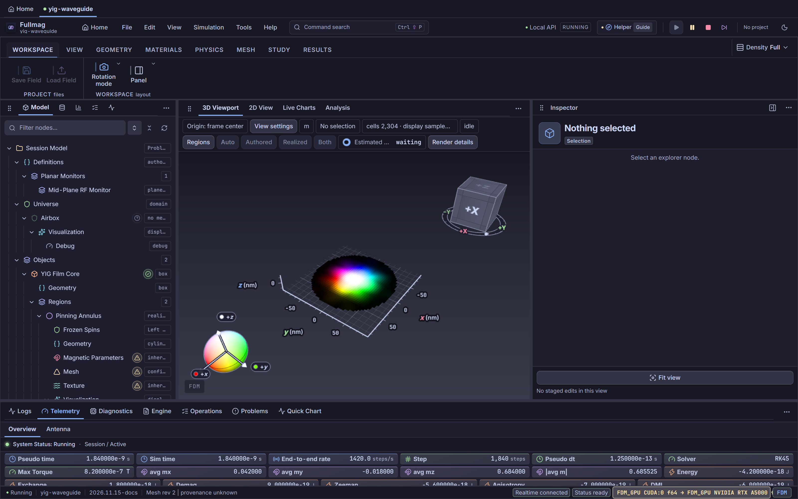
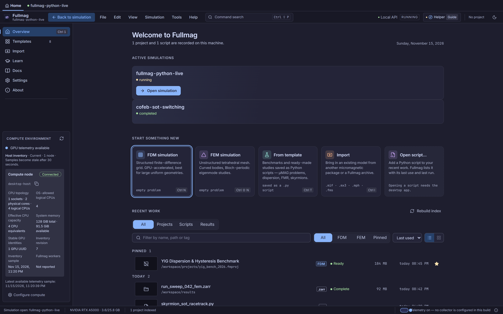
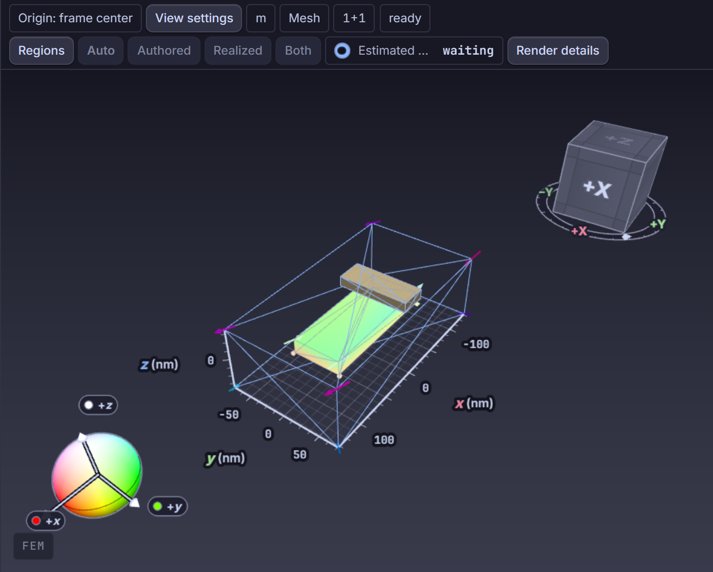
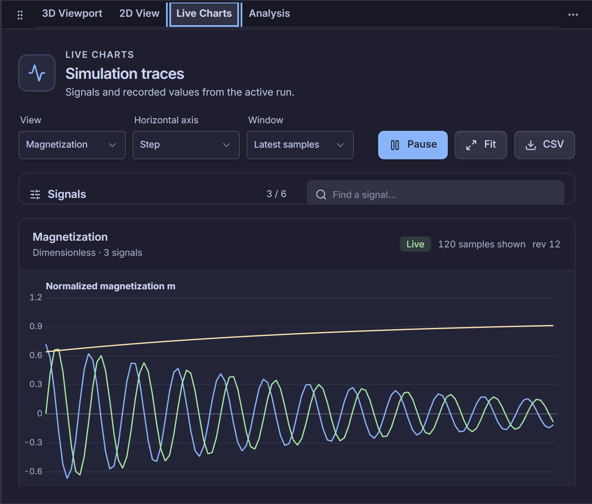

# fullmag

Python DSL and live HTTP/WebSocket API client for [Fullmag](https://github.com/MateuszZelent/fullmag),
a finite-difference (FDM) and finite-element (FEM) micromagnetics platform with CPU and CUDA
solvers plus an interactive browser Control Room.

- **PyPI**: <https://pypi.org/project/fullmag/>
- **Documentation**: <https://fullmag.mzelent.pl>
- **Interactive Live Python Guide**: <https://fullmag.mzelent.pl/getting-started/interactive-python.html>
- **Source & Live Examples**: [MateuszZelent/fullmag](https://github.com/MateuszZelent/fullmag) ([`examples/live`](https://github.com/MateuszZelent/fullmag/tree/master/examples/live))



## Installation

```bash
pip install fullmag
# or, with uv
uv add fullmag            # in a uv project
uv pip install fullmag    # in an existing environment
```

Optional extras:

| Extra | Adds | Use for |
| --- | --- | --- |
| `meshing` | `gmsh`, `manifold3d`, `meshio`, `scipy`, `trimesh` | FEM geometry and conformal mesh authoring |
| `figures` | `Pillow` | Image-based textures and figures |
| `jupyter` | `ipython`, `matplotlib` | Notebooks and `fullmag.live.jupyter.monitor()` |

```bash
pip install "fullmag[meshing,figures,jupyter]"
```

Python 3.10 or newer is required. The package is pure Python.

## What this package provides

`fullmag` is the public scripting surface of Fullmag: you author geometry, materials,
interactions, and ordered stages in Python, and the library lowers them to canonical `ProblemIR`.
The native FDM/FEM solvers (Rust, C++, CUDA, MFEM, hypre, libCEED) are **not** bundled in this
wheel.

Works directly with `pip install fullmag`:

- stage-first authoring (`fm.study(...)`, geometry, materials, textures, stages) and `ProblemIR`
  inspection;
- FEM mesh authoring when installed with `fullmag[meshing]`;
- the interactive live client (`fm.connect()`), driving a running Fullmag instance over HTTP and
  WebSocket (`fullmag.live.v1`) with binary `FMVP`/`FMTB` field and table readback
  (`.to_numpy()`, `.as_grid()`, `.to_pandas()`).

Needs a Fullmag runtime (the Docker Compose DEV group in the repository):

- executing solver stages (without `fm.connect()` and without the repository runtime, `fm.relax()` /
  `fm.run()` return a `Result` with `status="not-executable"`, and `fm.connect()` against an
  unreachable URL raises `FullmagConnectionError`);
- the Control Room UI and Docker DEV script runner (`just docker-dev`, `just docker-dev-script`,
  `just fullmag-dev-container`).

## Interactive Live Python (`fm.connect()`)

Start a Fullmag Docker Compose DEV group from a repository checkout (see
[Installation](https://fullmag.mzelent.pl/getting-started/installation.html)):

```bash
python -B scripts/setup_docker.py
just docker-dev-toolchain
just docker-dev "$PWD"
```

Then attach from any Python terminal, script, or Jupyter notebook:

```python
import fullmag as fm

fm.connect("http://127.0.0.1:3197")  # or omit url to read $FULLMAG_URL
fm.engine("fdm")
fm.device("cpu", precision="double")
fm.cell(5e-9, 5e-9, 10e-9)
fm.solver(fix_dt=1e-13)

layer = fm.geometry(fm.Box(200e-9, 100e-9, 10e-9, name="layer"), name="layer")
layer.Ms = 800e3
layer.Aex = 13e-12
layer.alpha = 0.5
layer.m = fm.texture.uniform(1, 1, 0)

result = fm.relax(dt=1e-13, tolT=1e-4, max_steps=1_000)

with fm.transaction():
    layer.alpha = 0.02
    fm.b_ext(0.05, 0.0, 0.0)

fm.run_until(
    lambda sess: sess.table("scalars", columns=("mx",)).column("mx")[-1] < 0.5,
    chunk_time=10e-12,
    max_time=500e-12,
)

m = fm.field("m").to_numpy()      # NumPy array of shape (point_count, 3)
grid = fm.field("m").as_grid()    # Structured FDM grid (nx, ny, nz, 3)
df = fm.table("scalars").to_pandas()
script_py = fm.export_script()    # Canonical reproducible script from server state
fm.disconnect()
```

Live client capabilities include:

- **Background client presence heartbeats** (`sessions.heartbeat` every 10 s) so active scripts
  show up cleanly in Control Room Start Screen **Active simulations**.
- **Atomic scene edits** (`fm.transaction()`), explicit sync (`fm.sync(reconcile=True)`), and
  canonical round-trip export (`fm.export_script()`).
- **WebSocket event callbacks** (`fm.on("scalar.sample", callback)`), **Jupyter live monitors**
  (`fullmag.live.jupyter.monitor()`), and **multi-group sweeps** (`fm.sweep(fn, groups=[...], ...)`).



## Stage-first study authoring & Control Room

For reproducible batch scripts and FEM studies, use `fm.study(...)` and ordered `study.stages`:

```python
import fullmag as fm

study = fm.study("permalloy_film")
study.engine("fdm")
study.device("cpu", precision="double")
study.cell(5e-9, 5e-9, 10e-9)

film = study.geometry(fm.Box((200e-9, 100e-9, 10e-9), name="film"), name="film")
film.Ms = 800e3
film.Aex = 13e-12
film.alpha = 0.02
film.m = fm.texture.uniform(1, 0.1, 0)

study.exchange()
study.demag()
study.solver(fix_dt=1e-13)
study.stages.add_relax(algorithm="llg_overdamped", dt=1e-13, tolT=1e-5, max_steps=2_000)
study.tableautosave(50e-12, quantities=["step", "t", "mx", "my", "mz"])
study.stages.add_run(1e-9)
```

| FEM Conformal Mesh & Poisson Airbox | Live Time-Series Telemetry |
|---|---|
|  |  |

## Isolated authoring contexts

When a process authors more than one document concurrently, bind each document to its own
`ExecutionContext`:

```python
import fullmag as fm

with fm.execution_context():
    study_a = fm.study("document-a")
    body_a = fm.geometry(fm.Box(100e-9, 100e-9, 5e-9, name="body-a"), name="body-a")

with fm.ExecutionContext():
    study_b = fm.study("document-b")
    body_b = fm.geometry(fm.Box(100e-9, 100e-9, 5e-9, name="body-b"), name="body-b")
```

`ExecutionContext` owns the mutable flat authoring state and restores the previous binding on exit,
including exception paths. Entering a context does not build a mesh or start a solver.

## Acknowledgements, EU Funding &amp; Scientific Heritage

Mateusz Zelent acknowledges funding from the European Union's Horizon Europe programme under
**HORIZON-MSCA-2024-PF-01**, Marie Skłodowska-Curie Grant Agreement No. **101208951 (CNMA)**
(hosted at Fachbereich Physik and Landesforschungszentrum OPTIMAS, RPTU Kaiserslautern-Landau).

FullMag's workflow, numerical abstractions, and cross-validation benchmarks draw inspiration from
the open-source micromagnetics community, including **MuMax3** ([doi:10.1063/1.4899186](https://doi.org/10.1063/1.4899186)),
**Amumax** (<https://github.com/MathieuMoalic/amumax>),
**mumax⁺** ([doi:10.1038/s41524-025-01893-y](https://doi.org/10.1038/s41524-025-01893-y)),
**Boris Computational Spintronics** (*J. Appl. Phys.* **128**, 243902, 2020),
**OOMMF** (NISTIR 6376, 1999),
**TetraX** ([doi:10.1063/5.0054169](https://doi.org/10.1063/5.0054169); [doi:10.14278/rodare.1418](https://doi.org/10.14278/rodare.1418)),
**Tetmag** (<https://github.com/R-Hertel/tetmag>), and
**NeuralMag** ([doi:10.1038/s41524-025-01688-1](https://doi.org/10.1038/s41524-025-01688-1)).

For full institutional attributions, literature references, and citation instructions, see the
[Acknowledgements &amp; EU Grant page](https://fullmag.mzelent.pl/acknowledgements/index.html).
