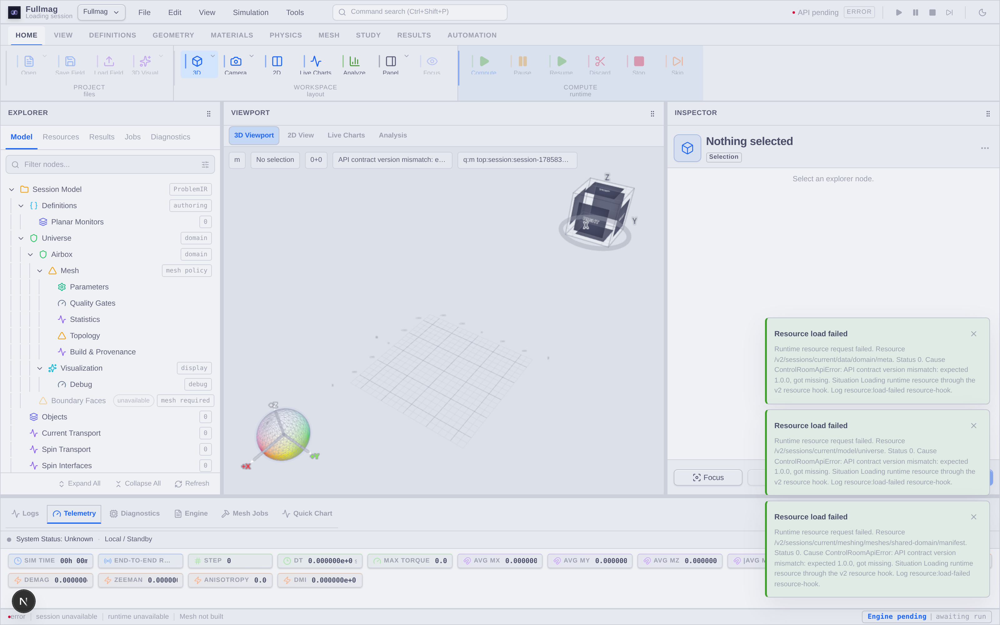

# FullMag

<a id="readme-top"></a>

<div align="center">
  <a href="https://fullmag.mzelent.pl/">
    
  </a>

  <h2>FDM and FEM micromagnetics with Python, CPU/CUDA solvers, and an interactive Control Room</h2>

  <p>
    <strong>One study model · multiple numerical engines · advanced relaxation and spectral solvers · explicit provenance</strong>
  </p>

  <p>
    <a href="https://fullmag.mzelent.pl/"><strong>Documentation</strong></a>
    ·
    <a href="https://fullmag.mzelent.pl/frontend/control-room/index.html">Control Room</a>
    ·
    <a href="https://fullmag.mzelent.pl/python-api/index.html">Python API</a>
    ·
    <a href="#quick-start">Quick start</a>
    ·
    <a href="docs/specs/capability-matrix-v0.md">Capability matrix</a>
  </p>
</div>

## Overview

FullMag is active research software for finite-difference (FDM) and finite-element (FEM)
micromagnetics. A model can be authored through the stage-oriented Python API or the Control Room,
lowered to the canonical `ProblemIR`, checked against backend capabilities, and executed as an
ordered study. The runtime records requested and resolved execution settings together with solver
diagnostics and scientific artifacts.

FullMag combines structured and conforming discretizations, CPU and CUDA implementations,
time-domain dynamics, direct relaxation, hysteresis, FEM eigenmodes, driven frequency response,
and interactive 2D/3D analysis in one workflow.

> [!IMPORTANT]
> Support is resolved for a complete execution lane: physics, discretization, device, precision,
> solver, mesh class, and workload. Source code or an API object does not by itself imply
> executable, validated, or production-qualified support. CPU/GPU and FDM/FEM parity is never
> assumed; consult the [capability matrix](docs/specs/capability-matrix-v0.md).

<div align="center">
  <a href="https://fullmag.mzelent.pl/frontend/control-room/index.html">
    
  </a>
  <p><sub>Control Room: model authoring, mesh and field inspection, 2D/3D visualization, live analysis, runtime status, and Python export.</sub></p>
</div>

<a id="numerical-engines"></a>

## Numerical engines

| Engine | Best suited to | Main implementation |
|---|---|---|
| **FDM** | Regular films, nanowires, racetracks, disks, pillars, periodic cells, repeated time integration, and disconnected multilayers | Cell-centred Cartesian grids; Newell demagnetization tensors with zero-padded FFTs; Rust/RustFFT CPU paths; C++17/CUDA/cuFFT GPU paths; explicit finite-image PBC and multilayer contracts |
| **FEM** | Curved or irregular 3D bodies, conforming multi-region structures, local refinement, magnetic-plus-air domains, and modal or driven-response studies | Gmsh conforming meshes; C++17/MFEM/hypre/libCEED operators; Poisson Airbox and CPU FEM/BEM demagnetization; bounded CUDA paths and optional PETSc/SLEPc spectral infrastructure |

Each engine owns its mesh, operators, memory layout, dependencies, and validation evidence.
Unsupported combinations fail in `strict` mode instead of being replaced by a hidden backend,
device, or solver fallback.

## Studies and physics

| Area | Current public scope |
|---|---|
| **Time-domain dynamics** | Gilbert LLG with Heun, RK4, RK23, RK45, and bounded lane-specific ABM3/coupled paths |
| **Relaxation** | `llg_overdamped`, tangent projected-gradient Barzilai–Borwein, and Polak–Ribière+ nonlinear conjugate gradient; availability is lane-specific |
| **Hysteresis** | Ordered field schedules built from the same relaxation, stopping, artifact, and provenance contracts |
| **Eigenmodes and dispersion** | Tangent-space linearized-LLG generalized eigenproblems; the public modal contract is FEM, not production FDM |
| **Driven frequency response** | Complex linear response around equilibrium with dense, sparse, Schur, modal, and GPU-oriented planner families; the public response contract is FEM |
| **Interactions** | Exchange, demagnetization, and Zeeman have public FDM and FEM paths. Anisotropy, DMI, thermal fields, STT/SOT, Oersted fields, magnetoelasticity, and transport have explicit lane-specific statuses |
| **Periodic boundaries** | FDM finite-image kernels and bounded FEM periodic/Floquet formulations are separate capabilities with separate validation requirements |
| **Parallel execution** | Current public execution is single-device. `gpu_count > 1` is rejected; CPU threading and GPU residency depend on the resolved lane |

Detailed equations, discretizations, implementation mappings, and validation evidence are maintained
in the [physics](https://fullmag.mzelent.pl/physics/index.html) and
[numerical-methods](https://fullmag.mzelent.pl/numerical-methods/index.html) references.

## Execution model

```text
Python study or Control Room
            │
            ▼
         ProblemIR
            │
            ▼
validation and capability planning
            │
            ▼
 session → run → ordered stages
            │
      ┌─────┴─────┐
      ▼           ▼
     FDM         FEM
      └─────┬─────┘
            ▼
fields, observables, diagnostics, artifacts, and provenance
```

The public authoring contract is `fm.study(...)`. Requested intent and resolved execution remain
separate in provenance. Automatic selection, where available, is recorded as a planner decision
and is not treated as scientific validation.

<a id="quick-start"></a>

## Quick start

The commands in this section install and smoke-test the authoring/runtime
packages. For daily application development with source HMR and persistent
Docker state, use the [Docker development workspace](#docker-development-workspace)
below.

Install the Python authoring layer from PyPI (available once the first release is
published; until then use the source checkout below):

```bash
pip install fullmag
# or with uv
uv add fullmag          # in a uv project
uv pip install fullmag  # in an existing environment
```

The PyPI package is the pure-Python DSL and live API client (`fm.connect()`); it does not
contain the FDM/FEM solvers, which run in the Docker DEV group or a native build. From a source
checkout:

```bash
git clone https://github.com/MateuszZelent/fullmag
cd fullmag
python -m pip install ./packages/fullmag-py
```

Install optional geometry and meshing dependencies when needed:

```bash
python -m pip install "./packages/fullmag-py[meshing]"   # PyPI: pip install "fullmag[meshing]"
```

Run the repository-owned FDM CPU smoke scenario:

```bash
just run-headless examples/fdm_cpu_relax_smoke.py
```

This smoke test verifies the execution path; it is not a convergence or scientific qualification
benchmark. Native FEM/MFEM/hypre/libCEED/CUDA builds use the managed container recipes owned by the
repository `justfile`:

```bash
just ensure-managed-fem-runtime
```

Platform-specific setup is documented in the
[installation guide](https://fullmag.mzelent.pl/getting-started/installation.html).

## Docker development workspace

### Quick guide: working with the containers on Windows and WSL

This is the short, task-oriented path for people and agents. The sections
after it describe the full contract.

**1. Choose where the code lives.** Containers run in the Docker Desktop Linux
VM. How fast they see your code depends only on the filesystem of the checkout:

| | WSL checkout (recommended) | Windows checkout |
|---|---|---|
| Location | ext4 inside the WSL distribution, e.g. `/home/<user>/git/fullmag/fullmag` | NTFS, e.g. `C:\git\fullmag\fullmag` |
| How containers read it | direct bind mount | 9p (drvfs) across the VM boundary |
| Frontend file watching | native inotify (`watch_mode=native`) | polling every 5 s by every running frontend |
| Measured on the dev host (21.10.2026) | source capture 6–12 s, `.tsx` edit visible in ≤ 2.6 s without reload, idle frontend ~1% CPU | source capture 31–140 s, page compile ~80 s, idle frontend ~30% CPU |
| Edit with | VS Code Remote-WSL, or Windows tools via `\\wsl$\<distro>\home\...` | any Windows editor |

`/mnt/c/...` inside WSL is the Windows disk through the same 9p bridge, so it
behaves like the Windows column. Keep WSL code under `/home`.

**2. One-time setup.** Run the wizard in the main checkout (it only writes the
local `.env` and the storage marker; it never builds or starts anything):

```bash
# WSL
cd ~/git/fullmag/fullmag
python3 -B scripts/setup_docker.py          # pick storage on ext4, e.g. ~/git/fullmag/storage
python3 -B scripts/setup_docker.py --check
```

```powershell
# Windows PowerShell
Set-Location C:\git\fullmag\fullmag
python -B scripts\setup_docker.py
python -B scripts\setup_docker.py --check
```

In WSL the containers run as UID `65532` and must be able to read the main
checkout's `.git`. If the backend stops with `cannot inspect live Git worktree
admin directory` or `Permission denied` on a Git object, grant read-only access:

```bash
cd ~/git/fullmag/fullmag
setfacl -R -m u:65532:rX .git
find .git -path .git/modules -prune -o -type d -print0 | xargs -0 setfacl -d -m u:65532:rX
```

**3. Daily loop.** Each checkout is its own Compose group with exactly two
services, `backend` and `frontend`. The main checkout is `fullmag-master`; a
worktree is `fullmag-worktree-<worktree_id>`.

```bash
# Create a worktree for the task next to the main checkout
git -C ~/git/fullmag/fullmag worktree add ../worktrees/<task> -b codex/<task> origin/master
cd ~/git/fullmag/worktrees/<task>
just docker-dev-toolchain     # dependency image; slow only the first time on a host
just docker-dev "$PWD"        # builds the backend in its container, starts API and frontend
```

- Without a port, a new group takes `FULLMAG_HTTP_PORT` (default `3197`) or the
  next free loopback port; the launcher prints the URL. An existing group keeps
  its port.
- **Frontend edits** appear through HMR.
- **Backend edits:** restart the group's backend (`docker restart <backend>` or
  Docker Desktop). It rebuilds only what changed and starts the API again;
  follow it with `docker logs -f <backend>`. A restart without source changes
  reuses the built package.
- **Run a script** in a running group: `just docker-dev-script examples/<file>.py`.
- Never use a plain `docker compose up`, `docker system prune` or
  `docker compose down -v` for these groups.

Find a group's containers and their state:

```bash
docker ps -a --filter "label=com.docker.compose.project=<compose-project>" --format "table {{.Names}}\t{{.Status}}"
```

**4. Finish a task.** A stopped group still pins its cache volumes (often
10–20 GB) and a running frontend keeps watching the checkout. Before removing
the worktree, save the project, finish simulations, then:

```bash
docker stop -t 75 <frontend> <backend>          # drains the backend
docker inspect -f '{{range .Mounts}}{{if eq .Type "volume"}}{{.Name}} {{end}}{{end}}' <backend> <frontend>
docker rm <frontend> <backend>
docker volume rm <fullmag-backend-v2-…-build> <fullmag-backend-v2-…-package> <fullmag-dev-frontend-v1-…>
git -C ~/git/fullmag/fullmag worktree remove ../worktrees/<task>
```

Remove only the group's `-build`, `-package` and `fullmag-dev-frontend-v1-*`
cache volumes. Keep `fullmag-build-control-*` (receipts and provenance) and any
`host-ledger` volume, and never remove storage with sessions and results.

**5. Resources.** Each group has static caps from the main `.env`
(`FULLMAG_DEV_BACKEND_CPUS`, `FULLMAG_DEV_BACKEND_MEMORY_GIB`,
`FULLMAG_DEV_FRONTEND_CPUS`, `FULLMAG_DEV_FRONTEND_MEMORY_GIB`); without them,
backend min(8, CPUs/4) CPUs and min(32, RAM/6) GiB, frontend min(4, CPUs/10)
CPUs and 8–16 GiB. All Docker data lives in `docker_data.vhdx`
(`%LOCALAPPDATA%\Docker\wsl\disk` on Windows). The launcher needs at least
32 GiB free on that drive; move the disk image in Docker Desktop → Settings →
Resources → Advanced → Disk image location if the system drive is tight.
Each DEV group keeps its own resource ledger (`group-ledger-v1`, a volume of
that group; [ADR 0067](docs/adr/0067-docker-dev-group-isolation.md)), so groups
with different code can build and hold live APIs side by side. A new group gets
its own ledger at once; an existing group moves to it when its services are
re-rendered (`docker-dev-recreate-volume`), while a resumed older operation
keeps the global ledger pinned in its receipt.

**6. Common failures.**

| Message | Cause | What to do |
|---|---|---|
| `Docker build filesystem has less than 32 GiB free` | the drive holding `docker_data.vhdx` is nearly full | free space or move the disk image |
| `runtime readiness rotation requires the host inventory owner to be absent` | an older group still on the shared global ledger meets another live API there | stop that group's backend; it gets its own ledger when its services are re-rendered (`just docker-dev-recreate-volume`, pins from the launcher output) |
| `cannot inspect live Git worktree admin directory`, `Permission denied` on a Git object (WSL) | `.git` not readable by UID 65532 | grant the ACL from step 2 |
| `measured host capacity differs from the persisted policy` | host capacity changed since the ledger policy was written | coordinated `--migrate-host-capacity` ([ADR 0061](docs/adr/0061-docker-development-build-and-runtime-container.md)) |
| idle frontend near 30% CPU, slow HMR (Windows) | 9p polling | use a WSL checkout; stop groups you are not using |

Agents follow [`AGENTS.md`](AGENTS.md): build only through `just docker-dev` in
the selected checkout's group, do not stop other groups without the user's
approval, and clean up their own group before `git worktree remove`.

### Reference

Recipes are defined in [`justfile`](justfile); run `just --list` from the
selected checkout to list them. The two-service topology, mounts, and network
are defined in [`compose.dev.yaml`](compose.dev.yaml). See the
[Docker development guide](docs/guides/docker-development-architecture.md)
for the detailed architecture and lifecycle contract and
[ADR 0061](docs/adr/0061-docker-development-build-and-runtime-container.md)
for the same-container build and runtime decision.
The [Fullmag Docker build skill](.agents/skills/fullmag-docker-build/SKILL.md)
defines the requested volume-only build-data boundary and its preflight.
The current launchers still need migration; user sessions, results and settings
remain in the configured host storage. The skill does not claim this migration is complete.

For storage locations, automatic retention, known cleanup gaps and the
verification procedure, see [Docker build and storage lifecycle](docs/guides/docker-build-storage-lifecycle.md).

Each checkout group has two persistent application services: `frontend` and
`backend`. The backend container compiles the selected source using its durable
ext4 cache and then starts API and native runtime in that same container. Its
Docker Desktop Logs show compilation and service startup together. Development
does not use a separate one-shot backend-build container or transfer the built
package through Windows storage. Cold start, incremental `.rs` rebuild and
restart without changes reached `Ready: API` on Windows and WSL on 21.10.2026
([audit §13](docs/audits/2026-10-21-docker-dev-workflow-audit.md)); interrupted
builds and Ctrl+C are covered by source tests only.

Daily FullMag development uses the direct Docker Compose workspace from
Windows PowerShell or Linux/WSL. Windows uses Docker Desktop's `desktop-linux`
context and the `windows-folder-v1` storage profile on local NTFS/ReFS.
Linux/WSL uses the configured Docker endpoint and the independent
`linux-native-v1` profile on local ext4/xfs/btrfs. WSL checkouts under `~/git`
are supported; enable Docker Desktop integration for the distribution.
See [Linux/WSL setup](docs/guides/docker-setup-linux-wsl.md) and
[ADR 0064](docs/adr/0064-docker-development-linux-wsl-host.md).

Git and a host Python are required. Docker must use the Linux engine and
Compose; NVIDIA support is required for GPU lanes. `just` is optional when
invoking the Python CLI directly, but is required by the
`just` recipes and by the complete `setup_docker.py --check` preflight. The
host Python only runs the managed launcher; backend code is compiled inside the
Docker Compose backend service, so host Cargo and CMake are not development
prerequisites.

### Clone, select a checkout, and configure storage

The resolver identifies the project from Git. Keep the main checkout and any
worktrees under one project parent, and keep durable storage outside every
checkout. Replace the placeholder values below with paths on the host:

For Linux/WSL, configure the selected checkout with Linux paths:

```bash
cd "<selected-checkout>"
python3 -B scripts/setup_docker.py
python3 -B scripts/setup_docker.py --check
just docker-dev-toolchain
just docker-dev "$PWD" 3197
```

Windows PowerShell example:

```powershell
$projectRoot = "C:\path\to\fullmag-project"
$main = "$projectRoot\fullmag"
$worktree = "$projectRoot\worktrees\cofeb-dev"
$storage = "C:\path\to\fullmag-storage"

git clone https://github.com/MateuszZelent/fullmag $main
Set-Location $main
git worktree add $worktree -b codex/cofeb-dev master
git worktree list --porcelain

python -B scripts/setup_docker.py `
  --repo-root $main `
  --storage-root $storage `
  --source-root $worktree `
  --port 3197
python -B scripts/setup_docker.py --repo-root $main --check
```

The setup wizard keeps the existing `.env` comments and secrets, writes the
selected `FULLMAG_PROJECT_STORAGE_ROOT`, source checkout, and frontend port to
the main checkout, and initializes only the validated storage marker. It does
not build images, start containers, stop a running group, or remove data. The
interactive prompts show the values supplied above; accept them only after
checking the displayed paths.

### Start and iterate

Run from the selected checkout. One command prepares or reuses the pinned
dependency images, builds the complete backend in its Compose service, and
starts the `backend` and `frontend` services:

```powershell
Set-Location $worktree
just docker-dev
```

Startup and explicit image preparation share the same source selection. Explicit source arguments and
process settings take precedence; a selected worktree takes precedence over
main-checkout defaults. The wizard writes `FULLMAG_SOURCE_ROOT` and
`FULLMAG_HTTP_PORT` to the main `.env`; older host-settings records remain
readable. An omitted port uses those settings, then `3197`.
`just docker-dev-toolchain` is optional: use it to prepare or diagnose dependency
images separately, without starting the application. `docker-dev` already performs
that preparation automatically and reuses matching images. Dependency-image
progress appears in the command output or Docker Desktop Builds. Application compilation and runtime stay in the same
permanent backend container. No separate application builder is started.

The development frontend enables the Node Inspector on container loopback,
without publishing a host debug port or waiting for a debugger to attach. The
frontend log reports the Inspector address. Release processes keep it disabled;
see the [development debugger guide](docs/guides/docker-development-architecture.md#debugger-frontendu-dev).

The equivalent native Python commands are useful when `just` is unavailable:

```powershell
python -B "$worktree\scripts\bootstrap_docker_toolchain.py" --repo-root $worktree --direct-development
# Start without a startup script:
python -B "$main\scripts\docker_dev.py" --repo-root $main up --source-root $worktree --port 3197
# Or start with a startup script:
# python -B "$main\scripts\docker_dev.py" --repo-root $main up --source-root $worktree --port 3197 --script "examples/fem_relax_gpu_smoke.py"
```

The `up` command starts the two services. The backend itself checks current
mounted source, builds as needed with its persistent cache, and then starts API.
Open `http://127.0.0.1:3197/workspace` after startup. A startup script without
`study.wait_for_solve(True)` is activated and executed automatically; a script
with that call publishes an interactive workspace waiting for Compute.

The selected checkout must be a Git-registered checkout of this project. Both
services receive the same checkout as a read-only source bind. Frontend edits
are picked up by Next.js HMR. On an ext4/xfs/btrfs checkout (Linux/WSL) the
frontend watches natively (`watch_mode=native`). Any other source mount,
including a Windows 9p bind, polls every `FULLMAG_WATCHPACK_POLLING_MS`
(default `5000`, range `250`–`10000`) set in the main checkout `.env`. Frontend dependencies, Next
output, and watcher state stay in the group cache rather than being written to
the checkout.

After editing backend code, save the project, finish active simulations, and
restart the **backend service in the selected group** in Docker Desktop:

```powershell
docker ps --filter "label=com.docker.compose.project=<compose-project>" --filter "label=com.docker.compose.service=backend"
docker restart <backend-container-id>
docker logs -f <backend-container-id>
```

Every backend start checks the current mounted source and dependencies itself.
Unchanged inputs reuse the existing result; changed modules and their dependants
are compiled incrementally. No separate host manifest refresh, build container,
package transfer, or second startup command is required. The frontend stays
running. With unchanged image and mounts, the backend keeps its container ID.
Changing the image or mount configuration can require service recreation.

Stopping must preserve the native drain and ownership checks. An unconfirmed
owner requires canonical recovery; do not reset it, take over another group,
remove volumes, or restart an active simulation. Cache, sessions, results, and
workspace settings remain durable. The new lifecycle remains **NOT VERIFIED**
until its actual container startup and restart checks are recorded.

An optional third `just docker-dev` argument selects a Python startup script
inside the same checkout. The path is contained, hashed, and recorded in
startup provenance:

```powershell
just docker-dev "$worktree" 3197 `
  "examples/fem_relax_gpu_smoke.py"
```

The referenced example is tracked in this repository. The two-material
`examples/permalloy_layer_cofeb_rings_relax_300nm.py` additionally requires
mixed-P1 certificate v2 and disconnected-body material lowering. Its managed
FEM GPU execution is **NOT VERIFIED** in this development change. A script
that sets `study.wait_for_solve(True)` (for example,
`examples/fem_de_smoke_numeric.py`) publishes an interactive activation that
waits for Compute and does not silently switch from GPU to CPU. A start without
`--script` opens Home and does not select an arbitrary saved session.

For an already healthy group with an empty Workspace, activate a script
without restarting or rebuilding either service:

```powershell
just docker-dev-script "examples/fem_relax_gpu_smoke.py"
```

The launcher discovers the exact attempt, configuration hash, and live pair
from the group control volume. It retains the running frontend port, including
an explicit override used at startup. Manual pins remain available through
`docker-dev-script-pinned`. A successful linked resume is accepted without overwriting the
failed-start history. The command keeps the current-session and request fences;
it does not replace an existing active simulation. An unknown activation result
blocks automatic retry. See the [activation guide](docs/guides/docker-volume-development.md#aktywacja-skryptu-w-już-działającym-workspace)
for the receipt locations and optional replay request ID. Source-level checks
pass; this command still requires a real runtime activation test.

### Ports, isolation, and persistence

The frontend binds one loopback port, such as `127.0.0.1:3197`, to its
container port `8080`. An explicit port is used as given; without one, a new
group prefers the configured port and otherwise takes a free one from a stable
per-project rotation, and an existing group keeps the port it pins. The main
checkout uses Compose project `fullmag-master`; a registered worktree uses
`fullmag-worktree-<worktree_id>`. The backend publishes no host port; the
frontend reaches it as `backend:8081` over the private bridge network for the
selected Compose project. Project name, network, port, workspace settings, and
user data are derived per registered checkout, so a worktree does not share a
frontend port or `workspace.db` with the main checkout. Sessions, results,
projects and settings remain in the configured host storage; group settings
include `storage/user-data/<compose-project>/workspace.db`. Build cache,
packages, build logs and technical receipts belong to Docker named volumes
and BuildKit. Small runtime admission records and host-ledger evidence retain
their explicit host-storage contract.

Do not run a plain `docker compose up` for this workspace. The managed launcher
attests the source bind, package and dependency identities, host storage,
host ledger, owner record, startup response, and resolved Compose configuration
before it starts the services. Keep the exact receipts and stop evidence when a
start or build fails.

### OpenAPI and TypeScript generation in development

After both services are running with the current backend sources, use the
selected checkout in PowerShell or Linux/WSL:

```powershell
Set-Location $worktree
just docker-dev-codegen "$worktree"
# Equivalent daily-development recipe:
just generate-api-openapi "$worktree"
```

The command uses the existing `backend` and `frontend` containers. Backend
OpenAPI export, frontend generators and staging stay in their Docker volumes;
only the four versioned API source artifacts are published to the checkout.
It verifies source, container, image and volume identities before publication.
Receipts stay in the group's control volume. It does not start services or
rebuild stale backend sources: restart that group's backend first. The separate
`generate-api-openapi-legacy` recipe is reserved for explicitly documented
release/CI gates. This development route still requires runtime verification
in addition to its source tests.

### Development and release inputs

The default `dev` profile uses Cargo `backend-dev`, `live-shadow-v1`, persistent
incremental cache, and a live source bind for the running services. The backend
build is isolated in a Linux ext4 shadow of the validated source manifest, so a
checkout edit during compilation cannot mix versions; the next backend start
captures current sources itself. Release or frozen inputs use the separate `release`
profile and immutable archive/snapshot path and do not provide the HMR workflow.

The dependency declarations are repository-owned: CUDA, CMake, MFEM, hypre,
libCEED, and the native toolchain are pinned in
`docker/fem-gpu/Dockerfile`; Rust uses `rust-toolchain.toml`, the workspace
Cargo manifests, and the repository-root `Cargo.lock`; Python uses
`packages/fullmag-py/pyproject.toml`; and the Control Room uses
`apps/control-room/package.json` plus the repository-root `pnpm-lock.yaml`.
`just docker-dev` consumes these declarations inside Docker; the optional
`just docker-dev-toolchain` prepares only the dependency image. Do not
install a second host toolchain or edit a runtime image by hand for daily dev.

<details>
<summary><strong>Show the FDM CPU relaxation example</strong></summary>

```python
import fullmag as fm

study = fm.study("fdm_cpu_relax_smoke")
study.engine("fdm")
study.device("cpu", precision="double")
study.universe(
    mode="manual",
    size=(80e-9, 160e-9, 10e-9),
    center=(0.0, 0.0, 0.0),
    padding=(0.0, 0.0, 0.0),
)
study.cell(5e-9, 5e-9, 5e-9)

film = study.geometry(
    fm.Box(size=(40e-9, 120e-9, 10e-9), name="smoke_box"),
    name="smoke_box",
)
film.Ms = 752000.0
film.Aex = 1.55e-11
film.alpha = 0.1
film.m = fm.texture.uniform(0.0, 1.0, 0.0)

study.demag()
study.b_ext(0.0, 0.0, 1e-3)
study.solver(fix_dt=1e-13, g=2.115)
study.stages.add_relax(
    algorithm="llg_overdamped",
    dt=1e-13,
    tolA=1e-4,
    max_steps=4,
).tableautosave(
    every_steps=1,
    quantities=["step", "t", "dt", "mx", "my", "mz", "E_total"],
)
```

The tracked source is [`examples/fdm_cpu_relax_smoke.py`](examples/fdm_cpu_relax_smoke.py).

</details>

## Repository map

| Path | Responsibility |
|---|---|
| `packages/fullmag-py/` | Public Python API, geometry, materials, interactions, stages, outputs, and lowering |
| `crates/fullmag-ir/` | Canonical backend-neutral `ProblemIR` |
| `crates/fullmag-plan/` | Validation, capability checks, and execution-lane resolution |
| `crates/fullmag-engine/` | Reference and public executable solver logic |
| `backends/`, `native/` | Native FDM/FEM CPU and GPU implementations and ABI |
| `crates/fullmag-api/`, `crates/fullmag-runner/`, `crates/fullmag-cli/` | Sessions, runs, API, CLI, artifacts, and provenance |
| `apps/control-room/` | Next.js/React/TypeScript Control Room with Three.js and ECharts |
| `public_docs/site/` | Sphinx/MyST public documentation |
| `tests/`, `tests/standard_problems/` | Unit, regression, parity, benchmark, and standard-problem cases |

The supporting stack includes Python/NumPy/Zarr/HDF5, Rust/Axum/Tokio/PyO3,
C++17/CUDA/cuFFT, Gmsh/MFEM/hypre/libCEED, and optional PETSc/SLEPc. Exact
repository-declared versions are shown below.

## Documentation and validation

Use the public documentation as the user-facing and scientific reference:

- [Getting started](https://fullmag.mzelent.pl/getting-started/index.html)
- [Control Room](https://fullmag.mzelent.pl/frontend/index.html)
- [Python API](https://fullmag.mzelent.pl/python-api/index.html)
- [Physics](https://fullmag.mzelent.pl/physics/index.html)
- [Numerical methods](https://fullmag.mzelent.pl/numerical-methods/index.html)
- [Validation](https://fullmag.mzelent.pl/validation/index.html)
- [Architecture](https://fullmag.mzelent.pl/architecture/index.html)

Internal plans, audits, and engineering notes under `docs/` are not automatically part of the
public contract.

<!-- fullmag-version-dashboard:start -->
<a id="version-dashboard"></a>

## Version and compatibility dashboard

The badges below are generated from repository-owned manifests. They distinguish exact
toolchain pins from supported dependency ranges; `contract-guard` fails when this README
no longer matches the source files.

<p align="center">
  <strong>Continuous verification</strong><br />
  <a href="https://github.com/MateuszZelent/fullmag/actions/workflows/contract-guard.yml"></a>
  <a href="https://github.com/MateuszZelent/fullmag/actions/workflows/react-doctor.yml"></a>
  <a href="https://github.com/MateuszZelent/fullmag/actions/workflows/documentation.yml"></a>
</p>

<p align="center">
  <strong>Core toolchain</strong><br />
  <a href="Cargo.toml"></a>
  <a href="packages/fullmag-py/pyproject.toml"></a>
  <a href=".node-version"></a>
  <a href="rust-toolchain.toml"></a>
  <a href="docker/fem-gpu/Dockerfile"></a>
  <a href="docker/fem-gpu/Dockerfile"></a>
  <a href="docker/fem-gpu/Dockerfile"></a>
</p>

<p align="center">
  <strong>Scientific backends</strong><br />
  <a href="docker/fem-gpu/Dockerfile"></a>
  <a href="docker/fem-gpu/Dockerfile"></a>
  <a href="docker/fem-gpu/Dockerfile"></a>
  <a href="Cargo.toml"></a>
  <a href="packages/fullmag-py/pyproject.toml"></a>
  <a href="packages/fullmag-py/pyproject.toml"></a>
</p>

<p align="center">
  <strong>Control Room</strong><br />
  <a href="apps/control-room/package.json"></a>
  <a href="apps/control-room/package.json"></a>
  <a href="apps/control-room/package.json"></a>
  <a href="apps/control-room/package.json"></a>
  <a href="apps/control-room/package.json"></a>
  <a href="Cargo.toml"></a>
</p>

<details>
<summary><strong>Version policy and sources of truth</strong></summary>

| Contract | Current manifest value | Source of truth | Policy |
|---|---|---|---|
| FullMag packages | `0.1.0` | `Cargo.toml`, `packages/fullmag-py/pyproject.toml`, `apps/control-room/package.json` | package versions must agree |
| Core toolchain | Python `>=3.10`; Node `24.18.0`; Rust `stable` / edition `2021` | `pyproject.toml`, `.node-version`, `rust-toolchain.toml`, `Cargo.toml` | compatibility range or pinned channel/version |
| Managed FEM/GPU bundle | CUDA `12.4.1`; CMake `3.30.5`; MFEM `4.10`; hypre `3.1.0`; libCEED `0.12.0` | `docker/fem-gpu/Dockerfile` | exact reproducible build pins |
| Python scientific API | NumPy `>=1.24,<3`; Zarr `>=2.18,<4`; h5py `>=3.9,<4`; Gmsh `>=4.12,<5` | `packages/fullmag-py/pyproject.toml` | declared compatibility ranges |
| Control Room direct stack | Next.js `16.3.8`; React `19.2.4`; TypeScript `npm:@typescript/typescript6@6.0.2`; Three.js `^0.186.1`; ECharts `^6.1.0` | `apps/control-room/package.json`, repository-root `pnpm-lock.yaml` | direct constraints; complete transitive resolution is pinned in the repository-root lockfile |
| Rust/Python and desktop bridge | PyO3 `0.29`; Tauri `2.11.1` | `Cargo.toml`, repository-root `Cargo.lock` | workspace dependency constraints and resolved dependencies |

Regenerate after changing a version source:

```bash
python3 scripts/update_readme_version_dashboard.py --write
```

</details>
<!-- fullmag-version-dashboard:end -->

## Contributing

Read [`AGENTS.md`](AGENTS.md) before changing the repository. A capability change should update the
relevant authoring API, `ProblemIR`, planner data, executable backend, tests, validation evidence,
and public documentation. Capability claims must name their backend, device, precision, mode,
solver, mesh, and workload scope.

## Citation and authors

Until a versioned release with a persistent identifier is available, cite the repository and the
exact commit used for the reported result:

> M. Zelent, M. Gołebiewski, U. Makartsou, and P. Pirro, *FullMag: a computational framework for reproducible finite-difference and finite-element micromagnetics*, research software, 2026. Repository: [github.com/MateuszZelent/fullmag](https://github.com/MateuszZelent/fullmag). Documentation: [fullmag.mzelent.pl](https://fullmag.mzelent.pl/).

<details>
<summary><strong>BibTeX</strong></summary>

```bibtex
@software{fullmag_2026,
  author = {Zelent, Mateusz and Gołebiewski, Mateusz and Makartsou, Uladzislau and Pirro, Philipp},
  title  = {FullMag: A Computational Framework for Reproducible
            Finite-Difference and Finite-Element Micromagnetics},
  year   = {2026},
  url    = {https://github.com/MateuszZelent/fullmag},
  note   = {Research software; cite the exact release or commit used}
}
```

</details>

| Author | Affiliation |
|---|---|
| Dr Mateusz Zelent | Fachbereich Physik and Landesforschungszentrum OPTIMAS, RPTU Kaiserslautern-Landau, Germany |
| Dr Mateusz Gołebiewski | Faculty of Physics and Astronomy, Adam Mickiewicz University, Poznań, Poland |
| Uladzislau Makartsou | Faculty of Physics and Astronomy, Adam Mickiewicz University, Poznań, Poland |
| Prof. Philipp Pirro | Fachbereich Physik and Landesforschungszentrum OPTIMAS, RPTU Kaiserslautern-Landau, Germany |

Project coordination: **Mateusz Zelent, RPTU Kaiserslautern-Landau**.

## License

FullMag is free software, licensed under the GNU General Public License, version 3 or (at
your option) any later version (`GPL-3.0-or-later`). The full text is in the LICENSE file at
the repository root; the `fullmag` Python package ships the same text.

## Funding

Mateusz Zelent acknowledges funding from the European Union's Horizon Europe programme under
HORIZON-MSCA-2024-PF-01, Marie Skłodowska-Curie Grant Agreement No. **101208951 (CNMA)**.
